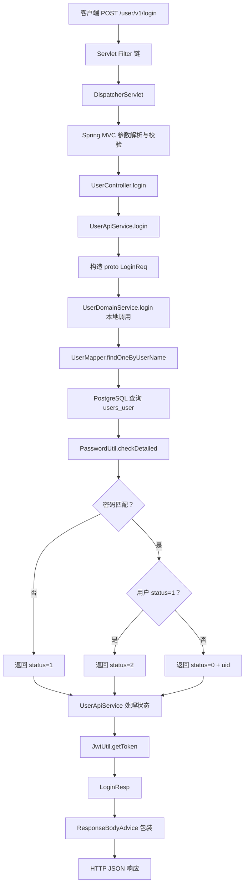

这是一个实际的 `user-service` 微服务，包含 HTTP 接口、用户业务服务、领域服务、MyBatis-Plus、JWT、Redis、gRPC 服务端、Nacos 注册和统一异常处理等内容。

我选 “用户登录：从 HTTP 请求进入，到 JWT 返回客户端” 作为示例。

这个流程很适合检验你要的讲解方式：它不是简单的 Controller → Service → Mapper 三层调用，而是包含请求校验、用户查询、密码验证、封禁判断、状态分支、异常映射、JWT 签发和统一响应。

先说明一个源码细节：当前 `UserApiService.login()` 调用的是 `userDomainService.login(rpcReq)`。从这段调用本身看，这是 Spring Bean 之间的本地方法调用，不能因为参数使用了 proto 生成的 `LoginReq`，就把它说成一次 gRPC 网络调用。项目另有 `UserGrpcService`，但它属于 gRPC 服务端入口。两者的关系需要在讲解中区分清楚。

下面先给你一段实际的示例讲解，再附上可以交给 Agent 的提示词。

# 示例输出：一次用户登录是怎样完成的

## 1. 先明确我们正在追踪什么

假设客户端发送：

```
POST /user/v1/login
Content-Type: application/json

{
    "username": "alice",
    "password": "123456"
}
```

本次只追踪登录成功的主路径，同时在对应位置解释失败分支。

这次操作最终要完成三件事：

1. 确认用户名对应的用户存在。

2. 验证用户提交的密码是否与数据库中的密码哈希匹配，并检查用户是否被封禁。

3. 验证通过后签发 JWT，将 Token 返回给客户端。


这里先区分两个概念：

- 用户密码验证成功，不等于登录流程已经完成。

- `UserDomainService` 返回成功，也不等于客户端已经拿到 Token。


因为当前项目把密码验证和 JWT 签发放在了不同的服务方法中。

## 2. 整体执行路线



注意：这张图省略了部分框架内部步骤，也没有把所有异常路径画进去。它只是导航图，下面才是实际解析。

## 3. 第一个环节：请求如何进入 Controller？

涉及文件：

- `controller/UserController.java`

- `dto/auth/LoginReq.java`

- `config/WebMvcConfig.java`

- `interceptor/JwtAuthPaths.java`

- `interceptor/JwtAuthFilter.java`

- `interceptor/JwtAuthInterceptor.java`


### 3.1 先看路由定义

`UserController` 上有：

```
@RestController
@RequestMapping("/user/v1")
public class UserController {
```

这里两个注解共同决定了 Controller 的基础路由。

- `@RestController`：告诉 Spring MVC，这个类中的处理方法用于接收 Web 请求，返回值通常写入 HTTP 响应体。

- `@RequestMapping("/user/v1")`：为这个 Controller 下的方法统一增加 `/user/v1` 前缀。


因此，如果方法上定义：

```
@PostMapping("/login")
```

完整路径就是：

```
POST /user/v1/login
```

这里有一个值得注意的地方：项目使用的是 `@PostMapping`，不是因为登录在语义上只能使用 POST，而是当前项目明确冻结了 HTTP 路由契约。不能随意改成其他 HTTP 方法。

### 3.2 为什么登录不需要 JWT？

项目的 `WebMvcConfig` 中有：

```
registry.addInterceptor(jwtAuthInterceptor)
        .addPathPatterns("/user/v1/**");
```

这句话表示：所有 `/user/v1/**` 路径都会进入 `JwtAuthInterceptor`。

但这不意味着登录接口也必须携带 Token。

继续看 `JwtAuthInterceptor.preHandle()`：

```
String uri = request.getRequestURI();

if (JwtAuthPaths.isPublic(uri)) {
    return true;
}
```

这里先判断当前路径是不是公开路径。

`JwtAuthPaths` 将：

```
/user/v1/login
/user/v1/register
```

列为 public 路径。

所以登录请求虽然匹配了拦截器注册的路径前缀，但会在 `preHandle()` 的第一段判断中直接放行。

这就是两个容易混淆的概念：

- `addPathPatterns()` 决定拦截器会在哪些路径上执行。

- `isPublic()` 决定拦截器对当前路径是否执行身份验证。


执行了拦截器，不等于一定要通过 JWT 验证。

另外，这个项目还有一个 `JwtAuthFilter`。它只对 protected 路径验签。登录是 public 路径，因此不会在 Filter 中执行 JWT 验签。

这样，未登录的客户端才有机会调用登录接口。

## 4. 第二个环节：JSON 如何变成 Java 对象？

涉及文件：

- `dto/auth/LoginReq.java`

- `controller/UserController.java`


客户端发来的是 JSON：

```
{
    "username": "alice",
    "password": "123456"
}
```

但 Java 方法不能直接拿一段 JSON 文本当作业务对象使用。

所以 Controller 的登录方法会接收一个 `LoginReq` 参数。

项目中的 DTO 是：

```
public record LoginReq(
        @NotNull String username,
        @NotNull String password
) {
}
```

这里有两个值得理解的地方。

第一，为什么使用 record？

`record` 是 Java 提供的一种数据载体声明方式。

这段代码声明了一个包含 `username` 和 `password` 两个分量的不可变数据对象。Java 会为它生成对应的访问方法，例如：

```
req.username()
req.password()
```

所以后面 Service 使用的是 `req.username()`，而不是传统 Java Bean 风格的 `getUsername()`。

第二，为什么是 `@NotNull`，而不是 `@NotBlank`？

两者的约束并不一样：

- `@NotNull`：只要求值不能是 null。

- `@NotBlank`：要求字符串不能为 null，而且不能是空字符串或只包含空白字符。


当前项目使用 `@NotNull`，意味着空字符串仍然可以通过这个字段约束。

这不是疏忽，而是项目明确保留的行为：原先的业务必填判定只判断 null，不判断空字符串。

如果 Agent 看到密码字段，就擅自把 `@NotNull` 改成 `@NotBlank`，可能改变接口行为。

### 4.1 谁负责把 JSON 转换成 LoginReq？

这一步不是 Controller 自己写的 JSON 解析代码。

Spring MVC 在调用 Controller 方法之前，会根据 `@RequestBody` 和配置的 HTTP 消息转换器读取请求体，并将 JSON 反序列化为 `LoginReq`。

在参数上还存在 `@Valid` 时，Spring MVC 会触发 Bean Validation。

所以执行顺序是：

```
收到 HTTP 请求
    ↓
Spring MVC 读取请求体
    ↓
Jackson 将 JSON 转换成 LoginReq
    ↓
Bean Validation 校验字段
    ↓
校验通过，调用 Controller 方法
```

如果请求体为空，或者 JSON 不能正常读取，可能产生 `HttpMessageNotReadableException`。

如果对象成功构造，但 `username` 或 `password` 为 null，则可能产生 `MethodArgumentNotValidException`。

这两种错误不是同一件事：

- 前者是请求体无法正常读取或构造。

- 后者是对象已经构造出来，但字段不符合校验规则。


后面会看到，这两种异常都由 `UserApiExceptionHandler` 处理。

## 5. 第三个环节：Controller 为什么还要调用 UserApiService？

Controller 的职责不是直接执行整个登录业务。

它将 HTTP 请求转换成 Java 参数，然后把实际操作交给 `UserApiService`。

可以把它理解成：

```
Controller：处理 HTTP 入口
Service：组织登录业务流程
DomainService：执行用户领域操作
```

这里不是简单地说三层分别负责什么，而是要看实际调用。

Controller 的登录方法最终会调用：

```
userApiService.login(req, httpRequest);
```

这次调用传入两个东西：

- `req`：已经被 Spring MVC 转换和校验的登录请求对象。

- `httpRequest`：当前 Servlet HTTP 请求对象。


为什么还要传入 `httpRequest`？

因为 API Service 除了处理业务结果，还可能需要从当前请求上下文读取信息，例如请求相关的身份或上下文数据。当前登录成功路径中，JWT 签发使用的是领域服务返回的 uid，而不是从这个参数中取 uid。

不要因为方法参数存在，就认定它一定参与了当前流程的每个步骤。

## 6. 第四个环节：UserApiService 如何组织登录业务？

涉及文件：

- `service/UserApiService.java`

- `config/UserApiProperties.java`

- `contract/ErrCodes.java`

- `contract/ErrMsg.java`


这是登录流程中非常关键的一层。

它没有直接查询数据库，而是先把 HTTP 层的 DTO 转换为 proto 消息。

### 6.1 为什么要构造 proto LoginReq？

代码：

```
com.rag.proto.user.LoginReq rpcReq =
        com.rag.proto.user.LoginReq.newBuilder()
                .setUsername(req.username() == null ? "" : req.username())
                .setPassword(req.password() == null ? "" : req.password())
                .build();
```

这里构造了一个新的对象。

前一个对象是：

```
com.rag.user.dto.auth.LoginReq
```

后一个对象是：

```
com.rag.proto.user.LoginReq
```

它们不是同一个类型。

前者属于 HTTP API 的请求 DTO，后者属于 proto 模块生成的消息类型。

转换时，代码对 null 做了处理：

```
req.username() == null ? "" : req.username()
```

如果值为 null，就传入空字符串；否则保留原值。

这里的处理和 `@NotNull` 是两道不同层次的逻辑。正常情况下，经过校验的 HTTP 请求不会带 null 字段；这段转换仍然保留了对 null 的防御性处理。

### 6.2 一个非常重要的源码事实：这里不是 gRPC 网络调用

接下来代码是：

```
rpcResp = userDomainService.login(rpcReq);
```

虽然变量叫 `rpcReq`，类型也是 proto 生成的消息，但这里调用的是注入到当前 Spring Bean 中的 `UserDomainService` 对象的方法。

从当前这段代码看，没有出现：

- gRPC Stub；

- ManagedChannel；

- 网络地址；

- 远端服务调用。


因此，这里是同一 Spring 应用内的 Java 方法调用，不是一次 gRPC 网络请求。

为什么项目仍然有 `UserGrpcService`？

因为同一个 `UserDomainService` 还被 gRPC 服务端入口使用。

这实际上体现了项目的一种结构：

```
HTTP 入口 ───────┐
                ├── UserDomainService
gRPC 服务入口 ──┘
```

两个入口都可以调用同一份领域业务实现。

这也解释了为什么不能仅凭 proto 类型就断定发生了网络通信。

## 7. 第五个环节：UserDomainService 如何验证密码？

涉及文件：

- `domain/service/UserDomainService.java`

- `mapper/UserMapper.java`

- `domain/entity/UserEntity.java`

- 共享层 `PasswordUtil`


我们现在进入真正的用户领域业务。

`UserDomainService.login()` 首先创建一个 OpenTelemetry Span：

```
Span span = tracer.spanBuilder("Action-User-Login")
        .setAttribute("biz.username", req.getUsername())
        .startSpan();
```

这段代码的目的不是验证密码，而是记录这次登录业务操作的追踪信息。

随后进入 `try`，并调用：

```
checkDeadline();
```

这个方法会检查当前线程是否被中断，以及当前 RPC deadline 是否已经超时。

如果已经超时，就抛出 `DEADLINE_EXCEEDED`。

为什么每个关键步骤之前都检查 deadline？

因为项目需要保证一次业务操作不会在已经超时之后继续消耗资源。后面的数据库查询和密码验证之前也会检查。

### 7.1 W1：先查询用户

代码：

```
user = userMapper.findOneByUserName(req.getUsername());
```

这个方法定义在 `UserMapper` 中。

它不是直接写 SQL 的普通抽象调用，而是一个 Mapper 接口中的 default 方法：

```
default UserEntity findOneByUserName(String username) {
    UserEntity u = selectByUsernameRaw(username);

    if (u == null) {
        throw new NotFoundException(
                "user not found by username: " + username);
    }

    return u;
}
```

这里又调用：

```
selectByUsernameRaw(username);
```

SQL 是：

```
SELECT * FROM users_user
WHERE username = #{username}
LIMIT 1
```

这个查询的作用是：根据客户端提交的用户名，从 `users_user` 表中找到对应用户。

如果找到，就返回 `UserEntity`。

如果没有找到，MyBatis 查询结果会是 null，随后 `findOneByUserName()` 主动抛出 `NotFoundException`。

为什么不直接返回 null？

因为当前项目将“用户不存在”作为一个明确的业务情况处理，而不是让每个调用者自己判断 null。

### 7.2 用户不存在时为什么不直接返回 gRPC NOT_FOUND？

看 `UserDomainService.login()` 中的 catch：

```
catch (NotFoundException e) {
    metrics.getLoginUserNotFound().increment();

    logger.logInfo(
            otelCtx,
            "login failed : user not found,username : "
                    + req.getUsername()
    );

    return LoginResp.newBuilder()
            .setStatus(1L)
            .build();
}
```

注意，这里没有抛出异常，而是返回了一个正常的 `LoginResp`。

为什么？

因为当前登录业务特意把两种情况合并：

- 用户名不存在；

- 用户名存在，但密码错误。


两种情况都返回 `status = 1`。

这样外部调用者无法仅凭登录结果判断某个用户名是否真实存在，可以减少用户名枚举风险。

因此，这里要区分：

- 用户查询失败是数据库层面的查询结果；

- 用户不存在是领域层识别出的业务状态；

- 领域层将其转换为登录失败状态，而不是 gRPC 异常。


如果数据库本身发生故障，则走另一个 `catch (Exception e)` 分支，增加 DB 错误指标、记录异常，然后抛出 `Status.INTERNAL`。

所以“用户不存在”和“数据库查询失败”并不是一回事。

### 7.3 W2：密码比对

如果查询到了用户，接下来执行：

```
PasswordUtil.Outcome pwOutcome =
        PasswordUtil.checkDetailed(
                req.getPassword(),
                user.getPassword()
        );
```

这里传入了两个值：

|参数|来源|含义|
|---|---|---|
|`req.getPassword()`|HTTP 请求 DTO|用户本次提交的明文密码|
|`user.getPassword()`|数据库查询结果|数据库保存的密码哈希|

这里不是把明文密码和数据库密码字符串直接比较。

`PasswordUtil.checkDetailed()` 会执行密码哈希校验，并返回一个 `Outcome`，表示校验结果。

当前代码判断：

```
if (pwOutcome != PasswordUtil.Outcome.MATCHED)
```

只要不是 MATCHED，就进入登录失败分支。

项目还特别处理了 `MALFORMED_HASH`：数据库中存储的哈希格式非法时，会记录额外的 Span 属性和错误日志。

但是从客户端能看到的结果仍然是 `status = 1`，不会把存储格式错误直接暴露成另一种登录结果。

这意味着项目将“密码不匹配”和“密码哈希格式异常”在外部登录语义上统一为登录失败，同时保留内部诊断信号。

### 7.4 W3：封禁检查

只有密码匹配，才会继续执行封禁检查：

```
if (user.getStatus() != null && user.getStatus() == 1L) {
    return LoginResp.newBuilder()
            .setStatus(2L)
            .build();
}
```

这里的 `status` 是数据库用户状态。

当前业务约定：

- `status = 1`：用户被封禁。

- 其他情况：不因为这条判断而被认定为封禁。


这里还有一个容易误读的细节：`UserEntity` 中 `status` 字段初始化为 `0L`。

```
private Long status = 0L;
```

实体映射数据库时，如果数据库中的 status 为 NULL，MyBatis 默认 `callSettersOnNulls=false`，不会把 null 赋值给字段，因此初始化的 `0L` 会保留下来。

所以不能简单地认为：

```
user.getStatus() == null
```

就代表数据库里的 status 一定是 NULL。

这个细节会影响登录封禁判断，不能忽略。

### 7.5 W4：登录成功

如果：

- 用户查询成功；

- 密码匹配；

- 用户没有被封禁；


就执行：

```
metrics.getLoginSuccess().increment();

logger.logInfo(
        otelCtx,
        "login success,username : " + req.getUsername()
);

return LoginResp.newBuilder()
        .setUid(user.getUid())
        .setStatus(0L)
        .build();
```

这里返回的对象包含两个重要字段：

- `uid`：当前用户的业务 ID。

- `status = 0`：领域层登录成功。


注意：这里依然没有生成 JWT。

`UserDomainService` 的任务到这里就完成了。它返回的是领域登录结果，不是最终 HTTP 登录响应。

最后 `finally` 中：

```
span.end();
```

无论前面成功返回、用户不存在、密码错误、封禁还是抛出异常，都会结束当前 Span。

这是 Java 的 `finally` 语义：只要控制流离开 try/catch，就会执行 finally。

## 8. 第六个环节：为什么还要回到 UserApiService？

现在领域层已经返回：

```
uid = 用户 ID
status = 0
```

控制流回到：

```
UserApiService.login()
```

Service 根据领域返回的状态判断下一步。

项目定义的三个状态是：

|status|含义|
|---|---|
|0|登录成功|
|1|用户不存在或密码错误|
|2|用户被封禁|

如果 `status == 1`，API Service 会抛出 `BusinessException`，业务码是 `ERROR_LOGIN_WRONG`。

如果 `status == 2`，会抛出 `BusinessException`，业务码是 `ERROR_USER_BANNED`。

只有成功状态才继续签发 JWT。

这就是为什么领域层不直接生成 Token：领域层只负责确认用户是否满足登录条件，而 API Service 负责把领域结果转换成 HTTP API 需要的结果。

## 9. 第七个环节：JWT 是怎样签发的？

成功状态下，代码执行：

```
long nowSec = System.currentTimeMillis() / 1000L;

long expireSec =
        properties.getUserAuth().getAccessExpire();

String accessSecret =
        properties.getUserAuth().getAccessSecret();

token = JwtUtil.getToken(
        accessSecret,
        nowSec,
        expireSec,
        rpcResp.getUid()
);
```

这里有三个输入：

1. 当前时间 `nowSec`。

2. Token 过期时间配置 `expireSec`。

3. 当前用户的 `uid`。


密钥则来自 `UserApiProperties`。

配置文件中对应：

```
user-api:
  user-auth:
    access-secret: ${USER_JWT_SECRET}
    access-expire: ${USER_JWT_EXPIRE:2592000}
```

其中：

- `USER_JWT_SECRET` 是签名密钥。

- `USER_JWT_EXPIRE` 是有效期，默认 2592000 秒，也就是 30 天。


签发过程由共享层的 `JwtUtil` 完成。当前项目注释明确说明使用 HS256，claim 为 `userId`。

如果签发过程中出现异常，API Service 会：

- 增加 `loginTokenError` 指标；

- 记录错误日志；

- 转换为 `BusinessException(ERROR_TOKEN_RUNTIME)`。


所以 Token 生成失败不会被当作登录成功。

成功时，最终返回：

```
return new LoginResp(token);
```

现在才得到 HTTP API 所需要的响应 DTO。

## 10. 第八个环节：LoginResp 如何变成 HTTP JSON？

此时 `UserApiService` 已经返回：

```
new LoginResp(token)
```

它会逐层返回到 Controller。

但 Controller 返回 `LoginResp`，并不代表客户端收到的 JSON 就只有：

```
{
    "token": "..."
}
```

因为项目还配置了：

`UserApiResponseAdvice`

它实现了：

```
ResponseBodyAdvice<Object>
```

其中：

```
@Override
public boolean supports(...) {
    return true;
}
```

表示它支持所有 Controller 返回值。

真正包装响应的地方是：

```
return new ApiResponse(
        ErrCodes.SUCCESS,
        ErrMsg.getMsg(ErrCodes.SUCCESS),
        body
);
```

所以正常成功路径最终会形成类似：

```
{
    "code": 200,
    "msg": "OK",
    "data": {
        "token": "..."
    }
}
```

这里的 `data` 才是原来的 `LoginResp`。

为什么不直接让每个 Controller 返回 ApiResponse？

因为项目将统一响应格式集中到了 `ResponseBodyAdvice`，Controller 和 Service 不需要每次都手动创建相同的包装对象。

另外，Advice 特意判断：

```
if (body == null || body instanceof ApiResponse) {
    return body;
}
```

避免重复包装。

否则异常处理器已经返回 `ApiResponse`，再被包一层，就可能产生：

```
{
    "code": 200,
    "msg": "OK",
    "data": {
        "code": 1002,
        "msg": "登录失败",
        "data": null
    }
}
```

这会破坏客户端约定的错误响应结构。

## 11. 失败时到底会怎样？

我们把前面几个关键分支串起来看。

|发生位置|结果|后续处理|
|---|---|---|
|JSON 无法读取|`HttpMessageNotReadableException`|异常处理器返回 400|
|DTO 字段为 null|`MethodArgumentNotValidException`|异常处理器返回 400|
|用户不存在|Domain 返回 `status=1`|API Service 转换成业务错误 1002|
|密码不匹配|Domain 返回 `status=1`|API Service 转换成业务错误 1002|
|用户被封禁|Domain 返回 `status=2`|API Service 转换成业务错误 1011|
|数据库查询异常|Domain 抛 `Status.INTERNAL`|API Service 转换成业务错误 5001|
|JWT 签发异常|API Service 抛业务异常|错误码 1006|

这里还要特别注意 HTTP 状态码与业务码的区别。

当前项目的业务异常由 `UserApiExceptionHandler` 处理，普通业务错误会以 HTTP 200 返回，业务成败通过响应体中的 `code` 表达。

但参数校验错误等框架级错误不是同一条路径，项目明确保留了 HTTP 400 和 `text/plain` 的行为。

不能因为项目有统一响应包装，就认为所有失败都返回 HTTP 200 和 JSON envelope。

## 12. 最后复盘：我们真正走过了哪些代码？

这次登录成功路径可以归纳为：

```
HTTP 请求
  ↓
JwtAuthFilter / JwtAuthInterceptor（public 路径放行）
  ↓
Spring MVC 请求解析与校验
  ↓
UserController
  ↓
UserApiService
  ↓
proto LoginReq 构造
  ↓
UserDomainService
  ↓
UserMapper
  ↓
PostgreSQL
  ↓
PasswordUtil
  ↓
用户状态判断
  ↓
领域 LoginResp（status=0 + uid）
  ↓
UserApiService
  ↓
JwtUtil
  ↓
HTTP LoginResp
  ↓
UserApiResponseAdvice
  ↓
HTTP JSON
```

这里最重要的不是记住这条链，而是理解几个边界：

1. Controller 接收 HTTP 请求，不直接执行数据库查询。

2. API Service 组织 HTTP API 层的业务流程，负责把领域结果转成 API 结果。

3. DomainService 执行用户领域逻辑，负责查询用户、校验密码和判断封禁状态。

4. Mapper 负责把查询交给 MyBatis 执行，并把结果映射成实体。

5. `UserApiResponseAdvice` 在 Controller 返回值写入 HTTP 响应时统一包装。

6. `UserGrpcService` 是另一种入口，不代表 HTTP 登录调用 DomainService 时发生了 gRPC 网络通信。


这才是一次完整的流程解析：我们不仅知道有哪些类，还知道它们在这次登录操作中什么时候参与、为什么参与、输入输出是什么，以及失败时控制流会怎样改变。

# 给 Agent 的提示词

这份提示词以刚才的登录流程为质量标准。重点不是要求它复制登录这篇的章节，而是要求它对其他流程也达到类似的代码追踪深度。

# 任务：对当前微服务进行真实执行流程的逐步讲解

## 一、当前任务定位

我已经完成了当前微服务的文件树梳理和文件职责分析。

**本次不要重新生成文件树，不要重新分析架构，不要重新介绍每个目录和类的职责。**

我现在需要的是：以真实业务场景为起点，沿着源码中的实际执行顺序，把每一个重要流程完整地走一遍，并对每一步进行详细讲解。

我希望达到的学习效果是：

我不仅知道一次请求经过了哪些类，还能理解：

- 为什么请求会进入这个类和方法？

- 这个方法具体执行了什么？

- 参数从哪里来？

- 返回值是什么？

- 为什么需要调用下一个方法？

- 数据在不同层之间发生了什么变化？

- Spring 或其他框架在什么位置介入？

- 发生异常时，程序的控制流如何变化？

- 最终产生了什么结果？


请参考我提供的登录流程讲解示例的深度和方式。

注意：示例只是质量标准，不是要求所有流程机械套用相同章节。

## 二、首先检查当前微服务

实际读取当前微服务源码，不要只根据已有文件树和类名推断。

需要检查：

- Controller

- Service

- Domain Service

- Mapper / Repository

- Entity / DTO

- Config

- Interceptor / Filter

- Advice / Exception Handler

- Client

- gRPC 服务端与客户端

- 消息生产者和消费者（如果存在）

- Redis、数据库及其他外部组件

- 配置文件

- 测试代码


本次重点是还原执行流程，而不是重新介绍这些文件。

## 三、流程划分要求

根据实际源码确定应该讲解哪些流程。

可以包含：

1. 每个重要 HTTP 接口的完整处理过程。

2. 业务流程内部涉及的数据库、缓存和其他组件操作。

3. 跨微服务调用的完整过程。

4. JWT 认证、身份提取和权限检查过程。

5. 异常产生、传播和统一处理过程。

6. gRPC 请求接收、业务执行和响应返回过程。

7. 应用启动、Bean 初始化、服务注册和资源关闭过程。

8. 事务、消息、幂等、定时任务等实际存在的机制。


以上仅是候选方向，不代表项目一定包含全部内容。

不要为了减少文档数量而合并掉复杂流程，也不要机械地按照每个类或接口各写一篇。

首先给出一份流程学习计划，列出：

- 流程名称；

- 触发场景；

- 执行入口；

- 流程终点；

- 主要涉及的代码；

- 为什么值得单独学习；

- 与其他流程的关系。


然后开始逐个编写详细流程记录。

## 四、每个流程的讲解方式

### 1. 从具体场景开始

不要从抽象架构开始。

先给出一个具体操作，例如：

```
POST /user/v1/login
```

说明：

- 谁发起了操作？

- 请求携带了什么？

- 系统需要完成什么？

- 这次追踪从哪里开始？

- 最终需要观察什么结果？


如果是启动流程、消息消费流程等，则选择符合该流程特点的真实触发场景。

### 2. 给出整体执行路线

先用流程图或文字展示整体执行顺序。

流程图中的节点必须对应真实代码，不能凭常规架构习惯补造节点。

特别注意区分：

- 普通 Java 方法调用；

- Spring 框架自动触发；

- MyBatis 等框架代理执行；

- gRPC 网络调用；

- 外部系统实际执行。


不要把所有调用都画成普通的方法调用。

### 3. 按真实执行顺序逐步讲解

这是最重要的要求。

必须沿着真实源码逐步追踪。

每个关键步骤都要解释：

**现在执行到了哪里？**

给出具体文件、类、方法和相关代码。

**为什么会执行到这里？**

解释调用者，或者框架触发机制。

**进入之前有什么数据？**

解释参数的来源、类型、内容以及前面如何产生。

**这里具体做了什么？**

结合真实代码解释条件判断、方法调用、数据转换、状态变化。

**为什么要这样做？**

结合当前业务目标和前后执行步骤解释。

**执行之后发生了什么？**

解释返回值、副作用、数据变化或异常。

**接下来为什么进入下一步？**

继续追踪控制流，不要在当前类介绍完后就停止。

不要只说：

“Controller 调用 Service 处理业务。”

必须继续追踪 Service 内部实际调用了什么，直到本次流程的终点。

### 4. 跨文件必须继续追踪

如果一个方法调用另一个文件中的方法，必须根据需要继续进入被调用的方法。

例如：

```
Controller
  ↓
Service
  ↓
DomainService
  ↓
Mapper
  ↓
数据库
```

不能把上面五个节点各解释一段职责就结束。

必须解释实际调用关系、参数传递、执行结果和返回过程。

如果调用了 Mapper，需要说明 SQL 从哪里来、参数如何绑定、查询结果如何映射。

如果调用了 Client，需要说明客户端对象从哪里来、远程请求如何发出、响应如何返回。

如果调用了工具类，需要说明它实际完成了什么，不要只翻译方法名称。

### 5. 解释框架在背后做了什么

不要把 Spring 自动完成的部分直接略过。

例如：

- Controller 如何被 Spring MVC 注册和调用；

- JSON 如何转换为 DTO；

- Bean Validation 如何触发；

- 拦截器和 Filter 的执行顺序；

- Bean 如何注入；

- 事务代理如何介入；

- gRPC 服务如何注册；

- MyBatis 如何执行 SQL；

- ResponseBodyAdvice 如何包装返回值。


但不要把 Spring 基础知识堆砌成独立百科。

每次都围绕当前流程解释：

**这个机制为什么在这里发生？由什么触发？它与当前业务代码是什么关系？**

### 6. 追踪数据的变化

对关键数据说明完整流转过程。

例如：

```
HTTP JSON
  ↓
Request DTO
  ↓
内部请求对象
  ↓
领域对象
  ↓
数据库查询结果
  ↓
业务处理结果
  ↓
Response DTO
  ↓
HTTP JSON
```

这只是形式示例，必须根据实际源码确定。

说明每次转换的：

- 输入对象；

- 输出对象；

- 转换方法；

- 字段变化；

- 转换原因；

- 失败行为。


不要只列出对象名称。

### 7. 讲解正常路径之外的重要分支

不能只讲成功路径。

需要检查真实源码中的：

- if / else；

- switch；

- 提前 return；

- catch；

- throw；

- 超时；

- 重试；

- 降级；

- 空值处理；

- 状态判断。


对重要分支说明：

- 什么条件触发；

- 为什么会触发；

- 与正常路径有什么区别；

- 哪些步骤不再执行；

- 返回什么；

- 异常如何传播；

- 最终客户端或调用者能观察到什么。


不要遗漏有业务意义的分支。

### 8. 异常必须沿控制流追踪

不能只列出异常类型和异常处理类。

必须从异常发生的位置开始：

```
异常产生
  ↓
当前方法是否捕获
  ↓
是否转换或重新抛出
  ↓
上层调用者是否捕获
  ↓
是否进入统一异常处理
  ↓
最终响应
```

解释每一层为什么捕获或不捕获。

区分：

- 业务异常；

- 数据库异常；

- 参数校验异常；

- 框架异常；

- gRPC 状态异常；

- 超时异常；

- 未知异常。


如果异常在某一层被转换成其他类型，必须说明转换前后的区别。

### 9. 说明副作用和执行边界

对于当前流程中发生的操作，说明：

- 数据库是否发生读写；

- 是否开启事务；

- 事务何时提交或回滚；

- Redis 是否发生读写；

- 是否发起远程调用；

- 是否发送或消费消息；

- 是否记录日志；

- 是否增加指标；

- 是否生成 ID 或 Token；

- 失败后哪些操作可能已经发生。


不要仅凭注解推断执行结果，要结合实际代码和框架机制。

## 五、讲解深度要求

请注意以下几种不合格的讲解方式。

### 不合格一：只给调用链

```
Controller → Service → Mapper → Database
```

这只是路线，不是讲解。

### 不合格二：只介绍文件职责

```
Controller 负责接收请求。
Service 负责业务逻辑。
Mapper 负责数据库访问。
```

这不是本次任务需要的内容。

### 不合格三：只翻译代码

```
if (user == null) {
    throw new NotFoundException();
}
```

不能只解释为：

“如果用户为空，就抛出用户不存在异常。”

还需要解释：

- user 为什么可能为空？

- 它由哪个查询方法返回？

- SQL 查询条件是什么？

- 为什么在 Mapper 层转换成异常？

- 上层如何处理这个异常？

- 这个异常最终影响什么业务结果？


### 不合格四：只讲框架原理

不能写一篇 Spring MVC 教程，然后声称已经解释了项目中的 HTTP 请求流程。

必须将框架原理与项目真实代码连接起来。

### 不合格五：只讲成功路径

如果源码中存在密码错误、用户不存在、用户封禁、数据库异常等分支，就不能只讲成功登录。

## 六、文档的表达要求

我是一名 Java 初学者，但希望理解真实项目，不需要把内容写成纯理论教材。

具体要求：

1. 尽量使用具体、直接的语言。

2. 少用抽象概念替代具体代码行为。

3. 每个新概念第一次出现时解释清楚。

4. 不要假设我已经熟悉 Spring 内部机制。

5. 不要只给结论，要解释得出结论的过程。

6. 代码片段应当来自当前项目，不要编造示例代码冒充项目源码。

7. 多行代码共同完成一个行为时，应当放在一起讲解。

8. 简单代码可以简短解释，不必机械逐行分析。

9. 重要的调用、分支、数据变化和异常路径必须深入讲解。

10. 必要时给出流程图、数据流图和对照表，但它们不能代替正文。


## 七、源码依据与不确定性

所有项目行为都以真实源码为依据。

需要明确区分：

- 源码明确实现的行为；

- Spring 或其他框架本身的机制；

- 根据代码得出的合理推断；

- 当前源码无法确认的行为。


不能根据类名猜测行为。

不能因为项目使用了 gRPC，就把所有 proto 对象调用解释成 gRPC 网络请求。

不能因为项目存在 Redis，就认定当前流程一定访问 Redis。

不能因为某个方法上有事务注解，就不检查事务是否真正生效。

无法确认的地方明确说明，不要补造。

## 八、最终交付要求

每个重要流程形成一份独立的 Markdown 学习记录。

每份记录都必须具有足够的细节，可以独立阅读。

不同流程之间可以引用已经讲过的背景知识，但不能以此为由跳过当前流程独有的关键代码解析。

先给出流程学习计划，然后逐份完成详细讲解。

如果内容较长，可以分阶段输出，但不能为了控制篇幅而删减重要执行步骤。

**不要把本次任务变成文件树说明、架构总结、调用链清单或 Spring 概念百科。**

最终验收标准：

我读完一份流程记录后，应该能够打开项目源码，沿着这份记录自己走一遍执行过程，并解释每个关键步骤为什么发生、数据如何流转、异常如何传播，以及最终产生什么结果。

现在开始检查当前微服务，并按照以上要求完成流程学习计划和详细流程记录。

## 九、输出规范、文档组织与规模控制

本节是强制输出规范。所有流程学习记录必须遵守。

### 1. 输出形式：允许并要求合理使用多文件

本次任务允许并鼓励输出多个 Markdown 文件。

不要试图把整个微服务的所有流程塞进一份 Markdown 文档。

也不要为了减少文件数量，把多个独立且复杂的流程强行合并。

原则：

- 一个完整、边界清晰的流程，原则上对应一份独立 Markdown 文档。

- 如果一个流程内部存在多个紧密关联的子阶段，应当在同一文档内连续讲解。

- 如果两个流程具有不同的触发条件、执行入口、执行目标或生命周期，应当考虑拆成不同文档。

- 如果某个公共机制需要独立深入讲解，可以形成单独文档；但仍需在其他流程中说明它在当前场景下具体如何参与。

- 不要按照类或文件的数量决定文档数量。

- 不要为了凑文档数量而拆分一个完整流程。

- 不要为了减少文档数量而压缩多个完整流程。


最终交付应该是一组有组织关系的学习记录，而不是一篇超长说明书。

### 2. 输出目录结构

在项目文档目录下建立独立的流程学习文档目录。

建议结构：

```
doc/
└── process-learning/
    ├── README.md
    ├── 01-用户注册流程.md
    ├── 02-用户登录流程.md
    ├── 03-用户信息查询流程.md
    ├── 04-用户信息更新流程.md
    ├── 05-JWT认证与身份传递流程.md
    ├── 06-HTTP异常处理与统一响应流程.md
    ├── 07-gRPC请求处理流程.md
    ├── 08-应用启动与服务注册流程.md
    └── ...
```

以上目录和文件名仅为格式示例，不代表要求项目必须存在这些流程。

必须根据实际微服务内容确定最终文件数量和名称。

不要修改、覆盖或删除原项目源码及已有文档。流程学习记录应当作为新增文档保存。

### 3. README.md 的职责

`README.md` 是整个流程学习文档集的总索引。

它不是另一份架构说明书，也不能代替各个流程的正文。

至少需要包含：

#### 3.1 文档集说明

说明这组文档研究的是哪个微服务、使用什么源码版本，以及本次学习覆盖的范围。

#### 3.2 学习顺序

给出建议阅读顺序，并解释为什么这样安排。

例如：

```
基础请求流程
    ↓
具体业务流程
    ↓
认证与公共机制
    ↓
跨服务调用
    ↓
应用生命周期与工程机制
```

这只是组织示例，必须根据真实项目依赖关系调整。

#### 3.3 流程文档索引

使用表格列出所有文档：

|编号|文档名称|触发场景|主要入口|流程终点|前置知识|
|---|---|---|---|---|---|
|01|用户注册流程|客户端提交注册|Controller|注册结果返回|HTTP 请求处理|
|02|用户登录流程|客户端提交登录|Controller|Token 返回|HTTP 请求处理|

实际内容必须来自源码，不允许照搬示例。

#### 3.4 流程依赖关系

说明哪些流程依赖其他流程，哪些公共机制会被多个流程复用。

可以使用 Mermaid 图展示文档之间的学习依赖关系。

注意：这里展示的是学习内容之间的依赖关系，不是重新生成项目文件树。

#### 3.5 覆盖状态

标记每个流程的状态：

- 未开始；

- 分析中；

- 已完成；

- 待补充；

- 源码无法确认。


不能将尚未讲解的流程标记为已完成。

### 4. 单份流程文档的基本格式

每份流程文档必须包含：

1. 标题；

2. 本次流程的研究范围；

3. 触发场景和输入；

4. 整体执行路线；

5. 按执行顺序展开的详细讲解；

6. 重要分支与失败路径；

7. 数据变化和副作用；

8. 执行结果；

9. 流程复盘；

10. 源码定位与验证方式。


以上是最低内容要求，不是要求每份文档都机械使用相同的二级标题。

不同流程应根据自身特点调整章节。

例如：

- HTTP 请求流程应重点解释请求进入、参数绑定、拦截器、Controller、响应返回。

- 数据写入流程应重点解释数据构造、SQL 执行、事务边界、提交和回滚。

- gRPC 流程应重点解释服务注册、Stub、网络请求、服务端入口和响应。

- 启动流程应重点解释 Spring Boot 启动阶段、Bean 创建、组件初始化和服务注册。

- 异常流程应重点解释异常产生、传播、捕获、转换和最终响应。


不要为了格式统一牺牲讲解质量。

### 5. 单份文档的输出规模

不要预先规定每份文档必须达到固定字数，也不要设置整个项目只能输出多少页。

按照真实流程的复杂度决定篇幅。

但必须遵守以下规模原则：

**第一，完整性优先于篇幅。**

不能因为文档已经较长，就跳过重要调用、分支、异常路径、框架机制或数据变化。

**第二，不能用摘要替代详细解析。**

每个重要步骤必须有对应的源码依据和实际执行解释。

**第三，避免无意义扩写。**

不需要解释每个 Java 关键字的百科知识，不需要重复介绍已经明确的文件职责，也不需要对简单 getter、setter 进行大段讲解。

**第四，允许复杂流程形成较长文档。**

如果一个流程涉及多个业务分支、数据库操作、远程调用和异常处理，应当允许它形成较长的独立文档。

**第五，拆分必须依据流程边界，而不是字数。**

如果单份文档过长，先判断是否存在真正独立的子流程。

如果存在，可以拆分，并在总索引和正文中建立清晰的关联。

如果不存在，就保留在同一份文档中，不要为了控制字数强行截断。

### 6. 多文件输出时的完整性要求

多文件不能成为内容缩水的理由。

每份文档都应当能够独立阅读。

具体要求：

- 每份文档开头说明当前流程的背景和触发条件。

- 首次出现的重要概念应当解释。

- 需要引用其他文档时，给出明确的相对路径和章节名称。

- 即使其他文档已经解释过某个公共机制，也必须说明该机制在当前流程中的实际作用。

- 不允许使用“与前文相同”“其余步骤类似”“参考之前的流程”等说法跳过当前流程的关键步骤。

- 不允许将本应在正文中讲解的内容全部转移到另一篇文档。

- 一个流程的开始、关键执行阶段和结束必须在同一份文档中形成完整闭环。


如果一个流程确实依赖另一份文档，应当说明依赖关系，但不能把当前流程的讲解责任推给另一份文档。

### 7. 流程图规范：全部使用 Mermaid

**所有流程图、执行路径图、数据流图、状态变化图和关系图统一使用 Mermaid。**

禁止使用 Mermaid 时序图。

具体而言：

- 允许 `flowchart TD`、`flowchart LR`；

- 允许 `stateDiagram-v2`；

- 允许 `classDiagram`；

- 允许 `graph TD`；

- 允许 Mermaid 的其他非时序图类型，但必须确实适合当前表达目的；

- 禁止 `sequenceDiagram`。


特别注意：

不要为了表现调用顺序而使用时序图。

如果需要表达调用先后、分支判断和返回路径，使用 `flowchart TD` 或 `flowchart LR`。

例如：

```
flowchart TD
    A["客户端发起请求"] --> B["Controller 接收请求"]
    B --> C["Service 执行业务逻辑"]
    C --> D{"用户是否存在？"}
    D -->|是| E["继续处理"]
    D -->|否| F["返回业务错误"]
```

如果需要表达对象状态变化，可以使用状态图。

如果需要表达不同组件之间的静态关系，可以使用类图或流程图。

不要为了使用图而使用图。

### 8. Mermaid 图的质量要求

每张图必须能够帮助理解当前流程。

具体要求：

1. 节点名称应当具体，尽量使用真实类名、方法名或操作名称。

2. 关键判断必须标注判断条件。

3. 重要分支必须体现不同执行路径。

4. 需要表达返回路径时，应明确画出返回节点。

5. 跨服务调用必须区分本地调用和远程通信。

6. 框架自动触发的环节必须明确标注触发机制。

7. 不要把一个复杂流程压缩成只有三四个节点的示意图。

8. 不要把整篇文档的所有细节塞进一张图。

9. 一张图只表达一个相对明确的内容范围。

10. 图中的执行顺序必须与正文一致。


如果流程很复杂，可以使用多张 Mermaid 图：

- 总体执行路线图；

- 关键子流程图；

- 异常分支图；

- 数据流转图；

- 状态变化图。


但这些图必须互相一致，不能出现正文和图中的调用顺序不一致的情况。

### 9. 代码片段和源码引用格式

讲解时必须提供能够定位到真实源码的线索。

优先使用：

```
文件：src/main/java/.../UserApiService.java
类：UserApiService
方法：login()
```

对于关键代码，提供适量的源码片段。

要求：

- 不要大段复制整个源文件。

- 只截取当前步骤真正需要解释的代码。

- 代码片段应当保持原始逻辑，不得为了方便讲解而改写成另一种实现。

- 如果对代码进行了省略，必须明确说明省略了什么。

- 如果代码涉及多个文件，分别给出源码位置。

- 如果需要解释某个配置，给出配置文件位置以及实际读取位置。

- 如果使用测试作为验证依据，给出测试文件和测试方法位置。


行号只有在确认准确时才能提供。无法确认时提供文件路径、类名和方法名即可。

### 10. 文档质量与规模检查

每完成一份文档，都必须进行检查：

- 是否有明确的流程入口和终点？

- 是否按照真实执行顺序讲解？

- 是否追踪了关键跨文件调用？

- 是否解释了关键参数和返回值？

- 是否解释了关键数据转换？

- 是否讲清楚框架介入的位置？

- 是否包含重要分支和失败路径？

- 是否追踪异常传播？

- 是否说明副作用和事务边界？

- 是否提供了真实源码定位？

- Mermaid 图是否全部符合规范？

- 正文是否存在用摘要代替详细解释的情况？


如果存在遗漏，先补齐再标记完成。

整个文档集完成后，还需要检查：

- README 是否包含全部已生成的流程文档；

- 是否存在流程重复或重要流程遗漏；

- 流程之间的依赖关系是否清楚；

- 是否存在某个公共机制被反复提及却没有解释清楚的情况；

- 是否有文档引用了不存在的文件或章节；

- 是否有图文不一致；

- 是否有尚未完成却被标记为完成的流程。


最终交付应当是一套结构清晰、规模合理、内容深入、能够独立阅读且彼此关联的多文件流程学习文档。


## 我对这份示例的建议

先不要让 Agent 一次性生成整个微服务的所有流程正文。建议按这个顺序使用：

1. 先让它生成流程学习计划。

2. 让它先完成一个完整的 HTTP 业务流程。

3. 检查它是否真的追踪了跨文件调用、数据变化和异常路径。

4. 确认讲解深度符合预期后，再让它继续其他流程。


还有一个我认为很重要的标准：不要让 Agent 把流程讲解写成源码注释的扩写版。 你要学的是程序在运行时发生了什么，而不是把每个类里的注释换一种说法再读一遍。

