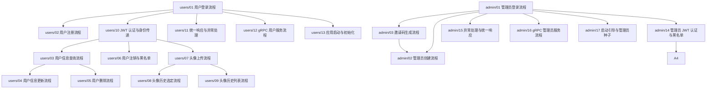

# users 域 · 流程学习记录（总索引）

> 本目录是 **RAG-V1 仓库 `users` 业务域**（`service/users/user` + `service/users/admin` 两个 Spring Boot 进程）
> 的**真实执行流程逐行讲解集**。
>
> 它**不是**架构说明书、**不是**文件树、**不是**调用链清单、**不是** Spring 概念百科。
> 它回答的是：**这一次请求/事件在运行时到底发生了什么**。

---

## 1. 文档集说明

| 项 | 内容 |
|---|---|
| 研究对象 | RAG-V1 的 `users` 域：`service/users/user`（用户域 app）+ `service/users/admin`（管理域 app） |
| 源码版本 | 仓库 `/Users/pr/Documents/GitHub/RAG-V1`，`main` 分支，基线 commit `c665476` |
| 技术栈 | Spring Boot **3.5.11** · Spring MVC · MyBatis-Plus · jjwt · Spring Data Redis · gRPC（`net.devh`）· Nacos Discovery · OpenTelemetry · PostgreSQL |
| 判定基准 | **B 侧 RAG 仓**（`/Users/pr/Documents/java&golang/RAG`，只读）—— L1 契约层 / L2 业务语义层 / L4 机制层**一律以 B 侧为准**（决策 D13 + D16） |
| 覆盖范围 | user 域 **13** 篇 + admin 域 **17** 篇，共 **30** 篇流程记录 |
| 读者 | Java 初学者，但要能照着文档自己把源码走一遍 |

### 两点必须先讲清楚的「形状」

1. **api 与 rpc 已合并成一个进程。** B 侧 api 进程通过 gRPC 调 rpc 进程；RAG-V1 按决策 **D1 + D7** 把两者压进**同一个 Spring Boot 进程**。
   ⇒ 代码里 `UserApiService` 调 `UserDomainService` 时**参数类型是 proto 生成的类**，但那是**同进程 Java 方法调用，不是 gRPC 网络请求**。
   gRPC 服务端入口 `UserGrpcService` 仍然存在，它调用的是**同一份** `UserDomainService`。
   —— 这一点在多篇文档里都会出现，因为它是初学者最容易误读的地方。

2. **用户域与管理域是两个独立进程、两套密钥、两套黑名单前缀。**
   `user:jwt_blacklist:*` vs `admin:jwt_blacklist:*`；`user-api` / `user-rpc` 配置前缀 vs `admin-api` / `admin-rpc`。
   两域**读错误码的位置不同**：user 域读域内 `contract/ErrCodes`（一份只暴露本域用到的子集的**薄转发层**，
   每个常量都转发自共享层），admin 域**直接**读共享层 `users-common` 的 `ErrCodes`。
   ⇒ **码值本身完全一致**（是转发，不是各定义一份）；差别只在「哪些码以哪个类名暴露」。

---

## 2. 学习顺序

```
   ┌─────────────────────────────────────────────────────────────┐
   │  第一层：一条完整的 HTTP 业务流（拿它当尺子）                    │
   │    users/01 用户登录流程        ← 建议第一篇读这个                │
   └─────────────────────────────────────────────────────────────┘
                              ↓
   ┌─────────────────────────────────────────────────────────────┐
   │  第二层：同域其余业务流（复用第一篇建立的坐标感）                │
   │    注册 / 查询 / 更新 / 删除 / 注销 / 头像三件套                 │
   │    admin 域：登录 / 创建 / 邀请码 / 自助 / 管理用户九件套        │
   └─────────────────────────────────────────────────────────────┘
                              ↓
   ┌─────────────────────────────────────────────────────────────┐
   │  第三层：贯穿所有业务流的公共机制（回头再看业务流会更快）        │
   │    JWT 认证与身份传递 · 统一响应与异常处理 · 事务边界            │
   └─────────────────────────────────────────────────────────────┘
                              ↓
   ┌─────────────────────────────────────────────────────────────┐
   │  第四层：另一种入口形态与进程生命周期                          │
   │    gRPC 服务端 · 应用启动 / 建表 / 雪花 ID / Nacos 注册          │
   └─────────────────────────────────────────────────────────────┘
```

**为什么这样排**：第一层建立「一次请求会穿过哪些层、每层负责什么」的坐标感；
第二层用同一条坐标轴横向铺开；第三层把散在业务流里的机制抽出来单独讲透；
第四层换一个入口（gRPC）和一个生命周期维度（启动）来看同一套代码。

**推荐入口**：`users/01-用户登录流程.md` —— 它是全组文档里最完整的一篇，
读完你就能理解 `Controller → API Service → DomainService → Mapper → PostgreSQL` 这条主轴。

---

## 3. 流程文档索引

### 3.1 user 域（`users/`）—— 9 个 HTTP 端点 + 4 篇机制文档

| 编号 | 文档名称 | 触发场景 | 主要入口 | 流程终点 | 前置知识 |
|---|---|---|---|---|---|
| 01 | [用户登录流程](./users/01-用户登录流程.md) | 客户端提交用户名密码 | `UserController#login` | 客户端拿到 JWT | HTTP 请求处理 |
| 02 | [用户注册流程](./users/02-用户注册流程.md) | 客户端提交注册信息 | `UserController#register` | 返回新用户 uid | 01 |
| 03 | [用户信息查询流程](./users/03-用户信息查询流程.md) | 已登录用户查自己 | `UserController#getUser` | 返回 `user` + `found` | 10 |
| 04 | [用户信息更新流程](./users/04-用户信息更新流程.md) | 已登录用户改资料 | `UserController#updateUser` | 返回更新后的 `user` | 03 |
| 05 | [用户删除流程](./users/05-用户删除流程.md) | 已登录用户注销账号 | `UserController#deleteUser` | 行被删除 | 03 |
| 06 | [用户注销与 Redis 黑名单流程](./users/06-用户注销与黑名单流程.md) | 已登录用户退出登录 | `UserController#logout` | token 进黑名单 | 10 |
| 07 | [头像上传流程](./users/07-头像上传流程.md) | 已登录用户换头像 | `UserController#uploadAvatar` | 双写落库 + 返回 history | 10 |
| 08 | [头像历史选定流程](./users/08-头像历史选定流程.md) | 用户从历史里选头像 | `UserController#selectAvatar` | 头像被切换 | 07 |
| 09 | [头像历史列表流程](./users/09-头像历史列表流程.md) | 用户查看历史头像 | `UserController#getAvatarHistory` | 返回列表 | 07 |
| 10 | [JWT 认证与身份传递流程](./users/10-JWT认证与身份传递流程.md) | 任意受保护路径的请求 | `JwtAuthFilter` → `JwtAuthInterceptor` | request attribute 就位 | 01 |
| 11 | [HTTP 统一响应与异常处理流程](./users/11-HTTP统一响应与异常处理流程.md) | 任意异常或正常返回 | `UserApiExceptionHandler` / `UserApiResponseAdvice` | 最终 HTTP 响应 | 01 |
| 12 | [gRPC 用户服务流程](./users/12-gRPC用户服务流程.md) | 外部 gRPC 客户端调用 | `UserGrpcService` | `StreamObserver` 响应 | 01、11 |
| 13 | [应用启动与初始化流程](./users/13-应用启动与初始化流程.md) | 进程启动 | `UserServiceApplication` | 容器就绪 + Nacos 注册 | 01 |

### 3.2 admin 域（`admin/`）—— 13 个 HTTP 端点 + 4 篇机制文档

| 编号 | 文档名称 | 触发场景 | 主要入口 | 流程终点 | 前置知识 |
|---|---|---|---|---|---|
| 01 | [管理员登录流程](./admin/01-管理员登录流程.md) | 管理员提交账号密码 | `AdminController#login` | 客户端拿到 JWT | HTTP 请求处理 |
| 02 | [管理员创建流程](./admin/02-管理员创建流程.md) | 用邀请码创建管理员 | `AdminController#createAdmin` | 管理员落库 + 邀请码标记已用 | 01、03 |
| 03 | [邀请码生成流程](./admin/03-邀请码生成流程.md) | 管理员生成邀请码 | `AdminController#createInviteCode` | 邀请码落库（10 分钟有效） | 01 |
| 04 | [管理员自助信息查询流程](./admin/04-管理员自助信息查询流程.md) | 管理员查自己 | `AdminController#getSelf` | 返回 `admin` | 01 |
| 05 | [管理员自助信息更新流程](./admin/05-管理员自助信息更新流程.md) | 管理员改自己资料 | `AdminController#updateSelf` | 返回 `success` + `admin` | 04 |
| 06 | [管理员注销与黑名单流程](./admin/06-管理员注销与黑名单流程.md) | 管理员退出登录 | `AdminController#logout` | token 进黑名单 | 01 |
| 07 | [用户封禁流程](./admin/07-用户封禁流程.md) | 管理员封禁用户 | `AdminController#banUser` | `users_user.status = 1` | 01 |
| 08 | [用户解封流程](./admin/08-用户解封流程.md) | 管理员解封用户 | `AdminController#unBanUser` | `users_user.status = 0` | 07 |
| 09 | [用户信息查询流程](./admin/09-用户信息查询流程.md) | 管理员查指定用户 | `AdminController#getUser` | 返回 `user` + `found` | 01 |
| 10 | [用户列表分页查询流程](./admin/10-用户列表分页查询流程.md) | 管理员查用户列表 | `AdminController#getUserList` | 返回 `list` + `total` | 09 |
| 11 | [用户信息更新流程](./admin/11-用户信息更新流程.md) | 管理员改用户资料 | `AdminController#updateUser` | 返回 `success` + `user` | 09 |
| 12 | [用户删除流程](./admin/12-用户删除流程.md) | 管理员删除用户 | `AdminController#deleteUser` | 行被删除 | 09 |
| 13 | [用户密码重置流程](./admin/13-用户密码重置流程.md) | 管理员重置用户密码 | `AdminController#resetUserPassword` | 密码被重置为**配置里的默认口令** | 01 |
| 14 | [管理员 JWT 认证与黑名单流程](./admin/14-管理员JWT认证与黑名单流程.md) | 任意受保护路径 | `AdminJwtSignatureFilter` → `AdminJwtAuthInterceptor` | request attribute 就位 | 01 |
| 15 | [异常处理与统一响应流程](./admin/15-异常处理与统一响应流程.md) | 任意异常或正常返回 | `AdminApiExceptionHandler` / `AdminApiResponseAdvice` | 最终 HTTP 响应 | 01 |
| 16 | [gRPC 管理员服务流程](./admin/16-gRPC管理员服务流程.md) | 外部 gRPC 客户端调用 | `AdminGrpcService` | `StreamObserver` 响应 | 01、15 |
| 17 | [启动引导与管理员种子流程](./admin/17-启动引导与管理员种子流程.md) | 进程启动 | `AdminServiceApplication` | 种子管理员就位 + Nacos 注册 | 01 |

---

## 4. 流程依赖关系

下图是**学习内容之间的依赖关系**（不是项目文件树）：



**共享机制被哪些流程复用**（读某一篇时，如果遇到「这个机制我在别处见过」——机制篇是它的完整解释）：

| 机制 | 完整解释在哪 | 被哪些流程用到 |
|---|---|---|
| JWT 验签 + claim 提取 + 身份判定链 | `users/10` · `admin/14` | 所有 JWT 受保护端点（user 7 个、admin 11 个） |
| 统一响应信封 `{code,msg,data}` | `users/11` · `admin/15` | 所有正常返回 |
| gRPC code → 业务码映射 | `users/11` §4 · `admin/15` §4 | 所有领域层抛 `StatusRuntimeException` 的端点 |
| 雪花 ID 生成 | `users/02` §4 · `admin/02` §4 | 注册、头像历史 id、邀请码 |
| Redis 黑名单写入 / 查询 | `users/06` · `admin/06` | 注销写、鉴权读 |
| 事务边界（双写 / 邀请码消费） | `users/07` §5 · `admin/02` §5 | 头像双写、管理员创建 |

---

## 5. 覆盖状态

| 文档 | 状态 | 说明 |
|---|---|---|
| users/01 ~ users/13 | 已完成 | 13 篇全部完成 |
| admin/01 ~ admin/17 | 已完成 | 17 篇全部完成 |

> **状态的含义**：本目录中的每篇文档都基于**实际读取过的源码**写成，
> 文中给出的文件/类/方法定位均可在仓库中核对。
> 但「已完成」**不等于**「与 B 侧逐字对拍通过」——
> RAG-V1 域级台账在 `docs/DRIFT/users/` 下，对拍结论以台账为准。

---

## 6. 阅读时的三个提醒

1. **看到 proto 类型不要以为是 gRPC。** 本仓 api 与 rpc 已合并（决策 D1 + D7），
   `UserApiService` → `UserDomainService` 是**同进程方法调用**。
   真正的 gRPC 入口在 `grpc/` 包下，是**另一个入口**，不是同一段调用的下游。

2. **错误码有两套映射并存。** 有的端点在自己 `catch` 里按 `e.getStatus().getCode()` 逐条写映射，
   有的端点原样上抛给 advice 的通用映射。**两套不完全相同**，且这不是 bug —— 是照抄真源的结果。
   每篇文档都会写清「本端点走哪一套」。

3. **HTTP 状态码 ≠ 业务码。** 业务错误基本都返回 **HTTP 200** + body 里的 `code`；
   但参数校验类框架错误保留 **HTTP 400 + `text/plain`**（不带信封）。
   不能因为有统一响应包装就以为所有失败都是 JSON 信封。

---

## 7. 本地源码位置速查

| 域 | 源码根 | 关键入口 |
|---|---|---|
| user | `service/users/user/src/main/java/com/rag/user/` | `controller/UserController.java` |
| admin | `service/users/admin/src/main/java/com/rag/admin/` | `controller/AdminController.java` |
| 共享层 | `common/src/main/java/com/rag/common/` | `security/` `web/` `contract/` `exception/` `snowflake/` `persistence/` `observability/` |
| users 共享 | `service/users/common/src/main/java/com/rag/users/common/` | `IdentityResolver.java` `SchemaInitializer.java` `ErrCodes.java` |
| proto | `proto/src/main/proto/users.proto` · `admin.proto` | pb 包名 `com.rag.proto.user` / `com.rag.proto.admin` |
