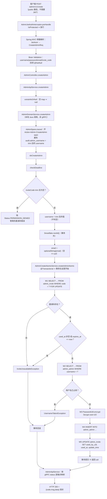
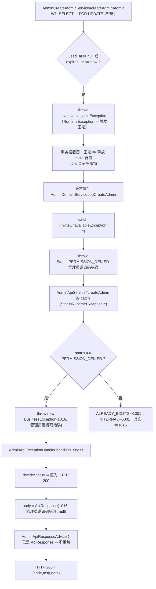
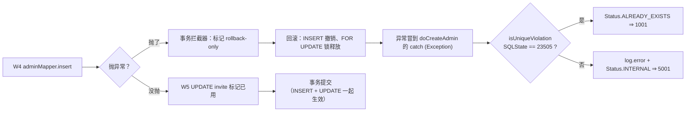

# 02. 管理员创建流程（POST /admin/v1/create）

> 研究对象：`service/users/admin/`（RAG-V1 管理域 Spring Boot 进程）
> 本文所有源码定位都可在仓库 `/Users/pr/Documents/GitHub/RAG-V1` 中按 `文件:行号` 核对。

---

## 1. 本次流程的研究范围

### 1.1 我们要追踪什么

拿着一个邀请码创建**新的管理员账号**，到新管理员落库、邀请码标记已用为止：

```
HTTP 请求（public 路径，不需要 JWT）
  → Spring MVC 参数解析（Jackson + Bean Validation）
  → AdminController#createAdmin
  → AdminApiService#createAdmin
  → AdminDomainService#createAdmin / #doCreateAdmin
      ├─ Snowflake.nextId()（事务外）
      └─ AdminCreateAtomicService#createAdminAtomic（事务内）
          ├─ W1 SELECT invite WHERE code = ? FOR UPDATE
          ├─ W2 SELECT admin WHERE username = ?
          ├─ W3 bcrypt 哈希
          ├─ W4 INSERT admin
          └─ W5 UPDATE invite SET used_by_uid, used_at
  → AdminApiResponseAdvice（统一信封）
  → HTTP JSON 响应
```

### 1.2 追踪到哪里为止

| 到此为止 | 不在本篇范围 |
|---|---|
| 客户端拿到 `{"code":200,"msg":"OK","data":{"uid":"123..."}}` | 邀请码**怎么来的** → 见 [03](./03-邀请码生成流程.md) §4 |
| `admin_invite.used_by_uid` / `used_at` 被写上 | 邀请码 TTL 的生成侧 → 见 [03](./03-邀请码生成流程.md) §4.5 |
| 事务的提交 / 回滚边界 | 事务机制在别的端点的表现 → 见本域 [15](./15-异常处理与统一响应流程.md) §4 |
| 一次 INSERT + 一次 UPDATE | 表结构 DDL 全文 → `service/users/common/src/main/resources/db/` |

### 1.3 这个流程要完成的五件事

1. 校验**邀请码**有效（存在、没被用过、没过期）。
2. 校验**用户名**没被占用。
3. 把明文密码**哈希**成 bcrypt 串。
4. 生成一个 Snowflake uid 作为新管理员的**业务主键**。
5. 插入管理员行，并把邀请码**标记为已用**。

### 1.4 🔴 本篇的核心：步骤顺序本身就是行为契约

这五件事**必须按这个顺序**做，而且顺序不是实现细节，是**可观察行为**：

```
W1 锁 invite（悲观锁）→ 校验邀请码
W2 查 username 冲突
W3 bcrypt 哈希           ← 必须在 W1/W2 之后！
W4 insert admin
W5 标记 invite 已用
```

**如果 bcrypt 跑到 W1/W2 前面**，超长密码会抢先抛错，
把本该报「邀请码错误(1016)」「用户名已存在(1001)」的请求报成「系统内部错误(5001)」。
详见 §4.6。

---

## 2. 触发场景与输入

新管理员用邀请码注册：

```
POST /admin/v1/create
Content-Type: application/json

{
    "username": "newadmin",
    "password": "s3cret-p@ss",
    "email": "newadmin@example.com",
    "invite_code": "ADM-3F9A7C2E1B4D8A06",
    "extra_info": {
        "department": "ops"
    }
}
```

DTO（`service/users/admin/src/main/java/com/rag/admin/dto/admin/CreateAdminReq.java:36`）：

```java
public record CreateAdminReq(
        @NotNull String username,
        @NotNull String password,
        @NotNull @JsonInclude(JsonInclude.Include.NON_NULL) String email,
        @NotNull @JsonProperty("invite_code") String inviteCode,
        @JsonInclude(JsonInclude.Include.NON_NULL) @JsonProperty("extra_info") Map<String, String> extraInfo) {
}
```

| JSON 键 | Java 组件 | 类型 | 约束 |
|---|---|---|---|
| `username` | `username` | `String` | `@NotNull` |
| `password` | `password` | `String` | `@NotNull` |
| `email` | `email` | `String` | `@NotNull` |
| `invite_code` | `inviteCode` | `String` | `@NotNull` |
| `extra_info` | `extraInfo` | `Map<String,String>` | **无约束** |

⚠️ 两个容易看错的点：

1. **`extra_info` 没有 `@NotNull`** —— 但这**不是**漏标。
   真源那侧对它走的是「显式 null 报错、缺席放行」的**三态**判定，
   Bean Validation 没有等价物 ⇒ 降级登记为 D-01。
2. **`email` 是 `@NotNull`，但可以是空串** —— 空串在 HTTP 层合法，
   到领域层会被 `AdminHelpers.optionalString` 归一成 `null` ⇒ 不写进库（`email` 列可空）。
   ⇒ 「必填」和「一定会有值」是两件事。

**wire 键名**：`invite_code` / `extra_info` 是 snake_case（`@JsonProperty` 指定的），
`username` / `password` / `email` 是原样。

### 2.1 `/admin/v1/create` 是 public 路径

`/admin/v1/create` 与 `/admin/v1/login` 一样，**不在** `PROTECTED_PATHS` 里
⇒ 拦截器放行 ⇒ **不需要 Authorization 头**。

这正是「邀请码」存在的意义：**邀请码就是凭证**。
没有邀请码的人也能调这个端点，但过不了 W1 那一步。

---

## 3. 整体执行路线



---

## 4. 逐步讲解

### 4.1 第一个环节：请求进入 Controller

`AdminController.java:139`：

```java
@PostMapping("/create")
public CreateAdminResp createAdmin(@Valid @RequestBody CreateAdminReq req, HttpServletRequest httpRequest) {
    return adminApiService.createAdmin(req, httpRequest);
}
```

和登录端点一样：

- `@RequestBody` **必填**（`required` 默认 true）⇒ 空 body ⇒ `HttpMessageNotReadableException` ⇒ 400 + text/plain。
- `@Valid` ⇒ Bean Validation 校验四项 `@NotNull`。
- `httpRequest` 这个参数**在本端点没用到**（它只在需要从 token 取身份的端点里用）。
  本端点是 public 的，操作人不需要身份。

### 4.2 第二个环节：`AdminApiService#createAdmin`

`AdminApiService.java:275`：

```java
public CreateAdminResp createAdmin(CreateAdminReq req, HttpServletRequest httpRequest) {
    long uid;
    try {
        uid = adminDomainService.createAdmin(
                req.username() == null ? "" : req.username(),
                req.password() == null ? "" : req.password(),
                req.email() == null ? "" : req.email(),
                // B 侧链路：api 层 putAllExtraInfo(null→{}) ⇒ proto 空 map ⇒ rpc 层判 isEmpty ⇒ 传 null
                extraInfoOrNull(req.extraInfo()),
                req.inviteCode() == null ? "" : req.inviteCode());
    } catch (StatusRuntimeException e) {
        log.error("admin createAdmin RPC error, username={}", req.username(), e);
        // ⚠️ **逐端点 switch（B 出处：对应 B 侧 api service 的 catch 块逐条照抄）**
        //    —— 不能用 advice 的通用 mapRPCStatusToCode：本端点的 INTERNAL 码与通用表**不同**。
        Status.Code code = e.getStatus().getCode();
        if (code == Status.Code.PERMISSION_DENIED) {
            throw new BusinessException(ErrCodes.ERROR_ADMIN_INVITE_CODE_WRONG,
                    ErrMsg.getMsg(ErrCodes.ERROR_ADMIN_INVITE_CODE_WRONG));
        }
        if (code == Status.Code.ALREADY_EXISTS) {
            throw new BusinessException(ErrCodes.ERROR_USER_EXIST,
                    ErrMsg.getMsg(ErrCodes.ERROR_USER_EXIST));
        }
        if (code == Status.Code.INTERNAL) {
            throw new BusinessException(ErrCodes.ERROR_SERVER_COMMON,
                    ErrMsg.getMsg(ErrCodes.ERROR_SERVER_COMMON));
        }
        throw new BusinessException(ErrCodes.CODE_SERVER_BUSY,
                ErrMsg.getMsg(ErrCodes.CODE_SERVER_BUSY));
    }

    // B 侧：CreateAdminResp.setUid(uid)（Long）⇒ getter 返回 uid.toString() ⇒ JSON 是字符串
    return new CreateAdminResp(String.valueOf(uid));
}
```

本端点的逐端点映射：

| 领域层 gRPC status | 业务码 | 文案 | 触发原因 |
|---|---|---|---|
| `PERMISSION_DENIED` | **1016** `ERROR_ADMIN_INVITE_CODE_WRONG` | 管理员邀请码错误 | 邀请码不存在 / 已用 / 过期 |
| `ALREADY_EXISTS` | **1001** `ERROR_USER_EXIST` | 用户名已存在 | 用户名被占用 / 唯一约束冲突 |
| `INTERNAL` | **5001** `ERROR_SERVER_COMMON` | 系统内部错误 | 数据库失败 / bcrypt 超长密码 |
| 其它（default） | **1015** `CODE_SERVER_BUSY` | 服务繁忙 | deadline 超时等 |

⚠️ 注意 `PERMISSION_DENIED` 在**通用兜底表**里也映射成 1016（`AdminApiExceptionHandler.java:172`），
但这里之所以还要自己写一遍，是因为**同端点的 `INTERNAL` 码与通用表不同**
（通用表也是 5001，但 `updateSelf` / `unBanUser` / `resetUserPassword` 那几个端点的 INTERNAL 是 5003）。

#### 4.2.1 `extraInfoOrNull` 是什么

`AdminApiService.java:803`：

```java
private static Map<String, String> extraInfoOrNull(Map<String, String> extraInfo) {
    return (extraInfo == null || extraInfo.isEmpty()) ? null : new HashMap<>(extraInfo);
}
```

它的作用是**归一化**：把「null」和「空 map」压成同一个形态 `null`。

真源那侧的等价链是：

```
api 层：putAllExtraInfo(null → {})   ⇒ proto 里是个空 map
rpc 层：判 isEmpty() ? null : new HashMap<>(...)  ⇒ 领域层收到 null 或非空 map
```

本仓按 D2「域内直连」把 proto 中转去掉了 ⇒ 归一化点必须**留在同一层**，
否则「空 map」会一路传下去。

⚠️ 归一化在这个流程里发生了**三次**（三层各一次），行为一致：

| 层 | 代码 |
|---|---|
| `AdminApiService#createAdmin` | `extraInfoOrNull(req.extraInfo())` |
| `AdminDomainService#doCreateAdmin` | `safeExtraInfo = (extraInfo == null \|\| extraInfo.isEmpty()) ? null : new HashMap<>(extraInfo)` |
| `AdminCreateAtomicService` W4 | `if (extraInfo != null && !extraInfo.isEmpty()) { admin.setExtraInfo(new HashMap<>(extraInfo)); }` |

最终效果：**`extra_info` 为空时，数据库里那一列就是 NULL**（而不是 `{}`）。

### 4.3 第三个环节：领域层外层 —— 开 span

`AdminDomainService.java:528`：

```java
public long createAdmin(String username, String password, String email,
                        Map<String, String> extraInfo, String inviteCode) {
    // 🔴 DRIFT-ARPC-006：参考侧 createadminlogic.go 的顺序是
    //     tracer.Start(ctx, "Action-Admin-CreateAdmin")
    //     username := strings.TrimSpace(in.Username)      ← 先 trim
    //     span.SetAttributes(attribute.String("audit.admin_username", username))  ← 再打属性
    // ⇒ 属性必须取**trim 之后**的值，与参考侧逐字一致（不是原始入参）。
    return AdminSpans.traced(AdminSpans.CREATE_ADMIN,
            span -> span.setAttribute(AdminSpans.ATTR_ADMIN_USERNAME,
                    username == null ? "" : username.trim()),
            () -> doCreateAdmin(username, password, email, extraInfo, inviteCode));
}
```

⚠️ **对照记忆点**：
`createAdmin` 的 span 属性用 **trim 之后**的 username，
而 `login` 的 span 属性用**原始** username（`AdminDomainService.java:236`）。
两个字段名一样（`audit.admin_username`），取值口径不同 —— 是真源两个 logic 的原始差异。

### 4.4 第四个环节：领域层内层 —— `doCreateAdmin`

`AdminDomainService.java:541`：

```java
private long doCreateAdmin(String username, String password, String email,
                           Map<String, String> extraInfo, String inviteCode) {
    checkDeadline();
    // inviteCode 非空
    String trimmedInvite = inviteCode == null ? "" : inviteCode.trim();
    if (trimmedInvite.isEmpty()) {
        throw Status.PERMISSION_DENIED.withDescription("管理员邀请码错误").asRuntimeException();
    }

    // DRIFT-008（已修）：此处**不**校验 username 是否为空。
    String trimmedUsername = username == null ? "" : username.trim();
```

#### 4.4.1 邀请码为空的判断在**最前面**

`inviteCode.trim()` 后为空 ⇒ 直接 `PERMISSION_DENIED`（⇒ 1016 管理员邀请码错误）。

这一步在**任何数据库操作之前** ⇒ 一个连邀请码都没填的请求，
**不会**产生任何 DB 读写，也**不会**消耗 Snowflake ID。

⚠️ 这也是「trim 之后判空」而不是「原串判空」：
`"   "`（纯空白）也会被当成空 ⇒ 1016。

#### 4.4.2 用户名**不**判空

源码注释解释了原因（`AdminDomainService.java:550`）：

```java
// DRIFT-008（已修）：此处**不**校验 username 是否为空。
// 参考侧 createadminlogic.go 没有该校验——username 为空串时会照常进事务、
// 查重（通常 not found）并 INSERT 成功，返回 uid。
// 本实现此前多加了一道 INVALID_ARGUMENT「用户名不能为空」，而
// AdminCreateService 的 switch 没有 INVALID_ARGUMENT case，会落到 default
// 被报成 1015「服务繁忙」——把一个本来能成功的建号请求报成服务端故障。
```

⇒ **username 为空串时，流程照常走完并成功建号**。
（`admin_admin.username` 列是 `TEXT UNIQUE`，所以第二个空串会撞唯一约束 ⇒ 1001。）

### 4.5 第五个环节：Snowflake uid —— 在**事务外**

`AdminDomainService.java:577`：

```java
// Snowflake uid（事务外）
long uid;
try {
    uid = Snowflake.nextId();
} catch (StatusRuntimeException e) {
    throw e;
} catch (Exception e) {
    log.error("admin createAdmin Snowflake.nextId failed", e);
    throw Status.INTERNAL.withDescription("DB添加失败").asRuntimeException();
}
```

`Snowflake.nextId()`（`common/src/main/java/com/rag/common/snowflake/Snowflake.java:268`）：

```java
public static long nextId() {
    if (workerId == null && initError == null) {
        init(); // 对应 B 的 GetID() 第一行 Init()
    }
    if (initError != null) {
        throw new IllegalStateException("snowflake node is not initialized", initError);
    }
    Long id = workerId;
    if (id == null) {
        throw new IllegalStateException("snowflake node is not initialized");
    }
    return nextIdInternal(id, STATE);
}
```

ID 的位布局（`Snowflake.java:56`~`74`）：

```
epoch  = 1288834974657（2010-11-04 01:42:54 UTC）
41 位时间戳 | 10 位 workerId | 12 位 sequence
```

算法体 `nextIdInternal`（`Snowflake.java:347`）：

```java
public static long nextIdInternal(long workerIdArg, State state) {
    synchronized (state) {
        long now = state.nowMillisSinceEpoch();
        if (now == state.lastTimestamp) {
            state.sequence = (state.sequence + 1) & SEQUENCE_MASK;
            if (state.sequence == 0) {
                while (now <= state.lastTimestamp) {
                    now = state.nowMillisSinceEpoch();
                }
            }
        } else {
            state.sequence = 0L;
        }
        state.lastTimestamp = now;
        return (now << TIMESTAMP_SHIFT)
                | (workerIdArg << WORKER_ID_SHIFT)
                | state.sequence;
    }
}
```

要点：

- 同一毫秒内靠 12 位 sequence（0~4095）区分；耗尽了就**自旋到下一毫秒**。
- 时钟源是「锚点 + 单调流逝」，**不是纯墙钟** ⇒ 墙钟回拨不会让 ID 重复。
- `synchronized (state)` ⇒ 进程内串行化。

#### 🔴 为什么 uid 生成在事务**外**

源码注释（`AdminDomainService.java:573`）写明了理由：

```java
// ⚠️ 下方原先那条注释「bcrypt password（事务外，避免延长事务持有时间）」
// 描述的是一个**未经参考侧出处论证**的优化（§3.2 无出处 idiomatization），
// 本次按用户裁决撤销。代价已知并接受：cost=10 约 60~100ms，
// 会延长 invite 行 FOR UPDATE 的持锁时间；但该锁只锁单行。
//
// Snowflake uid 仍留在事务外（见下）：它不触碰 invite 锁，也不参与错误码归属，
// 与参考侧放在哈希之后相比不产生可观测差异（参考侧 GetID 失败同样是 Internal）。
```

⇒ **uid 的生成位置（事务外）是刻意保留的**：

- 它**不触碰 invite 行的锁**（锁是 W1 的 SELECT 拿的，还在事务外），
- 它**不参与错误码归属**（Snowflake 失败 ⇒ 同样是 INTERNAL）。

⚠️ 但它有一个**可观察的副作用**：uid 是**单调消耗**的。
即使后面事务回滚了，**这个 ID 已经被消耗掉了**，永远不会被复用。
详见 §6.8。

### 4.6 🔴 第六个环节：进入事务 —— `AdminCreateAtomicService`

`AdminDomainService.java:591`：

```java
// 4 步事务
String optionalEmail = AdminHelpers.optionalString(email);
Map<String, String> safeExtraInfo = (extraInfo == null || extraInfo.isEmpty())
        ? null
        : new HashMap<>(extraInfo);
try {
    createAtomicService.createAdminAtomic(
            trimmedUsername, trimmedInvite, password, optionalEmail, safeExtraInfo, uid, true);
} catch (InviteUnavailableException e) {
    throw Status.PERMISSION_DENIED.withDescription("管理员邀请码错误").asRuntimeException();
} catch (UsernameTakenException e) {
    throw Status.ALREADY_EXISTS.withDescription("用户名已存在").asRuntimeException();
} catch (StatusRuntimeException e) {
    throw e;
} catch (Exception e) {
    if (AdminExceptions.isUniqueViolation(e)) {
        throw Status.ALREADY_EXISTS.withDescription("用户名已存在").asRuntimeException();
    }
    log.error("admin createAdmin 4-step transaction failed", e);
    throw Status.INTERNAL.withDescription("DB添加失败").asRuntimeException();
}

log.info("admin createAdmin success, username={}", trimmedUsername);
return uid;
```

几个点：

- `optionalEmail` = `AdminHelpers.optionalString(email)`（`service/AdminHelpers.java:26`）：

  ```java
  public static String optionalString(String value) {
      if (value == null) {
          return null;
      }
      String trimmed = value.trim();
      if (trimmed.isEmpty()) {
          return null;
      }
      return trimmed;
  }
  ```

  ⇒ 空串 email ⇒ `null` ⇒ 那一列不写。

- 最后一个参数 **`true`** = `passwordIsPlaintext`。
  ⇒ **明文密码**被传进去，**哈希在事务内部完成**（W3）。

- 四个 catch 的顺序：两个业务 sentinel 异常先 catch，
  然后是 gRPC 异常原样重抛（`DEADLINE_EXCEEDED` 不能被改写），
  最后是宽 catch（DB 错误 + 唯一约束兜底）。

#### 4.6.1 `@Transactional` 的落点与代理问题（本篇最需要讲清的一节）

`AdminCreateAtomicService`（`domain/service/AdminCreateAtomicService.java:57`）：

```java
@Service
public class AdminCreateAtomicService {

    private final AdminMapper adminMapper;
    private final AdminInviteMapper adminInviteMapper;

    public AdminCreateAtomicService(AdminMapper adminMapper, AdminInviteMapper adminInviteMapper) {
        this.adminMapper = adminMapper;
        this.adminInviteMapper = adminInviteMapper;
    }
```

它有两个重载，**两个都带 `@Transactional`**：

```java
@Transactional
public Long createAdminAtomic(String username, String inviteCode, String passwordHash,
                              String email, Map<String, String> extraInfo, Long generatedUid) {
    return createAdminAtomic(username, inviteCode, passwordHash, email, extraInfo,
            generatedUid, false);
}
```

```java
@Transactional
public Long createAdminAtomic(String username, String inviteCode, String password,
                              String email, Map<String, String> extraInfo, Long generatedUid,
                              boolean passwordIsPlaintext) {
```

**6 参数版本**接收的是**已哈希**的密码（`passwordIsPlaintext=false` ⇒ 内部不哈希）。
它内部调用 7 参数版本 —— 这是**同类自调用（self-invocation）**，不走代理。
但因为 6 参数版本自己也是 `@Transactional`，
**从外部进入时事务已经开启**，内部那次自调用只是复用已有事务 ⇒ 无行为差异。

**7 参数版本**才是生产路径（`AdminDomainService` 传 `passwordIsPlaintext=true`）。

##### 代理到底生不生效？—— 逐条核对

Spring 的 `@Transactional` 靠 **AOP 代理**生效。代理**只拦截从容器外部进来的调用**。
如果这段 4 步代码写在 `AdminDomainService` 自己的 public 方法里、
再由同类的 `createAdmin(...)` 直接调用（`this.xxx()`），调用不经过代理 ⇒
`@Transactional` **静默失效** —— 代码看着有事务，运行时是 auto-commit，异常不回滚。

本仓的写法**规避了**这个坑：

```java
// AdminDomainService.java:173
private final AdminCreateAtomicService createAtomicService;

// AdminDomainService.java:175-189（构造器注入）
public AdminDomainService(AdminMapper adminMapper,
                          AdminInviteMapper adminInviteMapper,
                          UserMapper userMapper,
                          StringRedisTemplate stringRedisTemplate,
                          AdminRpcProperties properties,
                          AdminRpcMetrics metrics,
                          AdminCreateAtomicService createAtomicService) {
    ...
    this.createAtomicService = createAtomicService;
}
```

```java
// AdminDomainService.java:596
createAtomicService.createAdminAtomic(...);
```

逐条判定：

| 检查项 | 本仓源码 | 结论 |
|---|---|---|
| `AdminCreateAtomicService` 是不是 Spring Bean？ | 类上有 `@Service`（`:57`） | ✅ 是 |
| `AdminDomainService` 是不是注入**另一个 Bean**？ | 构造器注入 `AdminCreateAtomicService`（`:181`） | ✅ 是，**不是 `this`** |
| 调用是不是跨 Bean 调用？ | `createAtomicService.createAdminAtomic(...)`（`:596`，参数省略） | ✅ 是，**不是 `this.createAdminAtomic(...)`** |
| 事务管理器有没有？ | 见下 | ✅ 有 |

⇒ **结论：代理生效，事务是真的。**

`AdminCreateAtomicService` 的类 javadoc 把这件事写成了显式设计决策：

```java
    /**
     * <p><b>为什么必须独立成 Bean</b>：Spring 的 {@code @Transactional} 靠 AOP 代理生效，
     * 而代理<b>只拦截从容器外部进来的调用</b>。若这 4 步写在 {@code AdminDomainService}
     * 自己的 public 方法里、再由同类的 {@code createAdmin(...)} 直接调用（self-invocation），
     * 调用不经过代理，{@code @Transactional} 会<b>静默失效</b>——代码看着有事务，运行时是
     * auto-commit，异常不回滚。独立 Bean 后由 {@code AdminDomainService} 跨 Bean 调用，
     * 代理才会生效。
     */
```

##### 事务管理器从哪来

**本模块的主代码里没有显式的 `@EnableTransactionManagement`，也没有手写 `PlatformTransactionManager` bean。**

事务基础设施由 **Spring Boot 的自动配置**提供：

- `TransactionAutoConfiguration` ⇒ 导入 `@EnableTransactionManagement`（开启 `@Transactional` 解析）+ 事务拦截器；
- `DataSourceTransactionManagerAutoConfiguration` ⇒ 在 classpath 上有 `DataSource` 且没有别的 `PlatformTransactionManager` 时，
  造一个 `DataSourceTransactionManager`。

本模块具备条件：`application.yml` 里配了 `spring.datasource`（PostgreSQL），
pom 里引了 `mybatis-plus-spring-boot3-starter`（传递依赖 `spring-boot-starter-jdbc` ⇒ `spring-jdbc`）。

> ⚠️ **这是框架机制，不是本仓显式代码** —— 上面这段属于「Spring Boot 框架本身的机制」，
> 不是「源码里能 grep 到的一行」。要验证运行时行为，看测试
> `AdminDomainServiceRealPgTest`（它自己注册了 `@EnableTransactionManagement` +
> `DataSourceTransactionManager`）。

### 4.7 第七个环节：W1 —— 悲观锁查邀请码

`AdminCreateAtomicService.java:132`：

```java
// W1 查 invite：悲观锁 SELECT ... FOR UPDATE —— 必须在事务内做，
// 锁到本事务结束，保证同一邀请码不会被两个并发事务同时消费。
AdminInviteEntity invite = adminInviteMapper.selectOne(
        new LambdaQueryWrapper<AdminInviteEntity>()
                .eq(AdminInviteEntity::getCode, inviteCode)
                .last("FOR UPDATE")
);
if (invite == null) {
    throw new InviteUnavailableException("invite code not found: " + inviteCode);
}
```

生成的 SQL 形状：

```sql
SELECT id, code, inviter_uid, expires_at, used_by_uid, used_at, create_time, update_time
FROM admin_invite
WHERE code = ?
FOR UPDATE
```

`.last("FOR UPDATE")` 是 MyBatis-Plus 的**原样追加**：把这段 SQL 片段拼到语句末尾。

#### 4.7.1 `FOR UPDATE` 到底解决了什么

邀请码的业务不变量是「**一次性使用**」。

如果只靠「事务内读 `used_at`，再更新」这种写法，在 PostgreSQL 默认的 **READ COMMITTED** 隔离级别下仍有竞态：

```
时刻 T1: 事务 A 读 invite 行，看到 used_at IS NULL  ⇒ 校验通过
时刻 T2: 事务 B 读 invite 行，看到 used_at IS NULL  ⇒ 校验通过（B 读到的还是旧快照）
时刻 T3: 事务 A INSERT admin，UPDATE invite SET used_at = now
时刻 T4: 事务 B INSERT admin，UPDATE invite SET used_at = now  ← 后写者覆盖先写者
⇒ 同一个邀请码创建出了**两个**管理员
```

加上 `SELECT ... FOR UPDATE` 之后：

```
时刻 T1: 事务 A 执行 SELECT ... FOR UPDATE ⇒ **拿到该行的行级排他锁**
时刻 T2: 事务 B 执行 SELECT ... FOR UPDATE ⇒ **阻塞等待**
时刻 T3: 事务 A 校验通过、INSERT、UPDATE used_at ⇒ **提交，释放锁**
时刻 T4: 事务 B 拿到锁 ⇒ 读到的是**已被标记 used 的行** ⇒ used_at != null ⇒ InviteUnavailableException
⇒ 第二个调用被拒绝
```

要点：

- 这是**行级悲观锁**（row-level lock），**不是表锁** —— 只锁 `admin_invite` 里 `code` 匹配的那**一行**。
- 锁**持有到事务结束**（提交或回滚才释放）。
- 锁的范围只有**一行** ⇒ 不影响其它邀请码、也不影响其它 admin 行的操作。

> ⚠️ 一个 PostgreSQL 的细节：`SELECT ... FOR UPDATE` 对**不存在的行**不锁任何东西
> （PG 没有「间隙锁」）。所以「用同一个不存在的 code 并发创建」时，
> 两个事务都会拿到 `null`、都抛 `InviteUnavailableException`、都失败 ——
> 结果仍然正确（不会建出两个 admin），只是靠的是「都失败」而不是「串行化」。

#### 4.7.2 过期与已用的判定

`AdminCreateAtomicService.java:150`：

```java
// 🔴 OffsetDateTime，不是 LocalDateTime（2026-10-23，用户拍板修 DRIFT-ARPC-004②）。
// B 出处：AdminCreateAtomicService.java（admin-rpc）—— 事务闭包内
//     now := time.Now()
//     if invite.UsedAt != nil || !invite.ExpiresAt.After(now)
// B 侧的 invite.ExpiresAt 来自 **timestamptz** 列 ⇒ 带 location 的绝对时刻，
// `.After(now)` 比的是绝对时刻。
OffsetDateTime now = OffsetDateTime.now();
if (invite.getUsedAt() != null || !invite.getExpiresAt().isAfter(now)) {
    throw new InviteUnavailableException("invite code expired or used: " + inviteCode);
}
```

一个 `if` 判两种情况：

| 条件 | 含义 |
|---|---|
| `invite.getUsedAt() != null` | **已经被人用过了**（`used_at` 被写过） |
| `!invite.getExpiresAt().isAfter(now)` | **已过期**（`expires_at` 不在 `now` 之后） |

⚠️ 两个细节：

1. **判的是 `used_at`，不是 `used_by_uid`。**
   `used_by_uid` 在「码被用但 uid 还没写进去」的中间态下可能仍为 NULL。
   判 `used_at` 才是「这个码有没有被消费过」的权威标志。
2. **必须用 `OffsetDateTime`（绝对时刻），不能用 `LocalDateTime`（墙钟）。**
   跨时区多实例部署时（A 区建码、B 区消费），墙钟比较会让邀请码**刚生成就判为已过期**。
   详见 [03](./03-邀请码生成流程.md) §4.6。

⇒ 邀请码无效的**三种**原因（不存在 / 已用 / 过期）抛的是**同一个**异常
`InviteUnavailableException`，最终都映射成 **1016 管理员邀请码错误**。
客户端**分不出**是哪种原因 —— 这也是防枚举的一部分。

### 4.8 第八个环节：W2 —— 查用户名冲突

`AdminCreateAtomicService.java:155`：

```java
// W2 查 username 冲突（事务内）
AdminEntity existing = adminMapper.selectOne(
        new LambdaQueryWrapper<AdminEntity>().eq(AdminEntity::getUsername, username)
);
if (existing != null) {
    throw new UsernameTakenException("admin already exists with username: " + username);
}
```

SQL：

```sql
SELECT id, uid, username, password, email, extra_info, create_time, update_time
FROM admin_admin
WHERE username = ?
```

⚠️ 这里**没有** `FOR UPDATE`。为什么不需要？

因为 `admin_admin.username` 上有 **UNIQUE 约束**（`03_create_admin.sql:54`）。
数据库的唯一索引是**最后一道防线**：
即便两个不同邀请码的并发事务同时用同一个用户名走到这里都查不到人，
它们后面 INSERT 时会有一方撞唯一约束 ⇒ 被兜底成 `ALREADY_EXISTS`（见 §4.11）。

⇒ 「先查后插」是**快速失败**（避免白跑一趟 INSERT），
唯一约束才是**正确性保证**。两者缺一不可。

### 4.9 🔴 第九个环节：W3 —— bcrypt 哈希（**必须**在 W1/W2 之后）

`AdminCreateAtomicService.java:163`：

```java
// R5（2026-10-22，用户签字「完全对齐 B 侧」）：bcrypt 必须在 W1/W2 之后。
//
// 两端 bcrypt 实现相同（B 侧 bcrypt.DefaultCost=10 / RAG PasswordUtil STRENGTH=10），
// 都拒 >72 字节的密码；分歧<b>纯粹来自步骤顺序</b>：
// 修复前 RAG 在事务外先哈希 → 72 字节上限抢在 invite / username 检查之前抛错，
// 把本该报 1016 / 1001 的请求报成 5001。
// B 出处：AdminCreateAtomicService.java（admin-rpc）事务闭包内 PasswordEncrypt 在
//           FindAdminInviteByCodeForUpdate 与 FindOneAdminByUsernameTx 之后。
String effectiveHash = password;
if (passwordIsPlaintext) {
    try {
        effectiveHash = PasswordUtil.encrypt(password);
    } catch (StatusRuntimeException e) {
        // B-1：DEADLINE_EXCEEDED 必须上抛，不能被改写成 INTERNAL。
        throw e;
    } catch (Exception e) {
        // bcrypt 对 >72 字节抛 IllegalArgumentException。
        // B 侧这里同样是裸 err → 由 CreateAdminLogic 外层兜成 Internal(1015)，
        // 这里保持同一归属：冒泡给 AdminDomainService 的 db_error 分支。
        throw e;
    }
}
```

`PasswordUtil.encrypt`（`common/src/main/java/com/rag/common/security/PasswordUtil.java:73`）：

```java
public static String encrypt(String rawPassword) {
    return ENCODER.encode(rawPassword);
}
```

`ENCODER = new BCryptPasswordEncoder(10)`（`:49`）⇒ **bcrypt cost = 10**。

#### 4.9.1 为什么顺序不能改 —— 具体到错误码

bcrypt 算法本身只处理**前 72 字节**。密码更长时，Spring Security 会直接抛异常。

**实测口径**（spring-security-crypto **7.0.7** 的字节码，不靠记忆）：

```
BCrypt.hashpw(String, String)
  → hashpw(byte[], String)
      → hashpw(byte[], String, false)      ← 布尔传 false
          if (password.length > 72)
              throw new IllegalArgumentException("password cannot be more than 72 bytes")
```

而 `BCryptPasswordEncoder#encode` 走的就是 `BCrypt.hashpw(String, String)` ⇒ **检查生效**。

（对比：`BCrypt.checkpw` 走 `hashpwforcheck` ⇒ 布尔传 `true` ⇒ **跳过**长度检查。
⇒ 所以「登录时提交超长密码」不会抛异常，只会「不匹配」；
⇒ 而「建号时提交超长密码」会抛异常。两条路径行为不同。）

现在看**顺序**如何影响错误码：

| 顺序 | 请求：无效邀请码 + 80 字节密码 | 结果 |
|---|---|---|
| **bcrypt 在前**（修复前的写法） | bcrypt 先抛 `IllegalArgumentException` | 报 **5001 系统内部错误** ❌ |
| **bcrypt 在后**（现在的写法） | 先 W1 校验邀请码 | 报 **1016 管理员邀请码错误** ✅ |

再看另一个组合：

| 顺序 | 请求：有效邀请码 + 已占用用户名 + 80 字节密码 | 结果 |
|---|---|---|
| **bcrypt 在前** | bcrypt 先抛 | 报 **5001** ❌ |
| **bcrypt 在后** | 先 W1 通过，W2 查出用户名冲突 | 报 **1001 用户名已存在** ✅ |

⇒ **同样一个请求，顺序不同 ⇒ 客户端拿到的错误码完全不同。**
这就是「步骤顺序是行为契约」的含义。

源码里记录了真源那侧的步骤序（`AdminCreateAtomicService.java:100`）：

```java
 *   FindAdminInviteByCodeForUpdate → not found/过期 → PermissionDenied
 *   FindOneAdminByUsernameTx        → 命中         → AlreadyExists
 *   cryptx.PasswordEncrypt          → >72 字节    → err
 *   snowflake.GetID
 *   InsertOneAdminTx
 *   UpdateAdminInviteUsedTx
```

⇒ 真源就是「先校验、后哈希」。本仓逐条镜像。

#### 4.9.2 ⚠️ 代价：bcrypt 延长了持锁时间

`bcrypt cost=10` 大约 **60~100ms**（`AdminCreateAtomicService.java:116` 的记载）。
这 60~100ms 全程**持有 `admin_invite` 那一行的行锁**。

**这是刻意接受的代价**，源码写得很明白：

```java
     * <p><b>为什么哈希必须在事务内（代价已知并接受）</b>：bcrypt cost=10 约 60~100ms
     * （B 侧 用 {@code bcrypt.DefaultCost}=10，RAG 用 {@code STRENGTH}=10，同量级），
     * 会延长 invite 行 {@code SELECT ... FOR UPDATE} 的持锁时间。
     * 这是<b>刻意选择</b>：B 侧 本身就是这个顺序，而该锁只锁 invite 单行，
     * 换来的是「错误码归属」与真源逐条一致。
```

权衡：

| 方案 | 优点 | 缺点 |
|---|---|---|
| **哈希在事务外**（修复前） | 锁持有时间短（几乎为 0） | ❌ 错误码归属与真源分叉（1016/1001 变 5001） |
| **哈希在事务内**（现在） | 错误码归属与真源逐条一致 | 锁多持有 60~100ms（但只锁一行） |

⇒ 选「错误码归属一致」，接受持锁时间变长。

⚠️ 顺带一提：源码里明确记录了**之前有过一次「优化」被撤销**：

```java
// <p>此前本方法的 javadoc 写着「bcrypt password（事务外，避免延长事务持有时间）」——
// 那条注释描述的是一个<b>未经 B 出处论证</b>的优化，属 §3.2「无出处 idiomatization」，
// 本次按用户裁决撤销。
```

⇒ **没有真源出处的「优化」是危险的**：它会悄悄改变客户端可见的错误码。

### 4.10 第十个环节：W4 —— 插入管理员

`AdminCreateAtomicService.java:187`：

```java
// W3 插入 admin（事务内）
AdminEntity admin = new AdminEntity();
admin.setUid(generatedUid);
admin.setUsername(username);
admin.setPassword(effectiveHash);
admin.setEmail(email);   // nullable，null 表示不填
if (extraInfo != null && !extraInfo.isEmpty()) {
    admin.setExtraInfo(new HashMap<>(extraInfo));
}
adminMapper.insert(admin);
```

落库的字段：

| 列 | 值 | 说明 |
|---|---|---|
| `id` | 自增 | `BIGSERIAL PRIMARY KEY` |
| `uid` | Snowflake uid | `BIGINT NOT NULL UNIQUE` |
| `username` | trim 后的用户名 | `TEXT UNIQUE` |
| `password` | **bcrypt 哈希** | `TEXT`，**不是明文** |
| `email` | `optionalString(email)`，可能为 NULL | `TEXT UNIQUE`，可空 |
| `extra_info` | JSON 文本 | `TEXT`，`JsonTextTypeHandler` |
| `create_time` / `update_time` | DB 默认 | `FieldStrategy.NEVER` ⇒ 不由实体写 |

⚠️ `extra_info` 的 `JsonTextTypeHandler`（`AdminEntity.java:128`）：

```java
@TableField(value = "extra_info", typeHandler = JsonTextTypeHandler.class)
private Map<String, String> extraInfo;
```

配合类上的 `@TableName(value = "admin_admin", autoResultMap = true)`
⇒ 映射成 `text` 列里的 JSON 文本。

⚠️ **`extra_info` 列是 `text` 不是 `jsonb`** —— 这不是省事，是刻意的：
`jsonb` 会校验并拒绝某些 JSON 文本能产出的合法内容
（实测：含 U+0000 的 extra_info，`jsonb` 列会以 `22P05` 拒收，`text` 列照单全收）⇒ 两侧行为会分叉。

### 4.11 第十一个环节：W5 —— 标记邀请码已用

`AdminCreateAtomicService.java:198`：

```java
// W4 标记 invite used（事务内）
LambdaUpdateWrapper<AdminInviteEntity> inviteWrapper = new LambdaUpdateWrapper<>();
inviteWrapper.eq(AdminInviteEntity::getId, invite.getId())
        .set(AdminInviteEntity::getUsedByUid, generatedUid)
        .set(AdminInviteEntity::getUsedAt, now)
        .setSql("update_time = CURRENT_TIMESTAMP");
adminInviteMapper.update(null, inviteWrapper);
```

生成的 SQL 形状：

```sql
UPDATE admin_invite
SET used_by_uid = ?, used_at = ?, update_time = CURRENT_TIMESTAMP
WHERE id = ?
```

⚠️ **WHERE 用的是 `id`（主键），不是 `code`** —— 因为 W1 已经把行锁住了，
用主键定位最精确。

⚠️ `adminInviteMapper.update(null, inviteWrapper)` 的第一个参数是 **`null`**。
这是 MyBatis-Plus 的 **wrapper-only 更新路径**：实体为 null ⇒ 只有 wrapper 里显式 set 的字段进 SET 子句。

⚠️ `update_time` 是用 `.setSql("update_time = CURRENT_TIMESTAMP")` 显式加的。
原因：`AdminInviteEntity` 上 `update_time` 标了 `FieldStrategy.NEVER`
（实体层永不写这一列），而 wrapper-only 路径下 MP 的 `MetaObjectHandler` 也不会被调用
⇒ 必须靠 `setSql` 推进时间戳。

⇒ **它不改变任何可观察行为**（`update_time` 不在 proto 的任何 message 里，业务代码也从不读它），
属「让 DDL 行为与真源同构」的纯对齐。

### 4.12 第十二个环节：唯一的约束兜底

如果 W4 的 INSERT 撞了唯一约束（两个并发事务用同一个用户名，
或者两个并发事务用**同一个邀请码**但 W2 都没查到 —— 后者被 FOR UPDATE 挡住，
但用户名场景挡不住）：

异常从 `createAdminAtomic` 里冒出来 ⇒ **事务回滚** ⇒
冒到 `AdminDomainService#doCreateAdmin` 的宽 catch：

```java
} catch (Exception e) {
    if (AdminExceptions.isUniqueViolation(e)) {
        throw Status.ALREADY_EXISTS.withDescription("用户名已存在").asRuntimeException();
    }
    log.error("admin createAdmin 4-step transaction failed", e);
    throw Status.INTERNAL.withDescription("DB添加失败").asRuntimeException();
}
```

⇒ 唯一约束冲突 ⇒ **1001 用户名已存在**（不是 5001）。

⚠️ 注意 catch 的**位置**：它在**事务外面**（`doCreateAdmin`），
所以回滚**已经发生**了（事务拦截器先处理异常、再把异常抛给调用方）⇒
catch 里只是**翻译错误码**，不会让已回滚的写入复活。

### 4.13 第十三个环节：返回 —— `uid` 是**字符串**

`AdminApiService.java:306`：

```java
// B 侧：CreateAdminResp.setUid(uid)（Long）⇒ getter 返回 uid.toString() ⇒ JSON 是字符串
return new CreateAdminResp(String.valueOf(uid));
```

`CreateAdminResp`（`dto/admin/CreateAdminResp.java:19`）：

```java
public record CreateAdminResp(@JsonProperty("uid") String uid) {
}
```

⇒ **JSON 里的 `uid` 是字符串**，不是数字：

```json
{
    "code": 200,
    "msg": "OK",
    "data": {
        "uid": "1854392847562910208"
    }
}
```

为什么要用字符串？

Snowflake uid 是 64 位整数（当前量级约 1.8e18），
**超过 JavaScript 的 `Number.MAX_SAFE_INTEGER`（2^53 ≈ 9.007e15）**。
如果序列化成 JSON 数字，JavaScript 前端解析时会**丢精度**
（末尾几位变成 0 或随机数）⇒ 后续用这个 uid 查用户就会查不到。

⇒ 真源那侧的 getter 返回的就是 `uid.toString()`，本仓的 DTO 组件类型直接定成 `String`。
**这是 L1 契约**，不要"顺手改成 long"。

---

## 5. 重要分支与失败路径

### 5.1 失败分支总表

| # | 发生位置 | 抛什么 | 当前层 catch | 转换后 | 上层 | 最终 HTTP | body 的 code |
|---|---|---|---|---|---|---|---|
| 1 | 请求体读不出来 | `HttpMessageNotReadableException` | Spring MVC | — | advice | **400** | text/plain，非 JSON |
| 2 | 四项必填有 null | `MethodArgumentNotValidException` | Spring MVC | — | advice | **400** | text/plain，非 JSON |
| 3 | `inviteCode` trim 后为空 | `Status.PERMISSION_DENIED` | 无（直接抛） | `StatusRuntimeException` | `AdminApiService` → `BusinessException(1016)` | **200** | **1016** |
| 4 | Snowflake 初始化失败 | `IllegalStateException` | `doCreateAdmin` 的 `catch (Exception)` | `Status.INTERNAL` | → `BusinessException(5001)` | **200** | **5001** |
| 5 | 邀请码不存在（W1） | `InviteUnavailableException` | `doCreateAdmin` | `Status.PERMISSION_DENIED` | → `BusinessException(1016)` | **200** | **1016** |
| 6 | 邀请码已用 / 已过期（W1） | `InviteUnavailableException` | 同上 | 同上 | → 1016 | **200** | **1016** |
| 7 | 用户名已占用（W2） | `UsernameTakenException` | `doCreateAdmin` | `Status.ALREADY_EXISTS` | → `BusinessException(1001)` | **200** | **1001** |
| 8 | 密码 > 72 字节（W3） | `IllegalArgumentException` | `doCreateAdmin` 的 `catch (Exception)`（**不是** unique violation） | `Status.INTERNAL`「DB添加失败」 | → `BusinessException(5001)` | **200** | **5001** |
| 9 | W4 INSERT 撞唯一约束 | `DataIntegrityViolationException` | `doCreateAdmin` | `Status.ALREADY_EXISTS` | → `BusinessException(1001)` | **200** | **1001** |
| 10 | W4/W5 其它 DB 错误 | `Exception` | `doCreateAdmin` | `Status.INTERNAL` | → `BusinessException(5001)` | **200** | **5001** |
| 11 | deadline 超时 | `Status.DEADLINE_EXCEEDED` | 领域层原样重抛 | 不变 | `AdminApiService` catch → 落 default → `BusinessException(1015)` | **200** | **1015** |
| 12 | 未预期的其它异常 | 任意 | — | — | advice `handleAny` | **500** | 5001 |

### 5.2 异常传播链（以「邀请码已过期」为例）



### 5.3 事务回滚链（以「W4 插入失败」为例）



### 5.4 三种「邀请码不可用」合并成一个码

| 具体原因 | 领域层异常 | 领域层描述 | 最终业务码 |
|---|---|---|---|
| code 不存在 | `InviteUnavailableException` | `invite code not found: XXX` | 1016 |
| 已被用过（`used_at` 非空） | `InviteUnavailableException` | `invite code expired or used: XXX` | 1016 |
| 已过期 | `InviteUnavailableException` | `invite code expired or used: XXX` | 1016 |

⇒ **客户端分不出这三种**。只有服务端日志里能看到区别。

### 5.5 事务失败时哪些步骤已经发生

| 失败点 | W1 锁 | W2 查 | W3 哈希 | W4 insert | W5 update invite | 事务结果 | Snowflake ID |
|---|---|---|---|---|---|---|---|
| 邀请码为空（事务外） | — | — | — | — | — | 未开启 | **未消耗** |
| Snowflake 失败（事务外） | — | — | — | — | — | 未开启 | 失败，未产出 |
| W1 失败 | ✅ 拿了锁 → 释放 | — | — | — | — | **回滚** | **已消耗** |
| W2 失败 | ✅ | ✅ | — | — | — | **回滚** | **已消耗** |
| W3 失败（密码超长） | ✅ | ✅ | ❌ 抛错 | — | — | **回滚** | **已消耗** |
| W4 失败 | ✅ | ✅ | ✅ | ❌ | — | **回滚** | **已消耗** |
| W5 失败 | ✅ | ✅ | ✅ | ✅（被回滚） | ❌ | **回滚** | **已消耗** |
| 全部成功 | ✅ | ✅ | ✅ | ✅ | ✅ | **提交** | 已消耗（正常） |

⇒ **一个关键结论**：除了「邀请码为空」和「Snowflake 失败」这两种**事务外**的失败，
其余所有失败都会**消耗掉一个 Snowflake ID**，但数据库里**什么都没留下**。

---

## 6. 数据变化与副作用

### 6.1 数据库

| 时机 | 表 | 操作 | SQL 形状 |
|---|---|---|---|
| 事务外 | — | 无 | — |
| W1（事务内） | `admin_invite` | 读 1 行 + **加行锁** | `SELECT ... FROM admin_invite WHERE code = ? FOR UPDATE` |
| W2（事务内） | `admin_admin` | 读 1 行 | `SELECT ... FROM admin_admin WHERE username = ?` |
| W3（事务内） | — | 无（纯 CPU 计算） | — |
| W4（事务内） | `admin_admin` | **插入 1 行** | `INSERT INTO admin_admin (uid, username, password, email, extra_info) VALUES (?, ?, ?, ?, ?)` |
| W5（事务内） | `admin_invite` | **更新 1 行** | `UPDATE admin_invite SET used_by_uid = ?, used_at = ?, update_time = CURRENT_TIMESTAMP WHERE id = ?` |

⇒ **两条写操作**（INSERT + UPDATE），**必须同生共死** ⇒ 这就是需要事务的原因。

### 6.2 事务边界

| 项 | 内容 |
|---|---|
| 是否开启事务 | **是** |
| 事务从哪里开始 | `AdminCreateAtomicService#createAdminAtomic`（7 参数重载，`@Transactional`） |
| 事务在哪里结束 | 该方法**正常返回或抛异常**时 |
| 代理是否生效 | **是** —— 跨 Bean 调用（构造器注入），不是 `this.` 自调用 |
| 事务管理器 | Spring Boot 自动配置（`TransactionAutoConfiguration` + `DataSourceTransactionManagerAutoConfiguration`），主代码里无显式 `@EnableTransactionManagement` |
| 回滚规则 | Spring 默认：**`RuntimeException` 和 `Error` 抛回就回滚** |
| 哪些异常会回滚 | `InviteUnavailableException`、`UsernameTakenException`、`IllegalArgumentException`（bcrypt 超长）、所有 `DataAccessException` —— 它们都是 `RuntimeException` 的子类 |
| 隔离级别 | PostgreSQL 默认 READ COMMITTED |
| 锁 | `admin_invite` 命中行的**行级排他锁**，持有到事务结束 |

#### 6.2.1 事务的**外面**有什么

事务**外**（`doCreateAdmin` 里）有这些动作：

| 动作 | 是否在事务内 | 失败后果 |
|---|---|---|
| `checkDeadline()` | ❌ | 抛 `DEADLINE_EXCEEDED` ⇒ 1015 |
| `inviteCode.trim()` 判空 | ❌ | 抛 `PERMISSION_DENIED` ⇒ 1016（**无 DB 访问**） |
| `username.trim()` | ❌ | 不会失败 |
| **`Snowflake.nextId()`** | ❌ | **ID 已被消耗**（若后续失败） |
| `optionalString(email)` / `extraInfo` 归一化 | ❌ | 不会失败 |

### 6.3 Redis

**没有访问。**

- `AdminDomainService` 注入了 `StringRedisTemplate`，但 `createAdmin` 路径**一次都没用**。
- 拦截器对 `/admin/v1/create`（public 路径）**直接放行**，不做黑名单检查 ⇒ 也不查 Redis。

⇒ **本流程完全不碰 Redis。**

### 6.4 远程调用

**无。**

`adminDomainService.createAdmin(...)` 和 `createAtomicService.createAdminAtomic(...)`
**都是同进程 Java 方法调用**。

⚠️ `proto/admin.proto` 里确实有 `rpc CreateAdmin(CreateAdminReq) returns (CreateAdminResp);`
（`:159`），但它服务的是 `AdminGrpcService` 那个入口（见 [16](./16-gRPC管理员服务流程.md) §4.2）。
本仓按 D2「域内直连」把 HTTP 入口的自我 gRPC 往返删掉了。

### 6.5 消息

**无。** 不发送、不消费任何消息。

### 6.6 日志

| 级别 | 内容 | 位置 |
|---|---|---|
| ERROR | `admin createAdmin Snowflake.nextId failed` | `doCreateAdmin` |
| ERROR | `admin createAdmin 4-step transaction failed` | `doCreateAdmin`（宽 catch） |
| ERROR | `admin createAdmin RPC error, username={}` | `AdminApiService#createAdmin` |
| INFO | `admin createAdmin success, username={}` | `doCreateAdmin` |

⚠️ **注意日志粒度**：`InviteUnavailableException` / `UsernameTakenException`
**不会**产生 ERROR 日志 —— 它们被 `doCreateAdmin` 直接翻译成 gRPC 异常，没有 error 日志。
只有落到宽 catch 的才是 ERROR。

### 6.7 指标

**⚠️ 本流程一个指标都没有。**

这是 admin 域 13 个端点里的**特例**：

- `AdminApiService#createAdmin` 里**没有** `metrics.xxx().increment()`。
- `AdminDomainService#doCreateAdmin` 里**也没有**。
- `AdminRpcMetrics` 里**没有** createAdmin 相关的 Counter ——
  它的 javadoc 写着：「CreateAdmin 在 B 侧*不埋点*（D-016），所以本类不为其建 Counter。」

⇒ 「建号」这个高风险动作**在指标上是不可见的**。
（对比：邀请码生成有 4 个 `admin_rpc_high_risk_action_logal` label。）

### 6.8 Trace

- Span 名：**`Action-Admin-CreateAdmin`**
- Tracer 名：`admin-rpc`
- 属性：`audit.admin_username` = **trim 之后**的 username
- 结束时机：`finally` 里 `span.end()`；span 状态恒为 `Unset`
- ⚠️ 事务**内**的步骤**不在**这个 span 的属性里 —— span 只记了一个 username 属性

### 6.9 ID / Token

| 项 | 是否发生 |
|---|---|
| 生成 ID（Snowflake） | **生成 1 个**，`Snowflake.nextId()`，在**事务外** |
| 生成 Token | **不生成**。本端点**不签发 JWT** —— 新管理员要自己再调一次 `/admin/v1/login` |
| 消费 Token | **不消费**（public 路径） |

### 6.10 失败后哪些操作已经发生

| 失败点 | 已经发生 | 没发生 |
|---|---|---|
| 邀请码为空 | 一次 trim | 没查库、没写库、**没消耗 ID** |
| Snowflake 失败 | 无 | 没查库、没写库 |
| W1 失败（邀请码无效） | **1 个 Snowflake ID 已消耗**、一次 SELECT（拿到锁） | 没写库（事务回滚） |
| W2 失败（用户名占用） | **1 个 ID 已消耗**、两次 SELECT | 没写库（回滚） |
| W3 失败（密码超长） | **1 个 ID 已消耗**、两次 SELECT、**一次 bcrypt 计算（部分完成）** | 没写库（回滚） |
| W4 失败（唯一约束） | **1 个 ID 已消耗**、三次 SELECT、一次 bcrypt、**一次失败的 INSERT** | 没写库（回滚） |
| W5 失败 | **1 个 ID 已消耗**、三次 SELECT、一次 bcrypt、**一次 INSERT（被回滚）** | invite 没被标记（回滚） |
| 全部成功 | 1 个 ID、INSERT + UPDATE 都提交 | — |

⇒ **最反直觉的一条**：**事务回滚了，Snowflake ID 照样被消耗掉了。**

这是雪花 ID 的固有性质（单调、不复用）。
⇒ 数据库里没有这个 admin，但这个 uid 永远不会再被分配。
**ID 序列里会有一个空洞。** 这是**正常现象**，不是 bug。

⇒ 事务的原子性保证的是「**数据库状态**要么全变要么全不变」，
**不保证**「外部世界的副作用被撤销」。ID 消耗、日志、指标、trace 都不在事务管辖范围内。

---

## 7. 执行结果

### 7.1 成功

HTTP 200，`Content-Type: application/json`：

```json
{
    "code": 200,
    "msg": "OK",
    "data": {
        "uid": "1854392847562910208"
    }
}
```

⚠️ `uid` 是**字符串**（`String.valueOf(uid)`）。

数据库此时：

```sql
-- admin_admin 新增一行
SELECT id, uid, username, password, email, extra_info FROM admin_admin
--  id |          uid | username  |          password          | email | extra_info
--   7 | 1854392847562910208 | newadmin | $2a$10$...（bcrypt 哈希） | ...  | {"department":"ops"}

-- admin_invite 那行被标记
SELECT id, code, inviter_uid, expires_at, used_by_uid, used_at FROM admin_invite
--  id |         code         | inviter_uid |   expires_at   |   used_by_uid   |       used_at
--   3 | ADM-3F9A7C2E1B4D8A06 |   1854...    | 2026-11-02... | 1854392847562910208 | 2026-11-02...
```

⇒ **这个邀请码现在永久作废**（即使 `expires_at` 还没到）。

### 7.2 失败

**邀请码无效 / 已用 / 过期**（HTTP 200）：

```json
{
    "code": 1016,
    "msg": "管理员邀请码错误",
    "data": null
}
```

**用户名已存在**（HTTP 200）：

```json
{
    "code": 1001,
    "msg": "用户名已存在",
    "data": null
}
```

**数据库故障 / 密码超长**（HTTP 200）：

```json
{
    "code": 5001,
    "msg": "系统内部错误",
    "data": null
}
```

⚠️ **密码超长（>72 字节）报的是 5001，不是 400。**
这是真源行为（bcrypt 抛的是内部异常，被兜成 Internal）。
但只有当**邀请码有效、用户名没被占用**时才会走到这一步 ⇒
如果邀请码本身就错，报的是 1016（因为 bcrypt 在校验之后）。

---

## 8. 流程复盘

### 8.1 我们真正走过了哪些代码

```
HTTP 请求 POST /admin/v1/create（public，不需要 JWT）
  ↓
AdminJwtAuthInterceptor.preHandle（!isProtected ⇒ 放行，不查 Redis）
  ↓
Spring MVC：Jackson → CreateAdminReq → Bean Validation（四项 @NotNull）
  ↓
AdminController#createAdmin
  ↓
AdminApiService#createAdmin
  ├─ extraInfoOrNull（空 map ⇒ null）
  └─ catch StatusRuntimeException → 逐端点 switch（1016 / 1001 / 5001 / 1015）
  ↓
AdminDomainService#createAdmin → AdminSpans.traced（开 span，属性 = trim 后的 username）
  ↓
AdminDomainService#doCreateAdmin
  ├─ checkDeadline()
  ├─ inviteCode.trim() 判空 ⇒ PERMISSION_DENIED
  ├─ username.trim()（不判空）
  ├─ Snowflake.nextId()（事务外）
  ├─ AdminHelpers.optionalString(email)
  └─ createAtomicService.createAdminAtomic(..., passwordIsPlaintext=true)
       ↓
       ┌──────── @Transactional 事务开始 ────────┐
       │ W1 SELECT invite FOR UPDATE              │
       │    ├─ 不存在 ⇒ InviteUnavailableException│
       │    └─ 已用/过期 ⇒ InviteUnavailableException
       │ W2 SELECT admin by username              │
       │    └─ 命中 ⇒ UsernameTakenException      │
       │ W3 PasswordUtil.encrypt（bcrypt cost=10）│
       │ W4 adminMapper.insert                    │
       │ W5 adminInviteMapper.update（标记已用）  │
       └──────── 提交 / 回滚 ────────────────────┘
  ↓
CreateAdminResp(String.valueOf(uid))
  ↓
AdminApiResponseAdvice（包成 {code,msg,data}）
  ↓
HTTP 200 + JSON
```

### 8.2 六个边界结论

1. **Controller 不碰数据库**；`AdminApiService` 只做「错误码映射 + 参数归一化」；
   `AdminDomainService` 做业务编排；`AdminCreateAtomicService` 是**事务边界**。
2. **事务边界不在 `AdminDomainService` 上**，而在 `AdminCreateAtomicService` 上 ——
   而且**必须**在另一个 Bean 上，否则 Spring AOP 代理不生效、事务静默失效。
3. **步骤顺序是行为契约**：W1 → W2 → W3(bcrypt) → W4 → W5。
   bcrypt 换到前面 ⇒ 错误码从 1016/1001 变成 5001。
4. **悲观锁保证邀请码只用一次**；数据库唯一约束保证用户名不重复。
   两者是不同维度的保证，不能互相替代。
5. **事务回滚不会退还 Snowflake ID** —— ID 序列里会留空洞，这是正常的。
6. **本流程没有指标、没有 Redis、没有 Token、没有消息**，
   唯一的副作用是两条 DB 写 + 一个 Snowflake ID。

### 8.3 与本域其它文档的关系

| 关系 | 文档 |
|---|---|
| 邀请码从哪来（生成、TTL、码的形状） | [03](./03-邀请码生成流程.md) §4.5 |
| 新管理员怎么登录拿 token | [01](./01-管理员登录流程.md) §4.8 |
| 事务与代理的通用机制 | 本域 [15](./15-异常处理与统一响应流程.md) §4.5 |
| `admin_admin` / `admin_invite` 的 DDL 全文 | `service/users/common/src/main/resources/db/03_create_admin.sql` · `04_create_admin_invite.sql` |

---

## 9. 源码定位与验证方式

### 9.1 本篇涉及的全部源码

| 环节 | 文件 | 定位 |
|---|---|---|
| 路由 | `service/users/admin/src/main/java/com/rag/admin/controller/AdminController.java` | `:139` `createAdmin` |
| 请求 DTO | `service/users/admin/src/main/java/com/rag/admin/dto/admin/CreateAdminReq.java` | `:36` |
| 响应 DTO | `service/users/admin/src/main/java/com/rag/admin/dto/admin/CreateAdminResp.java` | `:19` |
| HTTP 用例 | `service/users/admin/src/main/java/com/rag/admin/service/AdminApiService.java` | `:275` `createAdmin` · `:803` `extraInfoOrNull` |
| 领域（外层） | `service/users/admin/src/main/java/com/rag/admin/domain/service/AdminDomainService.java` | `:528` `createAdmin` |
| 领域（内层） | 同上 | `:541` `doCreateAdmin` |
| **事务边界** | `service/users/admin/src/main/java/com/rag/admin/domain/service/AdminCreateAtomicService.java` | `:82` 6 参重载 · `:128` 7 参重载 · `:134` W1 · `:156` W2 · `:171` W3 · `:188` W4 · `:199` W5 |
| Bean 注入关系 | `service/users/admin/src/main/java/com/rag/admin/domain/service/AdminDomainService.java` | `:173` 字段 · `:181` 构造器注入 · `:596` 跨 Bean 调用 |
| 雪花 ID | `common/src/main/java/com/rag/common/snowflake/Snowflake.java` | `:268` `nextId` · `:347` `nextIdInternal` · `:56` EPOCH |
| 密码哈希 | `common/src/main/java/com/rag/common/security/PasswordUtil.java` | `:73` `encrypt` · `:48` cost=10 |
| 实体 | `service/users/admin/src/main/java/com/rag/admin/domain/entity/AdminEntity.java` | `:53` |
| 邀请码实体 | `service/users/admin/src/main/java/com/rag/admin/domain/entity/AdminInviteEntity.java` | `:55` |
| Mapper | `service/users/admin/src/main/java/com/rag/admin/mapper/AdminMapper.java` · `AdminInviteMapper.java` | `:37` · `:27` |
| 业务异常 | `service/users/admin/src/main/java/com/rag/admin/exception/AdminExceptions.java` | `:60` `InviteUnavailableException` · `:70` `UsernameTakenException` · `:86` `isUniqueViolation` |
| 字符串归一化 | `service/users/admin/src/main/java/com/rag/admin/service/AdminHelpers.java` | `:26` `optionalString` |
| Span | `service/users/admin/src/main/java/com/rag/admin/service/AdminSpans.java` | `:68` `CREATE_ADMIN` · `:78` `ATTR_ADMIN_USERNAME` · `:90` `traced` |
| 响应信封 | `service/users/admin/src/main/java/com/rag/admin/advice/AdminApiResponseAdvice.java` | `:43` |
| 异常处理 | `service/users/admin/src/main/java/com/rag/admin/advice/AdminApiExceptionHandler.java` | `:86` `handleBusiness` · `:134` `handleRPC` · `:167` 通用表 · `:434` `decideStatus` |
| 错误码 | `service/users/common/src/main/java/com/rag/users/common/ErrCodes.java` | `:70` `:73` `:103` `:139` |
| 错误文案 | `service/users/common/src/main/java/com/rag/users/common/ErrMsg.java` | `:46` |
| 鉴权放行 | `service/users/admin/src/main/java/com/rag/admin/interceptor/AdminJwtAuthInterceptor.java` | `:153` · `:319` `PROTECTED_PATHS` |
| 建表 DDL | `service/users/common/src/main/resources/db/03_create_admin.sql` | `:51` `admin_admin`（`:53` uid UNIQUE · `:54` username UNIQUE · `:55` email UNIQUE） |
| 建表 DDL | `service/users/common/src/main/resources/db/04_create_admin_invite.sql` | `:36` `admin_invite`（`:38` code UNIQUE · `:40` expires_at TIMESTAMPTZ） |
| proto（另一入口） | `proto/src/main/proto/admin.proto` | `:40` `CreateAdminReq` · `:48` `CreateAdminResp` · `:159` rpc |

### 9.2 怎么自己验证

| 想验证什么 | 怎么做 |
|---|---|
| 事务**真的**生效（不是 auto-commit） | `AdminDomainServiceRealPgTest#createAdminConsumesInviteExactlyOnce`（真 PG + **真 `@Transactional` 代理**）；该测试类自己注册了 `@EnableTransactionManagement` + `DataSourceTransactionManager`（`:117` / `:167`） |
| 行级悲观锁真的生效 | 同上 —— 并发两次消费同一个邀请码，第二次必须失败 |
| 端点是 public | 跑 `AdminHttpContractRealTomcatTest#pathSetMatchesControllerMappings`（集合与 13 个映射一一对应，少一条测试立刻红） |
| `uid` 在 JSON 里是字符串 | 真 Tomcat 契约测试的响应断言 |
| bcrypt 的 72 字节限制 | spring-security-crypto **7.0.7** 的 `BCrypt#hashpw(byte[],String,boolean)` 里那句 `"password cannot be more than 72 bytes"`；`BCrypt.hashpw(String,String)` 传 `false` ⇒ 检查生效（`encode` 走这条） |
| 错误码归属与真源一致 | 域级台账 `docs/DRIFT/users/admin/verification-admin-2026-11-02.md`；以及 `AdminCreateAtomicService.java:109` 引用的 `tools/difftest/r5-order-probe.py` 实测记录（B 有效邀请码+超长密码+用户名已存在 ⇒ B=1001） |

### 9.3 源码无法确认的点

| 点 | 为什么无法确认 |
|---|---|
| **事务代理在生产运行时**是否真的生效 | 主代码里没有显式 `@EnableTransactionManagement` / `PlatformTransactionManager` bean，依赖 **Spring Boot 自动配置**。测试里是显式注册的。⇒ 生产的实际生效情况需要有运行证据（如真实 PG 上观察事务边界），本篇只依据「跨 Bean 调用 + `@Service` + Boot 自动配置」推导 |
| **持锁时长**的具体毫秒数 | 源码注释记的是「bcrypt cost=10 约 60~100ms」，这是**量级估计**；本仓没有对 `FOR UPDATE` 持锁时长的埋点或实测 |
| **并发建号**时 `admin_admin` 的唯一约束冲突率 | 需要生产流量统计；本仓没有相关指标（createAdmin **完全无埋点**） |
| B 侧在**同一场景下的活体行为** | 域级台账记的是 `tools/difftest/r5-order-probe.py` 的历史实测；本篇未重新执行该脚本 |
