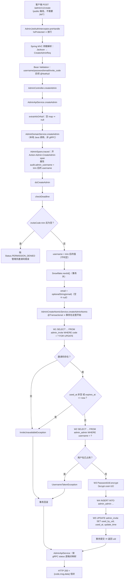
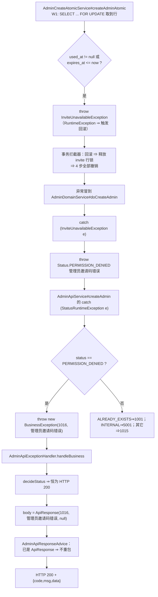
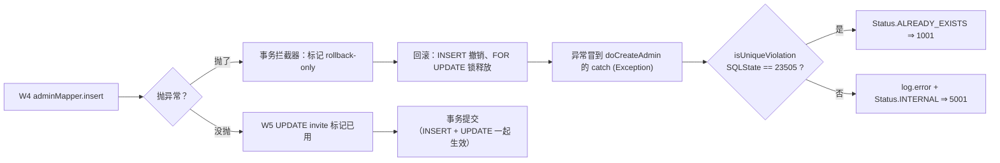
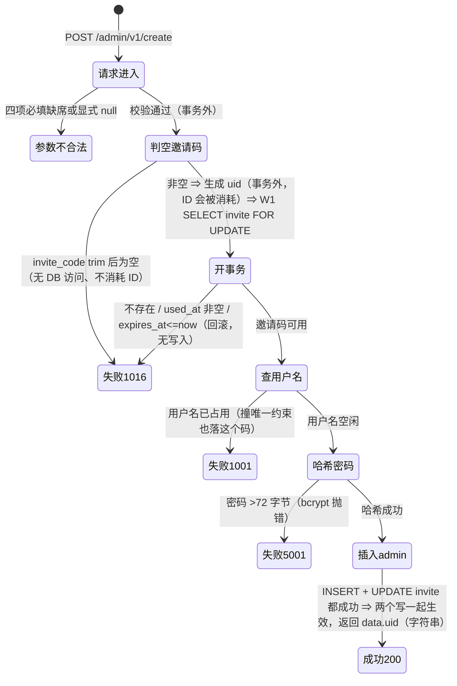

# 02. 管理员创建流程（POST /admin/v1/create）

> 研究对象：`service/users/admin/`（RAG-V1 管理域 Spring Boot 进程）
> 本文所有源码定位都可在仓库 `/Users/pr/Documents/GitHub/RAG-V1` 中按 `文件:行号` 核对。

---

## 1. 本次流程的研究范围

### 1.1 我们要追踪什么

拿着一个邀请码创建**新的管理员账号**，到新管理员落库、邀请码标记已用为止：

```
HTTP 请求（public 路径，不需要 JWT）
  → Spring MVC 参数解析（Jackson + Bean Validation）
  → AdminController#createAdmin
  → AdminApiService#createAdmin
  → AdminDomainService#createAdmin / #doCreateAdmin
      ├─ Snowflake.nextId()（事务外）
      └─ AdminCreateAtomicService#createAdminAtomic（事务内）
          ├─ W1 SELECT invite WHERE code = ? FOR UPDATE
          ├─ W2 SELECT admin WHERE username = ?
          ├─ W3 bcrypt 哈希
          ├─ W4 INSERT admin
          └─ W5 UPDATE invite SET used_by_uid, used_at
  → AdminApiResponseAdvice（统一信封）
  → HTTP JSON 响应
```

### 1.2 追踪到哪里为止

| 到此为止 | 不在本篇范围 |
|---|---|
| 客户端拿到 `{"code":200,"msg":"OK","data":{"uid":"123..."}}` | 邀请码**怎么来的** → 见 [03](./03-邀请码生成流程.md) §4 |
| `admin_invite.used_by_uid` / `used_at` 被写上 | 邀请码 TTL 的生成侧 → 见 [03](./03-邀请码生成流程.md) §4.5 |
| 事务的提交 / 回滚边界 | 事务机制在别的端点的表现 → 见本域 [15](./15-异常处理与统一响应流程.md) §4 |
| 一次 INSERT + 一次 UPDATE | 表结构 DDL 全文 → `service/users/common/src/main/resources/db/` |

### 1.3 这个流程要完成的五件事

1. 校验**邀请码**有效（存在、没被用过、没过期）。
2. 校验**用户名**没被占用。
3. 把明文密码**哈希**成 bcrypt 串。
4. 生成一个 Snowflake uid 作为新管理员的**业务主键**。
5. 插入管理员行，并把邀请码**标记为已用**。

### 1.4 🔴 本篇的核心：步骤顺序本身就是行为契约

这五件事**必须按这个顺序**做，而且顺序不是实现细节，是**可观察行为**：

```
W1 锁 invite（悲观锁）→ 校验邀请码
W2 查 username 冲突
W3 bcrypt 哈希           ← 必须在 W1/W2 之后！
W4 insert admin
W5 标记 invite 已用
```

**如果 bcrypt 跑到 W1/W2 前面**，超长密码会抢先抛错，
把本该报「邀请码错误(1016)」「用户名已存在(1001)」的请求报成「系统内部错误(5001)」。
详见 §4.6。

---

## 2. 触发场景与输入

新管理员用邀请码注册：

```
POST /admin/v1/create
Content-Type: application/json

{
    "username": "newadmin",
    "password": "s3cret-p@ss",
    "email": "newadmin@example.com",
    "invite_code": "ADM-3F9A7C2E1B4D8A06",
    "extra_info": {
        "department": "ops"
    }
}
```

DTO（`service/users/admin/src/main/java/com/rag/admin/dto/admin/CreateAdminReq.java:36`）：

```java
public record CreateAdminReq(
        @NotNull String username,
        @NotNull String password,
        @NotNull @JsonInclude(JsonInclude.Include.NON_NULL) String email,
        @NotNull @JsonProperty("invite_code") String inviteCode,
        @JsonInclude(JsonInclude.Include.NON_NULL) @JsonProperty("extra_info") Map<String, String> extraInfo) {
}
```

| JSON 键 | Java 组件 | 类型 | 约束 |
|---|---|---|---|
| `username` | `username` | `String` | `@NotNull` |
| `password` | `password` | `String` | `@NotNull` |
| `email` | `email` | `String` | `@NotNull` |
| `invite_code` | `inviteCode` | `String` | `@NotNull` |
| `extra_info` | `extraInfo` | `Map<String,String>` | **无约束** |

⚠️ 两个容易看错的点：

1. **`extra_info` 没有 `@NotNull`** —— 但这**不是**漏标。
   真源那侧对它走的是「显式 null 报错、缺席放行」的**三态**判定，
   Bean Validation 没有等价物 ⇒ 降级登记为 D-01。
2. **`email` 是 `@NotNull`，但可以是空串** —— 空串在 HTTP 层合法，
   到领域层会被 `AdminHelpers.optionalString` 归一成 `null` ⇒ 不写进库（`email` 列可空）。
   ⇒ 「必填」和「一定会有值」是两件事。

**wire 键名**：`invite_code` / `extra_info` 是 snake_case（`@JsonProperty` 指定的），
`username` / `password` / `email` 是原样。

### 2.1 `/admin/v1/create` 是 public 路径

`/admin/v1/create` 与 `/admin/v1/login` 一样，**不在** `PROTECTED_PATHS` 里
⇒ 拦截器放行 ⇒ **不需要 Authorization 头**。

这正是「邀请码」存在的意义：**邀请码就是凭证**。
没有邀请码的人也能调这个端点，但过不了 W1 那一步。

---

## 3. 整体执行路线



---

## 4. 逐步讲解

### 4.1 第一个环节：请求进入 Controller

`AdminController.java:139`：

```java
@PostMapping("/create")
public CreateAdminResp createAdmin(@Valid @RequestBody CreateAdminReq req, HttpServletRequest httpRequest) {
    return adminApiService.createAdmin(req, httpRequest);
}
```

和登录端点一样：

- `@RequestBody` **必填**（`required` 默认 true）⇒ 空 body ⇒ `HttpMessageNotReadableException` ⇒ 400 + text/plain。
- `@Valid` ⇒ Bean Validation 校验四项 `@NotNull`。
- `httpRequest` 这个参数**在本端点没用到**（它只在需要从 token 取身份的端点里用）。
  本端点是 public 的，操作人不需要身份。

### 4.2 第二个环节：`AdminApiService#createAdmin`

`AdminApiService.java:275`：

```java
public CreateAdminResp createAdmin(CreateAdminReq req, HttpServletRequest httpRequest) {
    long uid;
    try {
        uid = adminDomainService.createAdmin(
                req.username() == null ? "" : req.username(),
                req.password() == null ? "" : req.password(),
                req.email() == null ? "" : req.email(),
                // B 侧链路：api 层 putAllExtraInfo(null→{}) ⇒ proto 空 map ⇒ rpc 层判 isEmpty ⇒ 传 null
                extraInfoOrNull(req.extraInfo()),
                req.inviteCode() == null ? "" : req.inviteCode());
    } catch (StatusRuntimeException e) {
        log.error("admin createAdmin RPC error, username={}", req.username(), e);
        // ⚠️ **逐端点 switch（B 出处：对应 B 侧 api service 的 catch 块逐条照抄）**
        //    —— 不能用 advice 的通用 mapRPCStatusToCode：本端点的 INTERNAL 码与通用表**不同**。
        Status.Code code = e.getStatus().getCode();
        if (code == Status.Code.PERMISSION_DENIED) {
            throw new BusinessException(ErrCodes.ERROR_ADMIN_INVITE_CODE_WRONG,
                    ErrMsg.getMsg(ErrCodes.ERROR_ADMIN_INVITE_CODE_WRONG));
        }
        if (code == Status.Code.ALREADY_EXISTS) {
            throw new BusinessException(ErrCodes.ERROR_USER_EXIST,
                    ErrMsg.getMsg(ErrCodes.ERROR_USER_EXIST));
        }
        if (code == Status.Code.INTERNAL) {
            throw new BusinessException(ErrCodes.ERROR_SERVER_COMMON,
                    ErrMsg.getMsg(ErrCodes.ERROR_SERVER_COMMON));
        }
        throw new BusinessException(ErrCodes.CODE_SERVER_BUSY,
                ErrMsg.getMsg(ErrCodes.CODE_SERVER_BUSY));
    }

    // B 侧：CreateAdminResp.setUid(uid)（Long）⇒ getter 返回 uid.toString() ⇒ JSON 是字符串
    return new CreateAdminResp(String.valueOf(uid));
}
```

本端点的逐端点映射：

| 领域层 gRPC status | 业务码 | 文案 | 触发原因 |
|---|---|---|---|
| `PERMISSION_DENIED` | **1016** `ERROR_ADMIN_INVITE_CODE_WRONG` | 管理员邀请码错误 | 邀请码不存在 / 已用 / 过期 |
| `ALREADY_EXISTS` | **1001** `ERROR_USER_EXIST` | 用户名已存在 | 用户名被占用 / 唯一约束冲突 |
| `INTERNAL` | **5001** `ERROR_SERVER_COMMON` | 系统内部错误 | 数据库失败 / bcrypt 超长密码 |
| 其它（default） | **1015** `CODE_SERVER_BUSY` | 服务繁忙 | deadline 超时等 |

⚠️ 注意 `PERMISSION_DENIED` 在**通用兜底表**里也映射成 1016（`AdminApiExceptionHandler.java:172`），
但这里之所以还要自己写一遍，是因为**同端点的 `INTERNAL` 码与通用表不同**
（通用表也是 5001，但 `updateSelf` / `unBanUser` / `resetUserPassword` 那几个端点的 INTERNAL 是 5003）。

#### 4.2.1 `extraInfoOrNull` 是什么

`AdminApiService.java:803`：

```java
private static Map<String, String> extraInfoOrNull(Map<String, String> extraInfo) {
    return (extraInfo == null || extraInfo.isEmpty()) ? null : new HashMap<>(extraInfo);
}
```

它的作用是**归一化**：把「null」和「空 map」压成同一个形态 `null`。

真源那侧的等价链是：

```
api 层：putAllExtraInfo(null → {})   ⇒ proto 里是个空 map
rpc 层：判 isEmpty() ? null : new HashMap<>(...)  ⇒ 领域层收到 null 或非空 map
```

本仓按 D2「域内直连」把 proto 中转去掉了 ⇒ 归一化点必须**留在同一层**，
否则「空 map」会一路传下去。

⚠️ 归一化在这个流程里发生了**三次**（三层各一次），行为一致：

| 层 | 代码 |
|---|---|
| `AdminApiService#createAdmin` | `extraInfoOrNull(req.extraInfo())` |
| `AdminDomainService#doCreateAdmin` | `safeExtraInfo = (extraInfo == null \|\| extraInfo.isEmpty()) ? null : new HashMap<>(extraInfo)` |
| `AdminCreateAtomicService` W4 | `if (extraInfo != null && !extraInfo.isEmpty()) { admin.setExtraInfo(new HashMap<>(extraInfo)); }` |

最终效果：**`extra_info` 为空时，数据库里那一列就是 NULL**（而不是 `{}`）。

### 4.3 第三个环节：领域层外层 —— 开 span

`AdminDomainService.java:528`：

```java
public long createAdmin(String username, String password, String email,
                        Map<String, String> extraInfo, String inviteCode) {
    // 🔴 DRIFT-ARPC-006：参考侧 createadminlogic.go 的顺序是
    //     tracer.Start(ctx, "Action-Admin-CreateAdmin")
    //     username := strings.TrimSpace(in.Username)      ← 先 trim
    //     span.SetAttributes(attribute.String("audit.admin_username", username))  ← 再打属性
    // ⇒ 属性必须取**trim 之后**的值，与参考侧逐字一致（不是原始入参）。
    return AdminSpans.traced(AdminSpans.CREATE_ADMIN,
            span -> span.setAttribute(AdminSpans.ATTR_ADMIN_USERNAME,
                    username == null ? "" : username.trim()),
            () -> doCreateAdmin(username, password, email, extraInfo, inviteCode));
}
```

⚠️ **对照记忆点**：
`createAdmin` 的 span 属性用 **trim 之后**的 username，
而 `login` 的 span 属性用**原始** username（`AdminDomainService.java:236`）。
两个字段名一样（`audit.admin_username`），取值口径不同 —— 是真源两个 logic 的原始差异。

### 4.4 第四个环节：领域层内层 —— `doCreateAdmin`

`AdminDomainService.java:541`：

```java
private long doCreateAdmin(String username, String password, String email,
                           Map<String, String> extraInfo, String inviteCode) {
    checkDeadline();
    // inviteCode 非空
    String trimmedInvite = inviteCode == null ? "" : inviteCode.trim();
    if (trimmedInvite.isEmpty()) {
        throw Status.PERMISSION_DENIED.withDescription("管理员邀请码错误").asRuntimeException();
    }

    // DRIFT-008（已修）：此处**不**校验 username 是否为空。
    String trimmedUsername = username == null ? "" : username.trim();
```

#### 4.4.1 邀请码为空的判断在**最前面**

`inviteCode.trim()` 后为空 ⇒ 直接 `PERMISSION_DENIED`（⇒ 1016 管理员邀请码错误）。

这一步在**任何数据库操作之前** ⇒ 一个连邀请码都没填的请求，
**不会**产生任何 DB 读写，也**不会**消耗 Snowflake ID。

⚠️ 这也是「trim 之后判空」而不是「原串判空」：
`"   "`（纯空白）也会被当成空 ⇒ 1016。

#### 4.4.2 用户名**不**判空

源码注释解释了原因（`AdminDomainService.java:550`）：

```java
// DRIFT-008（已修）：此处**不**校验 username 是否为空。
// 参考侧 createadminlogic.go 没有该校验——username 为空串时会照常进事务、
// 查重（通常 not found）并 INSERT 成功，返回 uid。
// 本实现此前多加了一道 INVALID_ARGUMENT「用户名不能为空」，而
// AdminCreateService 的 switch 没有 INVALID_ARGUMENT case，会落到 default
// 被报成 1015「服务繁忙」——把一个本来能成功的建号请求报成服务端故障。
```

⇒ **username 为空串时，流程照常走完并成功建号**。
（`admin_admin.username` 列是 `TEXT UNIQUE`，所以第二个空串会撞唯一约束 ⇒ 1001。）

### 4.5 第五个环节：Snowflake uid —— 在**事务外**

`AdminDomainService.java:577`：

```java
// Snowflake uid（事务外）
long uid;
try {
    uid = Snowflake.nextId();
} catch (StatusRuntimeException e) {
    throw e;
} catch (Exception e) {
    log.error("admin createAdmin Snowflake.nextId failed", e);
    throw Status.INTERNAL.withDescription("DB添加失败").asRuntimeException();
}
```

`Snowflake.nextId()`（`common/src/main/java/com/rag/common/snowflake/Snowflake.java:268`）：

```java
public static long nextId() {
    if (workerId == null && initError == null) {
        init(); // 对应 B 的 GetID() 第一行 Init()
    }
    if (initError != null) {
        throw new IllegalStateException("snowflake node is not initialized", initError);
    }
    Long id = workerId;
    if (id == null) {
        throw new IllegalStateException("snowflake node is not initialized");
    }
    return nextIdInternal(id, STATE);
}
```

ID 的位布局（`Snowflake.java:56`~`74`）：

```
epoch  = 1288834974657（2010-11-04 01:42:54 UTC）
41 位时间戳 | 10 位 workerId | 12 位 sequence
```

算法体 `nextIdInternal`（`Snowflake.java:347`）：

```java
public static long nextIdInternal(long workerIdArg, State state) {
    synchronized (state) {
        long now = state.nowMillisSinceEpoch();
        if (now == state.lastTimestamp) {
            state.sequence = (state.sequence + 1) & SEQUENCE_MASK;
            if (state.sequence == 0) {
                while (now <= state.lastTimestamp) {
                    now = state.nowMillisSinceEpoch();
                }
            }
        } else {
            state.sequence = 0L;
        }
        state.lastTimestamp = now;
        return (now << TIMESTAMP_SHIFT)
                | (workerIdArg << WORKER_ID_SHIFT)
                | state.sequence;
    }
}
```

要点：

- 同一毫秒内靠 12 位 sequence（0~4095）区分；耗尽了就**自旋到下一毫秒**。
- 时钟源是「锚点 + 单调流逝」，**不是纯墙钟** ⇒ 墙钟回拨不会让 ID 重复。
- `synchronized (state)` ⇒ 进程内串行化。

#### 🔴 为什么 uid 生成在事务**外**

源码注释（`AdminDomainService.java:573`）写明了理由：

```java
// ⚠️ 下方原先那条注释「bcrypt password（事务外，避免延长事务持有时间）」
// 描述的是一个**未经参考侧出处论证**的优化（§3.2 无出处 idiomatization），
// 本次按用户裁决撤销。代价已知并接受：cost=10 约 60~100ms，
// 会延长 invite 行 FOR UPDATE 的持锁时间；但该锁只锁单行。
//
// Snowflake uid 仍留在事务外（见下）：它不触碰 invite 锁，也不参与错误码归属，
// 与参考侧放在哈希之后相比不产生可观测差异（参考侧 GetID 失败同样是 Internal）。
```

⇒ **uid 的生成位置（事务外）是刻意保留的**：

- 它**不触碰 invite 行的锁**（锁是 W1 的 SELECT 拿的，还在事务外），
- 它**不参与错误码归属**（Snowflake 失败 ⇒ 同样是 INTERNAL）。

⚠️ 但它有一个**可观察的副作用**：uid 是**单调消耗**的。
即使后面事务回滚了，**这个 ID 已经被消耗掉了**，永远不会被复用。
详见 §6.8。

### 4.6 🔴 第六个环节：进入事务 —— `AdminCreateAtomicService`

`AdminDomainService.java:591`：

```java
// 4 步事务
String optionalEmail = AdminHelpers.optionalString(email);
Map<String, String> safeExtraInfo = (extraInfo == null || extraInfo.isEmpty())
        ? null
        : new HashMap<>(extraInfo);
try {
    createAtomicService.createAdminAtomic(
            trimmedUsername, trimmedInvite, password, optionalEmail, safeExtraInfo, uid, true);
} catch (InviteUnavailableException e) {
    throw Status.PERMISSION_DENIED.withDescription("管理员邀请码错误").asRuntimeException();
} catch (UsernameTakenException e) {
    throw Status.ALREADY_EXISTS.withDescription("用户名已存在").asRuntimeException();
} catch (StatusRuntimeException e) {
    throw e;
} catch (Exception e) {
    if (AdminExceptions.isUniqueViolation(e)) {
        throw Status.ALREADY_EXISTS.withDescription("用户名已存在").asRuntimeException();
    }
    log.error("admin createAdmin 4-step transaction failed", e);
    throw Status.INTERNAL.withDescription("DB添加失败").asRuntimeException();
}

log.info("admin createAdmin success, username={}", trimmedUsername);
return uid;
```

几个点：

- `optionalEmail` = `AdminHelpers.optionalString(email)`（`service/AdminHelpers.java:26`）：

  ```java
  public static String optionalString(String value) {
      if (value == null) {
          return null;
      }
      String trimmed = value.trim();
      if (trimmed.isEmpty()) {
          return null;
      }
      return trimmed;
  }
  ```

  ⇒ 空串 email ⇒ `null` ⇒ 那一列不写。

- 最后一个参数 **`true`** = `passwordIsPlaintext`。
  ⇒ **明文密码**被传进去，**哈希在事务内部完成**（W3）。

- 四个 catch 的顺序：两个业务 sentinel 异常先 catch，
  然后是 gRPC 异常原样重抛（`DEADLINE_EXCEEDED` 不能被改写），
  最后是宽 catch（DB 错误 + 唯一约束兜底）。

#### 4.6.1 `@Transactional` 的落点与代理问题（本篇最需要讲清的一节）

`AdminCreateAtomicService`（`domain/service/AdminCreateAtomicService.java:57`）：

```java
@Service
public class AdminCreateAtomicService {

    private final AdminMapper adminMapper;
    private final AdminInviteMapper adminInviteMapper;

    public AdminCreateAtomicService(AdminMapper adminMapper, AdminInviteMapper adminInviteMapper) {
        this.adminMapper = adminMapper;
        this.adminInviteMapper = adminInviteMapper;
    }
```

它有两个重载，**两个都带 `@Transactional`**：

```java
@Transactional
public Long createAdminAtomic(String username, String inviteCode, String passwordHash,
                              String email, Map<String, String> extraInfo, Long generatedUid) {
    return createAdminAtomic(username, inviteCode, passwordHash, email, extraInfo,
            generatedUid, false);
}
```

```java
@Transactional
public Long createAdminAtomic(String username, String inviteCode, String password,
                              String email, Map<String, String> extraInfo, Long generatedUid,
                              boolean passwordIsPlaintext) {
```

**6 参数版本**接收的是**已哈希**的密码（`passwordIsPlaintext=false` ⇒ 内部不哈希）。
它内部调用 7 参数版本 —— 这是**同类自调用（self-invocation）**，不走代理。
但因为 6 参数版本自己也是 `@Transactional`，
**从外部进入时事务已经开启**，内部那次自调用只是复用已有事务 ⇒ 无行为差异。

**7 参数版本**才是生产路径（`AdminDomainService` 传 `passwordIsPlaintext=true`）。

##### 代理到底生不生效？—— 逐条核对

Spring 的 `@Transactional` 靠 **AOP 代理**生效。代理**只拦截从容器外部进来的调用**。
如果这段 4 步代码写在 `AdminDomainService` 自己的 public 方法里、
再由同类的 `createAdmin(...)` 直接调用（`this.xxx()`），调用不经过代理 ⇒
`@Transactional` **静默失效** —— 代码看着有事务，运行时是 auto-commit，异常不回滚。

本仓的写法**规避了**这个坑：

```java
// AdminDomainService.java:173
private final AdminCreateAtomicService createAtomicService;

// AdminDomainService.java:175-189（构造器注入）
public AdminDomainService(AdminMapper adminMapper,
                          AdminInviteMapper adminInviteMapper,
                          UserMapper userMapper,
                          StringRedisTemplate stringRedisTemplate,
                          AdminRpcProperties properties,
                          AdminRpcMetrics metrics,
                          AdminCreateAtomicService createAtomicService) {
    ...
    this.createAtomicService = createAtomicService;
}
```

```java
// AdminDomainService.java:596
createAtomicService.createAdminAtomic(...);
```

逐条判定：

| 检查项 | 本仓源码 | 结论 |
|---|---|---|
| `AdminCreateAtomicService` 是不是 Spring Bean？ | 类上有 `@Service`（`:57`） | ✅ 是 |
| `AdminDomainService` 是不是注入**另一个 Bean**？ | 构造器注入 `AdminCreateAtomicService`（`:181`） | ✅ 是，**不是 `this`** |
| 调用是不是跨 Bean 调用？ | `createAtomicService.createAdminAtomic(...)`（`:596`，参数省略） | ✅ 是，**不是 `this.createAdminAtomic(...)`** |
| 事务管理器有没有？ | 见下 | ✅ 有 |

⇒ **结论：代理生效，事务是真的。**

`AdminCreateAtomicService` 的类 javadoc 把这件事写成了显式设计决策：

```java
    /**
     * <p><b>为什么必须独立成 Bean</b>：Spring 的 {@code @Transactional} 靠 AOP 代理生效，
     * 而代理<b>只拦截从容器外部进来的调用</b>。若这 4 步写在 {@code AdminDomainService}
     * 自己的 public 方法里、再由同类的 {@code createAdmin(...)} 直接调用（self-invocation），
     * 调用不经过代理，{@code @Transactional} 会<b>静默失效</b>——代码看着有事务，运行时是
     * auto-commit，异常不回滚。独立 Bean 后由 {@code AdminDomainService} 跨 Bean 调用，
     * 代理才会生效。
     */
```

##### 事务管理器从哪来

**本模块的主代码里没有显式的 `@EnableTransactionManagement`，也没有手写 `PlatformTransactionManager` bean。**

事务基础设施由 **Spring Boot 的自动配置**提供：

- `TransactionAutoConfiguration` ⇒ 导入 `@EnableTransactionManagement`（开启 `@Transactional` 解析）+ 事务拦截器；
- `DataSourceTransactionManagerAutoConfiguration` ⇒ 在 classpath 上有 `DataSource` 且没有别的 `PlatformTransactionManager` 时，
  造一个 `DataSourceTransactionManager`。

本模块具备条件：`application.yml` 里配了 `spring.datasource`（PostgreSQL），
pom 里引了 `mybatis-plus-spring-boot3-starter`（传递依赖 `spring-boot-starter-jdbc` ⇒ `spring-jdbc`）。

> ⚠️ **这是框架机制，不是本仓显式代码** —— 上面这段属于「Spring Boot 框架本身的机制」，
> 不是「源码里能 grep 到的一行」。要验证运行时行为，看测试
> `AdminDomainServiceRealPgTest`（它自己注册了 `@EnableTransactionManagement` +
> `DataSourceTransactionManager`）。

### 4.7 第七个环节：W1 —— 悲观锁查邀请码

`AdminCreateAtomicService.java:132`：

```java
// W1 查 invite：悲观锁 SELECT ... FOR UPDATE —— 必须在事务内做，
// 锁到本事务结束，保证同一邀请码不会被两个并发事务同时消费。
AdminInviteEntity invite = adminInviteMapper.selectOne(
        new LambdaQueryWrapper<AdminInviteEntity>()
                .eq(AdminInviteEntity::getCode, inviteCode)
                .last("FOR UPDATE")
);
if (invite == null) {
    throw new InviteUnavailableException("invite code not found: " + inviteCode);
}
```

生成的 SQL 形状：

```sql
SELECT id, code, inviter_uid, expires_at, used_by_uid, used_at, create_time, update_time
FROM admin_invite
WHERE code = ?
FOR UPDATE
```

`.last("FOR UPDATE")` 是 MyBatis-Plus 的**原样追加**：把这段 SQL 片段拼到语句末尾。

#### 4.7.1 `FOR UPDATE` 到底解决了什么

邀请码的业务不变量是「**一次性使用**」。

如果只靠「事务内读 `used_at`，再更新」这种写法，在 PostgreSQL 默认的 **READ COMMITTED** 隔离级别下仍有竞态：

```
时刻 T1: 事务 A 读 invite 行，看到 used_at IS NULL  ⇒ 校验通过
时刻 T2: 事务 B 读 invite 行，看到 used_at IS NULL  ⇒ 校验通过（B 读到的还是旧快照）
时刻 T3: 事务 A INSERT admin，UPDATE invite SET used_at = now
时刻 T4: 事务 B INSERT admin，UPDATE invite SET used_at = now  ← 后写者覆盖先写者
⇒ 同一个邀请码创建出了**两个**管理员
```

加上 `SELECT ... FOR UPDATE` 之后：

```
时刻 T1: 事务 A 执行 SELECT ... FOR UPDATE ⇒ **拿到该行的行级排他锁**
时刻 T2: 事务 B 执行 SELECT ... FOR UPDATE ⇒ **阻塞等待**
时刻 T3: 事务 A 校验通过、INSERT、UPDATE used_at ⇒ **提交，释放锁**
时刻 T4: 事务 B 拿到锁 ⇒ 读到的是**已被标记 used 的行** ⇒ used_at != null ⇒ InviteUnavailableException
⇒ 第二个调用被拒绝
```

要点：

- 这是**行级悲观锁**（row-level lock），**不是表锁** —— 只锁 `admin_invite` 里 `code` 匹配的那**一行**。
- 锁**持有到事务结束**（提交或回滚才释放）。
- 锁的范围只有**一行** ⇒ 不影响其它邀请码、也不影响其它 admin 行的操作。

> ⚠️ 一个 PostgreSQL 的细节：`SELECT ... FOR UPDATE` 对**不存在的行**不锁任何东西
> （PG 没有「间隙锁」）。所以「用同一个不存在的 code 并发创建」时，
> 两个事务都会拿到 `null`、都抛 `InviteUnavailableException`、都失败 ——
> 结果仍然正确（不会建出两个 admin），只是靠的是「都失败」而不是「串行化」。

#### 4.7.2 过期与已用的判定

`AdminCreateAtomicService.java:150`：

```java
// 🔴 OffsetDateTime，不是 LocalDateTime（2026-10-23，用户拍板修 DRIFT-ARPC-004②）。
// B 出处：AdminCreateAtomicService.java（admin-rpc）—— 事务闭包内
//     now := time.Now()
//     if invite.UsedAt != nil || !invite.ExpiresAt.After(now)
// B 侧的 invite.ExpiresAt 来自 **timestamptz** 列 ⇒ 带 location 的绝对时刻，
// `.After(now)` 比的是绝对时刻。
OffsetDateTime now = OffsetDateTime.now();
if (invite.getUsedAt() != null || !invite.getExpiresAt().isAfter(now)) {
    throw new InviteUnavailableException("invite code expired or used: " + inviteCode);
}
```

一个 `if` 判两种情况：

| 条件 | 含义 |
|---|---|
| `invite.getUsedAt() != null` | **已经被人用过了**（`used_at` 被写过） |
| `!invite.getExpiresAt().isAfter(now)` | **已过期**（`expires_at` 不在 `now` 之后） |

⚠️ 两个细节：

1. **判的是 `used_at`，不是 `used_by_uid`。**
   `used_by_uid` 在「码被用但 uid 还没写进去」的中间态下可能仍为 NULL。
   判 `used_at` 才是「这个码有没有被消费过」的权威标志。
2. **必须用 `OffsetDateTime`（绝对时刻），不能用 `LocalDateTime`（墙钟）。**
   跨时区多实例部署时（A 区建码、B 区消费），墙钟比较会让邀请码**刚生成就判为已过期**。
   详见 [03](./03-邀请码生成流程.md) §4.6。

⇒ 邀请码无效的**三种**原因（不存在 / 已用 / 过期）抛的是**同一个**异常
`InviteUnavailableException`，最终都映射成 **1016 管理员邀请码错误**。
客户端**分不出**是哪种原因 —— 这也是防枚举的一部分。

### 4.8 第八个环节：W2 —— 查用户名冲突

`AdminCreateAtomicService.java:155`：

```java
// W2 查 username 冲突（事务内）
AdminEntity existing = adminMapper.selectOne(
        new LambdaQueryWrapper<AdminEntity>().eq(AdminEntity::getUsername, username)
);
if (existing != null) {
    throw new UsernameTakenException("admin already exists with username: " + username);
}
```

SQL：

```sql
SELECT id, uid, username, password, email, extra_info, create_time, update_time
FROM admin_admin
WHERE username = ?
```

⚠️ 这里**没有** `FOR UPDATE`。为什么不需要？

因为 `admin_admin.username` 上有 **UNIQUE 约束**（`03_create_admin.sql:54`）。
数据库的唯一索引是**最后一道防线**：
即便两个不同邀请码的并发事务同时用同一个用户名走到这里都查不到人，
它们后面 INSERT 时会有一方撞唯一约束 ⇒ 被兜底成 `ALREADY_EXISTS`（见 §4.11）。

⇒ 「先查后插」是**快速失败**（避免白跑一趟 INSERT），
唯一约束才是**正确性保证**。两者缺一不可。

### 4.9 🔴 第九个环节：W3 —— bcrypt 哈希（**必须**在 W1/W2 之后）

`AdminCreateAtomicService.java:163`：

```java
// R5（2026-10-22，用户签字「完全对齐 B 侧」）：bcrypt 必须在 W1/W2 之后。
//
// 两端 bcrypt 实现相同（B 侧 bcrypt.DefaultCost=10 / RAG PasswordUtil STRENGTH=10），
// 都拒 >72 字节的密码；分歧<b>纯粹来自步骤顺序</b>：
// 修复前 RAG 在事务外先哈希 → 72 字节上限抢在 invite / username 检查之前抛错，
// 把本该报 1016 / 1001 的请求报成 5001。
// B 出处：AdminCreateAtomicService.java（admin-rpc）事务闭包内 PasswordEncrypt 在
//           FindAdminInviteByCodeForUpdate 与 FindOneAdminByUsernameTx 之后。
String effectiveHash = password;
if (passwordIsPlaintext) {
    try {
        effectiveHash = PasswordUtil.encrypt(password);
    } catch (StatusRuntimeException e) {
        // B-1：DEADLINE_EXCEEDED 必须上抛，不能被改写成 INTERNAL。
        throw e;
    } catch (Exception e) {
        // bcrypt 对 >72 字节抛 IllegalArgumentException。
        // B 侧这里同样是裸 err → 由 CreateAdminLogic 外层兜成 Internal(1015)，
        // 这里保持同一归属：冒泡给 AdminDomainService 的 db_error 分支。
        throw e;
    }
}
```

`PasswordUtil.encrypt`（`common/src/main/java/com/rag/common/security/PasswordUtil.java:73`）：

```java
public static String encrypt(String rawPassword) {
    return ENCODER.encode(rawPassword);
}
```

`ENCODER = new BCryptPasswordEncoder(10)`（`:49`）⇒ **bcrypt cost = 10**。

#### 4.9.1 为什么顺序不能改 —— 具体到错误码

bcrypt 算法本身只处理**前 72 字节**。密码更长时，Spring Security 会直接抛异常。

**实测口径**（spring-security-crypto **7.0.7** 的字节码，不靠记忆）：

```
BCrypt.hashpw(String, String)
  → hashpw(byte[], String)
      → hashpw(byte[], String, false)      ← 布尔传 false
          if (password.length > 72)
              throw new IllegalArgumentException("password cannot be more than 72 bytes")
```

而 `BCryptPasswordEncoder#encode` 走的就是 `BCrypt.hashpw(String, String)` ⇒ **检查生效**。

（对比：`BCrypt.checkpw` 走 `hashpwforcheck` ⇒ 布尔传 `true` ⇒ **跳过**长度检查。
⇒ 所以「登录时提交超长密码」不会抛异常，只会「不匹配」；
⇒ 而「建号时提交超长密码」会抛异常。两条路径行为不同。）

现在看**顺序**如何影响错误码：

| 顺序 | 请求：无效邀请码 + 80 字节密码 | 结果 |
|---|---|---|
| **bcrypt 在前**（修复前的写法） | bcrypt 先抛 `IllegalArgumentException` | 报 **5001 系统内部错误** ❌ |
| **bcrypt 在后**（现在的写法） | 先 W1 校验邀请码 | 报 **1016 管理员邀请码错误** ✅ |

再看另一个组合：

| 顺序 | 请求：有效邀请码 + 已占用用户名 + 80 字节密码 | 结果 |
|---|---|---|
| **bcrypt 在前** | bcrypt 先抛 | 报 **5001** ❌ |
| **bcrypt 在后** | 先 W1 通过，W2 查出用户名冲突 | 报 **1001 用户名已存在** ✅ |

⇒ **同样一个请求，顺序不同 ⇒ 客户端拿到的错误码完全不同。**
这就是「步骤顺序是行为契约」的含义。

源码里记录了真源那侧的步骤序（`AdminCreateAtomicService.java:100`）：

```java
 *   FindAdminInviteByCodeForUpdate → not found/过期 → PermissionDenied
 *   FindOneAdminByUsernameTx        → 命中         → AlreadyExists
 *   cryptx.PasswordEncrypt          → >72 字节    → err
 *   snowflake.GetID
 *   InsertOneAdminTx
 *   UpdateAdminInviteUsedTx
```

⇒ 真源就是「先校验、后哈希」。本仓逐条镜像。

#### 4.9.2 ⚠️ 代价：bcrypt 延长了持锁时间

`bcrypt cost=10` 大约 **60~100ms**（`AdminCreateAtomicService.java:116` 的记载）。
这 60~100ms 全程**持有 `admin_invite` 那一行的行锁**。

**这是刻意接受的代价**，源码写得很明白：

```java
     * <p><b>为什么哈希必须在事务内（代价已知并接受）</b>：bcrypt cost=10 约 60~100ms
     * （B 侧 用 {@code bcrypt.DefaultCost}=10，RAG 用 {@code STRENGTH}=10，同量级），
     * 会延长 invite 行 {@code SELECT ... FOR UPDATE} 的持锁时间。
     * 这是<b>刻意选择</b>：B 侧 本身就是这个顺序，而该锁只锁 invite 单行，
     * 换来的是「错误码归属」与真源逐条一致。
```

权衡：

| 方案 | 优点 | 缺点 |
|---|---|---|
| **哈希在事务外**（修复前） | 锁持有时间短（几乎为 0） | ❌ 错误码归属与真源分叉（1016/1001 变 5001） |
| **哈希在事务内**（现在） | 错误码归属与真源逐条一致 | 锁多持有 60~100ms（但只锁一行） |

⇒ 选「错误码归属一致」，接受持锁时间变长。

⚠️ 顺带一提：源码里明确记录了**之前有过一次「优化」被撤销**：

```java
// <p>此前本方法的 javadoc 写着「bcrypt password（事务外，避免延长事务持有时间）」——
// 那条注释描述的是一个<b>未经 B 出处论证</b>的优化，属 §3.2「无出处 idiomatization」，
// 本次按用户裁决撤销。
```

⇒ **没有真源出处的「优化」是危险的**：它会悄悄改变客户端可见的错误码。

### 4.10 第十个环节：W4 —— 插入管理员

`AdminCreateAtomicService.java:187`：

```java
// W3 插入 admin（事务内）
AdminEntity admin = new AdminEntity();
admin.setUid(generatedUid);
admin.setUsername(username);
admin.setPassword(effectiveHash);
admin.setEmail(email);   // nullable，null 表示不填
if (extraInfo != null && !extraInfo.isEmpty()) {
    admin.setExtraInfo(new HashMap<>(extraInfo));
}
adminMapper.insert(admin);
```

落库的字段：

| 列 | 值 | 说明 |
|---|---|---|
| `id` | 自增 | `BIGSERIAL PRIMARY KEY` |
| `uid` | Snowflake uid | `BIGINT NOT NULL UNIQUE` |
| `username` | trim 后的用户名 | `TEXT UNIQUE` |
| `password` | **bcrypt 哈希** | `TEXT`，**不是明文** |
| `email` | `optionalString(email)`，可能为 NULL | `TEXT UNIQUE`，可空 |
| `extra_info` | JSON 文本 | `TEXT`，`JsonTextTypeHandler` |
| `create_time` / `update_time` | DB 默认 | `FieldStrategy.NEVER` ⇒ 不由实体写 |

⚠️ `extra_info` 的 `JsonTextTypeHandler`（`AdminEntity.java:128`）：

```java
@TableField(value = "extra_info", typeHandler = JsonTextTypeHandler.class)
private Map<String, String> extraInfo;
```

配合类上的 `@TableName(value = "admin_admin", autoResultMap = true)`
⇒ 映射成 `text` 列里的 JSON 文本。

⚠️ **`extra_info` 列是 `text` 不是 `jsonb`** —— 这不是省事，是刻意的：
`jsonb` 会校验并拒绝某些 JSON 文本能产出的合法内容
（实测：含 U+0000 的 extra_info，`jsonb` 列会以 `22P05` 拒收，`text` 列照单全收）⇒ 两侧行为会分叉。

### 4.11 第十一个环节：W5 —— 标记邀请码已用

`AdminCreateAtomicService.java:198`：

```java
// W4 标记 invite used（事务内）
LambdaUpdateWrapper<AdminInviteEntity> inviteWrapper = new LambdaUpdateWrapper<>();
inviteWrapper.eq(AdminInviteEntity::getId, invite.getId())
        .set(AdminInviteEntity::getUsedByUid, generatedUid)
        .set(AdminInviteEntity::getUsedAt, now)
        .setSql("update_time = CURRENT_TIMESTAMP");
adminInviteMapper.update(null, inviteWrapper);
```

生成的 SQL 形状：

```sql
UPDATE admin_invite
SET used_by_uid = ?, used_at = ?, update_time = CURRENT_TIMESTAMP
WHERE id = ?
```

⚠️ **WHERE 用的是 `id`（主键），不是 `code`** —— 因为 W1 已经把行锁住了，
用主键定位最精确。

⚠️ `adminInviteMapper.update(null, inviteWrapper)` 的第一个参数是 **`null`**。
这是 MyBatis-Plus 的 **wrapper-only 更新路径**：实体为 null ⇒ 只有 wrapper 里显式 set 的字段进 SET 子句。

⚠️ `update_time` 是用 `.setSql("update_time = CURRENT_TIMESTAMP")` 显式加的。
原因：`AdminInviteEntity` 上 `update_time` 标了 `FieldStrategy.NEVER`
（实体层永不写这一列），而 wrapper-only 路径下 MP 的 `MetaObjectHandler` 也不会被调用
⇒ 必须靠 `setSql` 推进时间戳。

⇒ **它不改变任何可观察行为**（`update_time` 不在 proto 的任何 message 里，业务代码也从不读它），
属「让 DDL 行为与真源同构」的纯对齐。

### 4.12 第十二个环节：唯一的约束兜底

如果 W4 的 INSERT 撞了唯一约束（两个并发事务用同一个用户名，
或者两个并发事务用**同一个邀请码**但 W2 都没查到 —— 后者被 FOR UPDATE 挡住，
但用户名场景挡不住）：

异常从 `createAdminAtomic` 里冒出来 ⇒ **事务回滚** ⇒
冒到 `AdminDomainService#doCreateAdmin` 的宽 catch：

```java
} catch (Exception e) {
    if (AdminExceptions.isUniqueViolation(e)) {
        throw Status.ALREADY_EXISTS.withDescription("用户名已存在").asRuntimeException();
    }
    log.error("admin createAdmin 4-step transaction failed", e);
    throw Status.INTERNAL.withDescription("DB添加失败").asRuntimeException();
}
```

⇒ 唯一约束冲突 ⇒ **1001 用户名已存在**（不是 5001）。

⚠️ 注意 catch 的**位置**：它在**事务外面**（`doCreateAdmin`），
所以回滚**已经发生**了（事务拦截器先处理异常、再把异常抛给调用方）⇒
catch 里只是**翻译错误码**，不会让已回滚的写入复活。

### 4.13 第十三个环节：返回 —— `uid` 是**字符串**

`AdminApiService.java:306`：

```java
// B 侧：CreateAdminResp.setUid(uid)（Long）⇒ getter 返回 uid.toString() ⇒ JSON 是字符串
return new CreateAdminResp(String.valueOf(uid));
```

`CreateAdminResp`（`dto/admin/CreateAdminResp.java:19`）：

```java
public record CreateAdminResp(@JsonProperty("uid") String uid) {
}
```

⇒ **JSON 里的 `uid` 是字符串**，不是数字：

```json
{
    "code": 200,
    "msg": "OK",
    "data": {
        "uid": "1854392847562910208"
    }
}
```

为什么要用字符串？

Snowflake uid 是 64 位整数（当前量级约 1.8e18），
**超过 JavaScript 的 `Number.MAX_SAFE_INTEGER`（2^53 ≈ 9.007e15）**。
如果序列化成 JSON 数字，JavaScript 前端解析时会**丢精度**
（末尾几位变成 0 或随机数）⇒ 后续用这个 uid 查用户就会查不到。

⇒ 真源那侧的 getter 返回的就是 `uid.toString()`，本仓的 DTO 组件类型直接定成 `String`。
**这是 L1 契约**，不要"顺手改成 long"。

---

## 5. 重要分支与失败路径

### 5.1 失败分支总表

| # | 发生位置 | 抛什么 | 当前层 catch | 转换后 | 上层 | 最终 HTTP | body 的 code |
|---|---|---|---|---|---|---|---|
| 1 | 请求体读不出来 | `HttpMessageNotReadableException` | Spring MVC | — | advice | **400** | text/plain，非 JSON |
| 2 | 四项必填有 null | `MethodArgumentNotValidException` | Spring MVC | — | advice | **400** | text/plain，非 JSON |
| 3 | `inviteCode` trim 后为空 | `Status.PERMISSION_DENIED` | 无（直接抛） | `StatusRuntimeException` | `AdminApiService` → `BusinessException(1016)` | **200** | **1016** |
| 4 | Snowflake 初始化失败 | `IllegalStateException` | `doCreateAdmin` 的 `catch (Exception)` | `Status.INTERNAL` | → `BusinessException(5001)` | **200** | **5001** |
| 5 | 邀请码不存在（W1） | `InviteUnavailableException` | `doCreateAdmin` | `Status.PERMISSION_DENIED` | → `BusinessException(1016)` | **200** | **1016** |
| 6 | 邀请码已用 / 已过期（W1） | `InviteUnavailableException` | 同上 | 同上 | → 1016 | **200** | **1016** |
| 7 | 用户名已占用（W2） | `UsernameTakenException` | `doCreateAdmin` | `Status.ALREADY_EXISTS` | → `BusinessException(1001)` | **200** | **1001** |
| 8 | 密码 > 72 字节（W3） | `IllegalArgumentException` | `doCreateAdmin` 的 `catch (Exception)`（**不是** unique violation） | `Status.INTERNAL`「DB添加失败」 | → `BusinessException(5001)` | **200** | **5001** |
| 9 | W4 INSERT 撞唯一约束 | `DataIntegrityViolationException` | `doCreateAdmin` | `Status.ALREADY_EXISTS` | → `BusinessException(1001)` | **200** | **1001** |
| 10 | W4/W5 其它 DB 错误 | `Exception` | `doCreateAdmin` | `Status.INTERNAL` | → `BusinessException(5001)` | **200** | **5001** |
| 11 | deadline 超时 | `Status.DEADLINE_EXCEEDED` | 领域层原样重抛 | 不变 | `AdminApiService` catch → 落 default → `BusinessException(1015)` | **200** | **1015** |
| 12 | 未预期的其它异常 | 任意 | — | — | advice `handleAny` | **500** | 5001 |

### 5.2 异常传播链（以「邀请码已过期」为例）



### 5.3 事务回滚链（以「W4 插入失败」为例）



### 5.4 三种「邀请码不可用」合并成一个码

| 具体原因 | 领域层异常 | 领域层描述 | 最终业务码 |
|---|---|---|---|
| code 不存在 | `InviteUnavailableException` | `invite code not found: XXX` | 1016 |
| 已被用过（`used_at` 非空） | `InviteUnavailableException` | `invite code expired or used: XXX` | 1016 |
| 已过期 | `InviteUnavailableException` | `invite code expired or used: XXX` | 1016 |

⇒ **客户端分不出这三种**。只有服务端日志里能看到区别。

### 5.5 事务失败时哪些步骤已经发生

| 失败点 | W1 锁 | W2 查 | W3 哈希 | W4 insert | W5 update invite | 事务结果 | Snowflake ID |
|---|---|---|---|---|---|---|---|
| 邀请码为空（事务外） | — | — | — | — | — | 未开启 | **未消耗** |
| Snowflake 失败（事务外） | — | — | — | — | — | 未开启 | 失败，未产出 |
| W1 失败 | ✅ 拿了锁 → 释放 | — | — | — | — | **回滚** | **已消耗** |
| W2 失败 | ✅ | ✅ | — | — | — | **回滚** | **已消耗** |
| W3 失败（密码超长） | ✅ | ✅ | ❌ 抛错 | — | — | **回滚** | **已消耗** |
| W4 失败 | ✅ | ✅ | ✅ | ❌ | — | **回滚** | **已消耗** |
| W5 失败 | ✅ | ✅ | ✅ | ✅（被回滚） | ❌ | **回滚** | **已消耗** |
| 全部成功 | ✅ | ✅ | ✅ | ✅ | ✅ | **提交** | 已消耗（正常） |

⇒ **一个关键结论**：除了「邀请码为空」和「Snowflake 失败」这两种**事务外**的失败，
其余所有失败都会**消耗掉一个 Snowflake ID**，但数据库里**什么都没留下**。

---

## 6. 数据变化与副作用

### 6.1 数据库

| 时机 | 表 | 操作 | SQL 形状 |
|---|---|---|---|
| 事务外 | — | 无 | — |
| W1（事务内） | `admin_invite` | 读 1 行 + **加行锁** | `SELECT ... FROM admin_invite WHERE code = ? FOR UPDATE` |
| W2（事务内） | `admin_admin` | 读 1 行 | `SELECT ... FROM admin_admin WHERE username = ?` |
| W3（事务内） | — | 无（纯 CPU 计算） | — |
| W4（事务内） | `admin_admin` | **插入 1 行** | `INSERT INTO admin_admin (uid, username, password, email, extra_info) VALUES (?, ?, ?, ?, ?)` |
| W5（事务内） | `admin_invite` | **更新 1 行** | `UPDATE admin_invite SET used_by_uid = ?, used_at = ?, update_time = CURRENT_TIMESTAMP WHERE id = ?` |

⇒ **两条写操作**（INSERT + UPDATE），**必须同生共死** ⇒ 这就是需要事务的原因。

### 6.2 事务边界

| 项 | 内容 |
|---|---|
| 是否开启事务 | **是** |
| 事务从哪里开始 | `AdminCreateAtomicService#createAdminAtomic`（7 参数重载，`@Transactional`） |
| 事务在哪里结束 | 该方法**正常返回或抛异常**时 |
| 代理是否生效 | **是** —— 跨 Bean 调用（构造器注入），不是 `this.` 自调用 |
| 事务管理器 | Spring Boot 自动配置（`TransactionAutoConfiguration` + `DataSourceTransactionManagerAutoConfiguration`），主代码里无显式 `@EnableTransactionManagement` |
| 回滚规则 | Spring 默认：**`RuntimeException` 和 `Error` 抛回就回滚** |
| 哪些异常会回滚 | `InviteUnavailableException`、`UsernameTakenException`、`IllegalArgumentException`（bcrypt 超长）、所有 `DataAccessException` —— 它们都是 `RuntimeException` 的子类 |
| 隔离级别 | PostgreSQL 默认 READ COMMITTED |
| 锁 | `admin_invite` 命中行的**行级排他锁**，持有到事务结束 |

#### 6.2.1 事务的**外面**有什么

事务**外**（`doCreateAdmin` 里）有这些动作：

| 动作 | 是否在事务内 | 失败后果 |
|---|---|---|
| `checkDeadline()` | ❌ | 抛 `DEADLINE_EXCEEDED` ⇒ 1015 |
| `inviteCode.trim()` 判空 | ❌ | 抛 `PERMISSION_DENIED` ⇒ 1016（**无 DB 访问**） |
| `username.trim()` | ❌ | 不会失败 |
| **`Snowflake.nextId()`** | ❌ | **ID 已被消耗**（若后续失败） |
| `optionalString(email)` / `extraInfo` 归一化 | ❌ | 不会失败 |

### 6.3 Redis

**没有访问。**

- `AdminDomainService` 注入了 `StringRedisTemplate`，但 `createAdmin` 路径**一次都没用**。
- 拦截器对 `/admin/v1/create`（public 路径）**直接放行**，不做黑名单检查 ⇒ 也不查 Redis。

⇒ **本流程完全不碰 Redis。**

### 6.4 远程调用

**无。**

`adminDomainService.createAdmin(...)` 和 `createAtomicService.createAdminAtomic(...)`
**都是同进程 Java 方法调用**。

⚠️ `proto/admin.proto` 里确实有 `rpc CreateAdmin(CreateAdminReq) returns (CreateAdminResp);`
（`:159`），但它服务的是 `AdminGrpcService` 那个入口（见 [16](./16-gRPC管理员服务流程.md) §4.2）。
本仓按 D2「域内直连」把 HTTP 入口的自我 gRPC 往返删掉了。

### 6.5 消息

**无。** 不发送、不消费任何消息。

### 6.6 日志

| 级别 | 内容 | 位置 |
|---|---|---|
| ERROR | `admin createAdmin Snowflake.nextId failed` | `doCreateAdmin` |
| ERROR | `admin createAdmin 4-step transaction failed` | `doCreateAdmin`（宽 catch） |
| ERROR | `admin createAdmin RPC error, username={}` | `AdminApiService#createAdmin` |
| INFO | `admin createAdmin success, username={}` | `doCreateAdmin` |

⚠️ **注意日志粒度**：`InviteUnavailableException` / `UsernameTakenException`
**不会**产生 ERROR 日志 —— 它们被 `doCreateAdmin` 直接翻译成 gRPC 异常，没有 error 日志。
只有落到宽 catch 的才是 ERROR。

### 6.7 指标

**⚠️ 本流程一个指标都没有。**

这是 admin 域 13 个端点里的**特例**：

- `AdminApiService#createAdmin` 里**没有** `metrics.xxx().increment()`。
- `AdminDomainService#doCreateAdmin` 里**也没有**。
- `AdminRpcMetrics` 里**没有** createAdmin 相关的 Counter ——
  它的 javadoc 写着：「CreateAdmin 在 B 侧*不埋点*（D-016），所以本类不为其建 Counter。」

⇒ 「建号」这个高风险动作**在指标上是不可见的**。
（对比：邀请码生成有 4 个 `admin_rpc_high_risk_action_logal` label。）

### 6.8 Trace

- Span 名：**`Action-Admin-CreateAdmin`**
- Tracer 名：`admin-rpc`
- 属性：`audit.admin_username` = **trim 之后**的 username
- 结束时机：`finally` 里 `span.end()`；span 状态恒为 `Unset`
- ⚠️ 事务**内**的步骤**不在**这个 span 的属性里 —— span 只记了一个 username 属性

### 6.9 ID / Token

| 项 | 是否发生 |
|---|---|
| 生成 ID（Snowflake） | **生成 1 个**，`Snowflake.nextId()`，在**事务外** |
| 生成 Token | **不生成**。本端点**不签发 JWT** —— 新管理员要自己再调一次 `/admin/v1/login` |
| 消费 Token | **不消费**（public 路径） |

### 6.10 失败后哪些操作已经发生

| 失败点 | 已经发生 | 没发生 |
|---|---|---|
| 邀请码为空 | 一次 trim | 没查库、没写库、**没消耗 ID** |
| Snowflake 失败 | 无 | 没查库、没写库 |
| W1 失败（邀请码无效） | **1 个 Snowflake ID 已消耗**、一次 SELECT（拿到锁） | 没写库（事务回滚） |
| W2 失败（用户名占用） | **1 个 ID 已消耗**、两次 SELECT | 没写库（回滚） |
| W3 失败（密码超长） | **1 个 ID 已消耗**、两次 SELECT、**一次 bcrypt 计算（部分完成）** | 没写库（回滚） |
| W4 失败（唯一约束） | **1 个 ID 已消耗**、三次 SELECT、一次 bcrypt、**一次失败的 INSERT** | 没写库（回滚） |
| W5 失败 | **1 个 ID 已消耗**、三次 SELECT、一次 bcrypt、**一次 INSERT（被回滚）** | invite 没被标记（回滚） |
| 全部成功 | 1 个 ID、INSERT + UPDATE 都提交 | — |

⇒ **最反直觉的一条**：**事务回滚了，Snowflake ID 照样被消耗掉了。**

这是雪花 ID 的固有性质（单调、不复用）。
⇒ 数据库里没有这个 admin，但这个 uid 永远不会再被分配。
**ID 序列里会有一个空洞。** 这是**正常现象**，不是 bug。

⇒ 事务的原子性保证的是「**数据库状态**要么全变要么全不变」，
**不保证**「外部世界的副作用被撤销」。ID 消耗、日志、指标、trace 都不在事务管辖范围内。

---

## 7. 执行结果

### 7.1 成功

HTTP 200，`Content-Type: application/json`：

```json
{
    "code": 200,
    "msg": "OK",
    "data": {
        "uid": "1854392847562910208"
    }
}
```

⚠️ `uid` 是**字符串**（`String.valueOf(uid)`）。

数据库此时：

```sql
-- admin_admin 新增一行
SELECT id, uid, username, password, email, extra_info FROM admin_admin
--  id |          uid | username  |          password          | email | extra_info
--   7 | 1854392847562910208 | newadmin | $2a$10$...（bcrypt 哈希） | ...  | {"department":"ops"}

-- admin_invite 那行被标记
SELECT id, code, inviter_uid, expires_at, used_by_uid, used_at FROM admin_invite
--  id |         code         | inviter_uid |   expires_at   |   used_by_uid   |       used_at
--   3 | ADM-3F9A7C2E1B4D8A06 |   1854...    | 2026-11-02... | 1854392847562910208 | 2026-11-02...
```

⇒ **这个邀请码现在永久作废**（即使 `expires_at` 还没到）。

### 7.2 失败

**邀请码无效 / 已用 / 过期**（HTTP 200）：

```json
{
    "code": 1016,
    "msg": "管理员邀请码错误",
    "data": null
}
```

**用户名已存在**（HTTP 200）：

```json
{
    "code": 1001,
    "msg": "用户名已存在",
    "data": null
}
```

**数据库故障 / 密码超长**（HTTP 200）：

```json
{
    "code": 5001,
    "msg": "系统内部错误",
    "data": null
}
```

⚠️ **密码超长（>72 字节）报的是 5001，不是 400。**
这是真源行为（bcrypt 抛的是内部异常，被兜成 Internal）。
但只有当**邀请码有效、用户名没被占用**时才会走到这一步 ⇒
如果邀请码本身就错，报的是 1016（因为 bcrypt 在校验之后）。

---

## 8. 流程复盘

### 8.1 我们真正走过了哪些代码

```
HTTP 请求 POST /admin/v1/create（public，不需要 JWT）
  ↓
AdminJwtAuthInterceptor.preHandle（!isProtected ⇒ 放行，不查 Redis）
  ↓
Spring MVC：Jackson → CreateAdminReq → Bean Validation（四项 @NotNull）
  ↓
AdminController#createAdmin
  ↓
AdminApiService#createAdmin
  ├─ extraInfoOrNull（空 map ⇒ null）
  └─ catch StatusRuntimeException → 逐端点 switch（1016 / 1001 / 5001 / 1015）
  ↓
AdminDomainService#createAdmin → AdminSpans.traced（开 span，属性 = trim 后的 username）
  ↓
AdminDomainService#doCreateAdmin
  ├─ checkDeadline()
  ├─ inviteCode.trim() 判空 ⇒ PERMISSION_DENIED
  ├─ username.trim()（不判空）
  ├─ Snowflake.nextId()（事务外）
  ├─ AdminHelpers.optionalString(email)
  └─ createAtomicService.createAdminAtomic(..., passwordIsPlaintext=true)
       ↓
       ┌──────── @Transactional 事务开始 ────────┐
       │ W1 SELECT invite FOR UPDATE              │
       │    ├─ 不存在 ⇒ InviteUnavailableException│
       │    └─ 已用/过期 ⇒ InviteUnavailableException
       │ W2 SELECT admin by username              │
       │    └─ 命中 ⇒ UsernameTakenException      │
       │ W3 PasswordUtil.encrypt（bcrypt cost=10）│
       │ W4 adminMapper.insert                    │
       │ W5 adminInviteMapper.update（标记已用）  │
       └──────── 提交 / 回滚 ────────────────────┘
  ↓
CreateAdminResp(String.valueOf(uid))
  ↓
AdminApiResponseAdvice（包成 {code,msg,data}）
  ↓
HTTP 200 + JSON
```

### 8.2 六个边界结论

1. **Controller 不碰数据库**；`AdminApiService` 只做「错误码映射 + 参数归一化」；
   `AdminDomainService` 做业务编排；`AdminCreateAtomicService` 是**事务边界**。
2. **事务边界不在 `AdminDomainService` 上**，而在 `AdminCreateAtomicService` 上 ——
   而且**必须**在另一个 Bean 上，否则 Spring AOP 代理不生效、事务静默失效。
3. **步骤顺序是行为契约**：W1 → W2 → W3(bcrypt) → W4 → W5。
   bcrypt 换到前面 ⇒ 错误码从 1016/1001 变成 5001。
4. **悲观锁保证邀请码只用一次**；数据库唯一约束保证用户名不重复。
   两者是不同维度的保证，不能互相替代。
5. **事务回滚不会退还 Snowflake ID** —— ID 序列里会留空洞，这是正常的。
6. **本流程没有指标、没有 Redis、没有 Token、没有消息**，
   唯一的副作用是两条 DB 写 + 一个 Snowflake ID。

### 8.3 与本域其它文档的关系

| 关系 | 文档 |
|---|---|
| 邀请码从哪来（生成、TTL、码的形状） | [03](./03-邀请码生成流程.md) §4.5 |
| 新管理员怎么登录拿 token | [01](./01-管理员登录流程.md) §4.8 |
| 事务与代理的通用机制 | 本域 [15](./15-异常处理与统一响应流程.md) §4.5 |
| `admin_admin` / `admin_invite` 的 DDL 全文 | `service/users/common/src/main/resources/db/03_create_admin.sql` · `04_create_admin_invite.sql` |

---

## 9. 源码定位与验证方式

### 9.1 本篇涉及的全部源码

| 环节 | 文件 | 定位 |
|---|---|---|
| 路由 | `service/users/admin/src/main/java/com/rag/admin/controller/AdminController.java` | `:139` `createAdmin` |
| 请求 DTO | `service/users/admin/src/main/java/com/rag/admin/dto/admin/CreateAdminReq.java` | `:36` |
| 响应 DTO | `service/users/admin/src/main/java/com/rag/admin/dto/admin/CreateAdminResp.java` | `:19` |
| HTTP 用例 | `service/users/admin/src/main/java/com/rag/admin/service/AdminApiService.java` | `:275` `createAdmin` · `:803` `extraInfoOrNull` |
| 领域（外层） | `service/users/admin/src/main/java/com/rag/admin/domain/service/AdminDomainService.java` | `:528` `createAdmin` |
| 领域（内层） | 同上 | `:541` `doCreateAdmin` |
| **事务边界** | `service/users/admin/src/main/java/com/rag/admin/domain/service/AdminCreateAtomicService.java` | `:82` 6 参重载 · `:128` 7 参重载 · `:134` W1 · `:156` W2 · `:171` W3 · `:188` W4 · `:199` W5 |
| Bean 注入关系 | `service/users/admin/src/main/java/com/rag/admin/domain/service/AdminDomainService.java` | `:173` 字段 · `:181` 构造器注入 · `:596` 跨 Bean 调用 |
| 雪花 ID | `common/src/main/java/com/rag/common/snowflake/Snowflake.java` | `:268` `nextId` · `:347` `nextIdInternal` · `:56` EPOCH |
| 密码哈希 | `common/src/main/java/com/rag/common/security/PasswordUtil.java` | `:73` `encrypt` · `:48` cost=10 |
| 实体 | `service/users/admin/src/main/java/com/rag/admin/domain/entity/AdminEntity.java` | `:53` |
| 邀请码实体 | `service/users/admin/src/main/java/com/rag/admin/domain/entity/AdminInviteEntity.java` | `:55` |
| Mapper | `service/users/admin/src/main/java/com/rag/admin/mapper/AdminMapper.java` · `AdminInviteMapper.java` | `:37` · `:27` |
| 业务异常 | `service/users/admin/src/main/java/com/rag/admin/exception/AdminExceptions.java` | `:60` `InviteUnavailableException` · `:70` `UsernameTakenException` · `:86` `isUniqueViolation` |
| 字符串归一化 | `service/users/admin/src/main/java/com/rag/admin/service/AdminHelpers.java` | `:26` `optionalString` |
| Span | `service/users/admin/src/main/java/com/rag/admin/service/AdminSpans.java` | `:68` `CREATE_ADMIN` · `:78` `ATTR_ADMIN_USERNAME` · `:90` `traced` |
| 响应信封 | `service/users/admin/src/main/java/com/rag/admin/advice/AdminApiResponseAdvice.java` | `:43` |
| 异常处理 | `service/users/admin/src/main/java/com/rag/admin/advice/AdminApiExceptionHandler.java` | `:86` `handleBusiness` · `:134` `handleRPC` · `:167` 通用表 · `:434` `decideStatus` |
| 错误码 | `service/users/common/src/main/java/com/rag/users/common/ErrCodes.java` | `:70` `:73` `:103` `:139` |
| 错误文案 | `service/users/common/src/main/java/com/rag/users/common/ErrMsg.java` | `:46` |
| 鉴权放行 | `service/users/admin/src/main/java/com/rag/admin/interceptor/AdminJwtAuthInterceptor.java` | `:153` · `:319` `PROTECTED_PATHS` |
| 建表 DDL | `service/users/common/src/main/resources/db/03_create_admin.sql` | `:51` `admin_admin`（`:53` uid UNIQUE · `:54` username UNIQUE · `:55` email UNIQUE） |
| 建表 DDL | `service/users/common/src/main/resources/db/04_create_admin_invite.sql` | `:36` `admin_invite`（`:38` code UNIQUE · `:40` expires_at TIMESTAMPTZ） |
| proto（另一入口） | `proto/src/main/proto/admin.proto` | `:40` `CreateAdminReq` · `:48` `CreateAdminResp` · `:159` rpc |

### 9.2 怎么自己验证

| 想验证什么 | 怎么做 |
|---|---|
| 事务**真的**生效（不是 auto-commit） | `AdminDomainServiceRealPgTest#createAdminConsumesInviteExactlyOnce`（真 PG + **真 `@Transactional` 代理**）；该测试类自己注册了 `@EnableTransactionManagement` + `DataSourceTransactionManager`（`:117` / `:167`） |
| 行级悲观锁真的生效 | 同上 —— 并发两次消费同一个邀请码，第二次必须失败 |
| 端点是 public | 跑 `AdminHttpContractRealTomcatTest#pathSetMatchesControllerMappings`（集合与 13 个映射一一对应，少一条测试立刻红） |
| `uid` 在 JSON 里是字符串 | 真 Tomcat 契约测试的响应断言 |
| bcrypt 的 72 字节限制 | spring-security-crypto **7.0.7** 的 `BCrypt#hashpw(byte[],String,boolean)` 里那句 `"password cannot be more than 72 bytes"`；`BCrypt.hashpw(String,String)` 传 `false` ⇒ 检查生效（`encode` 走这条） |
| 错误码归属与真源一致 | 域级台账 `docs/DRIFT/users/admin/verification-admin-2026-11-02.md`；以及 `AdminCreateAtomicService.java:109` 引用的 `tools/difftest/r5-order-probe.py` 实测记录（B 有效邀请码+超长密码+用户名已存在 ⇒ B=1001） |

### 9.3 源码无法确认的点

| 点 | 为什么无法确认 |
|---|---|
| **事务代理在生产运行时**是否真的生效 | 主代码里没有显式 `@EnableTransactionManagement` / `PlatformTransactionManager` bean，依赖 **Spring Boot 自动配置**。测试里是显式注册的。⇒ 生产的实际生效情况需要有运行证据（如真实 PG 上观察事务边界），本篇只依据「跨 Bean 调用 + `@Service` + Boot 自动配置」推导 |
| **持锁时长**的具体毫秒数 | 源码注释记的是「bcrypt cost=10 约 60~100ms」，这是**量级估计**；本仓没有对 `FOR UPDATE` 持锁时长的埋点或实测 |
| **并发建号**时 `admin_admin` 的唯一约束冲突率 | 需要生产流量统计；本仓没有相关指标（createAdmin **完全无埋点**） |
| B 侧在**同一场景下的活体行为** | 域级台账记的是 `tools/difftest/r5-order-probe.py` 的历史实测；本篇未重新执行该脚本 |

---

## 10. 从需求到实现：如果让我重新开发「用邀请码创建管理员」

> **本章与前 9 章的分工**：第 1~9 章回答的是「这套代码跑起来时，运行时到底发生了什么」；本章反过来回答：**如果我只拿到一句业务需求，我该怎么一步步把它推导出上面那套代码**。本章**不重复**前面的运行流程，只讲**推导过程**：先定行为 → 再定组件 → 再写代码 → 再验证 → 出问题怎么查 → 需求变了怎么改。
>
> 本篇的**业务特殊性**只有一条，但它决定全章：**这不是「插入一行管理员」，这是「消费一张一次性凭证，并且消费与发放必须原子」。** 一句话需求里藏着**两个写操作**（插 admin + 标记 invite 已用）和**一个并发不变量**（同一个邀请码只能用一次）⇒ 而「两个写操作要么都成要么都败」这件事，在 Java + Spring 里**不是一个方法能保证的**——它要求我**把事务边界画在一个独立的 Bean 上**，否则 Spring 的 AOP 代理会静默失效（§10.C.5 展开）。

### 10.0 本章的证据分级（通篇使用）

| 标记 | 含义 | 本章用它回答什么 |
|---|---|---|
| 【事实】 | 可在**当前仓库源码**里直接确认的行为 | 「它现在**是什么**」——附 `文件:行号` |
| 【契约】 | 可在 **proto / 建表 SQL / 共享层 / B 侧台账**里确认的要求 | 「它**必须**是什么」——附契约出处 |
| 【推导】 | 由前两类推出的设计要求 | 「它**应该**是什么」——**不冒充原作者的意图** |
| 【存疑】 | 现有资料不足以确定 | 明说「不知道」，不编 |

⚠️ **本章没有原始需求文档。** 仓库里**不存在**「管理员创建 PRD」这类文件 ⇒ 本章的「需求」是**从现有行为反向还原出来的需求模型**，**不是**原开发者真实的需求记录 ⇒ 凡属「原作者当初为什么这么设计」的判断，一律标【存疑】，不标【事实】。

---

### 10.A 从需求推导业务行为

#### 10.A.1 手上的原始输入，和它到底有多原始

如果我现在只接到一句需求：

> 「拿着邀请码建一个新管理员账号。」

这句话**写不出一行代码**，因为它没有回答任何一条**可被测试**的问题：邀请码从哪来？客户端传还是服务端发？它是**一次性**的还是有次数？**过期**了怎么办？用户名撞了返回什么、邀请码不对返回什么？**这两个能区分吗？**
密码超长（>72 字节）算**参数错误**（400）还是**服务端错误**（5001）？建号成功后**能立刻登录吗**？**建号失败时，邀请码还能再用吗？** 两个人同时用**同一个**邀请码建号会怎样？

⇒ **最后两条才是这个需求的真正难点**，而它们**都不在需求那句话里**。

#### 10.A.2 推导必须先回答的问题，以及每个问题的答案出处

| # | 我必须先回答的问题 | 本项目里的答案 | 证据等级 | 依据 |
|---|---|---|---|---|
| Q1 / Q2 | 邀请码校验要查哪几点？三种「不可用」要不要区分？ | **三点**（存在？`used_at IS NULL`？`expires_at > now`？）且**不区分** ⇒ 三种原因统一抛 `InviteUnavailableException` ⇒ 统一 **1016** | 【事实】 | `AdminCreateAtomicService.java:139`（不存在）＋ `:140,152`（异常）＋ `:151`（已用 / 过期）＋ `AdminDomainService.java:598-599` |
| Q3 / Q4 | 邀请码校验点、用户名查重必须在**事务内**吗？ | **都要**（否则「读完未用」到「写已用」之间有窗口；查重要在「读已用校验之后、写之前」） | 【推导】+【事实】 | 见 §10.A.4 第 1 条；`AdminCreateAtomicService.java:156-161` |
| Q5 | 密码哈希在哪一步做？ | **W3**，即 **W1（邀请码）、W2（用户名）之后**，**且在事务内** | 【事实】+【契约】 | `AdminCreateAtomicService.java:171-185`；B 出处逐条抄录在 `:97-107` 的 javadoc 里 |
| Q6 / Q7 / Q8 | `uid` 在哪一步生成？建号成功后签 token 吗？`uid` 在 JSON 里是数字还是字符串？ | `uid` 在**事务外**生成（W1 之前）⇒ 失败时 ID 仍被消耗（序列留空洞）；**不签 token** ⇒ 客户端要自己再调一次 `/admin/v1/login`；`uid` 是**字符串** | 【事实】+【契约】 | `AdminDomainService.java:577-588`（理由见注释 `:574-575`）；`service/AdminApiService.java:307` 只返回 `CreateAdminResp(uid)`；`dto/admin/CreateAdminResp.java:19` |
| Q9 | 这个端点需要 JWT 吗？ | **不需要**（public 路径）⇒ **邀请码本身就是凭证** | 【事实】 | `interceptor/AdminJwtAuthInterceptor.java:300-302` |
| Q10 | 有没有指标？ | **一个都没有**（真源不埋点，本仓照抄） | 【事实】 | `AdminApiService.java:275-308` 内**无任何** `metrics.*` 调用；`metrics/AdminRpcMetrics.java` 里也没有 createAdmin 的 Counter |

> 🔴 **Q5 是本篇的题眼，也是最容易被「优化掉」的一条**：bcrypt 的 cost=10 约 **60~100ms**（`AdminCreateAtomicService.java:116` 的量级记载），而这 60~100ms **全程持有 `admin_invite` 那一行的行锁**。直觉上会想「把哈希挪到事务外，缩短持锁」⇒ 但那样做的代价是：**72 字节上限会抢在邀请码 / 用户名校验之前抛错** ⇒ 本该报 **1016 / 1001** 的请求变成 **5001**。⇒ 【契约】本仓明确选了「**错误码归属一致**」，并把被撤销的「优化」写进了 javadoc（`:122-124`）⇒ 这是「**顺序即语义**」最干净的一个例子：**同样是 bcrypt，挪一格，客户端看到的码就变了**。
>
> 🔴 **Q10 是一条容易被忽略的运维风险**：「建管理员」是**权限最高**的动作，但它在指标上**完全不可见**——没有成功计数、没有失败计数、连「有多少次尝试」都没有。⇒ 【推导】如果这个域要上生产，**先补埋点**比「补功能」更紧急。本章不替项目做这个决定，只把它作为**需求侧的空白**记下来。

#### 10.A.3 行为清单（这是本章后面所有推导的**唯一输入**）

| 编号 | 行为 | 成功判据 | 失败判据 / 形态 | 证据等级 | 依据 |
|---|---|---|---|---|---|
| **B-01** | 端点形态：`POST /admin/v1/create`，JSON body | 路由命中 | 非 POST ⇒ **405** | 【契约】 | `controller/AdminController.java:123` + `:139` |
| **B-02** | 建号是 **public 路径** | 无 `Authorization` 也能建号 | 缺 token **不**是 401 | 【事实】 | `interceptor/AdminJwtAuthInterceptor.java:300-302` |
| **B-03 / B-04** | 入参 5 项：4 项必填（`username`/`password`/`email`/`invite_code`），**`extra_info` 没有必填约束** | 4 项非 null | 缺席 / 显式 null ⇒ **HTTP 400 + `text/plain`**；**空串放行** | 【事实】+【契约】 | `dto/admin/CreateAdminReq.java:36-41`（`extra_info` 无 `@NotNull`）＋ L3 降级 D-01（B 侧走 `GoStyleRequired.explicitNull` 三态，Bean Validation 无等价物） |
| **B-05** | `email` 必填但**可以为空串** | 非 null | 空串 ⇒ 领域层归一成 `null` ⇒ **不写进库** | 【事实】 | `CreateAdminReq.java:39` ＋ `service/AdminHelpers.java:26-36` |
| **B-06** | `invite_code` 为空（trim 后） | — | **PERMISSION_DENIED ⇒ 1016**，且**不产生任何 DB 访问、不消耗 Snowflake ID** | 【事实】 | `AdminDomainService.java:545-548`（在事务外、在 `Snowflake.nextId()`（`:580`）之前） |
| **B-07 / B-08 / B-09** | 邀请码**不存在 / 已用过（`used_at` 非空）/ 已过期（`expires_at <= now`）** | — | 三者**统一 1016** | 【事实】 | `AdminCreateAtomicService.java:139-141`（不存在）＋ `:151-153`（已用 / 过期） |
| **B-10** | 用户名**已占用** | — | **1001** `ERROR_USER_EXIST` | 【事实】 | `AdminCreateAtomicService.java:159-161` ＋ `AdminApiService.java:294-297` |
| **B-11** | 密码 > 72 字节 | — | **5001**（不是 400）；**且只有在邀请码有效、用户名没被占用时才会走到这一步** | 【事实】 | `AdminCreateAtomicService.java:171-185` ＋ `AdminDomainService.java:606-611` |
| **B-12** | W4 INSERT 撞唯一约束 | — | **1001**（兜底） | 【事实】 | `AdminDomainService.java:607-609`（`AdminExceptions.isUniqueViolation`） |
| **B-13 / B-14** | **原子性**：插 admin 与标记 invite 已用同生共死；**一次性语义**：同一邀请码并发建号只能成功一次 | 成功 ⇒ 两个写都提交 | 任一失败 ⇒ 两个写都回滚；第二个并发请求 ⇒ **1016**，两个都成功 ⇒ **不变量被破坏** | 【事实】+【契约】+【推导】 | `AdminCreateAtomicService.java:128`（`@Transactional`）＋ `:196`（insert）＋ `:220`（update invite）＋ `:134-138`（`FOR UPDATE`） |
| **B-15 / B-16** | **不签 token**；响应只有 `data.uid`（字符串）；**无指标** | 响应只有 `data.uid`（字符串） | —— | 【事实】 | `AdminApiService.java:307` ＋ `CreateAdminResp.java:19`；`AdminApiService.java:275-308` 内无 `metrics.*` |

#### 10.A.4 需求里没写、但动手前必须自己定下来的四件事

1. **【推导】邀请码校验与「标记已用」必须在同一个事务里，而且要加行锁。** 只靠「事务内读 `used_at`、再更新」是**不够**的：PostgreSQL 默认 **READ COMMITTED** 下，两个并发事务会读到同一份「未用」快照 ⇒ 两个都通过校验 ⇒ 两个都插入 ⇒ **同一个邀请码建出两个管理员** ⇒ 必须 `SELECT ... FOR UPDATE` 把命中行锁住，**第二个事务要等第一个提交完才能读到「已用」** ⇒ 推导出 B-14。
2. **【推导】「不存在 / 已用 / 过期」三种原因必须合并成一个码；密码哈希必须排在两个判定之后。** 前者若分开报，攻击者就能靠错误码**探测哪些邀请码曾经存在过** ⇒ 推导出 B-07/B-08/B-09 三条同码（1016）；后者 ⇒ 推导出 B-11 的**条件性**：「密码超长 ⇒ 5001」这句话**只在前面两个检查都过了之后才成立**。
3. **【推导】`uid` 必须生成，但**生成位置**可以选；选「事务外」的理由是它不参与错误码归属。** ⇒ 推导出可观察副作用：失败也会消耗一个 ID ⇒ **ID 序列留空洞**，这是雪花 ID 的固有性质，**不是 bug**。
4. **【推导】数据库唯一约束是「正确性保证」，先查后插只是「快速失败」。** 两者不能互相替代：W2 的 `SELECT` 让人**早一点**拿到 1001，但**真正保证不重复**的是 `admin_admin.username` 上的 UNIQUE（`03_create_admin.sql:54`）⇒ 推导出 B-12 这条**兜底路径**——它是并发场景下唯一能兜住的那张网。

#### 10.A.5 必须保持不变的既有行为（改代码时的红线）

| 红线 | 为什么不能动 | 依据 |
|---|---|---|
| 路径与 method（`POST /admin/v1/create`） | 客户端按它写死了 | 【契约】`AdminController.java:139` |
| 错误码语义（1016 / 1001 / 5001 / 1015） | 客户端分支逻辑挂在码上 | 【契约】`service/users/common/.../ErrCodes.java:139`（1016）`:103`（1001）`:73`（5001）`:70`（1015） |
| **W1→W2→W3→W4→W5 的顺序**，且 bcrypt 在**事务内** | 顺序决定**错误码归属**（见 §10.A.2 的 Q5）；挪出去 ⇒ 1016 / 1001 变 5001 | 【契约】`AdminCreateAtomicService.java:97-107`（B 出处逐条抄录）＋ `:116-124` |
| 事务边界在**独立 Bean** 上 | 挪回领域服务自调用 ⇒ **事务静默失效**（见 §10.C.5） | 【事实】`AdminCreateAtomicService.java:41-46`（类 javadoc 明写） |
| `used_at` 才是「已用过」的判据（**不是** `used_by_uid`） | `used_by_uid` 在中间态可能仍为 NULL | 【事实】`AdminCreateAtomicService.java:151` |
| 用 `OffsetDateTime` 比过期（**不是** `LocalDateTime`） | 墙钟比较在跨时区部署下会让码「刚生成就过期」 | 【事实】`AdminCreateAtomicService.java:150-153`；DDL 侧 `04_create_admin_invite.sql:40` 是 `TIMESTAMPTZ` |
| 响应形态：`uid` 在 JSON 里是**字符串**且建号**不签 token** | 前端 JS 解析 18 位数字会丢精度；客户端按「建号后自己登录」两步走 | 【契约】`CreateAdminResp.java:19` ＋【事实】`AdminApiService.java:307` |
| `invite_code` / `extra_info` 的 wire 键名是 snake_case | 客户端按它写死了 | 【契约】`CreateAdminReq.java:40-41`（`@JsonProperty`） |

#### 10.A.6 从行为清单到需求状态机

行为清单是**平铺**的，实现需要一个**有序的判定过程**：



> **这张图是「需求状态机」**，不是代码流程图。它把**事务边界**画成了一条显式的边（`判空邀请码 → 开事务` 与 `开事务 → …`）——这是本篇与登录篇最大的推导差别：登录篇的状态机里**没有事务**（只读），本篇有，且**事务边界的位置本身就是一条需求**。

---

### 10.B 从业务行为推导组件设计

> 🔴 **本章最容易走偏的地方**：直接抄文件树，然后逐个解释职责。正确的顺序是：**行为 → 需要谁来做 → 已有能力能否承担 → 落成什么文件**。

#### 10.B.1 推导的第一问：每个行为要交给谁承担

| 行为 | 承担者 | 为什么是它（而不是别的） |
|---|---|---|
| B-01 路由与 method ＋ B-02 放行判据 | `AdminController` ＋ `AdminJwtAuthInterceptor.AdminJwtAuthPaths` | Spring MVC 只认 `@RestController`；Filter 与 Interceptor 必须共用同一份判据 |
| B-03/B-04/B-05 入参校验 | `CreateAdminReq` record + `@Valid` | 校验规则贴在数据形状上；`extra_info` 特意**不**加约束 |
| B-06 邀请码空判 | `AdminDomainService#doCreateAdmin`（**事务外**） | 这是**零成本快速失败**：不查库、不消耗 ID ⇒ 必须排在一切昂贵动作之前 |
| B-07~B-09 邀请码三点校验 ＋ B-10 用户名查重 | `AdminCreateAtomicService`（**事务内**） | 它必须与「标记已用」在**同一事务**⇒ 只能在事务边界那个 Bean 里；查重也在「读已用校验之后、写之前」 |
| B-11 哈希 | 同上（W3） | 顺序即语义 ⇒ 必须能被固定在 W3 这个位置 |
| B-12 唯一约束兜底 | `AdminDomainService#doCreateAdmin` 的宽 catch | 兜底发生在**事务外**（回滚已发生）⇒ 在这里翻译错误码最安全 |
| B-13 原子性 ＋ B-14 一次性语义 | `AdminCreateAtomicService` 的 `@Transactional` ＋ W1 的 `FOR UPDATE` | 事务边界必须**能被 Spring 代理拦截** ⇒ 必须在**另一个 Bean** 上；行级锁是**数据库**提供的互斥，不依赖应用层判断 |
| B-15 uid 转字符串 ＋ B-16 无指标 | `AdminApiService#createAdmin`；——（不是组件，是**契约**） | 「协议表示」是**用例层**职责；真源不埋点，本仓照抄 ⇒ 加埋点 = 改观测面（L1） |

#### 10.B.2 为什么必须分层：三个「合并掉会怎样」的反事实

| 假设合并 | 会发生什么 | 结论 |
|---|---|---|
| 把 W1~W5 直接写进 `AdminDomainService` 的 `createAdmin` 方法体，**或**把「标记 invite 已用」挪到事务**外** | 前者：Spring 的 `@Transactional` 靠 **AOP 代理**生效，代理**只拦截从容器外部进来的调用** ⇒ 同类自调用（`this.xxx()`）**不经过代理** ⇒ `@Transactional` **静默失效**：代码看着有事务，运行时是 auto-commit，**W4 的 INSERT 提交了、W5 的 UPDATE 失败了也不会回滚**；后者：建号成功但标记失败 ⇒ 邀请码**没被消费** ⇒ 可以**重复建号** ⇒ 一次性不变量彻底破了 | ⇒ 4 步事务**必须独立成 Bean**，且两条写**必须同生共死** |
| 把 bcrypt 挪到事务外（W3 提到 W1 之前） | 72 字节上限抢在邀请码 / 用户名校验之前抛错 ⇒ 本该报 **1016 / 1001** 的请求报成 **5001** ⇒ 客户端看到「系统内部错误」会去重试，而邀请码其实还没被消费 | ⇒ 顺序是**契约**，不是性能优化空间 |
| 把 W2（查用户名）删掉，只靠 UNIQUE 约束 | 唯一约束**仍然会**挡住重复用户名 ⇒ 正确性没问题，但**错误发生的时机**变了：从「W2 查出冲突 ⇒ 1001」变成「W4 撞约束 ⇒ 异常 → 宽 catch → 1001」⇒ **码一样，但多跑了一次 bcrypt（60~100ms）**，而且**错误日志的形态变了**（W2 路径不打 ERROR，W4 路径打 `admin createAdmin 4-step transaction failed`）⇒ **可观测面漂移** | ⇒ 「先查后插」是**快速失败**，UNIQUE 是**正确性保证**，两者都要 |

#### 10.B.3 DTO / Entity / 建表：这些「简单文件」是怎么被推导出来的

##### `CreateAdminReq`（HTTP 请求体）

| 推导问题 | 推导过程 | 结论 |
|---|---|---|
| 为什么需要一个请求类型？为什么是 record？ | Spring MVC 需要一个**类型**来承接 JSON；没有它 ⇒ 校验与类型安全落空。请求体是**只读数据** ⇒ record | record |
| 为什么**正好 5 个**字段？ | 建一个管理员需要：身份名（`username`）、凭据（`password`）、可选联系方式（`email`）、**凭证**（`invite_code`）、**扩展位**（`extra_info`）⇒ 一个都不能少 | 5 个分量 |
| 为什么 `username` / `password` / `email` 用 `@NotNull` 而不是 `@NotBlank`？ | B 侧 `GoStyleRequired.field` **只判 null** ⇒ 空串合法 ⇒ `@NotBlank` 会**多拒一类合法输入**；`email` 空串由领域层 `AdminHelpers.optionalString` 归一成 `null` ⇒ **「必填」和「一定会有值」是两件事** | `@NotNull` + 领域层归一 |
| 🔴 为什么 `extra_info` **没有** `@NotNull`？ | B 侧对它走的是 `GoStyleRequired.explicitNull` 的**三态**判定（**缺席** ⇒ 放行；**显式 null** ⇒ 报错；**空串/空 map** ⇒ 合法）⇒ Bean Validation **没有等价物**（`@NotNull` 会把「缺席」也拒掉）⇒ 这是一条**已登记的降级**（L3 降级 D-01，2026-11-02 users 域审核把影响面从「仅文案」扩写为「文案 + map 字段必填判定 + 标量字段空串合法性」）⇒ **不加约束**是当前唯一不「多拒」的选择 | **无约束**（并登记降级） |
| 为什么 `invite_code` / `extra_info` 要 `@JsonProperty`、`email` / `extra_info` 要 `@JsonInclude(NON_NULL)`？ | wire 键名是 **snake_case**（与 Java 组件名不同 ⇒ 必须显式映射 ⇒ 改组件名不影响 wire，改 wire 键名是改契约）；真源那侧这两个字段带 `NON_NULL` ⇒ **序列化形状**要一致，否则响应体多出 `"email": null` 键 | `@JsonProperty("invite_code")` / `@JsonProperty("extra_info")` ＋ `@JsonInclude` |

##### `CreateAdminResp`（HTTP 响应体）

| 推导问题 | 结论 | 依据 |
|---|---|---|
| 为什么只有一个字段？ | 建号成功时服务端能交付的只有**新账号的标识** ⇒ token 刻意**不**在这里发（B-15） | 【事实】`CreateAdminResp.java:19` |
| 🔴 为什么 `uid` 是 `String` 而不是 `long`？ | Snowflake uid 当前量级约 **1.8e18**，**超过 JavaScript 的 `Number.MAX_SAFE_INTEGER`（2^53 ≈ 9.007e15）** ⇒ 序列化成 JSON 数字时前端**丢精度**（末几位变 0）⇒ 后续用这个 uid 查用户就查不到 ⇒ 真源那侧 getter 返回的就是 `uid.toString()` ⇒ 本仓 DTO 的组件类型直接定成 `String`；改成 `long` 后端不受影响、**前端受影响** ⇒ 这是「**只在跨语言边界上才暴露**」的契约 ⇒ 改它必须当成 L1 变更 | 【契约】`CreateAdminResp.java:19` ＋ `AdminApiService.java:306-307` |

##### `admin_invite` 表（邀请码表）与 `admin_admin` 表（被写入的那张表）

| 推导问题 | 结论 | 依据 |
|---|---|---|
| `code` 为什么 UNIQUE？ | ① 消费端按 `code` 查（`FOR UPDATE`）⇒ 必须有索引 ② **唯一约束保证同一个码不可能对应两行** ⇒ 生成端撞码时可以安全重试（`AdminDomainService.java:706-708`） | 【契约】`04_create_admin_invite.sql:38` + `:48`（索引） |
| 为什么有**两个**「已用」字段（`used_by_uid` + `used_at`）？🔴 **哪个字段才是「已用过」的判据？** | 两个字段各有分工（前者记「谁用了它」、后者记「什么时候用的」）⇒ 审计需要；但**判据只有 `used_at`**：`used_by_uid` 在「码被用但 uid 还没写进去」的中间态下可能仍为 NULL ⇒ 判 `used_at` 才是权威标志 | 【契约】`04_create_admin_invite.sql:41-42` ＋【事实】`AdminCreateAtomicService.java:151` |
| `expires_at` 为什么是 `TIMESTAMPTZ` 而不是 `TIMESTAMP`？ | 它必须与消费方的比较**在同一根时间轴上**⇒ `OffsetDateTime` ↔ `TIMESTAMPTZ` ⇒ 跨时区多实例部署下不会误判过期 | 【契约】`04_create_admin_invite.sql:40` ＋ `AdminCreateAtomicService.java:150-153` |
| 哪些列是本流程要写的？为什么 `password` 列存的是哈希不是明文？ | `uid` / `username` / `password` / `email` / `extra_info` ⇒ **5 个**；`id` 自增、`create_time`/`update_time` 由 DDL 默认填；`password` 落库前必须过 `PasswordUtil.encrypt`（W3）⇒ 这是**建号流程**与**登录流程**唯一共享的能力 | 【契约】`03_create_admin.sql:51-60` ＋【事实】`AdminCreateAtomicService.java:174` |
| ⚠️ `email` 为什么是 **UNIQUE**？ | 上游 GORM 的 `email` 字段带唯一索引 ⇒ 照抄。**但这一条有可观察后果**，见 §10.E.2 | 【契约】`03_create_admin.sql:56` |
| `extra_info` 为什么是 `text` 而不是 `jsonb`？ | `jsonb` 会**校验并拒绝**某些 JSON 文本能产出的合法内容（实测：含 U+0000 的 payload，`jsonb` 列会以 `22P05` 拒收，`text` 列照单全收）⇒ 两侧行为会分叉 | 【契约】`03_create_admin.sql` 的迁移段（`:74` 起）＋ `domain/service/AdminRpcColumnTypeParityTest.java:329`（真 PG 用例） |

#### 10.B.4 框架替我做了什么、我仍然必须自己写什么

| 职责 | 框架承担 | 我必须自己写 |
|---|---|---|
| JSON → 对象 | Jackson | 字段名映射（`@JsonProperty`）、**序列化的 null 形状**（`@JsonInclude`） |
| 参数校验 | Hibernate Validator | **哪些字段该有约束、哪些不该**（`extra_info` 不该有） |
| 路由 | Spring MVC | 路径与 method（**契约**） |
| 事务与回滚 | `@Transactional` ＋ **AOP 代理**；默认 `RuntimeException` 与 `Error` 抛回就回滚 | **事务边界画在哪、跨不跨 Bean**（§10.C.5）——框架不会替你避免 self-invocation；**哪些异常是 `RuntimeException`**（两个 sentinel 异常必须是 ⇒ 否则**不触发回滚**） |
| 并发正确性 | PostgreSQL（`SELECT ... FOR UPDATE` ＋ 唯一约束） | **在哪一步加锁**（必须是「读已用状态」那一步）、**依赖哪个约束做最后防线**（并且要知道「哪个约束冲突」会被归成同一个码） |
| ID 生成 | 本仓自研 `Snowflake`（不是框架） | **生成位置**（事务外）——这是一个业务决定，不是技术细节 |
| 密码哈希 | Spring Security Crypto（`BCryptPasswordEncoder`） | **调用位置**（W3）——因为它决定错误码归属 |
| 统一响应 ＋ 异常→码 ＋ 指标 | `AdminApiResponseAdvice` ＋ `AdminApiExceptionHandler` ＋ Micrometer | 信封字段与逃逸口、**端点专属 vs 通用兜底**的分工；本流程**没有**任何指标（真源不埋点）⇒ 这是契约，不是遗漏 |

> ⚠️ **框架承担 ≠ 业务行为被免除**：`@Transactional` 帮你开事务，但**「边界画在哪个 Bean 上」是业务决定**；Spring 默认「`RuntimeException` 回滚」，但**「哪些失败应该回滚」是业务决定**；MyBatis-Plus 帮你拼 SQL，但**`.last("FOR UPDATE")` 加不加、加在哪一步，是业务决定**。

#### 10.B.5 admin 域的错误码从哪里读——与 user 域的一个结构性差异

| 域 | 错误码从哪读 | 形态 | 依据 |
|---|---|---|---|
| **admin 域** | **直接读共享层** `com.rag.users.common.ErrCodes` / `ErrMsg` | 共享层那份就是**唯一真源** | 【事实】`service/AdminApiService.java:38-39` —— 全 admin 域直接 import 共享层 |
| **user 域** | 读**域内视图** `com.rag.user.contract.ErrCodes` / `ErrMsg` | **薄转发层**：只做别名转发，**不复制任何码值** | 【事实】`service/users/user/src/main/java/com/rag/user/contract/ErrCodes.java:40` 起 |

⇒ 【推导】对本流程的具体影响：**改一个错误码要改共享层** ⇒ 会**影响所有读共享层的域** ⇒ 这是「改一个码」的真正成本所在（不是改一行 Java，而是改一个跨域契约）；且 admin 域**没有**「域内视图」这一层 ⇒ 读 `AdminApiService.java` 的人**看不出这个端点实际会返回哪些码**（本流程是 **1016 / 1001 / 5001 / 1015** 四个，散在 `:290-303` 的三支映射 ＋ 共享层里）。

---

### 10.C 从空文件推导代码实现

> 本节不讲「现在这个文件里写了什么」（前 9 章已经讲过），讲的是「**从一个空文件开始，我按什么顺序写、每一步凭什么**」。

#### 10.C.1 动手前先钉死的四张清单

| 清单 | 内容（以建号为例） | 从哪来 |
|---|---|---|
| ① 协议清单 | 方法、路径、请求体形状（5 字段）、响应体形状（1 字段，字符串）、错误码 | §10.A.3 ＋ 契约 |
| ② 字段清单 ③ 行为清单 | 字段：名字 / 类型 / 是否必填 / wire 键名 / 来源 / 谁消费；判定：条件 / 成立时做什么 / 不成立时做什么 + **事务边界位置** | §10.B.3 ＋ §10.A.3 ＋ §10.A.6 |
| ④ 契约清单 | 不能改的东西（**尤其是 W1→W5 的顺序**） | §10.A.5 红线表 |

#### 10.C.2 第一步：两张表（`admin_invite` 先于 `admin_admin`）

| 决策 | 依据 |
|---|---|
| 为什么先建 `admin_invite`？为什么**没有外键**？ | 建号流程**先读**它（W1）再写 `admin_admin`（W4）⇒ 依赖方向是 invite → admin；但上游 GORM AutoMigrate 不建外键 ⇒ 照抄；且 `used_by_uid` 指向的是**刚生成的** uid ⇒ 建外键反而更脆 ⇒ 两张表顺序只影响「第一次跑通要建几张表」 | 【推导】 |
| `code` 为什么 `NOT NULL UNIQUE`？ | 唯一约束是「撞码可安全重试」的前提 | 【契约】`04_create_admin_invite.sql:38` |
| `expires_at` 为什么 `TIMESTAMPTZ NOT NULL`？ | 与消费方的 `OffsetDateTime` 比较必须同轴；且有效期由服务端独占 ⇒ 不给「永不过期」的默认值 | 【契约】`04_create_admin_invite.sql:40` |
| `uid` / `username` / `email` 为什么都 UNIQUE？ | uid 是 JWT claim 的值；username 是登录键；email 照抄上游 GORM 的唯一索引（⚠️ 后果见 §10.E.2） | 【契约】`03_create_admin.sql:53-56` |

#### 10.C.3 `CreateAdminReq` 与 `AdminController#createAdmin`：从空文件到「一个 record + 3 行 Controller」

```java
// 步骤 1：建文件与包 dto/admin/（按「被管理的对象」分包）；步骤 2：确定外部注解；步骤 3：写 record —— 分量顺序 = 客户端 JSON 里出现的顺序
public record CreateAdminReq(
        @NotNull String username,                                          // 分量 1
        @NotNull String password,                                          // 分量 2
        @NotNull @JsonInclude(JsonInclude.Include.NON_NULL) String email,  // 分量 3
        @NotNull @JsonProperty("invite_code") String inviteCode,          // 分量 4
        @JsonInclude(JsonInclude.Include.NON_NULL) @JsonProperty("extra_info") Map<String, String> extraInfo) {  // 分量 5
}
```

| 步骤 | 我怎么知道该这么写 |
|---|---|
| 1. 放 `dto/admin/` 而不是 `dto/auth/` | `invite/create` 那组 DTO 放在 `dto/invite/` ⇒ 本组的 DTO 放 `dto/admin/` |
| 2. `extra_info` 的类型为什么是 `Map<String,String>` 而不是 `Map<String,Object>`？ | 落库列是 `text`，写入端是 `JsonTextTypeHandler` ⇒ **值类型被限定为 String** ⇒ 这是「存储形态反向约束 DTO」的典型例子 ⇒ 用 `Object` 会让「能不能落库」变成运行时才知道的事 | 【事实】`AdminEntity.java:128-129` |
| 3. 为什么 `extra_info` **不加** `@NotNull`？＋ 4. 为什么 `email` 要 `@JsonInclude(NON_NULL)`、`invite_code` 要 `@JsonProperty`？ | B 侧三态判定，Bean Validation 无等价物 ⇒ 登记降级 D-01 ⇒ **不加**是当前唯一不「多拒」的选择；真源侧字段带 `NON_NULL`、wire 键名是 snake_case ⇒ **序列化形状 / wire 键名**都要一致 |

Controller 只有 3 行（`@PostMapping("/create")` + `@Valid @RequestBody CreateAdminReq req` + `HttpServletRequest httpRequest`，方法体一行 `return adminApiService.createAdmin(req, httpRequest);`）：

| 行 | 依据 | 反事实 |
|---|---|---|
| ① | B-01；`AdminController.java:139` 逐字照抄 | 改 method ⇒ 客户端 405 |
| ② | B-03/B-04；`@Valid` 触发校验 | 去掉 `@Valid` ⇒ 缺字段直接进业务层 ⇒ `invite_code` 缺席会变成「空串」⇒ 报 1016 而不是 400 |
| ③ | 本端点是 **public** 的，**操作人不需要身份** ⇒ `httpRequest` 传了不用 | 去掉它 ⇒ 与其它 12 个端点签名不一致 ⇒ 破坏本仓「签名统一」的约定 |

#### 10.C.4 `AdminApiService#createAdmin`：四支映射与「归一化点必须留在同一层」

```java
public CreateAdminResp createAdmin(CreateAdminReq req, HttpServletRequest httpRequest) {
    long uid;
    try {   // 用例层兜底：null → ""（HTTP 层的 @NotNull 与用例层兜底是两层独立防御）
        uid = adminDomainService.createAdmin(req.username() == null ? "" : req.username(),
                req.password() == null ? "" : req.password(), req.email() == null ? "" : req.email(),
                extraInfoOrNull(req.extraInfo()), req.inviteCode() == null ? "" : req.inviteCode());  // ← 归一化点 1
    } catch (StatusRuntimeException e) {
        Status.Code code = e.getStatus().getCode();   // 四支映射见下表（1016/1001/5001/1015）
    }
    return new CreateAdminResp(String.valueOf(uid));
}
```

| 推导问题 | 答案 | 依据 |
|---|---|---|
| 为什么四支映射要**逐端点手写**？ | 通用表里 `PERMISSION_DENIED` 也是 1016，但**同端点的 `INTERNAL` 码与通用表不同**（`updateSelf` / `unBanUser` / `resetUserPassword` 那几个端点的 INTERNAL 是 5003）⇒ 照抄真源的逐端点 switch | 【事实】`AdminApiService.java:290-303` ＋ `advice/AdminApiExceptionHandler.java:165-173` |
| 为什么 `null → ""` 的兜底要在**用例层**再做一次？ | `@NotNull` 是 **HTTP 层**的必填约束；`== null ? "" : x` 是**用例层**的兜底 ⇒ 两层独立的防御 ⇒ 让「传 null」在用例层表现为「查空值」而不是 NPE | 【事实】`AdminApiService.java:279-284` |
| `extraInfoOrNull` 是什么？ | **归一化**：把「null」和「空 map」压成同一个形态 `null` | 【事实】`AdminApiService.java:803` |
| 为什么归一化点必须**留在同一层**？ | 真源那侧的等价链是「api 层 `null → {}` ⇒ proto 空 map ⇒ rpc 层 `isEmpty() ? null : new HashMap(...)`」；本仓按 D2「域内直连」把 proto 中转去掉了 ⇒ 归一化点若分散在多层，「空 map」会一路传下去 ⇒ **归一化共发生三次**（API 层 `:283`、领域层 `AdminDomainService.java:592-594`、事务层 `AdminCreateAtomicService.java:193-195`）⇒ 最终效果：`extra_info` 为空时，数据库里那一列就是 **NULL**（而不是 `{}`） | 【事实】`AdminApiService.java:794-800` 的 javadoc |

#### 10.C.5 🔴 `AdminCreateAtomicService`：为什么必须独立成一个 Bean（本篇最需要讲清的一节）

从空文件开始写这个类时，第一个要回答的问题是：**「这 4 步要不要包在一个事务里？」** —— 答案是「要」（B-13）。第二个问题是：**「事务注解加在哪儿？」** —— 这里就是本篇的技术核心。
**推理：`@Transactional` 靠代理生效** —— 代理只拦截**从容器外部进来**的调用（`调用方 → 代理对象 → 目标对象`）。若这 4 步写在 `AdminDomainService` 自己的 public 方法里、再由同类 `createAdmin(...)` 直接调用（`this.xxx()`），调用**不经过代理** ⇒ `@Transactional` **静默失效** ⇒ 代码看着有事务、运行时是 auto-commit ⇒ **W4 的 INSERT 提交了、W5 的 UPDATE 失败了也不会回滚** ⇒ 邀请码没被标记 ⇒ 同一个邀请码可以再建一次号。
⇒ 所以要独立成 Bean，由**另一个 Bean** 调它 ⇒ 代理才会生效。

**落到源码**

```java
@Service                        // 步骤 1：独立成一个 @Service Bean —— 关键就这一行注解
public class AdminCreateAtomicService {
    private final AdminMapper adminMapper;                 // 步骤 2：构造器注入两个 Mapper
    private final AdminInviteMapper adminInviteMapper;
    public AdminCreateAtomicService(AdminMapper adminMapper, AdminInviteMapper adminInviteMapper) {
        this.adminMapper = adminMapper; this.adminInviteMapper = adminInviteMapper;
    }
    @Transactional               // 步骤 3：事务边界方法 —— 7 参数版本是生产路径
    public Long createAdminAtomic(String username, String inviteCode, String password, String email,
                                  Map<String, String> extraInfo, Long generatedUid, boolean passwordIsPlaintext) {
        // W1 / W2 / W3 / W4 / W5 …（见 §10.C.6）
    }
}
```

| 决策 | 依据 |
|---|---|
| 为什么是 `@Service` 而不是 `@Component`？ | 语义命名（服务）而不是技术命名（组件）⇒ 读代码的人一眼知道它是「业务服务」 |
| 为什么有**两个重载**、且都带 `@Transactional`？🔴 **为什么 7 参数版本要带 `passwordIsPlaintext` 布尔开关，而不是拆成两个方法？** | 6 参数版本接收**已哈希**的密码（`passwordIsPlaintext=false`）⇒ 供「哈希已完成」的调用方使用；⚠️ 6 参版本内部调 7 参版本是**同类自调用**（不走代理）⇒ 但 6 参版本**自己**也带 `@Transactional` ⇒ **从外部进入时事务已开启**，内部那次自调用只是复用已有事务 ⇒ **无行为差异**。而布尔开关是因为 **W3 的位置（哈希在事务内、还是在事务外）**是这条流水线的**一个可配置点** ⇒ 用一个开关表达「这一步做不做」比拆两个方法更贴近「同一段流水线、参数不同」的语义 ⇒ 且**默认值必须是 `false`**（已哈希）⇒ 少一个参数时**不会**意外触发一次昂贵的哈希 |

**逐条核对「代理到底生不生效」**

| 检查项 | 本仓源码 | 结论 |
|---|---|---|
| `AdminCreateAtomicService` 是不是 Spring Bean？ | 类上有 `@Service`（`:57-58`） | ✅ |
| `AdminDomainService` 是不是注入**另一个 Bean**？调用是不是跨 Bean 调用？ | 构造器注入（`AdminDomainService.java:173` 字段 / `:181` 构造器参数）；调用点是 `createAtomicService.createAdminAtomic(...)`（`:596`）⇒ **不是 `this.xxx()`** | ✅ |
| 事务管理器有没有？ | Spring Boot 自动配置（`TransactionAutoConfiguration` + `DataSourceTransactionManagerAutoConfiguration`）；本模块主代码**无**显式 `@EnableTransactionManagement`、**无**手写 `PlatformTransactionManager` bean | ✅（**框架机制，不是本仓源码里能 grep 到的一行**） |
| 领域层有没有捕获并「吞掉」事务内异常？ | 没有：`doCreateAdmin` 的 catch 都在**事务外面**（`:598-612`）⇒ 异常先由事务拦截器处理（回滚），**再**冒给领域层 | ✅ |

⇒ **结论：代理生效，事务是真的。**

> ⚠️ 但请注意最后一行的含义：`doCreateAdmin` 的 `catch (Exception e)`（`:606`）**在事务外**，所以它里面的 `AdminExceptions.isUniqueViolation(e)` 判定（`:607`）看到的是**已经回滚之后**的异常 ⇒ 它只是**翻译错误码**，**不会让已回滚的写入复活**。
> ⇒ 【推导】如果哪天真把 catch 挪进事务方法里，**回滚就不会发生了**（异常被吃掉 ⇒ 事务正常提交）——这是比 self-invocation 更隐蔽的一个坑。

#### 10.C.6 W1–W5：五步的顺序是怎么排出来的

| 步 | 做什么 | 为什么必须在这个位置 | 位置 |
|---|---|---|---|
| **W1 / W1.5** | `SELECT ... FROM admin_invite WHERE code = ? FOR UPDATE` ＋ 过期 / 已用判定 | 必须**最先**：它同时完成「查邀请码」与「锁住这一行」⇒ 第二个并发请求会**阻塞在这里**；判定必须在**拿到锁之后**⇒ 否则 B 读到的还是旧快照 | `:134-141` ＋ `:150-153` |
| **W2** | `SELECT ... FROM admin_admin WHERE username = ?` | 在 W1 之后 ⇒ ① 邀请码无效时**不查 admin 表**（少一次 DB 往返）② 顺序决定错误码（§10.A.2 的 Q5） | `:156-161` |
| **W3** | `PasswordUtil.encrypt`（bcrypt cost=10） | 在 W1 / W2 之后 ⇒ 否则超长密码抢先抛错 ⇒ 1016/1001 变 5001 | `:171-185` |
| **W4** | `INSERT INTO admin_admin` | 在 W3 之后（要存哈希）⇒ 在 W2 之后（先查了重名） | `:187-196` |
| **W5** | `UPDATE admin_invite SET used_by_uid, used_at` | **最后** ⇒ 它是「消费凭证」这个动作的**记录**⇒ 必须与 W4 同生共死 | `:198-220` |

**W1 为什么用 `.last("FOR UPDATE")`、W1.5 为什么用 `OffsetDateTime`、W5 为什么用 `update(null, wrapper)`？**

```java
// W1 —— 悲观锁：.last() 是 MyBatis-Plus 的「原样追加」机制，PG 语法就是后置
AdminInviteEntity invite = adminInviteMapper.selectOne(new LambdaQueryWrapper<AdminInviteEntity>()
        .eq(AdminInviteEntity::getCode, inviteCode).last("FOR UPDATE"));
if (invite == null) throw new InviteUnavailableException("invite code not found: " + inviteCode);
// W1.5 —— 一个 if 判两种情况；必须用 OffsetDateTime（绝对时刻），不能是 LocalDateTime（墙钟）
OffsetDateTime now = OffsetDateTime.now();
if (invite.getUsedAt() != null || !invite.getExpiresAt().isAfter(now))
    throw new InviteUnavailableException("invite code expired or used: " + inviteCode);
// W5 —— wrapper-only 更新路径：实体为 null ⇒ 只有 wrapper 里 set 的字段进 SET 子句
LambdaUpdateWrapper<AdminInviteEntity> w = new LambdaUpdateWrapper<>();
w.eq(AdminInviteEntity::getId, invite.getId())     // ← 用主键，不用 code（W1 已锁住，主键最精确）
        .set(AdminInviteEntity::getUsedByUid, generatedUid).set(AdminInviteEntity::getUsedAt, now)
        .setSql("update_time = CURRENT_TIMESTAMP");  // ← 实体层标了 FieldStrategy.NEVER，wrapper 路径下 MetaObjectHandler 不会被调用
adminInviteMapper.update(null, w);
```
（W1 的 SELECT 生成 `SELECT ... FROM admin_invite WHERE code = ? FOR UPDATE`；W5 生成 `UPDATE admin_invite SET used_by_uid = ?, used_at = ?, update_time = CURRENT_TIMESTAMP WHERE id = ?`。）

| 推导问题 | 答案 | 依据 |
|---|---|---|
| 为什么不用普通 SELECT？为什么是**行级**锁而不是表锁？ | READ COMMITTED 下两个并发事务会读到同一份「未用」快照 ⇒ 都通过校验 ⇒ **都建号成功**；行级锁只锁 `code` 匹配的那**一行** ⇒ 不影响其它邀请码、不影响其它 admin 行 | 【推导】§10.A.4 第 1 条 ＋【事实】`.last("FOR UPDATE")` |
| ⚠️ 「用同一个**不存在的** code 并发建号」会怎样？ | PG 的 `FOR UPDATE` 对**不存在的行不锁任何东西**（没有间隙锁）⇒ 两个事务都拿到 `null`、都抛 `InviteUnavailableException`、**都失败** ⇒ 结果仍然正确（不会建出两个 admin），只是靠的是「**都失败**」而不是「串行化」 | 【推导】 |
| 为什么查不到要抛**自定义异常**而不是 `NotFoundException`？ | `InviteUnavailableException` ⇒ PERMISSION_DENIED ⇒ 1016；而 `NotFoundException` 在登录流程里 ⇒ NOT_FOUND ⇒ 1003 ⇒ **同一个「查不到」的语义，在两个流程里落两个不同的码** ⇒ 必须是**不同的异常类型** | 【事实】`exception/AdminExceptions.java:50` / `:60` |
| 为什么判 `used_at` 而不是 `used_by_uid`？为什么把「已用」和「过期」合成一个 `if`？ | `used_by_uid` 在「码被用但 uid 还没写进去」的中间态下可能仍为 NULL ⇒ 判 `used_at` 才是权威标志；两者的**客户端可见形态必须相同**（都是 1016）⇒ 合成一个判断 ⇒ 也合成一个异常 | 【事实】`AdminCreateAtomicService.java:151` |
| 为什么用 `OffsetDateTime`？ | 它是**绝对时刻 + 偏移量** ⇒ `isAfter` 比的是**同一根时间轴**；`LocalDateTime` 是**墙钟** ⇒ 跨时区多实例部署下（A 区建码、B 区消费）会让邀请码**刚生成就判为已过期** ⇒ 且实体类型与列类型（`TIMESTAMPTZ`）必须**同轴** ⇒ 只改一边比不改更糟（值算错是悄无声息的） | 【事实】`AdminCreateAtomicService.java:150-153` ＋ `04_create_admin_invite.sql:40` |
| 为什么 W5 的 `WHERE` 用 `id` 而不是 `code`？⚠️ 加 `update_time` 改变了可观察行为吗？ | W1 已经把行锁住了 ⇒ 用主键定位**最精确**、最快；`admin_invite.update_time` 不在 proto 的任何 message 里、业务代码也从不读它 ⇒ 属「让 DDL 行为与真源同构」的纯对齐 | 【事实】`AdminCreateAtomicService.java:216-218` 的注释 |

**W3 与 W4 的写法**

```java
// W3 —— 哈希。两个 catch 都是原样重抛：W3 在事务内 ⇒ 抛出去就触发回滚 ⇒ 翻译留给事务外的 doCreateAdmin
String effectiveHash = password;
if (passwordIsPlaintext) {
    try { effectiveHash = PasswordUtil.encrypt(password); }
    catch (StatusRuntimeException e) { throw e; }   // DEADLINE_EXCEEDED 必须上抛，不能被改写成 INTERNAL
    catch (Exception e) { throw e; }                // bcrypt 对 >72 字节抛 IllegalArgumentException
}
// W4 —— 逐字段 set：uid 由外面传进来；email 可空 ⇒ set(null) ⇒ MP 排除该列；extra_info 空 map 不写
AdminEntity admin = new AdminEntity();
admin.setUid(generatedUid); admin.setUsername(username); admin.setPassword(effectiveHash); admin.setEmail(email);
if (extraInfo != null && !extraInfo.isEmpty()) admin.setExtraInfo(new HashMap<>(extraInfo));  // 防御拷贝 + 归一化第三层
adminMapper.insert(admin);
```

| 推导问题 | 答案 |
|---|---|
| 为什么 W3 的两个 catch 都是 `throw e`？ | 因为 **W3 在事务内**⇒ 抛出去就会**触发回滚**（两个 sentinel 异常都是 `RuntimeException`）⇒ 不需要在这里翻译错误码 ⇒ 翻译留给**事务外**的 `doCreateAdmin` 统一做（`:606-611`）⇒ 同一处翻译，不重复 |
| 为什么 `StatusRuntimeException` 要单独 catch？ | `DEADLINE_EXCEEDED` 一旦掉进宽 catch 就会被改写成 `INTERNAL` ⇒ 客户端分不出「超时」与「数据库故障」 | 【事实】`AdminCreateAtomicService.java:175-178` 的注释 |
| 为什么 `uid` 由**外面传进来**？为什么 `extra_info` 要判 `!= null && !isEmpty()`、还要 `new HashMap<>(...)`？ | `uid` 的生成位置（事务外）是一个**业务决定**（§10.A.2 的 Q6）⇒ 事务方法只负责「用这个 uid」；空 map 写进去会变成 `{}` 文本，而真源那侧归一化成 `null` ⇒ 列就是 NULL ⇒ **要判**（归一化第三层）；`new HashMap<>(...)` 是**防御拷贝** ⇒ 后续调用方改了原 map 不会影响已准备好的实体 |

#### 10.C.7 `AdminDomainService#doCreateAdmin`：事务外的那几件事

```java
private long doCreateAdmin(String username, String password, String email,
                           Map<String, String> extraInfo, String inviteCode) {
    checkDeadline();                                   // ① 预算检查
    String trimmedInvite = inviteCode == null ? "" : inviteCode.trim();
    if (trimmedInvite.isEmpty()) throw Status.PERMISSION_DENIED.withDescription("管理员邀请码错误").asRuntimeException();  // ② 零成本快速失败
    String trimmedUsername = username == null ? "" : username.trim();   // ③ 不判空！
    long uid = Snowflake.nextId();                     // ④ 事务外生成 ID
    createAtomicService.createAdminAtomic(trimmedUsername, trimmedInvite, password, optionalEmail, safeExtraInfo, uid, true);  // ⑤ 进事务
}
```

| 步 | 为什么在这个位置 | 依据 |
|---|---|---|
| ① `checkDeadline()` ＋ ② 邀请码空判 | 每个昂贵动作前查一次预算 ⇒ 放在最前；空判**在任何 DB 操作之前** ⇒ 一个连码都没填的请求**不会**产生任何 DB 读写、**不会**消耗 Snowflake ID ⇒ 失败零副作用 | `AdminDomainService.java:210-215` ＋ `:545-548` |
| ③ `username` **不判空** | 【事实】源码注释写明原因：参考侧没有该校验，username 为空串时会**照常进事务、查重（通常 not found）并 INSERT 成功**；本实现此前多加了一道 `INVALID_ARGUMENT`，而 `AdminCreateService` 的 switch **没有** `INVALID_ARGUMENT` case ⇒ 会落到 default 被报成 1015「服务繁忙」——**把一个本来能成功的建号请求报成服务端故障** | `:550-555` 的注释（代码在 `:556`） |
| ④ `Snowflake.nextId()` 在**事务外** ＋ ⑤ 进事务 | 它**不触碰 invite 行的锁**，也**不参与错误码归属**（Snowflake 失败同样是 INTERNAL）⇒ 与放在哈希之后相比**不产生可观测差异**；进事务就是跨 Bean 调用 `createAtomicService.createAdminAtomic(...)` | `:574-575` 的注释 ＋ `:596` |

> 🔴 **③ 这条是本篇最容易「顺手修好」的代码，而它其实是对的**：「用户名不能为空」看起来是显然的业务规则，但**加上它就会改变客户端可见的错误码**（1015 vs 成功）⇒ 【推导】**判断一个校验该不该加，要问的是「它的失败会落哪个码」，不是「它看起来对不对」。**

#### 10.C.8 实现顺序（谁先谁后）与每步的完成判据

| 序 | 先做哪一步 | 为什么不能颠倒 | 完成判据 |
|---|---|---|---|
| 1 | **两张表的 DDL** | Entity / Mapper 依赖列清单 | `admin_invite` + `admin_admin` 能建出来 |
| 2 | **两个 Entity ＋ 两个 Mapper** | 依赖表结构 / 依赖 Entity | 字段与列一一对应；`extra_info` 的 TypeHandler 生效；能按 `code` 查到 invite、能按 `username` 查到 admin |
| 3 | **两个 sentinel 异常 + `isUniqueViolation`** | 依赖 PG 的 SQLState 口径（`23505`） | 能把唯一约束异常识别出来 |
| 4 | **`AdminCreateAtomicService`（W1~W5）** | 依赖 Mapper 与异常 | W1~W5 顺序正确；`.last("FOR UPDATE")` 在 SQL 里 |
| 5 | **领域层 `doCreateAdmin`** | 依赖第 4 步 | 事务外的事（空判、ID 生成）都排对了 |
| 6 | **DTO + Controller + API Service（翻译层）** | 依赖领域层返回形状与 DTO | 请求能被解析、校验能拦；四支映射（1016/1001/5001/1015）都对 |
| 7 | **测试** | 依赖全部 | 见 §10.D |

---

### 10.D 如何验证实现符合需求

> 🔴 **本章的红线**：**「能编译」「测试通过」「代码看起来没问题」三者都不等于「行为正确」** —— 验证的对象是 §10.A.3 的**行为清单**，不是「类有没有写」。

#### 10.D.1 从行为清单推导用例，并对照现有测试

本流程的测试覆盖**相当扎实**，尤其是**顺序**与**事务**这两条最容易被改坏的性质：

| 行为 | 推导出的用例 | 本项目现状 | 依据 |
|---|---|---|---|
| B-01 / B-02 | `GET /admin/v1/create` ⇒ 405；无 token 调 create ⇒ 不是 401 | ✅ 已覆盖 | `http/AdminHttpContractRealTomcatTest.java:240`（`allThirteenEndpointsArePostOnly`）＋ `:253`（`publicPathsAreNot401`） |
| B-03 | 四项必填缺失 ⇒ 400 + `text/plain` + `nosniff`；**空串**（`username: ""` 等）放行 | ✅ 已覆盖（**建号流程有，登录流程没有**） | 同上 `:325` ＋ `http/AdminApiPlainText400ContentTypeTest.java:149` ＋ `domain/service/AdminSemanticDriftRegressionTest.java:407`（DRIFT-008：username 为空串时不报 INVALID_ARGUMENT，照常进事务） |
| B-04 / B-05 | `extra_info` 缺席 / 显式 null 都放行；`email: ""` ⇒ 不写进库（列为 NULL） | ⚠️ **未覆盖** | 依据：`CreateAdminReq.java:41` 无 `@NotNull` ＋ L3 降级 D-01 ＋ `service/AdminHelpers.java:26-36` |
| B-06 | 邀请码为空 ⇒ 1016，**且不产生 DB 访问、不消耗 ID** | ✅ 已覆盖（异常类型） | `domain/service/AdminDomainServiceRealPgTest.java:236`（`createAdminWithoutInviteIsPermissionDenied`）＋ `AdminSemanticDriftRegressionTest.java:422`（对照：inviteCode 为空仍抛 PERMISSION_DENIED） |
| B-07 / B-08 / B-09 | 邀请码不存在 / 已用过 / 已过期 ⇒ 1016 | ✅ 已覆盖（三条） | `domain/service/AdminCreatePasswordOrderRegressionTest.java:241`（`oversizedPasswordWithUnknownInviteYieldsInviteUnavailable`）`:252`（`…UsedInvite…`）`:263`（`…ExpiredInvite…`）＋ `AdminUpdateSelfAndCreateAdminRegressionTest.java:219`（`createAdmin_usedInviteStillRejected`）＋ `AdminDomainServiceRealPgTest.java:265`（`createAdminWithExpiredInviteIsPermissionDenied`） |
| B-10 | 用户名已占用 ⇒ 1001，**且邀请码不被消耗** | ✅ 已覆盖 | `AdminDomainServiceRealPgTest.java:275`（`createAdminDuplicateUsernameKeepsInvite`） |
| B-11 | 超长密码 + 有效邀请码 + 重名 ⇒ **1001**；+ 无效邀请码 ⇒ **1016**；+ 新用户名 ⇒ **落到 bcrypt 上限（5001）** | ✅ 已覆盖（三条组合） | `AdminCreatePasswordOrderRegressionTest.java:222`（`oversizedPasswordWithExistingUsernameYieldsUsernameTaken`）`:241` ＋ `:366`（`domainServiceMapsInviteWrongBeforeBcrypt`，断言 `PERMISSION_DENIED`）`:279`（`oversizedPasswordWithFreshUsernameFallsThroughToBcryptLimit`）＋ `:350`（`domainServiceMapsUsernameTakenBeforeBcrypt`，断言 `ALREADY_EXISTS`） |
| B-13 / B-14 | 事务**真的**生效（不是 auto-commit）；**并发**用同一邀请码 ⇒ 只有一个成功；W1 **必须**带 `FOR UPDATE` 行锁；4 步事务已抽到独立 Bean（不是 self-invocation）；正常路径密码列存的是 **bcrypt hash 而不是明文**；6 参重载传已哈希密码 ⇒ **原样落库（不二次哈希）** | ✅ 已覆盖（测试类自己注册了 `@EnableTransactionManagement` + `DataSourceTransactionManager`） | `AdminDomainServiceRealPgTest.java:118`（`TxConfig`）＋ `:244`（`createAdminConsumesInviteExactlyOnce`）＋ `AdminUpdateSelfAndCreateAdminRegressionTest.java:174`（`createAdmin_inviteLookupTakesRowLock`）`:194`（`createAdmin_atomicStepLivesInSeparateBean`）＋ `AdminCreatePasswordOrderRegressionTest.java:296`（`normalPathStillHashesPassword`）`:328`（`preHashedOverloadStoresValueVerbatim`） |
| B-15 / B-16 | `uid` 在 JSON 里是字符串；**无指标**（建号在指标上不可见） | ✅ 已覆盖（真 Tomcat 响应断言；**反向**断言无埋点） | `http/AdminHttpContractRealTomcatTest.java` ＋ 依据：`AdminApiService.java:275-308` 内无 `metrics.*` 调用 |
| —— | `extra_info` 含 U+0000 也能落库（`text` 列不是 `jsonb`） | ✅ 已覆盖（真 PG） | `domain/service/AdminRpcColumnTypeParityTest.java:330`（`extraInfoAcceptsPayloadJsonbWouldReject`） |

⇒ **诚实的结论**：本流程**未覆盖**的主要是 **B-04（`extra_info` 三态）**、**B-05（`email` 空串）**、以及 **「事务失败后 Snowflake ID 仍被消耗」**这条可观察副作用；它们目前只有**源码层面的推导**。

#### 10.D.2 三类结论必须分开写

| 类别 | 本流程里的具体内容 | 怎么标注 |
|---|---|---|
| **仓库中存在覆盖用例**（本轮**未实际执行**） | B-01、B-02、B-03、B-06~B-15 的绝大部分，以及「事务真生效」「FOR UPDATE」「独立 Bean」「密码不二次哈希」 | 「有真 PG / 真 Tomcat 用例，见哪个类的哪个方法」 |
| **仅源码推导，未运行验证** | B-04、B-05、事务回滚后的 ID 空洞、`admin_admin.email` UNIQUE 冲突被归成 1001（§10.E.2） | 「源码推导，未运行验证」 |
| **无法确认 / 存疑** | 「持锁 60~100ms 在生产上是否可接受」——源码只给了量级，没有实测数据｜生产环境里**并发建号**的冲突率（本流程无任何埋点 ⇒ 从指标上看不见）｜原作者是否**有意**把 bcrypt 放在事务内（源码有 B 出处论证 ⇒ 这一点其实**不是**存疑） | 【存疑】 |

> ⚠️ **不要把「源码里有这条测试」写成「测试通过」**。本章**没有运行任何测试**——本次任务是纯文档追加，未执行 `mvn test`。上述第一栏的准确含义是「**仓库里存在覆盖该行为的测试用例**」，不是「我跑过并通过了」。

#### 10.D.3 怎么验证「副作用」，而不只是「返回值」

「接口返回 200 + `data.uid`」**不**证明系统做对了。对每个会改变状态的行为，要问**「世界的哪个角落变了」**：

| 行为 | 返回值能证明什么 | 真正要查的地方 |
|---|---|---|
| B-13 建号成功 | 返回了 uid | 查 `admin_admin` **新行**：① `password` 列是 `$2a$10$...`（不是明文）② `email` 列是 NULL（当传了空串）③ `extra_info` 列是 NULL（当没传）④ `uid` 与响应里的字符串**逐字相等**；再查 `admin_invite` 那一行：`used_at` 非空、`used_by_uid` **等于**新 uid ⇒ 证明两条写**同时**生效 |
| B-08 邀请码已用 | 报 1016 | 查 `admin_invite.used_at` **非空** ⇒ 证明「已用过」的判据是 `used_at` 而不是 `used_by_uid` |
| B-10 用户名占用 | 报 1001 | 查 `admin_invite.used_at` **仍是 NULL** ⇒ 证明「查重失败**不**消费邀请码」（`AdminDomainServiceRealPgTest#createAdminDuplicateUsernameKeepsInvite` 就在测这条） |
| B-13 事务真生效 | 报 5001 | 在真 PG 上跑一次「W5 失败」的场景 ⇒ 查 `admin_admin` **没有**新行 ⇒ 证明 W4 被回滚了（**这是唯一能证明「不是 auto-commit」的方法**：返回值证明不了） |
| B-06 失败零副作用 | 报 1016 | 查 `admin_admin` 无新行 ＋ **Snowflake ID 计数器没动**（比对新旧 uid 的差值） |
| B-16 无指标 | —— | 反向验证：查 `admin_api_intercept_total` 的 `path` label **没有** `/admin/create` 这一项 ⇒ 证明「建号在指标上不可见」是**现状**而不是我漏看 |

#### 10.D.4 怎么验证「错误码映射」，而不只是「抛了异常」

常见错误写法：测试只断言「抛了 `BusinessException`」⇒ **任何码都算通过**。正确写法要断言**三件事**：① **HTTP 状态码**（本流程业务失败 ⇒ 200；框架错误 ⇒ 400）② **body 里的业务码**（1016 / 1001 / 5001 / 1015）③ **body 的形状**（信封三字段 vs `text/plain`）。

⇒ 例：`AdminCreatePasswordOrderRegressionTest#domainServiceMapsUsernameTakenBeforeBcrypt`（`:350`）断言的是**gRPC 状态码是 `ALREADY_EXISTS`**（而不是 `INTERNAL`）——它测的是**领域层**；再由 `AdminApiService.java:294-297` 把 `ALREADY_EXISTS` 翻成 **1001**。
⇒ 【推导】**两层各测一层是对的**：领域层测「事实是什么」，API 层测「事实变成哪个码」；只测其中一层，就会漏掉「映射表写错」这一类 bug。

#### 10.D.5 回归范围：改了这个流程，什么必须重新验

| 改动类型 | 必须回归 |
|---|---|
| 改 W1~W5 的**顺序**，或改 bcrypt 的**位置**（事务内 / 外） | **全部** B-06~B-13 ＋ `AdminCreatePasswordOrderRegressionTest` 的 9 个用例（它们就是为「顺序」写的）＋ B-11 的三条组合 |
| 改**事务边界**（挪 Bean / 去掉 `@Transactional`） | B-13 + B-14 ＋ `AdminUpdateSelfAndCreateAdminRegressionTest#createAdmin_atomicStepLivesInSeparateBean` ＋ `#createAdmin_inviteLookupTakesRowLock` ＋ `AdminDomainServiceRealPgTest#createAdminConsumesInviteExactlyOnce` |
| 改 W1 的**加锁方式**（去掉 `FOR UPDATE`） | B-14（并发只成功一次）＋ `AdminUpdateSelfAndCreateAdminRegressionTest#createAdmin_inviteLookupTakesRowLock` |
| 改**过期判定**（`OffsetDateTime` → `LocalDateTime`） | B-09 ＋ 跨文档 `./03-邀请码生成流程.md`（生成侧 `expires_at`）＋ `AdminRpcColumnTypeParityTest.java:375`（`inviteExpiryJudgedOnAbsoluteInstantNotWallClock`） |
| 改 `extra_info` 的**归一化** | B-04 + `AdminRpcColumnTypeParityTest.java:330`（U+0000 payload） |
| 改 `uid` 的**生成位置** | B-06（零副作用）+ 事务回滚后的 ID 空洞（**当前无测试覆盖**） |
| 改 `admin_admin` 表结构 | 跨文档：`./01`（登录读这张表）＋ `./03`（按 uid 查 admin）＋ `./17`（种子写这张表） |
| 改 `admin_invite` 表结构 | 跨文档：`./03`（生成侧写这张表）＋ 本篇 W1/W5 |
| 改 `ErrCodes` / `ErrMsg`（共享层） | ⚠️ **影响所有读共享层的域**（user / admin / 其它）⇒ 见 §10.B.5 |

---

### 10.E 出现问题时如何定位

> 🔴 **红线**：定位不是「看日志 / 查数据库 / 上 Debug」，而是**一串有顺序的排除**，每一步都问「**这一步的检查能排除什么**」。下面四个案例都来自本流程**真实存在的机制**（不是虚构的故障剧本）。

#### 10.E.1 案例一：邀请码明明有效，却报 1016「管理员邀请码错误」

**1. 故障现象**：客户端刚生成的邀请码，提交建号却被拒：`{code:1016, msg:"管理员邀请码错误"}`
**2. 预期行为**：200 + `data.uid`
**3. 实际行为**：恒 1016。**关键点：1016 有三个来源**（不存在 / 已用 / 过期）——它们**故意**同码 ⇒ 必须靠库里的行来分离
**4. 排查入口**：**不是**日志（这三种情况在 `InviteUnavailableException` 里描述不同，但**都不打 ERROR 日志**——它们被 `doCreateAdmin` 直接翻译成 gRPC 异常）⇒ 入口是**那条 `admin_invite` 行**：`SELECT id, code, used_at, used_by_uid, expires_at FROM admin_invite WHERE code = ?`
**5. 检查顺序**：① 那行**存在吗**？不存在 ⇒ 就是 B-07（码错了 / 被清理了）→ ② `used_at` 非空？⇒ B-08（**已被消费过**）→ ③ `expires_at <= now()`？⇒ B-09（过期）→ ④ 三者都不是 ⇒ 问题在**比对的不是同一个值** → ⑤ 查**大小写**与**首尾空格**（`inviteCode` 在领域层被 `trim()` 了 ⇒ `" ADM-XXX "` 能过；但**大小写不归一** ⇒ `"adm-xxx"` 查不到）→ ⑥ 查**时区**：`expires_at` 是 `TIMESTAMPTZ` ⇒ 取出来是绝对时刻 ⇒ 若这一列被误建成 `TIMESTAMP`（墙钟）⇒ 跨时区部署下会误判过期
**6. 可能原因**：① **码被用过了**（同一个码提交了两次 ⇒ 第二次必然 1016）② **码过期了**（10 分钟 TTL，生成端是**代码常量** ⇒ 改 TTL 要发版）③ **大小写**：生成是大写 hex，消费端 `eq(code, inviteCode)` **大小写敏感** ⇒ 客户端若把码转成小写就查不到 ④ **客户端把码两侧的空白去掉了但中间有不可见字符** ⑤ **连的不是同一个库**（`admin_invite` 建在另一个 schema ⇒ 查不到行 ⇒ 报「不存在」）
**7. 排除过程**：① **绕开应用，直接 SQL** 查那一行：查不到 ⇒ 排除 ③④（码本身没错）⇒ 查得到 ⇒ ② 看 `used_at` / `expires_at` ⇒ ③ 三个字段都正常 ⇒ 排除 ①②③ ⇒ ④ 那就查**比对的值**：把客户端**原样**的 `invite_code` 打出来（带引号、看不可见字符）⇒ 与库里 `code` 逐字节比 ⇒ ⑤ 最后查库的连接：`SELECT current_database(), current_schema()`
**8. 根因确认**：判据 = **「SQL 层能不能查到那一行」**：SQL 查不到 ⇒ 不是 Java 的问题 ⇒ 沿着「码值 → 库 → schema」三层收敛；SQL 查得到但应用说不存在 ⇒ 落在 **Mapper 查询 / 码值归一**
**9. 影响范围**：只影响这一个码 ⇒ 但**客户端分不出「过期」与「已用」**⇒ 用户会以为「码还能再用」而反复重试 ⇒ **错误文案本身就是故障放大器**。跨文档影响：`./03-邀请码生成流程.md` 的 TTL 与码形态
**10. 修复与验证**：按根因修（重新生成码 / 对齐大小写 / 改 TTL 后发版）⇒ 回归 **B-06~B-09** ＋ `AdminCreatePasswordOrderRegressionTest.java:241,252,263` 三条 ＋ `AdminDomainServiceRealPgTest.java:265`

#### 10.E.2 案例二：报 1001「用户名已存在」，但用户名明明是新的

**1. 故障现象**：用一个全新的用户名建号，被拒：`{code:1001, msg:"用户名已存在"}`
**2. 预期行为**：200 + `data.uid`
**3. 实际行为**：1001。**关键点：1001 有两个来源**——W2 的 `UsernameTakenException`（真·用户名冲突）**和** W4 撞唯一约束的兜底（`AdminDomainService.java:607-609`）⇒ **1001 本身不区分是哪一个**
**4. 排查入口**：**绕开应用，直接看唯一约束冲突在哪一列**：在真 PG 上把本次 INSERT 单独跑一遍（或读服务端日志里 `admin createAdmin 4-step transaction failed` 这条 ERROR，`:610`）——**这条 ERROR 日志只有「W4 撞约束」这条路径才会打**；W2 查重命中**不会**打 ERROR ⇒ **日志的有无就是分型信号**
**5. 检查顺序**：① 有没有 `admin createAdmin 4-step transaction failed` 这条 ERROR？**有** ⇒ 是 W4 撞约束 ⇒ ② 没有 ⇒ 是 W2 查重命中 ⇒ ③ 查 `admin_admin` 里 `username = 'xxx'` 是否真有一行 ⇒ ④ 查 `username` **trim 之后**的值（领域层 `trim()` 过 ⇒ `" xxx "` 与 `"xxx"` 是同一个！）⇒ ⑤ **查 `email`**（见第 6 条）
**6. 可能原因**：① **`username` 真的已被占用**（含**首尾空格**：W2 用的是 trim 后的值）② 🔴 **`email` 撞了唯一约束**——`admin_admin.email` 是 `TEXT UNIQUE`（`03_create_admin.sql:56`）⇒ **两个管理员填同一个 email ⇒ W4 的 INSERT 撞 email 的唯一约束 ⇒ 被 `isUniqueViolation` 兜底成 `ALREADY_EXISTS` ⇒ 报 1001「用户名已存在」** ⇒ **错误文案与真实原因不符**，客户端会去改用户名（而真正该改的是 email）③ 撞的是 `uid` 的 UNIQUE（理论可能：Snowflake 重复 ⇒ 极罕见）
**7. 排除过程**：① **用同一条 INSERT 单独跑**（把 5 个值填进去）⇒ 看 PG 报的**约束名**：报 `admin_admin_username_key` ⇒ 是 username ⇒ 排除 ②③；报 `admin_admin_email_key` ⇒ **根因确认是 email** ⇒ ② 逐个排除：把 username 换一个新的再试 ⇒ 若仍 1001 ⇒ 排除 ① ⇒ 查 `admin_admin` 里 `email` 那一列有没有同值的一行 ⇒ 确认 ②
**8. 根因确认**：判据 = **PG 抛出的唯一约束名**。这是本案例唯一能**确定**区分「username 冲突」与「email 冲突」的证据——因为应用层**把它们合并成了同一个码、同一句文案**（`AdminDomainService.java:607-609` 的兜底不区分列）
**9. 影响范围**：只影响建号流程本身 ⇒ 但**影响面在客户端**：文案说「用户名已存在」⇒ 用户改了用户名还是失败 ⇒ **重试到放弃**。跨文档：`./09`/`./11`（改 admin 信息）也会撞 email 约束
**10. 修复与验证**：① **业务侧**：让用户换一个 email（或不填）⇒ 立即可解 ② **代码侧**：若要让错误码准确，需要在兜底处**区分约束名**（读 `SQLException#getMessage()` 或约束名）⇒ 但这会**改变错误码的可见形态** ⇒ 属于**契约变更** ⇒ 要走决策。⇒ 无论改不改，都要**补一条日志**把约束名打出来（当前这条 ERROR 日志**不区分**）⇒ 回归 **B-10、B-12** ＋ `AdminCreatePasswordOrderRegressionTest.java:350`

#### 10.E.3 案例三：建号「成功了」，但同一个邀请码又能建一次

**1. 故障现象**：第一次建号返回 200 + uid；**用同一个邀请码再建一次也返回 200** ⇒ 一次性不变量破了
**2. 预期行为**：第二次必须 **1016**
**3. 实际行为**：两次都成功 ⇒ `admin_invite.used_at` 没被写上，或写了但没提交
**4. 排查入口**：**两个方向各查一次**：① 查 `admin_invite` 那一行的 `used_at` —— 若**仍是 NULL** ⇒ W5 没生效；若是**有值但第二次仍成功** ⇒ W1 的校验没生效
**5. 检查顺序**：① `used_at` 是 NULL？⇒ **W5 没执行或没提交** → ② 看服务端日志里有没有 `admin createAdmin 4-step transaction failed` → ③ 看 `AdminDomainService` 里调的是 `createAtomicService.createAdminAtomic(...)`（**跨 Bean**）还是 `this.createAdminAtomic(...)`（**自调用**）→ ④ `used_at` 有值但第二次仍成功？⇒ **W1 没锁住 / 没校验** → 查 W1 生成的 SQL 里**有没有 `FOR UPDATE`**
**6. 可能原因**：① 🔴 **`@Transactional` 静默失效**（self-invocation）⇒ 运行时是 auto-commit ⇒ W4 提交了、W5 失败也不会回滚 ⇒ **`used_at` 是 NULL** ② **W5 失败了但没人管**（wrapper-only 更新路径的 SQL 有问题）③ **W1 的 `FOR UPDATE` 被去掉了** ⇒ 两个并发事务都读到「未用」⇒ 两次都成功（但这种情况 `used_at` 会有值）④ **两次用的不是同一个码**（客户端复制时带了空格 / 换了大小写 ⇒ 两次命中**不同的行**）
**7. 排除过程**：① 查 `used_at` ⇒ NULL ⇒ 走 W5 路径；非 NULL ⇒ 走 W1 路径 ⇒ ② **读源码**核对：`AdminDomainService.java:596` 是不是 `createAtomicService.createAdminAtomic(...)`？`AdminCreateAtomicService.java:128` 上有没有 `@Transactional`？③ **看运行时有没有真的开事务**：在真 PG 上查 `pg_stat_activity` 看事务；或观察 W1 的锁行为（并发第二个请求是否被阻塞）④ 查 W1 生成的 SQL 里有没有 `FOR UPDATE`（开 MyBatis SQL 日志）⇒ ⑤ 若是 W1 路径 ⇒ 查两次请求的 `invite_code` **原文字节**是否完全相同
**8. 根因确认**：判据 = **「事务是否真的生效」要靠运行时证据，不能靠读代码**：最直接的证据是「W5 失败时 W4 是否被回滚」——在真 PG 上人为让 W5 失败 ⇒ 查 `admin_admin` **没有**新行 ⇒ 事务生效；**有新行** ⇒ 事务没生效 ⇒ 根因就是 self-invocation 或缺 `@Transactional`
**9. 影响范围**：**一次性凭证机制整体失效** ⇒ 攻击者拿到一个邀请码可以**无限建管理员** ⇒ 权限体系被突破 ⇒ 影响 `admin_admin` 表的完整性、影响 `admin_invite` 的审计价值、影响所有依赖「admin 数量有限」的假设
**10. 修复与验证**：把 4 步放回**独立 Bean** 并确保是**跨 Bean 调用** ⇒ 回归 **B-13、B-14** ＋ `AdminUpdateSelfAndCreateAdminRegressionTest#createAdmin_atomicStepLivesInSeparateBean` ＋ `#createAdmin_inviteLookupTakesRowLock` ＋ `AdminDomainServiceRealPgTest#createAdminConsumesInviteExactlyOnce`（**这条就是并发只成功一次的守门**）

#### 10.E.4 三类故障的「第一动作」速查

| 症状 | 第一动作 | 为什么先做这个 |
|---|---|---|
| 恒 1016 | **直接 SQL 查那一行 `admin_invite`** | 1016 有三个来源（不存在 / 已用 / 过期），且**故意**同码 ⇒ 只有库里的行能分离 |
| 报 1001「用户名已存在」但用户名是新的 | 看**有没有 `admin createAdmin 4-step transaction failed` 这条 ERROR** | 有 ⇒ 是 W4 撞唯一约束（很可能是 **email**）⇒ 错误文案在骗人 |
| 报 5001 且密码很长 ＋ 同一个码能建两次 | 日志里搜 `72 bytes`；再查 `admin_invite.used_at` 是 NULL 还是有值 | 5001 可能是「bcrypt 超长」也可能是「DB 挂了」⇒ 先用一条日志分离；`used_at` 为 NULL ⇒ W5 没提交（事务问题），有值 ⇒ W1 没锁住（加锁问题）⇒ 两类根因的修法完全不同 |

---

### 10.F 需求变化时如何修改

> 本节的三个场景**刻意分成三类**：**F-1** = 当前项目**已实现**、可以照着讲的真实改动路径；**F-2** = 当前项目**未实现**、纯**教学假设**（明确标记）；**F-3** = **看似相关但不应该改**（说明为什么）。

#### 10.F.1 场景一（教学假设）：把邀请码有效期从 10 分钟改成可配置

> ⚠️ **当前实现里 TTL 是代码常量，不是配置项** ⇒ 【事实】`domain/service/AdminDomainService.java:136`：`private static final Duration INVITE_CODE_TTL = Duration.ofMinutes(10);` ⇒ 【事实】`application.yml` 里**没有任何**与邀请码有效期相关的键 ⇒ 所以本节是**教学假设**，讲的是「**一个常量变成配置项**」这条需求该怎么推开。

| # | 内容 |
|---|---|
| **1. 原有业务行为** | 生成端：`expiresAt = now.plus(INVITE_CODE_TTL)`（`AdminDomainService.java:678`），TTL = **10 分钟**（代码常量）；消费端：**不读 TTL**，只判 DB 里的 `expires_at`（`AdminCreateAtomicService.java:151`）⇒ 【事实】这是当前实现的**正确形态**：TTL 只有**一个**来源 |
| **2. 新需求改变了什么** | TTL 要能按环境 / 按调用方配置（例如「测试环境 1 小时、生产 10 分钟」） |
| **3. 哪些原有行为必须保持不变** | ① **消费端的判定逻辑不变**（它读的是 DB 里的绝对时刻，**根本不知道 TTL 是多少**）⇒ 这是本需求**最省事**的地方 ② 生成端返回的 `expires_at` 语义不变（仍是 **unix 秒**）③ 邀请码形态不变（仍是 `ADM-` + 16 hex）④ 过期与已用仍同码 1016 |
| **4. 哪些组件需要修改** | ① **新增配置项**：`admin-rpc.admin-invite.ttl`（前缀见第 5 条）② **新增/修改配置类**：挂到已有的 `AdminRpcProperties`（或新建一个 `AdminInviteProperties`）③ **改领域层**：`:678` 的 `now.plus(INVITE_CODE_TTL)` ⇒ 改成 `now.plus(configuredTtl)` ④ **改常量**：删掉 `INVITE_CODE_TTL` 或降级为「默认值」 |
| **5. 为什么是这些组件** | ① TTL 只在**生成端**被用到 ⇒ **只有生成端要改**（这就是第 3 条「消费端不动」的根据）② ⚠️ **配置前缀容易放错**：`AdminDomainService` 注入的是 **`AdminRpcProperties`**（`:170`）⇒ 配置项应落在 **`admin-rpc.*`** 下（`application.yml:142-146` 已有这一段）⇒ 放错前缀**不会报错**（绑不上 ⇒ 取默认值）⇒ **必须验证生效** |
| **6. 哪些组件不应该修改** | ① `AdminCreateAtomicService`（消费端**不读 TTL**）② `admin_invite` 表（列类型与 TTL 无关）③ `CreateAdminReq` / `CreateAdminResp`（契约不变）④ `ErrCodes` / `ErrMsg`（错误码不变）⑤ `generateInviteCode`（码形态不变） |
| **7. 是否需要新增 DTO / Entity / 字段 / 方法 / 配置 / 约束** | 需要：**一个配置键**（+ 默认值 + **启动期合法性校验**，比如不能为负 / 不能为零）。不需要：新 DTO、新 Entity、新字段、新表约束、新方法 |
| **8. 是否影响接口契约 / Proto / DB 结构 / 其它服务** | **不影响** HTTP 契约（`expires_at` 仍是 unix 秒）⇒ **不影响** proto。**不影响** DB 结构。⚠️ **影响**配置面 ⇒ 若 B 侧对应配置项名不同 ⇒ 就是**双向对齐问题**（本仓键名逐字沿用 B 侧 ⇒ 新增键也要沿用 B 侧的命名习惯） |
| **9. 是否影响事务 / 幂等 / 并发 / 安全性 / 异常** | **幂等**：无。**并发**：无。**事务**：无（生成端只有一条 INSERT）。**安全性**：🔴 **TTL 变长 ⇒ 凭证窗口变长 ⇒ 泄露后的危害变大**；TTL 变短 ⇒ 可能出现「码还没传到客户端就过期」的**竞态**（网络慢 / 人工转抄）⇒ **需求必须说清 TTL 的下界**。**异常**：配置非法（负数 / 零）必须在**启动期**判掉（复用 `AdminApiProperties#verifyAccessSecret` 的 fail-closed 范式）⇒ 否则会变成「运行时所有码一生成就过期」 |
| **10. 合理的修改顺序** | ① 定**配置键名与默认值**（契约面）→ ② 加**配置项 + 启动期校验**（可独立上线，默认值 = 当前的 10 分钟 ⇒ **行为零变化**）→ ③ 改**领域层**读配置（默认值兜底）→ ④ 补**验证用例**（配 1 分钟 ⇒ 生成后 61 秒消费 ⇒ 报 1016）→ ⑤ 才在环境里改值 |
| **11. 需要验证哪些新行为** | ① 配 1 分钟 ⇒ 61 秒后消费 ⇒ **1016** ② 配 10 分钟 ⇒ 9 分钟内消费 ⇒ 成功 ③ **未配置时** ⇒ 行为与改动前**逐字相同** ④ 配成 **0 或负数** ⇒ **进程起不来**（不是「所有码立即过期」）⑤ 生成端返回的 `expires_at` 仍与 `now + TTL` 一致（位数仍 10 位） |
| **12. 需要回归哪些旧行为** | B-06、B-07、B-08、B-09（TTL 只影响过期判定 ⇒ 邀请码相关全部）＋ 跨文档 `./03-邀请码生成流程.md` 的 B-13（生成端 `expires_at` 的形态）＋ `./03` §4.6 的 `OffsetDateTime` 语义（**别把时区修法顺手改成 `LocalDateTime`**） |

#### 10.F.2 场景二（教学假设）：一个邀请码允许创建 N 个管理员

> ⚠️ **当前实现是「一次性」**：判据是 `used_at IS NULL`（`AdminCreateAtomicService.java:151`），`admin_invite` 表**没有**「使用次数」列 ⇒ 本节是**教学假设**。

| # | 内容 |
|---|---|
| **1. 原有业务行为** | 邀请码一次性；用掉后 `used_at` 被写上；第二个请求 1016；并发只成功一次（B-14） |
| **2. 新需求** | 邀请码可以创建**最多 N 个**管理员（第 N+1 个仍然 1016） |
| **3. 必须保持不变的** | ① 「不存在 / 已用 / 过期」的**同码**语义 ② **过期**判定不变（`expires_at` 仍是绝对时刻）③ 锁策略不变（**并发下不能超发**）④ 用户名唯一性不变 ⑤ `uid` 仍在事务外生成 ⑥ `extra_info` 三层归一化不变 |
| **4. 需要改的组件** | ① **DDL**：`admin_invite` 加一列 `used_count INTEGER NOT NULL DEFAULT 0`（或 `max_uses` + `used_count` 两列）② **实体**：`AdminInviteEntity` 加对应字段 ③ **改 W1.5**：判据从「`used_at != null`」改成「`used_count >= max_uses`」 ④ **改 W5**：写入时 `used_count = used_count + 1`（而不是写死 `used_at`）⑤ **proto**：`CreateInviteCodeResp` 也许要带上「可用次数」（若客户端要展示）—— ⚠️ **L1 变更** |
| **5. 为什么是这些组件** | 次数是**持久化状态** ⇒ 必须落库（不能放 Redis ⇒ 因为它要与「插 admin」在同一事务里保持一致）⇒ DDL + 实体 + 判定 + 递增 四处同步 |
| **6. 不应该改的** | ① `CreateAdminReq`（输入不变）② `CreateAdminResp`（输出不变）③ `ErrCodes` / `ErrMsg`（错误码不变 ⇒ 仍是 1016）④ `AdminApiProperties`（密钥无关）⑤ **`Snowflake` 的位置**（事务外 ⇒ 仍事务外） |
| **7. 需要新增什么** | 需要：**一个列**（+ 实体字段 + 判定条件 + 递增写法）。不需要：新 DTO、新错误码、新表、新方法 |
| **8. 影响契约吗** | **影响 DB 结构**（加列 ⇒ DDL 与实体**同一次提交**）⇒ 走变更流程。**可能影响 proto**（若响应里要带次数）。**不影响** HTTP 请求契约 ⇒ 客户端的建号请求一个字都不用改 |
| **9. 事务 / 幂等 / 并发 / 安全 / 异常** | **事务**：W1~W5 仍在同一事务 ⇒ 次数递增与插 admin 同生共死 ✔。**并发**：🔴 **这是本需求最难的一点**——`used_count` 的递增必须在 `FOR UPDATE` 保护下做（锁已经在 W1 拿到了 ✔）⇒ 但**判据与递增必须原子**（幸好 W1 的行锁已经串行化了 ⇒ 读 count 与写 count 之间不会被打断）。**幂等**：⚠️ 「同一请求重发」会**多消耗一次次数** ⇒ 需要幂等键才能真正幂等 ⇒ **需求要说清**。**安全**：N 越大 ⇒ 一个码泄露的破坏面越大 ⇒ N 应该由**生成时**指定（⇒ 生成端要能带 N ⇒ 那是另一个需求）。**异常**：N 耗尽 ⇒ 仍是 1016 ⇒ **客户端分不出「次数用完」与「过期」** ⇒ 若要分 ⇒ 需要新错误码（L1 变更） |
| **10. 修改顺序** | ① 定**语义**（次数是「生成时定」还是「消费端定」）→ ② 定**DDL** → ③ **DDL + 实体同一次提交** → ④ 改 W1.5 判据 → ⑤ 改 W5 递增 → ⑥ 改生成端（若 N 由生成端定）→ ⑦ 补**并发测试**（N=2 时并发 3 个请求 ⇒ 恰好 2 个成功） |
| **11. 验证新行为** | ① 第 1 次、第 2 次消费都成功 ② 第 3 次 ⇒ 1016 ③ **并发**消费 N+1 个 ⇒ 恰好 N 个成功（**这条是并发正确性的唯一守门**）④ 次数用完后**邀请码仍在表里**（不像一次性那样 `used_at` 有值）⑤ 过期仍然生效（次数没满但过期了 ⇒ 1016） |
| **12. 回归旧行为** | B-06、B-07、B-08、B-09、B-13、B-14 ＋ 跨文档 `./03`（生成端要能写 `max_uses`）＋ **一次性时代的测试会失效**：`AdminCreatePasswordOrderRegressionTest.java:252`（`oversizedPasswordWithUsedInviteYieldsInviteUnavailable`）与 `AdminUpdateSelfAndCreateAdminRegressionTest.java:219`（`createAdmin_usedInviteStillRejected`）**假设「用过一次就不能再用」** ⇒ 需求变更后这两条**要么改语义、要么保留为「N=1 时」的用例** ⇒ 【推导】**这正是「改动会连带改测试」的典型点**，必须在回归清单里显式列出 |

#### 10.F.3 场景三：看似相关、但**不应该**改的地方

| 看着该改 | 为什么**不该**改 |
|---|---|
| 「把 bcrypt 挪到事务外，缩短持锁时间」 | 会让 **1016 / 1001 变 5001**（B-11 的条件性被破坏）⇒ **错误码归属**是真源逐条对齐过的（`AdminCreateAtomicService.java:92-114` 记着实测：修复前 RAG=5001、参考侧=1001/1016）⇒ 性能优化**不能**以改可见行为为代价，除非走决策 |
| 「把 4 步搬回 `AdminDomainService`，少一个类」 | self-invocation ⇒ **`@Transactional` 静默失效** ⇒ W4 提交了 W5 失败也不回滚 ⇒ **一次性不变量破**（§10.E.4）⇒ 这个「简化」是**灾难性**的 |
| 「把 W2（查用户名）删掉，靠 UNIQUE 兜底就行」 | 正确性没问题，但**多跑一次 bcrypt（60~100ms）**、**ERROR 日志的形态变了**（W4 路径会打 `4-step transaction failed`）⇒ **可观测面漂移**；而且错误**发生的时机**从 W2 挪到 W4 ⇒ 客户端感知到的**延迟**变了 |
| 「`used_by_uid` 也能表示「已用过」，用它判就行」＋「把 `OffsetDateTime` 改成 `LocalDateTime`，少一个时区概念」 | `used_by_uid` 在「码被用但 uid 还没写进去」的中间态下可能仍为 NULL ⇒ 判它会**漏掉**一次已消费 ⇒ 同一个码能被用两次（【事实】`AdminCreateAtomicService.java:151` 判的是 `used_at`）；跨时区多实例部署下会让邀请码**刚生成就判为已过期**（A 区建码、B 区消费）⇒ 且要改就得**同时**改 DDL 列类型（`TIMESTAMPTZ`）⇒ **只改一边比不改更糟**（悄无声息的值算错） |
| 「给建号流程加埋点」＋「`email` 撞唯一约束也报「用户名已存在」很难看，改文案」 | ⚠️ 真源**不埋点**（本域的 `AdminRpcMetrics` 里没有 createAdmin 的 Counter）⇒ 加埋点是**新增观测面** ⇒ 指标名 / label 名 / label 取值都是 L1 观测契约 ⇒ 要么照抄真源将来加的名字，要么走决策登记；而改文案 = 改**错误契约**（L1）⇒ 「用户名已存在」这个文案本身是 `ErrCodes.ERROR_USER_EXIST` 的**共享层文案** ⇒ 改它 ⇒ **影响所有读共享层的域**（见 §10.B.5）⇒ 正确做法是**先把约束名打进日志**，再谈文案 |

#### 10.F.4 修改的四种类型，一句话区分

| 类型 | 判断标准 | 处理方式 |
|---|---|---|
| **需求确实要求改** | 新需求直接点名了它 | 改，并补验证 |
| **为保持原有行为必须同步改** | 不改它，新需求就会**破坏**旧行为 | 一起改，且**在回归清单里显式列出** |
| **看似相关但不该改** | 改了会让**别的**契约漂移 | **不改**，把理由写进台账 / 注释 |
| **项目没实现、仅教学演示** | 现状里根本不存在 | **明确标记为假设**，不得写成「现有功能」 |

---

### 10.G 本章的边界

| 项 | 说明 |
|---|---|
| **本章能给你什么 / 给不了什么** | 能给：一条**可复用**的推导链：需求 → 行为清单 → 组件 → 代码 → 验证 → 排错 → 变更；外加两个本篇独有的模板：**「一次性凭证 + 事务」的推导**（原子性 ⇒ 事务边界 ⇒ 代理 ⇒ 独立 Bean）与 **「顺序即语义」的推导**（W1~W5 每一步为什么在这个位置）。给不了：「原作者当初为什么这么设计」——仓库里没有需求文档与设计记录 ⇒ 这类问题一律【存疑】；「生产上持锁 60~100ms 是否可接受」——源码只给了量级，没有实测数据；「并发建号的冲突率」——本流程**零埋点**，从指标上看不见 |
| **哪些内容是本域特有的** | 「W1→W5 的顺序是契约」「bcrypt 在事务内」「事务边界在独立 Bean」「`used_at` 才是判据」「`OffsetDateTime` + `TIMESTAMPTZ`」「三种邀请码失效同码」「建号零指标」「`uid` 是字符串」——这些是**本业务**的属性，换个业务要重新推导 |
| **哪些内容是通用的** | 「先定行为再定组件」「顺序即语义」「窄 catch 在前」「先查后插是快速失败、唯一约束是正确性保证」「事务边界必须能被代理拦截」「区分已验证 / 仅推导 / 未覆盖」「失败要能分型计数」——这些在别的业务同样成立 |
| **本章与原文的一处不一致（须知）** | ⚠️ 本文 §9.1 把 `AdminCreateAtomicService` 的 W 步骤标为「`:134` W1 · `:156` W2 · `:171` W3 · `:188` W4 · `:199` W5」——按**当前源码**逐条核对：W1 的 SELECT 起于 `:134`、W2 起于 `:156`、W3 的 `effectiveHash` 声明在 `:171`、W4 的 `adminMapper.insert` 在 `:196`（`:187` 是「W3 插入 admin」这段**注释**的起始行）、W5 的 UPDATE 在 `:220`（`:198` 是「W4 标记 invite used」注释的起始行）⇒ **注释里的 W 编号比实际代码行号小 1~2 行**（本仓的 W3 是「bcrypt」、W4 是「insert」、W5 是「update」，而注释里写的是 `// W3 插入 admin` / `// W4 标记 invite used`）⇒ 本章凡引用行号一律按**实际代码行**；⇒ **原始文档本次未改动**（本任务只追加） |

> 📌 **下一章开始，请带着本章的「行为清单」去读**：每一篇流程文档的末尾都有一段同样结构的新增章节（A 从需求推导业务行为 → F 需求变化时如何修改），但**每篇推导出来的行为清单都不同** —— 本篇「消费」邀请码，[03 邀请码生成流程](./03-邀请码生成流程.md)「生产」邀请码：同一个 `admin_invite` 表，一个要事务与行锁，一个要随机与幂等重试。总索引见 [`../README.md`](../README.md)。
