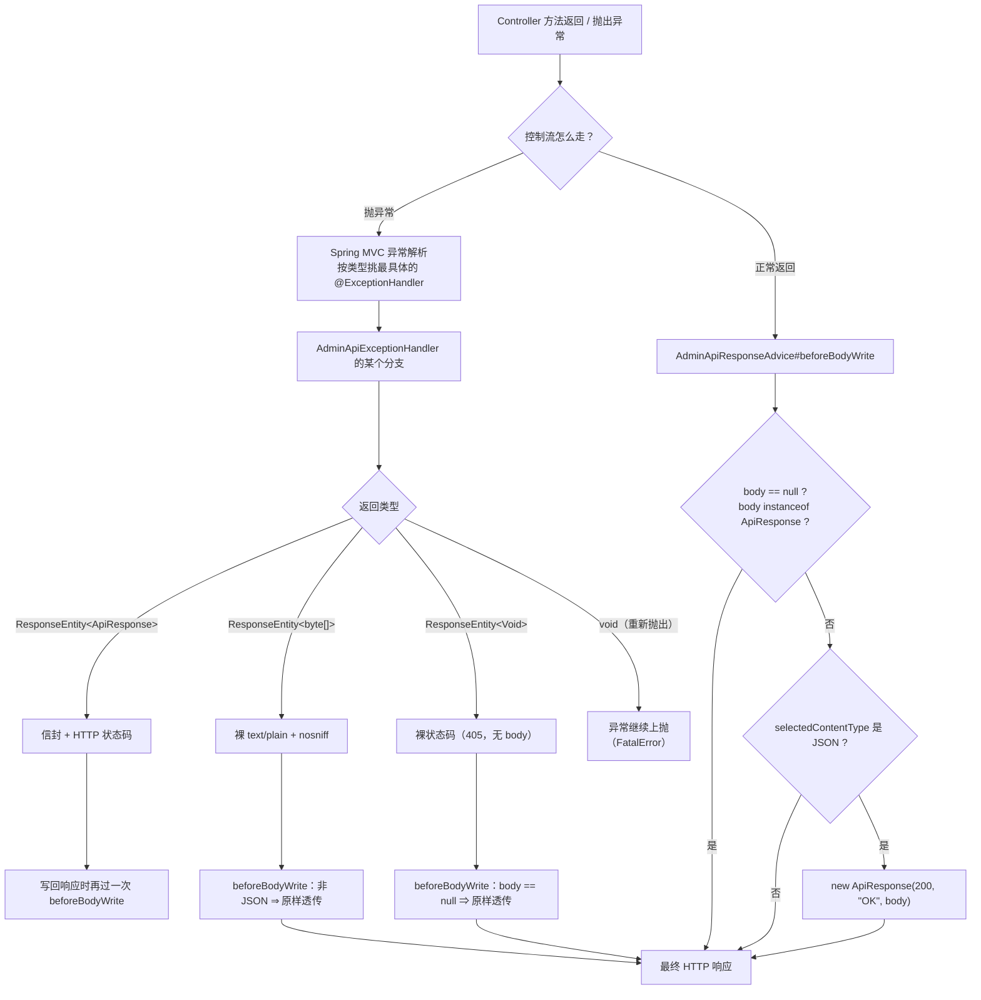
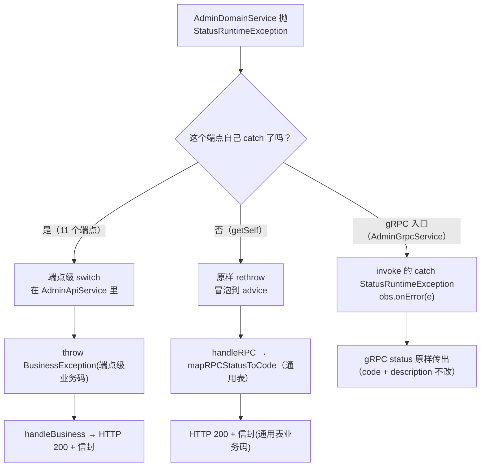
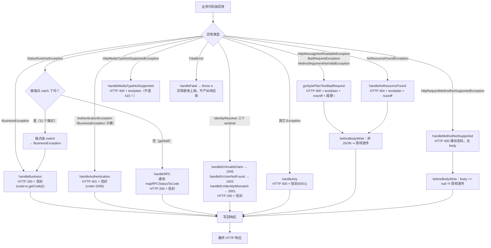
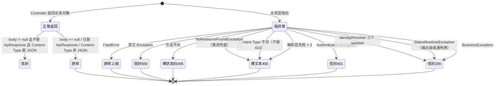

# 15. 异常处理与统一响应流程

## 1. 本次流程的研究范围

这一篇追踪的是：**一次 admin 域的 HTTP 请求，最终写回客户端的 HTTP 响应是怎么被决定的**。

具体追踪范围：

| 追踪 | 不追踪 |
|---|---|
| 正常返回时 `AdminApiResponseAdvice#beforeBodyWrite` 怎么包装 | 业务方法内部怎么算出返回值（见 01~13 篇） |
| `AdminApiExceptionHandler` 的**每一个** `@ExceptionHandler` 分支 | 异常在业务层是怎么被抛出来的（见 01~13 篇） |
| 每种异常 ⇒ HTTP 状态码 + body 形态的完整对应表 | Spring MVC 内部的 `HandlerExceptionResolver` 选择算法细节 |
| 两套 gRPC status → 业务码映射（端点级 / advice 通用表） | gRPC 面上的 status 透传（见 [16](./16-gRPC管理员服务流程.md)） |
| `ApiResponse` 信封的字段与序列化形状 | — |

**一个必须先说清的边界**：本流程有**两个入口**：

- **正常路径** ⇒ `AdminApiResponseAdvice`（`ResponseBodyAdvice`）
- **异常路径** ⇒ `AdminApiExceptionHandler`（`@RestControllerAdvice`）

两者**都会**参与最终响应，且异常路径的响应**也会**再经过一次 `ResponseBodyAdvice` ——
这是本篇最容易搞混的地方，见 §4.4。

---

## 2. 触发场景与输入

### 2.1 场景 A：正常返回

```
POST /admin/v1/login HTTP/1.1
Content-Type: application/json

{"username":"admin","password":"admin"}
```

Controller 方法签名（`controller/AdminController.java:135`）：

```java
@PostMapping("/login")
public LoginResp login(@Valid @RequestBody LoginReq req, HttpServletRequest httpRequest) {
    return adminApiService.login(req, httpRequest);
}
```

返回类型是 `LoginResp`（**不是** `ApiResponse`）⇒ 需要 advice 包装。

### 2.2 场景 B：抛异常

同一请求，密码写错 ⇒ 领域层抛 gRPC 状态异常 ⇒ API 层 catch 并转成 `BusinessException` ⇒ advice 接手。

### 2.3 输入是什么

| 输入 | 来源 | 谁消费 |
|---|---|---|
| `body` | Controller 方法的返回值，或 advice 产出的 `ApiResponse` | `beforeBodyWrite` 判断是否包装 |
| `selectedContentType` | Spring 选中的 `MediaType`（`HttpMessageConverter` 协商结果） | `beforeBodyWrite` 判断「是不是 JSON」 |
| 异常对象 | 业务层抛出 | `@ExceptionHandler` 按**类型**匹配 |
| `code` / `msg` | `BusinessException` 的两个字段 | 信封的 `code` / `msg` |

---

## 3. 整体执行路线



**关键结构**：`beforeBodyWrite` 在**写回响应体的那一刻**才跑（不是 Controller 返回的那一刻）。
所以异常处理器的返回值也会过它 —— 这就是「已是信封不重包」这条判断存在的原因。

---

## 4. 逐步讲解

### 4.1 第一步：正常路径 —— `ResponseBodyAdvice` 包装信封

涉及文件：`advice/AdminApiResponseAdvice.java`

```java
@RestControllerAdvice
public class AdminApiResponseAdvice implements ResponseBodyAdvice<Object> {

    @Override
    public boolean supports(MethodParameter returnType, Class<? extends HttpMessageConverter<?>> converterType) {
        return true;
    }

    @Override
    public Object beforeBodyWrite(Object body, MethodParameter returnType, MediaType selectedContentType,
                                  Class<? extends HttpMessageConverter<?>> selectedConverterType,
                                  ServerHttpRequest request, ServerHttpResponse response) {
        if (body == null || body instanceof ApiResponse) {
            return body;
        }
        if (selectedContentType != null
                && !MediaType.APPLICATION_JSON.isCompatibleWith(selectedContentType)) {
            return body;
        }
        return new ApiResponse(ErrCodes.SUCCESS, ErrMsg.getMsg(ErrCodes.SUCCESS), body);
    }
}
```

（`advice/AdminApiResponseAdvice.java:43-80`）

逐条拆：

| 分支 | 条件 | 为什么 |
|---|---|---|
| **不包装 ①** | `body == null` | 否则会把框架级错误的**空响应体**篡改成 `{"code":200,...}` |
| **不包装 ②** | `body instanceof ApiResponse` | 异常处理器返回的已经是信封 ⇒ 再包一层会变成 `{"code":200,"msg":"OK","data":{"code":1002,...}}` ⇒ **客户端的失败分支全部失效** |
| **不包装 ③** | `selectedContentType` 不是 JSON | B 侧的框架级错误是**裸 text/plain**，没有 `{code,msg,data}` 结构 |

**第 ③ 条的判据是「这次写出的到底是不是 JSON」，不是「body 是不是字符串」** ——
这是源码里特别强调的（`advice/AdminApiResponseAdvice.java:68-69`）：
如果按「body 是不是 String」判断，405 / 415 这类同样走 `text/plain` 的分支会被漏判。

`supports` 返回 `true` ⇒ **支持所有 Controller 返回值**。

### 4.2 第二步：信封长什么样

涉及文件：`common/src/main/java/com/rag/common/contract/ApiResponse.java`

```java
@Getter
@Setter
@NoArgsConstructor
@AllArgsConstructor
public class ApiResponse {
    private int code;
    private String msg;
    private Object data;
}
```

（`common/.../contract/ApiResponse.java:59-67`）

- **Lombok 注解**：`@Getter` / `@Setter` 生成 getter/setter；`@NoArgsConstructor` 生成无参构造；
  `@AllArgsConstructor` 生成三参构造 —— 包装时用的就是它（`new ApiResponse(code, msg, body)`）。
- **三个 JSON 键与顺序**：`code` → `msg` → `data`（Jackson 按字段声明顺序输出）。
- **⚠️ 不得加 `@JsonInclude(NON_NULL)`**：`data` 为 `null` 时**键必须仍然存在**（`"data":null`）。
  加了 `@JsonInclude` 就会让 `data` 键消失 ⇒ **可观察形状不等价**。
  测试 `AdminHttpContractRealTomcatTest#nullDataStillHasKey`（`:407`）钉死了这一条。

成功时：`ErrCodes.SUCCESS` = 200，`ErrMsg.getMsg(200)` = `"OK"`。

### 4.3 第三步：异常路径 —— `AdminApiExceptionHandler` 的 11 个分支

涉及文件：`advice/AdminApiExceptionHandler.java`（437 行）

Spring 的 `ExceptionHandlerExceptionResolver` 会**挑类型最具体**的那个 handler。
所以 `AuthenticationException`（是 `BusinessException` 的子类）会命中 `handleAuthentication`，
不会命中 `handleBusiness`。

#### 完整分支表

| # | 异常类型 | handler | HTTP 状态码 | body 形态 | 业务码 |
|---|---|---|---|---|---|
| 1 | `BusinessException` | `handleBusiness`（`:86`） | **200** | JSON 信封 | `e.getCode()` |
| 2 | `AuthenticationException` | `handleAuthentication`（`:105`） | **401** | JSON 信封 | `e.getCode()`（1006） |
| 3 | `StatusRuntimeException` | `handleRPC`（`:134`） | **200** | JSON 信封 | `mapRPCStatusToCode` 的结果 |
| 4 | `IdentityResolver.ErrInvalidClaimException` | `handleErrInvalidClaim`（`:185`） | **200** | JSON 信封 | **1006** |
| 5 | `IdentityResolver.ErrUserNotFoundException` | `handleErrUserNotFound`（`:201`） | **200** | JSON 信封 | **1003** |
| 6 | `IdentityResolver.ErrIdentityMismatchException` | `handleErrIdentityMismatch`（`:211`） | **200** | JSON 信封 | **5001** |
| 7 | `HttpMessageNotReadableException` | `handleUnreadableBody`（`:225`） | **400** | `text/plain` + nosniff + 尾随 `\n`，**无信封** | — |
| 8 | `BadRequestException` | `handleGoRequiredField`（`:255`） | **400** | 同上 | — |
| 9 | `MethodArgumentNotValidException` | `handleBeanValidation`（`:279`） | **400** | 同上 | — |
| 10 | `NoResourceFoundException` | `handleNoResourceFound`（`:352`） | **404** | `text/plain` + nosniff + `"404 page not found\n"` | — |
| 11 | `HttpRequestMethodNotSupportedException` | `handleMethodNotSupported`（`:358`） | **405** | **裸状态码，无 body、无 Content-Type** | — |
| 12 | `HttpMediaTypeNotSupportedException` | `handleMediaTypeNotSupported`（`:393`） | **400** ⚠️ | `text/plain` + nosniff + 尾随 `\n` | — |
| 13 | `FatalError` | `handleFatal`（`:410`） | — | **原样重抛**，不产出任何响应体 | — |
| 14 | `Exception`（兜底） | `handleAny`（`:416`） | **500** | JSON 信封 | **5001** |

#### ⚠️ 第 12 条：415 被改写成了 **400**

这是一个**非常容易看错**的地方。源码里的 handler 名字叫 `handleMediaTypeNotSupported`，
但它返回的是 **400**，不是 415：

```java
@ExceptionHandler(HttpMediaTypeNotSupportedException.class)
public ResponseEntity<byte[]> handleMediaTypeNotSupported(HttpMediaTypeNotSupportedException e) {
    log.warn("media type not supported : {}", e.getMessage());
    return goStylePlainTextBadRequest(e.getMessage());
}
```

（`advice/AdminApiExceptionHandler.java:393-397`）

**原因**（源码 `:369-380`）：B 侧的 go-zero **不做 content-type 协商** ——
`rest/httpx/requests.go:153` 的 `withJsonBody(r)` 判断的是
`r.ContentLength > 0 && strings.Contains(r.Header.Get("ContentType"), "application/json")`，
不匹配就**跳过 JSON 解析**，走 `UnmarshalJsonMap(nil, v)` ⇒ 必填字段缺失 ⇒ **400 + text/plain**。
⇒ **B 侧根本不存在 415 这个状态码**。

⇒ 行为对照：

| Content-Type | B 侧 | 本仓 |
|---|---|---|
| `application/json` | 正常解析 | 正常解析 |
| `text/plain`（body 有内容） | **400** + text/plain | **400** + text/plain ✅ 一致 |
| `text/plain`（**3 个空 struct 端点**：`/logout`、`/getself`、`/invite/create`） | **正常受理**（零值 struct ⇒ 无字段可缺 ⇒ 不报错） | **400** ⚠️ 已登记为 Intentional Deviation（框架差异 · 窄） |

由 `AdminHttpContractRealTomcatTest#nonJsonContentTypeIs400PlainText`（`:324`）钉死：
断言 **400**（不是 Spring 默认的 415）、`text/plain`、`nosniff`。

#### 第 7/8/9 条：400 的三条路径汇聚到同一个出口

```java
private static ResponseEntity<byte[]> goStylePlainTextBadRequest(String message) {
    String body = (message == null || message.isEmpty() ? "bad request" : message);
    return PlainTextErrors.badRequest(body);
}
```

（`advice/AdminApiExceptionHandler.java:322-325`）

⚠️ **空文案回落**这条是逐字保留的：B 侧是
`(message == null || message.isEmpty()) ? "bad request" : message`。
共享层的 `PlainTextErrors.text` 对 `null` 给的是**空串**，差这一个词 ⇒ **body 文本会变**
⇒ 所以在 advice 里先归一再交给共享层。

#### 共享层 `PlainTextErrors` 的三件事

涉及文件：`common/src/main/java/com/rag/common/web/PlainTextErrors.java`

```java
public static ResponseEntity<byte[]> text(HttpStatus status, String message) {
    byte[] body = ((message == null ? "" : message) + "\n").getBytes(StandardCharsets.UTF_8);
    return ResponseEntity.status(status)
            .header(HttpHeaders.CONTENT_TYPE, TEXT_PLAIN_UTF8)
            .header("X-Content-Type-Options", "nosniff")
            .body(body);
}
```

（`common/.../web/PlainTextErrors.java:83-89`）

**三件事，对应 B 侧 `net/http.Error` 的四行**：

| B 侧 `http.Error` | 本仓 |
|---|---|
| `h.Set("Content-Type", "text/plain; charset=utf-8")` | `TEXT_PLAIN_UTF8` = `"text/plain; charset=utf-8"`（`:61`） |
| `h.Set("X-Content-Type-Options", "nosniff")` | 同一个 header |
| `w.WriteHeader(code)` | `ResponseEntity.status(status)` |
| `fmt.Fprintln(w, error)` ⇒ **带一个尾随 `\n`** | `(message + "\n").getBytes(UTF_8)` |

⇒ **body 末尾的 `\n` 是由 `PlainTextErrors` 追加的，调用方不要自己加。**

⚠️ 关于 `Content-Type` 里的那个空格：共享层写的是 `"text/plain; charset=utf-8"`（分号后**有**空格），
但**真 Tomcat 会归一化**成 `text/plain;charset=utf-8`（分号后**无**空格）。
按 RFC 9110，参数分隔符旁的空白不显著 ⇒ 两者语义相同。**空格由容器重渲染决定，不由本层控制。**

由 `AdminHttpContractRealTomcatTest#missingRequiredFieldIs400PlainTextWithNosniff`（`:292`）钉死：
400、`text/plain`、`X-Content-Type-Options: nosniff`、body **以 `\n` 结尾**、且 body **不含** `"code"`。

#### 第 10 条：404 的形状来自共享层

```java
@ExceptionHandler(NoResourceFoundException.class)
public ResponseEntity<byte[]> handleNoResourceFound(NoResourceFoundException e) {
    log.warn("no static resource : {}", e.getMessage());
    return RouterErrorResponses.notFound(e.getResourcePath() == null ? "" : e.getResourcePath());
}
```

（`advice/AdminApiExceptionHandler.java:352-356`）

`RouterErrorResponses.notFound`（`common/.../web/RouterErrorResponses.java:133-138`）产出：

```
404 Not Found
Content-Type: text/plain; charset=utf-8
X-Content-Type-Options: nosniff
body = "404 page not found\n"   （19 字节）
```

⚠️ **注意成因**：Spring Boot 的静态资源 handler（`/**` → `ResourceHttpRequestHandler`）**兜住任何未知路径**
⇒ 路由「有 handler」⇒ 抛的是 `NoResourceFoundException`，**不是** `NoHandlerFoundException`。
⇒ 这个 handler 存在之前，未知路径会落到兜底的 `handleAny` ⇒ **HTTP 500** ⇒
「客户端打错路径」被误报成「服务端故障」。

#### 第 13 条：`FatalError` 原样重抛

```java
@ExceptionHandler(FatalError.class)
public void handleFatal(FatalError e) {
    // 故意不返回 ResponseEntity：让异常继续向上抛
    throw e;
}
```

（`advice/AdminApiExceptionHandler.java:410-414`）

`FatalError`（`common/.../logger/FatalError.java:41-47`）是共享层的**致命错误专用异常**。

**为什么不把它包成信封**：B 侧的 `logger.go:296` 在打出 `fatal_error` 后**无条件 `os.Exit(1)`**
—— 「fatal 后必须停止接流量」是硬契约。Java 版改成抛专用异常（**不**调 `System.exit`，
以免绕过 Spring 的 graceful shutdown / `@PreDestroy`），
但若不在此显式处理，`handleAny` 会把它当普通业务异常包成 200 信封 ⇒
**进程带着致命状态继续服务** ⇒ B 侧绝不会发生。

兜底分支里还有一道重复保险：

```java
public ResponseEntity<ApiResponse> handleAny(Exception e) {
    if (e instanceof FatalError fatal) {
        throw fatal;
    }
    log.error("unhandled exception", e);
    return ResponseEntity.status(HttpStatus.INTERNAL_SERVER_ERROR)
            .body(new ApiResponse(ErrCodes.ERROR_SERVER_COMMON, ErrMsg.getMsg(ErrCodes.ERROR_SERVER_COMMON), null));
}
```

（`advice/AdminApiExceptionHandler.java:416-425`）

#### 第 1 条：`decideStatus` 一律 200

```java
private HttpStatus decideStatus(int code) {
    return HttpStatus.OK;
}
```

（`advice/AdminApiExceptionHandler.java:434-436`）

**方法名有迷惑性**：它接收 `code` 却完全不用它，永远返回 `HttpStatus.OK`。

**这是刻意的**：B 侧所有 Logic 结果都走 `LogicResult` → `envelope(...)`，**HTTP 恒为 200**，
业务成败由 body 里的 `code` 表达。

⇒ **HTTP 状态码 ≠ 业务码**。这是本篇最需要记住的一条：

| 层面 | 载体 | 取值 |
|---|---|---|
| **业务码** | body 的 `code` | 1001 / 1002 / 1003 / 1006 / 1015 / 1016 / 5001 / 5003 … |
| **HTTP 状态码** | 响应行 | 业务错误 = **200**；鉴权失败 = **401**；框架级错误 = 400 / 404 / 405；未知异常 = 500 |

### 4.4 第四步：为什么异常响应也会经过 `beforeBodyWrite`

`AdminApiExceptionHandler` 的 handler 返回 `ResponseEntity<ApiResponse>`。
Spring 的 `HttpEntityMethodProcessor` 继承 `writeWithMessageConverters`，会查询 advice chain
⇒ **`ResponseBodyAdvice` 对 `ResponseEntity` 生效**。

⇒ 如果 `beforeBodyWrite` 无条件再包一层，错误响应的顶层 `code` 会恒为 200 ⇒ **客户端的失败分支全部失效**。

⇒ 所以「已经是信封的就不再包」这条判断是**必须**的，不是优化
（源码 `advice/AdminApiResponseAdvice.java:35-41`）。

**具体到三个不同 body 类型的走向**：

| handler 返回 | `body` 是什么 | `selectedContentType` | `beforeBodyWrite` 的判定 | 最终 |
|---|---|---|---|---|
| `ResponseEntity<ApiResponse>` | `ApiResponse` 实例 | JSON | `body instanceof ApiResponse` ⇒ **原样返回** | 完整信封 ✅ |
| `ResponseEntity<byte[]>` | `byte[]` | `text/plain` | 非 JSON ⇒ **原样返回** | 裸文本 ✅ |
| `ResponseEntity<Void>`（405） | `null` | — | `body == null` ⇒ **原样返回** | 裸状态码 ✅ |
| `void` + 重抛（`FatalError`） | — | — | 不产生响应 | 异常继续上抛 ✅ |

### 4.5 第五步：两套 gRPC status → 业务码映射（并存且不同）

这是本篇**最需要慢下来读**的一节。

#### 通用兜底表（advice 里）

```java
private int mapRPCStatusToCode(Status.Code code) {
    if (code == Status.Code.INTERNAL) return ErrCodes.ERROR_SERVER_COMMON;              // 5001
    if (code == Status.Code.NOT_FOUND) return ErrCodes.ERROR_USER_NOT_EXIST;            // 1003
    if (code == Status.Code.ALREADY_EXISTS) return ErrCodes.ERROR_USER_EXIST;           // 1001
    if (code == Status.Code.INVALID_ARGUMENT) return ErrCodes.ERROR;                    // 500
    if (code == Status.Code.PERMISSION_DENIED) return ErrCodes.ERROR_ADMIN_INVITE_CODE_WRONG; // 1016
    if (code == Status.Code.UNAUTHENTICATED) return ErrCodes.ERROR_TOKEN_RUNTIME;       // 1006
    return ErrCodes.CODE_SERVER_BUSY;                                                  // 1015
}
```

（`advice/AdminApiExceptionHandler.java:167-175`）

#### 端点级表（`AdminApiService` 里，每个端点各写各的）

`AdminApiService` 里的 catch 块**逐条照抄**了 B 侧各 api service 的 switch。
源码注释写得很清楚：

```
⚠️ **逐端点 switch（B 出处：对应 B 侧 api service 的 catch 块逐条照抄）**
   —— 不能用 advice 的通用 mapRPCStatusToCode：本端点的 INTERNAL 码与通用表**不同**。
```

（`service/AdminApiService.java` 各端点的 catch 块）

#### 对照表：哪些端点的映射与通用表不同

| 端点 | status | **端点级** | 通用表 | 差异 |
|---|---|---|---|---|
| `login` | `UNAUTHENTICATED` | **1002**（`ERROR_LOGIN_WRONG`） | 1006 | ⚠️ **不同** |
| `login` | `INTERNAL` | 5001 | 5001 | 同 |
| `login` | `NOT_FOUND` | 1003 | 1003 | 同 |
| `updateSelf` | `INTERNAL` | **5003**（`ERROR_DB_SELECT`） | 5001 | ⚠️ **不同** |
| `resetUserPassword` | `INTERNAL` | **5003** | 5001 | ⚠️ **不同** |
| `unBanUser` | `INTERNAL` | **5003** | 5001 | ⚠️ **不同** |
| `updateUser` | `INTERNAL` | 5001 | 5001 | 同 |
| `deleteUser` | `INTERNAL` | 5001 | 5001 | 同 |
| `banUser` | `INTERNAL` | 5001 | 5001 | 同 |
| `getUser` | `INTERNAL` | 5001 | 5001 | 同 |
| `getUserList` | `INTERNAL` | 5001 | 5001 | 同 |
| `createInviteCode` | `INTERNAL` | 5001 | 5001 | 同 |
| `createAdmin` | `PERMISSION_DENIED` | 1016 | 1016 | 同 |
| `logout` | `INTERNAL` | 5001 | 5001 | 同 |
| **`getSelf`** | 全部 | **不 catch，原样 rethrow** | 通用表 | ⇒ **走通用表** |

#### 两个具体的对照例子

**例 1：`login` 端点的密码错**

领域层 `AdminDomainService#doLogin` 抛：

```java
throw Status.UNAUTHENTICATED.withDescription("密码错误").asRuntimeException();
```

（`domain/service/AdminDomainService.java:271`）

`AdminApiService#login` 的 catch：

```java
if (code == Status.Code.UNAUTHENTICATED) {
    throw new BusinessException(ErrCodes.ERROR_LOGIN_WRONG,   // ← 1002
            ErrMsg.getMsg(ErrCodes.ERROR_LOGIN_WRONG));
}
```

（`service/AdminApiService.java:235-238`）

⇒ **端点级**：HTTP 200 + `{"code":1002,"msg":"用户名或密码错误"}`。
⇒ **通用表**：会给出 1006（`TOKEN已过期`）。
⇒ **同一类异常，两张表给出不同业务码。**

测试 `AdminHttpContractRealTomcatTest#wrongPasswordIs200WithBusinessCode`（`:387`）断言 **1002**，
注释里写明：「B 侧 login 端点专属映射，非通用表的 1006」。

**例 2：`updateSelf` 端点的 DB 失败**

领域层抛 `Status.INTERNAL`，`AdminApiService#updateSelf` 的 catch：

```java
if (code == Status.Code.INTERNAL) {
    throw new BusinessException(ErrCodes.ERROR_DB_SELECT,     // ← 5003
            ErrMsg.getMsg(ErrCodes.ERROR_DB_SELECT));
}
```

（`service/AdminApiService.java:427-430`）

⇒ **端点级**：HTTP 200 + `{"code":5003,"msg":"查询数据库失败"}`。
⇒ **通用表**：5001（`系统内部错误`）。

#### 为什么必须两套并存

源码在 `handleRPC` 的 javadoc 里写得很直白（`advice/AdminApiExceptionHandler.java:119-132`）：

> 本方法是「兜底」映射，不是唯一映射。B 侧**逐端点**在 api service 内各自 catch + 映射，
> C 侧在 `AdminApiService.java` 里**逐条照抄那 12 个 switch**；
> **本方法**对应 B 侧 `GlobalExceptionHandler.handleRPC` —— 承接**没有被端点自己 catch 住**的
> `StatusRuntimeException`（例：`getSelf` 端点 B 侧就是原样 rethrow，走的正是这条通用表）。
>
> ⚠️ **为什么不能反过来「只留通用表」**：B 侧**逐端点的 INTERNAL 码与通用表不同** ——
> `updateSelf` / `unBanUser` / `resetUserPassword` 的 INTERNAL 是 **5003**，而通用表是 **5001**；
> `login` 的 UNAUTHENTICATED 是 **1002**，而通用表是 **1006**。
> ⇒ 只留通用表 ⇒ 这 **4 个端点**的 HTTP 业务码与 B 侧不一致 ⇒ **未批准的 wire 漂移**。

⇒ **这不是 bug，是照抄真源的结果。**

#### 两张表的分流关系



#### `PERMISSION_DENIED` 为什么映射成「邀请码错误」（1016）

源码注释（`advice/AdminApiExceptionHandler.java:163-165`）：

> B 侧 admin 域的 `PERMISSION_DENIED` 只在「邀请码无效 / 已用 / 已过期」这一条路径上出现
> ⇒ ⇒ 该码在这一域里**就是**「管理员邀请码错误」的语义 ⇒ 逐字照抄。

#### 错误码表在哪

⚠️ **admin 域用的是**共享层（`users-common`）**那一份**：

| 文件 | 内容 |
|---|---|
| `service/users/common/src/main/java/com/rag/users/common/ErrCodes.java` | **码值集**（31 个常量，`SUCCESS`=200 · `ERROR`=500 · `CODE_SERVER_BUSY`=1015 · `ERROR_SERVER_COMMON`=5001 · `ERROR_DB_SELECT`=5003 · `ERROR_USER_EXIST`=1001 · `ERROR_LOGIN_WRONG`=1002 · `ERROR_USER_NOT_EXIST`=1003 · `ERROR_TOKEN_RUNTIME`=1006 · `ERROR_ADMIN_INVITE_CODE_WRONG`=1016 …） |
| `service/users/common/src/main/java/com/rag/users/common/ErrMsg.java` | **code → msg 映射**（31 条；`getMsg(int)` 未知码回落 `ERROR` 的文案 `"FAIL"`） |

user 域读的是**域内** `contract/ErrCodes.java`，但那是一份**薄转发层** ⇒ **码值两边完全一致**，
差别只在「以哪个类名访问」。

⚠️ **`msg` 取的是 `ErrMsg.getMsg(映射码)`，不是异常对象里带的 description**。
这是 B 侧自己的口径，逐字照抄（源码 `advice/AdminApiExceptionHandler.java:78-79`）。

### 4.6 完整异常链路图



---

## 5. 重要分支与失败路径

### 5.1 「同一类异常，不同端点，不同业务码」对照

这是本篇最容易被忽略、也最容易被后人「顺手统一」掉的行为。

| 场景 | 走哪张表 | HTTP | body 的 `code` |
|---|---|---|---|
| `login` 密码错 | **端点级** | 200 | **1002**（用户名或密码错误） |
| `login` 用户不存在 | **端点级** | 200 | **1003**（用户不存在） |
| `login` DB 故障 | **端点级** | 200 | **5001**（系统内部错误） |
| `updateSelf` DB 故障 | **端点级** | 200 | **5003**（查询数据库失败） |
| `resetUserPassword` DB 故障 | **端点级** | 200 | **5003** |
| `unBanUser` DB 故障 | **端点级** | 200 | **5003** |
| `getSelf` 管理员不存在 | **通用表** | 200 | **1003** |
| `getSelf` 身份错配 | identity sentinel | 200 | **5001** |

### 5.2 框架级错误分支

| 场景 | 抛什么 | 结果 |
|---|---|---|
| body 是空的 | `HttpMessageNotReadableException` | 400 + text/plain |
| body 是非法 JSON | `HttpMessageNotReadableException` | 400 + text/plain |
| 必填字段缺失（`@Valid` 触发） | `MethodArgumentNotValidException` | 400 + text/plain（**文案**由 Hibernate Validator 决定，属已登记的 L3 降级 D-01） |
| Content-Type 不是 JSON | `HttpMediaTypeNotSupportedException` | **400** + text/plain（B 侧没有 415） |
| 方法不对（GET 打 POST 端点） | `HttpRequestMethodNotSupportedException` | **405**，无 body、无 Content-Type |
| 路径不存在 | `NoResourceFoundException` | 404 + `"404 page not found\n"` |

### 5.3 兜底分支

| 场景 | 结果 |
|---|---|
| 任何没被上面 13 个分支接住的 `Exception` | **HTTP 500** + `{"code":5001,"msg":"系统内部错误","data":null}` |
| `FatalError` | **不产出响应** ⇒ 异常继续上抛 ⇒ 由更外层处置（Spring Boot 默认错误页 / 容器 500） |

---

## 6. 数据变化与副作用

| 维度 | 本流程是否发生 | 说明 |
|---|---|---|
| **数据库** | ❌ 未发生 | advice 与 advice 只做「异常 → 响应」的翻译，不碰 DB |
| **Redis** | ❌ 未发生 | 与本流程无关 |
| **事务** | ❌ 无 | 事务边界在业务层；异常被 catch 后事务**已经回滚**（若是运行时异常） |
| **远程调用** | ❌ 无 | — |
| **日志** | ✅ 每个分支都打 | `error`：BusinessException / StatusRuntimeException / identity sentinel / 未处理异常；`warn`：解析层失败 / 415 / 404 / 405 |
| **指标** | ❌ **advice 不埋点** | 指标在业务层（`AdminApiMetrics` / `AdminRpcMetrics`） |
| **生成 ID / Token** | ❌ 无 | — |

### 6.1 一个容易忽略的副作用顺序

`handleBusiness` 会打 `log.error("BusinessException code={} msg={}", ...)`（`:90`）——
**业务错误也打 error 级日志**。这是照抄 B 侧的结果，不是 bug。

而 `handleAuthentication` 打的是 `log.warn`（`:108`）—— 鉴权失败是客户端问题，不是服务端故障。

⇒ 排障时看到满屏 `ERROR ... BusinessException` **不代表**服务端有问题。

---

## 7. 执行结果

### 7.1 成功

```json
{"code":200,"msg":"OK","data":{"token":"eyJhbGciOiJIUzI1NiIs..."}}
```

**键恰好三个，顺序固定**：`code` → `msg` → `data`。
由 `AdminHttpContractRealTomcatTest#envelopeHasExactlyThreeKeys`（`:272`）断言：
`assertEquals(List.of("code", "msg", "data"), fieldNames)`。

### 7.2 业务失败（HTTP 200）

密码错：

```json
{"code":1002,"msg":"用户名或密码错误","data":null}
```

### 7.3 鉴权失败（HTTP 401）

```json
{"code":1006,"msg":"TOKEN已过期","data":null}
```

### 7.4 解析层失败（HTTP 400，**无信封**）

```
HTTP/1.1 400 Bad Request
Content-Type: text/plain;charset=utf-8
X-Content-Type-Options: nosniff

Required field 'username' is not present
```

（文案由 Hibernate Validator / Jackson 决定，**末尾有一个 `\n`**）

### 7.5 未知路径（HTTP 404）

```
HTTP/1.1 404 Not Found
Content-Type: text/plain;charset=utf-8
X-Content-Type-Options: nosniff

404 page not found
```

### 7.6 方法不对（HTTP 405，**裸状态码**）

```
HTTP/1.1 405 Method Not Allowed
```

**没有 body、没有 Content-Type。**（`ResponseEntity<Void>` + `body == null` ⇒ `beforeBodyWrite` 原样透传）

---

## 8. 流程复盘

```text
Controller 返回值 / 业务异常
  ↓
【异常路径】Spring MVC 异常解析 → 挑最具体的 @ExceptionHandler
  ├─ BusinessException          → 200 + 信封(code = e.getCode())
  ├─ AuthenticationException    → 401 + 信封(code = 1006)
  ├─ StatusRuntimeException     → 200 + 信封(端点级 switch 或通用表)
  ├─ identity sentinel × 3      → 200 + 信封(1006 / 1003 / 5001)
  ├─ 解析层失败 × 3             → 400 + text/plain + nosniff + 尾随 \n
  ├─ NoResourceFoundException   → 404 + "404 page not found\n"
  ├─ MethodNotSupported         → 405 裸状态码（无 body）
  ├─ MediaTypeNotSupported      → 400 + text/plain（不是 415！）
  ├─ FatalError                 → 原样重抛，无响应体
  └─ Exception                  → 500 + 信封(5001)
  ↓
【正常路径】ResponseBodyAdvice#beforeBodyWrite
  ├─ body == null               → 原样
  ├─ body instanceof ApiResponse → 原样（防重复包装）
  ├─ selectedContentType 非 JSON → 原样
  └─ 否则 → new ApiResponse(200, "OK", body)
  ↓
HTTP 响应
```

**边界结论**：

1. **HTTP 状态码 ≠ 业务码**。业务错误一律 **HTTP 200**，成败看 body 的 `code`。
2. **响应有三种形态**：JSON 信封 / 裸 `text/plain` / 裸状态码。**不是所有失败都是信封。**
3. **业务码表在共享层** `users-common` 的 `ErrCodes` + `ErrMsg`（admin 直接读，不走域内 contract）。
4. **两套 gRPC 码映射并存**：端点级 switch（11 个端点）＋ advice 通用表（兜底 `getSelf`）。
   ⇒ **同一类异常在不同端点可能得到不同业务码**（`login` 的 `UNAUTHENTICATED` ⇒ 1002 而非 1006；
   `updateSelf` / `resetUserPassword` / `unBanUser` 的 `INTERNAL` ⇒ 5003 而非 5001）。
5. **`FatalError` 绝不能被转成信封** ⇒ 它是「必须停」的最后一道闸门。
6. **`decideStatus(code)` 永远返回 200** ⇒ 方法名有迷惑性，但行为是契约。
7. **异常响应也会过 `beforeBodyWrite`** ⇒ 「已是信封不重包」不是优化，是必须。

---

## 9. 源码定位与验证方式

### 9.1 源码定位

| 位置 | 文件 | 关键成员 |
|---|---|---|
| 响应包装 | `service/users/admin/src/main/java/com/rag/admin/advice/AdminApiResponseAdvice.java` | `supports`（`:47`）· `beforeBodyWrite`（`:52`） |
| 异常出口 | `service/users/admin/src/main/java/com/rag/admin/advice/AdminApiExceptionHandler.java` | 14 个 handler（`:86`~`:425`）· `mapRPCStatusToCode`（`:167`）· `goStylePlainTextBadRequest`（`:322`）· `decideStatus`（`:434`） |
| 信封 | `common/src/main/java/com/rag/common/contract/ApiResponse.java` | 三个字段 + Lombok 注解（`:37-45`） |
| 裸文本 400 | `common/src/main/java/com/rag/common/web/PlainTextErrors.java` | `badRequest`（`:72`）· `text`（`:83`） |
| 裸 404 / 405 | `common/src/main/java/com/rag/common/web/RouterErrorResponses.java` | `notFound`（`:133`）· `methodNotAllowed`（`:145`） |
| 致命异常 | `common/src/main/java/com/rag/common/logger/FatalError.java` | `FatalError`（`:41`） |
| 业务异常 | `common/src/main/java/com/rag/common/exception/BusinessException.java` · `AuthenticationException.java` | — |
| 域内 sentinel | `service/users/admin/src/main/java/com/rag/admin/exception/AdminExceptions.java` | `NotFoundException` / `InviteUnavailableException` / `UsernameTakenException` / `isUniqueViolation` |
| 错误码表 | `service/users/common/src/main/java/com/rag/users/common/ErrCodes.java` · `ErrMsg.java` | 码值集 / 文案映射 |
| 端点级映射 | `service/users/admin/src/main/java/com/rag/admin/service/AdminApiService.java` | 11 个 catch 块（`:221`·`:285`·`:336`·`:414`·`:466`·`:509`·`:546`·`:583`·`:620`·`:661`·`:711`·`:756`） |
| 不 catch 的端点 | 同上 | `getSelf`（`:369`） |

> ⚠️ **`AdminExceptions` 里的三个 sentinel 没有任何专门的 `@ExceptionHandler`**。
> 它们**不直接冒泡到 HTTP 边界** —— 领域层会先 catch 它们并转成 gRPC `Status`
> （`NotFoundException` → `Status.NOT_FOUND` · `InviteUnavailableException` → `Status.PERMISSION_DENIED` ·
> `UsernameTakenException` → `Status.ALREADY_EXISTS`）⇒ 冒泡出 HTTP 边界的是 `StatusRuntimeException`
> ⇒ 走第 3 条分支。

### 9.2 验证方式

| 测试方法 | 位置 | 钉住什么 |
|---|---|---|
| `envelopeHasExactlyThreeKeys` | `AdminHttpContractRealTomcatTest.java:272` | body 恰好三键 `code/msg/data` 且顺序不变；`data:null` 时键仍在 |
| `nullDataStillHasKey` | `:407` | `data` 键不得消失（不许 `@JsonInclude(NON_NULL)`） |
| `missingRequiredFieldIs400PlainTextWithNosniff` | `:292` | 400 + `text/plain` + `nosniff` + 尾随 `\n` + **不含 `"code"`** |
| `absentBodyIs400` | `:312` | 空 body 与 `{}` 同等对待 ⇒ 400 |
| `nonJsonContentTypeIs400PlainText` | `:324` | 非 JSON content-type ⇒ **400**（不是 415）+ `text/plain` + `nosniff` |
| `unknownPathIs404` | `:369` | 404 + 逐字节 body + `nosniff` |
| `allThirteenEndpointsArePostOnly` | `:207` | GET ⇒ **405**（且发生在鉴权之前） |
| `wrongPasswordIs200WithBusinessCode` | `:387` | 密码错 ⇒ **HTTP 200 + 1002**（端点级映射，非通用表的 1006） |
| `unknownUserIs200WithNotFoundCode` | `:398` | 用户不存在 ⇒ HTTP 200 + 1003 |
| `protectedPathWithoutTokenIs401` | `:238` | 401 + 信封（`data` 键存在） |

全部使用**真 Tomcat**（`@SpringBootTest(webEnvironment = RANDOM_PORT)` + `TestRestTemplate`），
不走 MockMvc —— 因为 `Content-Type` 的最终渲染、`nosniff` 头、状态行只有真容器能测。

### 9.3 交叉引用

- **user 域的同款流程**（信封包装 + 异常分支表）⇒
  [11-HTTP统一响应与异常处理流程.md](../users/11-HTTP统一响应与异常处理流程.md)
- 401 的**产生点**（拦截器）⇒ [14-管理员JWT认证与黑名单流程.md](./14-管理员JWT认证与黑名单流程.md) §5.4
- 端点级映射的**调用方**（各业务流程）⇒ [01](./01-管理员登录流程.md) ~ [13](./13-用户密码重置流程.md)
- gRPC 面上 status **原样透传**（不经过本篇的映射）⇒ [16-gRPC管理员服务流程.md](./16-gRPC管理员服务流程.md)
- `BusinessException` 与 `AuthenticationException` 的区别 ⇒ [14](./14-管理员JWT认证与黑名单流程.md) §4.3

### 9.4 本篇的「源码无法确认」项

| 项 | 说明 |
|---|---|
| `ResponseBodyAdvice` 对 `ResponseEntity<ApiResponse>` 生效的具体机制 | 源码 javadoc 声明「`HttpEntityMethodProcessor` 继承 `writeWithMessageConverters` 并会查询 advice chain」⇒ 本仓有真 Tomcat 测试**间接**证明（401 的 body 是信封而不是被二次包装），但没有单独的探针直接断言 advice chain 的查询过程。 |
| `beforeBodyWrite` 在 `body == null` 时是否真被调用 | Spring 的 `AbstractMessageConverterMethodProcessor.writeWithMessageConverters` 在 body 为 null 时仍会走 advice 查询 ⇒ 本仓**间接**由 405 的裸状态码（无信封）证明；没有单独探针。 |
| `MethodArgumentNotValidException` 的**具体文案** | 文案由 Hibernate Validator 的版本决定（本仓未在源码中固定）⇒ 源码只保证**形状**（400 + text/plain + nosniff + 尾随 `\n`），**文本内容**属已登记的 L3 降级 D-01。测试也**刻意不断言文本**。 |

---

## 10. 从需求到实现：如果让我重新开发「异常处理与统一响应」

> **本章与前 9 章的分工** 第 1~9 章回答「这套代码跑起来时，一次 admin 域请求的最终响应是怎么被决定的」。本章反过来回答：**如果我只拿到一句「所有接口的返回格式要统一，出错也要给客户端看得懂的码」，我该怎么一步步把它推导出上面那套代码。** 本章**不重复**前面的运行流程，只讲**推导过程**：先定行为 → 再定组件 → 再写代码 → 再验证 → 出问题怎么查 → 需求变了怎么改。 ⚠️ **本章写的是「机制」，不是「一个业务端点」。** 「登录失败返回 1002」是业务端点的事（见 [01](./01-管理员登录流程.md)）；「信封 + 异常翻译」是**决定**每个响应形状的一套机制 ⇒ 本章的推导单位是**机制**。

### ⚠️ 开工前必须知道的一件事：前 9 章描述的响应面已经变了一处

| 项 | 前 9 章（§4.3 / §5.2 / §7.5）描述的状态 | **当前仓库源码的真实状态** |
|---|---|---|
| 未知路径的响应面 | 404 + `text/plain` + `"404 page not found\n"`（由 `handleNoResourceFound` 产出） | **该分支已被删除** ⇒ `NoResourceFoundException` 落进通用兜底 `handleAny` ⇒ **HTTP 500 + 信封 5001**；`RouterErrorResponses` 在 admin 域**已无任何引用** |
| 触发原因 | — | 鉴权判据改成**前缀语义**后，未知路径**先过鉴权** ⇒ 能走到路由层的未知路径必然带合法 token ⇒ 此时「路径不存在」在参考侧就是 500（台账 `docs/DRIFT/users/admin/verification-admin-2026-11-02.md` **A-30** 行，证据强度 **E-4**） |

⇒ 本章正文以**当前源码**为准；凡引用行号，都是**本章写作时实际打开该文件确认过的行号**。

### 10.0 本章的证据分级（通篇使用）

| 标记 | 含义 | 本章用它回答什么 |
|---|---|---|
| 【事实】 | 可在**当前仓库源码**里直接确认的行为 | 「它现在**是什么**」——附 `文件:行号` |
| 【契约】 | 可在 **proto / 建表 SQL / 共享层 / DRIFT 台账 / L3 降级清单**里确认的要求 | 「它**必须**是什么」——附契约出处 |
| 【推导】 | 由前两类推出的设计要求 | 「它**应该**是什么」——**不冒充原作者的意图** |
| 【存疑】 | 现有资料不足以确定 | 明说「不知道」，不编 |

⚠️ **本章没有原始需求文档。** 仓库里**不存在**「统一响应规范」这类文件 ⇒ ⇒ 本章的「需求」是**从现有行为反向还原出来的需求模型**，**不是**原开发者的需求记录。 ⇒ ⇒ 凡属「原作者当初为什么这么设计」的判断，一律标【存疑】。

---

### 10.A 从需求推导业务行为

#### 10.A.1 手上的原始输入，和它到底有多原始

如果我现在只接到一句需求：

> 「所有接口的返回格式要统一。出错的时候也要给客户端一个看得懂的错误码。」

它**写不出一行代码**，因为它没回答任何一条**可被测试**的问题：

- 「统一」是统一成什么形状？几个键？键名叫什么？键的顺序算不算契约？
- 「错误码」从哪来？谁定义？客户端怎么知道 1002 是什么意思？
- **HTTP 状态码**和**业务码**是一回事吗？业务失败该回 200 还是 4xx？
- 参数写错了（JSON 非法 / 字段缺失 / Content-Type 不对）算不算「错误」？它也套信封吗？
- 路径写错了返回什么？方法用错了返回什么？body 有没有？
- 服务端内部炸了返回什么？**绝不能**把内部异常信息透给客户端吧？
- 「fatal」这种必须停进程的错误，是不是也要包成信封？

⇒ **第一步不是写代码，是把这句话变成一组可判定的行为。**

#### 10.A.2 推导的八个问题，以及每个问题的答案出处

| # | 我必须先回答的问题 | 本项目里的答案 | 证据等级 | 依据 |
|---|---|---|---|---|
| Q1 | 信封长什么样？ | **恰好三键** `{code, msg, data}`，顺序 `code → msg → data` | 【契约】 | `common/.../contract/ApiResponse.java:60-67`（三个字段的声明顺序） |
| Q2 | `data` 为 null 时键还在吗？ | **在**（`"data":null`）⇒ **不许**加 `@JsonInclude(NON_NULL)` | 【契约】 | `http/AdminHttpContractRealTomcatTest.java:469` `nullDataStillHasKey` |
| Q3 | 业务码从哪来？ | 共享层 `users-common` 的 `ErrCodes`（码值）＋ `ErrMsg`（文案，31 条） | 【契约】 | `service/users/common/.../ErrCodes.java:64`~`:154` · `ErrMsg.java:49`、`:95-97` |
| Q4 | HTTP 状态码怎么定？ | **业务失败一律 200**；只有鉴权失败是 **401**、框架级错误是 **400/405**、未知异常是 **500** | 【事实】 | `advice/AdminApiExceptionHandler.java:425-427`（`decideStatus` 恒 `HttpStatus.OK`）· `:110`（401） |
| Q5 | 哪些响应**不进**信封？ | ① `body == null`（裸状态码）② 已是 `ApiResponse`（防重复包装）③ **选中的 Content-Type 不是 JSON**（裸 `text/plain`） | 【事实】 | `advice/AdminApiResponseAdvice.java:57-59` · `:75-78` |
| Q6 | 框架级错误为什么不进信封？ | 参考侧 go-zero **不做 content-type 协商** ⇒ 不存在 415；解析层失败一律 `http.Error(w, msg, 400)` ⇒ **裸 text/plain + nosniff + 尾随 `\n`** | 【契约】 | `advice/AdminApiExceptionHandler.java:360-371`（B 出处逐行引用） |
| Q7 | 什么**绝不能**被包成信封？ | `FatalError` —— 「fatal 后必须停止接流量」是硬契约 | 【契约】 | `advice/AdminApiExceptionHandler.java:390-405` ＋ `common/.../logger/FatalError.java:43` |
| Q8 | 同一个异常在不同端点，业务码一样吗？ | **不一定**：11 个端点各有自己的 catch switch（`login` 的 `UNAUTHENTICATED` ⇒ **1002** 而非通用表的 1006；`updateSelf`/`resetUserPassword`/`unBanUser` 的 `INTERNAL` ⇒ **5003** 而非 5001）；只有 `getSelf` 不 catch，走通用表 | 【事实】 | `advice/AdminApiExceptionHandler.java:114-131`（javadoc 把差异逐条列了）＋ `service/AdminApiService.java:235-238`、`:427-429`、`:556-558`、`:630-632` |

> 🔴 **Q8 是本机制最容易被「顺手统一」掉的行为**：看到两张表会本能地想「合并成一张」。但参考侧**本来就是逐端点各写各的** ⇒ 合并 = 改掉参考侧的行为 ⇒ 未批准的 wire 漂移。 ⇒ 源码在 javadoc 里把这条写死了（`advice/AdminApiExceptionHandler.java:125-131`）。

#### 10.A.3 行为清单（本章后面所有推导的**唯一输入**）

| 编号 | 行为 | 成功判据 | 失败判据 / 形态 | 证据等级 | 依据 |
|---|---|---|---|---|---|
| **B-01** | 成功响应 = 三键信封 | `code=200`、`msg="OK"`、`data` 是业务对象 | — | 【事实】 | `advice/AdminApiResponseAdvice.java:79` ＋ `common/.../contract/ApiResponse.java:65-67` |
| **B-02** | 信封键**恰好三个、顺序固定** | `["code","msg","data"]` | 多一个键（如 `traceId`）⇒ 破 | 【契约】 | `http/AdminHttpContractRealTomcatTest.java:305` `envelopeHasExactlyThreeKeys` |
| **B-03** | `data` 为 null 时键**仍在** | `"data":null` | 键消失 ⇒ 破 | 【契约】 | 同文件 `:469` `nullDataStillHasKey` |
| **B-04** | 业务失败 ⇒ **HTTP 200** + 信封 | — | 状态码不是 200 ⇒ 破 | 【事实】 | `advice/AdminApiExceptionHandler.java:425-427` |
| **B-05** | 鉴权失败 ⇒ **HTTP 401** + 完整信封 | — | 变成 200 ⇒ 客户端的「未登录」分支失效 | 【契约】 | 同文件 `:103-112` ＋ `http/AdminHttpContractRealTomcatTest.java:271` |
| **B-06** | 解析层失败（body 不可读 / 必填缺失 / Content-Type 不对）⇒ **400 + `text/plain` + `nosniff` + 尾随 `\n`**，**无信封** | — | 被包成信封 ⇒ 破 | 【契约】 | `advice/AdminApiExceptionHandler.java:223-227`、`:253-257`、`:277-281`、`:384-388` ＋ `http/AdminHttpContractRealTomcatTest.java:325` |
| **B-07** | **415 不存在**：Content-Type 不对 ⇒ **400** | — | 回 415 ⇒ 与参考侧不一致 | 【契约】 | `advice/AdminApiExceptionHandler.java:355-388` ＋ `http/AdminHttpContractRealTomcatTest.java:357` |
| **B-08** | 方法不对 ⇒ **405 裸状态码**（无 body、无 Content-Type） | — | 带 body ⇒ 破 | 【契约】 | `advice/AdminApiExceptionHandler.java:349-353` ＋ `http/AdminHttpContractRealTomcatTest.java:240` |
| **B-09** | 未知异常 ⇒ **HTTP 500** + 信封 `5001` | — | 被包成 200 ⇒ 破 | 【事实】 | `advice/AdminApiExceptionHandler.java:407-416` |
| **B-10** | `FatalError` ⇒ **原样重抛，不产出任何响应体** | — | 被包成信封 ⇒ **进程带着致命状态继续服务** ⇒ 破 | 【契约】 | `advice/AdminApiExceptionHandler.java:401-405` ＋ `:410-411`（兜底里再放行一次） |
| **B-11** | `msg` 取 `ErrMsg.getMsg(映射码)`，**不是**异常对象里带的 description | — | 取 description ⇒ 文案漂移 | 【契约】 | `advice/AdminApiExceptionHandler.java:136`（`ErrMsg.getMsg(businessCode)`） |
| **B-12** | 未知码 ⇒ 回落 `ERROR` 的文案 `"FAIL"` | 不是 null、不是空串 | 抛异常 ⇒ 破 | 【契约】 | `service/users/common/.../ErrMsg.java:49`、`:95-97` |
| **B-13** | gRPC status → 业务码**两套并存** | 端点级 11 个 ＋ 通用兜底 1 个 | 只留一张 ⇒ 4 个端点的码漂移 | 【事实】 | `advice/AdminApiExceptionHandler.java:165-173`（通用表）＋ `service/AdminApiService.java` 各端点 catch |
| **B-14** | 业务错误也打 `error` 级日志；鉴权失败打 `warn` | — | 看到满屏 ERROR **不代表**服务端有问题 | 【事实】 | `advice/AdminApiExceptionHandler.java:88`（error）vs `:106`（warn） |
| **B-15** | 400 的**文案内容**不保证 | 形状保证，文本不保证 | 断言文案 ⇒ 测试会随 Validator 版本碎 | 【契约】 | `docs/L3-降级清单.md` **D-01**（文案 + map 字段必填判定 + 标量字段空串合法性 三项已登记） |

> **B-02 + B-03 是一对**：键**恰好三个**且 `data` 为 null 时**键仍在** ⇒ 意味着 `ApiResponse` 上**不许**加 `@JsonInclude(NON_NULL)`，也不许加第四个字段（除非连同客户端一起改）。 ⇒ 而 B-03 的测试（`http/AdminHttpContractRealTomcatTest.java:469`）刻意只断言 `body.has("data")` 与 `body.get("data").isNull()`，**不**断言 `msg` 文案 ⇒ 允许文案降级但不允许形状降级。

#### 10.A.4 需求里没写、但动手前必须自己定下来的五件事

1. **【推导】信封与异常翻译必须是两个组件。** 一个负责「正常返回时怎么包」，一个负责「抛异常时怎么包」——二者的触发时机、输入类型、能产出的形状**都不同**（一个拿到的是业务返回值，一个是异常对象）。⇒ 推出 `AdminApiResponseAdvice`（`ResponseBodyAdvice`）＋ `AdminApiExceptionHandler`（`@RestControllerAdvice`）两个类。 2. **【推导】异常响应也会再过一次 `beforeBodyWrite`。** Spring 的 `HttpEntityMethodProcessor` 继承 `writeWithMessageConverters`，会查询 advice chain ⇒ **advice 对 `ResponseEntity` 生效** ⇒ 若无条件再包一层 ⇒ 错误响应的顶层 `code` 恒为 200 ⇒ **客户端的失败分支全部失效**。⇒ 推出「`body instanceof ApiResponse` ⇒ 原样返回」这条**必须**的判断（`advice/AdminApiResponseAdvice.java:57-59`，源码 javadoc `:35-41` 明确写了这一点）。 3. **【推导】「是不是 JSON」必须按 `selectedContentType` 判，不能按「body 是不是 String」判。** 后者会漏掉 405 / 415 这类同样走 `text/plain` 的分支（`advice/AdminApiResponseAdvice.java:60-74` 特别强调了这条）。 4. **【推导】状态码必须由「异常的**类型**」决定，而不是由「业务码的值域」推断。** 所以「层次由类型承载」——`BusinessException` ⇒ 200 + 信封、`AuthenticationException` ⇒ 401 + 信封、解析层异常 ⇒ 400 + 裸文本，三者**互不合并**。⇒ 推出 `AuthenticationException` 必须是 `BusinessException` 的**子类**（Spring 挑最具体的 handler）。 5. **【推导】空文案必须归一。** 参考侧是 `(message == null || message.isEmpty()) ? "bad request" : message`，而共享层 `PlainTextErrors.text` 对 `null` 给的是**空串** ⇒ 差这一个词 ⇒ **body 文本会变** ⇒ 必须在 advice 里先归一再交给共享层（`advice/AdminApiExceptionHandler.java:320-323`）。

#### 10.A.5 必须保持不变的既有行为（改代码时的红线）

| 红线 | 为什么不能动 | 依据 |
|---|---|---|
| 信封三键与顺序 | 客户端统一解包 | 【契约】`common/.../contract/ApiResponse.java:65-67` ＋ `http/AdminHttpContractRealTomcatTest.java:305` |
| 业务码的**值**（1001/1002/1003/1006/1015/1016/5001/5003…） | 客户端分支逻辑挂在码上 | 【契约】`service/users/common/.../ErrCodes.java:64`~`:154` |
| **业务失败 = HTTP 200** | 参考侧 `LogicResult` → `envelope(...)` 恒 200 | 【契约】`advice/AdminApiExceptionHandler.java:425-427` |
| 401 的形状（401 + 完整信封） | 鉴权失败与业务失败必须可区分 | 【契约】`advice/AdminApiExceptionHandler.java:103-112` |
| **415 不存在** | 参考侧不做 content-type 协商 | 【契约】`advice/AdminApiExceptionHandler.java:360-371` |
| `FatalError` 原样重抛 | 「fatal 后必须停」是硬契约 | 【契约】`advice/AdminApiExceptionHandler.java:401-405` |
| 两套 gRPC 码映射并存 | 合并 = 4 个端点漂移 | 【事实】`advice/AdminApiExceptionHandler.java:125-131` |

#### 10.A.6 从行为清单到状态机



> **这张图是「需求状态机」**：它把「异常类型 ⇒ 响应形状」这张映射表画成了**可执行的判定**。与 §4.6 的完整异常链路图对照着看，能看出**「需求状态」与「执行位置」是两套坐标**。

---

### 10.B 从业务行为推导组件设计

> 🔴 **本章最容易走偏的地方**：直接抄文件树再逐个解释职责。正确顺序：**行为 → 需要谁来做 → 已有能力能否承担 → 落成什么文件**。

#### 10.B.1 推导的第一问：每个行为要交给谁承担

| 行为 | 承担者 | 为什么是它（而不是别的） |
|---|---|---|
| B-01~B-03 信封形状 | `ApiResponse`（共享层 `contract/`） | 信封是**跨域共享**的 L1 契约 ⇒ 放在共享层，user/admin/follow… 各域引用同一份 |
| B-01/B-05 正常返回时包信封 | `AdminApiResponseAdvice`（`ResponseBodyAdvice`） | Spring MVC 的**扩展点**就长这样 ⇒ 业务代码一行不写就自动被包 |
| B-04~B-10 异常 ⇒ 响应 | `AdminApiExceptionHandler`（`@RestControllerAdvice`） | 异常翻译是**边界职责**，不属于任何一个业务方法 ⇒ 集中在一处 |
| B-02/B-03 幂等保护 | `AdminApiResponseAdvice#beforeBodyWrite` 的两条早退 | 「已是信封不重包」「null 不包」必须在**唯一的包装点**上 ⇒ 放在 advice 里 |
| B-10 `FatalError` 放行 | `handleFatal`（**返回 void 并重抛**） | 必须**先于** `handleAny` 被挑中 ⇒ 靠异常类型的继承关系（`FatalError` 不继承 `BusinessException`）＋ 一个显式分支 |
| B-11/B-12 码与文案 | 共享层 `ErrCodes` + `ErrMsg` | 码与文案**只有一处真源** ⇒ admin 域直接读共享层（user 域是薄转发层） |
| B-13 gRPC 码 → 业务码 | ① `AdminApiService` 的 11 个端点级 catch ② advice 的通用表 `mapRPCStatusToCode` | ①是**契约的一部分**（参考侧逐端点照抄）②是**兜底**（承接没被端点 catch 住的） |

#### 10.B.2 为什么必须是两个组件：三个「合并掉会怎样」的反事实

| 假设合并 | 会发生什么 | 结论 |
|---|---|---|
| 把 `AdminApiResponseAdvice` 的包装逻辑**搬进** `AdminApiExceptionHandler` | 正常返回**不再被包装**（异常处理器只在抛异常时跑）⇒ 成功响应变成裸 `LoginResp` ⇒ **客户端的解包逻辑全废** | ⇒ 两个组件必须并存 |
| 把 `AdminApiExceptionHandler` 的翻译逻辑**搬进** `AdminApiResponseAdvice` | `ResponseBodyAdvice` **拿不到异常对象**（它的入参里没有 exception）⇒ 无法按类型分派 | ⇒ 异常翻译必须留在 `@ExceptionHandler` |
| 把 `AuthenticationException` **并进** `BusinessException` 的 handler | 鉴权失败会变成 **HTTP 200 + 信封 1006** ⇒ 客户端的「未登录」分支与「业务失败」分支合并 ⇒ **参考侧是 401**，⇒ wire 漂移 | ⇒ 必须靠**异常类型**区分，而不是靠码 |

> 🔴 **第三条是 Spring 的一个真实机制**：`ExceptionHandlerExceptionResolver` 会**挑类型最具体**的那个 handler。 ⇒ `AuthenticationException` 继承 `BusinessException` ⇒ 挑到 `handleAuthentication` ⇒ 401。 ⇒ **如果两者没有继承关系**（比如都是直接继承 `RuntimeException`），Spring 挑哪个就变成**注册顺序**决定的 ⇒ 脆弱。 ⇒ **继承关系在这里承载的是行为**（「401」还是「200」），不是「代码复用」。

#### 10.B.3 简单文件：这些代码量少的文件是怎么被推导出来的

##### `ApiResponse`（信封，共享层 L1 契约类）

| 推导问题 | 推导过程 | 结论 |
|---|---|---|
| 为什么需要一个信封类型？ | 客户端要**统一解包** ⇒ 必须有固定的键与固定的形状 ⇒ 需要一个**共享类型** | 共享层 `contract/ApiResponse` |
| 为什么是 class 而不是 record？ | 它用 Lombok 的 `@Getter/@Setter/@NoArgsConstructor/@AllArgsConstructor` ⇒ 需要**可变**（Jackson 反序列化要 setter；框架层也可能改） | class |
| 为什么三个字段都是 `private` + 无 public 构造器？ | 靠 Lombok 的 `@AllArgsConstructor` 提供三参构造、`@NoArgsConstructor` 提供无参构造 ⇒ **手写构造器会与 Lombok 冲突** | 三个 `private` 字段 |
| 为什么 `code` 是 `int` 而不是 `Integer`？ | 码值表全是常量 `int`；用 `int` ⇒ **不可能为 null** ⇒ 不需要判空 | `private int code` |
| 为什么 `data` 是 `Object`？ | 它要能装**任何**业务对象（`LoginResp` / `AdminInfo` / `Map` / `null`）⇒ 泛型化会传染到所有调用点 | `private Object data` |
| 为什么**不得**加 `@JsonInclude(NON_NULL)`？ | 加了 ⇒ `data` 为 null 时键**消失** ⇒ **可观察形状不等价** ⇒ 客户端的 `body.has("data")` 判断失效 | 【契约】`http/AdminHttpContractRealTomcatTest.java:469` |
| 为什么**不得**加第四个字段（如 `traceId`）？ | 键数与顺序是契约（`["code","msg","data"]`）⇒ 加字段 = 改契约 | 【契约】同文件 `:305` |

> ⚠️ **键的顺序也是契约**：Jackson 按**字段声明顺序**输出 ⇒ `code → msg → data` 由 `ApiResponse.java:65-67` 的声明顺序决定 ⇒ **重排字段就等于改 wire**。

##### `ErrCodes` / `ErrMsg`（码与文案，共享层）

| 推导问题 | 结论 | 依据 |
|---|---|---|
| 为什么码值与文案要**分成两个类**？ | 码值是**分支逻辑**的依据（客户端 `switch`），文案是**给人看的** ⇒ 两者生命周期不同 | `service/users/common/.../ErrCodes.java` ＋ `ErrMsg.java` |
| 为什么未知码回落 `ERROR` 的文案 `"FAIL"`？ | 参考侧 `ErrorCode.of(code)` 用 `getOrDefault(code, ERROR)` ⇒ **同一个回落**（不是 null、不是空串、不是异常） | `ErrMsg.java:95-97` ＋ `:49` |
| 为什么 admin 域**直接读共享层**，user 域却读自己域内的 `contract/ErrCodes`？ | user 域那份是**薄转发层**（`service/users/user/.../contract/ErrCodes.java` 的每个常量都 `= com.rag.users.common.ErrCodes.XXX`）⇒ **码值两边完全一致**，差别只在「以哪个类名访问」 | 【事实】`service/users/user/src/main/java/com/rag/user/contract/ErrCodes.java` |
| ⇒ 这对「改错误码要改哪里」意味着什么？ | **码值只有一处真源**（共享层）⇒ 改码值 = 改共享层 = **同时影响 user 域与 admin 域**；改「以哪个类名访问」= 纯表达层 | 【推导】 |

##### `PlainTextErrors`（裸文本形状，共享层）

| 推导问题 | 结论 | 依据 |
|---|---|---|
| 为什么要有这个共享类？ | `http.Error` 的四件事（Content-Type / nosniff / 状态码 / 尾随 `\n`）在**每个 api 模块**都要用 ⇒ 形状必须**只有一份** | `common/.../web/PlainTextErrors.java:83-89` |
| 为什么 `TEXT_PLAIN_UTF8` 写成 `"text/plain; charset=utf-8"`（分号后**有**空格）？ | 与参考侧逐字相同 ⇒ **空格/大小写由容器重渲染**（真 Tomcat 归一化成 `text/plain;charset=utf-8`），**不由本层控制** | `:61` ＋ `advice/AdminApiExceptionHandler.java:312-315` |
| 为什么**由本方法**追加尾随 `\n`？ | 参考侧用 `fmt.Fprintln(w, error)` ⇒ 带一个 `\n` ⇒ **调用方不要自己加** | `:69-70` 的 javadoc ＋ `advice/AdminApiExceptionHandler.java:269` |

#### 10.B.4 框架承担什么 vs 我必须自己写什么

| 职责 | 框架承担 | 我必须自己写 |
|---|---|---|
| 异常 → handler 的分派 | `ExceptionHandlerExceptionResolver`（按类型挑最具体） | **异常类型的继承关系**（它承载「401 vs 200」的行为） |
| 响应写回 | `HttpMessageConverter`（Jackson / ByteArray） | **选哪个返回类型**（`ResponseEntity<ApiResponse>` vs `ResponseEntity<byte[]>` vs `ResponseEntity<Void>`） |
| 包装时机 | `ResponseBodyAdvice`（在写回前一刻调用） | **哪三种 body 不包装** |
| Content-Type 协商 | Spring MVC（`selectedContentType`） | **判据用「是不是 JSON」而不是「body 是不是 String」** |
| 状态码提交 | `ResponseEntity.status(...)` | **每个分支的状态码**（恒 200 的那个方法要显式写死） |

> ⚠️ **框架承担 ≠ 业务行为被免除**：`@RestControllerAdvice` 帮你把异常变成响应，但**「哪类异常 ⇒ 什么形状」是业务决定**； `ResponseBodyAdvice` 帮你包信封，但**「哪些 body 不包」是业务决定**； `ResponseEntity.status(...)` 帮你提交状态码，但**「业务失败恒 200」是业务决定**（`decideStatus` 那个「接了 code 却不用」的方法就是这条决定的代码形态）。

---

### 10.C 从空文件推导代码实现

> 本节不讲「现在这个文件里写了什么」（前 9 章已经讲过），讲的是「**从一个空文件开始，我按什么顺序写、每一步凭什么**」。

#### 10.C.1 动手前先钉死的四张清单

| 清单 | 内容（以本机制为例） | 从哪来 |
|---|---|---|
| ① 形状清单 | 信封三键与顺序 · 裸文本形状 · 裸状态码形状 · 哪些响应进信封 | 10.A.3 ＋ 契约 |
| ② 码表清单 | 每个异常类型 ⇒ 业务码 ⇒ 文案；每个 gRPC status ⇒ 业务码 | 10.A.2 Q3/Q8 ＋ `ErrCodes`/`ErrMsg` |
| ③ 行为清单 | 每个判定：异常类型 / 条件 / 产出什么 | 10.A.3 ＋ 10.A.6 |
| ④ 契约清单 | 不能改的东西 ＋ 改动需要谁拍板 | 10.A.5 |

#### 10.C.2 `ApiResponse`：从空文件到 8 行（不含 Lombok）

```java
// 步骤 1：位置 —— 它是**跨域共享**的 L1 契约 ⇒ 放共享层 contract/，不放在任何域里
// 步骤 2：形态 —— class（Jackson 反序列化要 setter ⇒ 不能是 record）
// 步骤 3：三个字段，顺序 = 契约（code → msg → data）⇒ 顺序即 wire
@Getter
@Setter
@NoArgsConstructor
@AllArgsConstructor
public class ApiResponse {
    private int code;        // 字段 1：业务码。int ⇒ 不可能为 null ⇒ 不必判空
    private String msg;      // 字段 2：文案。取 ErrMsg.getMsg(code)，不是异常带的 description
    private Object data;     // 字段 3：载荷。Object ⇒ 能装任何业务对象与 null
}
```

| 步骤 | 依据 | 反事实 |
|---|---|---|
| 1. 放共享层 | 多个域共用同一份信封 ⇒ 放域内 = 每个域一份 = 形状会漂 | admin 域自己定义 ⇒ user 域的键名/顺序可能不同 ⇒ **客户端要写两套解包** |
| 3. 字段顺序 `code/msg/data` | **键顺序是契约**（`http/AdminHttpContractRealTomcatTest.java:305` 断言 `List.of("code","msg","data")`） | 重排字段 ⇒ 客户端的严格按序解析会失败 |
| 4. **不写** `@JsonInclude` | `data` 为 null 时键必须仍在（B-03） | 加了 ⇒ `"data"` 键消失 ⇒ **形状不等价** |
| 5. **不写**第四个字段 | 键数是契约（B-02） | 加 `traceId` ⇒ 键数变 4 ⇒ 破 |

#### 10.C.3 `AdminApiResponseAdvice`：从空文件到 30 行

```java
@RestControllerAdvice
public class AdminApiResponseAdvice implements ResponseBodyAdvice<Object> {

    @Override
    public boolean supports(MethodParameter returnType, Class<? extends HttpMessageConverter<?>> converterType) {
        return true;                       // 步骤 1：支持所有 Controller 返回值
    }

    @Override
    public Object beforeBodyWrite(Object body, MethodParameter returnType, MediaType selectedContentType,
                                  Class<? extends HttpMessageConverter<?>> selectedConverterType,
                                  ServerHttpRequest request, ServerHttpResponse response) {
        // 步骤 2：已经是信封的 → 原样；null body → 原样
        if (body == null || body instanceof ApiResponse) {
            return body;
        }
        // 步骤 3：选中的 Content-Type 不是 JSON → 原样（裸 text/plain / 裸状态码）
        if (selectedContentType != null
                && !MediaType.APPLICATION_JSON.isCompatibleWith(selectedContentType)) {
            return body;
        }
        // 步骤 4：包信封
        return new ApiResponse(ErrCodes.SUCCESS, ErrMsg.getMsg(ErrCodes.SUCCESS), body);
    }
}
```

| 步骤 | 依据 | 反事实（换个写法会怎样） |
|---|---|---|
| 1. `supports` 恒 true | 本域**所有** Controller 返回值都要包 | 改成按 `returnType` 判断 ⇒ 每个端点都要在签名上做标记 ⇒ 漏一个就少包一个 |
| 2. `body == null` 早退 | null body 是**框架级错误的空响应体**（如 405）⇒ 包了会变成 `{"code":200,...}` ⇒ **把 405 变成 200** | 不早退 ⇒ **405 会带一个 200 信封 body** ⇒ wire 漂移 |
| 2. `body instanceof ApiResponse` 早退 | 异常处理器返回的**已经是信封** ⇒ 再包一层 ⇒ `{"code":200,"msg":"OK","data":{"code":1002,...}}` ⇒ **客户端的失败分支全部失效** | 不早退 ⇒ **每一个错误响应的顶层 code 都变成 200** ⇒ 最致命的一类漂移 |
| 3. 判据用 `selectedContentType` | 本次写出的**到底是不是 JSON** ⇒ 405/415 这类同走 `text/plain` 的分支不会漏判 | 按「body 是不是 String」判 ⇒ 405/415 **被漏判** ⇒ 被包成信封 ⇒ 形状漂移 |
| 4. `code=ErrCodes.SUCCESS` | 成功码来自**码表**，不写字面量 `200` | 写字面量 ⇒ 码表改了这里不会跟着改 ⇒ 两处真源 |

#### 10.C.4 `AdminApiExceptionHandler`：十四个分支，怎么排

| 步 | 写什么 | 为什么排在这个位置 |
|---|---|---|
| W2 | `handleAuthentication`（`AuthenticationException` ⇒ **401** + 信封） | 靠**继承关系**抢在 W1 前面（`AuthenticationException extends BusinessException`）⇒ **不需要**写代码顺序 |
| W3 | `handleRPC`（`StatusRuntimeException` ⇒ 200 + 信封，码 = 通用表映射） | gRPC 异常**只在 HTTP 边界**出现（gRPC 侧是原样透传）⇒ 放这里 |
| W4 | 三个 identity sentinel（⇒ 200 + 信封 1006 / 1003 / 5001） | 它们**不是** `BusinessException` 的子类 ⇒ 必须是**独立分支**；且它们**不直接冒泡**（领域层先 catch 并转成 gRPC status）⇒ 这三个分支是兜底 |
| W5 | 三个解析层分支（`HttpMessageNotReadableException` / `BadRequestException` / `MethodArgumentNotValidException` ⇒ 400 + 裸文本） | 它们的**产出形状与业务分支完全不同**（不是信封）⇒ 必须分开 |
| W6 | `handleMethodNotSupported` ⇒ **405 裸状态码**（`ResponseEntity<Void>` ⇒ body 为 null ⇒ advice 原样透传） | 405 **不带 body** ⇒ 用 `ResponseEntity<Void>` 而不是 `.build()` + 空 body |
| W7 | `handleMediaTypeNotSupported` ⇒ **400 + 裸文本**（**不是 415**） | 参考侧没有 415 ⇒ 见 10.A.2 Q6 |
| W8 | `handleFatal` ⇒ **返回 void 并原样重抛** | 必须**先于** W9 被挑中 ⇒ 靠「`FatalError` 不继承 `BusinessException`」＋ 独立分支 |
| W9 | `handleAny(Exception)` ⇒ 500 + 信封 5001 | 兜底；里面**再放行一次** `FatalError`（`e instanceof FatalError fatal → throw fatal`）⇒ 双保险 |
| W10 | `decideStatus(int code)` ⇒ **恒 `HttpStatus.OK`** | 把「业务码 → HTTP 状态码」这条决定**写成一个方法** ⇒ 读代码的人一眼能看到「这里是恒 200」；方法名保留 `decideStatus` 是**刻意的迷惑性**（源码 javadoc 解释了） |

> 🔴 **W6 的 `ResponseEntity<Void>` 是一个刻意的类型选择**：它让 `body` 为 `null` ⇒ `beforeBodyWrite` 的第一条早退命中 ⇒ **405 不带任何 body，也不带 Content-Type**。若写成 `ResponseEntity<byte[]>` + `new byte[0]`，body 非 null ⇒ 会被第三条判据（Content-Type 非 JSON）放行，但**字节数组**可能被写成 `Content-Length: 0` 的 body ⇒ 形状与「裸状态码」**不等价**。

#### 10.C.5 三个「产出形状」的选择依据

| handler | 返回类型 | `body` 是什么 | `selectedContentType` | 最终形状 |
|---|---|---|---|---|
| `handleBusiness` / `handleRPC` / sentinel | `ResponseEntity<ApiResponse>` | `ApiResponse` 实例 | JSON | 完整信封 ✅ |
| `handleUnreadableBody` 等 400 分支 | `ResponseEntity<byte[]>` | `byte[]` | `text/plain` | 裸文本 ✅ |
| `handleMethodNotSupported`（405） | `ResponseEntity<Void>` | `null` | — | 裸状态码 ✅ |
| `handleFatal` | `void`（重抛） | — | — | 无响应体 ✅ |

⇒ **返回类型就是产物的声明** ⇒ 选错类型 ⇒ 形状就错 ⇒ **编译期就要想清楚**。

#### 10.C.6 `goStylePlainTextBadRequest`：一个字都不能改的归一

```java
private static ResponseEntity<byte[]> goStylePlainTextBadRequest(String message) {
    String body = (message == null || message.isEmpty() ? "bad request" : message);
    return PlainTextErrors.badRequest(body);
}
```

| 决策 | 依据 |
|---|---|
| 为什么要在 advice 里做空文案归一？ | 共享层 `PlainTextErrors.text` 对 `null` 给的是**空串**，参考侧给的是 `"bad request"` ⇒ 差这一个词 ⇒ **body 文本会变** ⇒ 必须在交出去之前归一 |
| 为什么尾随 `\n` 由 `PlainTextErrors` 追加？ | 参考侧是 `fmt.Fprintln` ⇒ **调用方不要自己加** ⇒ 归一后直接交给共享层，不要在这里拼 `\n` |
| 为什么 Content-Type 里那个空格**不归一**？ | 参考侧字面量就是 `"text/plain; charset=utf-8"`（分号后有空格）⇒ 按 RFC 9110 参数分隔符旁的空白不显著 ⇒ **空格由容器重渲染决定，不由本层控制** |

#### 10.C.7 实现顺序（谁先谁后）与每步的完成判据

| 序 | 先做哪一步 | 为什么不能颠倒 | 完成判据 |
|---|---|---|---|
| 1 | **码表 + 文案表**（共享层 `ErrCodes`/`ErrMsg`） | 所有分支都要引用码 ⇒ 没有码表就写不出分支 | `ErrMsg.getMsg(1006)` == `"TOKEN已过期"` |
| 3 | **共享层 `PlainTextErrors`** | 400 分支要产出裸文本 | `badRequest("x")` ⇒ 400 + `text/plain; charset=utf-8` + `nosniff` + body `"x\n"` |
| 4 | **`AdminApiResponseAdvice`** | 依赖 2 | 成功响应被包成三键信封；`data:null` 时键仍在 |
| 5 | **`AdminApiExceptionHandler` 的业务分支** | 依赖 1/2 | `BusinessException(1002)` ⇒ HTTP 200 + `{"code":1002,…}` |
| 7 | **405 分支** | 依赖 4（靠 `body == null` 早退） | GET 端点 ⇒ 405 且**无 body** |
| 8 | **`FatalError` 分支** | 必须在兜底之前 | 抛 `FatalError` ⇒ 异常**继续上抛**，不产出响应体 |
| 9 | **端点级 catch（`AdminApiService`）** | 依赖 1 | `login` 密码错 ⇒ **1002**（不是通用表的 1006） |
| 10 | **测试** | 依赖全部 | 见 10.D |

---

### 10.D 如何验证实现符合需求

> 🔴 **本章的红线**：**「能编译」「测试通过」「代码看起来没问题」三者都不等于「行为正确」**。验证的对象是 10.A.3 的**行为清单**。

#### 10.D.1 从行为清单推导用例，并对照现有测试

| 行为 | 推导出的用例 | 现状 | 依据（测试方法与所在文件） |
|---|---|---|---|
| B-01/B-02 | 成功响应 body **恰好三键**且顺序 `code/msg/data` | ✅ 已覆盖 | `http/AdminHttpContractRealTomcatTest.java:305` `envelopeHasExactlyThreeKeys` |
| B-03 | `data` 为 null 时**键仍在** | ✅ 已覆盖 | 同文件 `:469` `nullDataStillHasKey` |
| B-04 | 业务失败 ⇒ **HTTP 200** + 1002 | ✅ 已覆盖 | 同文件 `:449` `wrongPasswordIs200WithBusinessCode` |
| B-05 | 缺 token ⇒ **401** + 信封（`data` 键存在） | ✅ 已覆盖 | 同文件 `:271` `protectedPathWithoutTokenIs401` |
| B-06 | 必填字段缺失 ⇒ 400 + `text/plain` + `nosniff` + 尾随 `\n` + **不含 `"code"`** | ✅ 已覆盖 | 同文件 `:325` `missingRequiredFieldIs400PlainTextWithNosniff` |
| B-06 | body 完全缺失 ⇒ 400 | ✅ 已覆盖 | 同文件 `:345` `absentBodyIs400` |
| B-07 | 非 JSON Content-Type ⇒ **400**（不是 415）+ `text/plain` + `nosniff` | ✅ 已覆盖 | 同文件 `:357` `nonJsonContentTypeIs400PlainText` |
| B-06 | 400 的 Content-Type 必须**逐字节**是 `text/plain; charset=utf-8` | ✅ 已覆盖 | `http/AdminApiPlainText400ContentTypeTest.java:150` `badRequestContentTypeMatchesGoByteForByte` |
| B-06 | **畸形 JSON** 的 400 同样带 charset（不能只测必填缺失） | ✅ 已覆盖 | 同文件 `:188` `malformedJsonContentTypeAlsoCarriesCharset` |
| B-06/B-08 | 真 Tomcat 下 400 必须带 charset + nosniff + 尾随换行；3s 超时 ⇒ **503** + `"Request Timeout\n"`；对照组快下游 ⇒ 200 + JSON | ✅ 已覆盖 | `http/AdminApiRealTomcatResponseBytesTest.java:254` · `:299` · `:345` |
| B-09 | 未知异常 ⇒ 500 + 信封 5001 | ⚠️ **未直接覆盖** | 依据：`advice/AdminApiExceptionHandler.java:407-416`；间接路径见 `http/AdminHttpContractRealTomcatTest.java:434` `unknownPathWithTokenIs500Envelope`（走的是 `handleAny`） |
| B-10 | `FatalError` 不得被转成信封 | ⚠️ **admin 域未覆盖** | 共享层有 `FatalErrorNotSwallowedTest` 的登记（`common/.../logger/FatalError.java` 类 javadoc 提及）；admin 域无对应测试 |
| B-11 | `msg` 取 `ErrMsg.getMsg(映射码)` 而非 description | ⚠️ **未单独覆盖** | 依据：`advice/AdminApiExceptionHandler.java:136` |
| B-12 | 未知码 ⇒ 回落 `"FAIL"` | ✅ 已覆盖 | `service/users/common/src/test/java/com/rag/users/common/ErrContractParityTest.java`（共享层 31 条码↔文案一致性） |
| B-13 | `updateSelf` 的 `INTERNAL` ⇒ **5003**（不是 5001） | ✅ 已覆盖 | `http/AdminSemanticDriftApiRegressionTest.java:226` `updateSelf_internalMapsTo5003` |
| B-13 | `resetUserPassword` / `unBanUser` 的 `INTERNAL` ⇒ **5003** | ✅ 已覆盖 | 同文件 `:240` · `:255` |
| B-13 | `banUser` 的 `INTERNAL` ⇒ **5001**（参考侧与 `unBanUser` 不一致） | ✅ 已覆盖（防回退） | 同文件 `:274` `banUser_internalStays5001` |
| B-15 | 400 的**文案** | ⚠️ **刻意不断言** | `docs/L3-降级清单.md` **D-01** 已登记：影响面 = 文案 + map 字段必填判定 + 标量字段空串合法性 |

⇒ **诚实的结论**：**B-09（兜底 500 的直接断言）、B-10（`FatalError` 放行）、B-11（msg 取码表而非 description）** 这 3 条 **当前没有 admin 域的直接覆盖**；B-15 是**刻意不覆盖**（已登记降级）。

#### 10.D.2 三类结论必须分开写

| 类别 | 本流程里的具体内容 | 怎么标注 |
|---|---|---|
| **仓内已有守门测试**（**本章未运行**） | B-01~B-08、B-12、B-13 | 「仓内有对应断言测试（真 Tomcat）」（`http/AdminHttpContractRealTomcatTest.java` · `http/AdminApiPlainText400ContentTypeTest.java` · `http/AdminApiRealTomcatResponseBytesTest.java` · `http/AdminSemanticDriftApiRegressionTest.java`）⇒ **只说明「仓里有这条断言」，不代表本章跑过它** |
| **仅源码推导，未运行** | B-09 的直接断言、B-10（admin 域）、B-11 | 「源码推导，未运行」 |
| **无法确认** | 原作者当初**为什么**要保留两套 gRPC 码映射（源码只给了参考侧逐端点照抄的**客观事实**）；`ErrMsg` 的 31 条中文文案是否来自参考侧 `ErrorCode` 枚举的逐字翻译（源码注释说是，本章未逐条比对参考侧枚举） | 【存疑】 |

#### 10.D.3 怎么验「副作用」，而不只是「返回值」

「接口返回 200 + 信封」**不**证明异常翻译做对了。对每条分支，要问**「世界的哪个角落变了」**：

| 行为 | 返回值能证明什么 | 真正要查的地方 |
|---|---|---|
| B-02/B-03 信封形状 | body 里看到三个键 | **键的顺序**（`body.fieldNames()` 的迭代顺序）＋ `data` 为 null 时 `body.has("data")` 为真（**不是** `body.get("data")` 为 null 就够 —— 键可能整个消失） |
| B-05 401 | 状态码 401 | **状态行 + `Content-Type: application/json`** + body 是信封（不是裸文本）⇒ 三者同时对才算 |
| B-06 400 | 状态码 400 | **`X-Content-Type-Options: nosniff` 头** ＋ body **以 `\n` 结尾** ＋ body **不含 `"code"`** ⇒ 三条缺一不可（`http/AdminHttpContractRealTomcatTest.java:333-340` 就是这三条） |
| B-07 415→400 | 状态码 400 | **不是 415** ⇒ 断言要写死 `assertEquals(BAD_REQUEST, …)`，不能写 `assertNotEquals(OK, …)` |
| B-08 405 | 状态码 405 | **body 为空**（长度 0）＋ **没有 `Content-Type`** ⇒ 这是「裸状态码」的定义 |
| B-13 码映射 | 200 | **body.code 的具体值**（1002 / 5003 / 1003 / 1001）⇒ 只断言「不是 200」等于没断言 |

#### 10.D.4 为什么 HTTP 断言**必须**走真 Tomcat

这是本机制最吃重的一条验证纪律，仓库里有**真证据**：

| 证据 | 内容 |
|---|---|
| 参考侧的 `DRIFT-FRAMEWORK-001` | 「`HttpMiddleware` 的 `setStatus` 没 propagate 到 underlying ⇒ 把全部 **401 / 5003 静默降级成 200**」——**MockMvc standalone 测不出来**，因为它不挂真实 filter 链。原文见 `service/users/user/src/test/java/com/rag/user/api/UserApiHttpContractTest.java:44` |
| 本仓的取证过程 | `http/AdminApiPlainText400HeaderProbeTest.java` 的类 javadoc 记了当时的 curl 实测：参考侧 400 带 `Content-Type: text/plain; charset=utf-8` + `nosniff`，而 RAG 侧**两个头都没有** ⇒ **正文是对齐的**（DRIFT-006 对齐的正是正文）⇒ 只比 body 的 difftest **连续 4 轮全绿** ⇒ **缺陷藏在响应头这一层，从来没被比对过** |
| 探针类的目的 | `http/AdminApiPlainText400HeaderProbeTest.java` 的目的是把「advice 根本没设 Content-Type」与「设了但被 HttpMiddleware 的 wrapper 吞掉」这两种可能**用证据区分开**，而不是靠静态推理下结论（`:131` `probeMalformedJson` / `:158` `probeJsonOkPath`） |
| 为什么 MockMvc 不行 | `http/AdminApiRealTomcatResponseBytesTest.java` 的类 javadoc：MockMvc 的 `MockHttpServletResponse` 在 `setHeader`/`commit` 的**时序**上与 Tomcat 不同 ⇒ **MockMvc 里的断言对真实字节没有判别力** |
| ⇒ 结论 | 本机制的形状类断言（Content-Type / nosniff / 状态行 / body 字节）**一律走真 Tomcat**（`@SpringBootTest(webEnvironment = RANDOM_PORT)` + `TestRestTemplate`），**不走 MockMvc** |

> ⚠️ **这条纪律的通用形式**：「当被观察的对象是**容器重渲染后的字节**时，测试替身与真实容器的差异会吃掉断言的判别力。」 ⇒ 判据 = **这个断言依赖的是框架契约，还是依赖容器的具体实现？** 前者 MockMvc 可以，后者不行。

#### 10.D.5 怎么验「错误码映射」，而不只是「抛了异常」

常见错误写法：测试只断言「抛了 `BusinessException`」⇒ **任何码都算通过**。正确写法要断言**四件事**：

1. **HTTP 状态码**（业务失败 ⇒ **200**；鉴权失败 ⇒ **401**；解析层失败 ⇒ **400**）； 2. **body 里的业务码**（1002 / 5003 / 1003 / 1001 / 5001 …）； 3. **body 的形状**（三键信封 vs 裸 `text/plain` vs 裸状态码）； 4. **body 的文案**（是否等于 `ErrMsg.getMsg(期望码)`）—— ⚠️ 但 400 的文案**不在契约内**（D-01）⇒ 对 400 **不要**断言文案。

⇒ 例：`http/AdminSemanticDriftApiRegressionTest.java:226` `updateSelf_internalMapsTo5003` 断言的是**具体的 5003**， **不是**「不是 5001」—— 前者能抓住「映成别的码」，后者只能抓住「恰好不是这一个」。

#### 10.D.6 回归范围：改了这个机制，什么必须重新验

| 改动类型 | 必须回归 |
|---|---|
| 改 `ApiResponse` 的字段/顺序 | B-01、B-02、B-03 ＋ **所有域**（共享层 ⇒ user 域同时受影响） |
| 改 `ErrCodes` / `ErrMsg` 的值或文案 | B-04、B-11、B-12、B-13 ＋ **user 域全量** ＋ **所有把码写死在文档里的对拍脚本** |
| 改 `beforeBodyWrite` 的任一判据 | B-02、B-03、B-05、B-06、B-08（**三个早退 + 一个内容类型判据，四条都验**） |
| 改 `decideStatus` | B-04（**全部业务分支**）＋ B-05（401 走的是**另一条路**，不受影响，但要确认没被顺手改成 200） |
| 改某个端点的 catch switch | 该端点的全部失败分支 ＋ **B-13**（端点级与通用表的差异） |
| 改 `PlainTextErrors` | B-06、B-07 ＋ **所有域的 400**（共享层）＋ `http/AdminApiPlainText400ContentTypeTest.java` 的逐字节断言 |
| 改 `FatalError` 的处理 | B-10 ＋ 共享层的 `FatalErrorNotSwallowedTest` |

---

### 10.E 出现问题时如何定位

> 🔴 **红线**：定位不是「看日志 / 查数据库 / 上 Debug」。定位是**一串有顺序的排除**，每一步都问「**这一步的检查能排除什么**」。下面三个案例都来自本流程**真实存在的机制**（不是虚构的故障剧本）。

#### 10.E.1 案例一：错误响应的顶层 `code` 恒为 200

| 要素 | 内容 |
|---|---|
| **1. 故障现象** | 客户端收到 `{"code":200,"msg":"OK","data":{"code":1002,"msg":"用户名或密码错误","data":null}}` ⇒ 客户端按顶层 `code` 判断 ⇒ **一律当成功** |
| **2. 预期行为** | 顶层 `code` 就是业务码（1002），`data` 里**不应该**再有信封 |
| **3. 实际行为** | 信封**被套了两层** |
| **4. 排查入口** | **包装点**：`advice/AdminApiResponseAdvice.java:52-80` 的 `beforeBodyWrite` —— 重点看**第二条早退**（`body instanceof ApiResponse` ⇒ 原样返回，`:57-59`） |
| **5. 检查顺序** | ① 在 `beforeBodyWrite` 入口打一行「body 的类型是什么」⇒ ② 若 body 已经是 `ApiResponse` 却仍被包 ⇒ **早退失效** → ③ 检查 `instanceof` 判断右侧的类型是不是**同一个** `ApiResponse` 类（**同名不同包**是最可能的坑：域内一份 + 共享层一份）→ ④ 检查 `import` 的是哪个 → ⑤ 若 body 类型不是 `ApiResponse`，看异常处理器返回的到底是不是 `ResponseEntity<ApiResponse>`（`:89`、`:139`、`:187`…） |
| **6. 可能原因** | ① **同名不同包**：`com.rag.common.contract.ApiResponse` 与某处另有一个 `ApiResponse` ⇒ `instanceof` 判 false ② 早退那行被误删/被改写 ③ 异常处理器返回的是 `ResponseEntity<Object>` 包着 `ApiResponse` ⇒ `body` 仍是 `ApiResponse` 实例（这一条其实是对的）④ **另一个 advice 也在包装**（`supports` 恒 true ⇒ 多个 advice 会**依次**包装） |
| **7. 排除过程** | ① 打印 body 的**实际类全名**（`body.getClass().getName()`）⇒ 若不是 `com.rag.common.contract.ApiResponse` ⇒ **排除 ②③** ⇒ 对上 ①；② 若类全名**完全正确**但仍被包 ⇒ 排除 ①③ ⇒ 对上 ②④ ⇒ 查容器里**有几个** `ResponseBodyAdvice` bean（`@RestControllerAdvice` 扫到多个就会**都执行**） |
| **8. 根因确认** | 判据 = **异常处理器返回的 body 的类全名** 与 advice 里 `instanceof` 右侧的类**是不是同一个**（`Class.getName()` 逐字相等）⇒ 不等 ⇒ 根因是「同名不同包」；相等却仍被包 ⇒ 根因是「**advice 链里有第二个包装点**」 |
| **9. 影响范围** | **全部**错误响应（每个端点的每个失败分支）⇒ 客户端的失败分支**全部失效** ⇒ 但成功路径**不受影响**（正常返回的 body 不是 `ApiResponse`）⇒ **症状是「只有失败时不对」** ⇒ 很容易被误判成「业务码映射错了」 |
| **10. 修复与验证** | 统一 `ApiResponse` 的**唯一真源**（共享层 `contract/`）⇒ 回归 **B-01、B-02、B-04、B-05、B-13** ＋ `http/AdminHttpContractRealTomcatTest.java:305`（三键顺序）＋ `:449`（顶层 1002）＋ `http/AdminSemanticDriftApiRegressionTest.java` 的**全部码映射断言**（`:188`、`:226`、`:240`、`:255`、`:274`） |

#### 10.E.2 案例二：客户端收到 415 而不是 400

| 要素 | 内容 |
|---|---|
| **1. 故障现象** | 客户端用 `Content-Type: text/plain` 发请求 ⇒ 收到 **HTTP 415**（Spring 默认）；参考侧同一请求返回 **400 + text/plain** ⇒ 对拍脚本报「状态码差异」 |
| **2. 预期行为** | 400 + `text/plain; charset=utf-8` + `nosniff` + 尾随 `\n` |
| **3. 实际行为** | 415（Spring 的 `HttpMediaTypeNotSupportedException` 默认语义） |
| **4. 排查入口** | **异常类型**：`advice/AdminApiExceptionHandler.java:384-388` 的 `@ExceptionHandler(HttpMediaTypeNotSupportedException.class)` —— 它**存在**，但要确认**它被挑中了** |
| **5. 检查顺序** | ① 看响应状态码是不是 415 ⇒ 是 ⇒ ② 看 `handleMediaTypeNotSupported` 的返回状态码（`:387` 走 `goStylePlainTextBadRequest` ⇒ 里面是 `PlainTextErrors.badRequest` ⇒ **400**）⇒ 若 handler 返回的是 400 但客户端收到 415 ⇒ **handler 没被挑中** → ③ 检查是否有**另一个** `@ExceptionHandler` 也匹配 `HttpMediaTypeNotSupportedException`（`@RestControllerAdvice` 里多个 advice 时，**跨 advice 竞争**，谁先谁后不由书写顺序决定）→ ④ 检查异常是否在**进入 advice 之前**就被别的地方处理了 |
| **6. 可能原因** | ① **advice 顺序**：`@RestControllerAdvice` 有多个时，Spring 按 **`@Order`/`Ordered`** 排序 ⇒ **没有排序就是不确定的** ⇒ 另一个 advice 先匹配上并返回了 415 ② handler 的返回类型被误改成 `ResponseEntity<Void>`（那样就变成裸状态码 415）③ 共享层 `WebAutoConfiguration` 里还有另一个 `HttpMediaTypeNotSupportedException` 的处理器 |
| **7. 排除过程** | ① 直接在 `handleMediaTypeNotSupported` 里打一条 log（`:386` 已有 `log.warn("media type not supported : {}")`）⇒ **日志没出现** ⇒ **排除 ②③** ⇒ handler 没被调用 ⇒ 对上 ①；② 日志出现了但客户端收到 415 ⇒ handler 确实跑了但**响应被别的层改写** ⇒ 查是否有 filter 改写状态码 |
| **8. 根因确认** | 判据 = **`log.warn("media type not supported")` 是否出现在响应同一次请求的日志里**。出现 ⇒ 根因在「响应被改写」；不出现 ⇒ 根因在「handler 没被挑中」⇒ 再查 advice 的 `@Order` |
| **9. 影响范围** | 只影响**非 JSON Content-Type** 的请求 ⇒ 但这正是**客户端拼错 content-type** 时最常见的形态 ⇒ 影响面是「所有非 JSON 调用方」 |
| **10. 修复与验证** | 回归 **B-07**（`http/AdminHttpContractRealTomcatTest.java:357` `nonJsonContentTypeIs400PlainText` 断言 **400**（不是 415）+ `text/plain` + `nosniff`）＋ `http/AdminApiPlainText400ContentTypeTest.java:188`（畸形 JSON 的同款断言）＋ **所有域**（415 的处理是共享行为，改一处影响多域） |

#### 10.E.3 案例三：400 响应丢了 `Content-Type` 和 `nosniff` 头

| 要素 | 内容 |
|---|---|
| **1. 故障现象** | 400 响应的 **body 文案是对的**，但 **没有 `Content-Type`**、**没有 `X-Content-Type-Options: nosniff`**；`Content-Length` 变成 `Transfer-Encoding: chunked` |
| **2. 预期行为** | `Content-Type: text/plain; charset=utf-8` + `X-Content-Type-Options: nosniff` + 尾随 `\n` |
| **3. 实际行为** | 头没了，body 还在 ⇒ **正文对齐、头部不对** ⇒ 只比 body 的对拍脚本**连续 4 轮全绿** |
| **4. 排查入口** | **两个候选**：① advice 根本没设头 ⇒ ② 设了但被**中间层吞掉** ⇒ 区分这两者的工具就是 `http/AdminApiPlainText400HeaderProbeTest.java`（`:131` `probeMalformedJson` / `:158` `probeJsonOkPath`） |
| **5. 检查顺序** | ① 先看 `http/AdminApiPlainText400ContentTypeTest.java:150` 的断言结果（它断言的是**逐字节**的 Content-Type）⇒ ② 看 `probeMalformedJson` 与 `probeJsonOkPath` 的**对照**结果 ⇒ 若**JSON 200 路径的头正常**而 400 路径的头缺失 ⇒ 排除「wrapper 普遍吞头」⇒ 对上 ①；若**两条路径的头都缺** ⇒ 对上 ② → ③ 查共享层的 `HttpMiddleware` / `ObservabilityResponseWriter` 是否重写响应 ⇒ ④ 查 `PlainTextErrors.text` 有没有真的设置那两个 header（`:86-87`） |
| **6. 可能原因** | ① advice 走了**另一个**分支，只写了 body 没写头 ② 共享层的响应包装器（`HttpMiddleware`）**重建**了响应对象 ⇒ 原头丢失 ③ 用了 `ResponseEntity<String>` 而不是 `ResponseEntity<byte[]>` ⇒ 走了 `StringHttpMessageConverter` ⇒ Content-Type 由**协商**决定而不是显式设定 ④ `Content-Type` 写了但**拼错**（例如 `text/plain;charset=utf-8` vs `text/plain; charset=utf-8`） |
| **7. 排除过程** | ① 对照组 `probeJsonOkPath`（`:158`）—— 它的作用就是「鉴别 wrapper 是否普遍吞 header」⇒ **200 JSON 路径头正常** ⇒ 排除 ② ⇒ 对上 ①③④；② 看 `PlainTextErrors.text` 的返回体（`:83-89`）⇒ 若两个 header 都在 ⇒ 排除 ①③ ⇒ 对上 ②；③ 看实际 `ResponseEntity` 的 header 集合（不是看最终响应的）⇒ 若 `ResponseEntity` 上有、最终响应上无 ⇒ **确定是中间层吞的** |
| **8. 根因确认** | 判据 = **在 advice 返回的那一刻把 `ResponseEntity` 的 header 集合打出来**，与**最终响应**的 header 集合逐条比对 ⇒ advice 返回时有、最终没有 ⇒ 根因在**中间层**；两边都没有 ⇒ 根因在 **advice/共享层自身** |
| **9. 影响范围** | 全部 400 响应（三个解析层分支共用 `goStylePlainTextBadRequest`）⇒ 且**503 超时路径**也共用裸文本形状（`http/AdminApiRealTomcatResponseBytesTest.java:299` 就在守这条）⇒ 影响面是「所有框架级错误的响应头」 |
| **10. 修复与验证** | 修在**被吞的那一层**（或改 advice 的返回类型）⇒ 回归 `http/AdminApiPlainText400ContentTypeTest.java:150`（逐字节 Content-Type）＋ `:188`（畸形 JSON 同款）＋ `http/AdminApiRealTomcatResponseBytesTest.java:254`（真 Tomcat 字节级）＋ `:299`（503 路径）＋ `http/AdminHttpContractRealTomcatTest.java:325`（`nosniff` + 尾随 `\n` + 不含 `"code"`） |

#### 10.E.4 三类故障的「第一动作」速查

| 症状 | 第一动作 | 为什么先做这个 |
|---|---|---|
| 顶层 `code` 恒 200 | 打印错误响应 body 的**类全名** | 「同名不同包」与「advice 链有第二个包装点」两种根因都能靠类全名分离 |
| 状态码是 415 而不是 400 | 找 `log.warn("media type not supported")` 有没有出现 | 出现 ⇒ 响应被改写；不出现 ⇒ handler 根本没被挑中 ⇒ 两类根因一步分开 |
| 400 丢了 `Content-Type`/`nosniff` | 跑 `probeMalformedJson` 与 `probeJsonOkPath` 的**对照** | 对照组的存在就是为了区分「advice 没设」与「中间层吞了」 |

---

### 10.F 需求变化时如何修改

> 本节的场景**刻意分成三类**：**F-1** = 当前项目**已实现**、可以照着讲的真实改动路径；**F-2** = 当前项目**未实现**、纯**教学假设**（明确标记）；**F-3** = **看似相关但不应该改**。

#### 10.F.1 场景一（已实现 · 可照着讲）：把「必填字段缺失」的异常来源从手写校验改成 Bean Validation

> ✅ **这一条是本仓真实发生过的改动**（`advice/AdminApiExceptionHandler.java` 的类 javadoc `:38-51` 完整记着）：映射表指定 `GoRequiredFieldException`（参考侧手写必填校验）→ 共享层 `BadRequestException`；随后 D5 决策改用 Bean Validation ⇒ 「必填字段缺失」这件事**现在由 Hibernate Validator 表达** ⇒ 它抛的是 `MethodArgumentNotValidException` ⇒ **必须新增**一个分支把它接住。

| # | 内容 |
|---|---|
| **1. 原有业务行为** | 「必填字段缺失」由手写的必填校验产出**专用异常** ⇒ advice 里有一个专门分支接它 ⇒ 产出 400 + `text/plain` + `nosniff` + 尾随 `\n` |
| **2. 新需求改了什么** | 改用 Bean Validation（`@NotNull` 等）⇒ 「必填字段缺失」现在由 **Hibernate Validator** 产出 ⇒ 异常类型变成 `MethodArgumentNotValidException` ⇒ **必须新增**一个 `@ExceptionHandler` 分支 |
| **3. 哪些原有行为必须保持不变** | ① **响应形状完全不变**（400 + `text/plain` + `nosniff` + 尾随 `\n` + **无信封**）② **响应状态码不变**（400）③ **文案不属于契约**（D-01 已登记）④ 其它解析层分支（`HttpMessageNotReadableException` / `BadRequestException`）**保留**（它们仍可能发生）⑤ 端点级 / 通用表两套 gRPC 映射**不动** |
| **4. 哪些组件需要修改** | ① **新增**：`advice/AdminApiExceptionHandler.java:277-281` 的 `@ExceptionHandler(MethodArgumentNotValidException.class)` 分支 ② **改**：DTO 的校验注解（从「手写校验」改成 `@NotNull` 等）③ **改**：文档与台账（`docs/L3-降级清单.md` **D-01** 的影响面：文案 + **map 字段必填判定** + **标量字段空串合法性**）④ **改/加**：测试（断言**形状**，**刻意不断言文案**） |
| **5. 为什么这些组件需要修改** | ① 新异常类型**不被任何现有分支接住** ⇒ 会落进 `handleAny` ⇒ **HTTP 500 + 信封 5001** ⇒ 「客户端参数写错」被误报成「服务端故障」⇒ **与参考侧完全相反**（参考侧同样把这类错误落在 400 那一支）② DTO 的注解是**输入契约的一部分** ⇒ 换校验方式就是换「哪些输入被拒」 |
| **6. 哪些组件不应该修改** | ① `AdminApiResponseAdvice`（形状不变 ⇒ 包装逻辑不变）② `PlainTextErrors`（共享层，形状不变）③ `ErrCodes`/`ErrMsg`（**解析层失败没有业务码** ⇒ 不涉及码表）④ `AdminApiService` 的端点级 catch（解析层异常**到不了**业务层）⑤ **user 域的对应实现**（各域独立，不跨域改） |
| **7. 是否需要新增 DTO / Entity / 字段 / 方法 / 配置 / 约束** | **不新增** DTO / Entity / 表 / 配置。**新增一个 handler 方法**；DTO 侧把「手写校验」替换成注解（**注解是字段级约束**，不是新字段） |
| **8. 是否影响接口契约 / Proto / DB 结构 / 其它服务** | **影响 HTTP 契约**：① **哪些输入被拒**变了（`@NotNull` 会把「字段**缺席**」也拒掉，而参考侧的 `GoStyleRequired.field` **只判 null** ⇒ **比参考侧多拒一类合法输入** —— 这正是 D-01 扩写后的范围）② **错误文案**变了（已登记降级）。**不影响** proto / DB。**其它服务**：凡是依赖「空串被接受」的调用方会被拒 |
| **9. 是否影响事务 / 幂等 / 并发 / 安全 / 异常处理** | **安全**：**变严**（多拒了一类合法输入）⇒ 若那是「故意传空串」的调用方，会突然失败。**幂等/并发/事务**：无。**异常处理**：**新增一条分支** ⇒ 必须确认它排在 `handleAny` 之前（靠类型不继承 `Exception` 之外的任何业务异常来保证） |
| **10. 合理的修改顺序** | ① 先写清「哪些输入被拒」的**对照表**（参考侧的 `field` / `explicitNull` 语义 vs Bean Validation 的语义）② 再改 DTO 的注解 ③ **再**加 handler 分支（顺序反了 ⇒ 中间有一段时间「参数写错 ⇒ 500」）④ 再改测试（断言**形状**）⑤ 再更新 D-01 的影响面描述 |
| **11. 需要验证哪些新行为** | ① 缺字段 ⇒ **400 + text/plain + nosniff + 尾随 `\n`**（**不是 500**）② body **不含** `"code"` ③ 空 body ⇒ 400 ④ 非 JSON Content-Type ⇒ 400（不是 415）⑤ **空串**的处理按新的注解语义（D-01 的范围） |
| **12. 需要回归哪些旧行为** | B-01、B-02、B-03、B-04、B-05、B-06、B-07、B-08、B-09 ＋ **13 个端点全量**（DTO 注解是每个端点的入参）＋ 跨文档 [14](./14-管理员JWT认证与黑名单流程.md)（401 的信封形状） |

#### 10.F.2 场景二（教学假设）：把「业务失败一律 HTTP 200」改成按业务码映射 HTTP 状态码

> ⚠️ **当前项目是恒 200**（`advice/AdminApiExceptionHandler.java:425-427`）⇒ 本节是**假设场景**。它的价值在于：**演示一次「协议语义变更」的影响面**——这是本机制里**最贵**的一类改动。

| # | 内容 |
|---|---|
| **1. 原有业务行为** | 业务失败 ⇒ HTTP 200 + 信封；成败由 body 的 `code` 表达。客户端只解析 body。 |
| **2. 新需求改了什么** | 业务失败 ⇒ HTTP 状态码按业务码映射（如 1002 ⇒ 400、1003 ⇒ 404、5001 ⇒ 500），body 仍带信封 |
| **3. 必须保持不变的** | ① **信封三键与顺序不变** ② **业务码的值不变**（只改 HTTP 状态码，不改码）③ **401 的形状不变** ④ **框架级错误（400/405/500）不变** ⑤ **proto / DB 不变** |
| **4. 要改哪些组件** | ① **改**：`advice/AdminApiExceptionHandler.java:425-427` 的 `decideStatus`（从「恒 200」改成「按码查表」）② **新增**：一张 `业务码 → HttpStatus` 的映射表（**放在哪里也要定** —— 见第 8 项）③ **改**：所有端点级 catch 产出的码要**逐个**决定状态码（1002/1003/1006/1015/1016/5001/5003…）④ **改**：测试（现在全部断言「200 + 码」⇒ 要逐条改成「状态码 + 码」）⑤ **改**：文档与台账 |
| **5. 为什么是这些** | ① `decideStatus` 已经是**唯一**的状态码决策点 ⇒ 改这一处就能覆盖全部业务分支 ② 但**端点级表产出的码**与通用表产出的码**不同** ⇒ 同一张映射表要**覆盖所有可能出现的码** ⇒ 漏一个码 ⇒ 该码落到默认分支 ⇒ 行为不确定 |
| **6. 不该改哪些** | ① `AdminApiResponseAdvice`（信封逻辑与状态码无关）② `ErrCodes`/`ErrMsg`（**码值不动**）③ `PlainTextErrors`（框架级错误的形状）④ `AdminApiService` 的 catch 逻辑（**只译码，不改码**）⑤ **gRPC 入口**（gRPC 面的 status 与 HTTP 面的状态码是两套东西 ⇒ 不动） |
| **7. 是否需要新增 DTO / Entity / 字段 / 方法 / 配置 / 约束** | **新增一张映射表**（可以是一个 `switch`，也可以是一个 `Map`）。**不新增** DTO / Entity / 表 / 配置。⚠️ **不要**把它做成「可配置」—— 那会让「码 → 状态码」变成部署期可变 ⇒ 客户端行为不可预测 |
| **8. 是否影响契约 / Proto / DB / 其它服务** | **强烈影响 HTTP 契约**：状态码是**客户端的第一道分支**（很多 HTTP 客户端在非 2xx 时直接抛异常、不解析 body！）⇒ ⇒ **大量客户端会「看不见」信封** ⇒ **破坏性变更** ⇒ 必须走 L1 决策流程并**先做客户端影响面盘点**。**不影响** proto / DB |
| **9. 是否影响事务 / 幂等 / 并发 / 安全 / 异常处理** | **安全**：部分客户端的「非 2xx ⇒ 重试」逻辑会被**误触发**（业务失败也变成 4xx/5xx）⇒ ⇒ **重试风暴**的风险。**异常处理**：重试语义与业务语义的**耦合**是新引入的跨域问题。**幂等/并发/事务**：无 |
| **10. 修改顺序** | ① 先做**客户端影响面盘点**（有多少调用方只看状态码？）② 再定「哪些码映射到哪个状态码」（业务决策，不是技术决策）③ 再改 `decideStatus` ④ 再补全映射表的**所有码**（对照 `ErrCodes` 的 31 条逐条过）⑤ 再改测试 ⑥ 最后**灰度**：先加开关、观察、再全量 |
| **11. 验证新行为** | ① 每个**出现过的**业务码都有确定的状态码 ② 未登记的码落到**确定的默认**（不是随机）③ body 仍然是三键信封 ④ 401 仍然是 401 ⑤ 400 仍然是裸文本（**不是信封**） |
| **12. 回归旧行为** | B-01~B-13 全部 ＋ **所有域**（`ApiResponse` 是共享的，状态码映射若放在共享层就跨域）＋ 跨文档 [14](./14-管理员JWT认证与黑名单流程.md)（401）＋ **gRPC 面不受影响**这一条要**显式验证**（`grpc/AdminRpcGoWireParityTest.java:303` `errorStatusTableMatchesGoWireBytes`） |

#### 10.F.3 场景三（教学假设）：给信封加一个 `traceId` 字段

> ⚠️ **当前信封只有三键**（`common/.../contract/ApiResponse.java:65-67`）⇒ 本节是**假设场景**。

| # | 内容 |
|---|---|
| **1. 原有行为** | 成功与失败响应都恰好是 `{code, msg, data}` 三键，顺序固定 |
| **2. 新需求** | 加一个 `traceId`，便于客户端把一次请求的日志与服务端对上 |
| **3. 必须保持不变的** | ① **`code`/`msg`/`data` 三个键与顺序不变**（放**末尾**）② **状态码语义不变** ③ 裸文本 400 / 裸状态码 405 **不带** `traceId`（它们不是信封）④ 业务码的值不变 |
| **4. 要改哪些组件** | ① **改**：`common/.../contract/ApiResponse.java`（加字段 + Lombok 构造器参数）② **改**：所有 `new ApiResponse(code, msg, data)` 的调用点（**共享层 ⇒ 全域**）③ **改**：`AdminApiResponseAdvice#beforeBodyWrite`（要**填** `traceId` ⇒ 得从 request 里取 ⇒ 得改方法体）④ **改**：`AdminApiExceptionHandler` 的每个分支（也要填）⑤ **改**：测试（键数断言 `List.of("code","msg","data")` 会**立刻转红**） |
| **5. 为什么是这些** | ① `ApiResponse` 是**共享 L1 契约类** ⇒ 加字段 = **全域**的响应形状都变 ⇒ 影响面与「改错误码」同级 ② 填值需要**一个来源**（`traceId` 从哪来？request attribute？MDC？新生成的 UUID？）⇒ 这决定了改动面 |
| **6. 不该改哪些** | ① `ErrCodes`/`ErrMsg` ② `PlainTextErrors`（裸文本形状**不含**信封字段）③ `RouterErrorResponses` ④ **proto**（gRPC 面不经过 `ApiResponse`） |
| **7. 是否需要新增 DTO / Entity / 字段 / 方法 / 配置 / 约束** | **新增 1 个字段** + **新增一个「取 traceId」的来源**（若取 MDC ⇒ 要在共享层 filter 里写入 ⇒ 那是**另一个**组件的改动）。**不新增** DTO / Entity / 表 |
| **8. 是否影响契约 / Proto / DB / 其它服务** | **影响 HTTP 响应契约**（键数 3 → 4）。**对旧客户端通常兼容**（多一个键），但**严格反序列化**（拒绝未知字段）的客户端会破 ⇒ **必须在需求里确认客户端形态**。**不影响** proto / DB |
| **9. 是否影响事务 / 幂等 / 并发 / 安全 / 异常处理** | **安全**：⚠️ `traceId` 是**客户端可见的新信息** ⇒ 必须确认它**不含**内部主机名 / 用户标识 / 任何敏感信息。**并发**：traceId 若是**每次请求生成** ⇒ 无状态问题；若是**线程本地** ⇒ 必须清理，否则线程复用会串号。**幂等/事务**：无。**异常处理**：异常分支也要填 ⇒ 每个 handler 都要改 ⇒ **漏一个 ⇒ 某个分支的 `traceId` 是 null** ⇒ 又是一次「形状不等价」 |
| **10. 修改顺序** | ① 先定 **traceId 的来源与语义**（客户端传进来？还是服务端生成？跨服务传递时怎么办？）② 再改共享层 `ApiResponse` ③ 再改 advice（正常路径）④ 再改 advice 的**每一个** handler（异常路径）⑤ 再改测试（键数断言）⑥ 再改文档 |
| **11. 验证新行为** | ① 成功响应有 **4 个键**且顺序是 `code/msg/data/traceId` ② 失败响应也有 ③ **400 裸文本里不含** `traceId` ④ 405 **无 body** ⑤ `traceId` 非空 ⑥ **同一个 traceId 在这一请求的所有日志里一致** |
| **12. 回归旧行为** | B-01、B-02、B-03、B-05、B-06、B-08 ＋ **所有域**（共享 `ApiResponse`）＋ **user 域的等价测试**（`service/users/user/src/test/java/com/rag/user/api/UserApiHttpContractTest.java`） |

#### 10.F.4 看似相关、但**不应该**改的地方

| 看着该改 | 为什么**不该**改 |
|---|---|
| 「把两套 gRPC 码映射合并成一张」 | 参考侧**逐端点**各写各的（B 侧各 api service 的 catch 块）⇒ 合并 = 改掉参考侧行为 ⇒ `updateSelf`/`resetUserPassword`/`unBanUser` 的 `INTERNAL` 会从 5003 变 5001，`login` 的 `UNAUTHENTICATED` 会从 1002 变 1006 ⇒ **4 个端点漂移** ⇒ 未批准的 wire 漂移（`advice/AdminApiExceptionHandler.java:125-131` 明确写了） |
| 「把 `FatalError` 也包成信封，返回 5001」 | 参考侧 `logger.go:296` 在打出 `fatal_error` 后**无条件 `os.Exit(1)`** ⇒ 「fatal 后必须停止接流量」是硬契约 ⇒ 包成信封 = 进程带着致命状态继续服务 ⇒ **参考侧绝不会发生** |
| 「给 `ApiResponse` 加 `@JsonInclude(NON_NULL)`，减小响应体积」 | 会让 `data` 为 null 时**键消失** ⇒ **可观察形状不等价** ⇒ 客户端的 `body.has("data")` 判断失效（B-03） |
| 「把 415 改回 Spring 默认」 | 参考侧 go-zero **不做 content-type 协商** ⇒ **根本不存在 415** ⇒ 回 415 就是漂移 |
| 「把 `ErrMsg` 的文案改成英文 / 润色一下」 | 文案是 **L1 契约**（客户端可见）⇒ 改文案 = 改可见行为 = 走决策流程（`service/users/common/.../ErrMsg.java` 类 javadoc 明写） |

#### 10.F.5 修改的四种类型，一句话区分

| 类型 | 判断标准 | 处理方式 |
|---|---|---|
| **需求确实要求改** | 新需求直接点名了它 | 改，并补验证 |
| **为保持原有行为必须同步改** | 不改它，新需求就会**破坏**旧行为 | 一起改，且**在回归清单里显式列出** |
| **看似相关但不该改** | 改了会让**别的**契约漂移 | **不改**，把理由写进台账/注释 |
| **项目没实现、仅教学演示** | 现状里根本不存在 | **明确标记为假设**，不得写成「现有功能」 |

---

### 10.G 本章的边界

| 项 | 说明 |
|---|---|
| **本章能给你什么** | 一条**可复用**的推导链：需求 → 行为清单 → 组件 → 代码 → 验证 → 排错 → 变更；以及一条**机制级**的判据：**「响应形状由异常的类型决定，不由业务码的值域决定」** |
| **本章给不了什么** | 「原作者当初为什么这么设计」——仓库里没有需求文档与设计记录 ⇒ 这类问题一律【存疑】。本章能确认的是**行为**，不是**动机** |
| **哪些内容是本机制特有的** | 「业务失败恒 200 · 401 是唯一例外」· 「415 不存在（参考侧不协商 content-type）」· 「400 的裸文本形状 + 尾随 `\n`」· 「`FatalError` 必须原样重抛」· 「两套 gRPC 码映射并存」· 「admin 域直接读共享层码表、user 域读薄转发层」 |
| **⚠️ 本章与前 9 章的关系** | 前 9 章的 §4.3 / §5.2 / §7.5 描述的 **404 响应面已被删除**（`handleNoResourceFound` 分支随 E-4 改动一起下线）⇒ 当前未知路径落进 `handleAny` ⇒ **500 + 信封 5001**。本章以**当前源码**为准（见本篇开头「前 9 章描述的响应面已经变了一处」） |

> 📌 **下一章开始，请带着本章的「行为清单」去读**： [16-gRPC管理员服务流程.md](./16-gRPC管理员服务流程.md) 讲的是**另一个入口**——同一份领域代码，换一个协议。它会回答一个本章没法回答的问题：**同一份业务代码，为什么在 HTTP 上是「200 + 信封 1002」，在 gRPC 上却是「UNAUTHENTICATED(16) + description 密码错误」？**
