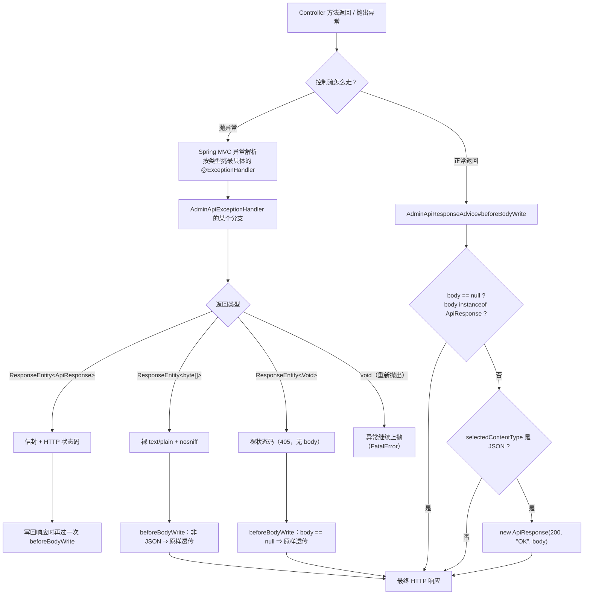
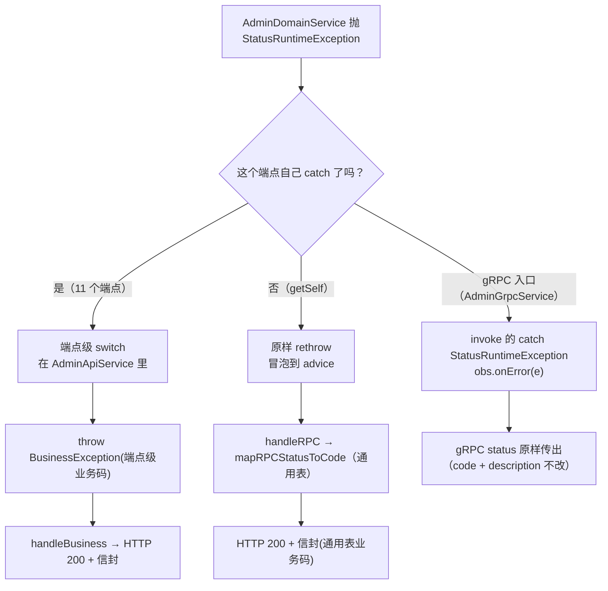
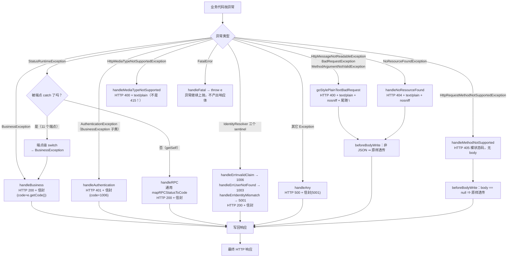

# 15. 异常处理与统一响应流程

## 1. 本次流程的研究范围

这一篇追踪的是：**一次 admin 域的 HTTP 请求，最终写回客户端的 HTTP 响应是怎么被决定的**。

具体追踪范围：

| 追踪 | 不追踪 |
|---|---|
| 正常返回时 `AdminApiResponseAdvice#beforeBodyWrite` 怎么包装 | 业务方法内部怎么算出返回值（见 01~13 篇） |
| `AdminApiExceptionHandler` 的**每一个** `@ExceptionHandler` 分支 | 异常在业务层是怎么被抛出来的（见 01~13 篇） |
| 每种异常 ⇒ HTTP 状态码 + body 形态的完整对应表 | Spring MVC 内部的 `HandlerExceptionResolver` 选择算法细节 |
| 两套 gRPC status → 业务码映射（端点级 / advice 通用表） | gRPC 面上的 status 透传（见 [16](./16-gRPC管理员服务流程.md)） |
| `ApiResponse` 信封的字段与序列化形状 | — |

**一个必须先说清的边界**：本流程有**两个入口**：

- **正常路径** ⇒ `AdminApiResponseAdvice`（`ResponseBodyAdvice`）
- **异常路径** ⇒ `AdminApiExceptionHandler`（`@RestControllerAdvice`）

两者**都会**参与最终响应，且异常路径的响应**也会**再经过一次 `ResponseBodyAdvice` ——
这是本篇最容易搞混的地方，见 §4.4。

---

## 2. 触发场景与输入

### 2.1 场景 A：正常返回

```
POST /admin/v1/login HTTP/1.1
Content-Type: application/json

{"username":"admin","password":"admin"}
```

Controller 方法签名（`controller/AdminController.java:135`）：

```java
@PostMapping("/login")
public LoginResp login(@Valid @RequestBody LoginReq req, HttpServletRequest httpRequest) {
    return adminApiService.login(req, httpRequest);
}
```

返回类型是 `LoginResp`（**不是** `ApiResponse`）⇒ 需要 advice 包装。

### 2.2 场景 B：抛异常

同一请求，密码写错 ⇒ 领域层抛 gRPC 状态异常 ⇒ API 层 catch 并转成 `BusinessException` ⇒ advice 接手。

### 2.3 输入是什么

| 输入 | 来源 | 谁消费 |
|---|---|---|
| `body` | Controller 方法的返回值，或 advice 产出的 `ApiResponse` | `beforeBodyWrite` 判断是否包装 |
| `selectedContentType` | Spring 选中的 `MediaType`（`HttpMessageConverter` 协商结果） | `beforeBodyWrite` 判断「是不是 JSON」 |
| 异常对象 | 业务层抛出 | `@ExceptionHandler` 按**类型**匹配 |
| `code` / `msg` | `BusinessException` 的两个字段 | 信封的 `code` / `msg` |

---

## 3. 整体执行路线



**关键结构**：`beforeBodyWrite` 在**写回响应体的那一刻**才跑（不是 Controller 返回的那一刻）。
所以异常处理器的返回值也会过它 —— 这就是「已是信封不重包」这条判断存在的原因。

---

## 4. 逐步讲解

### 4.1 第一步：正常路径 —— `ResponseBodyAdvice` 包装信封

涉及文件：`advice/AdminApiResponseAdvice.java`

```java
@RestControllerAdvice
public class AdminApiResponseAdvice implements ResponseBodyAdvice<Object> {

    @Override
    public boolean supports(MethodParameter returnType, Class<? extends HttpMessageConverter<?>> converterType) {
        return true;
    }

    @Override
    public Object beforeBodyWrite(Object body, MethodParameter returnType, MediaType selectedContentType,
                                  Class<? extends HttpMessageConverter<?>> selectedConverterType,
                                  ServerHttpRequest request, ServerHttpResponse response) {
        if (body == null || body instanceof ApiResponse) {
            return body;
        }
        if (selectedContentType != null
                && !MediaType.APPLICATION_JSON.isCompatibleWith(selectedContentType)) {
            return body;
        }
        return new ApiResponse(ErrCodes.SUCCESS, ErrMsg.getMsg(ErrCodes.SUCCESS), body);
    }
}
```

（`advice/AdminApiResponseAdvice.java:43-80`）

逐条拆：

| 分支 | 条件 | 为什么 |
|---|---|---|
| **不包装 ①** | `body == null` | 否则会把框架级错误的**空响应体**篡改成 `{"code":200,...}` |
| **不包装 ②** | `body instanceof ApiResponse` | 异常处理器返回的已经是信封 ⇒ 再包一层会变成 `{"code":200,"msg":"OK","data":{"code":1002,...}}` ⇒ **客户端的失败分支全部失效** |
| **不包装 ③** | `selectedContentType` 不是 JSON | B 侧的框架级错误是**裸 text/plain**，没有 `{code,msg,data}` 结构 |

**第 ③ 条的判据是「这次写出的到底是不是 JSON」，不是「body 是不是字符串」** ——
这是源码里特别强调的（`advice/AdminApiResponseAdvice.java:68-69`）：
如果按「body 是不是 String」判断，405 / 415 这类同样走 `text/plain` 的分支会被漏判。

`supports` 返回 `true` ⇒ **支持所有 Controller 返回值**。

### 4.2 第二步：信封长什么样

涉及文件：`common/src/main/java/com/rag/common/contract/ApiResponse.java`

```java
@Getter
@Setter
@NoArgsConstructor
@AllArgsConstructor
public class ApiResponse {
    private int code;
    private String msg;
    private Object data;
}
```

（`common/.../contract/ApiResponse.java:59-67`）

- **Lombok 注解**：`@Getter` / `@Setter` 生成 getter/setter；`@NoArgsConstructor` 生成无参构造；
  `@AllArgsConstructor` 生成三参构造 —— 包装时用的就是它（`new ApiResponse(code, msg, body)`）。
- **三个 JSON 键与顺序**：`code` → `msg` → `data`（Jackson 按字段声明顺序输出）。
- **⚠️ 不得加 `@JsonInclude(NON_NULL)`**：`data` 为 `null` 时**键必须仍然存在**（`"data":null`）。
  加了 `@JsonInclude` 就会让 `data` 键消失 ⇒ **可观察形状不等价**。
  测试 `AdminHttpContractRealTomcatTest#nullDataStillHasKey`（`:407`）钉死了这一条。

成功时：`ErrCodes.SUCCESS` = 200，`ErrMsg.getMsg(200)` = `"OK"`。

### 4.3 第三步：异常路径 —— `AdminApiExceptionHandler` 的 11 个分支

涉及文件：`advice/AdminApiExceptionHandler.java`（437 行）

Spring 的 `ExceptionHandlerExceptionResolver` 会**挑类型最具体**的那个 handler。
所以 `AuthenticationException`（是 `BusinessException` 的子类）会命中 `handleAuthentication`，
不会命中 `handleBusiness`。

#### 完整分支表

| # | 异常类型 | handler | HTTP 状态码 | body 形态 | 业务码 |
|---|---|---|---|---|---|
| 1 | `BusinessException` | `handleBusiness`（`:86`） | **200** | JSON 信封 | `e.getCode()` |
| 2 | `AuthenticationException` | `handleAuthentication`（`:105`） | **401** | JSON 信封 | `e.getCode()`（1006） |
| 3 | `StatusRuntimeException` | `handleRPC`（`:134`） | **200** | JSON 信封 | `mapRPCStatusToCode` 的结果 |
| 4 | `IdentityResolver.ErrInvalidClaimException` | `handleErrInvalidClaim`（`:185`） | **200** | JSON 信封 | **1006** |
| 5 | `IdentityResolver.ErrUserNotFoundException` | `handleErrUserNotFound`（`:201`） | **200** | JSON 信封 | **1003** |
| 6 | `IdentityResolver.ErrIdentityMismatchException` | `handleErrIdentityMismatch`（`:211`） | **200** | JSON 信封 | **5001** |
| 7 | `HttpMessageNotReadableException` | `handleUnreadableBody`（`:225`） | **400** | `text/plain` + nosniff + 尾随 `\n`，**无信封** | — |
| 8 | `BadRequestException` | `handleGoRequiredField`（`:255`） | **400** | 同上 | — |
| 9 | `MethodArgumentNotValidException` | `handleBeanValidation`（`:279`） | **400** | 同上 | — |
| 10 | `NoResourceFoundException` | `handleNoResourceFound`（`:352`） | **404** | `text/plain` + nosniff + `"404 page not found\n"` | — |
| 11 | `HttpRequestMethodNotSupportedException` | `handleMethodNotSupported`（`:358`） | **405** | **裸状态码，无 body、无 Content-Type** | — |
| 12 | `HttpMediaTypeNotSupportedException` | `handleMediaTypeNotSupported`（`:393`） | **400** ⚠️ | `text/plain` + nosniff + 尾随 `\n` | — |
| 13 | `FatalError` | `handleFatal`（`:410`） | — | **原样重抛**，不产出任何响应体 | — |
| 14 | `Exception`（兜底） | `handleAny`（`:416`） | **500** | JSON 信封 | **5001** |

#### ⚠️ 第 12 条：415 被改写成了 **400**

这是一个**非常容易看错**的地方。源码里的 handler 名字叫 `handleMediaTypeNotSupported`，
但它返回的是 **400**，不是 415：

```java
@ExceptionHandler(HttpMediaTypeNotSupportedException.class)
public ResponseEntity<byte[]> handleMediaTypeNotSupported(HttpMediaTypeNotSupportedException e) {
    log.warn("media type not supported : {}", e.getMessage());
    return goStylePlainTextBadRequest(e.getMessage());
}
```

（`advice/AdminApiExceptionHandler.java:393-397`）

**原因**（源码 `:369-380`）：B 侧的 go-zero **不做 content-type 协商** ——
`rest/httpx/requests.go:153` 的 `withJsonBody(r)` 判断的是
`r.ContentLength > 0 && strings.Contains(r.Header.Get("ContentType"), "application/json")`，
不匹配就**跳过 JSON 解析**，走 `UnmarshalJsonMap(nil, v)` ⇒ 必填字段缺失 ⇒ **400 + text/plain**。
⇒ **B 侧根本不存在 415 这个状态码**。

⇒ 行为对照：

| Content-Type | B 侧 | 本仓 |
|---|---|---|
| `application/json` | 正常解析 | 正常解析 |
| `text/plain`（body 有内容） | **400** + text/plain | **400** + text/plain ✅ 一致 |
| `text/plain`（**3 个空 struct 端点**：`/logout`、`/getself`、`/invite/create`） | **正常受理**（零值 struct ⇒ 无字段可缺 ⇒ 不报错） | **400** ⚠️ 已登记为 Intentional Deviation（框架差异 · 窄） |

由 `AdminHttpContractRealTomcatTest#nonJsonContentTypeIs400PlainText`（`:324`）钉死：
断言 **400**（不是 Spring 默认的 415）、`text/plain`、`nosniff`。

#### 第 7/8/9 条：400 的三条路径汇聚到同一个出口

```java
private static ResponseEntity<byte[]> goStylePlainTextBadRequest(String message) {
    String body = (message == null || message.isEmpty() ? "bad request" : message);
    return PlainTextErrors.badRequest(body);
}
```

（`advice/AdminApiExceptionHandler.java:322-325`）

⚠️ **空文案回落**这条是逐字保留的：B 侧是
`(message == null || message.isEmpty()) ? "bad request" : message`。
共享层的 `PlainTextErrors.text` 对 `null` 给的是**空串**，差这一个词 ⇒ **body 文本会变**
⇒ 所以在 advice 里先归一再交给共享层。

#### 共享层 `PlainTextErrors` 的三件事

涉及文件：`common/src/main/java/com/rag/common/web/PlainTextErrors.java`

```java
public static ResponseEntity<byte[]> text(HttpStatus status, String message) {
    byte[] body = ((message == null ? "" : message) + "\n").getBytes(StandardCharsets.UTF_8);
    return ResponseEntity.status(status)
            .header(HttpHeaders.CONTENT_TYPE, TEXT_PLAIN_UTF8)
            .header("X-Content-Type-Options", "nosniff")
            .body(body);
}
```

（`common/.../web/PlainTextErrors.java:83-89`）

**三件事，对应 B 侧 `net/http.Error` 的四行**：

| B 侧 `http.Error` | 本仓 |
|---|---|
| `h.Set("Content-Type", "text/plain; charset=utf-8")` | `TEXT_PLAIN_UTF8` = `"text/plain; charset=utf-8"`（`:61`） |
| `h.Set("X-Content-Type-Options", "nosniff")` | 同一个 header |
| `w.WriteHeader(code)` | `ResponseEntity.status(status)` |
| `fmt.Fprintln(w, error)` ⇒ **带一个尾随 `\n`** | `(message + "\n").getBytes(UTF_8)` |

⇒ **body 末尾的 `\n` 是由 `PlainTextErrors` 追加的，调用方不要自己加。**

⚠️ 关于 `Content-Type` 里的那个空格：共享层写的是 `"text/plain; charset=utf-8"`（分号后**有**空格），
但**真 Tomcat 会归一化**成 `text/plain;charset=utf-8`（分号后**无**空格）。
按 RFC 9110，参数分隔符旁的空白不显著 ⇒ 两者语义相同。**空格由容器重渲染决定，不由本层控制。**

由 `AdminHttpContractRealTomcatTest#missingRequiredFieldIs400PlainTextWithNosniff`（`:292`）钉死：
400、`text/plain`、`X-Content-Type-Options: nosniff`、body **以 `\n` 结尾**、且 body **不含** `"code"`。

#### 第 10 条：404 的形状来自共享层

```java
@ExceptionHandler(NoResourceFoundException.class)
public ResponseEntity<byte[]> handleNoResourceFound(NoResourceFoundException e) {
    log.warn("no static resource : {}", e.getMessage());
    return RouterErrorResponses.notFound(e.getResourcePath() == null ? "" : e.getResourcePath());
}
```

（`advice/AdminApiExceptionHandler.java:352-356`）

`RouterErrorResponses.notFound`（`common/.../web/RouterErrorResponses.java:133-138`）产出：

```
404 Not Found
Content-Type: text/plain; charset=utf-8
X-Content-Type-Options: nosniff
body = "404 page not found\n"   （19 字节）
```

⚠️ **注意成因**：Spring Boot 的静态资源 handler（`/**` → `ResourceHttpRequestHandler`）**兜住任何未知路径**
⇒ 路由「有 handler」⇒ 抛的是 `NoResourceFoundException`，**不是** `NoHandlerFoundException`。
⇒ 这个 handler 存在之前，未知路径会落到兜底的 `handleAny` ⇒ **HTTP 500** ⇒
「客户端打错路径」被误报成「服务端故障」。

#### 第 13 条：`FatalError` 原样重抛

```java
@ExceptionHandler(FatalError.class)
public void handleFatal(FatalError e) {
    // 故意不返回 ResponseEntity：让异常继续向上抛
    throw e;
}
```

（`advice/AdminApiExceptionHandler.java:410-414`）

`FatalError`（`common/.../logger/FatalError.java:41-47`）是共享层的**致命错误专用异常**。

**为什么不把它包成信封**：B 侧的 `logger.go:296` 在打出 `fatal_error` 后**无条件 `os.Exit(1)`**
—— 「fatal 后必须停止接流量」是硬契约。Java 版改成抛专用异常（**不**调 `System.exit`，
以免绕过 Spring 的 graceful shutdown / `@PreDestroy`），
但若不在此显式处理，`handleAny` 会把它当普通业务异常包成 200 信封 ⇒
**进程带着致命状态继续服务** ⇒ B 侧绝不会发生。

兜底分支里还有一道重复保险：

```java
public ResponseEntity<ApiResponse> handleAny(Exception e) {
    if (e instanceof FatalError fatal) {
        throw fatal;
    }
    log.error("unhandled exception", e);
    return ResponseEntity.status(HttpStatus.INTERNAL_SERVER_ERROR)
            .body(new ApiResponse(ErrCodes.ERROR_SERVER_COMMON, ErrMsg.getMsg(ErrCodes.ERROR_SERVER_COMMON), null));
}
```

（`advice/AdminApiExceptionHandler.java:416-425`）

#### 第 1 条：`decideStatus` 一律 200

```java
private HttpStatus decideStatus(int code) {
    return HttpStatus.OK;
}
```

（`advice/AdminApiExceptionHandler.java:434-436`）

**方法名有迷惑性**：它接收 `code` 却完全不用它，永远返回 `HttpStatus.OK`。

**这是刻意的**：B 侧所有 Logic 结果都走 `LogicResult` → `envelope(...)`，**HTTP 恒为 200**，
业务成败由 body 里的 `code` 表达。

⇒ **HTTP 状态码 ≠ 业务码**。这是本篇最需要记住的一条：

| 层面 | 载体 | 取值 |
|---|---|---|
| **业务码** | body 的 `code` | 1001 / 1002 / 1003 / 1006 / 1015 / 1016 / 5001 / 5003 … |
| **HTTP 状态码** | 响应行 | 业务错误 = **200**；鉴权失败 = **401**；框架级错误 = 400 / 404 / 405；未知异常 = 500 |

### 4.4 第四步：为什么异常响应也会经过 `beforeBodyWrite`

`AdminApiExceptionHandler` 的 handler 返回 `ResponseEntity<ApiResponse>`。
Spring 的 `HttpEntityMethodProcessor` 继承 `writeWithMessageConverters`，会查询 advice chain
⇒ **`ResponseBodyAdvice` 对 `ResponseEntity` 生效**。

⇒ 如果 `beforeBodyWrite` 无条件再包一层，错误响应的顶层 `code` 会恒为 200 ⇒ **客户端的失败分支全部失效**。

⇒ 所以「已经是信封的就不再包」这条判断是**必须**的，不是优化
（源码 `advice/AdminApiResponseAdvice.java:35-41`）。

**具体到三个不同 body 类型的走向**：

| handler 返回 | `body` 是什么 | `selectedContentType` | `beforeBodyWrite` 的判定 | 最终 |
|---|---|---|---|---|
| `ResponseEntity<ApiResponse>` | `ApiResponse` 实例 | JSON | `body instanceof ApiResponse` ⇒ **原样返回** | 完整信封 ✅ |
| `ResponseEntity<byte[]>` | `byte[]` | `text/plain` | 非 JSON ⇒ **原样返回** | 裸文本 ✅ |
| `ResponseEntity<Void>`（405） | `null` | — | `body == null` ⇒ **原样返回** | 裸状态码 ✅ |
| `void` + 重抛（`FatalError`） | — | — | 不产生响应 | 异常继续上抛 ✅ |

### 4.5 第五步：两套 gRPC status → 业务码映射（并存且不同）

这是本篇**最需要慢下来读**的一节。

#### 通用兜底表（advice 里）

```java
private int mapRPCStatusToCode(Status.Code code) {
    if (code == Status.Code.INTERNAL) return ErrCodes.ERROR_SERVER_COMMON;              // 5001
    if (code == Status.Code.NOT_FOUND) return ErrCodes.ERROR_USER_NOT_EXIST;            // 1003
    if (code == Status.Code.ALREADY_EXISTS) return ErrCodes.ERROR_USER_EXIST;           // 1001
    if (code == Status.Code.INVALID_ARGUMENT) return ErrCodes.ERROR;                    // 500
    if (code == Status.Code.PERMISSION_DENIED) return ErrCodes.ERROR_ADMIN_INVITE_CODE_WRONG; // 1016
    if (code == Status.Code.UNAUTHENTICATED) return ErrCodes.ERROR_TOKEN_RUNTIME;       // 1006
    return ErrCodes.CODE_SERVER_BUSY;                                                  // 1015
}
```

（`advice/AdminApiExceptionHandler.java:167-175`）

#### 端点级表（`AdminApiService` 里，每个端点各写各的）

`AdminApiService` 里的 catch 块**逐条照抄**了 B 侧各 api service 的 switch。
源码注释写得很清楚：

```
⚠️ **逐端点 switch（B 出处：对应 B 侧 api service 的 catch 块逐条照抄）**
   —— 不能用 advice 的通用 mapRPCStatusToCode：本端点的 INTERNAL 码与通用表**不同**。
```

（`service/AdminApiService.java` 各端点的 catch 块）

#### 对照表：哪些端点的映射与通用表不同

| 端点 | status | **端点级** | 通用表 | 差异 |
|---|---|---|---|---|
| `login` | `UNAUTHENTICATED` | **1002**（`ERROR_LOGIN_WRONG`） | 1006 | ⚠️ **不同** |
| `login` | `INTERNAL` | 5001 | 5001 | 同 |
| `login` | `NOT_FOUND` | 1003 | 1003 | 同 |
| `updateSelf` | `INTERNAL` | **5003**（`ERROR_DB_SELECT`） | 5001 | ⚠️ **不同** |
| `resetUserPassword` | `INTERNAL` | **5003** | 5001 | ⚠️ **不同** |
| `unBanUser` | `INTERNAL` | **5003** | 5001 | ⚠️ **不同** |
| `updateUser` | `INTERNAL` | 5001 | 5001 | 同 |
| `deleteUser` | `INTERNAL` | 5001 | 5001 | 同 |
| `banUser` | `INTERNAL` | 5001 | 5001 | 同 |
| `getUser` | `INTERNAL` | 5001 | 5001 | 同 |
| `getUserList` | `INTERNAL` | 5001 | 5001 | 同 |
| `createInviteCode` | `INTERNAL` | 5001 | 5001 | 同 |
| `createAdmin` | `PERMISSION_DENIED` | 1016 | 1016 | 同 |
| `logout` | `INTERNAL` | 5001 | 5001 | 同 |
| **`getSelf`** | 全部 | **不 catch，原样 rethrow** | 通用表 | ⇒ **走通用表** |

#### 两个具体的对照例子

**例 1：`login` 端点的密码错**

领域层 `AdminDomainService#doLogin` 抛：

```java
throw Status.UNAUTHENTICATED.withDescription("密码错误").asRuntimeException();
```

（`domain/service/AdminDomainService.java:271`）

`AdminApiService#login` 的 catch：

```java
if (code == Status.Code.UNAUTHENTICATED) {
    throw new BusinessException(ErrCodes.ERROR_LOGIN_WRONG,   // ← 1002
            ErrMsg.getMsg(ErrCodes.ERROR_LOGIN_WRONG));
}
```

（`service/AdminApiService.java:235-238`）

⇒ **端点级**：HTTP 200 + `{"code":1002,"msg":"用户名或密码错误"}`。
⇒ **通用表**：会给出 1006（`TOKEN已过期`）。
⇒ **同一类异常，两张表给出不同业务码。**

测试 `AdminHttpContractRealTomcatTest#wrongPasswordIs200WithBusinessCode`（`:387`）断言 **1002**，
注释里写明：「B 侧 login 端点专属映射，非通用表的 1006」。

**例 2：`updateSelf` 端点的 DB 失败**

领域层抛 `Status.INTERNAL`，`AdminApiService#updateSelf` 的 catch：

```java
if (code == Status.Code.INTERNAL) {
    throw new BusinessException(ErrCodes.ERROR_DB_SELECT,     // ← 5003
            ErrMsg.getMsg(ErrCodes.ERROR_DB_SELECT));
}
```

（`service/AdminApiService.java:427-430`）

⇒ **端点级**：HTTP 200 + `{"code":5003,"msg":"查询数据库失败"}`。
⇒ **通用表**：5001（`系统内部错误`）。

#### 为什么必须两套并存

源码在 `handleRPC` 的 javadoc 里写得很直白（`advice/AdminApiExceptionHandler.java:119-132`）：

> 本方法是「兜底」映射，不是唯一映射。B 侧**逐端点**在 api service 内各自 catch + 映射，
> C 侧在 `AdminApiService.java` 里**逐条照抄那 12 个 switch**；
> **本方法**对应 B 侧 `GlobalExceptionHandler.handleRPC` —— 承接**没有被端点自己 catch 住**的
> `StatusRuntimeException`（例：`getSelf` 端点 B 侧就是原样 rethrow，走的正是这条通用表）。
>
> ⚠️ **为什么不能反过来「只留通用表」**：B 侧**逐端点的 INTERNAL 码与通用表不同** ——
> `updateSelf` / `unBanUser` / `resetUserPassword` 的 INTERNAL 是 **5003**，而通用表是 **5001**；
> `login` 的 UNAUTHENTICATED 是 **1002**，而通用表是 **1006**。
> ⇒ 只留通用表 ⇒ 这 **4 个端点**的 HTTP 业务码与 B 侧不一致 ⇒ **未批准的 wire 漂移**。

⇒ **这不是 bug，是照抄真源的结果。**

#### 两张表的分流关系



#### `PERMISSION_DENIED` 为什么映射成「邀请码错误」（1016）

源码注释（`advice/AdminApiExceptionHandler.java:163-165`）：

> B 侧 admin 域的 `PERMISSION_DENIED` 只在「邀请码无效 / 已用 / 已过期」这一条路径上出现
> ⇒ ⇒ 该码在这一域里**就是**「管理员邀请码错误」的语义 ⇒ 逐字照抄。

#### 错误码表在哪

⚠️ **admin 域用的是**共享层（`users-common`）**那一份**：

| 文件 | 内容 |
|---|---|
| `service/users/common/src/main/java/com/rag/users/common/ErrCodes.java` | **码值集**（31 个常量，`SUCCESS`=200 · `ERROR`=500 · `CODE_SERVER_BUSY`=1015 · `ERROR_SERVER_COMMON`=5001 · `ERROR_DB_SELECT`=5003 · `ERROR_USER_EXIST`=1001 · `ERROR_LOGIN_WRONG`=1002 · `ERROR_USER_NOT_EXIST`=1003 · `ERROR_TOKEN_RUNTIME`=1006 · `ERROR_ADMIN_INVITE_CODE_WRONG`=1016 …） |
| `service/users/common/src/main/java/com/rag/users/common/ErrMsg.java` | **code → msg 映射**（31 条；`getMsg(int)` 未知码回落 `ERROR` 的文案 `"FAIL"`） |

user 域读的是**域内** `contract/ErrCodes.java`，但那是一份**薄转发层** ⇒ **码值两边完全一致**，
差别只在「以哪个类名访问」。

⚠️ **`msg` 取的是 `ErrMsg.getMsg(映射码)`，不是异常对象里带的 description**。
这是 B 侧自己的口径，逐字照抄（源码 `advice/AdminApiExceptionHandler.java:78-79`）。

### 4.6 完整异常链路图



---

## 5. 重要分支与失败路径

### 5.1 「同一类异常，不同端点，不同业务码」对照

这是本篇最容易被忽略、也最容易被后人「顺手统一」掉的行为。

| 场景 | 走哪张表 | HTTP | body 的 `code` |
|---|---|---|---|
| `login` 密码错 | **端点级** | 200 | **1002**（用户名或密码错误） |
| `login` 用户不存在 | **端点级** | 200 | **1003**（用户不存在） |
| `login` DB 故障 | **端点级** | 200 | **5001**（系统内部错误） |
| `updateSelf` DB 故障 | **端点级** | 200 | **5003**（查询数据库失败） |
| `resetUserPassword` DB 故障 | **端点级** | 200 | **5003** |
| `unBanUser` DB 故障 | **端点级** | 200 | **5003** |
| `getSelf` 管理员不存在 | **通用表** | 200 | **1003** |
| `getSelf` 身份错配 | identity sentinel | 200 | **5001** |

### 5.2 框架级错误分支

| 场景 | 抛什么 | 结果 |
|---|---|---|
| body 是空的 | `HttpMessageNotReadableException` | 400 + text/plain |
| body 是非法 JSON | `HttpMessageNotReadableException` | 400 + text/plain |
| 必填字段缺失（`@Valid` 触发） | `MethodArgumentNotValidException` | 400 + text/plain（**文案**由 Hibernate Validator 决定，属已登记的 L3 降级 D-01） |
| Content-Type 不是 JSON | `HttpMediaTypeNotSupportedException` | **400** + text/plain（B 侧没有 415） |
| 方法不对（GET 打 POST 端点） | `HttpRequestMethodNotSupportedException` | **405**，无 body、无 Content-Type |
| 路径不存在 | `NoResourceFoundException` | 404 + `"404 page not found\n"` |

### 5.3 兜底分支

| 场景 | 结果 |
|---|---|
| 任何没被上面 13 个分支接住的 `Exception` | **HTTP 500** + `{"code":5001,"msg":"系统内部错误","data":null}` |
| `FatalError` | **不产出响应** ⇒ 异常继续上抛 ⇒ 由更外层处置（Spring Boot 默认错误页 / 容器 500） |

---

## 6. 数据变化与副作用

| 维度 | 本流程是否发生 | 说明 |
|---|---|---|
| **数据库** | ❌ 未发生 | advice 与 advice 只做「异常 → 响应」的翻译，不碰 DB |
| **Redis** | ❌ 未发生 | 与本流程无关 |
| **事务** | ❌ 无 | 事务边界在业务层；异常被 catch 后事务**已经回滚**（若是运行时异常） |
| **远程调用** | ❌ 无 | — |
| **日志** | ✅ 每个分支都打 | `error`：BusinessException / StatusRuntimeException / identity sentinel / 未处理异常；`warn`：解析层失败 / 415 / 404 / 405 |
| **指标** | ❌ **advice 不埋点** | 指标在业务层（`AdminApiMetrics` / `AdminRpcMetrics`） |
| **生成 ID / Token** | ❌ 无 | — |

### 6.1 一个容易忽略的副作用顺序

`handleBusiness` 会打 `log.error("BusinessException code={} msg={}", ...)`（`:90`）——
**业务错误也打 error 级日志**。这是照抄 B 侧的结果，不是 bug。

而 `handleAuthentication` 打的是 `log.warn`（`:108`）—— 鉴权失败是客户端问题，不是服务端故障。

⇒ 排障时看到满屏 `ERROR ... BusinessException` **不代表**服务端有问题。

---

## 7. 执行结果

### 7.1 成功

```json
{"code":200,"msg":"OK","data":{"token":"eyJhbGciOiJIUzI1NiIs..."}}
```

**键恰好三个，顺序固定**：`code` → `msg` → `data`。
由 `AdminHttpContractRealTomcatTest#envelopeHasExactlyThreeKeys`（`:272`）断言：
`assertEquals(List.of("code", "msg", "data"), fieldNames)`。

### 7.2 业务失败（HTTP 200）

密码错：

```json
{"code":1002,"msg":"用户名或密码错误","data":null}
```

### 7.3 鉴权失败（HTTP 401）

```json
{"code":1006,"msg":"TOKEN已过期","data":null}
```

### 7.4 解析层失败（HTTP 400，**无信封**）

```
HTTP/1.1 400 Bad Request
Content-Type: text/plain;charset=utf-8
X-Content-Type-Options: nosniff

Required field 'username' is not present
```

（文案由 Hibernate Validator / Jackson 决定，**末尾有一个 `\n`**）

### 7.5 未知路径（HTTP 404）

```
HTTP/1.1 404 Not Found
Content-Type: text/plain;charset=utf-8
X-Content-Type-Options: nosniff

404 page not found
```

### 7.6 方法不对（HTTP 405，**裸状态码**）

```
HTTP/1.1 405 Method Not Allowed
```

**没有 body、没有 Content-Type。**（`ResponseEntity<Void>` + `body == null` ⇒ `beforeBodyWrite` 原样透传）

---

## 8. 流程复盘

```text
Controller 返回值 / 业务异常
  ↓
【异常路径】Spring MVC 异常解析 → 挑最具体的 @ExceptionHandler
  ├─ BusinessException          → 200 + 信封(code = e.getCode())
  ├─ AuthenticationException    → 401 + 信封(code = 1006)
  ├─ StatusRuntimeException     → 200 + 信封(端点级 switch 或通用表)
  ├─ identity sentinel × 3      → 200 + 信封(1006 / 1003 / 5001)
  ├─ 解析层失败 × 3             → 400 + text/plain + nosniff + 尾随 \n
  ├─ NoResourceFoundException   → 404 + "404 page not found\n"
  ├─ MethodNotSupported         → 405 裸状态码（无 body）
  ├─ MediaTypeNotSupported      → 400 + text/plain（不是 415！）
  ├─ FatalError                 → 原样重抛，无响应体
  └─ Exception                  → 500 + 信封(5001)
  ↓
【正常路径】ResponseBodyAdvice#beforeBodyWrite
  ├─ body == null               → 原样
  ├─ body instanceof ApiResponse → 原样（防重复包装）
  ├─ selectedContentType 非 JSON → 原样
  └─ 否则 → new ApiResponse(200, "OK", body)
  ↓
HTTP 响应
```

**边界结论**：

1. **HTTP 状态码 ≠ 业务码**。业务错误一律 **HTTP 200**，成败看 body 的 `code`。
2. **响应有三种形态**：JSON 信封 / 裸 `text/plain` / 裸状态码。**不是所有失败都是信封。**
3. **业务码表在共享层** `users-common` 的 `ErrCodes` + `ErrMsg`（admin 直接读，不走域内 contract）。
4. **两套 gRPC 码映射并存**：端点级 switch（11 个端点）＋ advice 通用表（兜底 `getSelf`）。
   ⇒ **同一类异常在不同端点可能得到不同业务码**（`login` 的 `UNAUTHENTICATED` ⇒ 1002 而非 1006；
   `updateSelf` / `resetUserPassword` / `unBanUser` 的 `INTERNAL` ⇒ 5003 而非 5001）。
5. **`FatalError` 绝不能被转成信封** ⇒ 它是「必须停」的最后一道闸门。
6. **`decideStatus(code)` 永远返回 200** ⇒ 方法名有迷惑性，但行为是契约。
7. **异常响应也会过 `beforeBodyWrite`** ⇒ 「已是信封不重包」不是优化，是必须。

---

## 9. 源码定位与验证方式

### 9.1 源码定位

| 位置 | 文件 | 关键成员 |
|---|---|---|
| 响应包装 | `service/users/admin/src/main/java/com/rag/admin/advice/AdminApiResponseAdvice.java` | `supports`（`:47`）· `beforeBodyWrite`（`:52`） |
| 异常出口 | `service/users/admin/src/main/java/com/rag/admin/advice/AdminApiExceptionHandler.java` | 14 个 handler（`:86`~`:425`）· `mapRPCStatusToCode`（`:167`）· `goStylePlainTextBadRequest`（`:322`）· `decideStatus`（`:434`） |
| 信封 | `common/src/main/java/com/rag/common/contract/ApiResponse.java` | 三个字段 + Lombok 注解（`:37-45`） |
| 裸文本 400 | `common/src/main/java/com/rag/common/web/PlainTextErrors.java` | `badRequest`（`:72`）· `text`（`:83`） |
| 裸 404 / 405 | `common/src/main/java/com/rag/common/web/RouterErrorResponses.java` | `notFound`（`:133`）· `methodNotAllowed`（`:145`） |
| 致命异常 | `common/src/main/java/com/rag/common/logger/FatalError.java` | `FatalError`（`:41`） |
| 业务异常 | `common/src/main/java/com/rag/common/exception/BusinessException.java` · `AuthenticationException.java` | — |
| 域内 sentinel | `service/users/admin/src/main/java/com/rag/admin/exception/AdminExceptions.java` | `NotFoundException` / `InviteUnavailableException` / `UsernameTakenException` / `isUniqueViolation` |
| 错误码表 | `service/users/common/src/main/java/com/rag/users/common/ErrCodes.java` · `ErrMsg.java` | 码值集 / 文案映射 |
| 端点级映射 | `service/users/admin/src/main/java/com/rag/admin/service/AdminApiService.java` | 11 个 catch 块（`:221`·`:285`·`:336`·`:414`·`:466`·`:509`·`:546`·`:583`·`:620`·`:661`·`:711`·`:756`） |
| 不 catch 的端点 | 同上 | `getSelf`（`:369`） |

> ⚠️ **`AdminExceptions` 里的三个 sentinel 没有任何专门的 `@ExceptionHandler`**。
> 它们**不直接冒泡到 HTTP 边界** —— 领域层会先 catch 它们并转成 gRPC `Status`
> （`NotFoundException` → `Status.NOT_FOUND` · `InviteUnavailableException` → `Status.PERMISSION_DENIED` ·
> `UsernameTakenException` → `Status.ALREADY_EXISTS`）⇒ 冒泡出 HTTP 边界的是 `StatusRuntimeException`
> ⇒ 走第 3 条分支。

### 9.2 验证方式

| 测试方法 | 位置 | 钉住什么 |
|---|---|---|
| `envelopeHasExactlyThreeKeys` | `AdminHttpContractRealTomcatTest.java:272` | body 恰好三键 `code/msg/data` 且顺序不变；`data:null` 时键仍在 |
| `nullDataStillHasKey` | `:407` | `data` 键不得消失（不许 `@JsonInclude(NON_NULL)`） |
| `missingRequiredFieldIs400PlainTextWithNosniff` | `:292` | 400 + `text/plain` + `nosniff` + 尾随 `\n` + **不含 `"code"`** |
| `absentBodyIs400` | `:312` | 空 body 与 `{}` 同等对待 ⇒ 400 |
| `nonJsonContentTypeIs400PlainText` | `:324` | 非 JSON content-type ⇒ **400**（不是 415）+ `text/plain` + `nosniff` |
| `unknownPathIs404` | `:369` | 404 + 逐字节 body + `nosniff` |
| `allThirteenEndpointsArePostOnly` | `:207` | GET ⇒ **405**（且发生在鉴权之前） |
| `wrongPasswordIs200WithBusinessCode` | `:387` | 密码错 ⇒ **HTTP 200 + 1002**（端点级映射，非通用表的 1006） |
| `unknownUserIs200WithNotFoundCode` | `:398` | 用户不存在 ⇒ HTTP 200 + 1003 |
| `protectedPathWithoutTokenIs401` | `:238` | 401 + 信封（`data` 键存在） |

全部使用**真 Tomcat**（`@SpringBootTest(webEnvironment = RANDOM_PORT)` + `TestRestTemplate`），
不走 MockMvc —— 因为 `Content-Type` 的最终渲染、`nosniff` 头、状态行只有真容器能测。

### 9.3 交叉引用

- **user 域的同款流程**（信封包装 + 异常分支表）⇒
  [11-HTTP统一响应与异常处理流程.md](../users/11-HTTP统一响应与异常处理流程.md)
- 401 的**产生点**（拦截器）⇒ [14-管理员JWT认证与黑名单流程.md](./14-管理员JWT认证与黑名单流程.md) §5.4
- 端点级映射的**调用方**（各业务流程）⇒ [01](./01-管理员登录流程.md) ~ [13](./13-用户密码重置流程.md)
- gRPC 面上 status **原样透传**（不经过本篇的映射）⇒ [16-gRPC管理员服务流程.md](./16-gRPC管理员服务流程.md)
- `BusinessException` 与 `AuthenticationException` 的区别 ⇒ [14](./14-管理员JWT认证与黑名单流程.md) §4.3

### 9.4 本篇的「源码无法确认」项

| 项 | 说明 |
|---|---|
| `ResponseBodyAdvice` 对 `ResponseEntity<ApiResponse>` 生效的具体机制 | 源码 javadoc 声明「`HttpEntityMethodProcessor` 继承 `writeWithMessageConverters` 并会查询 advice chain」⇒ 本仓有真 Tomcat 测试**间接**证明（401 的 body 是信封而不是被二次包装），但没有单独的探针直接断言 advice chain 的查询过程。 |
| `beforeBodyWrite` 在 `body == null` 时是否真被调用 | Spring 的 `AbstractMessageConverterMethodProcessor.writeWithMessageConverters` 在 body 为 null 时仍会走 advice 查询 ⇒ 本仓**间接**由 405 的裸状态码（无信封）证明；没有单独探针。 |
| `MethodArgumentNotValidException` 的**具体文案** | 文案由 Hibernate Validator 的版本决定（本仓未在源码中固定）⇒ 源码只保证**形状**（400 + text/plain + nosniff + 尾随 `\n`），**文本内容**属已登记的 L3 降级 D-01。测试也**刻意不断言文本**。 |
