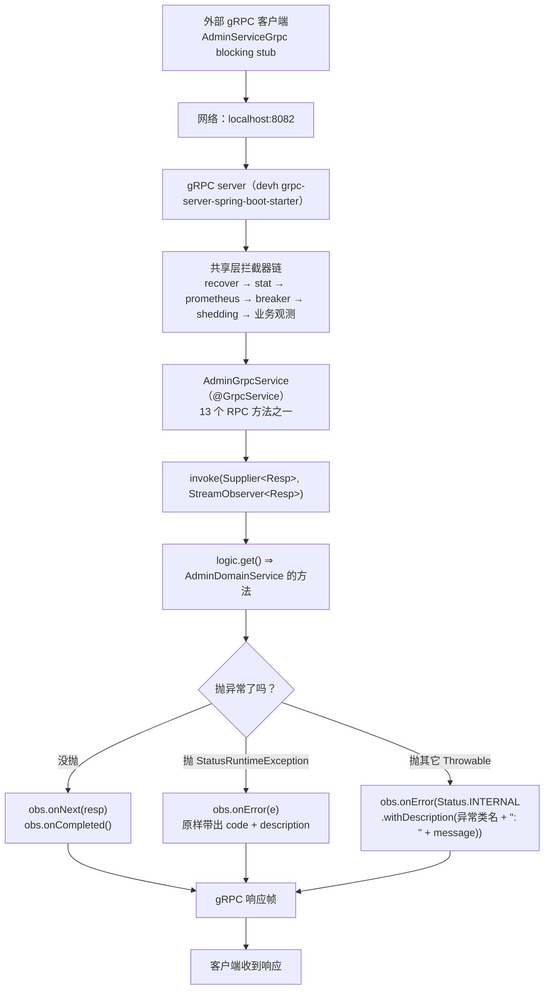
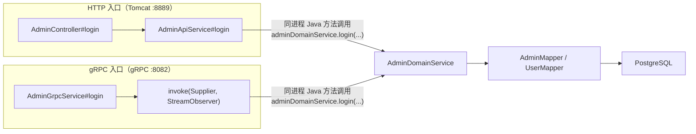
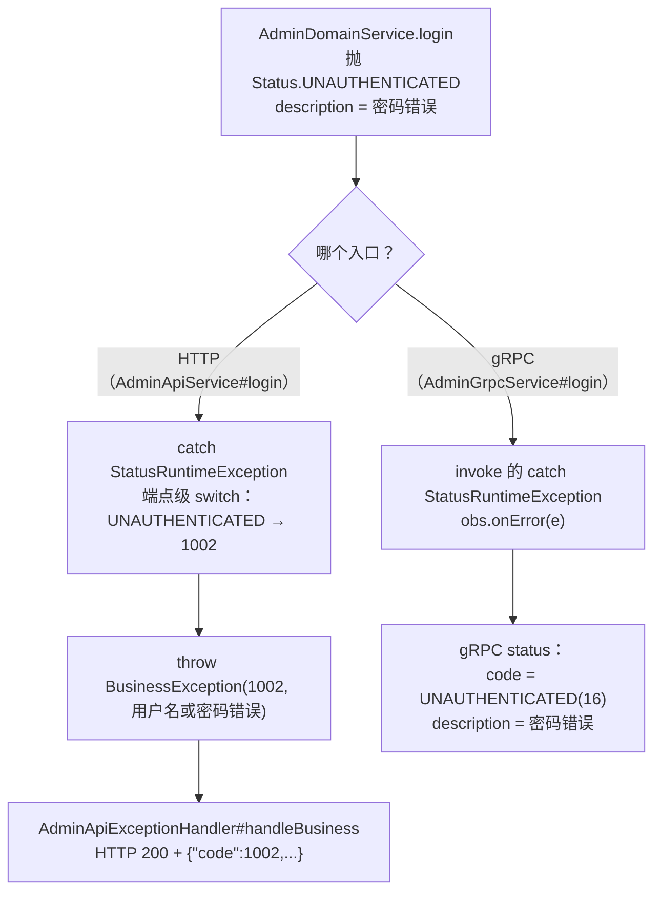

# 16. gRPC 管理员服务流程

## 1. 本次流程的研究范围

这一篇追踪的是：**一个外部 gRPC 客户端调用 admin 域的 `AdminService`，请求是怎么进到领域代码、又怎么变成 gRPC 响应的**。

具体追踪范围：

| 追踪 | 不追踪 |
|---|---|
| gRPC server 的启动与端口 | gRPC server 的**进程模型**（D1 合并的来龙去脉） |
| 共享层拦截器链（recover / stat / prometheus / breaker / shedding / 业务观测） | 各拦截器的**内部算法**（熔断算法、降载算法细节） |
| `AdminGrpcService` 的 13 个 RPC 方法 | 领域层的业务规则（见 01~13 篇） |
| `invoke` 的三段式（成功 / `StatusRuntimeException` / `Throwable`） | — |
| gRPC 面上的异常形态（status code + description） | HTTP 面的异常形态（见 [15](./15-异常处理与统一响应流程.md)） |
| `deadline` 的检查点 | deadline 机制的完整设计 |

**关键边界**：本篇**只讲 gRPC 入口**。
HTTP 入口（`AdminController` → `AdminApiService` → `AdminDomainService`）不在本篇，
但两者**共用同一份领域代码** —— 这是本篇要讲清的核心结构，见 §4.2。

---

## 2. 触发场景与输入

### 2.1 典型调用

外部 gRPC 客户端用 `AdminService` 的 stub 调用：

```
rpc /admin.AdminService/Login
```

请求消息（`proto/src/main/proto/admin.proto:61-64`）：

```protobuf
message LoginReq{
  string username = 1;
  string password = 2;
}
```

响应消息（`:66-68`）：

```protobuf
message LoginResp{
  int64 uid = 1;
}
```

### 2.2 gRPC server 在哪、监听哪个端口

`service/users/admin/src/main/resources/application.yml`：

```yaml
grpc:
  server:
    port: ${ADMIN_GRPC_PORT:8082}
    address: 0.0.0.0
    reflection-service-enabled: false
    enable-keep-alive: true
    keep-alive-time: 30s
    permit-keep-alive-without-calls: true
```

（`service/users/admin/src/main/resources/application.yml:89-104`）

⇒ **gRPC 端口 8082**（不是 HTTP 的 8889）。

⚠️ **8081 → 8082 是签字偏离（部署面）**：B 侧 admin-rpc 用 8081，但 B 侧 user-rpc **也是** 8081
⇒ 两域撞端口，靠环境变量错开。
本仓 D1 把 api + rpc 合成一个进程后，users 域只剩 2 个进程 ⇒ 端口必须错开
⇒ user-service 已占 8081 ⇒ admin 取 **8082**。

⚠️ **`grpc.client:` 这一段在本仓的 yml 里刻意没有**（`:105-121`）。
devh 3.1.0 的 `GrpcChannelsProperties` 是 `@ConfigurationProperties("grpc")`，
其 `client` 字段是 `Map<String, GrpcChannelProperties>`
⇒ `grpc.client.<X>` 的 `<X>` 是**通道名**。
⇒ 写 `grpc.client.negotiation-type: plaintext` 会被当成「名叫 negotiation-type 的通道」，
值是 String ⇒ 绑不成 `GrpcChannelProperties` ⇒ **上下文启动直接失败**（`ConverterNotFoundException`）。
⇒ **连「只有注释的 `client:`」都不能留** —— Spring 的 YAML loader 把「有键无值」读成**空串**（不是 null）
⇒ 同样绑失败。

### 2.3 service 定义（13 个 RPC）

`proto/src/main/proto/admin.proto:155-169`：

```protobuf
service AdminService {
  rpc GetUser(GetUserReq) returns (GetUserResp);
  rpc GetUserList(GetUserListReq) returns (GetUserListResp);
  rpc GetSelf(GetSelfReq) returns (GetSelfResp);
  rpc CreateAdmin(CreateAdminReq) returns (CreateAdminResp);
  rpc CreateInviteCode(CreateInviteCodeReq) returns (CreateInviteCodeResp);
  rpc Login(LoginReq) returns (LoginResp);
  rpc Logout(LogoutReq) returns (LogoutResp);
  rpc DeleteUser(DeleteUserReq) returns (DeleteUserResp);
  rpc ResetUserPassword(ResetUserPasswordReq) returns (ResetUserPasswordResp);
  rpc UpdateSelf(UpdateSelfReq) returns (UpdateSelfResp);
  rpc UpdateUser(UpdateUserReq) returns (UpdateUserResp);
  rpc BanUser(BanUserReq) returns (BanUserResp);
  rpc UnBanUser(UnBanUserReq) returns (UnBanUserResp);
}
```

**proto 包名与 java 包名**：

| 项 | 值 | 位置 |
|---|---|---|
| proto package | `admin` | `admin.proto:3` |
| `option java_package` | `com.rag.proto.admin` | `admin.proto:4` |
| `option java_multiple_files` | `true` | `admin.proto:5` |

⇒ 生成的 Java 类在 `com.rag.proto.admin` 下，
生成的服务基类是 `com.rag.proto.admin.AdminServiceGrpc.AdminServiceImplBase`。

---

## 3. 整体执行路线



---

## 4. 逐步讲解

### 4.1 第一步：服务是怎么被注册上去的

涉及文件：`grpc/AdminGrpcService.java`

```java
@GrpcService
public class AdminGrpcService extends AdminServiceGrpc.AdminServiceImplBase {

    private final AdminDomainService adminDomainService;

    public AdminGrpcService(AdminDomainService adminDomainService) {
        this.adminDomainService = adminDomainService;
    }
```

（`service/users/admin/src/main/java/com/rag/admin/grpc/AdminGrpcService.java:84-91`）

- **`@GrpcService`** 来自 `net.devh.boot.grpc.server.service.GrpcService`。
  devh 的 starter 启动时扫描容器里所有带这个注解的 bean，
  把它们注册到 gRPC server 的 `ServiceRegistry` ⇒ **本类不需要写任何注册代码**。
- **`extends AdminServiceGrpc.AdminServiceImplBase`** —— 这个基类是 protobuf 插件生成的，
  里面已经有一堆 `public void login(LoginReq request, StreamObserver<LoginResp> responseObserver)` 这样的空实现。
  本类逐个 `@Override` 填上真实实现。

⇒ **proto 里的 `service AdminService` 与 Java 里的这个类是一一对应的**：
proto 每加一个 rpc，生成基类就多一个方法，**不 `@Override` 就编译不过**。

### 4.2 第二步：两个入口共用同一份领域代码（本章最重要的结构）



**关键事实**：`AdminApiService` 拿到的 `AdminDomainService` 是**同一个 Spring Bean**。

看 HTTP 侧的实际代码（`service/AdminApiService.java:218`）：

```java
uid = adminDomainService.login(
        req.username() == null ? "" : req.username(),
        req.password() == null ? "" : req.password());
```

**这里没有出现**：

- gRPC Stub（`AdminServiceGrpc.AdminServiceBlockingStub`）；
- `ManagedChannel`；
- 网络地址；
- 远端服务名。

⇒ **这是同进程内的 Java 方法调用，不是一次 gRPC 网络请求。**

#### 判据：怎么区分「用了 proto 类型」和「发生了 gRPC 调用」

| 看什么 | proto 类型当参数（本地调用） | 真 gRPC 调用 |
|---|---|---|
| 有没有 Stub | ❌ | ✅ `XxxBlockingStub` / `XxxFutureStub` |
| 有没有 `ManagedChannel` | ❌ | ✅ |
| 有没有端口 / 目标服务名 | ❌ | ✅ |
| 有没有 `StreamObserver` | ❌ | ✅（服务端） |
| 有没有跨进程序列化 | ❌ | ✅（protobuf marshal） |

⇒ **本仓 D2「域内直连」**：HTTP 层**不再**经 gRPC stub 调 gRPC 层，
而是**直接注入** `AdminDomainService`（同进程、同事务上下文）。
⇒ `AdminGrpcService` **仍是 gRPC 出口**（对外 RPC 契约面），只是**不再被自己的 HTTP 层经网络调用**。

⚠️ **gRPC 面上没有 JWT 鉴权**：`AdminGrpcService` 里的 13 个方法**没有任何一个**检查
`Authorization` 头或 request attribute。
HTTP 面的 11 条受保护路径由 `AdminJwtAuthInterceptor` 把关（见 [14](./14-管理员JWT认证与黑名单流程.md)），
而 gRPC 入口**没有对应的拦截器**。

### 4.3 第三步：单个 RPC 的内部结构 —— 以 `login` 为例

涉及文件：`grpc/AdminGrpcService.java`

```java
// ====================== 1. Login ======================

@Override
public void login(LoginReq request, StreamObserver<LoginResp> responseObserver) {
    invoke(() -> {
        long uid = adminDomainService.login(request.getUsername(), request.getPassword());
        return LoginResp.newBuilder().setUid(uid).build();
    }, responseObserver);
}
```

（`service/users/admin/src/main/java/com/rag/admin/grpc/AdminGrpcService.java:95-101`）

拆开看：

| 元素 | 作用 |
|---|---|
| `request` | protobuf 反序列化后的**不可变**消息对象（`LoginReq`） |
| `responseObserver` | gRPC 传进来的**响应观察者** —— 服务端**不直接写 socket**，而是调它的方法 |
| `() -> { ... }` | 一个 `Supplier<LoginResp>` lambda —— 真正的业务代码被**包成"延迟求值"** |
| `invoke(...)` | 统一的三段式封装（见 §4.4） |

**为什么把业务包成 lambda**：因为 gRPC 的响应必须通过 `StreamObserver` 写出去，
而成功 / 失败两条路要分开处理 ⇒ 把业务隔离成一个「要么返回值、要么抛异常」的纯函数，
再由 `invoke` 统一决定「返回值 ⇒ onNext + onCompleted；异常 ⇒ onError」。

**`StreamObserver` 的三个方法**（初学者最容易混的）：

| 方法 | 什么时候调 | 本仓库的用法 |
|---|---|---|
| `onNext(resp)` | 写一条响应消息 | 成功时**恰好调一次** |
| `onCompleted()` | 声明「消息流正常结束」 | 成功时在 `onNext` 之后调 |
| `onError(t)` | 声明「这次调用失败」 | 失败时调**一次**（之后**不能再**调 `onNext` / `onCompleted`） |

### 4.4 第四步：`invoke` —— 三段式统一转发

```java
private static <Req, Resp> void invoke(
        java.util.function.Supplier<Resp> logic,
        StreamObserver<Resp> obs) {
    try {
        Resp resp = logic.get();
        obs.onNext(resp);
        obs.onCompleted();
    } catch (StatusRuntimeException e) {
        obs.onError(e);
    } catch (Throwable t) {
        obs.onError(Status.INTERNAL
                .withDescription(t.getClass().getSimpleName() + ": " + t.getMessage())
                .asRuntimeException());
    }
}
```

（`service/users/admin/src/main/java/com/rag/admin/grpc/AdminGrpcService.java:328-342`）

**三个分支，逐条讲**：

#### 分支 ①：成功

```java
Resp resp = logic.get();
obs.onNext(resp);
obs.onCompleted();
```

⇒ **先 `onNext` 再 `onCompleted`**，顺序不能反（反了 grpc-java 会抛 `IllegalStateException`）。

#### 分支 ②：`StatusRuntimeException` —— **原样透传**

```java
} catch (StatusRuntimeException e) {
    obs.onError(e);
}
```

⇒ **既不改 code，也不改 description。**

这条极重要，因为 admin 域的**领域层就是抛 gRPC 状态异常**：

```java
throw Status.NOT_FOUND.withDescription("用户不存在").asRuntimeException();
throw Status.UNAUTHENTICATED.withDescription("密码错误").asRuntimeException();
throw Status.INTERNAL.withDescription("DB查询失败").asRuntimeException();
throw Status.DEADLINE_EXCEEDED
        .withDescription("rpc deadline reached")
        .asRuntimeException();
```

（`domain/service/AdminDomainService.java` 的各方法）

**为什么必须原样透传**：`status code` + `description` 是 **gRPC wire 上可见的 L1 契约**。
若改成 `BusinessException`，共享层的 `GrpcExceptionMapperAutoConfiguration` 会把 status 改写成
`UNKNOWN(2)` + trailer `sea-biz-code` ⇒ **gRPC 面的 code 与 description 双双偏离**。

⇒ 所以本仓 admin 域**坚持抛 `StatusRuntimeException`**，HTTP 边界再逐条翻译成业务码
（见 [15](./15-异常处理与统一响应流程.md) §4.5）。

#### 分支 ③：其它 `Throwable` —— 兜底成 `INTERNAL`

```java
} catch (Throwable t) {
    obs.onError(Status.INTERNAL
            .withDescription(t.getClass().getSimpleName() + ": " + t.getMessage())
            .asRuntimeException());
}
```

⇒ **description 的形状是「异常类简名 + \": \" + message」**，例如：

```
NullPointerException: cannot invoke "String.length()" because "x" is null
```

⚠️ 这**不是** B 侧的形状。B 侧的 panic 处理是
`status.Errorf(codes.Internal, "panic: %v", r)`（见 `RpcRecoverInterceptor` 的 `PANIC_DESCRIPTION_PREFIX = "panic: "`）。
⇒ 但那条路径是**panic**（`Error`/`RuntimeException` 逃出 handler），
由共享层的 `RpcRecoverInterceptor` 兜住；本分支兜的是**普通异常逃出 `logic.get()`**。

### 4.5 第五步：领域层抛出的异常，在两个入口上形态不同

**同一份领域代码，两种入口，两种对外错误形态**：



⇒ **对照表**：

| 领域层抛的 | HTTP 入口看到 | gRPC 入口看到 |
|---|---|---|
| `Status.NOT_FOUND("用户不存在")` | HTTP 200 + `{"code":1003}` | status `NOT_FOUND(5)` + desc `用户不存在` |
| `Status.UNAUTHENTICATED("密码错误")` | HTTP 200 + `{"code":1002}`（login 端点专属） | status `UNAUTHENTICATED(16)` + desc `密码错误` |
| `Status.INTERNAL("DB查询失败")` | HTTP 200 + `{"code":5001}` 或 `{"code":5003}`（端点级 switch） | status `INTERNAL(13)` + desc `DB查询失败` |
| `Status.DEADLINE_EXCEEDED("rpc deadline reached")` | HTTP 200 + `{"code":1015}` | status `DEADLINE_EXCEEDED(4)` + desc `rpc deadline reached` |
| `Status.PERMISSION_DENIED(...)` | HTTP 200 + `{"code":1016}` | status `PERMISSION_DENIED(7)` + desc 原样 |
| `Status.ALREADY_EXISTS(...)` | HTTP 200 + `{"code":1001}` | status `ALREADY_EXISTS(6)` + desc 原样 |
| `Status.INVALID_ARGUMENT("Token不能为空")` | HTTP 200 + `{"code":500}` | status `INVALID_ARGUMENT(3)` + desc 原样 |

⇒ **gRPC 面是「原始 status」，HTTP 面是「翻译后的业务码」** —— 两套并存是刻意的（照抄真源）。

### 4.6 第六步：`deadline` —— 每个关键步骤前的检查

```java
private void checkDeadline() {
    if (Thread.currentThread().isInterrupted() || DeadlineState.isExpired()) {
        throw Status.DEADLINE_EXCEEDED
                .withDescription("rpc deadline reached")
                .asRuntimeException();
    }
}
```

（`domain/service/AdminDomainService.java:210-216`）

**它能做什么、不能做什么**（源码 `:198-206` 写得很清楚）：

| 能 | 不能 |
|---|---|
| 在**发起** DB / Redis 调用**之前**感知 deadline 已到、提前退出 | 取消**在途** IO —— JDBC 驱动不响应线程 interrupt |

**检查点分布**（`AdminDomainService` 里）：

| 方法 | 检查时机 |
|---|---|
| `doLogin` | 方法开头（`:241`） |
| `getSelf` | 方法开头（`:358`） |
| `getUser` | 方法开头（`:840`） |
| `getUserList` | 方法开头（`:878`） |
| `logout` | **不设入口闸门** ⇒ 期限耗尽时请求**照样走到 Redis 写**（`:302-303`） |

**`catch` 的顺序保住了 `DEADLINE_EXCEEDED` 不被改写**：

```java
try {
    admin = findOneAdminByUsername(username);
} catch (NotFoundException e) {
    metrics.getLoginUserNotFound().increment();
    throw Status.NOT_FOUND.withDescription("用户不存在").asRuntimeException();
} catch (StatusRuntimeException e) {
    // B-1：DEADLINE_EXCEEDED 必须上抛，不能掉进下面的 db_error 分支被改写成 INTERNAL。
    throw e;
} catch (Exception e) {
    metrics.getLoginDbError().increment();
    log.error("admin login DB error, username={}", username, e);
    throw Status.INTERNAL.withDescription("DB查询失败").asRuntimeException();
}
```

（`domain/service/AdminDomainService.java:243-256`）

**顺序很关键**：

1. `catch (NotFoundException e)` —— 领域 sentinel，最具体；
2. `catch (StatusRuntimeException e)` ⇒ **原样重抛** —— 这一条专门拦住 `DEADLINE_EXCEEDED`
   （它本身就是一个 `StatusRuntimeException`）；
3. `catch (Exception e)` ⇒ 改写成 `INTERNAL`。

⇒ 如果第 2 条不存在，`DEADLINE_EXCEEDED` 会掉进第 3 条被改写成 `INTERNAL` ⇒
**客户端看到的码从 `DEADLINE_EXCEEDED(4)` 变成 `INTERNAL(13)`** ⇒ 这是一条 wire 漂移。

`logout` 里是同款结构（`:326-340`），但注释里额外说明了一个**有意为之的例外**：

> ⚠️ 2026-10-30：本 catch **只**拦 grpc 的 `StatusRuntimeException`（PG 57014 走
> `SqlTimeoutStatusTranslator` 翻成 `DEADLINE_EXCEEDED` 的那条路）；共享层 Redis 期限代理
> 抛的是 **`org.springframework.dao.QueryTimeoutException`**（Spring 的，不是 grpc 的）
> ⇒ 它**不**被本分支拦 ⇒ 落进下面的 `catch (Exception)` ⇒ `INTERNAL`「注销失败,Redis写入异常」
> ⇒ 与参考侧的 `codes.Internal` 逐字同形（**这是有意的顺序，不是漏网**）。

### 4.7 第七步：共享层的 gRPC 拦截器链

装配点只有一个：`common/src/main/java/com/rag/common/autoconfigure/ProtectionAutoConfiguration.java`。

```java
@Bean
@ConditionalOnClass(name = "net.devh.boot.grpc.server.serverfactory.GrpcServerConfigurer")
@ConditionalOnMissingBean(name = "seaGrpcServerConfigurer")
public net.devh.boot.grpc.server.serverfactory.GrpcServerConfigurer seaGrpcServerConfigurer(
        ObjectProvider<ServerInterceptor> interceptors) {
    return server -> {
        List<ServerInterceptor> ordered = interceptors.orderedStream().toList();
        ServerInterceptor chain = RpcProtectionChain.compose(ordered);
        if (chain != null) {
            server.intercept(chain);
        }
        ...
    };
}
```

**为什么必须在这里、且只能有一份**（源码 `:219-228`）：
devh starter 只认 `GrpcServerConfigurer`（**实测 javap 证据**：`GrpcServerConfigurer extends Consumer<ServerBuilder<?>>`，
三个 server factory 方法都只注入 `List<GrpcServerConfigurer>`，**没有任何 interceptor 形参**）
⇒ 只产出一个 `ServerInterceptor` bean ⇒ **链上什么都不会发生，而且零报错**（静默失效）。

**链序由 `@Order` 常量写死**（`ProtectionAutoConfiguration.java:263-267`）：

```java
public static final int RPC_LAYER_RECOVER = 0;
public static final int RPC_LAYER_STAT = 1;
public static final int RPC_LAYER_PROMETHEUS = 2;
public static final int RPC_LAYER_BREAKER = 3;
public static final int RPC_LAYER_SHEDDING = 4;
```

**「序号小的在最外层」这条是怎么保证的**（`common/src/main/java/com/rag/common/protection/RpcProtectionChain.java:70-79`）：

```java
public static ServerInterceptor compose(List<ServerInterceptor> ordered) {
    if (ordered == null || ordered.isEmpty()) {
        return null;
    }
    ServerInterceptor chain = null;
    for (int i = ordered.size() - 1; i >= 0; i--) {
        chain = wrap(ordered.get(i), chain);
    }
    return chain;
}
```

⇒ **从后往前**遍历、每次把当前层套在已建链的外面 ⇒ **列表第 0 个在最外层**。

源码注释说明了为什么不用「多次 `server.intercept(...)`」：
grpc-api 1.63.0 的 `ServerBuilder#intercept` 只有单参重载，多次调用时**最后 add 的在最外层**
⇒ 链序就押在一个容易记反的 API 事实上 ⇒ 本方法把顺序**写进代码结构**。

⚠️ `wrap` 里有一处**必须**的写法（`:138-140`）：

```java
// ⚠️ 必须调 inner.interceptCall(...)，**不能**把 next 直接透传
//    ⇒ 透传 ⇒ inner 永远不被调用 ⇒ 整条内层链静默消失（零报错）
return delegate.interceptCall(c, h, next);
```

⇒ **这类"静默消失、零报错"的坑正是本仓反复强调「机制可证」的原因**（AGENTS.md §3.3）。

| 层 | 类 | 做什么 | 关键可观察契约 |
|---|---|---|---|
| `recover` | `RpcRecoverInterceptor` | 兜住 handler 的 panic | status `INTERNAL` + description 以 **`"panic: "`** 开头；**进程存活**；本地日志有带栈的 ERROR |
| `stat` | `RpcStatInterceptor` | 每个 unary 请求的耗时进进程内聚合器（每 60s 一行统计日志） | **panic 也会记一条**（B 侧用 `defer`） |
| `prometheus` | `RpcPrometheusInterceptor` | 耗时分布 + 状态码计数 | 指标名 `rpc_server_requests_duration_ms` / `rpc_server_requests_code`（导出后 = `rpc_server_requests_code_total`）；**panic 时不记** |
| `breaker` | `RpcCircuitGateInterceptor` | 服务端熔断 | 拒绝形状 = `UNAVAILABLE` + `"circuit breaker is open"`（**wire 契约**） |
| `shedding` | `RpcSheddingInterceptor` | CPU 自适应降载 | 拒绝形状 = `RESOURCE_EXHAUSTED` + `"service overloaded"` |
| 业务观测 | `ObservabilityAutoConfiguration` 的观测拦截器 | timeout / 慢调用 / span | **不带 `@Order`** ⇒ 落在 `LOWEST_PRECEDENCE` ⇒ **最内层** |

⇒ **完整链序**：`recover → stat → prometheus → breaker → shedding → 业务观测 → handler`。

**两个必须记住的细节**：

1. **`prometheus` 必须在 `breaker` / `shedding` 的外层** ——
   否则被降载 / 熔断拒绝的请求在指标里**整个消失**（它们会记成 `RESOURCE_EXHAUSTED(8)` / `UNAVAILABLE(14)`）。
2. **`recover` 必须包到 `Listener#onHalfClose`** ——
   grpc-java 的 handler 方法**不是在 `interceptCall` 里执行的，而是在 `Listener#onHalfClose()` 里执行的**
   ⇒ 只包 `next.startCall(...)` 的话，**用户 handler 里的 panic 一条都兜不住**。

### 4.8 第八步：13 个 RPC 与 proto 定义的对应表

| # | proto rpc | Java 方法（`AdminGrpcService`） | 领域方法（`AdminDomainService`） | 响应 message 的特殊点 |
|---|---|---|---|---|
| 1 | `Login` | `login`（`:96`） | `login(String, String)` → `Long` | `LoginResp.uid` |
| 2 | `Logout` | `logout`（`:106`） | `logout(String)` → `boolean` | ⚠️ **`LogoutResp.success` 不 set** ⇒ proto3 默认 `false` |
| 3 | `GetSelf` | `getSelf`（`:116`） | `getSelf(long)` → `AdminEntity` | — |
| 4 | `UpdateSelf` | `updateSelf`（`:126`） | `updateSelf(...)` → `AdminEntity` | `setSuccess(true)` + `setAdmin(...)` |
| 5 | `CreateAdmin` | `createAdmin`（`:147`） | `createAdmin(...)` → `long` | `CreateAdminResp.uid` |
| 6 | `CreateInviteCode` | `createInviteCode`（`:165`） | `createInviteCode(long)` → `InviteCodeResult` | `inviteCode` + `expiresAt` |
| 7 | `BanUser` | `banUser`（`:178`） | `banUser(long, long)` | `setSuccess(true)` |
| 8 | `UnBanUser` | `unBanUser`（`:188`） | `unBanUser(long, long)` | `setSuccess(true)` |
| 9 | `GetUser` | `getUser`（`:198`） | `getUser(long)` → `UserEntity` | ⚠️ **`GetUserResp.found` 不 set** ⇒ 默认 `false` |
| 10 | `GetUserList` | `getUserList`（`:213`） | `getUserList(long, long, String)` → `UserListResult` | `total` + `repeated list` |
| 11 | `UpdateUser` | `updateUser`（`:231`） | `updateUser(...)` → `UserEntity` | ⚠️ **`UpdateUserResp.success` 不 set** ⇒ 默认 `false` |
| 12 | `DeleteUser` | `deleteUser`（`:265`） | `deleteUser(long, long)` | `setSuccess(true)` |
| 13 | `ResetUserPassword` | `resetUserPassword`（`:275`） | `resetUserPassword(long, long)` | `setSuccess(true)` |

#### ⚠️ 三处 proto3 默认值（不得「顺手补 true」）

源码在 `AdminGrpcService` 的类注释里专门列了（`:73-82`）：

1. **`logout`**：`LogoutResp.success` **不** set ⇒ proto3 默认 `false`。
2. **`updateUser`**：`UpdateUserResp.success` **不** set ⇒ `false`。
   源码注释（`:243-251`）写得很细：B 侧 `updateuserlogic.go:105-113` **只 set 了 `User`**，
   ⇒ 线上序列化时该字段**缺席**，客户端读到 `false`。
   RAG 原先 `setSuccess(true)` ⇒ 线上是 varint 1 ⇒ 客户端读到 `true` ⇒ **wire 层可观察差异**。
3. **`getUser`**：`GetUserResp.found` **不** set ⇒ `false`。

**但 HTTP 面仍然是 `found=true` / `success=true`** —— 因为那是 **api 层**显式置的
（`AdminApiService#getUser` 写死 `Found: true`）。
⇒ **rpc 层的行为 ≠ 端到端的行为**。不要看到 rpc 层不 set 就以为端到端是 `false`。

#### `extra_info` 的空 map 处理

```java
Map<String, String> extra = admin.getExtraInfo();
if (extra != null && !extra.isEmpty()) {
    b.putAllExtraInfo(extra);
} else {
    b.putAllExtraInfo(new HashMap<>());
}
```

（`grpc/AdminGrpcService.java:294-299` 与 `:314-319`）

⇒ **空 map 也要 put 一个空 map 进去**（不是「不 put」）—— B 侧如此。
两个 helper（`toProtoAdmin` / `toProtoUser`）都是 **null-safe** 的：
`uid == null ? 0L : uid`、`username == null ? "" : username`、`email == null ? "" : email`。

⚠️ `toProtoAdmin` 的 email 用 `AdminHelpers.stringValue(admin.getEmail())` —— 因为
`admin_admin.email` 列是 **nullable**（`03_create_admin.sql:57`：`email TEXT UNIQUE`）。
而 `toProtoUser` 的 email 用 `user.getEmail() == null ? "" : user.getEmail()` —— `users_user.email` 非 null。

### 4.9 第九步：请求是怎么被反序列化的

**这一段是框架机制，不是本仓代码**，但必须讲清：

1. gRPC server 收到 HTTP/2 帧 → 按 `MethodDescriptor` 找到对应的 `ServerCallHandler`；
2. protobuf marshaller 用 `LoginReq.getDefaultInstance()` 作为原型 + `parseFrom(InputStream)` 反序列化
   ⇒ 得到 `LoginReq` 实例；
3. devh 的 starter 把这个实例作为**方法的第一个参数**传给 `AdminGrpcService#login`；
4. 第二个参数是 `StreamObserver`。

⇒ **proto3 的 `optional` presence 语义在这里生效**：本仓的 `admin.proto` **没有用 `optional`**，
所有字段都是「值语义」（`int64` 缺失 = 0，`bool` 缺失 = `false`，`string` 缺失 = `""`）。
⇒ 这就是为什么 `GetUserResp.found` 不 set 就等于 `false` —— **不是「未知」，是「false」**。

---

## 5. 重要分支与失败路径

### 5.1 gRPC 侧的异常分支表

| 抛出点 | 异常类型 | gRPC 侧结果 | HTTP 侧结果（同一份领域代码） |
|---|---|---|---|
| 领域层业务失败 | `StatusRuntimeException` | **原样 status**（code + description） | 端点级 switch → 业务码，HTTP 200 |
| 领域层 DB 故障 | `StatusRuntimeException(INTERNAL)` | `INTERNAL(13)` + desc `DB查询失败` | `5001` 或 `5003`（端点级），HTTP 200 |
| 领域层 deadline | `StatusRuntimeException(DEADLINE_EXCEEDED)` | `DEADLINE_EXCEEDED(4)` + desc `rpc deadline reached` | `1015`，HTTP 200 |
| `logic.get()` 抛普通异常 | `Throwable` | `INTERNAL(13)` + desc `"异常类名: message"` | — （HTTP 侧不走这里） |
| handler panic | `Error` / `RuntimeException` 逃出 `onHalfClose` | **`RpcRecoverInterceptor` 兜住** ⇒ `INTERNAL(13)` + desc `"panic: ..."` | — |
| breaker 拒绝 | — | `UNAVAILABLE(14)` + `"circuit breaker is open"` | — |
| shedding 拒绝 | — | `RESOURCE_EXHAUSTED(8)` + `"service overloaded"` | — |
| 客户端 deadline 到 | — | 服务端调度线程 close ⇒ 客户端收到 `DEADLINE_EXCEEDED(4)` | — |

### 5.2 `catch` 顺序的三个坑

| 坑 | 后果 |
|---|---|
| `catch (Exception e)` 写在 `catch (StatusRuntimeException e)` **前面** | `DEADLINE_EXCEEDED` 被改写成 `INTERNAL` ⇒ **wire 漂移** |
| `catch (NotFoundException e)` 写在后面 | 领域 sentinel 被 `Exception` 兜住 ⇒ 业务码从 `1003` 变成 `5001` |
| `RpcRecoverInterceptor` 只包 `startCall` 不包 `onHalfClose` | **handler 里的 panic 一条都兜不住** ⇒ 进程可能被拖垮 |

### 5.3 「panic 时记不记指标」的两层差异

| 层 | panic 时 | 为什么 |
|---|---|---|
| `stat` | **记一条**耗时样本 | B 侧用 `defer` ⇒ 栈展开时也执行 ⇒ 本仓在 panic 展开点补记 |
| `prometheus` | **不记** | B 侧是「先调 handler、再记」的直线代码 ⇒ panic 时后置的两行根本不执行 |

⇒ **同一个 panic 请求，在 Prometheus 里查不到，在 Stat 的聚合日志里查得到。**

---

## 6. 数据变化与副作用

| 维度 | 本流程是否发生 | 说明 |
|---|---|---|
| **数据库** | ✅ 视 RPC 而定 | 走 `AdminDomainService` ⇒ 读 / 写 `admin_admin` · `admin_invite` · `users_user` |
| **事务** | ⚠️ 视 RPC 而定 | `createAdmin` 走 `AdminCreateAtomicService` 的事务边界（悲观锁 + 事务，见 [02](./02-管理员创建流程.md)）；`logout` 是**单条 Redis 写**，无事务 |
| **Redis 写** | ⚠️ 仅 `logout` | `admin:jwt_blacklist:<token>` = `"banned"`，TTL = `access-expire`（默认 30 天） |
| **Redis 读** | ⚠️ 仅 `logout` 的前置（无） | gRPC 面上**没有黑名单读** ⇒ **gRPC 入口不做 JWT 鉴权** |
| **远程调用** | ❌ 无 | D2 域内直连 ⇒ 本进程不拨自己的 gRPC |
| **消息** | ❌ 无 | admin 域不收发 Kafka |
| **日志** | ✅ | 领域层 `log.error` / `log.info`；`RpcRecoverInterceptor` 的带栈 ERROR |
| **指标** | ✅ | `rpc_server_requests_duration_ms` + `rpc_server_requests_code_total`（prometheus 层）；`admin_rpc_*`（领域层 metrics）；`stat` 聚合器 |
| **生成 ID** | ⚠️ 仅 `createAdmin` | `Snowflake.nextId()` 生成 admin uid |
| **生成 Token** | ❌ 无 | gRPC 面上**不签发 JWT**（签发只在 HTTP 的 `login` 端点） |

### 6.1 副作用顺序（失败时哪些已经发生）

**以 `createAdmin` 为例**（它有事务边界）：

1. `Snowflake.nextId()` 生成 uid —— **这一步已经消耗了一个 ID**；
2. bcrypt 加密密码；
3. 事务内：`SELECT invite FOR UPDATE` → 校验邀请码 → 校验用户名 → `insert admin` → 标记邀请码已用；
4. 若第 3 步失败 ⇒ 事务回滚 ⇒ **表里没有数据**，但**第 1 步的 ID 已被消耗**。

⇒ 这就是「ID 消耗不可回滚」的典型形态。

**以 `logout` 为例**（无事务）：

1. `stringRedisTemplate.opsForValue().set(key, "banned", ttl)`；
2. 若 Redis 写失败 ⇒ 抛 `INTERNAL`「注销失败,Redis写入异常」⇒ **token 没有进黑名单** ⇒
   **用户仍然可以用这个 token 访问** ⇒ 这是「注销失败但会话仍有效」的典型形态。

---

## 7. 执行结果

### 7.1 成功

```protobuf
// rpc /admin.AdminService/Login 返回
message LoginResp {
  int64 uid = 1;
}
```

客户端拿到的 status = `OK(0)`，`description` 为空。

### 7.2 业务失败（gRPC 面保留原始 status）

```protobuf
// rpc /admin.AdminService/Login，密码错
status code = UNAUTHENTICATED(16)
description = "密码错误"
```

⚠️ **和 HTTP 面完全不同**：HTTP 面是 `HTTP 200 + {"code":1002,...}`，
gRPC 面是 `UNAUTHENTICATED(16)` + description `密码错误`（**不翻译**）。

### 7.3 `getUser` 的响应（`found` 不 set）

```protobuf
message GetUserResp {
  UserInfo user = 1;
  bool found = 2;      // ← 不 set ⇒ 线上缺席 ⇒ 客户端读到 false
}
```

⇒ 客户端读到 `found = false`，**但 `user` 字段是有内容的**。
HTTP 面同一个业务返回 `found = true`（api 层显式置的）。

---

## 8. 流程复盘

```text
外部 gRPC 客户端
  ↓ （localhost:8082，proto package=admin，java_package=com.rag.proto.admin）
gRPC server（devh starter）
  ↓
共享层拦截器链
  recover → stat → prometheus → breaker → shedding → 业务观测
  ↓
AdminGrpcService（@GrpcService extends AdminServiceGrpc.AdminServiceImplBase）
  ↓
invoke(Supplier<Resp>, StreamObserver<Resp>)
  ├─ logic.get() ⇒ AdminDomainService 的方法（与 HTTP 入口共用同一份 Bean）
  │     ├─ checkDeadline() ⇒ 超时则抛 DEADLINE_EXCEEDED
  │     ├─ Mapper ⇒ PostgreSQL
  │     └─ 业务失败 ⇒ StatusRuntimeException（NOT_FOUND / UNAUTHENTICATED / INTERNAL …）
  ├─ 成功 ⇒ obs.onNext(resp) + obs.onCompleted()
  ├─ StatusRuntimeException ⇒ obs.onError(e)          ← 原样，code + description 不动
  └─ 其它 Throwable ⇒ obs.onError(INTERNAL + "类名: message")
  ↓
gRPC 响应帧
```

**边界结论**：

1. **proto 消息类型 ≠ gRPC 调用**。
   HTTP 路径里也用 proto 消息当参数（`AdminApiService` 里构造 `com.rag.proto.admin.LoginReq`），
   但那是**同进程方法调用**。判据 = 有没有 Stub / ManagedChannel / 端口 / 远端服务名 / `StreamObserver`。
2. **两个入口共用同一份领域代码**（`AdminDomainService` 是同一个 Spring Bean）。
   ⇒ 业务规则只有一份实现，不会分叉。
3. **异常映射在两端**：领域层抛的 gRPC `Status` 在 gRPC 侧**原样传出**，
   在 HTTP 侧被翻译成业务码 ⇒ **同一份领域代码，两种对外错误形态**。
4. **gRPC 面上没有 JWT 鉴权**，也没有黑名单读。
5. **`catch` 顺序保住 `DEADLINE_EXCEEDED`**：`NotFoundException` → `StatusRuntimeException`（原样上抛）→ `Exception`（改写 INTERNAL）。
6. **三处 proto3 默认值不得「顺手补 true」**：`logout.success` / `updateUser.success` / `getUser.found`。
7. **拦截器链只有一个挂载点**（`seaGrpcServerConfigurer`）⇒ 域内再来一份就会挂 2 条链。
8. **`stat` 记 panic、`prometheus` 不记 panic** ⇒ 同一个 panic 在两套指标里表现不同。

---

## 9. 源码定位与验证方式

### 9.1 源码定位

| 位置 | 文件 | 关键成员 |
|---|---|---|
| gRPC 服务实现 | `service/users/admin/src/main/java/com/rag/admin/grpc/AdminGrpcService.java` | `@GrpcService`（`:84`）· 13 个 RPC（`:95`~`:280`）· `toProtoAdmin`（`:289`）· `toProtoUser`（`:308`）· `invoke`（`:328`） |
| proto 定义 | `proto/src/main/proto/admin.proto` | `service AdminService`（`:155`）· `java_package`（`:4`）· 13 个 message |
| 领域代码 | `service/users/admin/src/main/java/com/rag/admin/domain/service/AdminDomainService.java` | `checkDeadline`（`:210`）· `doLogin`（`:240`）· `logout`（`:319`）· `getSelf`（`:357`）· `createAdmin`（`:528`）· `createInviteCode`（`:645`）· `banUser`（`:747`）· `unBanUser`（`:791`）· `getUser`（`:839`）· `getUserList`（`:877`）· `updateUser`（`:1023`）· `deleteUser`（`:1161`）· `resetUserPassword`（`:1210`） |
| 拦截链装配 | `common/src/main/java/com/rag/common/autoconfigure/ProtectionAutoConfiguration.java` | `RPC_LAYER_*` 常量（`:263-267`）· `seaGrpcServerConfigurer`（`:233`）· 各层 bean（`:275`~`:339`） |
| 链的合成 | `common/src/main/java/com/rag/common/protection/RpcProtectionChain.java` | `compose`（`:70`）· `wrap`（`:111`）· `layerNames`（`:90`） |
| recover 层 | `common/src/main/java/com/rag/common/observability/RpcRecoverInterceptor.java` | `interceptCall`（`:80`）· `closeAsPanic`（`:141`）· `PANIC_DESCRIPTION_PREFIX`（`:73`） |
| stat 层 | `common/src/main/java/com/rag/common/observability/RpcStatInterceptor.java` | `interceptCall`（`:92`）· `recordOnce`（`:148`） |
| prometheus 层 | `common/src/main/java/com/rag/common/observability/RpcPrometheusInterceptor.java` | `DURATION_METRIC`（`:87`）· `CODE_METRIC`（`:98`）· `interceptCall`（`:118`） |
| deadline 载体 | `common/src/main/java/com/rag/common/observability/DeadlineState.java` | `isExpired`（`:110`）· `remainingMillis`（`:117`）· `bindRemainingNanos`（`:169`） |
| gRPC 异常边界 | `common/src/main/java/com/rag/common/autoconfigure/GrpcExceptionMapperAutoConfiguration.java` | `BIZ_CODE_TRAILER_KEY = "sea-biz-code"`（`:94`）· 服务端改写（`:117`） |
| gRPC 端口配置 | `service/users/admin/src/main/resources/application.yml` | `grpc.server.port`（`:99`） |
| 依赖 | `service/users/admin/pom.xml` | `grpc-server-spring-boot-starter` · `grpc-client-spring-boot-starter` · `grpc-core`（1.63.0，starter 上排除） |

### 9.2 验证方式

| 测试 | 位置 | 钉住什么 |
|---|---|---|
| `AdminHttpContractRealTomcatTest`（间接） | `:98` 的 `grpc.server.port=0` | gRPC server 在测试里用**随机端口**，不与本机其它域撞端口 |
| ⚠️ `AdminRpcGoWireParityTest#updateUserRespSuccessMatchesGoWire` | **本仓不存在这个测试类** | `AdminGrpcService.java:257` 的源码注释把它称作守门测试，但 `find . -name "AdminRpcGoWireParityTest*"` 在本仓**零命中** ⇒ 该 wire 对拍目前**没有实际执行的守门**。注释意图是：`updateUser` 的 `success` 字段与 Go 侧 wire 一致（**不 set** ⇒ false） |

> ⚠️ **本域的 gRPC 侧测试覆盖不如 HTTP 侧完整**。
> `AdminHttpContractRealTomcatTest` 用 `grpc.server.port=0` 让 gRPC server 真的起来（证明装配不炸）。
> 源码注释声称 13 个 RPC 的**逐条 wire 对拍**由 `AdminRpcGoWireParityTest` 覆盖，
> 但**该测试类在本仓并不存在** ⇒ **这层对拍目前是「注释里的承诺」，不是可跑的守门**。
> ⇒ 要核对某个 RPC 的 wire 细节，只能回到 `AdminGrpcService` 的源码注释与 proto 定义本身。

### 9.3 交叉引用

- **user 域的同款流程**（9 个 RPC 的 thin wrapper 形态）⇒
  [12-gRPC用户服务流程.md](../users/12-gRPC用户服务流程.md)
- HTTP 面的**异常映射两套表** ⇒ [15-异常处理与统一响应流程.md](./15-异常处理与统一响应流程.md) §4.5
- HTTP 面的 **JWT 鉴权**（gRPC 面没有）⇒ [14-管理员JWT认证与黑名单流程.md](./14-管理员JWT认证与黑名单流程.md)
- **启动期** gRPC server 的装配 ⇒ [17-启动引导与管理员种子流程.md](./17-启动引导与管理员种子流程.md)
- 各 RPC 对应的**业务流程** ⇒ [01](./01-管理员登录流程.md) ~ [13](./13-用户密码重置流程.md)
- **事务与悲观锁**（`createAdmin`）⇒ [02-管理员创建流程.md](./02-管理员创建流程.md) §5

### 9.4 本篇的「源码无法确认」项

| 项 | 说明 |
|---|---|
| `AdminRpcGoWireParityTest` 的完整断言清单 | 本篇只从 `AdminGrpcService` 的注释里读到了该测试的存在与它钉住的那一条（`updateUserRespSuccessMatchesGoWire`），**没有逐条读取该测试类** ⇒ 13 个 RPC 的 wire 对拍覆盖面本篇无法确认。 |
| 外部客户端调用 admin gRPC 端口的**实际请求帧** | 本仓的 admin 域**没有 gRPC 客户端**（D2 域内直连，`grpc.client:` 段刻意为空）⇒ 本仓内**没有**一条真实的外向 gRPC 调用路径可供在本域内实跑 ⇒ 「外部客户端调用」这一场景在本仓**只能靠 wire 契约与 B 侧对拍结论**支撑，无法在本域内端到端跑通。 |
| 业务观测层（timeout / 慢调用 / span）的**内部行为** | 该层由 `ObservabilityAutoConfiguration` 提供，**不带 `@Order`** ⇒ 落在 `LOWEST_PRECEDENCE` ⇒ 最内层。本篇**没有逐行读** `ObservabilityAutoConfiguration` 的实现 ⇒ 它在链上的**位置**已确认，**内部算法**未确认。 |
| `RpcProtectionChain.compose` 的链嵌套 | 已逐行确认（`common/src/main/java/com/rag/common/protection/RpcProtectionChain.java:70-79`）：`for (int i = ordered.size() - 1; i >= 0; i--) chain = wrap(ordered.get(i), chain);` ⇒ **列表第 0 个在最外层**。 |
