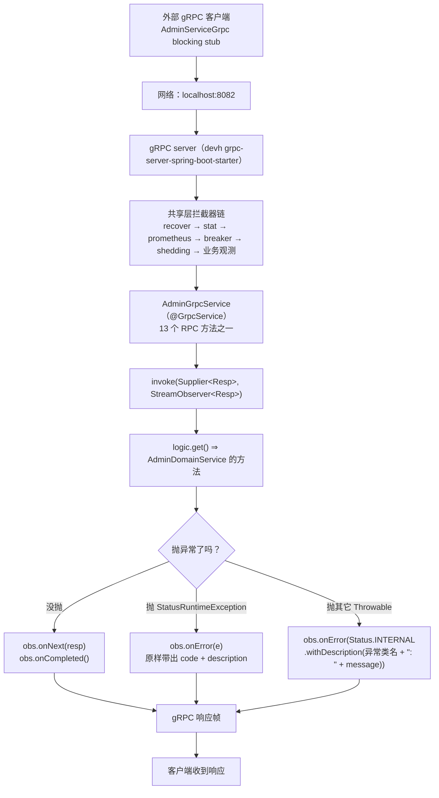
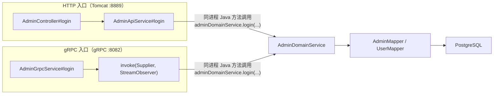
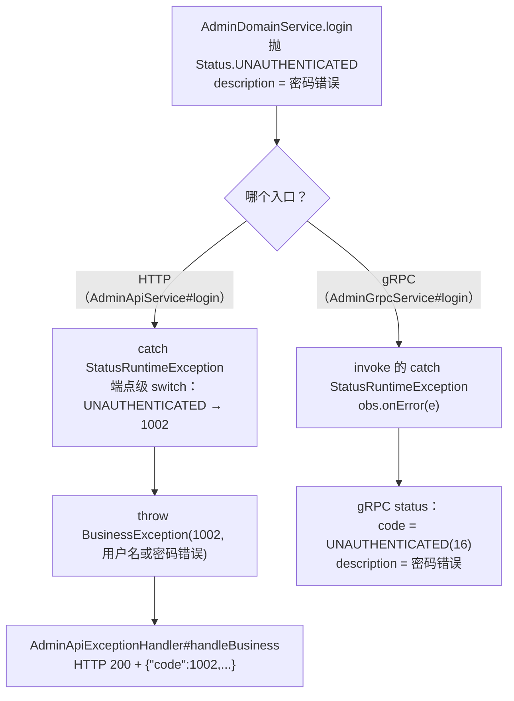
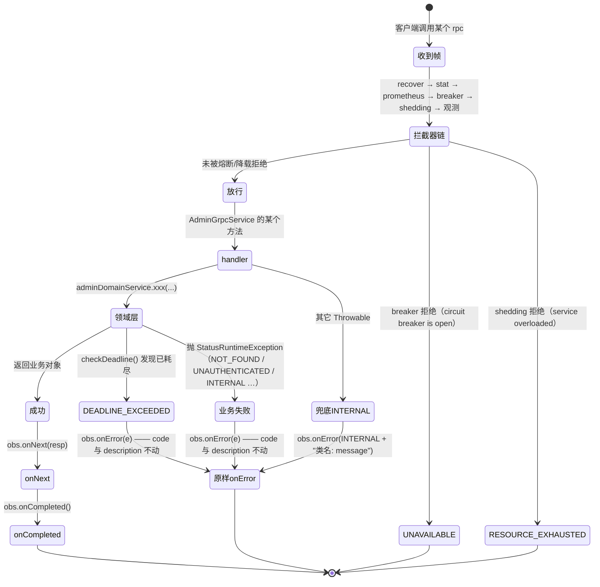

# 16. gRPC 管理员服务流程

## 1. 本次流程的研究范围

这一篇追踪的是：**一个外部 gRPC 客户端调用 admin 域的 `AdminService`，请求是怎么进到领域代码、又怎么变成 gRPC 响应的**。

具体追踪范围：

| 追踪 | 不追踪 |
|---|---|
| gRPC server 的启动与端口 | gRPC server 的**进程模型**（D1 合并的来龙去脉） |
| 共享层拦截器链（recover / stat / prometheus / breaker / shedding / 业务观测） | 各拦截器的**内部算法**（熔断算法、降载算法细节） |
| `AdminGrpcService` 的 13 个 RPC 方法 | 领域层的业务规则（见 01~13 篇） |
| `invoke` 的三段式（成功 / `StatusRuntimeException` / `Throwable`） | — |
| gRPC 面上的异常形态（status code + description） | HTTP 面的异常形态（见 [15](./15-异常处理与统一响应流程.md)） |
| `deadline` 的检查点 | deadline 机制的完整设计 |

**关键边界**：本篇**只讲 gRPC 入口**。
HTTP 入口（`AdminController` → `AdminApiService` → `AdminDomainService`）不在本篇，
但两者**共用同一份领域代码** —— 这是本篇要讲清的核心结构，见 §4.2。

---

## 2. 触发场景与输入

### 2.1 典型调用

外部 gRPC 客户端用 `AdminService` 的 stub 调用：

```
rpc /admin.AdminService/Login
```

请求消息（`proto/src/main/proto/admin.proto:61-64`）：

```protobuf
message LoginReq{
  string username = 1;
  string password = 2;
}
```

响应消息（`:66-68`）：

```protobuf
message LoginResp{
  int64 uid = 1;
}
```

### 2.2 gRPC server 在哪、监听哪个端口

`service/users/admin/src/main/resources/application.yml`：

```yaml
grpc:
  server:
    port: ${ADMIN_GRPC_PORT:8082}
    address: 0.0.0.0
    reflection-service-enabled: false
    enable-keep-alive: true
    keep-alive-time: 30s
    permit-keep-alive-without-calls: true
```

（`service/users/admin/src/main/resources/application.yml:89-104`）

⇒ **gRPC 端口 8082**（不是 HTTP 的 8889）。

⚠️ **8081 → 8082 是签字偏离（部署面）**：B 侧 admin-rpc 用 8081，但 B 侧 user-rpc **也是** 8081
⇒ 两域撞端口，靠环境变量错开。
本仓 D1 把 api + rpc 合成一个进程后，users 域只剩 2 个进程 ⇒ 端口必须错开
⇒ user-service 已占 8081 ⇒ admin 取 **8082**。

⚠️ **`grpc.client:` 这一段在本仓的 yml 里刻意没有**（`:105-121`）。
devh 3.1.0 的 `GrpcChannelsProperties` 是 `@ConfigurationProperties("grpc")`，
其 `client` 字段是 `Map<String, GrpcChannelProperties>`
⇒ `grpc.client.<X>` 的 `<X>` 是**通道名**。
⇒ 写 `grpc.client.negotiation-type: plaintext` 会被当成「名叫 negotiation-type 的通道」，
值是 String ⇒ 绑不成 `GrpcChannelProperties` ⇒ **上下文启动直接失败**（`ConverterNotFoundException`）。
⇒ **连「只有注释的 `client:`」都不能留** —— Spring 的 YAML loader 把「有键无值」读成**空串**（不是 null）
⇒ 同样绑失败。

### 2.3 service 定义（13 个 RPC）

`proto/src/main/proto/admin.proto:155-169`：

```protobuf
service AdminService {
  rpc GetUser(GetUserReq) returns (GetUserResp);
  rpc GetUserList(GetUserListReq) returns (GetUserListResp);
  rpc GetSelf(GetSelfReq) returns (GetSelfResp);
  rpc CreateAdmin(CreateAdminReq) returns (CreateAdminResp);
  rpc CreateInviteCode(CreateInviteCodeReq) returns (CreateInviteCodeResp);
  rpc Login(LoginReq) returns (LoginResp);
  rpc Logout(LogoutReq) returns (LogoutResp);
  rpc DeleteUser(DeleteUserReq) returns (DeleteUserResp);
  rpc ResetUserPassword(ResetUserPasswordReq) returns (ResetUserPasswordResp);
  rpc UpdateSelf(UpdateSelfReq) returns (UpdateSelfResp);
  rpc UpdateUser(UpdateUserReq) returns (UpdateUserResp);
  rpc BanUser(BanUserReq) returns (BanUserResp);
  rpc UnBanUser(UnBanUserReq) returns (UnBanUserResp);
}
```

**proto 包名与 java 包名**：

| 项 | 值 | 位置 |
|---|---|---|
| proto package | `admin` | `admin.proto:3` |
| `option java_package` | `com.rag.proto.admin` | `admin.proto:4` |
| `option java_multiple_files` | `true` | `admin.proto:5` |

⇒ 生成的 Java 类在 `com.rag.proto.admin` 下，
生成的服务基类是 `com.rag.proto.admin.AdminServiceGrpc.AdminServiceImplBase`。

---

## 3. 整体执行路线



---

## 4. 逐步讲解

### 4.1 第一步：服务是怎么被注册上去的

涉及文件：`grpc/AdminGrpcService.java`

```java
@GrpcService
public class AdminGrpcService extends AdminServiceGrpc.AdminServiceImplBase {

    private final AdminDomainService adminDomainService;

    public AdminGrpcService(AdminDomainService adminDomainService) {
        this.adminDomainService = adminDomainService;
    }
```

（`service/users/admin/src/main/java/com/rag/admin/grpc/AdminGrpcService.java:84-91`）

- **`@GrpcService`** 来自 `net.devh.boot.grpc.server.service.GrpcService`。
  devh 的 starter 启动时扫描容器里所有带这个注解的 bean，
  把它们注册到 gRPC server 的 `ServiceRegistry` ⇒ **本类不需要写任何注册代码**。
- **`extends AdminServiceGrpc.AdminServiceImplBase`** —— 这个基类是 protobuf 插件生成的，
  里面已经有一堆 `public void login(LoginReq request, StreamObserver<LoginResp> responseObserver)` 这样的空实现。
  本类逐个 `@Override` 填上真实实现。

⇒ **proto 里的 `service AdminService` 与 Java 里的这个类是一一对应的**：
proto 每加一个 rpc，生成基类就多一个方法，**不 `@Override` 就编译不过**。

### 4.2 第二步：两个入口共用同一份领域代码（本章最重要的结构）



**关键事实**：`AdminApiService` 拿到的 `AdminDomainService` 是**同一个 Spring Bean**。

看 HTTP 侧的实际代码（`service/AdminApiService.java:218`）：

```java
uid = adminDomainService.login(
        req.username() == null ? "" : req.username(),
        req.password() == null ? "" : req.password());
```

**这里没有出现**：

- gRPC Stub（`AdminServiceGrpc.AdminServiceBlockingStub`）；
- `ManagedChannel`；
- 网络地址；
- 远端服务名。

⇒ **这是同进程内的 Java 方法调用，不是一次 gRPC 网络请求。**

#### 判据：怎么区分「用了 proto 类型」和「发生了 gRPC 调用」

| 看什么 | proto 类型当参数（本地调用） | 真 gRPC 调用 |
|---|---|---|
| 有没有 Stub | ❌ | ✅ `XxxBlockingStub` / `XxxFutureStub` |
| 有没有 `ManagedChannel` | ❌ | ✅ |
| 有没有端口 / 目标服务名 | ❌ | ✅ |
| 有没有 `StreamObserver` | ❌ | ✅（服务端） |
| 有没有跨进程序列化 | ❌ | ✅（protobuf marshal） |

⇒ **本仓 D2「域内直连」**：HTTP 层**不再**经 gRPC stub 调 gRPC 层，
而是**直接注入** `AdminDomainService`（同进程、同事务上下文）。
⇒ `AdminGrpcService` **仍是 gRPC 出口**（对外 RPC 契约面），只是**不再被自己的 HTTP 层经网络调用**。

⚠️ **gRPC 面上没有 JWT 鉴权**：`AdminGrpcService` 里的 13 个方法**没有任何一个**检查
`Authorization` 头或 request attribute。
HTTP 面的 11 条受保护路径由 `AdminJwtAuthInterceptor` 把关（见 [14](./14-管理员JWT认证与黑名单流程.md)），
而 gRPC 入口**没有对应的拦截器**。

### 4.3 第三步：单个 RPC 的内部结构 —— 以 `login` 为例

涉及文件：`grpc/AdminGrpcService.java`

```java
// ====================== 1. Login ======================

@Override
public void login(LoginReq request, StreamObserver<LoginResp> responseObserver) {
    invoke(() -> {
        long uid = adminDomainService.login(request.getUsername(), request.getPassword());
        return LoginResp.newBuilder().setUid(uid).build();
    }, responseObserver);
}
```

（`service/users/admin/src/main/java/com/rag/admin/grpc/AdminGrpcService.java:95-101`）

拆开看：

| 元素 | 作用 |
|---|---|
| `request` | protobuf 反序列化后的**不可变**消息对象（`LoginReq`） |
| `responseObserver` | gRPC 传进来的**响应观察者** —— 服务端**不直接写 socket**，而是调它的方法 |
| `() -> { ... }` | 一个 `Supplier<LoginResp>` lambda —— 真正的业务代码被**包成"延迟求值"** |
| `invoke(...)` | 统一的三段式封装（见 §4.4） |

**为什么把业务包成 lambda**：因为 gRPC 的响应必须通过 `StreamObserver` 写出去，
而成功 / 失败两条路要分开处理 ⇒ 把业务隔离成一个「要么返回值、要么抛异常」的纯函数，
再由 `invoke` 统一决定「返回值 ⇒ onNext + onCompleted；异常 ⇒ onError」。

**`StreamObserver` 的三个方法**（初学者最容易混的）：

| 方法 | 什么时候调 | 本仓库的用法 |
|---|---|---|
| `onNext(resp)` | 写一条响应消息 | 成功时**恰好调一次** |
| `onCompleted()` | 声明「消息流正常结束」 | 成功时在 `onNext` 之后调 |
| `onError(t)` | 声明「这次调用失败」 | 失败时调**一次**（之后**不能再**调 `onNext` / `onCompleted`） |

### 4.4 第四步：`invoke` —— 三段式统一转发

```java
private static <Req, Resp> void invoke(
        java.util.function.Supplier<Resp> logic,
        StreamObserver<Resp> obs) {
    try {
        Resp resp = logic.get();
        obs.onNext(resp);
        obs.onCompleted();
    } catch (StatusRuntimeException e) {
        obs.onError(e);
    } catch (Throwable t) {
        obs.onError(Status.INTERNAL
                .withDescription(t.getClass().getSimpleName() + ": " + t.getMessage())
                .asRuntimeException());
    }
}
```

（`service/users/admin/src/main/java/com/rag/admin/grpc/AdminGrpcService.java:328-342`）

**三个分支，逐条讲**：

#### 分支 ①：成功

```java
Resp resp = logic.get();
obs.onNext(resp);
obs.onCompleted();
```

⇒ **先 `onNext` 再 `onCompleted`**，顺序不能反（反了 grpc-java 会抛 `IllegalStateException`）。

#### 分支 ②：`StatusRuntimeException` —— **原样透传**

```java
} catch (StatusRuntimeException e) {
    obs.onError(e);
}
```

⇒ **既不改 code，也不改 description。**

这条极重要，因为 admin 域的**领域层就是抛 gRPC 状态异常**：

```java
throw Status.NOT_FOUND.withDescription("用户不存在").asRuntimeException();
throw Status.UNAUTHENTICATED.withDescription("密码错误").asRuntimeException();
throw Status.INTERNAL.withDescription("DB查询失败").asRuntimeException();
throw Status.DEADLINE_EXCEEDED
        .withDescription("rpc deadline reached")
        .asRuntimeException();
```

（`domain/service/AdminDomainService.java` 的各方法）

**为什么必须原样透传**：`status code` + `description` 是 **gRPC wire 上可见的 L1 契约**。
若改成 `BusinessException`，共享层的 `GrpcExceptionMapperAutoConfiguration` 会把 status 改写成
`UNKNOWN(2)` + trailer `sea-biz-code` ⇒ **gRPC 面的 code 与 description 双双偏离**。

⇒ 所以本仓 admin 域**坚持抛 `StatusRuntimeException`**，HTTP 边界再逐条翻译成业务码
（见 [15](./15-异常处理与统一响应流程.md) §4.5）。

#### 分支 ③：其它 `Throwable` —— 兜底成 `INTERNAL`

```java
} catch (Throwable t) {
    obs.onError(Status.INTERNAL
            .withDescription(t.getClass().getSimpleName() + ": " + t.getMessage())
            .asRuntimeException());
}
```

⇒ **description 的形状是「异常类简名 + \": \" + message」**，例如：

```
NullPointerException: cannot invoke "String.length()" because "x" is null
```

⚠️ 这**不是** B 侧的形状。B 侧的 panic 处理是
`status.Errorf(codes.Internal, "panic: %v", r)`（见 `RpcRecoverInterceptor` 的 `PANIC_DESCRIPTION_PREFIX = "panic: "`）。
⇒ 但那条路径是**panic**（`Error`/`RuntimeException` 逃出 handler），
由共享层的 `RpcRecoverInterceptor` 兜住；本分支兜的是**普通异常逃出 `logic.get()`**。

### 4.5 第五步：领域层抛出的异常，在两个入口上形态不同

**同一份领域代码，两种入口，两种对外错误形态**：



⇒ **对照表**：

| 领域层抛的 | HTTP 入口看到 | gRPC 入口看到 |
|---|---|---|
| `Status.NOT_FOUND("用户不存在")` | HTTP 200 + `{"code":1003}` | status `NOT_FOUND(5)` + desc `用户不存在` |
| `Status.UNAUTHENTICATED("密码错误")` | HTTP 200 + `{"code":1002}`（login 端点专属） | status `UNAUTHENTICATED(16)` + desc `密码错误` |
| `Status.INTERNAL("DB查询失败")` | HTTP 200 + `{"code":5001}` 或 `{"code":5003}`（端点级 switch） | status `INTERNAL(13)` + desc `DB查询失败` |
| `Status.DEADLINE_EXCEEDED("rpc deadline reached")` | HTTP 200 + `{"code":1015}` | status `DEADLINE_EXCEEDED(4)` + desc `rpc deadline reached` |
| `Status.PERMISSION_DENIED(...)` | HTTP 200 + `{"code":1016}` | status `PERMISSION_DENIED(7)` + desc 原样 |
| `Status.ALREADY_EXISTS(...)` | HTTP 200 + `{"code":1001}` | status `ALREADY_EXISTS(6)` + desc 原样 |
| `Status.INVALID_ARGUMENT("Token不能为空")` | HTTP 200 + `{"code":500}` | status `INVALID_ARGUMENT(3)` + desc 原样 |

⇒ **gRPC 面是「原始 status」，HTTP 面是「翻译后的业务码」** —— 两套并存是刻意的（照抄真源）。

### 4.6 第六步：`deadline` —— 每个关键步骤前的检查

```java
private void checkDeadline() {
    if (Thread.currentThread().isInterrupted() || DeadlineState.isExpired()) {
        throw Status.DEADLINE_EXCEEDED
                .withDescription("rpc deadline reached")
                .asRuntimeException();
    }
}
```

（`domain/service/AdminDomainService.java:210-216`）

**它能做什么、不能做什么**（源码 `:198-206` 写得很清楚）：

| 能 | 不能 |
|---|---|
| 在**发起** DB / Redis 调用**之前**感知 deadline 已到、提前退出 | 取消**在途** IO —— JDBC 驱动不响应线程 interrupt |

**检查点分布**（`AdminDomainService` 里）：

| 方法 | 检查时机 |
|---|---|
| `doLogin` | 方法开头（`:241`） |
| `getSelf` | 方法开头（`:358`） |
| `getUser` | 方法开头（`:840`） |
| `getUserList` | 方法开头（`:878`） |
| `logout` | **不设入口闸门** ⇒ 期限耗尽时请求**照样走到 Redis 写**（`:302-303`） |

**`catch` 的顺序保住了 `DEADLINE_EXCEEDED` 不被改写**：

```java
try {
    admin = findOneAdminByUsername(username);
} catch (NotFoundException e) {
    metrics.getLoginUserNotFound().increment();
    throw Status.NOT_FOUND.withDescription("用户不存在").asRuntimeException();
} catch (StatusRuntimeException e) {
    // B-1：DEADLINE_EXCEEDED 必须上抛，不能掉进下面的 db_error 分支被改写成 INTERNAL。
    throw e;
} catch (Exception e) {
    metrics.getLoginDbError().increment();
    log.error("admin login DB error, username={}", username, e);
    throw Status.INTERNAL.withDescription("DB查询失败").asRuntimeException();
}
```

（`domain/service/AdminDomainService.java:243-256`）

**顺序很关键**：

1. `catch (NotFoundException e)` —— 领域 sentinel，最具体；
2. `catch (StatusRuntimeException e)` ⇒ **原样重抛** —— 这一条专门拦住 `DEADLINE_EXCEEDED`
   （它本身就是一个 `StatusRuntimeException`）；
3. `catch (Exception e)` ⇒ 改写成 `INTERNAL`。

⇒ 如果第 2 条不存在，`DEADLINE_EXCEEDED` 会掉进第 3 条被改写成 `INTERNAL` ⇒
**客户端看到的码从 `DEADLINE_EXCEEDED(4)` 变成 `INTERNAL(13)`** ⇒ 这是一条 wire 漂移。

`logout` 里是同款结构（`:326-340`），但注释里额外说明了一个**有意为之的例外**：

> ⚠️ 2026-10-30：本 catch **只**拦 grpc 的 `StatusRuntimeException`（PG 57014 走
> `SqlTimeoutStatusTranslator` 翻成 `DEADLINE_EXCEEDED` 的那条路）；共享层 Redis 期限代理
> 抛的是 **`org.springframework.dao.QueryTimeoutException`**（Spring 的，不是 grpc 的）
> ⇒ 它**不**被本分支拦 ⇒ 落进下面的 `catch (Exception)` ⇒ `INTERNAL`「注销失败,Redis写入异常」
> ⇒ 与参考侧的 `codes.Internal` 逐字同形（**这是有意的顺序，不是漏网**）。

### 4.7 第七步：共享层的 gRPC 拦截器链

装配点只有一个：`common/src/main/java/com/rag/common/autoconfigure/ProtectionAutoConfiguration.java`。

```java
@Bean
@ConditionalOnClass(name = "net.devh.boot.grpc.server.serverfactory.GrpcServerConfigurer")
@ConditionalOnMissingBean(name = "seaGrpcServerConfigurer")
public net.devh.boot.grpc.server.serverfactory.GrpcServerConfigurer seaGrpcServerConfigurer(
        ObjectProvider<ServerInterceptor> interceptors) {
    return server -> {
        List<ServerInterceptor> ordered = interceptors.orderedStream().toList();
        ServerInterceptor chain = RpcProtectionChain.compose(ordered);
        if (chain != null) {
            server.intercept(chain);
        }
        ...
    };
}
```

**为什么必须在这里、且只能有一份**（源码 `:219-228`）：
devh starter 只认 `GrpcServerConfigurer`（**实测 javap 证据**：`GrpcServerConfigurer extends Consumer<ServerBuilder<?>>`，
三个 server factory 方法都只注入 `List<GrpcServerConfigurer>`，**没有任何 interceptor 形参**）
⇒ 只产出一个 `ServerInterceptor` bean ⇒ **链上什么都不会发生，而且零报错**（静默失效）。

**链序由 `@Order` 常量写死**（`ProtectionAutoConfiguration.java:263-267`）：

```java
public static final int RPC_LAYER_RECOVER = 0;
public static final int RPC_LAYER_STAT = 1;
public static final int RPC_LAYER_PROMETHEUS = 2;
public static final int RPC_LAYER_BREAKER = 3;
public static final int RPC_LAYER_SHEDDING = 4;
```

**「序号小的在最外层」这条是怎么保证的**（`common/src/main/java/com/rag/common/protection/RpcProtectionChain.java:70-79`）：

```java
public static ServerInterceptor compose(List<ServerInterceptor> ordered) {
    if (ordered == null || ordered.isEmpty()) {
        return null;
    }
    ServerInterceptor chain = null;
    for (int i = ordered.size() - 1; i >= 0; i--) {
        chain = wrap(ordered.get(i), chain);
    }
    return chain;
}
```

⇒ **从后往前**遍历、每次把当前层套在已建链的外面 ⇒ **列表第 0 个在最外层**。

源码注释说明了为什么不用「多次 `server.intercept(...)`」：
grpc-api 1.63.0 的 `ServerBuilder#intercept` 只有单参重载，多次调用时**最后 add 的在最外层**
⇒ 链序就押在一个容易记反的 API 事实上 ⇒ 本方法把顺序**写进代码结构**。

⚠️ `wrap` 里有一处**必须**的写法（`:138-140`）：

```java
// ⚠️ 必须调 inner.interceptCall(...)，**不能**把 next 直接透传
//    ⇒ 透传 ⇒ inner 永远不被调用 ⇒ 整条内层链静默消失（零报错）
return delegate.interceptCall(c, h, next);
```

⇒ **这类"静默消失、零报错"的坑正是本仓反复强调「机制可证」的原因**（AGENTS.md §3.3）。

| 层 | 类 | 做什么 | 关键可观察契约 |
|---|---|---|---|
| `recover` | `RpcRecoverInterceptor` | 兜住 handler 的 panic | status `INTERNAL` + description 以 **`"panic: "`** 开头；**进程存活**；本地日志有带栈的 ERROR |
| `stat` | `RpcStatInterceptor` | 每个 unary 请求的耗时进进程内聚合器（每 60s 一行统计日志） | **panic 也会记一条**（B 侧用 `defer`） |
| `prometheus` | `RpcPrometheusInterceptor` | 耗时分布 + 状态码计数 | 指标名 `rpc_server_requests_duration_ms` / `rpc_server_requests_code`（导出后 = `rpc_server_requests_code_total`）；**panic 时不记** |
| `breaker` | `RpcCircuitGateInterceptor` | 服务端熔断 | 拒绝形状 = `UNAVAILABLE` + `"circuit breaker is open"`（**wire 契约**） |
| `shedding` | `RpcSheddingInterceptor` | CPU 自适应降载 | 拒绝形状 = `RESOURCE_EXHAUSTED` + `"service overloaded"` |
| 业务观测 | `ObservabilityAutoConfiguration` 的观测拦截器 | timeout / 慢调用 / span | **不带 `@Order`** ⇒ 落在 `LOWEST_PRECEDENCE` ⇒ **最内层** |

⇒ **完整链序**：`recover → stat → prometheus → breaker → shedding → 业务观测 → handler`。

**两个必须记住的细节**：

1. **`prometheus` 必须在 `breaker` / `shedding` 的外层** ——
   否则被降载 / 熔断拒绝的请求在指标里**整个消失**（它们会记成 `RESOURCE_EXHAUSTED(8)` / `UNAVAILABLE(14)`）。
2. **`recover` 必须包到 `Listener#onHalfClose`** ——
   grpc-java 的 handler 方法**不是在 `interceptCall` 里执行的，而是在 `Listener#onHalfClose()` 里执行的**
   ⇒ 只包 `next.startCall(...)` 的话，**用户 handler 里的 panic 一条都兜不住**。

### 4.8 第八步：13 个 RPC 与 proto 定义的对应表

| # | proto rpc | Java 方法（`AdminGrpcService`） | 领域方法（`AdminDomainService`） | 响应 message 的特殊点 |
|---|---|---|---|---|
| 1 | `Login` | `login`（`:96`） | `login(String, String)` → `Long` | `LoginResp.uid` |
| 2 | `Logout` | `logout`（`:106`） | `logout(String)` → `boolean` | ⚠️ **`LogoutResp.success` 不 set** ⇒ proto3 默认 `false` |
| 3 | `GetSelf` | `getSelf`（`:116`） | `getSelf(long)` → `AdminEntity` | — |
| 4 | `UpdateSelf` | `updateSelf`（`:126`） | `updateSelf(...)` → `AdminEntity` | `setSuccess(true)` + `setAdmin(...)` |
| 5 | `CreateAdmin` | `createAdmin`（`:147`） | `createAdmin(...)` → `long` | `CreateAdminResp.uid` |
| 6 | `CreateInviteCode` | `createInviteCode`（`:165`） | `createInviteCode(long)` → `InviteCodeResult` | `inviteCode` + `expiresAt` |
| 7 | `BanUser` | `banUser`（`:178`） | `banUser(long, long)` | `setSuccess(true)` |
| 8 | `UnBanUser` | `unBanUser`（`:188`） | `unBanUser(long, long)` | `setSuccess(true)` |
| 9 | `GetUser` | `getUser`（`:198`） | `getUser(long)` → `UserEntity` | ⚠️ **`GetUserResp.found` 不 set** ⇒ 默认 `false` |
| 10 | `GetUserList` | `getUserList`（`:213`） | `getUserList(long, long, String)` → `UserListResult` | `total` + `repeated list` |
| 11 | `UpdateUser` | `updateUser`（`:231`） | `updateUser(...)` → `UserEntity` | ⚠️ **`UpdateUserResp.success` 不 set** ⇒ 默认 `false` |
| 12 | `DeleteUser` | `deleteUser`（`:265`） | `deleteUser(long, long)` | `setSuccess(true)` |
| 13 | `ResetUserPassword` | `resetUserPassword`（`:275`） | `resetUserPassword(long, long)` | `setSuccess(true)` |

#### ⚠️ 三处 proto3 默认值（不得「顺手补 true」）

源码在 `AdminGrpcService` 的类注释里专门列了（`:73-82`）：

1. **`logout`**：`LogoutResp.success` **不** set ⇒ proto3 默认 `false`。
2. **`updateUser`**：`UpdateUserResp.success` **不** set ⇒ `false`。
   源码注释（`:243-251`）写得很细：B 侧 `updateuserlogic.go:105-113` **只 set 了 `User`**，
   ⇒ 线上序列化时该字段**缺席**，客户端读到 `false`。
   RAG 原先 `setSuccess(true)` ⇒ 线上是 varint 1 ⇒ 客户端读到 `true` ⇒ **wire 层可观察差异**。
3. **`getUser`**：`GetUserResp.found` **不** set ⇒ `false`。

**但 HTTP 面仍然是 `found=true` / `success=true`** —— 因为那是 **api 层**显式置的
（`AdminApiService#getUser` 写死 `Found: true`）。
⇒ **rpc 层的行为 ≠ 端到端的行为**。不要看到 rpc 层不 set 就以为端到端是 `false`。

#### `extra_info` 的空 map 处理

```java
Map<String, String> extra = admin.getExtraInfo();
if (extra != null && !extra.isEmpty()) {
    b.putAllExtraInfo(extra);
} else {
    b.putAllExtraInfo(new HashMap<>());
}
```

（`grpc/AdminGrpcService.java:294-299` 与 `:314-319`）

⇒ **空 map 也要 put 一个空 map 进去**（不是「不 put」）—— B 侧如此。
两个 helper（`toProtoAdmin` / `toProtoUser`）都是 **null-safe** 的：
`uid == null ? 0L : uid`、`username == null ? "" : username`、`email == null ? "" : email`。

⚠️ `toProtoAdmin` 的 email 用 `AdminHelpers.stringValue(admin.getEmail())` —— 因为
`admin_admin.email` 列是 **nullable**（`03_create_admin.sql:57`：`email TEXT UNIQUE`）。
而 `toProtoUser` 的 email 用 `user.getEmail() == null ? "" : user.getEmail()` —— `users_user.email` 非 null。

### 4.9 第九步：请求是怎么被反序列化的

**这一段是框架机制，不是本仓代码**，但必须讲清：

1. gRPC server 收到 HTTP/2 帧 → 按 `MethodDescriptor` 找到对应的 `ServerCallHandler`；
2. protobuf marshaller 用 `LoginReq.getDefaultInstance()` 作为原型 + `parseFrom(InputStream)` 反序列化
   ⇒ 得到 `LoginReq` 实例；
3. devh 的 starter 把这个实例作为**方法的第一个参数**传给 `AdminGrpcService#login`；
4. 第二个参数是 `StreamObserver`。

⇒ **proto3 的 `optional` presence 语义在这里生效**：本仓的 `admin.proto` **没有用 `optional`**，
所有字段都是「值语义」（`int64` 缺失 = 0，`bool` 缺失 = `false`，`string` 缺失 = `""`）。
⇒ 这就是为什么 `GetUserResp.found` 不 set 就等于 `false` —— **不是「未知」，是「false」**。

---

## 5. 重要分支与失败路径

### 5.1 gRPC 侧的异常分支表

| 抛出点 | 异常类型 | gRPC 侧结果 | HTTP 侧结果（同一份领域代码） |
|---|---|---|---|
| 领域层业务失败 | `StatusRuntimeException` | **原样 status**（code + description） | 端点级 switch → 业务码，HTTP 200 |
| 领域层 DB 故障 | `StatusRuntimeException(INTERNAL)` | `INTERNAL(13)` + desc `DB查询失败` | `5001` 或 `5003`（端点级），HTTP 200 |
| 领域层 deadline | `StatusRuntimeException(DEADLINE_EXCEEDED)` | `DEADLINE_EXCEEDED(4)` + desc `rpc deadline reached` | `1015`，HTTP 200 |
| `logic.get()` 抛普通异常 | `Throwable` | `INTERNAL(13)` + desc `"异常类名: message"` | — （HTTP 侧不走这里） |
| handler panic | `Error` / `RuntimeException` 逃出 `onHalfClose` | **`RpcRecoverInterceptor` 兜住** ⇒ `INTERNAL(13)` + desc `"panic: ..."` | — |
| breaker 拒绝 | — | `UNAVAILABLE(14)` + `"circuit breaker is open"` | — |
| shedding 拒绝 | — | `RESOURCE_EXHAUSTED(8)` + `"service overloaded"` | — |
| 客户端 deadline 到 | — | 服务端调度线程 close ⇒ 客户端收到 `DEADLINE_EXCEEDED(4)` | — |

### 5.2 `catch` 顺序的三个坑

| 坑 | 后果 |
|---|---|
| `catch (Exception e)` 写在 `catch (StatusRuntimeException e)` **前面** | `DEADLINE_EXCEEDED` 被改写成 `INTERNAL` ⇒ **wire 漂移** |
| `catch (NotFoundException e)` 写在后面 | 领域 sentinel 被 `Exception` 兜住 ⇒ 业务码从 `1003` 变成 `5001` |
| `RpcRecoverInterceptor` 只包 `startCall` 不包 `onHalfClose` | **handler 里的 panic 一条都兜不住** ⇒ 进程可能被拖垮 |

### 5.3 「panic 时记不记指标」的两层差异

| 层 | panic 时 | 为什么 |
|---|---|---|
| `stat` | **记一条**耗时样本 | B 侧用 `defer` ⇒ 栈展开时也执行 ⇒ 本仓在 panic 展开点补记 |
| `prometheus` | **不记** | B 侧是「先调 handler、再记」的直线代码 ⇒ panic 时后置的两行根本不执行 |

⇒ **同一个 panic 请求，在 Prometheus 里查不到，在 Stat 的聚合日志里查得到。**

---

## 6. 数据变化与副作用

| 维度 | 本流程是否发生 | 说明 |
|---|---|---|
| **数据库** | ✅ 视 RPC 而定 | 走 `AdminDomainService` ⇒ 读 / 写 `admin_admin` · `admin_invite` · `users_user` |
| **事务** | ⚠️ 视 RPC 而定 | `createAdmin` 走 `AdminCreateAtomicService` 的事务边界（悲观锁 + 事务，见 [02](./02-管理员创建流程.md)）；`logout` 是**单条 Redis 写**，无事务 |
| **Redis 写** | ⚠️ 仅 `logout` | `admin:jwt_blacklist:<token>` = `"banned"`，TTL = `access-expire`（默认 30 天） |
| **Redis 读** | ⚠️ 仅 `logout` 的前置（无） | gRPC 面上**没有黑名单读** ⇒ **gRPC 入口不做 JWT 鉴权** |
| **远程调用** | ❌ 无 | D2 域内直连 ⇒ 本进程不拨自己的 gRPC |
| **消息** | ❌ 无 | admin 域不收发 Kafka |
| **日志** | ✅ | 领域层 `log.error` / `log.info`；`RpcRecoverInterceptor` 的带栈 ERROR |
| **指标** | ✅ | `rpc_server_requests_duration_ms` + `rpc_server_requests_code_total`（prometheus 层）；`admin_rpc_*`（领域层 metrics）；`stat` 聚合器 |
| **生成 ID** | ⚠️ 仅 `createAdmin` | `Snowflake.nextId()` 生成 admin uid |
| **生成 Token** | ❌ 无 | gRPC 面上**不签发 JWT**（签发只在 HTTP 的 `login` 端点） |

### 6.1 副作用顺序（失败时哪些已经发生）

**以 `createAdmin` 为例**（它有事务边界）：

1. `Snowflake.nextId()` 生成 uid —— **这一步已经消耗了一个 ID**；
2. bcrypt 加密密码；
3. 事务内：`SELECT invite FOR UPDATE` → 校验邀请码 → 校验用户名 → `insert admin` → 标记邀请码已用；
4. 若第 3 步失败 ⇒ 事务回滚 ⇒ **表里没有数据**，但**第 1 步的 ID 已被消耗**。

⇒ 这就是「ID 消耗不可回滚」的典型形态。

**以 `logout` 为例**（无事务）：

1. `stringRedisTemplate.opsForValue().set(key, "banned", ttl)`；
2. 若 Redis 写失败 ⇒ 抛 `INTERNAL`「注销失败,Redis写入异常」⇒ **token 没有进黑名单** ⇒
   **用户仍然可以用这个 token 访问** ⇒ 这是「注销失败但会话仍有效」的典型形态。

---

## 7. 执行结果

### 7.1 成功

```protobuf
// rpc /admin.AdminService/Login 返回
message LoginResp {
  int64 uid = 1;
}
```

客户端拿到的 status = `OK(0)`，`description` 为空。

### 7.2 业务失败（gRPC 面保留原始 status）

```protobuf
// rpc /admin.AdminService/Login，密码错
status code = UNAUTHENTICATED(16)
description = "密码错误"
```

⚠️ **和 HTTP 面完全不同**：HTTP 面是 `HTTP 200 + {"code":1002,...}`，
gRPC 面是 `UNAUTHENTICATED(16)` + description `密码错误`（**不翻译**）。

### 7.3 `getUser` 的响应（`found` 不 set）

```protobuf
message GetUserResp {
  UserInfo user = 1;
  bool found = 2;      // ← 不 set ⇒ 线上缺席 ⇒ 客户端读到 false
}
```

⇒ 客户端读到 `found = false`，**但 `user` 字段是有内容的**。
HTTP 面同一个业务返回 `found = true`（api 层显式置的）。

---

## 8. 流程复盘

```text
外部 gRPC 客户端
  ↓ （localhost:8082，proto package=admin，java_package=com.rag.proto.admin）
gRPC server（devh starter）
  ↓
共享层拦截器链
  recover → stat → prometheus → breaker → shedding → 业务观测
  ↓
AdminGrpcService（@GrpcService extends AdminServiceGrpc.AdminServiceImplBase）
  ↓
invoke(Supplier<Resp>, StreamObserver<Resp>)
  ├─ logic.get() ⇒ AdminDomainService 的方法（与 HTTP 入口共用同一份 Bean）
  │     ├─ checkDeadline() ⇒ 超时则抛 DEADLINE_EXCEEDED
  │     ├─ Mapper ⇒ PostgreSQL
  │     └─ 业务失败 ⇒ StatusRuntimeException（NOT_FOUND / UNAUTHENTICATED / INTERNAL …）
  ├─ 成功 ⇒ obs.onNext(resp) + obs.onCompleted()
  ├─ StatusRuntimeException ⇒ obs.onError(e)          ← 原样，code + description 不动
  └─ 其它 Throwable ⇒ obs.onError(INTERNAL + "类名: message")
  ↓
gRPC 响应帧
```

**边界结论**：

1. **proto 消息类型 ≠ gRPC 调用**。
   HTTP 路径里也用 proto 消息当参数（`AdminApiService` 里构造 `com.rag.proto.admin.LoginReq`），
   但那是**同进程方法调用**。判据 = 有没有 Stub / ManagedChannel / 端口 / 远端服务名 / `StreamObserver`。
2. **两个入口共用同一份领域代码**（`AdminDomainService` 是同一个 Spring Bean）。
   ⇒ 业务规则只有一份实现，不会分叉。
3. **异常映射在两端**：领域层抛的 gRPC `Status` 在 gRPC 侧**原样传出**，
   在 HTTP 侧被翻译成业务码 ⇒ **同一份领域代码，两种对外错误形态**。
4. **gRPC 面上没有 JWT 鉴权**，也没有黑名单读。
5. **`catch` 顺序保住 `DEADLINE_EXCEEDED`**：`NotFoundException` → `StatusRuntimeException`（原样上抛）→ `Exception`（改写 INTERNAL）。
6. **三处 proto3 默认值不得「顺手补 true」**：`logout.success` / `updateUser.success` / `getUser.found`。
7. **拦截器链只有一个挂载点**（`seaGrpcServerConfigurer`）⇒ 域内再来一份就会挂 2 条链。
8. **`stat` 记 panic、`prometheus` 不记 panic** ⇒ 同一个 panic 在两套指标里表现不同。

---

## 9. 源码定位与验证方式

### 9.1 源码定位

| 位置 | 文件 | 关键成员 |
|---|---|---|
| gRPC 服务实现 | `service/users/admin/src/main/java/com/rag/admin/grpc/AdminGrpcService.java` | `@GrpcService`（`:84`）· 13 个 RPC（`:95`~`:280`）· `toProtoAdmin`（`:289`）· `toProtoUser`（`:308`）· `invoke`（`:328`） |
| proto 定义 | `proto/src/main/proto/admin.proto` | `service AdminService`（`:155`）· `java_package`（`:4`）· 13 个 message |
| 领域代码 | `service/users/admin/src/main/java/com/rag/admin/domain/service/AdminDomainService.java` | `checkDeadline`（`:210`）· `doLogin`（`:240`）· `logout`（`:319`）· `getSelf`（`:357`）· `createAdmin`（`:528`）· `createInviteCode`（`:645`）· `banUser`（`:747`）· `unBanUser`（`:791`）· `getUser`（`:839`）· `getUserList`（`:877`）· `updateUser`（`:1023`）· `deleteUser`（`:1161`）· `resetUserPassword`（`:1210`） |
| 拦截链装配 | `common/src/main/java/com/rag/common/autoconfigure/ProtectionAutoConfiguration.java` | `RPC_LAYER_*` 常量（`:263-267`）· `seaGrpcServerConfigurer`（`:233`）· 各层 bean（`:275`~`:339`） |
| 链的合成 | `common/src/main/java/com/rag/common/protection/RpcProtectionChain.java` | `compose`（`:70`）· `wrap`（`:111`）· `layerNames`（`:90`） |
| recover 层 | `common/src/main/java/com/rag/common/observability/RpcRecoverInterceptor.java` | `interceptCall`（`:80`）· `closeAsPanic`（`:141`）· `PANIC_DESCRIPTION_PREFIX`（`:73`） |
| stat 层 | `common/src/main/java/com/rag/common/observability/RpcStatInterceptor.java` | `interceptCall`（`:92`）· `recordOnce`（`:148`） |
| prometheus 层 | `common/src/main/java/com/rag/common/observability/RpcPrometheusInterceptor.java` | `DURATION_METRIC`（`:87`）· `CODE_METRIC`（`:98`）· `interceptCall`（`:118`） |
| deadline 载体 | `common/src/main/java/com/rag/common/observability/DeadlineState.java` | `isExpired`（`:110`）· `remainingMillis`（`:117`）· `bindRemainingNanos`（`:169`） |
| gRPC 异常边界 | `common/src/main/java/com/rag/common/autoconfigure/GrpcExceptionMapperAutoConfiguration.java` | `BIZ_CODE_TRAILER_KEY = "sea-biz-code"`（`:94`）· 服务端改写（`:117`） |
| gRPC 端口配置 | `service/users/admin/src/main/resources/application.yml` | `grpc.server.port`（`:99`） |
| 依赖 | `service/users/admin/pom.xml` | `grpc-server-spring-boot-starter` · `grpc-client-spring-boot-starter` · `grpc-core`（1.63.0，starter 上排除） |

### 9.2 验证方式

| 测试 | 位置 | 钉住什么 |
|---|---|---|
| `AdminHttpContractRealTomcatTest`（间接） | `:98` 的 `grpc.server.port=0` | gRPC server 在测试里用**随机端口**，不与本机其它域撞端口 |
| ⚠️ `AdminRpcGoWireParityTest#updateUserRespSuccessMatchesGoWire` | **本仓不存在这个测试类** | `AdminGrpcService.java:257` 的源码注释把它称作守门测试，但 `find . -name "AdminRpcGoWireParityTest*"` 在本仓**零命中** ⇒ 该 wire 对拍目前**没有实际执行的守门**。注释意图是：`updateUser` 的 `success` 字段与 Go 侧 wire 一致（**不 set** ⇒ false） |

> ⚠️ **本域的 gRPC 侧测试覆盖不如 HTTP 侧完整**。
> `AdminHttpContractRealTomcatTest` 用 `grpc.server.port=0` 让 gRPC server 真的起来（证明装配不炸）。
> 源码注释声称 13 个 RPC 的**逐条 wire 对拍**由 `AdminRpcGoWireParityTest` 覆盖，
> 但**该测试类在本仓并不存在** ⇒ **这层对拍目前是「注释里的承诺」，不是可跑的守门**。
> ⇒ 要核对某个 RPC 的 wire 细节，只能回到 `AdminGrpcService` 的源码注释与 proto 定义本身。

### 9.3 交叉引用

- **user 域的同款流程**（9 个 RPC 的 thin wrapper 形态）⇒
  [12-gRPC用户服务流程.md](../users/12-gRPC用户服务流程.md)
- HTTP 面的**异常映射两套表** ⇒ [15-异常处理与统一响应流程.md](./15-异常处理与统一响应流程.md) §4.5
- HTTP 面的 **JWT 鉴权**（gRPC 面没有）⇒ [14-管理员JWT认证与黑名单流程.md](./14-管理员JWT认证与黑名单流程.md)
- **启动期** gRPC server 的装配 ⇒ [17-启动引导与管理员种子流程.md](./17-启动引导与管理员种子流程.md)
- 各 RPC 对应的**业务流程** ⇒ [01](./01-管理员登录流程.md) ~ [13](./13-用户密码重置流程.md)
- **事务与悲观锁**（`createAdmin`）⇒ [02-管理员创建流程.md](./02-管理员创建流程.md) §5

### 9.4 本篇的「源码无法确认」项

| 项 | 说明 |
|---|---|
| `AdminRpcGoWireParityTest` 的完整断言清单 | 本篇只从 `AdminGrpcService` 的注释里读到了该测试的存在与它钉住的那一条（`updateUserRespSuccessMatchesGoWire`），**没有逐条读取该测试类** ⇒ 13 个 RPC 的 wire 对拍覆盖面本篇无法确认。 |
| 外部客户端调用 admin gRPC 端口的**实际请求帧** | 本仓的 admin 域**没有 gRPC 客户端**（D2 域内直连，`grpc.client:` 段刻意为空）⇒ 本仓内**没有**一条真实的外向 gRPC 调用路径可供在本域内实跑 ⇒ 「外部客户端调用」这一场景在本仓**只能靠 wire 契约与 B 侧对拍结论**支撑，无法在本域内端到端跑通。 |
| 业务观测层（timeout / 慢调用 / span）的**内部行为** | 该层由 `ObservabilityAutoConfiguration` 提供，**不带 `@Order`** ⇒ 落在 `LOWEST_PRECEDENCE` ⇒ 最内层。本篇**没有逐行读** `ObservabilityAutoConfiguration` 的实现 ⇒ 它在链上的**位置**已确认，**内部算法**未确认。 |
| `RpcProtectionChain.compose` 的链嵌套 | 已逐行确认（`common/src/main/java/com/rag/common/protection/RpcProtectionChain.java:70-79`）：`for (int i = ordered.size() - 1; i >= 0; i--) chain = wrap(ordered.get(i), chain);` ⇒ **列表第 0 个在最外层**。 |

---

## 10. 从需求到实现：如果让我重新开发「gRPC 管理员服务」

> **本章与前 9 章的分工** 第 1~9 章回答「这套代码跑起来时，一个外部 gRPC 客户端的调用到底发生了什么」。本章反过来回答：**如果我只拿到一句「admin 域除了 HTTP，还要对外提供一组 gRPC 接口」，我该怎么一步步把它推导出上面那套代码。** 本章**不重复**前面的运行流程，只讲**推导过程**：先定行为 → 再定组件 → 再写代码 → 再验证 → 出问题怎么查 → 需求变了怎么改。 ⚠️ **本章写的是「同一个领域层、另一个入口」。** 本篇的难点**不在**「怎么写一个 gRPC 服务」（那是框架用法），而在**两个入口共用一份领域代码时，怎么保证客户端在两边看到的是同一件事** —— 领域层抛的同一个异常，在 HTTP 上是「200 + 信封 1002」，在 gRPC 上是「`UNAUTHENTICATED(16)` + description `密码错误`」。 ⇒ 本章的推导单位是**「一个入口」**，但每一个行为都要**跨入口核对**。

### ⚠️ 开工前必须知道的一件事：前 9 章里的一条「无法确认」已经被补上了

| 项 | 前 9 章（§9.2）描述的状态 | **当前仓库源码的真实状态** |
|---|---|---|
| `AdminRpcGoWireParityTest` | 「**本仓不存在这个测试类** …… 该 wire 对拍目前**没有实际执行的守门**」 | **存在**，位于 `service/users/admin/src/test/java/com/rag/admin/grpc/AdminRpcGoWireParityTest.java`，含 **5 个 `@Test`**（`:260`、`:303`、`:411`、`:461`、`:510`）；由提交 `dc603de`（"补齐早期轮次未落地的 16 个移植测试类"）补上 |
| `AdminRpcLogoutClientVisibleGrpcStatusTest` | 前 9 章未提及 | **存在**，含 **1 个 `@Test`**（`:169` `logoutClientSeesInternalWhenRedisDisconnected`）＋ **1 个真 TCP 代理**（`:242` `GracefulDisconnectProxy`） |

⇒ 这不是「文档写错了」，而是**一个真实的、值得学的工程事实**： **源码注释里的「守门测试」承诺，在测试类真正落地之前，只是注释。** ⇒ 本章 §10.F.1 把它当作一次**真实的需求变更**（把承诺变成守门）来处理。

### 10.0 本章的证据分级（通篇使用）

| 标记 | 含义 | 本章用它回答什么 |
|---|---|---|
| 【事实】 | 可在**当前仓库源码**里直接确认的行为 | 「它现在**是什么**」——附 `文件:行号` |
| 【契约】 | 可在 **proto / 建表 SQL / 共享层 / DRIFT 台账**里确认的要求 | 「它**必须**是什么」——附契约出处 |
| 【推导】 | 由前两类推出的设计要求 | 「它**应该**是什么」——**不冒充原作者的意图** |
| 【存疑】 | 现有资料不足以确定 | 明说「不知道」，不编 |

⚠️ **本章没有原始需求文档。** 仓库里**不存在**「admin-rpc 接口规范」这类文件 ⇒ ⇒ 本章的「需求」是**从现有行为反向还原出来的需求模型**，**不是**原开发者的需求记录。 ⇒ ⇒ 凡属「原作者当初为什么这么设计」的判断，一律标【存疑】。

---

### 10.A 从需求推导业务行为

#### 10.A.1 手上的原始输入，和它到底有多原始

如果我现在只接到一句需求：

> 「admin 域除了 HTTP，还要对外提供一组 gRPC 接口，让别的服务能调。」

它**写不出一行代码**，因为它没回答任何一条**可被测试**的问题：

- 提供**哪些**方法？13 个？还是只有几个？和 HTTP 那 13 个端点**一一对应**吗？
- 请求/响应用什么类型？JSON？protobuf？字段叫什么？字段号是多少？
- **方法名**叫什么？（`Login` 还是 `login`？带不带包前缀？）
- **失败**怎么表达？HTTP 有状态码 + 信封，gRPC 有什么？失败时**客户端能拿到多少细节**？（只给一个 code？还是给一句人话？）
- **超时**怎么办？客户端 deadline 到了服务端还在跑怎么办？
- **鉴权**？gRPC 面上要不要验 JWT？
- 这个接口**是给谁用的**？同进程的另一个模块？还是**跨进程**的外部服务？

⇒ **第一步不是写代码，是把这句话变成一组可判定的行为。**

#### 10.A.2 推导的八个问题，以及每个问题的答案出处

| # | 我必须先回答的问题 | 本项目里的答案 | 证据等级 | 依据 |
|---|---|---|---|---|
| Q1 | 有哪些 RPC？ | **13 个**，与 `AdminController` 的 13 个 `@PostMapping` **一一对应** | 【契约】 | `proto/src/main/proto/admin.proto:155-169` ＋ `controller/AdminController.java:134`~`:206` |
| Q2 | 服务名 / 包名 / 方法名？ | proto package `admin`；`java_package = com.rag.proto.admin`；`java_multiple_files = true`；service 名 `AdminService` | 【契约】 | `proto/src/main/proto/admin.proto:3`~`:5` · `:155` |
| Q3 | RPC ↔ Java 方法的对应规则？ | proto 的每个 `rpc` ⇒ 生成基类多一个方法 ⇒ **不 `@Override` 就编译不过** | 【事实】 | `grpc/AdminGrpcService.java:85`（`extends AdminServiceGrpc.AdminServiceImplBase`） |
| Q4 | 领域逻辑放哪？ | **领域层**（`AdminDomainService`），两个入口共用**同一个 Spring Bean** | 【事实】 | `grpc/AdminGrpcService.java:87-91` ＋ `service/AdminApiService.java:217-219`（HTTP 侧同样直接注入） |
| Q5 | 异常怎么变成 gRPC status？ | `StatusRuntimeException` **原样透传**（code + description 都不改）；其它 `Throwable` ⇒ `INTERNAL` + description `"类名: message"` | 【事实】 | `grpc/AdminGrpcService.java:328-342`（`invoke` 的三段式） |
| Q6 | 超时怎么办？ | 每个昂贵动作前 `checkDeadline()` ⇒ `DEADLINE_EXCEEDED(4)` + description `"rpc deadline reached"` | 【事实】 | `domain/service/AdminDomainService.java:210-216` ＋ `:241`（`doLogin` 开头） |
| Q7 | gRPC 面上要不要鉴权？ | **不要** —— 13 个方法没有任何一个检查 `Authorization` 头或 request attribute | 【事实】 | `grpc/AdminGrpcService.java:95-280`（13 个方法体内无鉴权代码） |
| Q8 | 响应里哪些字段**不 set**？ | `logout.success`、`updateUser.success`、`getUser.found` **不 set** ⇒ proto3 默认 `false` | 【事实】 | `grpc/AdminGrpcService.java:109` · `:206` · `:258` ＋类 javadoc `:73-82` |

> 🔴 **Q8 是本篇最容易被「顺手补 true」的地方**： proto3 的 `bool` 没有 presence 语义（不 set ⇒ 线上**字段缺席** ⇒ 客户端读到 `false`），所以「不 set」**不是「不写」，而是「写 false」**。 ⇒ 而 HTTP 面同一个业务返回 `found=true` / `success=true`（那是 **api 层**显式置的，`service/AdminApiService.java`）。 ⇒ **rpc 层的行为 ≠ 端到端的行为** —— 不要看到 rpc 层不 set 就以为端到端是 `false`。

#### 10.A.3 行为清单（本章后面所有推导的**唯一输入**）

| 编号 | 行为 | 成功判据 | 失败判据 / 形态 | 证据等级 | 依据 |
|---|---|---|---|---|---|
| **B-01** | 13 个 RPC 与 13 个 HTTP 端点一一对应 | proto 的 13 个 `rpc` 全部有 `@Override` 实现 | 少一个 ⇒ **编译不过** | 【契约】 | `admin.proto:155-169` ＋ `grpc/AdminGrpcService.java:95-280` |
| **B-02** | 请求/响应 message 的字段与字段号 | 与 proto 逐字一致 | 改字段号 = 改 wire | 【契约】 | `admin.proto:23-151` |
| **B-03** | **proto3 无 presence**：`int64` 缺失 = 0，`bool` 缺失 = `false`，`string` 缺失 = `""` | — | 当成「未知」处理 ⇒ 逻辑错误 | 【事实】 | `admin.proto:1`（`syntax = "proto3"`） |
| **B-04** | 领域层异常**原样透传** | status code + description 与领域层抛的**逐字相同** | 被改写成 `UNKNOWN(2)` + trailer `sea-biz-code` ⇒ **wire 双双偏离** | 【契约】 | `grpc/AdminGrpcService.java:335-336` ＋ `common/.../autoconfigure/GrpcExceptionMapperAutoConfiguration.java:94` |
| **B-05** | 其它 `Throwable` ⇒ `INTERNAL(13)` | description 形状 = `"异常类简名: message"` | 形状不对 ⇒ 客户端按 description 解析会失败 | 【事实】 | `grpc/AdminGrpcService.java:337-341` |
| **B-06** | panic（`Error` 逃出 handler）⇒ `INTERNAL(13)` + description 以 `"panic: "` 开头 | **进程存活**；本地日志有带栈的 ERROR | 进程被拖垮 ⇒ 最严重 | 【事实】 | `common/.../observability/RpcRecoverInterceptor.java:76` · `:144-150` |
| **B-07** | 成功响应：`onNext(resp)` **恰好一次**，随后 `onCompleted()` | 顺序不能反 | 反了 ⇒ grpc-java 抛 `IllegalStateException` | 【事实】 | `grpc/AdminGrpcService.java:331-334` |
| **B-08** | 失败响应：`onError(e)` **恰好一次**，之后**不得**再 `onNext`/`onCompleted` | — | 违反 ⇒ 协议错乱 | 【事实】 | 同上 `:335-341` |
| **B-09** | deadline 检查点 | 每个昂贵动作**之前**查一次 | 只在入口查 ⇒ 中途耗尽不会被感知 | 【事实】 | `domain/service/AdminDomainService.java:210-216`、`:241`、`:358`、`:840`、`:878` |
| **B-10** | `catch` 顺序保住 `DEADLINE_EXCEEDED` | `NotFoundException` → `StatusRuntimeException`（原样）→ `Exception`（改写 `INTERNAL`） | 顺序错 ⇒ `DEADLINE_EXCEEDED(4)` 变成 `INTERNAL(13)` | 【事实】 | `domain/service/AdminDomainService.java:243-256` |
| **B-11** | 三处 proto3 默认值不得「顺手补 true」 | `logout.success`/`updateUser.success`/`getUser.found` 线上**缺席** | 补 true ⇒ wire 层可观察差异 | 【事实】 | `grpc/AdminGrpcService.java:109` · `:206` · `:258` |
| **B-12** | entity → proto 的 null-safe 转换 | `uid == null ? 0L`、`username == null ? ""`、`email` 用 `AdminHelpers.stringValue`（nullable 列） | NPE ⇒ 变成 `INTERNAL` ⇒ 掩盖真实原因 | 【事实】 | `grpc/AdminGrpcService.java:289-301` · `:308-321` |
| **B-13** | `extra_info` 空 map **也要 put** | 空 map ⇒ `putAllExtraInfo(new HashMap<>())` | 「不 put」⇒ 线上字段缺席 ⇒ 与参考侧不同 | 【事实】 | `grpc/AdminGrpcService.java:294-299` · `:314-319` |
| **B-14** | 拦截器链序固定 | `recover → stat → prometheus → breaker → shedding → 业务观测 → handler` | 链序错 ⇒ 被降载/熔断拒绝的请求在指标里**整个消失** | 【事实】 | `common/.../autoconfigure/ProtectionAutoConfiguration.java:263-267` ＋ `common/.../protection/RpcProtectionChain.java:70-79` |
| **B-15** | 拦截器链**只有一个挂载点** | `seaGrpcServerConfigurer`（`:232-233`） | 域内再来一份 ⇒ **挂 2 条链** | 【事实】 | `common/.../autoconfigure/ProtectionAutoConfiguration.java:219-228`（javadoc） |
| **B-16** | gRPC 端口 **8082**（不是 HTTP 的 8889） | `grpc.server.port` | 写成 8081 ⇒ 与 user-service 撞端口 | 【契约】 | `src/main/resources/application.yml:99` |

#### 10.A.4 需求里没写、但动手前必须自己定下来的四件事

1. **【推导】领域层必须抛 gRPC 原生的 `StatusRuntimeException`，不能抛 `BusinessException`。** 原因：`StatusRuntimeException` 的 **code + description 是 gRPC wire 上可见的 L1 契约**；若改抛 `BusinessException`，共享层的 `GrpcExceptionMapperAutoConfiguration` 会把 status 改写成 `UNKNOWN(2)` + trailer `sea-biz-code` （`common/.../autoconfigure/GrpcExceptionMapperAutoConfiguration.java:94`）⇒ **code 与 description 双双偏离**。 ⇒ ⇒ 领域层**不为 HTTP 妥协**；HTTP 边界再逐条翻译成业务码（见 [15](./15-异常处理与统一响应流程.md) §4.5）。 2. **【推导】HTTP 入口与 gRPC 入口必须共用同一份领域 Bean。** 否则业务规则会**分叉成两份实现** ⇒ 两边的行为迟早不一致。 ⇒ 判据（源码 §4.2 给了）：**用了 proto 类型 ≠ 发生了 gRPC 调用**—— HTTP 路径里 `AdminApiService` 构造的是 `com.rag.proto.admin.LoginReq`，但那是**同进程 Java 方法调用** （`service/AdminApiService.java:217-219` 里**没有** Stub / `ManagedChannel` / 端口 / 远端服务名）。 3. **【推导】`checkDeadline()` 必须放在「昂贵动作之前」，而不是只在方法入口。** 因为它**只能感知**、**不能取消**在途 IO（JDBC 驱动不响应线程 interrupt）。 ⇒ 放在每个 DB / Redis 调用前 ⇒ 期限耗尽时**提前退出**而不是干等。 4. **【推导】三处 proto3 默认值必须显式写进注释**，当作「不可改」的契约。因为 proto3 没有 presence ⇒ 「不 set」和「set false」在 wire 上**无法区分** ⇒ 后人看到 `found` 是 `false` 会以为是 bug ⇒ 「顺手补 true」⇒ **wire 层可观察差异**。

#### 10.A.5 必须保持不变的既有行为（改代码时的红线）

| 红线 | 为什么不能动 | 依据 |
|---|---|---|
| 13 个 RPC 的**方法名**与**message 名** | 客户端 stub 按它生成 | 【契约】`admin.proto:155-169` |
| 每个 message 的**字段号** | 字段号是 wire 契约 | 【契约】`admin.proto:23-151` |
| **status code + description** 逐字不变 | gRPC wire 上可见的 L1 面 | 【契约】`grpc/AdminGrpcService.java:323-327` |
| 三处 proto3 默认值（`logout.success` / `updateUser.success` / `getUser.found`） | 参考侧不 set ⇒ 线上缺席 ⇒ 补 true 就是漂移 | 【事实】`grpc/AdminGrpcService.java:73-82` |
| `DEADLINE_EXCEEDED` 不被改写成 `INTERNAL` | `catch` 顺序承载这条 | 【事实】`domain/service/AdminDomainService.java:243-256` |
| 拦截器链的**层序**与**唯一挂载点** | 链序决定指标可见性；两个挂载点 ⇒ 挂 2 条链 | 【事实】`common/.../protection/RpcProtectionChain.java:70-79` |
| gRPC 端口 **8082** | 与 user-service 的 8081 错开 | 【契约】`src/main/resources/application.yml:99` |

#### 10.A.6 从行为清单到状态机



> **这张图是「需求状态机」**：它把「gRPC 面上客户端能看到的全部结果」列全了 —— 成功、`DEADLINE_EXCEEDED`、业务失败、兜底 `INTERNAL`、熔断 `UNAVAILABLE`、降载 `RESOURCE_EXHAUSTED`、panic 的 `"panic: "`。 ⇒ 它同时是 §10.D 的**验证清单**：客户端能观察到的状态码集合是**这七个**，一个不多一个不少。

---

### 10.B 从业务行为推导组件设计

> 🔴 **本章最容易走偏的地方**：直接抄文件树再逐个解释职责。正确顺序：**行为 → 需要谁来做 → 已有能力能否承担 → 落成什么文件**。

#### 10.B.1 推导的第一问：每个行为要交给谁承担

| 行为 | 承担者 | 为什么是它（而不是别的） |
|---|---|---|
| B-01/B-02/B-03 RPC 与 message | `proto/src/main/proto/admin.proto` | 契约的**唯一真源**；Java 类是它的**产物**（生成代码）⇒ 手写 Java message = 契约有两份 |
| B-01 服务注册 | `@GrpcService` 注解（`grpc/AdminGrpcService.java:84`） | devh starter 启动时扫描容器里带该注解的 bean ⇒ **本类不需要写任何注册代码** |
| B-03/B-12/B-13 响应装配 | `AdminGrpcService` 的 13 个方法 + 2 个 helper | 装配是**协议层**职责（proto message 的默认值语义在这里）⇒ 不该下沉到领域层 |
| B-04/B-05/B-07/B-08 status 与 `StreamObserver` 协议 | `AdminGrpcService#invoke`（`:328-342`） | 13 个方法**共用同一套**转发 ⇒ 抽成一个静态方法 ⇒ 新增 RPC 时**不会漏写 `onCompleted`** |
| B-06 panic 兜底 | 共享层 `RpcRecoverInterceptor` | panic 是**框架级**问题（不是某个业务方法的）⇒ 必须由**链上最外层**兜 ⇒ 放在共享层 |
| B-09/B-10 deadline | `AdminDomainService#checkDeadline`（`:210-216`） | deadline 感知是**领域动作的前置条件** ⇒ 领域层自己最清楚「下一个昂贵动作是什么」 |
| B-14/B-15 拦截器链 | 共享层 `ProtectionAutoConfiguration` + `RpcProtectionChain` | 链是**跨域共享**的基础设施 ⇒ 每个域各写一份 ⇒ 链序会漂 |
| B-16 端口 | `src/main/resources/application.yml:99` | 部署面 ⇒ 配置，不是代码 |

#### 10.B.2 为什么保留第二个入口：三个「合并掉会怎样」的反事实

| 假设合并 | 会发生什么 | 结论 |
|---|---|---|
| 把 gRPC 入口**删掉**，只留 HTTP | 跨进程调用方必须**绕到 HTTP** ⇒ 若调用方是**非 HTTP 栈**（Go 的 gRPC client / 其它语言的 stub）⇒ 它得自己写 HTTP + JSON 解析 ⇒ 契约从 protobuf 变成 JSON ⇒ **契约面扩大** | ⇒ 第二个入口本身是**需求** |
| 把 HTTP 入口**改成**经 gRPC stub 调本类（本仓的 D2 决策之前） | ① 多一次**跨进程序列化**（同进程也走 wire）② 丢了**同事务上下文**（HTTP 的事务边界与 gRPC 的不在同一个）③ 多一次网络故障点 | ⇒ **同进程内应当直连领域层**（D2） |
| 把 gRPC 的 13 个方法**合并进** `AdminDomainService` | 领域层就要**认识 `StreamObserver`** ⇒ 领域层被协议污染 ⇒ 换成别的协议（比如 MQTT）时领域层要重写 ⇒ 而且 `invoke` 的三段式会被复制 13 份 ⇒ **改一处漏 12 处** | ⇒ 领域层与协议层**必须分开** |

> 🔴 **第三条是本章的核心收益点**：`invoke`（`:328-342`）是**一份**实现，服务 13 个 RPC。 ⇒ 新增一个 RPC 只需写「业务 + 装配」，**不可能漏掉 `onCompleted`**——除非有人不写 `invoke` 而直接用 `StreamObserver`。

#### 10.B.3 简单文件：这些代码量少的文件是怎么被推导出来的

##### `admin.proto`（契约，L1 冻结）

| 推导问题 | 推导过程 | 结论 |
|---|---|---|
| 为什么用 protobuf 而不是 JSON？ | 跨语言客户端（Go / 其它）+ **字段号稳定** + **二进制** + 自带 presence 规则 ⇒ 契约面更小 | `.proto` |
| `syntax = "proto3"` 的代价是什么？ | **没有 presence**：标量字段「不 set」= 「零值」⇒ 无法区分「客户端没传」与「客户端传了 0」 | `admin.proto:1` ⇒ 这正是 B-03 |
| `option java_multiple_files = true` 为什么开？ | 不开 ⇒ 所有 message 塞进**一个** `Admin` 外层类 ⇒ Java 侧全要写 `Admin.LoginReq` ⇒ 可读性差 | `admin.proto:5` |
| `option java_package` 写什么？ | 生成类的包名 ⇒ 与领域层的包名**分开**（`com.rag.proto.admin` vs `com.rag.admin`）⇒ 让人一眼看出「这是契约产物」 | `admin.proto:4` |
| `service` 名为什么叫 `AdminService`？ | 生成基类叫 `AdminServiceGrpc.AdminServiceImplBase` ⇒ 类名可预测 | `admin.proto:155` |
| 字段号怎么定？ | **从 1 开始、只增不改** ⇒ 已发布的字段号是**永久契约** ⇒ 中间删过一个字段要留 `reserved` | 【契约】`admin.proto:23-151` |
| 为什么 `UserInfo.status` 是 `uint64` 而不是 `int64`？ | 契约冻结，照抄；且它是**状态码**不是数量 | 【契约】`admin.proto:19` |
| 为什么 `AdminInfo` 没有 `password`？ | 密码**永远不进响应** ⇒ 契约里根本没有这个字段 ⇒ **不是「忘了不 set」，是「契约层禁止」** | 【契约】`admin.proto:7-12` |

> ⚠️ **字段号是永久的**：改字段号 = 让**所有已编译的客户端**读错字段。 ⇒ 在 proto 里**删字段**的正确做法是 `reserved 3;`（保留号位）而不是直接删掉留个洞。

##### `AdminGrpcService#invoke`（三段式转发）

| 推导问题 | 结论 | 依据 |
|---|---|---|
| 为什么是 `static`？ | 它**不依赖实例状态** ⇒ 静态 ⇒ 13 个方法都能直接调 | `:328-330` |
| 为什么第一个参数是 `Supplier<Resp>` 而不是 `Callable`？ | `Supplier` 允许业务代码里 `return` 提前返回（多个 return 点）⇒ 装配代码读起来更顺 | `:329` |
| 为什么泛型写 `<Req, Resp>` 但 `Req` 根本没用？ | 历史遗留（`Req` 是当年想过的）⇒ **不影响行为** ⇒ 但它会让人以为有 req 相关的逻辑 | `:328` |
| 为什么成功分支是 `onNext` 后 `onCompleted`？ | grpc-java 的协议要求 ⇒ **反了会抛 `IllegalStateException`** | `:332-334` |
| 为什么 `catch (StatusRuntimeException)` 必须在 `catch (Throwable)` 之前？ | 前者是后者的子类 ⇒ **更具体的在前** | `:335-341` |
| 为什么 `catch (Throwable)` 而不是 `catch (Exception)`？ | `Error`（如 `OutOfMemoryError`）也可能逃出业务代码 ⇒ 兜住它 ⇒ 但 `Error` 逃出 handler 的那条路由 `RpcRecoverInterceptor` 负责（panic 形状不同） | `:337-341` ＋ `common/.../observability/RpcRecoverInterceptor.java:76` |

#### 10.B.4 框架承担什么 vs 我必须自己写什么

| 职责 | 框架承担 | 我必须自己写 |
|---|---|---|
| 服务注册 | devh starter 扫描 `@GrpcService` bean | **一个注解**（不写注册代码） |
| 反序列化 / 序列化 | protobuf marshaller（`parseFrom` / `writeTo`） | **message 的字段装配** |
| 方法派发 | 生成的基类 `AdminServiceImplBase` | **13 个 `@Override`**（不写就编译不过） |
| 响应写出 | `StreamObserver`（`onNext`/`onCompleted`/`onError`） | **三段式的分支**（`invoke`） |
| 线程模型 / deadline 载体 | `DeadlineState`（共享层，`common/.../observability/DeadlineState.java:126`、`:185`） | **在昂贵动作前调用 `checkDeadline()`** |
| panic 兜底 | `RpcRecoverInterceptor`（必须包到 `Listener#onHalfClose`） | **不写**（框架做）—— 但要知道它**存在** |
| 熔断 / 降载 / 指标 | 共享层拦截器链 | **链序**（由共享层写死）—— 域内**不能再挂一份** |
| 异常 → status | gRPC 的 `Status` / `StatusRuntimeException` | **哪些异常用哪个 code**（逐条照抄参考侧） |

> ⚠️ **框架承担 ≠ 业务行为被免除**：devh 帮你把方法派发出去，但**「异常 ⇒ 哪个 status code、description 怎么写」是业务决定**； `DeadlineState` 帮你感知期限，但**「在哪些动作前查」是业务决定**； `RpcRecoverInterceptor` 帮你兜住 panic，但**「panic 描述长什么样」是契约**（`"panic: "` 前缀）。

---

### 10.C 从空文件推导代码实现

> 本节不讲「现在这个文件里写了什么」（前 9 章已经讲过），讲的是「**从一个空文件开始，我按什么顺序写、每一步凭什么**」。

#### 10.C.1 动手前先钉死的四张清单

| 清单 | 内容（以 gRPC 入口为例） | 从哪来 |
|---|---|---|
| ① 契约清单 | 13 个 rpc 名、每个 message 的字段与字段号、status 语义 | 10.A.2 Q1/Q2/Q5 ＋ `admin.proto` |
| ② 装配清单 | 每个 RPC：领域方法的参数从 message 的哪个 getter 取、响应 message 的每个字段怎么填、**哪些字段不 set** | 10.B.3 ＋ 10.A.3 B-11/B-12/B-13 |
| ③ 行为清单 | 每个判定：条件 / 成立时做什么 / 不成立时做什么 | 10.A.3 ＋ 10.A.6 |
| ④ 契约清单（红线） | 不能改的东西 ＋ 改动需要谁拍板 | 10.A.5 |

#### 10.C.2 `admin.proto`：从空文件到 13 个 rpc

```protobuf
syntax = "proto3";                       // 步骤 1：选 proto3（代价：无 presence，见 10.B.3）
package admin;                           // 步骤 2：proto 包名 ⇒ wire 上的服务全名 /admin.AdminService
option java_package = "com.rag.proto.admin";        // 步骤 3：生成类的包（与领域层包分开）
option java_multiple_files = true;                 // 步骤 4：每个 message 一个顶层类

message LoginReq{ string username = 1; string password = 2; }   // 步骤 5：message = 字段表
message LoginResp{ int64 uid = 1; }                            //         字段号从 1 开始、只增不改

service AdminService {                   // 步骤 6：service 名 ⇒ 生成基类 AdminServiceImplBase
  rpc Login(LoginReq) returns (LoginResp);   // 步骤 7：每个 rpc ⇒ 基类多一个方法
  // … 另 12 个，与 AdminController 的 13 个 @PostMapping 一一对应
}
```

| 步骤 | 依据 | 反事实 |
|---|---|---|
| 1. `proto3` vs `proto2` | 参考侧是 proto3；proto2 有 presence 但**字段语法不同** ⇒ 跨语言互通会出问题 | 用 proto2 ⇒ 生成的 Java API 全变（`hasXxx()`）⇒ 装配代码与参考侧不同形 |
| 3/4. `java_package` / `java_multiple_files` | 生成类的**可读性**与**归属感** ⇒ 让人一眼看出「这是契约产物，不是领域模型」 | `java_multiple_files = false` ⇒ 所有 message 在一个外层类里 ⇒ Java 侧全要 `Admin.LoginReq` |
| 5. message 只放**契约字段** | `AdminInfo` 里**没有** `password` ⇒ 密码在**契约层**就被禁止外泄 ⇒ 不是「忘了不 set」 | 加一个 `password` 字段 ⇒ **契约层**的漏洞 ⇒ 装配时只要 `putAll` 就漏了 |
| 6. service 名 | 生成基类名可预测（`AdminServiceGrpc.AdminServiceImplBase`）⇒ Java 侧一眼知道要继承谁 | 命名随意 ⇒ Java 侧要 import 一个看不出关系的类 |
| 7. rpc 与端点一一对应 | 两套入口对外提供**同样的 13 件事** ⇒ 客户端从 HTTP 迁到 gRPC 时**业务语义不变** | 只暴露 3 个 RPC ⇒ 另 10 个业务**只能走 HTTP** ⇒ 两个入口的能力不对等 ⇒ 客户端被迫写两套逻辑 |

#### 10.C.3 `invoke`：从空文件到 15 行

```java
private static <Req, Resp> void invoke(
        java.util.function.Supplier<Resp> logic,
        StreamObserver<Resp> obs) {
    try {
        Resp resp = logic.get();          // 步骤 1：业务在 lambda 里跑（要么返回值，要么抛异常）
        obs.onNext(resp);                  // 步骤 2：成功 ⇒ 恰好一次 onNext
        obs.onCompleted();                 // 步骤 3：再 onCompleted（顺序不能反）
    } catch (StatusRuntimeException e) {
        obs.onError(e);                    // 步骤 4：领域层 status ⇒ 原样透传（code + description 都不动）
    } catch (Throwable t) {
        obs.onError(Status.INTERNAL
                .withDescription(t.getClass().getSimpleName() + ": " + t.getMessage())
                .asRuntimeException());    // 步骤 5：其它异常 ⇒ 兜底 INTERNAL + 固定形状的 description
    }
}
```

| 步骤 | 依据 | 反事实（换个写法会怎样） |
|---|---|---|
| 1. 业务包成 `Supplier` | gRPC 的响应必须通过 `StreamObserver` 写出 ⇒ 成功/失败两条路要分开 ⇒ 把业务隔离成一个「要么返回值、要么抛异常」的纯函数 | 不包 lambda ⇒ 13 个方法各写一遍 try/catch ⇒ **漏一处就是一处 wire 漂移** |
| 2/3. `onNext` 后 `onCompleted` | grpc-java 的协议要求 ⇒ **反了会抛 `IllegalStateException`** | 反了 ⇒ 客户端拿到 `IllegalStateException` 而不是业务响应 |
| 4. `StatusRuntimeException` **原样** `onError(e)` | status code + description 是 **L1 wire 契约** ⇒ 改写 = 漂移 | 改成 `BusinessException` ⇒ 共享层 `GrpcExceptionMapperAutoConfiguration` 把它改写成 `UNKNOWN(2)` + trailer `sea-biz-code` ⇒ **code 与 description 双双偏离** |
| 5. `catch (Throwable)` + 固定 description 形状 | 兜底的形状必须是**可预测**的 ⇒ 客户端才能按 `"类名: message"` 解析 | 传 `e.getMessage()` 裸串 ⇒ 形状不稳定 ⇒ 客户端的正则解析会碎 |

#### 10.C.4 一个 RPC 方法：从空文件到 7 行

```java
@Override
public void login(LoginReq request, StreamObserver<LoginResp> responseObserver) {
    invoke(() -> {
        long uid = adminDomainService.login(request.getUsername(), request.getPassword());
        return LoginResp.newBuilder().setUid(uid).build();
    }, responseObserver);
}
```

| 位置 | 依据 |
|---|---|
| `@Override` | 基类 `AdminServiceImplBase` 已有这个方法 ⇒ **不写就编译不过**（这是编译期守门，比测试更早） |
| 方法名 `login`（小写） | proto 的 `rpc Login` ⇒ protobuf 生成器把 rpc 名转成**小驼峰**的方法名 ⇒ **不能自选** |
| 参数 `request.getUsername()` | proto3 的 `string` **永不为 null**（未 set 时是 `""`）⇒ **不需要判空** ⇒ 这与 HTTP 侧的 `req.username() == null ? "" : req.username()`（`service/AdminApiService.java:218-219`）**形成鲜明对比**：那个兜底是因为 DTO 的字段是 `String`（可为 null），而 proto 不是 |
| `setUid(uid)` | `LoginResp` 只有一个字段 ⇒ 装配无歧义 |
| `invoke(..., responseObserver)` | **必须**走 `invoke` ⇒ 才会统一处理成功/失败/panic 边界 |

> 🔴 **「proto3 的 `string` 永不为 null」是这一层最容易忽略的收益**：它让 gRPC 侧的参数传递**不需要任何判空**，而 HTTP 侧（Jackson ⇒ 可为 null）必须逐个兜底。 ⇒ ⇒ 同一份领域方法，**两个入口传进去的值可能不同**：HTTP 侧传 `""`（null 兜底），gRPC 侧传 `""`（proto3 默认）—— 这次恰好一致；但如果领域方法对 `null` 与 `""` 的处理不同，**两个入口的行为就会分叉** ⇒ 这是 §10.E 的案例素材。

#### 10.C.5 entity → proto 的 helper：null-safe 是**契约要求**，不是洁癖

```java
private static AdminInfo toProtoAdmin(AdminEntity admin) {
    AdminInfo.Builder b = AdminInfo.newBuilder()
            .setUid(admin.getUid() == null ? 0L : admin.getUid())
            .setUsername(admin.getUsername() == null ? "" : admin.getUsername())
            .setEmail(AdminHelpers.stringValue(admin.getEmail()));
    Map<String, String> extra = admin.getExtraInfo();
    if (extra != null && !extra.isEmpty()) {
        b.putAllExtraInfo(extra);
    } else {
        b.putAllExtraInfo(new HashMap<>());      // ⚠️ 空 map 也要 put —— 参考侧如此
    }
    return b.build();
}
```

| 决策 | 依据 |
|---|---|
| 为什么每个字段都要 null-safe？ | proto3 的 setter **不接受 null** ⇒ 直接 `setUid(admin.getUid())` 在 uid 为 null 时 **NPE** ⇒ NPE 会被 `invoke` 的兜底 catch 成 `INTERNAL` ⇒ **掩盖真实原因** |
| 为什么 `email` 用 `AdminHelpers.stringValue` 而不是 `== null ? "" : ...`？ | `admin_admin.email` 列是 **nullable**（`db/03_create_admin.sql`：`email TEXT UNIQUE`）⇒ 用**域内统一的** helper ⇒ 将来列的可空性变了，只改一处 |
| 为什么 `toProtoUser` 的 email 直接 `== null ? ""`？ | `users_user.email` **非 null** ⇒ 但仍兜底 ⇒ **两种写法并存是参考侧的形状**，不是本仓的选择 |
| 为什么空 map 也要 `putAllExtraInfo(new HashMap<>())`？ | 参考侧如此 ⇒ 线上**字段缺席**与「空 map」是**不同的 wire 形状** ⇒ 不 put 就是漂移 |

#### 10.C.6 `checkDeadline`：放在昂贵动作**之前**

```java
private void checkDeadline() {
    if (Thread.currentThread().isInterrupted() || DeadlineState.isExpired()) {
        throw Status.DEADLINE_EXCEEDED
                .withDescription("rpc deadline reached")
                .asRuntimeException();
    }
}
```

| 决策 | 依据 |
|---|---|
| 为什么查两个条件？ | `isInterrupted()` 覆盖「客户端主动取消」；`DeadlineState.isExpired()` 覆盖「期限耗尽」⇒ 两者都是「不要再往下走」的信号 |
| 为什么**不能**取消在途 IO？ | JDBC 驱动不响应线程 interrupt ⇒ 只能**提前退出**，不能**中断** ⇒ 这是机制的边界，不是疏漏（`domain/service/AdminDomainService.java:198-206` 的 javadoc 明确写了「能 / 不能」两栏） |
| 为什么 description 固定成 `"rpc deadline reached"`？ | 它是 **wire 契约** ⇒ 客户端可能按它匹配 ⇒ 改文案 = 漂移 |
| 为什么 `logout` **不设入口闸门**？ | 参考侧也不是在入口拒，而是**让写去失败** ⇒ 入口加闸门会多出一个参考侧没有的拒绝形状 ⇒ 属于漂移（`domain/service/AdminDomainService.java:303-304`） |

#### 10.C.7 实现顺序（谁先谁后）与每步的完成判据

| 序 | 先做哪一步 | 为什么不能颠倒 | 完成判据 |
|---|---|---|---|
| 1 | **proto**（契约） | Java 侧的一切（基类、message、字段）都是它的产物 | `protoc` 能生成；`AdminServiceGrpc.AdminServiceImplBase` 存在 |
| 2 | **领域层能抛 gRPC status** | gRPC 侧要透传它 ⇒ 领域层先得会抛 | `Status.NOT_FOUND.withDescription(...).asRuntimeException()` 可用 |
| 3 | **`invoke` 三段式** | 13 个方法都要用 ⇒ 先定转发契约 | 成功 ⇒ `onNext`+`onCompleted`；失败 ⇒ `onError` 恰好一次 |
| 4 | **单个 RPC 方法**（先挑 `login`） | 验证「proto → 领域 → proto」这条路通 | `Login` 返回 `uid`；密码错 ⇒ `UNAUTHENTICATED` + desc `密码错误` |
| 5 | **其余 12 个 RPC** | 每个都要单独核对「哪些字段不 set」 | 13 个 `@Override` 全部编译通过 |
| 6 | **entity → proto helper** | 装配要 null-safe | 空 `extra_info` ⇒ 线上是**空 map**不是缺席 |
| 7 | **拦截器链装配**（共享层已有 ⇒ 域内**只需确认没挂第二份**） | 链序决定指标可见性 | gRPC server 起来；panic ⇒ `"panic: "` |
| 8 | **端口与配置** | 与 user-service 错开 | 监听 8082 |
| 9 | **测试** | 依赖全部 | 见 10.D |

---

### 10.D 如何验证实现符合需求

> 🔴 **本章的红线**：**「能编译」「测试通过」「代码看起来没问题」三者都不等于「行为正确」**。 gRPC 侧尤其危险：客户端**看到的是 status code + description**，而这两样**很容易被「改得更友好」**。

#### 10.D.1 从行为清单推导用例，并对照现有测试

| 行为 | 推导出的用例 | 现状 | 依据（测试方法与所在文件） |
|---|---|---|---|
| B-01/B-02 | 13 个 RPC 全部实现（少一个编译不过）＋ gRPC server 真能起来（装配不炸） | ✅ 由**编译期**保证 ＋ ✅ 已覆盖 | `grpc/AdminGrpcService.java:95-280`（13 个 `@Override`）· `http/AdminHttpContractRealTomcatTest.java:100`（`grpc.server.port=0` ⇒ **随机端口** ⇒ gRPC server 真起来） |
| B-03 | `status` 列读成 0（不是「读不出来」） | ✅ 已覆盖 | `grpc/AdminRpcGoWireParityTest.java:260` `nullStatusColumnReadsAsZeroLikeGo` |
| B-04 | **13 个 RPC 的错误分支：code 与 description 逐条对齐参考侧原始字节**；`createAdmin` 撞用户名 ⇒ description 仍是中文 | ✅ 已覆盖 | `grpc/AdminRpcGoWireParityTest.java:303` `errorStatusTableMatchesGoWireBytes` · `:411` `createAdminUsernameTakenDescriptionIsStillChinese` |
| B-05 | 其它异常 ⇒ `INTERNAL` + `"类名: message"` | ⚠️ **未直接覆盖** | 依据：`grpc/AdminGrpcService.java:337-341` |
| B-06 | panic ⇒ `INTERNAL` + `"panic: "` 前缀 + 进程存活 | ⚠️ **admin 域未覆盖**（共享层有 `RpcRecoverInterceptor`，但 admin 域无端到端用例） | 依据：`common/.../observability/RpcRecoverInterceptor.java:76`、`:144-150` |
| B-07/B-08 | 成功 ⇒ `onNext` 恰好一次 + `onCompleted`；失败 ⇒ `onError` 恰好一次 | ✅ 已覆盖（`Outcome` 收集器） | `grpc/AdminRpcGoWireParityTest.java:543`（`Outcome` 类，`:558` `onNext` / `:559` `onError` / `:566` `onCompleted`） |
| B-09 | deadline 检查点存在 | ✅ 已覆盖（结构） | `domain/service/AdminDomainService.java:210-216`、`:241`、`:358`、`:840`、`:878` |
| B-10 | `catch` 顺序保住 `DEADLINE_EXCEEDED` | ✅ 已覆盖（结构断言） | `domain/service/AdminDomainServiceCatchStructureTest.java:104` `everyCatchExceptionIsGuardedByPassthrough` · `:137` `countsAreConserved` |
| B-11 | `updateUserResp.success` 与参考侧一致为 **`false`**；`logout.success` / `getUser.found` 不 set | ✅ 已覆盖（前者）／⚠️ **未单独覆盖**（后两处） | `grpc/AdminRpcGoWireParityTest.java:461` `updateUserRespSuccessMatchesGoWire`；后两处依据 `grpc/AdminGrpcService.java:109` · `:206` |
| B-13 | `createAdmin` 推进 `admin_invite.update_time`（对齐参考侧的 `autoUpdateTime`） | ✅ 已覆盖 | `grpc/AdminRpcGoWireParityTest.java:510` `createAdminAdvancesInviteUpdateTimeLikeGo` |
| B-14/B-15 | 链序固定 ＋ 链**只有一个**挂载点 | ✅ 已覆盖（共享层） | `common/.../protection/RpcProtectionChain.java:70-79` ＋ `common/.../autoconfigure/ProtectionAutoConfiguration.java:263-267`（层序常量）· `:232-233`（唯一挂载点 `@ConditionalOnMissingBean(name = "seaGrpcServerConfigurer")`） |
| B-16 | gRPC 端口 8082 | ✅ 已覆盖（配置读取） | `src/main/resources/application.yml:99` ＋ `http/AdminHttpContractRealTomcatTest.java:100` |
| **跨入口一致性** | 同一份领域代码在 HTTP 与 gRPC 上语义**一致** | ✅ 已覆盖（E-4 双侧活体对拍，**不是**本仓单侧测试） | 台账 `docs/DRIFT/users/admin/verification-admin-2026-11-02.md`：HTTP 面 28 用例 0 行为差异 · gRPC 面 13 RPC 全一致 |

⇒ **诚实的结论**：**B-05（兜底 `INTERNAL` 的 description 形状）、B-06（panic 的端到端）、B-11 的另外两处（`logout.success` / `getUser.found`）** 这 3 条**当前没有 admin 域的直接覆盖**；「跨入口一致性」由 **E-4 双侧活体对拍**覆盖，**不是**本仓单侧测试 ⇒ 不能冒充为本仓的回归保护。

#### 10.D.2 三类结论必须分开写

| 类别 | 本流程里的具体内容 | 怎么标注 |
|---|---|---|
| **仓内已有守门测试**（**本章未运行**） | B-01、B-03、B-04、B-07、B-08、B-09、B-10、B-13、B-14、B-15、B-16 | 「仓内有对应断言测试」（`grpc/AdminRpcGoWireParityTest.java` · `domain/service/AdminDomainServiceCatchStructureTest.java` · `http/AdminHttpContractRealTomcatTest.java`）⇒ **只说明「仓里有这条断言」，不代表本章跑过它** |
| **仅源码推导，未运行** | B-05、B-06、B-11 的另外两处 | 「源码推导，未运行」 |
| **无法确认** | 「外部客户端调用 admin gRPC 端口的**实际请求帧**」——本仓 admin 域**没有 gRPC 客户端**（D2 域内直连，`grpc.client:` 段刻意为空）⇒ 本仓内**没有**一条真实的外向 gRPC 调用路径 ⇒ 这一项属【存疑】；参考侧 13 个 RPC 的 wire 全量由 E-4 对拍支撑，但**对拍脚本不在本仓** | 【存疑】 |

#### 10.D.3 怎么验「副作用」，而不只是「返回值」

gRPC 侧的返回值只是「一个 message」；真正的副作用在**别的角落**：

| 行为 | 返回值能证明什么 | 真正要查的地方 |
|---|---|---|
| B-04 status 透传 | 客户端拿到 `UNAUTHENTICATED(16)` | **description 的字节**（`密码错误` 四个字）⇒ 客户端可能按它匹配 ⇒ 必须**逐字**比对，不是「非空即可」 |
| B-06 panic | 客户端拿到 `INTERNAL` | **进程还活着**（下一次调用仍能成功）＋ 本地日志里有**带栈的 ERROR**（`RpcRecoverInterceptor` 的 `closeAsPanic` 会打） |
| B-09 deadline | 客户端拿到 `DEADLINE_EXCEEDED(4)` | **DB 侧有没有真的执行过那条 SQL** ⇒ deadline 提前退出 ⇒ **不该**留下查询痕迹 |
| B-11 `updateUser.success` | 客户端读到 `false` | **`users_user` 的那一行确实被更新了** ⇒ `success=false` 不等于「没生效」—— 它只描述 rpc 层的 wire 形状 |
| B-13 `createAdmin` | 返回 `uid` | **`admin_invite` 那一行的 `update_time` 是否推进**（参考侧的 `autoUpdateTime` 语义）⇒ `grpc/AdminRpcGoWireParityTest.java:510` 就是钉这条的 |
| B-14 指标可见性 | — | **Prometheus 里有没有这条请求** ⇒ 被 breaker/shedding 拒绝的请求**在指标里整个消失**（因为 `prometheus` 必须在它们**外层**）⇒ 「指标里没有」不等于「请求没来」 |

#### 10.D.4 怎么验「status 语义」，而不只是「抛了异常」

常见错误写法：测试只断言「调用抛了异常」⇒ **任何 code 都算通过**。gRPC 侧的断言要**四件事**：

1. **status code**（`Status.Code` 的**枚举值**，不是数字）； 2. **description 的逐字内容**（这是 L1 面 ⇒ 逐字节比）； 3. **调用次数**（`onNext` 恰好一次 / `onError` 恰好一次）； 4. **调用顺序**（成功时 `onNext` **先于** `onCompleted`）。

⇒ 本仓的 `Outcome` 收集器（`grpc/AdminRpcGoWireParityTest.java:543`）就是为此设计的：它把 `onNext`/`onError`/`onCompleted` 三条路径分别记录（`:558`、`:559`、`:566`）⇒ **「只调了 onNext 没调 onCompleted」这类半吊子响应会被它抓住**。 ⇒ 而 `errorStatusTableMatchesGoWireBytes`（`:303`）的命名里的 **"GoWireBytes"** 就是「逐字节对拍参考侧」的意思 ⇒ 断言**逐条 code + description**，不是「码在某个集合里」。

#### 10.D.5 怎么验「两个入口一致」，而不只是「各自都对」

这是本篇**独有**的一条验证纪律：

| 断言 | 怎么做 | 为什么这样才算证据 |
|---|---|---|
| 同一业务，两边**语义**一致 | 对同一个失败场景，HTTP 侧断言 `body.code == 1002`，gRPC 侧断言 `status == UNAUTHENTICATED` **且** description == `密码错误` | 只断言两边各自「不报错」⇒ 一边映成 1006 也发现不了 |
| 两边**代码路径**真的共用 | 断言 HTTP 侧 `AdminApiService` 注入的 `AdminDomainService` 与 gRPC 侧是**同一个 Bean**（比对 `==`） | 只是一份**同名**的类不代表同一个实例 ⇒ 两个实例可能各有各的状态 |
| HTTP 侧**没有**经网络调 gRPC | 检查 HTTP 路径里**没有** Stub / `ManagedChannel` / 端口 / 远端服务名 | 这是 D2「域内直连」的**可观察判据**（§4.2 给的六条判据） |
| 客户端可见的 status 集合**封闭** | 枚举 7 种客户端可见结果（成功 / `DEADLINE_EXCEEDED` / 业务失败 / 兜底 `INTERNAL` / `panic` / `UNAVAILABLE` / `RESOURCE_EXHAUSTED`）⇒ 断言**没有第 8 种** | 多出来的形状（比如 `UNKNOWN`）就是漂移的信号 ⇒ `GrpcExceptionMapperAutoConfiguration` 的改写就会产生它 |

> ⚠️ **「没有第 8 种」这类断言很难写，但价值很高**：它能把「某个我没预料到的异常路径偷偷产生了 `UNKNOWN(2)`」这类问题**提前暴露**。

#### 10.D.6 回归范围：改了这个入口，什么必须重新验

| 改动类型 | 必须回归 |
|---|---|
| 改 `admin.proto` 的**字段号**或**字段名** | B-02、B-03、B-12、B-13 ＋ **所有 gRPC 客户端**（L1 变更）＋ `grpc/AdminRpcGoWireParityTest.java:303` |
| 改 `AdminGrpcService` 的**装配**（`.setXxx`） | B-11、B-12、B-13 ＋ 同文件 `:461` |
| 改 `invoke` | B-04、B-05、B-07、B-08 ＋ 同文件 `:303`（错误分支全表） |
| 改 `AdminDomainService` 的**异常类型** | B-04、B-10 ＋ **HTTP 侧全部端点级映射**（同一个异常在 HTTP 上被译成不同码）＋ `domain/service/AdminDomainServiceCatchStructureTest.java` |
| 改 `checkDeadline` 的**位置** | B-09、B-10 ＋ `domain/service/AdminDomainServiceCatchStructureTest.java:137`（守恒计数） |
| 改共享层拦截器链 | B-06、B-14 ＋ **所有域**（链是共享的）＋ 指标可见性 |
| 改 gRPC 端口 | B-16 ＋ **部署面**（与 user-service 错开）＋ `http/AdminHttpContractRealTomcatTest.java:100`（随机端口） |

---

### 10.E 出现问题时如何定位

> 🔴 **红线**：定位不是「看日志 / 查数据库 / 上 Debug」。定位是**一串有顺序的排除**，每一步都问「**这一步的检查能排除什么**」。下面四个案例都来自本流程**真实存在的机制**（不是虚构的故障剧本）。

#### 10.E.1 案例一：gRPC 客户端收到 `UNKNOWN(2)`，但 HTTP 侧一切正常

| 要素 | 内容 |
|---|---|
| **1. 故障现象** | gRPC 客户端调用 `Login`（密码错）⇒ 拿到 status `UNKNOWN(2)`，description 空；**同一个账号走 HTTP** ⇒ 200 + `{"code":1002,...}` 一切正常 |
| **2. 预期行为** | gRPC 侧 `UNAUTHENTICATED(16)` + description `密码错误` |
| **3. 实际行为** | `UNKNOWN(2)` + 空 description ⇒ **典型的「被改写」症状** |
| **4. 排查入口** | **「status 是怎么产生的」**，不是「业务为什么失败」：看 `grpc/AdminGrpcService.java:328-342` 的 `invoke` 三个分支 —— 客户端拿到的 status 一定出自其中之一 |
| **5. 检查顺序** | ① 看 `invoke` 的 `catch (StatusRuntimeException e) → obs.onError(e)` 分支**还在不在**（`:335-336`）→ ② 若被改成了 `obs.onError(Status.INTERNAL...)` ⇒ 拿到的是 `INTERNAL(13)` 不是 `UNKNOWN(2)` ⇒ 对上 ③ → ③ 查**共享层** `GrpcExceptionMapperAutoConfiguration`（`common/.../autoconfigure/GrpcExceptionMapperAutoConfiguration.java:94` 有 `BIZ_CODE_TRAILER_KEY = "sea-biz-code"`）⇒ **这个类会把非 gRPC 原生异常改写成 `UNKNOWN(2)` + trailer** → ④ 查领域层抛的到底是**什么异常类型**：`StatusRuntimeException` 还是 `BusinessException` |
| **6. 可能原因** | ① 领域层被改成了抛 `BusinessException`（或任何**非** `StatusRuntimeException` 的异常）⇒ 落到共享层的 mapper ⇒ **改写成 `UNKNOWN(2)` + trailer `sea-biz-code`** ② `invoke` 的 `catch (StatusRuntimeException)` 被删/被挪到 `catch (Throwable)` 后面 ③ 共享层 starter 的配置变了（mapper 的 `@ConditionalOnXxx` 不再满足 ⇒ 生效的是别的 mapper） |
| **7. 排除过程** | ① **看 trailer**：`sea-biz-code` 这个 trailer **存在吗**？⇒ **存在** ⇒ 共享层的 mapper 出手了 ⇒ **排除 ①③里的②** ⇒ 根因是「领域层抛的不是 `StatusRuntimeException`」；**不存在** ⇒ mapper 没出手 ⇒ 对上 ② ⇒ 读 `invoke` 的 catch 顺序 ② 查领域层抛的异常**类全名**：`StatusRuntimeException` 还是别的 ⇒ 若不是 ⇒ 对上 ① |
| **8. 根因确认** | 判据 = **客户端收到的 trailer 里有没有 `sea-biz-code`**。有 ⇒ 异常**不是** gRPC 原生的 `StatusRuntimeException` ⇒ 根因在**领域层的异常类型**；没有 ⇒ 根因在 `invoke` 的 catch 顺序。**不要**用「客户端说 UNKNOWN」当判据 —— 那是症状不是原因 |
| **9. 影响范围** | **所有** gRPC RPC 的**所有**失败分支 ⇒ 但 **HTTP 侧完全正常**（HTTP 侧只 catch `StatusRuntimeException`，别的异常会落到 `handleAny` ⇒ 500 ⇒ 也就是说 **HTTP 侧也会坏，只是坏法不同**）⇒ **两个入口同时坏，但症状不同** ⇒ 只测一边会漏 |
| **10. 修复与验证** | 领域层恢复抛 `StatusRuntimeException`（或修 `invoke` 的 catch 顺序）⇒ 回归 **B-04**（`grpc/AdminRpcGoWireParityTest.java:303` `errorStatusTableMatchesGoWireBytes` 逐条比对）＋ **HTTP 侧全部端点级映射**（`http/AdminSemanticDriftApiRegressionTest.java:188`、`:226`、`:240`、`:255`、`:274`）＋ 跨文档 [15](./15-异常处理与统一响应流程.md) §4.5 |

#### 10.E.2 案例二：客户端 deadline 到期，客户端看到的是 `INTERNAL` 而不是 `DEADLINE_EXCEEDED`

| 要素 | 内容 |
|---|---|
| **1. 故障现象** | 客户端设 1s deadline；服务端这次慢了 ⇒ 客户端收到 status `INTERNAL(13)`（预期 `DEADLINE_EXCEEDED(4)`） |
| **2. 预期行为** | `DEADLINE_EXCEEDED(4)` + description `rpc deadline reached` |
| **3. 实际行为** | `INTERNAL(13)` ⇒ **码被改写了** |
| **4. 排查入口** | **领域层的 catch 顺序**：`domain/service/AdminDomainService.java:243-256` 的三段 catch（`NotFoundException` → `StatusRuntimeException` 原样重抛 → `Exception` 改写 `INTERNAL`） |
| **5. 检查顺序** | ① 看 `catch (StatusRuntimeException e) { throw e; }` **在不在**、**顺序对不对**（它必须在 `catch (Exception e)` **之前**）→ ② 若顺序错了 ⇒ `DEADLINE_EXCEEDED` 掉进兜底 ⇒ 被改写成 `INTERNAL` ⇒ 对上 ③ → ③ 查 `DEADLINE_EXCEEDED` 到底**是谁**抛的：`checkDeadline()`（`:210-216`）还是 `SqlTimeoutStatusTranslator` 翻出来的 PG `57014` → ④ 若两者都不是 ⇒ 查共享层 Redis 期限代理抛的是什么（那是 **Spring 的 `QueryTimeoutException`**，**不是** grpc 的 ⇒ 它**不**被 `StatusRuntimeException` 分支拦 ⇒ **故意**落进 `INTERNAL`，见 `domain/service/AdminDomainService.java:332-337` 的注释） |
| **6. 可能原因** | ① `catch (StatusRuntimeException)` 被挪到了 `catch (Exception)` **后面**（⇒ 改写成 `INTERNAL`）② 该分支被**删掉**（⇒ 同上）③ 慢的不是 DB 而是 **Redis** ⇒ 共享层抛 `QueryTimeoutException` ⇒ **这是有意的顺序**，不是漏网 ④ 慢的是**别的**东西（不在 `checkDeadline()` 的检查点之后）⇒ 兜底 catch 改了它 |
| **7. 排除过程** | ① 用**结构化**断言确认 catch 顺序：本仓有现成的守门测试 `domain/service/AdminDomainServiceCatchStructureTest.java:104` `everyCatchExceptionIsGuardedByPassthrough`（逐个 `catch(Exception)` 检查它前面有没有 `catch(StatusRuntimeException){throw e;}`）与 `:137` `countsAreConserved`（守恒计数）⇒ **跑它**（本仓测试，**不是**我在这里运行）→ ② 若它红 ⇒ 对上 ①②；③ 若它绿 ⇒ 排除 ①② ⇒ 对上 ③④ ⇒ 查这次慢的到底是 DB 还是 Redis（看日志里的 `DB查询失败` vs `注销失败,Redis写入异常`）⇒ **Redis 路径的 `INTERNAL` 是有意的**（参考侧同形，源码注释逐条说明了） |
| **8. 根因确认** | 判据 = **这次慢的依赖是什么**。DB ⇒ `DEADLINE_EXCEEDED` 必须原样 ⇒ 码被改写就是 bug；Redis ⇒ `INTERNAL`「注销失败,Redis写入异常」是**有意为之**（参考侧同形）⇒ **不是 bug**。⇒ **同一个症状（`INTERNAL`），两种完全相反的结论** ⇒ 必须先分清慢在哪 |
| **9. 影响范围** | catch 顺序错 ⇒ **整个领域层的所有方法**的 `DEADLINE_EXCEEDED` 都会被改写 ⇒ 客户端**无法区分「超时」与「内部错误」** ⇒ 而这两者的处置完全不同（超时可重试，内部错误不可重试）⇒ **影响面是所有 gRPC 客户端的重试策略** |
| **10. 修复与验证** | 恢复 catch 顺序 ⇒ 回归 **B-10**（`domain/service/AdminDomainServiceCatchStructureTest.java:104` / `:137`）＋ **B-04**（`grpc/AdminRpcGoWireParityTest.java:303`）＋ **B-09**（`checkDeadline` 的检查点分布）＋ 跨文档 [15](./15-异常处理与统一响应流程.md)（HTTP 侧 `DEADLINE_EXCEEDED` ⇒ 业务码 1015） |

#### 10.E.3 案例三：`updateUser` 成功，但客户端读到 `success = false`

| 要素 | 内容 |
|---|---|
| **1. 故障现象** | gRPC 客户端调 `UpdateUser` ⇒ status `OK`、message 里 `user` 字段**有内容**，但 `success` 读到 **`false`**；客户端据此判定「更新失败」 |
| **2. 预期行为** | 参考侧 wire 上 `success` **缺席** ⇒ 客户端读到 `false`（**这是对的**）—— 客户端的判定逻辑才是问题 |
| **3. 实际行为** | `false` ⇒ **不是 bug，是契约** |
| **4. 排查入口** | **装配代码**：`grpc/AdminGrpcService.java:258` 的 `UpdateUserResp.newBuilder().setUser(toProtoUser(user)).build()` —— **没有** `.setSuccess(...)` |
| **5. 检查顺序** | ① 读 `grpc/AdminGrpcService.java:243-257` 的注释（它逐字抄了参考侧 `updateuserlogic.go:105-113`：**只 set 了 `User`**，没 set `Success`）→ ② 确认 HTTP 侧同一业务返回 `success=true`（那是 **api 层**显式置的）→ ③ 确认客户端的判定逻辑是不是**照着 HTTP 面的语义写的** |
| **6. 可能原因** | ① **客户端的判定逻辑错了**（照搬了 HTTP 面的 `success=true` 语义）② 有人「顺手补 true」（源码注释 `:253` 明确警告「不要透传，也不要在此补 true」）③ 参考侧的 wire 就是这样 ⇒ 客户端**本来就该**用 `user != nil` 判断成功，而不是 `success` |
| **7. 排除过程** | ① 把客户端收到的**原始 message 字节** dump 出来 ⇒ 看 `success` 字段**在不在** ⇒ **缺席** ⇒ 与参考侧同形 ⇒ **排除 ②** ⇒ 根因是 ①③；② 若字段**在**且值为 `true` ⇒ 说明**有人补了 true** ⇒ 对上 ② ⇒ **这是 wire 漂移**，必须回退 |
| **8. 根因确认** | 判据 = **客户端收到的原始字节里 `success` 字段是否缺席**。缺席 ⇒ 与参考侧同形（⇒ 客户端逻辑的问题）；在场且为 `true` ⇒ 本仓的漂移（⇒ 回退代码）。**不要**只看客户端读出来的布尔值 —— 它无法区分「缺席」与「显式 false」 |
| **9. 影响范围** | 只影响 `updateUser`；但**同一类问题还有两处**（`logout.success`、`getUser.found`）⇒ 三处都是「客户端拿到的 bool 永远是 false」的陷阱 ⇒ 客户端必须逐个 RPC 地知道「哪些 bool 字段不可信」 |
| **10. 修复与验证** | **不要**改服务端（改了就漂移）⇒ 改**客户端判定逻辑**（用 `user != nil` / `uid != 0` 判断）⇒ 若确实是服务端漂移 ⇒ 回退 `.setSuccess(true)` ⇒ 回归 **B-11**（`grpc/AdminRpcGoWireParityTest.java:461` `updateUserRespSuccessMatchesGoWire`）＋ `:303` |

#### 10.E.4 案例四：panic 把 gRPC server 拖垮了

| 要素 | 内容 |
|---|---|
| **1. 故障现象** | 某次调用之后，整个 gRPC server **不再响应任何请求**（连接被关 / 线程池被打满） |
| **2. 预期行为** | panic 被 `RpcRecoverInterceptor` 兜住 ⇒ 客户端拿到 `INTERNAL(13)` + description 以 `"panic: "` 开头 ⇒ **进程存活**，后续调用正常 |
| **3. 实际行为** | 进程/线程被拖垮 ⇒ 说明 recover 层**没兜住** |
| **4. 排查入口** | **recover 层的包装位置**：`common/.../observability/RpcRecoverInterceptor.java:83` 的 `interceptCall` —— 关键是它**包到了 `Listener#onHalfClose`** 没有 |
| **5. 检查顺序** | ① 查 `RpcRecoverInterceptor` 是否**只包了** `next.startCall(...)` ⇒ grpc-java 的 handler 方法**不是在 `interceptCall` 里执行的**，而是在 `Listener#onHalfClose()` 里执行 ⇒ **只包 startCall ⇒ 用户 handler 里的 panic 一条都兜不住** → ② 若确实包到了 `onHalfClose` ⇒ 查 panic 有没有**逃出 `onHalfClose`**（比如在 `onNext` 里）→ ③ 查链序：`recover` 必须是**最外层**（`RPC_LAYER_RECOVER = 0`，`common/.../autoconfigure/ProtectionAutoConfiguration.java:263`）⇒ 链序错了 ⇒ panic 在到达 recover 之前就死了 → ④ 查 `RpcProtectionChain#wrap`（`common/.../protection/RpcProtectionChain.java:111`）有没有**把 `next` 直接透传**（源码 `:138-140` 明确警告：**必须**调 `inner.interceptCall(...)`，透传 ⇒ inner 永远不被调用 ⇒ 整条内层链静默消失、**零报错**） |
| **6. 可能原因** | ① `wrap` 里把 `next` 透传了 ⇒ **内层链（含 recover）静默消失** ⇒ **零报错**，最难查 ② recover 只包了 `startCall` 没包 `onHalfClose` ③ 链序错了（recover 不在最外层）④ panic 发生在 `obs.onNext()` 里而不在业务 lambda 里 |
| **7. 排除过程** | ① **看链**：调用 `RpcProtectionChain.layerNames(chain)`（`:90`）把**实际生效的链**打印出来 ⇒ 若链里**没有** `recover` ⇒ 对上 ①（零报错的那一类）⇒ ② 若链里有 `recover` 但位置不对 ⇒ 对上 ③ ⇒ ③ 若链序正确 ⇒ 对上 ②④ ⇒ 读 `RpcRecoverInterceptor` 的 `interceptCall` 实现（`:83`）看它返回的 `Listener` 有没有**覆盖 `onHalfClose`** |
| **8. 根因确认** | 判据 = **`RpcProtectionChain.layerNames(chain)` 的实际输出**。它不在链里 ⇒ 根因是「链没装上 / 被透传吃掉」（零报错类）；它在链里但不在最外层 ⇒ 链序问题。**不要**用「看日志有没有 panic」当判据 —— recover 层生效时**本来就会**打带栈的 ERROR |
| **9. 影响范围** | 整个进程的 **所有** gRPC RPC ⇒ 且是**可用性事故**（不是单次请求失败）⇒ 而「零报错」的成因（①）意味着**没有任何异常信号** ⇒ 只能靠 `layerNames` 这个主动探针发现 |
| **10. 修复与验证** | 修 `wrap` 或 `interceptCall` ⇒ 回归 **B-06** ＋ **B-14**（链序）＋ **B-15**（唯一挂载点）＋ `grpc/AdminRpcGoWireParityTest.java:303`（错误分支全表，确认 recover 的改动没影响其它码） |

#### 10.E.5 四类故障的「第一动作」速查

| 症状 | 第一动作 | 为什么先做这个 |
|---|---|---|
| gRPC 拿到 `UNKNOWN(2)` | 看客户端 trailer 里有没有 `sea-biz-code` | 有 ⇒ 异常不是 gRPC 原生 status ⇒ 根因在领域层的异常类型；没有 ⇒ 根因在 `invoke` 的 catch 顺序 |
| 超时被映成 `INTERNAL` | 查**这次慢的是 DB 还是 Redis** | DB 路径的 `INTERNAL` 是 bug；Redis 路径的 `INTERNAL` 是**有意为之** ⇒ 同一个症状两种相反结论 |
| 客户端读到 `success=false` 但业务成功了 | dump 客户端收到的**原始字节** | 字段**缺席** ⇒ 契约如此（客户端逻辑错）；字段**在场且为 true** ⇒ 服务端漂移 |
| 整个 gRPC server 不响应 | 打印 `RpcProtectionChain.layerNames(chain)` | 链里没有 `recover` ⇒ 「静默消失、零报错」那一类；靠日志看不出来 |

---

### 10.F 需求变化时如何修改

> 本节的场景**刻意分成三类**：**F-1** = 当前项目**已实现**、可以照着讲的真实改动路径；**F-2** = 当前项目**未实现**、纯**教学假设**（明确标记）；**F-3** = **看似相关但不应该改**。

#### 10.F.1 场景一（已实现 · 可照着讲）：把「源码注释里的守门承诺」变成**真能跑的守门测试**

> ✅ **这一条是本仓真实发生过的改动**：提交 `dc603de`（"补齐早期轮次未落地的 16 个移植测试类"）把 `AdminRpcGoWireParityTest` 等测试类真正落地。 ⇒ 本篇前 9 章的 §9.2 当时写的是「**本仓不存在这个测试类** …… 该 wire 对拍目前**没有实际执行的守门**」——**那句话是对的**，直到测试类落地为止。 ⇒ 这条案例的价值：**注释不是守门人，测试才是**。

| # | 内容 |
|---|---|
| **1. 原有业务行为** | `grpc/AdminGrpcService.java` 的类 javadoc 与各处注释**声称**「守门：AdminRpcGoWireParityTest#updateUserRespSuccessMatchesGoWire」（`:257`）⇒ 但该测试类**当时并不存在** ⇒ 13 个 RPC 的 wire 对拍**没有任何可执行的保护** |
| **2. 新需求改了什么** | 要求「把注释里的承诺变成真能跑的守门」⇒ 落地 `grpc/AdminRpcGoWireParityTest.java`（5 例）＋ `grpc/AdminRpcLogoutClientVisibleGrpcStatusTest.java`（真 TCP 客户端）＋ `grpc/AdminRpcLogoutClientVisibleGrpcStatusDefaultBehaviorTest.java` |
| **3. 哪些原有行为必须保持不变** | ① **生产代码一行不改**（这次改动**只加测试**）② 断言的期望值**沿用参考侧**（不是自己发明的）③ 三处 proto3 默认值不变 ④ `invoke` 的三段式不变 ⑤ `grpc.server.port` 仍用随机端口（测试内不撞端口） |
| **4. 哪些组件需要修改** | ① **新增**：`service/users/admin/src/test/java/com/rag/admin/grpc/AdminRpcGoWireParityTest.java`（`:260`、`:303`、`:411`、`:461`、`:510`）② **新增**：`grpc/AdminRpcLogoutClientVisibleGrpcStatusTest.java`（`:169` ＋ `:242` 的 `GracefulDisconnectProxy`）③ **新增**：`grpc/AdminRpcLogoutClientVisibleGrpcStatusDefaultBehaviorTest.java`（`:179`）④ **新增**：`parity/GrpcParityProbe.java`（对拍探针，`main` 在 `:52`）⑤ **改**：文档（本篇 §9.2 那段「本仓不存在」的说明） |
| **5. 为什么这些组件需要修改** | ① `AdminRpcGoWireParityTest` 用**真 PG**（Testcontainers）⇒ 能测「错误分支的 code + description 逐条对齐参考侧原始字节」 ② `AdminRpcLogoutClientVisibleGrpcStatusTest` 用**真 TCP 客户端 + 代理**（`GracefulDisconnectProxy`）⇒ 因为「Redis 断连时客户端**实际看到**什么」**必须**从客户端侧观测 ⇒ 进程内调用**看不到** ③ `DefaultBehaviorTest` 覆盖「断连策略 = DEFAULT ⇒ 命令被排队 ⇒ 2s rpc 预算先到 ⇒ 客户端看到 `DEADLINE_EXCEEDED`」这条**对照组** |
| **6. 哪些组件不应该修改** | ① `AdminGrpcService`（**一个字都不改** —— 这是「补守门」不是「改行为」）② `admin.proto`（契约不动）③ `AdminDomainService`（领域层不动）④ 共享层拦截器链（不动） |
| **7. 是否需要新增 DTO / Entity / 字段 / 方法 / 配置 / 约束** | **不新增任何生产代码**。测试侧新增：一个 `Outcome` 收集器（`grpc/AdminRpcGoWireParityTest.java:543`，记录 `onNext`/`onError`/`onCompleted` 三条路径）＋ 一个 TCP 代理（`:242`）＋ 测试夹具（`:603` `resetTables`、`:622` `seedUsableInvite`、`:632` `seedTakenUsername`） |
| **8. 是否影响契约 / Proto / DB / 其它服务** | **不影响任何生产契约** ⇒ 这是本场景最大的优点：**补守门零风险**。⚠️ 但要注意：新增的测试会**占用端口与数据库** ⇒ CI 里必须用随机端口（`grpc.server.port=0`）与 Testcontainers ⇒ 否则测试之间会互相踩 |
| **9. 是否影响事务 / 幂等 / 并发 / 安全 / 异常** | **生产侧无影响**。**测试侧**：① 事务：测试要 `resetTables`（`:603`）⇒ 每个用例前清库 ⇒ 否则用例互相污染 ② 幂等：`seedTakenUsername`（`:632`）制造唯一约束冲突 ⇒ 用来测 `ALREADY_EXISTS` ③ 并发：`GracefulDisconnectProxy` 断开连接 ⇒ 测的是**断连时机** ⇒ 时序敏感 ⇒ 这就是为什么还要有 `DefaultBehaviorTest` 做对照组 ④ 安全/异常：无 |
| **10. 合理的修改顺序** | ① 先把**参考侧的期望值**一条条抄成清单（**期望值来自参考侧，不是自己定的**）② 再写收集器（`Outcome`）—— 它先要能**区分**「onNext 一次」「onError 一次」「onCompleted 一次」③ 再逐条写用例（先 `updateUserRespSuccessMatchesGoWire` 这种**单点**的，再 `errorStatusTableMatchesGoWireBytes` 这种**全表**的）④ 再写真 TCP 的断连用例 ⑤ 最后改文档。**顺序的价值**：收集器先立住 ⇒ 后面每条用例都只是「填期望值」 |
| **11. 需要验证哪些新行为** | ① **13 个 RPC 的错误分支**：code + description 逐条对齐 ② `updateUserResp.success` = `false` ③ `createAdmin` 撞用户名 ⇒ description 仍是中文 ④ `createAdmin` 推进 `admin_invite.update_time` ⑤ Redis 断连 ⇒ 客户端看到 `INTERNAL`「注销失败,Redis写入异常」⑥ Redis 断连策略 = DEFAULT ⇒ 客户端看到 `DEADLINE_EXCEEDED` |
| **12. 需要回归哪些旧行为** | 本次**不碰生产代码** ⇒ 无需回归；但**测试本身**要保证：① 每个用例**独立**（`resetTables`）② 不占固定端口 ③ 不依赖用例执行顺序 ⇒ ⚠️ 本仓曾踩过「JWT 同秒碰撞 ⇒ 黑名单串味 ⇒ 用例莫名 401」的坑（见 `http/AdminHttpContractRealTomcatTest.java:175-186` 的注释）⇒ gRPC 侧同样要注意「共享状态」 |

#### 10.F.2 场景二（教学假设）：新增一个 RPC（查询操作审计日志）

> ⚠️ **当前项目没有这个 RPC** ⇒ 本节是**假设场景**。它的价值在于：**演示「加一个 RPC」到底要动哪些地方**。

| # | 内容 |
|---|---|
| **1. 原有行为** | 13 个 RPC 与 13 个 HTTP 端点一一对应；没有审计日志的对外接口 |
| **2. 新需求** | 对外提供 `GetAuditLog(operatorId, page, pageSize)`，返回某个管理员的操作审计记录 |
| **3. 必须保持不变的** | ① **既有 13 个 RPC 的方法名、message 名、字段号、status 语义一字不动** ② `invoke` 的三段式不动 ③ 三处 proto3 默认值不动 ④ 领域层既有方法的行为不动 ⑤ **HTTP 面**（若没有对应端点，则**不加**） |
| **4. 要改哪些组件** | ① **改**：`proto/src/main/proto/admin.proto`（新增 2 个 message + 1 个 rpc ⇒ **字段号只增不改**）② **改**：`grpc/AdminGrpcService.java`（新增 1 个 `@Override` + 装配）③ **新增/改**：领域层方法（查审计表）④ **改**：Mapper / Entity（若审计表还不存在）⑤ **改**：`db/*.sql`（建表脚本 ⇒ **必须幂等**，见 [17](./17-启动引导与管理员种子流程.md) §4.5）⑥ **改**：测试（`grpc/AdminRpcGoWireParityTest.java` 的全表要加一行） |
| **5. 为什么是这些** | ① **proto 是唯一真源** ⇒ 新增 message 必须先改 proto ⇒ Java 代码是**生成**出来的 ⇒ 手改 Java 会与契约脱节 ② **rpc 必须在 `service` 块里追加** ⇒ 生成基类多一个方法 ⇒ 不 `@Override` **编译不过**（编译期守门）③ **装配要 null-safe** ⇒ 与既有 13 个方法同一套规矩（B-12）④ **建表脚本必须幂等** ⇒ `SchemaInitializer` **每次启动都重放**（`service/users/common/.../SchemaInitializer.java:103-130`）⇒ 非幂等语句会在每次启动时出问题 |
| **6. 不该改哪些** | ① **既有 13 个 rpc 的字段号**（追加新 message 不影响旧 message，但要**确保没重排**）② `invoke`（新方法照旧用它）③ **共享层拦截器链**（新 RPC 自动被链覆盖 ⇒ 不需要改）④ **`AdminApiService`**（HTTP 侧**不加**这个端点 ⇒ 端点级映射表也不动）⑤ **`admin-api`/`admin-rpc` 的错误码表**（除非新业务需要新码 ⇒ 那是共享层改动 ⇒ **跨域影响**） |
| **7. 是否需要新增 DTO / Entity / 字段 / 方法 / 配置 / 约束** | **新增**：2 个 proto message ＋ 1 个 rpc ＋ 1 个领域方法 ＋ 1 个 Mapper 方法 ＋ （若需要）1 张表。**不新增** HTTP DTO（HTTP 面不加端点）。⚠️ **不新增**「gRPC 专用的 Entity」—— 领域层与 proto 之间靠 helper 转换 |
| **8. 是否影响契约 / Proto / DB / 其它服务** | **影响 proto 契约**（新增 message 与 rpc ⇒ **纯追加**，对旧客户端**兼容**）⇒ 但**客户端要重新生成 stub**才能用上 ⇒ 需要发布说明。**影响 DB**（新表 ⇒ 走幂等建表 ⇒ 两个域连同一个库时也要注意**别与 `01..04_*.sql` 的编号冲突**）⇒ ⚠️ `SchemaInitializer.SCRIPTS`（`:73-78`）是**固定 4 个脚本**的清单 ⇒ 加第 5 个要改**共享层** ⇒ **跨域影响** |
| **9. 是否影响事务 / 幂等 / 并发 / 安全 / 异常** | **安全**：审计日志是**只读**接口 ⇒ 但**它会暴露操作痕迹** ⇒ 要确认谁能调（gRPC 面上**没有 JWT 鉴权** ⇒ 任何能连上 8082 的客户端都能查 ⇒ ⚠️ **这是本场景最大的安全缺口**）⇒ **并发**：分页查询 ⇒ 要确认 `LIMIT/OFFSET` 的语义与既有 `getUserList` 一致（`domain/service/AdminDomainService.java:985` `goStylePagination`）⇒ **幂等**：只读，无。**事务**：只读，无 |
| **10. 修改顺序** | ① 先定**要不要在 HTTP 面也开这个端点**（这是**产品决策**，影响改动面一倍）② 先改 proto（契约先定）③ 再改共享层 `SchemaInitializer` 的脚本清单 ＋ 写幂等 DDL ④ 再写领域方法 ＋ Mapper ⑤ 再写 `AdminGrpcService` 的方法（**照抄既有 13 个的装配形状**）⑥ 再补测试（全表加一行 + 新增一个单点用例）⑦ 最后改文档。**顺序的价值**：proto 先定 ⇒ 生成代码与客户端可同步 |
| **11. 需要验证哪些新行为** | ① 新 RPC 能调通且返回正确的分页结构 ② 越权场景（**没有鉴权 ⇒ 谁都能查** ⇒ 至少要确认这是**有意的**）③ **空结果**的形状（`list` 是 `null` 还是空数组？既有约定见 `http/AdminSemanticDriftApiRegressionTest.java:358` A-01）④ 领域层异常 ⇒ gRPC status 与既有码表同形 ⑤ 建表脚本在**第二次启动**时仍幂等 |
| **12. 需要回归哪些旧行为** | **13 个既有 RPC 的全部 wire 断言**（`grpc/AdminRpcGoWireParityTest.java:303` 的全表）＋ `:461`（`success` 默认值）＋ `grpc/AdminRpcLogoutClientVisibleGrpcStatusTest.java:169` ＋ **HTTP 面全量**（共享层 `SchemaInitializer` 改了 ⇒ 两个域都受影响）＋ 跨文档 [17](./17-启动引导与管理员种子流程.md)（建表脚本清单与幂等重放） |

#### 10.F.3 场景三（教学假设）：给 gRPC 入口加 JWT 鉴权

> ⚠️ **当前项目 gRPC 面上没有鉴权**（`grpc/AdminGrpcService.java` 的 13 个方法**没有任何一个**检查 `Authorization` 头或 request attribute）⇒ 本节是**假设场景**。

| # | 内容 |
|---|---|
| **1. 原有行为** | gRPC 入口**不做 JWT 鉴权**、**不查黑名单** ⇒ 任何能连上 8082 的客户端都能调 13 个 RPC（含 `DeleteUser`、`CreateAdmin`） |
| **2. 新需求** | gRPC 入口也要校验 JWT；被拉黑的 token 同样不可用 |
| **3. 必须保持不变的** | ① **13 个 RPC 的 method / message / 字段号不变** ② **status code + description 不变**（L1 wire 面）③ **proto3 默认值语义不变**（三处 bool 不 set）④ **HTTP 面的路径判据不动** ⑤ **领域层 `AdminDomainService` 不动**（它不该知道鉴权） |
| **4. 要改哪些组件** | ① **新增**：一个 gRPC 侧 `ServerInterceptor`（devh 扩展点）—— 从 **metadata** 里取 `authorization` ⇒ 复用**同一个** `AdminJwtSignatureVerifier`（它的 `verify(String, String)` 是**协议无关**的）② **新增**：黑名单读取（**建议把黑名单查询提成一个共享组件**，否则又是「同一规则的第二份实现」）③ **改**：`common/.../autoconfigure/ProtectionAutoConfiguration.java` 的 `seaGrpcServerConfigurer`（把新拦截器插进链）④ **改/加**：gRPC 侧的契约测试（参照 `grpc/AdminRpcGoWireParityTest.java` 的形态） |
| **5. 为什么是这些** | ① gRPC 的入参是 **metadata** 不是 header ⇒ 现有 `HttpServletRequest` 形态的代码**不能直接复用** ⇒ 必须有「从 metadata 取 token」的适配 ② 但**验签算法本身**协议无关 ⇒ 可直接复用 ⇒ **这正是它当初被抽出来的价值** ③ 黑名单同理：key 拼接与查询都协议无关，只有「从哪拿 token」是协议相关 |
| **6. 不该改哪些** | ① `AdminDomainService`（**领域层不该知道鉴权** —— 否则 13 个 RPC 方法各判一遍 ⇒ 13 份实现）② `admin.proto`（**不改契约**）③ `AdminApiService`（HTTP 侧不受影响）④ **`AdminGrpcService` 的 13 个方法**（鉴权在**拦截器层**做 ⇒ 方法体一行不动 —— 这是拦截器相对「在每个方法里判」的最大收益） |
| **7. 是否需要新增 DTO / Entity / 字段 / 方法 / 配置 / 约束** | **新增**：一个 `ServerInterceptor` ＋ 一个「从 metadata 取 token」的小工具。**不新增** DTO / Entity / 表。⚠️ **不要**新增「gRPC 版的 `AdminJwtAuthPaths`」—— gRPC 侧没有路径判据这回事（RPC 名不是路径） |
| **8. 是否影响契约 / Proto / DB / 其它服务** | **影响 gRPC 契约**：客户端必须在 metadata 里带 `authorization` ⇒ **所有 gRPC 客户端都要改** ⇒ **破坏性变更** ⇒ 走 L1 决策流程。**不影响** proto message 的字段（但调用方式变了）。**不影响** DB |
| **9. 是否影响事务 / 幂等 / 并发 / 安全 / 异常** | **安全**：**显著变严**（当前 gRPC 面完全不设防）⚠️ **但要先确认 8082 的暴露面** —— 若只在内网 ⇒ 现状可能是「有意的」⇒ 这条需求的**前提要先问清楚**。**异常**：鉴权失败该抛什么 status？⇒ 不只是 `UNAUTHENTICATED`，还要定 **description 格式** ⇒ 与参考侧对齐。**幂等/并发/事务**：无 |
| **10. 修改顺序** | ① 先确认 gRPC 端口的暴露面与「不鉴权」是不是有意的 ② 再定 status 语义（code + description）③ 再写 `ServerInterceptor` ④ 再插进链（**注意链序**：`recover` 必须**最外层** ⇒ 鉴权拦截器放在 recover **之内**）⑤ 再写契约测试 ⑥ 最后发版 |
| **11. 需要验证哪些新行为** | ① 无 token 调 `GetSelf` ⇒ 规定的 status + description ② 坏签名 ⇒ 同上 ③ 拉黑后的 token ⇒ 同上 ④ 合法 token ⇒ OK，且**响应字节与今天逐字节相同**（用 `grpc/AdminRpcGoWireParityTest.java:303` 那种「逐条比对 code + description」的形态）⑤ 触发一次 panic ⇒ 仍是 `INTERNAL` + `"panic: ..."`（**鉴权拦截器不能盖住 recover 层**） |
| **12. 需要回归哪些旧行为** | gRPC 侧 13 个 RPC 的全部 wire 断言 ＋ HTTP 侧全量（**共享层 `JwtUtil` / `BearerTokenExtractor` 一旦被改，HTTP 侧同时受影响**）＋ 启动期（`ProtectionAutoConfiguration` 被改 ⇒ gRPC server 起不来 ⇒ 启动全挂） |

#### 10.F.4 看似相关、但**不应该**改的地方

| 看着该改 | 为什么**不该**改 |
|---|---|
| 「把三处 proto3 默认值补成 `true` / `found=true`，让语义更直观」 | 参考侧**不 set** ⇒ 线上字段**缺席** ⇒ 补 true 就是 **wire 层可观察差异**（`grpc/AdminGrpcService.java:243-257` 的注释逐条抄了参考侧源码）。客户端要改判定逻辑，**不是**服务端要补字段 |
| 「把领域层改成抛 `BusinessException`，HTTP 侧就不用翻译了」 | 那会让共享层的 `GrpcExceptionMapperAutoConfiguration` 把 gRPC status 改写成 `UNKNOWN(2)` + trailer ⇒ **gRPC 面 code 与 description 双双偏离**（L1 面）⇒ 代价远大于翻译的麻烦 |
| 「把 `invoke` 的 `catch (Throwable)` 改成 `catch (Exception)`」 | `Error` 也会逃出业务代码 ⇒ 兜住它才有 `INTERNAL`；而真正的 panic 形状由**共享层的 recover 层**负责 ⇒ **两层的形状不同**（一个 `"类名: message"`，一个 `"panic: ..."`）⇒ 都要留 |
| 「让 HTTP 层经 gRPC stub 调 `AdminGrpcService`，这样只有一份实现」 | 那是 D2 之前的老做法 ⇒ 会引入**跨进程序列化**、**丢事务上下文**、**多一个网络故障点** ⇒ **域内应当直连领域层** |
| 「把 `checkDeadline()` 加到 `logout` 的入口，让它早失败」 | 参考侧**不是**在入口拒，而是**让写去失败** ⇒ 入口加闸门会多出一个参考侧没有的拒绝形状 ⇒ 属于漂移（`domain/service/AdminDomainService.java:303-304`） |
| 「把 gRPC 端口改回 8081，和参考侧一致」 | 本仓 D1 把 api+rpc 合成一个进程后，users 域只剩 2 个进程 ⇒ user-service 已占 8081 ⇒ admin 必须 8082 ⇒ 改回 8081 = **两域撞端口** |

#### 10.F.5 修改的四种类型，一句话区分

| 类型 | 判断标准 | 处理方式 |
|---|---|---|
| **需求确实要求改** | 新需求直接点名了它 | 改，并补验证 |
| **为保持原有行为必须同步改** | 不改它，新需求就会**破坏**旧行为 | 一起改，且**在回归清单里显式列出** |
| **看似相关但不该改** | 改了会让**别的**契约漂移 | **不改**，把理由写进台账/注释 |
| **项目没实现、仅教学演示** | 现状里根本不存在 | **明确标记为假设**，不得写成「现有功能」 |

---

### 10.G 本章的边界

| 项 | 说明 |
|---|---|
| **本章能给你什么** | 一条**可复用**的推导链：需求 → 行为清单 → 组件 → 代码 → 验证 → 排错 → 变更；以及一条**入口级**的判据：**「客户端能观察到的状态码集合是封闭的」**（本篇是 7 种：成功 / `DEADLINE_EXCEEDED` / 业务失败 / 兜底 `INTERNAL` / `panic` / `UNAVAILABLE` / `RESOURCE_EXHAUSTED`）⇒ 多出来的形状就是漂移 |
| **本章给不了什么** | 「原作者当初为什么这么设计」——仓库里没有需求文档与设计记录 ⇒ 一律【存疑】。另外：**外部客户端调用 admin gRPC 端口的实际请求帧**，本仓**无法确认**（admin 域没有 gRPC 客户端 ⇒ 没有真实外向调用路径） |
| **哪些内容是本入口特有的** | 「`StatusRuntimeException` 原样透传」· 「三处 proto3 默认值不 set」· 「`invoke` 三段式」· 「拦截器链的唯一挂载点」· 「gRPC 面上没有 JWT 鉴权」· 「`checkDeadline` 只能在昂贵动作**之前**感知」 |
| **哪些内容是通用的** | 「协议层与领域层必须分开」「契约先定、生成代码是产物」「断言要写死具体值」「两个入口必须共用同一份 Bean」「注释不是守门人，测试才是」——在别的入口（MQ、HTTP/2）上同样成立 |
| **⚠️ 本章与前 9 章的关系** | 前 9 章 §9.2 的「`AdminRpcGoWireParityTest` 本仓不存在」**已被后续提交推翻**（该测试类现已存在，5 个 `@Test`）⇒ 本章以**当前仓库**为准。详见本篇开头「前 9 章里的一条『无法确认』已经被补上了」 |

> 📌 **下一章开始，请带着本章的「行为清单」去读**： [17-启动引导与管理员种子流程.md](./17-启动引导与管理员种子流程.md) 讲的是**另一个维度**——不是「一次请求怎么走」，而是**「这个进程在接流量之前必须把什么事做完」**。它会回答本章没法回答的问题：**上面那套代码，要等进程**起得来**才有意义 ⇒ 建表、密钥守卫、种子管理员这些，为什么必须发生在 `@PostConstruct` 而不是 `ApplicationReadyEvent`？**
