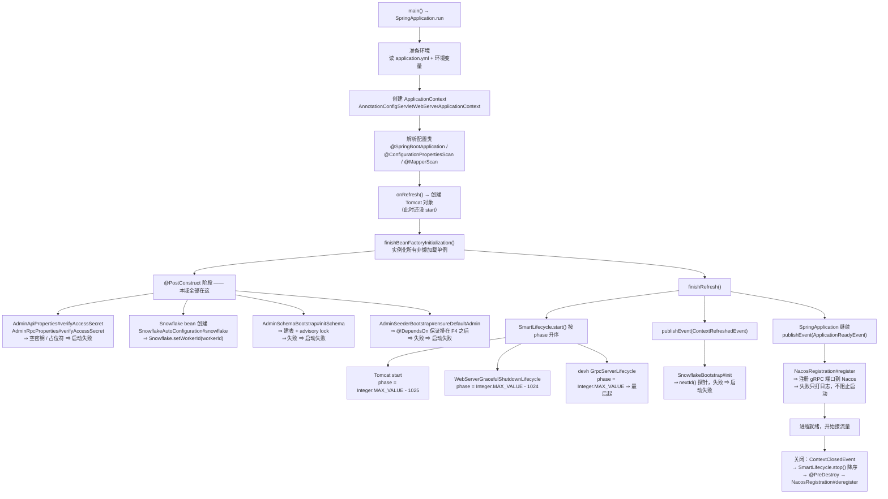
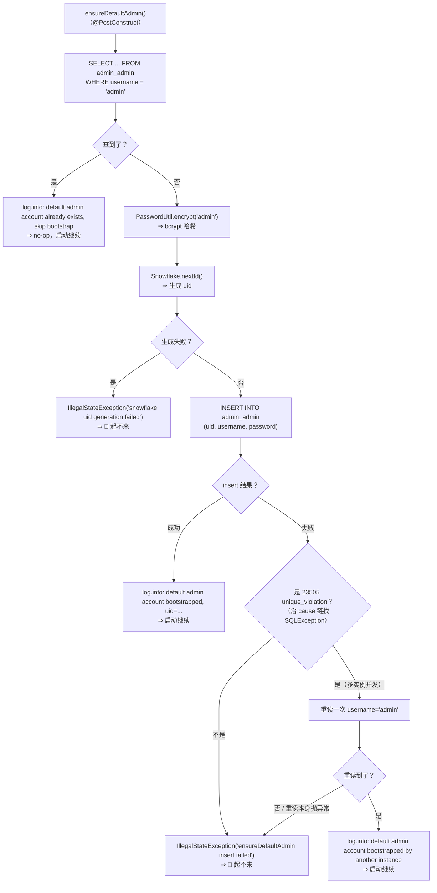
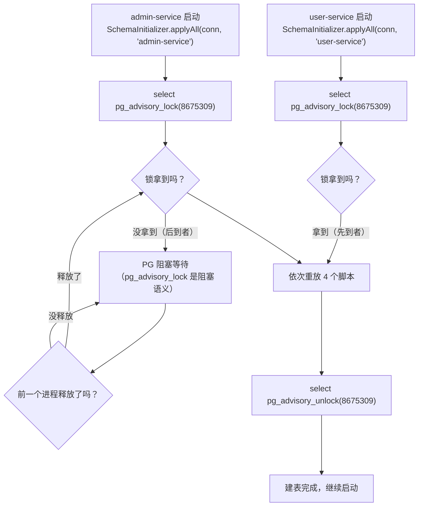

# 17. 启动引导与管理员种子流程

## 1. 本次流程的研究范围

这一篇追踪的是：**admin 域进程从 `main()` 到「可以接流量」之间，Spring 容器替我们做了什么、本仓的代码又做了什么**。

具体追踪范围：

| 追踪 | 不追踪 |
|---|---|
| `AdminServiceApplication` 的四个注解各自干了什么 | Spring Boot 内部的 `refresh()` 全部 12 步（本篇只挑与本域相关的节点讲） |
| `AdminSchemaBootstrap` 建表（`@PostConstruct`） | MyBatis-Plus 的 mapper 代理生成 |
| `AdminSeederBootstrap` 种子管理员（`@PostConstruct`） | 管理员登录流程（见 [01](./01-管理员登录流程.md)） |
| `SnowflakeBootstrap` 探针（`ContextRefreshedEvent`） | 雪花 ID 的位运算算法 |
| `NacosRegistration` 注册与注销（`ApplicationReadyEvent` + `@PreDestroy`） | Nacos 服务端内部 |
| 每一步失败 ⇒ **进程是「起不来」还是「起得来但功能坏」** | 业务域的 DTO / 校验 |

**关键边界**：本篇讲的是**生命周期维度**，
不是「一次请求的处理过程」。请求维度见 01~16 篇。

---

## 2. 触发场景与输入

### 2.1 触发场景

```
$ java -jar admin-service.jar
```

或者：

```java
public static void main(String[] args) {
    SpringApplication.run(AdminServiceApplication.class, args);
}
```

（`service/users/admin/src/main/java/com/rag/admin/AdminServiceApplication.java:64-66`）

### 2.2 输入是什么

| 输入 | 来源 | 谁消费 |
|---|---|---|
| `application.yml` | 域内 `src/main/resources/` | Spring Boot 的 `ConfigDataEnvironmentPostProcessor` |
| 环境变量 `ADMIN_JWT_SECRET` | 容器 / shell | `AdminApiProperties` / `AdminRpcProperties` |
| 环境变量 `ADMIN_GRPC_PORT` / `ADMIN_HTTP_PORT` | 容器 / shell | `grpc.server.port` / `server.port` |
| 环境变量 `NACOS_GROUP` / `NACOS_ADDR` … | 容器 / shell | `spring.cloud.nacos.discovery.*` |
| PostgreSQL 连接 | `spring.datasource.*` | `AdminSchemaBootstrap` + `AdminSeederBootstrap` |
| Nacos 服务端 | `spring.cloud.nacos.discovery.server-addr` | `NacosRegistration` |

### 2.3 启动期的四个关键配置

`service/users/admin/src/main/resources/application.yml`：

```yaml
spring:
  application:
    name: admin-service
  cloud:
    nacos:
      discovery:
        server-addr: ${NACOS_ADDR:nacos}:${NACOS_PORT:8848}
        namespace: ${NACOS_NAMESPACE:sea-rtw}
        group: ${NACOS_GROUP:USER_GROUP}
        register-enabled: false      # ⚠️ 必须关，见 §4.6

server:
  port: ${ADMIN_HTTP_PORT:8889}

grpc:
  server:
    port: ${ADMIN_GRPC_PORT:8082}

admin-api:
  admin-auth:
    access-secret: ${ADMIN_JWT_SECRET}      # ⚠️ 无默认值
    access-expire: ${ADMIN_JWT_EXPIRE:2592000}
admin-rpc:
  admin-auth:
    access-secret: ${ADMIN_JWT_SECRET}      # ⚠️ 无默认值
    access-expire: ${ADMIN_JWT_EXPIRE:2592000}
  system:
    default-password: ${ADMIN_DEFAULT_PASSWORD:123456}
```

⚠️ **本域的 yml 里没有任何「种子管理员开关」** —— 见 §4.4。

---

## 3. 整体执行路线



---

## 4. 逐步讲解

### 4.1 第一步：入口类的四个注解

涉及文件：`AdminServiceApplication.java`

```java
@SpringBootApplication
@ConfigurationPropertiesScan("com.rag.admin.config")
@MapperScan("com.rag.admin.mapper")
@EnableDiscoveryClient
public class AdminServiceApplication {
```

（`service/users/admin/src/main/java/com/rag/admin/AdminServiceApplication.java:58-62`）

| 注解 | 干了什么 | 为什么需要它 |
|---|---|---|
| `@SpringBootApplication` | = `@SpringBootConfiguration` + `@ComponentScan` + `@EnableAutoConfiguration` | **包扫描的根 = 本类所在包 `com.rag.admin`** ⇒ 本域的 `@Component`（`AdminController` / `AdminJwtAuthInterceptor` / `wiring/*` …）被扫到 |
| `@ConfigurationPropertiesScan("com.rag.admin.config")` | 扫描该包下带 `@ConfigurationProperties` 的类并注册 | 绑定 `admin-api.*`（`AdminApiProperties`）与 `admin-rpc.*`（`AdminRpcProperties`）**两段前缀** |
| `@MapperScan("com.rag.admin.mapper")` | 把该包下的 Mapper 接口注册成 bean | 没有它，`AdminMapper` / `AdminInviteMapper` / `UserMapper` **不是 bean** ⇒ `AdminSeederBootstrap` 注入不到 |
| `@EnableDiscoveryClient` | 开启服务发现 | 保留 B 侧 admin-rpc 的同款注解 |

#### ⚠️ 刻意**不**扫 `com.rag.common`

源码注释写得很明确（`AdminServiceApplication.java:18-22`）：

> 本仓**只扫 `com.rag.admin`** ⇒ ⇒ **刻意不扫 `com.rag.common`**：共享层在本仓是 **starter**（D3），
> 由 `AutoConfiguration.imports` 自动装配 ⇒ 再扫一遍会**双注册**。

共享层的 14 个 auto-configuration 由
`common/src/main/resources/META-INF/spring/org.springframework.boot.autoconfigure.AutoConfiguration.imports` 注册：

```
com.rag.common.autoconfigure.GoStyleOtelAutoConfiguration
com.rag.common.autoconfigure.WebAutoConfiguration
com.rag.common.autoconfigure.JsonBodyConverterAutoConfiguration
com.rag.common.autoconfigure.LoggerAutoConfiguration
com.rag.common.autoconfigure.ObservabilityAutoConfiguration
com.rag.common.autoconfigure.ProtectionAutoConfiguration
com.rag.common.autoconfigure.SnowflakeAutoConfiguration
com.rag.common.autoconfigure.MybatisPlusOrderingBridgeAutoConfiguration
com.rag.common.autoconfigure.GrpcExceptionMapperAutoConfiguration
com.rag.common.autoconfigure.PersistenceAutoConfiguration
com.rag.common.autoconfigure.RouteTemplateAutoConfiguration
com.rag.common.autoconfigure.ClientProtectionAutoConfiguration
com.rag.common.redis.ClientAutoConfiguration
com.rag.common.redis.DeadlineAutoConfiguration
```

⇒ 这就是为什么 `AdminServiceApplication` 的 `@Import` 清单是**空的**。

### 4.2 第二步：`@PostConstruct` 与 `ApplicationReadyEvent` 的差别

这是本篇**最需要讲清**的一节，因为四个引导类的触发时机各不相同。

| 触发点 | Spring 生命周期阶段 | 本域谁用它 |
|---|---|---|
| **`@PostConstruct`** | `finishBeanFactoryInitialization()` —— **实例化单例 bean 时**，在依赖注入之后、bean 交给容器之前 | `AdminApiProperties#verifyAccessSecret` · `AdminRpcProperties#verifyAccessSecret` · `AdminSchemaBootstrap#initSchema` · `AdminSeederBootstrap#ensureDefaultAdmin` |
| **`ContextRefreshedEvent`** | `finishRefresh()` 里，**`SmartLifecycle.start()` 之后**发布 | `SnowflakeBootstrap#init` |
| **`ApplicationReadyEvent`** | `refreshContext()` 返回**之后**，`SpringApplication.run` 里发布 | `NacosRegistration#register` |

**关键差别**：

- `@PostConstruct` 发生在**容器还没准备好接流量**的时候 ⇒ 失败 ⇒ **启动直接失败**；
- `ApplicationReadyEvent` 发生在**容器已经准备好**之后 ⇒ 失败 ⇒ **启动已经成功了**，只能记日志。

⇒ 所以「哪些失败会让进程起不来」这件事，**直接由触发点决定**。

### 4.3 第三步：密钥校验 —— 第一道 fail-closed 闸门

涉及文件：`config/AdminApiProperties.java` · `config/AdminRpcProperties.java`

```java
@PostConstruct
void verifyAccessSecret() {
    String secret = adminAuth == null ? null : adminAuth.getAccessSecret();
    if (secret == null || secret.isBlank()) {
        throw new IllegalStateException(
                "admin-api.admin-auth.access-secret 不能为空：请设置环境变量 ADMIN_JWT_SECRET（与 admin-rpc 共享同一把密钥）"
                        + "—— 本模块既签发又验签，空密钥会让任何人都能伪造 admin JWT（越权）");
    }
    if (secret.contains("${")) {
        throw new IllegalStateException(
                "admin-api.admin-auth.access-secret 仍是未解析的占位符（" + secret + "）：请设置环境变量 ADMIN_JWT_SECRET"
                        + "—— 占位符字面量是公开在仓里的常量，拿它当密钥 = 密钥公开");
    }
}
```

（`config/AdminApiProperties.java:77-90`；`config/AdminRpcProperties.java:88-101` 是同款，只是文案不同）

**两条守卫分别堵两条路**：

1. **变量设了但值是空串** ⇒ Spring 的 `PropertyPlaceholderHelper` 把空串当合法值（不走默认值、也不报错）
   ⇒ 属性绑成 `""` ⇒ 应用带着**空 HMAC 密钥**正常起来 ⇒ **admin token 可伪造（越权）**。
2. **变量没设** ⇒ 绑上去的**不是 `null`，而是占位符字面量** `"${ADMIN_JWT_SECRET}"`
   ⇒ 只判「null / 空串」**堵不住这条路**。

⇒ 两条都是 **fail-closed**：**启动失败**，不是「启动成功但验签永远失败」。

> 顺带：`admin-rpc` 那一段在本仓**没有运行时消费者**（admin-rpc 只消费 `AccessExpire`）
> ⇒ 它这一段的守卫是**纯收紧**，不改变任何已存在的取值。

### 4.4 第四步：种子管理员（`AdminSeederBootstrap`）

涉及文件：`wiring/AdminSeederBootstrap.java`

```java
@Component
@DependsOn("adminSchemaBootstrap")
@DependsOnDatabaseInitialization
public class AdminSeederBootstrap {
```

（`wiring/AdminSeederBootstrap.java:106-109`）

#### 4.4.1 它什么时候跑 —— **不是** `ApplicationReadyEvent`

```java
@PostConstruct
public void ensureDefaultAdmin() {
```

（`wiring/AdminSeederBootstrap.java:134-135`）

⇒ **种子管理员在 `@PostConstruct` 阶段就跑完了**，比 Tomcat 启动还早。

**为什么不能放到 `ApplicationReadyEvent`**（源码 `:65-72` 记了完整理由）：

> B 侧 `NewServiceContext(c)` 在 `zrpc.MustNewServer` **之前**执行 seeder，即 gRPC server 开始收流量之前。
> 本类此前用 `@EventListener(ApplicationReadyEvent)`，而该事件在 `SmartLifecycle` 启动 gRPC server **之后**才发布
> —— 冷启动窗口内 admin-api 若已连通，登录会拿到 `1003 用户不存在` 而不是连不上服务。
> 修法：改用 `@PostConstruct`。它在 `finishBeanFactoryInitialization` 阶段执行，
> 早于 `finishRefresh` 里的 `SmartLifecycle.start()`。

⇒ **这是一个真实修过的缺陷**（DRIFT-010），不是风格选择。

#### 4.4.2 完整逻辑（五段）

```java
@PostConstruct
public void ensureDefaultAdmin() {
    // 先尝试查默认账号；已存在 → no-op
    AdminEntity existing = adminMapper.selectOne(
            new LambdaQueryWrapper<AdminEntity>().eq(AdminEntity::getUsername, AdminDomainService.DEFAULT_ADMIN_USERNAME)
    );
    if (existing != null) {
        log.info("default admin account already exists, skip bootstrap");
        return;
    }

    // 不存在 → 创建。密码来自硬编码常量，不读 system.default-password
    String passwordHash = PasswordUtil.encrypt(AdminDomainService.DEFAULT_ADMIN_PASSWORD);

    long uid;
    try {
        uid = Snowflake.nextId();
    } catch (Exception e) {
        log.error("ensureDefaultAdmin failed: snowflake uid generation error", e);
        throw new IllegalStateException("snowflake uid generation failed", e);
    }

    AdminEntity admin = new AdminEntity();
    admin.setUid(uid);
    admin.setUsername(AdminDomainService.DEFAULT_ADMIN_USERNAME);
    admin.setPassword(passwordHash);

    try {
        adminMapper.insert(admin);
    } catch (Exception e) {
        if (AdminExceptions.isUniqueViolation(e)) {
            // 多实例并发启动场景：另一个实例已经创建。重读一次确认。
            try {
                AdminEntity relookup = adminMapper.selectOne(
                        new LambdaQueryWrapper<AdminEntity>().eq(AdminEntity::getUsername, AdminDomainService.DEFAULT_ADMIN_USERNAME)
                );
                if (relookup != null) {
                    log.info("default admin account bootstrapped by another instance");
                    return;
                }
            } catch (Exception lookupErr) {
                log.error("ensureDefaultAdmin relookup failed", lookupErr);
            }
        }
        log.error("ensureDefaultAdmin failed: insert admin error", e);
        throw new IllegalStateException("ensureDefaultAdmin insert failed", e);
    }

    log.info("default admin account bootstrapped, uid={}", uid);
}
```

（`wiring/AdminSeederBootstrap.java:134-184`）

逐段回答你可能关心的每个问题：

| 问题 | 答案 | 源码依据 |
|---|---|---|
| **配置项开关是什么？** | **没有开关。** seeder **每次启动都跑**。它唯一的「不做事」条件是「账号已存在」。 | `AdminSeederBootstrap` **没有**注入任何 `@Value` / properties 类；`application.yml` 里也没有任何 seeder 相关键 |
| **用什么用户名 / 密码？** | 用户名 `admin`、密码 `admin` —— **都是硬编码常量** | `AdminDomainService.DEFAULT_ADMIN_USERNAME = "admin"`（`:154`）· `DEFAULT_ADMIN_PASSWORD = "admin"`（`:164`） |
| **密码走 bcrypt 吗？** | **是** —— `PasswordUtil.encrypt(...)` | `wiring/AdminSeederBootstrap.java:146` |
| **可重复执行吗？** | **可以（幂等）** —— 先查后插 | `:137-143` |
| **失败是抛异常还是只打日志？** | **抛异常** ⇒ 容器启动失败 ⇒ 进程退出 | `:153` / `:180` |

#### 种子管理员的决策流程



#### ⚠️ 密码**不读** `admin-rpc.system.default-password`

这是 **DRIFT-001（已修）**，极易看错：

| 配置项 | 值 | 用途 |
|---|---|---|
| `admin-rpc.system.default-password` | `123456` | **重置普通用户密码**用（`AdminDomainService#resetUserPassword`） |
| `AdminDomainService.DEFAULT_ADMIN_PASSWORD` | `admin` | **种子管理员**的密码（硬编码常量） |

源码注释（`AdminDomainService.java:160-163`）：

> **不是** `AdminRpcProperties.System.DefaultPassword`：参考侧该配置项（yaml 里 `"123456"`）
> 只供 `ResetUserPasswordLogic` 重置*普通用户*密码，与本常量无关。DRIFT-001 即由此处误接配置引发。

⇒ 之前本类误接了 `admin-rpc.system.default-password` ⇒ **全新环境下默认管理员密码从 `admin` 变成了 `123456`**。

#### ⚠️ uid 用的是**静态** `Snowflake.nextId()`，但注入的是**实例**

```java
private final Snowflake snowflake;

public AdminSeederBootstrap(AdminMapper adminMapper, Snowflake snowflake) {
    this.adminMapper = adminMapper;
    this.snowflake = snowflake;
}
```

（`wiring/AdminSeederBootstrap.java:127-132`）

但方法体里调的是 **`Snowflake.nextId()`（静态）**（`:150`），
**注入的 `snowflake` 字段从头到尾没有被读取过**。

**这不是冗余代码 —— 注入的目的是「强制 bean 创建顺序」**（源码 `:115-126`）：

> 注入 `Snowflake` Bean（而非只用静态 `Snowflake.nextId()`）是为了强制 Spring 的 bean 创建顺序：
> `SnowflakeAutoConfiguration#snowflake` 在创建 Bean 时调 `Snowflake.setWorkerId(configuredId)`，
> 而 `@PostConstruct` 阶段的 seeder 若先跑，会用「静态兜底 workerId」生成 uid，
> 随后该 Bean 才把 workerId 换成配置值 —— 同一进程内先后两个不同 workerId 产 ID，存在跨 workerId 撞号风险。
> 注入后 Spring 保证该 Bean 先构造完，seeder 再执行。

⇒ **注入 ⇒ `SnowflakeAutoConfiguration#snowflake` 这个 bean 被创建 ⇒ `Snowflake.setWorkerId(workerId)` 已执行
⇒ 静态 `Snowflake.nextId()` 用的是正确的 workerId。**

#### 唯一约束冲突的处理

```java
public static boolean isUniqueViolation(Throwable err) {
    if (err == null) {
        return false;
    }
    Throwable cur = err;
    while (cur != null) {
        if (cur instanceof java.sql.SQLException) {
            String state = ((java.sql.SQLException) cur).getSQLState();
            if (state != null && state.equals("23505")) {
                return true;
            }
        }
        cur = cur.getCause();
    }
    return false;
}
```

（`exception/AdminExceptions.java:86-101`）

⇒ **沿 cause 链找 `SQLException`**，看 SQLState 是否 `23505`（PG 的 `unique_violation`）。
MyBatis / Spring 把它包装成 `DataIntegrityViolationException` ⇒ 必须沿链找。

**处理流程**：

```
insert 失败
  ├─ 是 23505（多实例并发启动）？
  │     ├─ 重读一次 → 找到了 ⇒ log.info + return（**启动继续**）
  │     └─ 重读也找不到 ⇒ 落到下面
  │   （重读本身抛异常 ⇒ 只 log.error，继续落到下面）
  └─ 抛 IllegalStateException("ensureDefaultAdmin insert failed") ⇒ **启动失败**
```

### 4.5 第五步：建表（`AdminSchemaBootstrap` → `SchemaInitializer`）

涉及文件：`wiring/AdminSchemaBootstrap.java` · `service/users/common/.../SchemaInitializer.java`

```java
@PostConstruct
public void initSchema() {
    log.info("admin-service schema init starting");
    try (Connection connection = dataSource.getConnection()) {
        SchemaInitializer.applyAll(connection, "admin-service");
    } catch (Exception e) {
        // 不吞：建表失败必须让整个进程起不来。
        throw new IllegalStateException("admin-service 建表失败，进程拒绝启动", e);
    }
    log.info("admin-service schema init done");
}
```

（`wiring/AdminSchemaBootstrap.java:63-78`）

#### 4.5.1 为什么 admin 域也要建 user 域的表

源码注释（`:33-37`）：

> 它**也读写 `users_user`**（`BanUser` / `DeleteUser` / `ResetUserPassword` / `UpdateUser`），
> 这是它自己那份迁移注释里写明的设计意图。

⇒ **admin-service 与 user-service 必须连同一个库。**

#### 4.5.2 为什么不用 Flyway

`SchemaInitializer` 的类注释（`:30-37`）：

> `flyway_schema_history` 是 **schema 级**账本，一个 schema 只能有一本账；
> 而 user-service 与 admin-service **必须连同一个库**
> ⇒ 两个进程各带一套 `db/migration/` 必然撞账本
> （版本号相同、内容不同 ⇒ 后启动者要么静默跳过自己的迁移，要么 checksum mismatch 启动失败）。
> ⇒ 本仓沿用 B 的定案：users 域**弃用 Flyway**、改用本类做幂等重放。

⇒ **`service/users/admin/pom.xml` 里没有 Flyway 依赖**（注释里逐条写了理由）。

#### 4.5.3 advisory lock —— 两个进程并发建表的串行化

```java
public static void applyAll(Connection connection, String serviceName) throws SQLException {
    // 先拿会话级 advisory lock：把两个服务并发建表这件事串行化。
    // 拿不到就一直等（PG 的 pg_advisory_lock 是阻塞语义），等到即可，
    // 因为另一个进程执行完就会释放 —— 不会死锁，也不需要超时。
    boolean locked = false;
    try (Statement st = connection.createStatement()) {
        st.execute("select pg_advisory_lock(" + ADVISORY_LOCK_KEY + ")");
        locked = true;
        log.info("schema init [{}]: acquired advisory lock {}", serviceName, ADVISORY_LOCK_KEY);
        for (String script : SCRIPTS) {
            log.info("schema init [{}]: applying {}", serviceName, script);
            ScriptUtils.executeSqlScript(connection, new ClassPathResource(script));
        }
    } finally {
        if (locked) {
            try (Statement st = connection.createStatement()) {
                st.execute("select pg_advisory_unlock(" + ADVISORY_LOCK_KEY + ")");
            } catch (SQLException e) {
                log.warn("schema init [{}]: advisory unlock failed (连接断开也会自动释放)",
                        serviceName, e);
            }
        }
    }
    log.info("schema init [{}]: all {} scripts applied", serviceName, SCRIPTS.length);
}
```

（`service/users/common/src/main/java/com/rag/users/common/SchemaInitializer.java:103-130`）

**三个要点**：

1. **锁键是常量 `8_675_309L`**（`:86`）。
   ⚠️ **两个服务必须用同一个键** ⇒ 改键 = 并发建表的保护失效。
2. **PG 的 `pg_advisory_lock` 是阻塞语义** ⇒ 拿不到就**一直等** ⇒ 不会死锁（另一个进程执行完会释放），
   也**不需要超时**。
3. **失败不吞**：`ScriptUtils.executeSqlScript` 默认 `continueOnError=false` ⇒ 任一语句失败即抛 `SQLException`
   ⇒ 一路冒泡到 `AdminSchemaBootstrap` ⇒ 变成 `IllegalStateException` ⇒ **进程拒绝启动**。

**为什么要锁**：PG 的 `CREATE TABLE IF NOT EXISTS` 在并发下**并不安全** ——
后到者可能撞 `pg_type_typname_nsp_index` 唯一索引冲突。



⇒ **两个进程连同一个库 ⇒ 同一把会话级锁 ⇒ 建表串行化 ⇒ 谁先启动都对。**

#### 4.5.4 执行的 4 个脚本

```java
private static final String[] SCRIPTS = {
        "db/01_create_user.sql",
        "db/02_create_user_avatar_history.sql",
        "db/03_create_admin.sql",
        "db/04_create_admin_invite.sql",
};
```

（`service/users/common/.../SchemaInitializer.java:73-78`）

⚠️ **数字前缀只保证确定性顺序，不表示版本**。

#### 4.5.5 admin 域关心的两张表

`service/users/common/src/main/resources/db/03_create_admin.sql`：

```sql
CREATE TABLE IF NOT EXISTS admin_admin (
    id          BIGSERIAL PRIMARY KEY,
    uid         BIGINT NOT NULL UNIQUE,
    username    TEXT UNIQUE,
    password    TEXT,
    email       TEXT UNIQUE,
    extra_info  TEXT,
    create_time TIMESTAMPTZ DEFAULT CURRENT_TIMESTAMP,
    update_time TIMESTAMPTZ DEFAULT CURRENT_TIMESTAMP
);

CREATE INDEX IF NOT EXISTS idx_admin_admin_uid ON admin_admin (uid);
```

（`db/03_create_admin.sql:51-63`）

**幂等写法有三类**：

| 类别 | 例子 | 幂等性 |
|---|---|---|
| `CREATE ... IF NOT EXISTS` | 建表、建索引 | 重复执行不报错、不改结构 |
| `ALTER ... TYPE`（恒等） | `ALTER TABLE admin_admin ALTER COLUMN username TYPE text;` | 已是 `text` 时恒等，可反复重放 |
| `SET TIME ZONE 'UTC'` + `ALTER` + `RESET TIME ZONE` | `create_time` / `update_time` → `TIMESTAMPTZ` | 两条路径（首迁 / 重放）都恒等 |

⚠️ **为什么时间列要这么绕**（`db/03_create_admin.sql:110-125`）：

> `timestamptz AT TIME ZONE 'UTC'` 对**已经是 timestamptz** 的列**并不恒等**：
> 会话时区非 UTC 时，**每启动一次整列时刻就偏移一次，且永不收敛**。
> `SchemaInitializer` 每次启动都原样重放本文件，所以这个坑会持续累积。
>
> ❌ `DO $$ … $$` + `information_schema` 条件守卫：**实测不可行** ——
> `SchemaInitializer` 用 spring-jdbc `ScriptUtils` 切分语句（分隔符 `;`），
> 而 spring-jdbc 的 `ScriptUtils` **不支持 PG 美元引号** ⇒ 块内分号照样被切断，DDL 语法错
> ⇒ `applyAll` 抛异常 ⇒ **user-rpc 与 admin-rpc 双双起不来**。

⇒ **脚本内容必须原样照抄，不得引入 `$$` 块。**

`service/users/common/src/main/resources/db/04_create_admin_invite.sql`：

```sql
CREATE TABLE IF NOT EXISTS admin_invite (
    id           BIGSERIAL PRIMARY KEY,
    code         TEXT NOT NULL UNIQUE,
    inviter_uid  BIGINT NOT NULL,
    expires_at   TIMESTAMPTZ NOT NULL,
    used_by_uid  BIGINT,
    used_at      TIMESTAMPTZ,
    create_time  TIMESTAMPTZ DEFAULT CURRENT_TIMESTAMP,
    update_time  TIMESTAMPTZ DEFAULT CURRENT_TIMESTAMP
);

CREATE INDEX IF NOT EXISTS idx_admin_invite_code ON admin_invite (code);
```

（`db/04_create_admin_invite.sql:36-48`）

⚠️ `code` 与 `expires_at` 上的**唯一约束与索引都不能退化** ——
`CreateAdmin` 的 4 步事务里对这张表做 **W1 行级悲观锁**（`SELECT ... FOR UPDATE`）。

⚠️ **`expire_at` 的时区语义**（`db/04_create_admin_invite.sql:60-77`）：
上游的 `ExpiresAt` 来自 `timestamptz` ⇒ 是**带 location 的绝对时刻**，
`.After(now)` 比的是**绝对时刻**。
RAG 侧原先是 `LocalDateTime`（墙钟）⇒ 跨时区多实例部署时
「实例 A（Asia/Shanghai）建的邀请码，实例 B（UTC）消费时 `04:00.isAfter(12:00)` 为 false」
⇒ **邀请码刚生成就被判为已过期**。
⇒ 配套改动：实体 `LocalDateTime` ⇒ `OffsetDateTime`。

#### 4.5.6 `SchemaInitializer` 为什么**不是** `@Component`

源码注释（`:54-57`）：

> 不是 `@Component`（与 B 一致）：本模块是**库**，各 app 只扫自己的包
> ⇒ 挂 `@Component` 只会造一个永不生效的假 bean ⇒ 保持**静态工具 + 各服务自己的
> `wiring/*SchemaBootstrap` 显式调用**。

#### 4.5.7 时序约束：建表必须在种子之前

`AdminSeederBootstrap` 是 `@PostConstruct` 且注入 `AdminMapper`，一上来就 `SELECT ... FROM admin_admin`。
DDL 若排在它后面，启动就会挂在 `PSQLException: relation "admin_admin" does not exist`。

**约束由 `@DependsOn("adminSchemaBootstrap")` 保证**（`wiring/AdminSeederBootstrap.java:107`）
—— **不是**靠 bean 定义的扫描顺序（那只是巧合，不可依赖）。

源码还记了这条约束的历史（`:82-95`）：原先靠 MyBatis-Plus 的
`MybatisDependsOnDatabaseInitializationDetector` 传递 ⇒ 2026-10-21 丢掉 Flyway 之后那条链整个消失了
⇒ 改成**点名到具体 bean** 的 `@DependsOn("adminSchemaBootstrap")` ⇒ ORM 换了、Boot 升大版本都不会失效。

`@DependsOnDatabaseInitialization` **予以保留**：万一将来换回 Flyway 或 `spring.sql.init`，它是另一条独立的保护。

### 4.6 第六步：Nacos 注册

涉及文件：`wiring/NacosRegistration.java`

```java
@Component("adminRpcNacosRegistration")
public class NacosRegistration {
```

（`wiring/NacosRegistration.java:75-76`）

⚠️ **bean 名必须显式错开**（源码 `:70-74`）：
`NacosServiceRegistryAutoConfiguration` 里有个 `@Bean nacosRegistration()`，
与本类的默认 bean 名（类名首字母小写）**撞名** ⇒ `BeanDefinitionOverrideException` ⇒ **应用启动失败**。

#### 注册逻辑

```java
@EventListener(ApplicationReadyEvent.class)
public void register() {
    String serviceName = "admin-service";
    String groupName = this.groupName;
    int port = grpcServerProperties.getPort();

    try {
        Instance instance = new Instance();
        instance.setIp(resolveLocalIp());
        instance.setPort(port);
        instance.setHealthy(true);
        instance.setWeight(1.0);
        instance.setEphemeral(true);
        instance.setServiceName(serviceName);
        instance.setClusterName("DEFAULT");

        NamingService namingService = nacosServiceManager.getNamingService();
        namingService.registerInstance(serviceName, groupName, instance);
        ...
    } catch (NacosException | UnknownHostException e) {
        log.error("admin-service nacos register FAILED service={} group={} port={}",
                serviceName, groupName, port, e);
    }
}
```

（`wiring/NacosRegistration.java:112-142`）

| 项 | 值 / 来源 |
|---|---|
| 服务名 | **`"admin-service"`**（硬编码，与 `spring.application.name` 一致） |
| group | **`@Value("${spring.cloud.nacos.discovery.group:USER_GROUP}")`** ⇒ 默认 `USER_GROUP`（读配置，不写死） |
| 端口 | **`grpcServerProperties.getPort()`** ⇒ **gRPC 端口 8082**，**不是** web 端口 8889 |
| ephemeral | `true` ⇒ 临时实例（进程挂掉后自动摘除） |
| healthy / weight | `true` / `1.0` |
| clusterName | `"DEFAULT"` |
| IP | `resolveLocalIp()`（见下） |

#### IP 怎么解析

```java
private static String resolveLocalIp() throws UnknownHostException {
    InetAddress candidate = null;
    try {
        Enumeration<NetworkInterface> nis = NetworkInterface.getNetworkInterfaces();
        while (nis != null && nis.hasMoreElements()) {
            NetworkInterface ni = nis.nextElement();
            if (ni.isLoopback() || ni.isPointToPoint() || !ni.isUp()) continue;
            Enumeration<InetAddress> addrs = ni.getInetAddresses();
            while (addrs.hasMoreElements()) {
                InetAddress a = addrs.nextElement();
                if (a instanceof Inet4Address) {
                    if (candidate == null) candidate = a;
                }
            }
        }
    } catch (SocketException ignore) {
        // 退回 InetAddress.getLocalHost
    }
    return candidate != null ? candidate.getHostAddress() : InetAddress.getLocalHost().getHostAddress();
}
```

（`wiring/NacosRegistration.java:164-183`）

⇒ **取第一个「非 loopback、非 point-to-point、UP」的网卡的 IPv4 地址**；
找不到就退回 `InetAddress.getLocalHost()`。

**为什么不用 `getLocalHost()`**（源码 `:160-162`）：
它在 macOS 上经常返回 `127.0.0.1`（loopback），
docker 容器跨 host 网络访问不到 host loopback。

#### ⚠️ 注册失败**不阻止启动**

`catch (NacosException | UnknownHostException e)` 里**只打 `log.error`，不重抛**。

⇒ 这是本篇唯一一个「**起得来但功能坏**」的失败点：
进程正常起来了、能接 HTTP / gRPC 请求，但**别的服务按名字寻址不到它**。

#### ⚠️ 为什么必须关掉 Nacos 自动注册

`application.yml` 里：

```yaml
spring.cloud.nacos.discovery.register-enabled: false
```

**原因链**（yml `:44-63` 有完整记录）：

1. D1 把 B 侧 admin-api + admin-rpc 合成**一个进程** ⇒ 本进程**同时**发 `WebServerInitializedEvent`（Tomcat）；
2. Spring Cloud Alibaba 的 `NacosAutoServiceRegistration` 会拿 **web 端口（8889）** 去注册；
3. 而域内 `wiring/NacosRegistration` 是**显式**用 **gRPC 端口（8082）** 注册的；
4. ⇒ ⇒ Nacos 里同一个服务名 `admin-service` 下会出现**两个端口的实例**
5. ⇒ ⇒ 消费方按名字寻址会连到错端口 ⇒ **gRPC 链路断（业务码塌 1015）**。

⇒ **判据是「运行期判定」，不是 bean gating**：
`NacosAutoServiceRegistration:71 register()` → `if (!isRegisterEnabled()) { return; }`
⇒ ⇒ **键名仍是 `spring.cloud.nacos.discovery.register-enabled`**。

#### 注销

```java
@PreDestroy
public void deregister() {
    if (registeredInstance == null) {
        return;
    }
    try {
        NamingService namingService = nacosServiceManager.getNamingService();
        namingService.deregisterInstance(
                registeredServiceName, registeredGroupName, registeredInstance);
        ...
    } catch (NacosException e) {
        log.warn("admin-service nacos deregister FAILED", e);
    }
}
```

（`wiring/NacosRegistration.java:144-158`）

⚠️ **注销在 `@PreDestroy`**，也就是在 **SmartLifecycle 停止之后**才跑
（`AbstractApplicationContext.doClose()` 的顺序是：发 `ContextClosedEvent` → `lifecycleProcessor.onClose()`（停 SmartLifecycle）→ `destroyBeans()`（跑 `@PreDestroy`））
⇒ **gRPC server 先停，Nacos 实例后摘**。

### 4.7 第七步：Snowflake 探针

涉及文件：`wiring/SnowflakeBootstrap.java`

```java
@Component
@Order(Ordered.HIGHEST_PRECEDENCE)
public class SnowflakeBootstrap {

    private volatile boolean initialized = false;

    @EventListener(ContextRefreshedEvent.class)
    public void init() {
        if (initialized) {
            return;
        }
        synchronized (this) {
            if (initialized) {
                return;
            }
            try {
                long probe = Snowflake.nextId();
                log.info("admin-service Snowflake ready, probe uid={}", probe);
                initialized = true;
            } catch (Throwable t) {
                log.error("admin-service Snowflake init failed", t);
                throw new IllegalStateException("snowflake init failed", t);
            }
        }
    }
}
```

（`wiring/SnowflakeBootstrap.java:44-70`）

⚠️ **它用的是 `ContextRefreshedEvent`，不是 `ApplicationReadyEvent`。**
⇒ 时机在 `finishRefresh()` 里，**在 Tomcat / gRPC server 启动之后、在 `ApplicationReadyEvent` 之前**。

**它现在只做「探针」，不再纠正 workerId**（源码 `:30-33`）：
本仓的 `Snowflake` **生成状态是全进程唯一的一份静态状态**（共享层「M11 修复」把两份状态收敛成一份）
⇒ 不存在 B 侧那个「同一 JVM 里两个不同 workerId 交替产 ID」的风险
⇒ ⇒ 探针保留（它是 fail-fast 探针），但不再承担「纠正 workerId」的职责。

**真正的 workerId 设置在共享层**：

```java
@Bean
@ConditionalOnMissingBean
public Snowflake snowflake(SnowflakeProperties props) {
    long workerId = resolveWorkerId(props);
    Snowflake.setWorkerId(workerId);
    return new Snowflake();
}
```

（`common/src/main/java/com/rag/common/autoconfigure/SnowflakeAutoConfiguration.java:60-66`）

workerId 的来源优先级：

| 优先级 | 来源 | 说明 |
|---|---|---|
| 1 | 环境变量 `SNOWFLAKE_NODE_ID` | 运维契约 |
| 2 | `snowflake.worker-id` 属性 | ⚠️ **B 侧没有这一档** ⇒ 属表达层扩展（已登记 `DRIFT-SF-002`） |
| 3 | 兜底 hash | `SERVICE_NAME + PID` 的 sha256 前 2 字节 % 1024 |

⇒ **这个 bean 的创建时机很重要**：它必须在 `AdminSeederBootstrap` 的 `@PostConstruct` 之前完成
⇒ 靠的是**注入**（见 §4.4.4），而不是靠 `@Order`（`@Order` 对 `@PostConstruct` 无效）。

### 4.8 第八步：Tomcat 与 gRPC server 谁先起

**这是 Spring 的 `SmartLifecycle` 机制**（不是本仓代码）：

- `SmartLifecycle` bean 在 `finishRefresh()` → `lifecycleProcessor.onRefresh()` 时启动；
- **启动顺序按 `getPhase()` 升序**（**phase 小的先起**）；
- **停止顺序按 `getPhase()` 降序**（**phase 大的先停**）。

本进程里三个相关 bean 的 phase（**已实测反编译确认**）：

| bean | phase | 数值 |
|---|---|---|
| `WebServerStartStopLifecycle`（Tomcat，servlet） | `Integer.MAX_VALUE - 1025` | 2147481599 |
| `WebServerGracefulShutdownLifecycle` | `Integer.MAX_VALUE - 1024` | 2147482623 |
| `GrpcServerLifecycle`（devh starter） | `Integer.MAX_VALUE` | 2147483647 |

⇒ **启动顺序：Tomcat → graceful shutdown → gRPC server**
⇒ **停止顺序：gRPC server → graceful shutdown → Tomcat**

⇒ 实用结论：**gRPC server 是最后起的** ⇒ Tomcat 已经在接 HTTP 了，gRPC 才开始收流量。
⇒ **停机时 gRPC 先停** ⇒ 停机窗口内 gRPC 调用会拿到 `UNAVAILABLE`，而 HTTP 还能通。

---

## 5. 重要分支与失败路径

### 5.1 完整失败矩阵

| # | 失败点 | 抛什么 | 进程状态 | 客户端可观察 |
|---|---|---|---|---|
| 1 | `ADMIN_JWT_SECRET` 未设 / 空串 / 仍是占位符 | `IllegalStateException`（`@PostConstruct`） | **🔴 起不来** | 连不上 |
| 2 | DDL 执行失败（语法错 / 权限不足 / 连接断） | `IllegalStateException("admin-service 建表失败，进程拒绝启动")` | **🔴 起不来** | 连不上 |
| 3 | advisory lock 拿不到 | **不失败** —— PG 阻塞等待 | 等待中 | 连不上（还在等） |
| 4 | seeder 的 `SELECT` 失败（表不存在等） | 异常冒泡出 `@PostConstruct` | **🔴 起不来** | 连不上 |
| 5 | `Snowflake.nextId()` 失败 | `IllegalStateException("snowflake uid generation failed")` | **🔴 起不来** | 连不上 |
| 6 | seeder `insert` 失败（非 23505） | `IllegalStateException("ensureDefaultAdmin insert failed")` | **🔴 起不来** | 连不上 |
| 7 | seeder `insert` 撞 23505（多实例并发） | 重读一次 → 找到 ⇒ `return` | **🟢 起得来** | 正常（账号已被别的实例建好） |
| 8 | seeder `insert` 撞 23505 **且重读也没找到** | `IllegalStateException("ensureDefaultAdmin insert failed")` | **🔴 起不来** | 连不上 |
| 9 | Snowflake 探针失败 | `IllegalStateException("snowflake init failed")` | **🔴 起不来** | 连不上 |
| 10 | gRPC 端口被占 | devh `IllegalStateException("Failed to start the grpc server")` | **🔴 起不来** | 连不上 |
| 11 | Nacos 注册失败（`NacosException` / `UnknownHostException`） | **不抛**，只 `log.error` | **🟡 起得来但功能坏** | HTTP / gRPC 正常；**别的服务寻址不到本服务** |
| 12 | Nacos 注销失败（`NacosException`） | **不抛**，只 `log.warn` | 🟡 无影响 | — |

**规律**（从这张表能读出来的一条设计原则）：

> **凡是「不抛异常」的失败点，都是「启动已经成功之后」的失败** ——
> Nacos 注册在 `ApplicationReadyEvent`（容器就绪后），注销在 `@PreDestroy`（停机阶段）。
> 而所有 `@PostConstruct` 阶段的失败**都是致命的**。

### 5.2 建表的分支

| 条件 | 结果 |
|---|---|
| 4 个脚本全部成功 | `log.info("admin-service schema init done")` ⇒ 继续 |
| 任一语句失败 | `ScriptUtils` 抛 `SQLException`（`continueOnError=false`）⇒ `IllegalStateException` ⇒ **进程拒绝启动** |
| advisory unlock 失败 | 只 `log.warn`（会话级锁在连接断开时也会自动释放）⇒ **不影响 DDL 的结论** |

### 5.3 种子的分支

| 条件 | 结果 |
|---|---|
| `selectOne(username='admin')` 查到 | `log.info("default admin account already exists, skip bootstrap")` ⇒ **no-op** |
| 查不到 + insert 成功 | `log.info("default admin account bootstrapped, uid={}")` |
| 查不到 + insert 撞 23505 + 重读查到 | `log.info("default admin account bootstrapped by another instance")` ⇒ 正常继续 |
| 查不到 + insert 失败（非 23505） | `IllegalStateException` ⇒ **起不来** |

---

## 6. 数据变化与副作用

### 6.1 副作用总表

| 副作用 | 发生？ | 细节 |
|---|---|---|
| **DB · DDL** | ✅ **发生** | 4 个脚本幂等重放：`CREATE TABLE IF NOT EXISTS` × 2 表 + `CREATE INDEX IF NOT EXISTS` × 2 索引 + `ALTER ... TYPE`（恒等）× 3 列 + `SET/RESET TIME ZONE` + `ALTER ... TIMESTAMPTZ` × 2 列（admin_admin）+ × 4 列（admin_invite） |
| **DB · DML** | ⚠️ **可能发生** | 种子管理员的 `INSERT INTO admin_admin`（仅当账号不存在时）；⚠️ **不删任何东西** ⇒ 重复启动**不产生**重复行 |
| **DB · advisory lock** | ✅ 发生 | `pg_advisory_lock(8675309)` ⇒ `pg_advisory_unlock(8675309)`；**会话级**（连接断开会自动释放） |
| **Nacos** | ✅ 发生 | 注册 1 个临时实例（`admin-service` / `USER_GROUP` / gRPC 端口）；停机时注销 |
| **Snowflake** | ✅ 发生（**内存态**） | `Snowflake.setWorkerId(workerId)`（共享层的 bean 创建时）+ 探针 `nextId()` 消耗 1 个 ID + 种子时消耗 1 个 ID |
| **Redis** | ❌ **完全没有** | 启动期**不写 Redis、不读 Redis**。黑名单的读写都在运行期的业务流程里（见 [06](./06-管理员注销与黑名单流程.md) / [14](./14-管理员JWT认证与黑名单流程.md)） |
| **Kafka / MQ** | ❌ 无 | admin 域不收发消息 |
| **端口** | ✅ 占用 | HTTP 8889（`server.port`）+ gRPC 8082（`grpc.server.port`） |
| **日志** | ✅ 多条 | `admin-service schema init starting/done` · `schema init [admin-service]: acquired advisory lock 8675309` · 每条脚本一行 `applying` · `default admin account ...` · `admin-service Snowflake ready, probe uid=...` · `nacos registry, USER_GROUP admin-service <ip>:8082 register finished` |
| **指标** | ⚠️ 启动期基本无 | 运行期的业务指标由 `metrics/AdminApiMetrics` / `AdminRpcMetrics` 提供 |

### 6.2 「失败后哪些操作可能已经发生」

| 失败点 | 已发生的副作用 |
|---|---|
| seeder 的 `insert` 之后失败 | ⚠️ 理论上 insert 已成功就不会走 catch；catch 里若重读失败 ⇒ **行可能已存在**（因为唯一约束冲突说明别人插了，或自己插成功了但确认失败）⇒ 需人工核对 |
| `Snowflake.nextId()` 失败 | 建表**已完成**；uid **未生成**（Snowflake 的 ID 计数器是否前进取决于失败点，本仓源码无法确认） |
| DDL 失败 | ⚠️ **前面的脚本已生效**（`ScriptUtils` 是逐条执行的，不是事务）⇒ 例如 `01_create_user.sql` 成功、`03_create_admin.sql` 失败 ⇒ `users_user` 已建、`admin_admin` 没建 ⇒ **下次启动会从 `01` 重放**（幂等）⇒ 不会留半成品冲突 |
| Nacos 注册失败 | DDL / 种子 / 端口全部就绪；**只是没注册上** ⇒ 服务能接流量但**寻址不到** |

---

## 7. 执行结果

### 7.1 启动成功的标志

```
admin-service schema init starting
schema init [admin-service]: acquired advisory lock 8675309
schema init [admin-service]: applying db/01_create_user.sql
schema init [admin-service]: applying db/02_create_user_avatar_history.sql
schema init [admin-service]: applying db/03_create_admin.sql
schema init [admin-service]: applying db/04_create_admin_invite.sql
schema init [admin-service]: all 4 scripts applied
admin-service schema init done
default admin account bootstrapped, uid=1234567890123456789
   （或：default admin account already exists, skip bootstrap
    或：default admin account bootstrapped by another instance）
admin-service Snowflake ready, probe uid=1234567890123456790
Tomcat started on port 8889 (http)
gRPC Server started, listening on address: 0.0.0.0, port: 8082
nacos registry, USER_GROUP admin-service 192.168.1.10:8082 register finished
```

⇒ 之后进程开始接 HTTP（8889）与 gRPC（8082）流量。

### 7.2 数据库里的最终状态

**表**：

```
users_user                  ← 01_create_user.sql
users_user_avatar_history   ← 02_create_user_avatar_history.sql
admin_admin                 ← 03_create_admin.sql
admin_invite                ← 04_create_admin_invite.sql
```

**种子管理员行**（仅首次）：

| 列 | 值 |
|---|---|
| `id` | `BIGSERIAL` 自增 |
| `uid` | Snowflake 生成的 64 位 ID |
| `username` | `admin`（`TEXT UNIQUE`） |
| `password` | bcrypt 哈希（**不是**明文 `admin`） |
| `email` | `NULL`（`TEXT UNIQUE`，可空） |
| `extra_info` | `NULL`（`TEXT`） |
| `create_time` / `update_time` | `TIMESTAMPTZ`，`DEFAULT CURRENT_TIMESTAMP` |

⇒ **登录时用 `admin` / `admin`**（密码明文是 `admin`，但库里存的是 bcrypt 哈希）。

### 7.3 Nacos 里的实例

| 字段 | 值 |
|---|---|
| serviceName | `admin-service` |
| groupName | `USER_GROUP`（来自 `spring.cloud.nacos.discovery.group`） |
| ip | 第一个非 loopback 网卡的 IPv4 |
| port | **8082**（gRPC 端口） |
| ephemeral | `true` |
| healthy | `true` |
| weight | `1.0` |
| clusterName | `DEFAULT` |

---

## 8. 流程复盘

```text
main()
  ↓
SpringApplication.run
  ↓
准备环境（application.yml + 环境变量）
  ↓
创建 ApplicationContext
  ↓
解析配置类（@SpringBootApplication / @ConfigurationPropertiesScan / @MapperScan）
  ↓
共享层 auto-configuration 由 AutoConfiguration.imports 装配（14 个）
  ↓
onRefresh() → 创建 Tomcat 对象（未 start）
  ↓
finishBeanFactoryInitialization()  ← 【@PostConstruct 阶段】
  ├─ AdminApiProperties#verifyAccessSecret   ⇒ 空/占位符 ⇒ 启动失败
  ├─ AdminRpcProperties#verifyAccessSecret   ⇒ 同上
  ├─ Snowflake bean ⇒ Snowflake.setWorkerId(workerId)
  ├─ AdminSchemaBootstrap#initSchema
  │     ├─ pg_advisory_lock(8675309)
  │     ├─ 重放 db/01..04_*.sql（幂等）
  │     └─ pg_advisory_unlock(8675309)
  │       ⇒ 任一失败 ⇒ 进程拒绝启动
  └─ AdminSeederBootstrap#ensureDefaultAdmin（@DependsOn 保证在建表之后）
        ├─ selectOne(username='admin') ⇒ 命中 ⇒ no-op
        ├─ PasswordUtil.encrypt("admin") ⇒ bcrypt
        ├─ Snowflake.nextId() ⇒ uid
        ├─ insert ⇒ 撞 23505 ⇒ 重读 ⇒ 命中 ⇒ OK
        └─ 其它失败 ⇒ IllegalStateException ⇒ 启动失败
  ↓
finishRefresh()
  ├─ SmartLifecycle.start()（phase 升序）
  │     ├─ Tomcat（MAX-1025）
  │     ├─ graceful shutdown（MAX-1024）
  │     └─ gRPC server（MAX_VALUE）⇒ 最后起
  └─ publishEvent(ContextRefreshedEvent) ⇒ SnowflakeBootstrap#init（探针）
  ↓
publishEvent(ApplicationReadyEvent) ⇒ NacosRegistration#register
  ↓
【就绪】接 HTTP(8889) + gRPC(8082) 流量
  ↓
关闭：ContextClosedEvent → SmartLifecycle.stop()（降序）→ @PreDestroy → Nacos 注销
```

**边界结论**：

1. **`@PostConstruct` 在容器就绪之前，`ApplicationReadyEvent` 在就绪之后。**
   ⇒ 前者失败 = **起不来**；后者失败 = **起得来但功能坏**。

2. **种子管理员在 `@PostConstruct` 阶段跑完**（不是 `ApplicationReadyEvent`）——
   因为 B 侧是在 gRPC server 收流量**之前** seeder 的。

3. **种子管理员没有配置开关**，恒定执行，靠「查到了就 no-op」实现幂等。
   用户名 / 密码都是硬编码的 `admin` / `admin`（**不是** `admin-rpc.system.default-password` = `123456`）。

4. **密码走 bcrypt**（`PasswordUtil.encrypt`），库里存的是哈希。

5. **`@DependsOn("adminSchemaBootstrap")` 保证建表先于种子** —— 不靠扫描顺序。

6. **建表用 advisory lock `8675309` 串行化两个进程**（user-service 与 admin-service 连同一个库）；
   PG 的锁是阻塞语义 ⇒ 拿不到就一直等 ⇒ 不会死锁。

7. **建表失败 = 进程拒绝启动**（刻意不吞异常）。而且 DDL 是**逐条**执行的 ⇒ 可能留半成品，
   但因为幂等 ⇒ 下次启动会重放修好。

8. **Nacos 注册用 gRPC 端口（8082）而不是 web 端口（8889）** ⇒ 所以必须关掉 Nacos 自动注册，
   否则同名服务下会出现两个端口的实例。

9. **Nacos 注册失败不阻止启动** ⇒ 唯一的「起得来但功能坏」点。

10. **启动期完全不碰 Redis。**

---

## 9. 源码定位与验证方式

### 9.1 源码定位

| 位置 | 文件 | 关键成员 |
|---|---|---|
| 应用入口 | `service/users/admin/src/main/java/com/rag/admin/AdminServiceApplication.java` | 四个注解（`:58-61`）· `main`（`:64`） |
| 建表引导 | `service/users/admin/src/main/java/com/rag/admin/wiring/AdminSchemaBootstrap.java` | `initSchema`（`:63`） |
| DDL 执行器 | `service/users/common/src/main/java/com/rag/users/common/SchemaInitializer.java` | `SCRIPTS`（`:73`）· `ADVISORY_LOCK_KEY`（`:86`）· `applyAll`（`:103`） |
| 种子管理员 | `service/users/admin/src/main/java/com/rag/admin/wiring/AdminSeederBootstrap.java` | `ensureDefaultAdmin`（`:134`）· `@DependsOn`（`:107`） |
| 种子常量 | `service/users/admin/src/main/java/com/rag/admin/domain/service/AdminDomainService.java` | `DEFAULT_ADMIN_USERNAME`（`:154`）· `DEFAULT_ADMIN_PASSWORD`（`:164`）· `BLACKLIST_KEY_PREFIX`（`:151`） |
| 唯一冲突判定 | `service/users/admin/src/main/java/com/rag/admin/exception/AdminExceptions.java` | `isUniqueViolation`（`:86`） |
| Snowflake 探针 | `service/users/admin/src/main/java/com/rag/admin/wiring/SnowflakeBootstrap.java` | `init`（`:52`） |
| Snowflake 装配 | `common/src/main/java/com/rag/common/autoconfigure/SnowflakeAutoConfiguration.java` | `snowflake`（`:60`）· `resolveWorkerId`（`:90`） |
| Nacos 注册 | `service/users/admin/src/main/java/com/rag/admin/wiring/NacosRegistration.java` | `register`（`:112`）· `deregister`（`:144`）· `resolveLocalIp`（`:164`） |
| 配置文件 | `service/users/admin/src/main/resources/application.yml` | `spring.cloud.nacos.discovery.register-enabled: false`（`:64`）· `grpc.server.port`（`:99`）· `admin-api.admin-auth`（`:138`） |
| DDL 脚本 | `service/users/common/src/main/resources/db/03_create_admin.sql` · `04_create_admin_invite.sql` | 建表 + 幂等 ALTER |
| auto-config 清单 | `common/src/main/resources/META-INF/spring/org.springframework.boot.autoconfigure.AutoConfiguration.imports` | 14 行 |

### 9.2 验证方式

| 测试 | 位置 | 钉住什么 |
|---|---|---|
| `schemaInitializerCreatedAllTables` | `src/test/java/com/rag/admin/AdminServiceApplicationTests.java:156` | 启动后 `information_schema` 里能查到 4 张表：`users_user` · `users_user_avatar_history` · `admin_admin` · `admin_invite` |
| `defaultAdminIsSeededWithHardcodedPassword` | 同文件 `:167` | 默认 admin 被种下；`PasswordUtil.check("admin", hash)` **为真**；`PasswordUtil.check("123456", hash)` **为假** ⇒ 钉死「密码是硬编码的 `admin`，**不是** `default-password=123456`」（DRIFT-001 的修法） |
| `grpcServerIsRunningInTheSameProcess` | 同文件 `:179` | devh 的 `GrpcServerLifecycle` bean 存在且 `isRunning()` 为 true ⇒ **gRPC 与 Tomcat 同进程且真在跑**（D1） |
| `nacosAutoRegistrationIsDisabledAndOnlyGrpcPortIsRegistered` | 同文件 `:210` | ① `NacosAutoServiceRegistration` bean **存在**（证明链路是活的，不是靠关掉整条 discovery 蒙混）；② `isRegisterEnabled()` 为 false（值来自**真实 yml**，测试未覆盖该键）；③ 桩 `NamingService` 上**只注册了 1 次**，且端口 == gRPC 端口、**≠** web 端口 |
| `AdminHttpContractRealTomcatTest` | `src/test/java/com/rag/admin/http/AdminHttpContractRealTomcatTest.java:98` | `grpc.server.port=0` ⇒ gRPC server 在测试里真起来（证明装配不炸） |
| `@DynamicPropertySource` 注入 `ADMIN_JWT_SECRET` | `AdminHttpContractRealTomcatTest.java:114-124` | yml 里的 `${ADMIN_JWT_SECRET}` 占位符被**真解析**（不是绕过校验的硬编码）⇒ 证明 fail-closed 守卫在有正确环境变量时**不会误杀** |
| `NacosStubConfiguration` | 同目录 | `spring.cloud.nacos.discovery.enabled=false` + 桩 ⇒ 注册调用是空操作（不会真去注册） |

> ⚠️ **启动期的完整回归由 `AdminServiceApplicationTests` 覆盖**（4 个 `@Test` + Testcontainers 真 PG），
> 本篇已逐条读过该类。**其余域级测试**（`AdminDomainServiceRealPgTest`）不在本篇范围内。

### 9.3 交叉引用

- **user 域的同款流程**（`UserSchemaBootstrap` 建表 + Nacos 注册）⇒
  [13-应用启动与初始化流程.md](../users/13-应用启动与初始化流程.md)
- 种子管理员**登录**拿 token ⇒ [01-管理员登录流程.md](./01-管理员登录流程.md)
- 黑名单的**写**（`AdminDomainService#logout`）⇒ [06-管理员注销与黑名单流程.md](./06-管理员注销与黑名单流程.md)
- 密钥校验失败的表现（401 与启动失败）⇒ [14-管理员JWT认证与黑名单流程.md](./14-管理员JWT认证与黑名单流程.md) §4.6
- gRPC server 的**运行期**行为 ⇒ [16-gRPC管理员服务流程.md](./16-gRPC管理员服务流程.md)
- `createAdmin` 的事务与悲观锁 ⇒ [02-管理员创建流程.md](./02-管理员创建流程.md)

### 9.4 本篇的「源码无法确认」项

| 项 | 说明 |
|---|---|
| `SmartLifecycle` 的 phase 数值 | **已实测确认**（反编译 `spring-boot-3.5.11.jar` 的 `WebServerStartStopLifecycle` = 2147481599、`WebServerGracefulShutdownLifecycle` = 2147482623；解包 `grpc-server-spring-boot-starter-3.1.0.RELEASE-sources.jar` 读 `GrpcServerLifecycle.getPhase()` = `Integer.MAX_VALUE`）⇒ **不是**推断。 |
| `AdminServiceApplicationTests` 的完整断言清单 | **已逐条读过**（`src/test/java/com/rag/admin/AdminServiceApplicationTests.java`，4 个 `@Test`）⇒ 见 §9.2。 |
| `Snowflake.nextId()` 失败时**计数器是否前进** | 本篇**没有读** `common/src/main/java/com/rag/common/snowflake/Snowflake.java` 的实现（只确认了 `nextId()` 在 `:268` · `nextIdInternal` 在 `:347`）⇒ 「失败的 ID 消耗」这一形态**源码无法确认**。 |
| `@PreDestroy` 与 `SmartLifecycle.stop()` 的**相对顺序** | 依据 Spring Framework `AbstractApplicationContext#doClose()` 的标准流程（`publishEvent(ContextClosedEvent)` → `lifecycleProcessor.onClose()` → `destroyBeans()`）⇒ 属**框架机制**，本仓源码中无直接断言。 |
| `resolveWorkerId` 的**兜底 hash** 具体算法 | 本篇只从 `SnowflakeAutoConfiguration` 的 javadoc（`:16-19`）读到「`SERVICE_NAME + PID` sha256 前 2 字节 % 1024」这一句描述，**没有逐行读** `resolveWorkerId`（`:90`）的实现。 |
