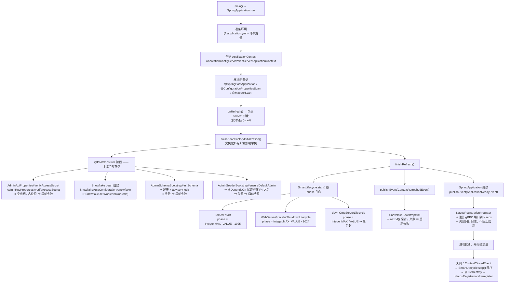
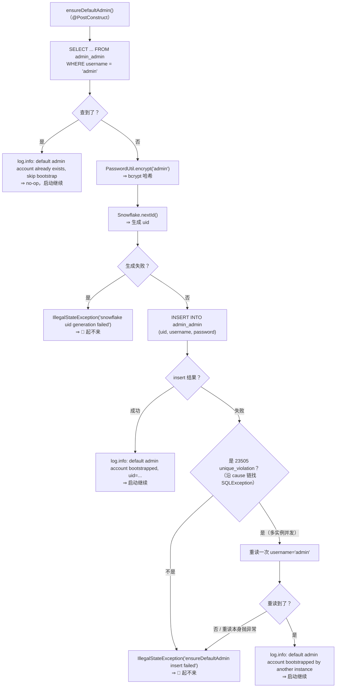
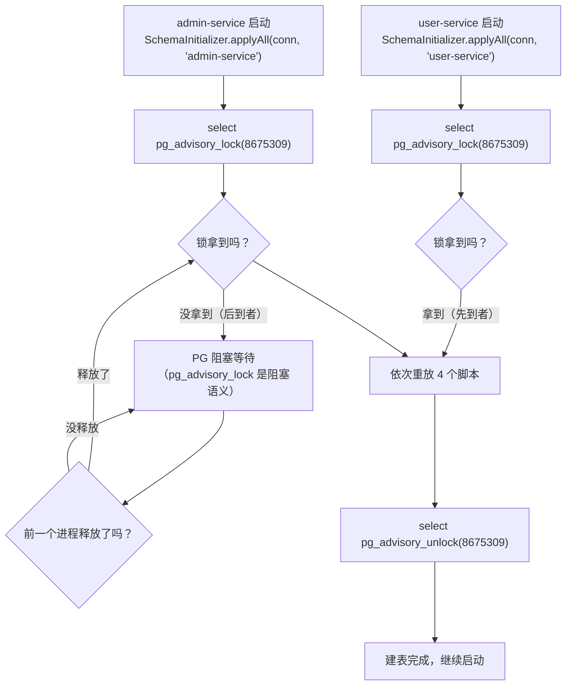
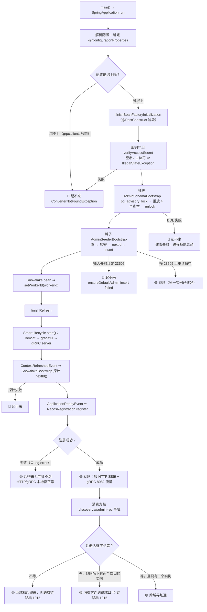

# 17. 启动引导与管理员种子流程

## 1. 本次流程的研究范围

这一篇追踪的是：**admin 域进程从 `main()` 到「可以接流量」之间，Spring 容器替我们做了什么、本仓的代码又做了什么**。

具体追踪范围：

| 追踪 | 不追踪 |
|---|---|
| `AdminServiceApplication` 的四个注解各自干了什么 | Spring Boot 内部的 `refresh()` 全部 12 步（本篇只挑与本域相关的节点讲） |
| `AdminSchemaBootstrap` 建表（`@PostConstruct`） | MyBatis-Plus 的 mapper 代理生成 |
| `AdminSeederBootstrap` 种子管理员（`@PostConstruct`） | 管理员登录流程（见 [01](./01-管理员登录流程.md)） |
| `SnowflakeBootstrap` 探针（`ContextRefreshedEvent`） | 雪花 ID 的位运算算法 |
| `NacosRegistration` 注册与注销（`ApplicationReadyEvent` + `@PreDestroy`） | Nacos 服务端内部 |
| 每一步失败 ⇒ **进程是「起不来」还是「起得来但功能坏」** | 业务域的 DTO / 校验 |

**关键边界**：本篇讲的是**生命周期维度**，
不是「一次请求的处理过程」。请求维度见 01~16 篇。

---

## 2. 触发场景与输入

### 2.1 触发场景

```
$ java -jar admin-service.jar
```

或者：

```java
public static void main(String[] args) {
    SpringApplication.run(AdminServiceApplication.class, args);
}
```

（`service/users/admin/src/main/java/com/rag/admin/AdminServiceApplication.java:64-66`）

### 2.2 输入是什么

| 输入 | 来源 | 谁消费 |
|---|---|---|
| `application.yml` | 域内 `src/main/resources/` | Spring Boot 的 `ConfigDataEnvironmentPostProcessor` |
| 环境变量 `ADMIN_JWT_SECRET` | 容器 / shell | `AdminApiProperties` / `AdminRpcProperties` |
| 环境变量 `ADMIN_GRPC_PORT` / `ADMIN_HTTP_PORT` | 容器 / shell | `grpc.server.port` / `server.port` |
| 环境变量 `NACOS_GROUP` / `NACOS_ADDR` … | 容器 / shell | `spring.cloud.nacos.discovery.*` |
| PostgreSQL 连接 | `spring.datasource.*` | `AdminSchemaBootstrap` + `AdminSeederBootstrap` |
| Nacos 服务端 | `spring.cloud.nacos.discovery.server-addr` | `NacosRegistration` |

### 2.3 启动期的四个关键配置

`service/users/admin/src/main/resources/application.yml`：

```yaml
spring:
  application:
    name: admin-service
  cloud:
    nacos:
      discovery:
        server-addr: ${NACOS_ADDR:nacos}:${NACOS_PORT:8848}
        namespace: ${NACOS_NAMESPACE:sea-rtw}
        group: ${NACOS_GROUP:USER_GROUP}
        register-enabled: false      # ⚠️ 必须关，见 §4.6

server:
  port: ${ADMIN_HTTP_PORT:8889}

grpc:
  server:
    port: ${ADMIN_GRPC_PORT:8082}

admin-api:
  admin-auth:
    access-secret: ${ADMIN_JWT_SECRET}      # ⚠️ 无默认值
    access-expire: ${ADMIN_JWT_EXPIRE:2592000}
admin-rpc:
  admin-auth:
    access-secret: ${ADMIN_JWT_SECRET}      # ⚠️ 无默认值
    access-expire: ${ADMIN_JWT_EXPIRE:2592000}
  system:
    default-password: ${ADMIN_DEFAULT_PASSWORD:123456}
```

⚠️ **本域的 yml 里没有任何「种子管理员开关」** —— 见 §4.4。

---

## 3. 整体执行路线



---

## 4. 逐步讲解

### 4.1 第一步：入口类的四个注解

涉及文件：`AdminServiceApplication.java`

```java
@SpringBootApplication
@ConfigurationPropertiesScan("com.rag.admin.config")
@MapperScan("com.rag.admin.mapper")
@EnableDiscoveryClient
public class AdminServiceApplication {
```

（`service/users/admin/src/main/java/com/rag/admin/AdminServiceApplication.java:58-62`）

| 注解 | 干了什么 | 为什么需要它 |
|---|---|---|
| `@SpringBootApplication` | = `@SpringBootConfiguration` + `@ComponentScan` + `@EnableAutoConfiguration` | **包扫描的根 = 本类所在包 `com.rag.admin`** ⇒ 本域的 `@Component`（`AdminController` / `AdminJwtAuthInterceptor` / `wiring/*` …）被扫到 |
| `@ConfigurationPropertiesScan("com.rag.admin.config")` | 扫描该包下带 `@ConfigurationProperties` 的类并注册 | 绑定 `admin-api.*`（`AdminApiProperties`）与 `admin-rpc.*`（`AdminRpcProperties`）**两段前缀** |
| `@MapperScan("com.rag.admin.mapper")` | 把该包下的 Mapper 接口注册成 bean | 没有它，`AdminMapper` / `AdminInviteMapper` / `UserMapper` **不是 bean** ⇒ `AdminSeederBootstrap` 注入不到 |
| `@EnableDiscoveryClient` | 开启服务发现 | 保留 B 侧 admin-rpc 的同款注解 |

#### ⚠️ 刻意**不**扫 `com.rag.common`

源码注释写得很明确（`AdminServiceApplication.java:18-22`）：

> 本仓**只扫 `com.rag.admin`** ⇒ ⇒ **刻意不扫 `com.rag.common`**：共享层在本仓是 **starter**（D3），
> 由 `AutoConfiguration.imports` 自动装配 ⇒ 再扫一遍会**双注册**。

共享层的 14 个 auto-configuration 由
`common/src/main/resources/META-INF/spring/org.springframework.boot.autoconfigure.AutoConfiguration.imports` 注册：

```
com.rag.common.autoconfigure.GoStyleOtelAutoConfiguration
com.rag.common.autoconfigure.WebAutoConfiguration
com.rag.common.autoconfigure.JsonBodyConverterAutoConfiguration
com.rag.common.autoconfigure.LoggerAutoConfiguration
com.rag.common.autoconfigure.ObservabilityAutoConfiguration
com.rag.common.autoconfigure.ProtectionAutoConfiguration
com.rag.common.autoconfigure.SnowflakeAutoConfiguration
com.rag.common.autoconfigure.MybatisPlusOrderingBridgeAutoConfiguration
com.rag.common.autoconfigure.GrpcExceptionMapperAutoConfiguration
com.rag.common.autoconfigure.PersistenceAutoConfiguration
com.rag.common.autoconfigure.RouteTemplateAutoConfiguration
com.rag.common.autoconfigure.ClientProtectionAutoConfiguration
com.rag.common.redis.ClientAutoConfiguration
com.rag.common.redis.DeadlineAutoConfiguration
```

⇒ 这就是为什么 `AdminServiceApplication` 的 `@Import` 清单是**空的**。

### 4.2 第二步：`@PostConstruct` 与 `ApplicationReadyEvent` 的差别

这是本篇**最需要讲清**的一节，因为四个引导类的触发时机各不相同。

| 触发点 | Spring 生命周期阶段 | 本域谁用它 |
|---|---|---|
| **`@PostConstruct`** | `finishBeanFactoryInitialization()` —— **实例化单例 bean 时**，在依赖注入之后、bean 交给容器之前 | `AdminApiProperties#verifyAccessSecret` · `AdminRpcProperties#verifyAccessSecret` · `AdminSchemaBootstrap#initSchema` · `AdminSeederBootstrap#ensureDefaultAdmin` |
| **`ContextRefreshedEvent`** | `finishRefresh()` 里，**`SmartLifecycle.start()` 之后**发布 | `SnowflakeBootstrap#init` |
| **`ApplicationReadyEvent`** | `refreshContext()` 返回**之后**，`SpringApplication.run` 里发布 | `NacosRegistration#register` |

**关键差别**：

- `@PostConstruct` 发生在**容器还没准备好接流量**的时候 ⇒ 失败 ⇒ **启动直接失败**；
- `ApplicationReadyEvent` 发生在**容器已经准备好**之后 ⇒ 失败 ⇒ **启动已经成功了**，只能记日志。

⇒ 所以「哪些失败会让进程起不来」这件事，**直接由触发点决定**。

### 4.3 第三步：密钥校验 —— 第一道 fail-closed 闸门

涉及文件：`config/AdminApiProperties.java` · `config/AdminRpcProperties.java`

```java
@PostConstruct
void verifyAccessSecret() {
    String secret = adminAuth == null ? null : adminAuth.getAccessSecret();
    if (secret == null || secret.isBlank()) {
        throw new IllegalStateException(
                "admin-api.admin-auth.access-secret 不能为空：请设置环境变量 ADMIN_JWT_SECRET（与 admin-rpc 共享同一把密钥）"
                        + "—— 本模块既签发又验签，空密钥会让任何人都能伪造 admin JWT（越权）");
    }
    if (secret.contains("${")) {
        throw new IllegalStateException(
                "admin-api.admin-auth.access-secret 仍是未解析的占位符（" + secret + "）：请设置环境变量 ADMIN_JWT_SECRET"
                        + "—— 占位符字面量是公开在仓里的常量，拿它当密钥 = 密钥公开");
    }
}
```

（`config/AdminApiProperties.java:77-90`；`config/AdminRpcProperties.java:88-101` 是同款，只是文案不同）

**两条守卫分别堵两条路**：

1. **变量设了但值是空串** ⇒ Spring 的 `PropertyPlaceholderHelper` 把空串当合法值（不走默认值、也不报错）
   ⇒ 属性绑成 `""` ⇒ 应用带着**空 HMAC 密钥**正常起来 ⇒ **admin token 可伪造（越权）**。
2. **变量没设** ⇒ 绑上去的**不是 `null`，而是占位符字面量** `"${ADMIN_JWT_SECRET}"`
   ⇒ 只判「null / 空串」**堵不住这条路**。

⇒ 两条都是 **fail-closed**：**启动失败**，不是「启动成功但验签永远失败」。

> 顺带：`admin-rpc` 那一段在本仓**没有运行时消费者**（admin-rpc 只消费 `AccessExpire`）
> ⇒ 它这一段的守卫是**纯收紧**，不改变任何已存在的取值。

### 4.4 第四步：种子管理员（`AdminSeederBootstrap`）

涉及文件：`wiring/AdminSeederBootstrap.java`

```java
@Component
@DependsOn("adminSchemaBootstrap")
@DependsOnDatabaseInitialization
public class AdminSeederBootstrap {
```

（`wiring/AdminSeederBootstrap.java:106-109`）

#### 4.4.1 它什么时候跑 —— **不是** `ApplicationReadyEvent`

```java
@PostConstruct
public void ensureDefaultAdmin() {
```

（`wiring/AdminSeederBootstrap.java:134-135`）

⇒ **种子管理员在 `@PostConstruct` 阶段就跑完了**，比 Tomcat 启动还早。

**为什么不能放到 `ApplicationReadyEvent`**（源码 `:65-72` 记了完整理由）：

> B 侧 `NewServiceContext(c)` 在 `zrpc.MustNewServer` **之前**执行 seeder，即 gRPC server 开始收流量之前。
> 本类此前用 `@EventListener(ApplicationReadyEvent)`，而该事件在 `SmartLifecycle` 启动 gRPC server **之后**才发布
> —— 冷启动窗口内 admin-api 若已连通，登录会拿到 `1003 用户不存在` 而不是连不上服务。
> 修法：改用 `@PostConstruct`。它在 `finishBeanFactoryInitialization` 阶段执行，
> 早于 `finishRefresh` 里的 `SmartLifecycle.start()`。

⇒ **这是一个真实修过的缺陷**（DRIFT-010），不是风格选择。

#### 4.4.2 完整逻辑（五段）

```java
@PostConstruct
public void ensureDefaultAdmin() {
    // 先尝试查默认账号；已存在 → no-op
    AdminEntity existing = adminMapper.selectOne(
            new LambdaQueryWrapper<AdminEntity>().eq(AdminEntity::getUsername, AdminDomainService.DEFAULT_ADMIN_USERNAME)
    );
    if (existing != null) {
        log.info("default admin account already exists, skip bootstrap");
        return;
    }

    // 不存在 → 创建。密码来自硬编码常量，不读 system.default-password
    String passwordHash = PasswordUtil.encrypt(AdminDomainService.DEFAULT_ADMIN_PASSWORD);

    long uid;
    try {
        uid = Snowflake.nextId();
    } catch (Exception e) {
        log.error("ensureDefaultAdmin failed: snowflake uid generation error", e);
        throw new IllegalStateException("snowflake uid generation failed", e);
    }

    AdminEntity admin = new AdminEntity();
    admin.setUid(uid);
    admin.setUsername(AdminDomainService.DEFAULT_ADMIN_USERNAME);
    admin.setPassword(passwordHash);

    try {
        adminMapper.insert(admin);
    } catch (Exception e) {
        if (AdminExceptions.isUniqueViolation(e)) {
            // 多实例并发启动场景：另一个实例已经创建。重读一次确认。
            try {
                AdminEntity relookup = adminMapper.selectOne(
                        new LambdaQueryWrapper<AdminEntity>().eq(AdminEntity::getUsername, AdminDomainService.DEFAULT_ADMIN_USERNAME)
                );
                if (relookup != null) {
                    log.info("default admin account bootstrapped by another instance");
                    return;
                }
            } catch (Exception lookupErr) {
                log.error("ensureDefaultAdmin relookup failed", lookupErr);
            }
        }
        log.error("ensureDefaultAdmin failed: insert admin error", e);
        throw new IllegalStateException("ensureDefaultAdmin insert failed", e);
    }

    log.info("default admin account bootstrapped, uid={}", uid);
}
```

（`wiring/AdminSeederBootstrap.java:134-184`）

逐段回答你可能关心的每个问题：

| 问题 | 答案 | 源码依据 |
|---|---|---|
| **配置项开关是什么？** | **没有开关。** seeder **每次启动都跑**。它唯一的「不做事」条件是「账号已存在」。 | `AdminSeederBootstrap` **没有**注入任何 `@Value` / properties 类；`application.yml` 里也没有任何 seeder 相关键 |
| **用什么用户名 / 密码？** | 用户名 `admin`、密码 `admin` —— **都是硬编码常量** | `AdminDomainService.DEFAULT_ADMIN_USERNAME = "admin"`（`:154`）· `DEFAULT_ADMIN_PASSWORD = "admin"`（`:164`） |
| **密码走 bcrypt 吗？** | **是** —— `PasswordUtil.encrypt(...)` | `wiring/AdminSeederBootstrap.java:146` |
| **可重复执行吗？** | **可以（幂等）** —— 先查后插 | `:137-143` |
| **失败是抛异常还是只打日志？** | **抛异常** ⇒ 容器启动失败 ⇒ 进程退出 | `:153` / `:180` |

#### 种子管理员的决策流程



#### ⚠️ 密码**不读** `admin-rpc.system.default-password`

这是 **DRIFT-001（已修）**，极易看错：

| 配置项 | 值 | 用途 |
|---|---|---|
| `admin-rpc.system.default-password` | `123456` | **重置普通用户密码**用（`AdminDomainService#resetUserPassword`） |
| `AdminDomainService.DEFAULT_ADMIN_PASSWORD` | `admin` | **种子管理员**的密码（硬编码常量） |

源码注释（`AdminDomainService.java:160-163`）：

> **不是** `AdminRpcProperties.System.DefaultPassword`：参考侧该配置项（yaml 里 `"123456"`）
> 只供 `ResetUserPasswordLogic` 重置*普通用户*密码，与本常量无关。DRIFT-001 即由此处误接配置引发。

⇒ 之前本类误接了 `admin-rpc.system.default-password` ⇒ **全新环境下默认管理员密码从 `admin` 变成了 `123456`**。

#### ⚠️ uid 用的是**静态** `Snowflake.nextId()`，但注入的是**实例**

```java
private final Snowflake snowflake;

public AdminSeederBootstrap(AdminMapper adminMapper, Snowflake snowflake) {
    this.adminMapper = adminMapper;
    this.snowflake = snowflake;
}
```

（`wiring/AdminSeederBootstrap.java:127-132`）

但方法体里调的是 **`Snowflake.nextId()`（静态）**（`:150`），
**注入的 `snowflake` 字段从头到尾没有被读取过**。

**这不是冗余代码 —— 注入的目的是「强制 bean 创建顺序」**（源码 `:115-126`）：

> 注入 `Snowflake` Bean（而非只用静态 `Snowflake.nextId()`）是为了强制 Spring 的 bean 创建顺序：
> `SnowflakeAutoConfiguration#snowflake` 在创建 Bean 时调 `Snowflake.setWorkerId(configuredId)`，
> 而 `@PostConstruct` 阶段的 seeder 若先跑，会用「静态兜底 workerId」生成 uid，
> 随后该 Bean 才把 workerId 换成配置值 —— 同一进程内先后两个不同 workerId 产 ID，存在跨 workerId 撞号风险。
> 注入后 Spring 保证该 Bean 先构造完，seeder 再执行。

⇒ **注入 ⇒ `SnowflakeAutoConfiguration#snowflake` 这个 bean 被创建 ⇒ `Snowflake.setWorkerId(workerId)` 已执行
⇒ 静态 `Snowflake.nextId()` 用的是正确的 workerId。**

#### 唯一约束冲突的处理

```java
public static boolean isUniqueViolation(Throwable err) {
    if (err == null) {
        return false;
    }
    Throwable cur = err;
    while (cur != null) {
        if (cur instanceof java.sql.SQLException) {
            String state = ((java.sql.SQLException) cur).getSQLState();
            if (state != null && state.equals("23505")) {
                return true;
            }
        }
        cur = cur.getCause();
    }
    return false;
}
```

（`exception/AdminExceptions.java:86-101`）

⇒ **沿 cause 链找 `SQLException`**，看 SQLState 是否 `23505`（PG 的 `unique_violation`）。
MyBatis / Spring 把它包装成 `DataIntegrityViolationException` ⇒ 必须沿链找。

**处理流程**：

```
insert 失败
  ├─ 是 23505（多实例并发启动）？
  │     ├─ 重读一次 → 找到了 ⇒ log.info + return（**启动继续**）
  │     └─ 重读也找不到 ⇒ 落到下面
  │   （重读本身抛异常 ⇒ 只 log.error，继续落到下面）
  └─ 抛 IllegalStateException("ensureDefaultAdmin insert failed") ⇒ **启动失败**
```

### 4.5 第五步：建表（`AdminSchemaBootstrap` → `SchemaInitializer`）

涉及文件：`wiring/AdminSchemaBootstrap.java` · `service/users/common/.../SchemaInitializer.java`

```java
@PostConstruct
public void initSchema() {
    log.info("admin-service schema init starting");
    try (Connection connection = dataSource.getConnection()) {
        SchemaInitializer.applyAll(connection, "admin-service");
    } catch (Exception e) {
        // 不吞：建表失败必须让整个进程起不来。
        throw new IllegalStateException("admin-service 建表失败，进程拒绝启动", e);
    }
    log.info("admin-service schema init done");
}
```

（`wiring/AdminSchemaBootstrap.java:63-78`）

#### 4.5.1 为什么 admin 域也要建 user 域的表

源码注释（`:33-37`）：

> 它**也读写 `users_user`**（`BanUser` / `DeleteUser` / `ResetUserPassword` / `UpdateUser`），
> 这是它自己那份迁移注释里写明的设计意图。

⇒ **admin-service 与 user-service 必须连同一个库。**

#### 4.5.2 为什么不用 Flyway

`SchemaInitializer` 的类注释（`:30-37`）：

> `flyway_schema_history` 是 **schema 级**账本，一个 schema 只能有一本账；
> 而 user-service 与 admin-service **必须连同一个库**
> ⇒ 两个进程各带一套 `db/migration/` 必然撞账本
> （版本号相同、内容不同 ⇒ 后启动者要么静默跳过自己的迁移，要么 checksum mismatch 启动失败）。
> ⇒ 本仓沿用 B 的定案：users 域**弃用 Flyway**、改用本类做幂等重放。

⇒ **`service/users/admin/pom.xml` 里没有 Flyway 依赖**（注释里逐条写了理由）。

#### 4.5.3 advisory lock —— 两个进程并发建表的串行化

```java
public static void applyAll(Connection connection, String serviceName) throws SQLException {
    // 先拿会话级 advisory lock：把两个服务并发建表这件事串行化。
    // 拿不到就一直等（PG 的 pg_advisory_lock 是阻塞语义），等到即可，
    // 因为另一个进程执行完就会释放 —— 不会死锁，也不需要超时。
    boolean locked = false;
    try (Statement st = connection.createStatement()) {
        st.execute("select pg_advisory_lock(" + ADVISORY_LOCK_KEY + ")");
        locked = true;
        log.info("schema init [{}]: acquired advisory lock {}", serviceName, ADVISORY_LOCK_KEY);
        for (String script : SCRIPTS) {
            log.info("schema init [{}]: applying {}", serviceName, script);
            ScriptUtils.executeSqlScript(connection, new ClassPathResource(script));
        }
    } finally {
        if (locked) {
            try (Statement st = connection.createStatement()) {
                st.execute("select pg_advisory_unlock(" + ADVISORY_LOCK_KEY + ")");
            } catch (SQLException e) {
                log.warn("schema init [{}]: advisory unlock failed (连接断开也会自动释放)",
                        serviceName, e);
            }
        }
    }
    log.info("schema init [{}]: all {} scripts applied", serviceName, SCRIPTS.length);
}
```

（`service/users/common/src/main/java/com/rag/users/common/SchemaInitializer.java:103-130`）

**三个要点**：

1. **锁键是常量 `8_675_309L`**（`:86`）。
   ⚠️ **两个服务必须用同一个键** ⇒ 改键 = 并发建表的保护失效。
2. **PG 的 `pg_advisory_lock` 是阻塞语义** ⇒ 拿不到就**一直等** ⇒ 不会死锁（另一个进程执行完会释放），
   也**不需要超时**。
3. **失败不吞**：`ScriptUtils.executeSqlScript` 默认 `continueOnError=false` ⇒ 任一语句失败即抛 `SQLException`
   ⇒ 一路冒泡到 `AdminSchemaBootstrap` ⇒ 变成 `IllegalStateException` ⇒ **进程拒绝启动**。

**为什么要锁**：PG 的 `CREATE TABLE IF NOT EXISTS` 在并发下**并不安全** ——
后到者可能撞 `pg_type_typname_nsp_index` 唯一索引冲突。



⇒ **两个进程连同一个库 ⇒ 同一把会话级锁 ⇒ 建表串行化 ⇒ 谁先启动都对。**

#### 4.5.4 执行的 4 个脚本

```java
private static final String[] SCRIPTS = {
        "db/01_create_user.sql",
        "db/02_create_user_avatar_history.sql",
        "db/03_create_admin.sql",
        "db/04_create_admin_invite.sql",
};
```

（`service/users/common/.../SchemaInitializer.java:73-78`）

⚠️ **数字前缀只保证确定性顺序，不表示版本**。

#### 4.5.5 admin 域关心的两张表

`service/users/common/src/main/resources/db/03_create_admin.sql`：

```sql
CREATE TABLE IF NOT EXISTS admin_admin (
    id          BIGSERIAL PRIMARY KEY,
    uid         BIGINT NOT NULL UNIQUE,
    username    TEXT UNIQUE,
    password    TEXT,
    email       TEXT UNIQUE,
    extra_info  TEXT,
    create_time TIMESTAMPTZ DEFAULT CURRENT_TIMESTAMP,
    update_time TIMESTAMPTZ DEFAULT CURRENT_TIMESTAMP
);

CREATE INDEX IF NOT EXISTS idx_admin_admin_uid ON admin_admin (uid);
```

（`db/03_create_admin.sql:51-63`）

**幂等写法有三类**：

| 类别 | 例子 | 幂等性 |
|---|---|---|
| `CREATE ... IF NOT EXISTS` | 建表、建索引 | 重复执行不报错、不改结构 |
| `ALTER ... TYPE`（恒等） | `ALTER TABLE admin_admin ALTER COLUMN username TYPE text;` | 已是 `text` 时恒等，可反复重放 |
| `SET TIME ZONE 'UTC'` + `ALTER` + `RESET TIME ZONE` | `create_time` / `update_time` → `TIMESTAMPTZ` | 两条路径（首迁 / 重放）都恒等 |

⚠️ **为什么时间列要这么绕**（`db/03_create_admin.sql:110-125`）：

> `timestamptz AT TIME ZONE 'UTC'` 对**已经是 timestamptz** 的列**并不恒等**：
> 会话时区非 UTC 时，**每启动一次整列时刻就偏移一次，且永不收敛**。
> `SchemaInitializer` 每次启动都原样重放本文件，所以这个坑会持续累积。
>
> ❌ `DO $$ … $$` + `information_schema` 条件守卫：**实测不可行** ——
> `SchemaInitializer` 用 spring-jdbc `ScriptUtils` 切分语句（分隔符 `;`），
> 而 spring-jdbc 的 `ScriptUtils` **不支持 PG 美元引号** ⇒ 块内分号照样被切断，DDL 语法错
> ⇒ `applyAll` 抛异常 ⇒ **user-rpc 与 admin-rpc 双双起不来**。

⇒ **脚本内容必须原样照抄，不得引入 `$$` 块。**

`service/users/common/src/main/resources/db/04_create_admin_invite.sql`：

```sql
CREATE TABLE IF NOT EXISTS admin_invite (
    id           BIGSERIAL PRIMARY KEY,
    code         TEXT NOT NULL UNIQUE,
    inviter_uid  BIGINT NOT NULL,
    expires_at   TIMESTAMPTZ NOT NULL,
    used_by_uid  BIGINT,
    used_at      TIMESTAMPTZ,
    create_time  TIMESTAMPTZ DEFAULT CURRENT_TIMESTAMP,
    update_time  TIMESTAMPTZ DEFAULT CURRENT_TIMESTAMP
);

CREATE INDEX IF NOT EXISTS idx_admin_invite_code ON admin_invite (code);
```

（`db/04_create_admin_invite.sql:36-48`）

⚠️ `code` 与 `expires_at` 上的**唯一约束与索引都不能退化** ——
`CreateAdmin` 的 4 步事务里对这张表做 **W1 行级悲观锁**（`SELECT ... FOR UPDATE`）。

⚠️ **`expire_at` 的时区语义**（`db/04_create_admin_invite.sql:60-77`）：
上游的 `ExpiresAt` 来自 `timestamptz` ⇒ 是**带 location 的绝对时刻**，
`.After(now)` 比的是**绝对时刻**。
RAG 侧原先是 `LocalDateTime`（墙钟）⇒ 跨时区多实例部署时
「实例 A（Asia/Shanghai）建的邀请码，实例 B（UTC）消费时 `04:00.isAfter(12:00)` 为 false」
⇒ **邀请码刚生成就被判为已过期**。
⇒ 配套改动：实体 `LocalDateTime` ⇒ `OffsetDateTime`。

#### 4.5.6 `SchemaInitializer` 为什么**不是** `@Component`

源码注释（`:54-57`）：

> 不是 `@Component`（与 B 一致）：本模块是**库**，各 app 只扫自己的包
> ⇒ 挂 `@Component` 只会造一个永不生效的假 bean ⇒ 保持**静态工具 + 各服务自己的
> `wiring/*SchemaBootstrap` 显式调用**。

#### 4.5.7 时序约束：建表必须在种子之前

`AdminSeederBootstrap` 是 `@PostConstruct` 且注入 `AdminMapper`，一上来就 `SELECT ... FROM admin_admin`。
DDL 若排在它后面，启动就会挂在 `PSQLException: relation "admin_admin" does not exist`。

**约束由 `@DependsOn("adminSchemaBootstrap")` 保证**（`wiring/AdminSeederBootstrap.java:107`）
—— **不是**靠 bean 定义的扫描顺序（那只是巧合，不可依赖）。

源码还记了这条约束的历史（`:82-95`）：原先靠 MyBatis-Plus 的
`MybatisDependsOnDatabaseInitializationDetector` 传递 ⇒ 2026-10-21 丢掉 Flyway 之后那条链整个消失了
⇒ 改成**点名到具体 bean** 的 `@DependsOn("adminSchemaBootstrap")` ⇒ ORM 换了、Boot 升大版本都不会失效。

`@DependsOnDatabaseInitialization` **予以保留**：万一将来换回 Flyway 或 `spring.sql.init`，它是另一条独立的保护。

### 4.6 第六步：Nacos 注册

涉及文件：`wiring/NacosRegistration.java`

```java
@Component("adminRpcNacosRegistration")
public class NacosRegistration {
```

（`wiring/NacosRegistration.java:75-76`）

⚠️ **bean 名必须显式错开**（源码 `:70-74`）：
`NacosServiceRegistryAutoConfiguration` 里有个 `@Bean nacosRegistration()`，
与本类的默认 bean 名（类名首字母小写）**撞名** ⇒ `BeanDefinitionOverrideException` ⇒ **应用启动失败**。

#### 注册逻辑

```java
@EventListener(ApplicationReadyEvent.class)
public void register() {
    String serviceName = "admin-service";
    String groupName = this.groupName;
    int port = grpcServerProperties.getPort();

    try {
        Instance instance = new Instance();
        instance.setIp(resolveLocalIp());
        instance.setPort(port);
        instance.setHealthy(true);
        instance.setWeight(1.0);
        instance.setEphemeral(true);
        instance.setServiceName(serviceName);
        instance.setClusterName("DEFAULT");

        NamingService namingService = nacosServiceManager.getNamingService();
        namingService.registerInstance(serviceName, groupName, instance);
        ...
    } catch (NacosException | UnknownHostException e) {
        log.error("admin-service nacos register FAILED service={} group={} port={}",
                serviceName, groupName, port, e);
    }
}
```

（`wiring/NacosRegistration.java:112-142`）

| 项 | 值 / 来源 |
|---|---|
| 服务名 | **`"admin-service"`**（硬编码，与 `spring.application.name` 一致） |
| group | **`@Value("${spring.cloud.nacos.discovery.group:USER_GROUP}")`** ⇒ 默认 `USER_GROUP`（读配置，不写死） |
| 端口 | **`grpcServerProperties.getPort()`** ⇒ **gRPC 端口 8082**，**不是** web 端口 8889 |
| ephemeral | `true` ⇒ 临时实例（进程挂掉后自动摘除） |
| healthy / weight | `true` / `1.0` |
| clusterName | `"DEFAULT"` |
| IP | `resolveLocalIp()`（见下） |

#### IP 怎么解析

```java
private static String resolveLocalIp() throws UnknownHostException {
    InetAddress candidate = null;
    try {
        Enumeration<NetworkInterface> nis = NetworkInterface.getNetworkInterfaces();
        while (nis != null && nis.hasMoreElements()) {
            NetworkInterface ni = nis.nextElement();
            if (ni.isLoopback() || ni.isPointToPoint() || !ni.isUp()) continue;
            Enumeration<InetAddress> addrs = ni.getInetAddresses();
            while (addrs.hasMoreElements()) {
                InetAddress a = addrs.nextElement();
                if (a instanceof Inet4Address) {
                    if (candidate == null) candidate = a;
                }
            }
        }
    } catch (SocketException ignore) {
        // 退回 InetAddress.getLocalHost
    }
    return candidate != null ? candidate.getHostAddress() : InetAddress.getLocalHost().getHostAddress();
}
```

（`wiring/NacosRegistration.java:164-183`）

⇒ **取第一个「非 loopback、非 point-to-point、UP」的网卡的 IPv4 地址**；
找不到就退回 `InetAddress.getLocalHost()`。

**为什么不用 `getLocalHost()`**（源码 `:160-162`）：
它在 macOS 上经常返回 `127.0.0.1`（loopback），
docker 容器跨 host 网络访问不到 host loopback。

#### ⚠️ 注册失败**不阻止启动**

`catch (NacosException | UnknownHostException e)` 里**只打 `log.error`，不重抛**。

⇒ 这是本篇唯一一个「**起得来但功能坏**」的失败点：
进程正常起来了、能接 HTTP / gRPC 请求，但**别的服务按名字寻址不到它**。

#### ⚠️ 为什么必须关掉 Nacos 自动注册

`application.yml` 里：

```yaml
spring.cloud.nacos.discovery.register-enabled: false
```

**原因链**（yml `:44-63` 有完整记录）：

1. D1 把 B 侧 admin-api + admin-rpc 合成**一个进程** ⇒ 本进程**同时**发 `WebServerInitializedEvent`（Tomcat）；
2. Spring Cloud Alibaba 的 `NacosAutoServiceRegistration` 会拿 **web 端口（8889）** 去注册；
3. 而域内 `wiring/NacosRegistration` 是**显式**用 **gRPC 端口（8082）** 注册的；
4. ⇒ ⇒ Nacos 里同一个服务名 `admin-service` 下会出现**两个端口的实例**
5. ⇒ ⇒ 消费方按名字寻址会连到错端口 ⇒ **gRPC 链路断（业务码塌 1015）**。

⇒ **判据是「运行期判定」，不是 bean gating**：
`NacosAutoServiceRegistration:71 register()` → `if (!isRegisterEnabled()) { return; }`
⇒ ⇒ **键名仍是 `spring.cloud.nacos.discovery.register-enabled`**。

#### 注销

```java
@PreDestroy
public void deregister() {
    if (registeredInstance == null) {
        return;
    }
    try {
        NamingService namingService = nacosServiceManager.getNamingService();
        namingService.deregisterInstance(
                registeredServiceName, registeredGroupName, registeredInstance);
        ...
    } catch (NacosException e) {
        log.warn("admin-service nacos deregister FAILED", e);
    }
}
```

（`wiring/NacosRegistration.java:144-158`）

⚠️ **注销在 `@PreDestroy`**，也就是在 **SmartLifecycle 停止之后**才跑
（`AbstractApplicationContext.doClose()` 的顺序是：发 `ContextClosedEvent` → `lifecycleProcessor.onClose()`（停 SmartLifecycle）→ `destroyBeans()`（跑 `@PreDestroy`））
⇒ **gRPC server 先停，Nacos 实例后摘**。

### 4.7 第七步：Snowflake 探针

涉及文件：`wiring/SnowflakeBootstrap.java`

```java
@Component
@Order(Ordered.HIGHEST_PRECEDENCE)
public class SnowflakeBootstrap {

    private volatile boolean initialized = false;

    @EventListener(ContextRefreshedEvent.class)
    public void init() {
        if (initialized) {
            return;
        }
        synchronized (this) {
            if (initialized) {
                return;
            }
            try {
                long probe = Snowflake.nextId();
                log.info("admin-service Snowflake ready, probe uid={}", probe);
                initialized = true;
            } catch (Throwable t) {
                log.error("admin-service Snowflake init failed", t);
                throw new IllegalStateException("snowflake init failed", t);
            }
        }
    }
}
```

（`wiring/SnowflakeBootstrap.java:44-70`）

⚠️ **它用的是 `ContextRefreshedEvent`，不是 `ApplicationReadyEvent`。**
⇒ 时机在 `finishRefresh()` 里，**在 Tomcat / gRPC server 启动之后、在 `ApplicationReadyEvent` 之前**。

**它现在只做「探针」，不再纠正 workerId**（源码 `:30-33`）：
本仓的 `Snowflake` **生成状态是全进程唯一的一份静态状态**（共享层「M11 修复」把两份状态收敛成一份）
⇒ 不存在 B 侧那个「同一 JVM 里两个不同 workerId 交替产 ID」的风险
⇒ ⇒ 探针保留（它是 fail-fast 探针），但不再承担「纠正 workerId」的职责。

**真正的 workerId 设置在共享层**：

```java
@Bean
@ConditionalOnMissingBean
public Snowflake snowflake(SnowflakeProperties props) {
    long workerId = resolveWorkerId(props);
    Snowflake.setWorkerId(workerId);
    return new Snowflake();
}
```

（`common/src/main/java/com/rag/common/autoconfigure/SnowflakeAutoConfiguration.java:60-66`）

workerId 的来源优先级：

| 优先级 | 来源 | 说明 |
|---|---|---|
| 1 | 环境变量 `SNOWFLAKE_NODE_ID` | 运维契约 |
| 2 | `snowflake.worker-id` 属性 | ⚠️ **B 侧没有这一档** ⇒ 属表达层扩展（已登记 `DRIFT-SF-002`） |
| 3 | 兜底 hash | `SERVICE_NAME + PID` 的 sha256 前 2 字节 % 1024 |

⇒ **这个 bean 的创建时机很重要**：它必须在 `AdminSeederBootstrap` 的 `@PostConstruct` 之前完成
⇒ 靠的是**注入**（见 §4.4.4），而不是靠 `@Order`（`@Order` 对 `@PostConstruct` 无效）。

### 4.8 第八步：Tomcat 与 gRPC server 谁先起

**这是 Spring 的 `SmartLifecycle` 机制**（不是本仓代码）：

- `SmartLifecycle` bean 在 `finishRefresh()` → `lifecycleProcessor.onRefresh()` 时启动；
- **启动顺序按 `getPhase()` 升序**（**phase 小的先起**）；
- **停止顺序按 `getPhase()` 降序**（**phase 大的先停**）。

本进程里三个相关 bean 的 phase（**已实测反编译确认**）：

| bean | phase | 数值 |
|---|---|---|
| `WebServerStartStopLifecycle`（Tomcat，servlet） | `Integer.MAX_VALUE - 1025` | 2147481599 |
| `WebServerGracefulShutdownLifecycle` | `Integer.MAX_VALUE - 1024` | 2147482623 |
| `GrpcServerLifecycle`（devh starter） | `Integer.MAX_VALUE` | 2147483647 |

⇒ **启动顺序：Tomcat → graceful shutdown → gRPC server**
⇒ **停止顺序：gRPC server → graceful shutdown → Tomcat**

⇒ 实用结论：**gRPC server 是最后起的** ⇒ Tomcat 已经在接 HTTP 了，gRPC 才开始收流量。
⇒ **停机时 gRPC 先停** ⇒ 停机窗口内 gRPC 调用会拿到 `UNAVAILABLE`，而 HTTP 还能通。

---

## 5. 重要分支与失败路径

### 5.1 完整失败矩阵

| # | 失败点 | 抛什么 | 进程状态 | 客户端可观察 |
|---|---|---|---|---|
| 1 | `ADMIN_JWT_SECRET` 未设 / 空串 / 仍是占位符 | `IllegalStateException`（`@PostConstruct`） | **🔴 起不来** | 连不上 |
| 2 | DDL 执行失败（语法错 / 权限不足 / 连接断） | `IllegalStateException("admin-service 建表失败，进程拒绝启动")` | **🔴 起不来** | 连不上 |
| 3 | advisory lock 拿不到 | **不失败** —— PG 阻塞等待 | 等待中 | 连不上（还在等） |
| 4 | seeder 的 `SELECT` 失败（表不存在等） | 异常冒泡出 `@PostConstruct` | **🔴 起不来** | 连不上 |
| 5 | `Snowflake.nextId()` 失败 | `IllegalStateException("snowflake uid generation failed")` | **🔴 起不来** | 连不上 |
| 6 | seeder `insert` 失败（非 23505） | `IllegalStateException("ensureDefaultAdmin insert failed")` | **🔴 起不来** | 连不上 |
| 7 | seeder `insert` 撞 23505（多实例并发） | 重读一次 → 找到 ⇒ `return` | **🟢 起得来** | 正常（账号已被别的实例建好） |
| 8 | seeder `insert` 撞 23505 **且重读也没找到** | `IllegalStateException("ensureDefaultAdmin insert failed")` | **🔴 起不来** | 连不上 |
| 9 | Snowflake 探针失败 | `IllegalStateException("snowflake init failed")` | **🔴 起不来** | 连不上 |
| 10 | gRPC 端口被占 | devh `IllegalStateException("Failed to start the grpc server")` | **🔴 起不来** | 连不上 |
| 11 | Nacos 注册失败（`NacosException` / `UnknownHostException`） | **不抛**，只 `log.error` | **🟡 起得来但功能坏** | HTTP / gRPC 正常；**别的服务寻址不到本服务** |
| 12 | Nacos 注销失败（`NacosException`） | **不抛**，只 `log.warn` | 🟡 无影响 | — |

**规律**（从这张表能读出来的一条设计原则）：

> **凡是「不抛异常」的失败点，都是「启动已经成功之后」的失败** ——
> Nacos 注册在 `ApplicationReadyEvent`（容器就绪后），注销在 `@PreDestroy`（停机阶段）。
> 而所有 `@PostConstruct` 阶段的失败**都是致命的**。

### 5.2 建表的分支

| 条件 | 结果 |
|---|---|
| 4 个脚本全部成功 | `log.info("admin-service schema init done")` ⇒ 继续 |
| 任一语句失败 | `ScriptUtils` 抛 `SQLException`（`continueOnError=false`）⇒ `IllegalStateException` ⇒ **进程拒绝启动** |
| advisory unlock 失败 | 只 `log.warn`（会话级锁在连接断开时也会自动释放）⇒ **不影响 DDL 的结论** |

### 5.3 种子的分支

| 条件 | 结果 |
|---|---|
| `selectOne(username='admin')` 查到 | `log.info("default admin account already exists, skip bootstrap")` ⇒ **no-op** |
| 查不到 + insert 成功 | `log.info("default admin account bootstrapped, uid={}")` |
| 查不到 + insert 撞 23505 + 重读查到 | `log.info("default admin account bootstrapped by another instance")` ⇒ 正常继续 |
| 查不到 + insert 失败（非 23505） | `IllegalStateException` ⇒ **起不来** |

---

## 6. 数据变化与副作用

### 6.1 副作用总表

| 副作用 | 发生？ | 细节 |
|---|---|---|
| **DB · DDL** | ✅ **发生** | 4 个脚本幂等重放：`CREATE TABLE IF NOT EXISTS` × 2 表 + `CREATE INDEX IF NOT EXISTS` × 2 索引 + `ALTER ... TYPE`（恒等）× 3 列 + `SET/RESET TIME ZONE` + `ALTER ... TIMESTAMPTZ` × 2 列（admin_admin）+ × 4 列（admin_invite） |
| **DB · DML** | ⚠️ **可能发生** | 种子管理员的 `INSERT INTO admin_admin`（仅当账号不存在时）；⚠️ **不删任何东西** ⇒ 重复启动**不产生**重复行 |
| **DB · advisory lock** | ✅ 发生 | `pg_advisory_lock(8675309)` ⇒ `pg_advisory_unlock(8675309)`；**会话级**（连接断开会自动释放） |
| **Nacos** | ✅ 发生 | 注册 1 个临时实例（`admin-service` / `USER_GROUP` / gRPC 端口）；停机时注销 |
| **Snowflake** | ✅ 发生（**内存态**） | `Snowflake.setWorkerId(workerId)`（共享层的 bean 创建时）+ 探针 `nextId()` 消耗 1 个 ID + 种子时消耗 1 个 ID |
| **Redis** | ❌ **完全没有** | 启动期**不写 Redis、不读 Redis**。黑名单的读写都在运行期的业务流程里（见 [06](./06-管理员注销与黑名单流程.md) / [14](./14-管理员JWT认证与黑名单流程.md)） |
| **Kafka / MQ** | ❌ 无 | admin 域不收发消息 |
| **端口** | ✅ 占用 | HTTP 8889（`server.port`）+ gRPC 8082（`grpc.server.port`） |
| **日志** | ✅ 多条 | `admin-service schema init starting/done` · `schema init [admin-service]: acquired advisory lock 8675309` · 每条脚本一行 `applying` · `default admin account ...` · `admin-service Snowflake ready, probe uid=...` · `nacos registry, USER_GROUP admin-service <ip>:8082 register finished` |
| **指标** | ⚠️ 启动期基本无 | 运行期的业务指标由 `metrics/AdminApiMetrics` / `AdminRpcMetrics` 提供 |

### 6.2 「失败后哪些操作可能已经发生」

| 失败点 | 已发生的副作用 |
|---|---|
| seeder 的 `insert` 之后失败 | ⚠️ 理论上 insert 已成功就不会走 catch；catch 里若重读失败 ⇒ **行可能已存在**（因为唯一约束冲突说明别人插了，或自己插成功了但确认失败）⇒ 需人工核对 |
| `Snowflake.nextId()` 失败 | 建表**已完成**；uid **未生成**（Snowflake 的 ID 计数器是否前进取决于失败点，本仓源码无法确认） |
| DDL 失败 | ⚠️ **前面的脚本已生效**（`ScriptUtils` 是逐条执行的，不是事务）⇒ 例如 `01_create_user.sql` 成功、`03_create_admin.sql` 失败 ⇒ `users_user` 已建、`admin_admin` 没建 ⇒ **下次启动会从 `01` 重放**（幂等）⇒ 不会留半成品冲突 |
| Nacos 注册失败 | DDL / 种子 / 端口全部就绪；**只是没注册上** ⇒ 服务能接流量但**寻址不到** |

---

## 7. 执行结果

### 7.1 启动成功的标志

```
admin-service schema init starting
schema init [admin-service]: acquired advisory lock 8675309
schema init [admin-service]: applying db/01_create_user.sql
schema init [admin-service]: applying db/02_create_user_avatar_history.sql
schema init [admin-service]: applying db/03_create_admin.sql
schema init [admin-service]: applying db/04_create_admin_invite.sql
schema init [admin-service]: all 4 scripts applied
admin-service schema init done
default admin account bootstrapped, uid=1234567890123456789
   （或：default admin account already exists, skip bootstrap
    或：default admin account bootstrapped by another instance）
admin-service Snowflake ready, probe uid=1234567890123456790
Tomcat started on port 8889 (http)
gRPC Server started, listening on address: 0.0.0.0, port: 8082
nacos registry, USER_GROUP admin-service 192.168.1.10:8082 register finished
```

⇒ 之后进程开始接 HTTP（8889）与 gRPC（8082）流量。

### 7.2 数据库里的最终状态

**表**：

```
users_user                  ← 01_create_user.sql
users_user_avatar_history   ← 02_create_user_avatar_history.sql
admin_admin                 ← 03_create_admin.sql
admin_invite                ← 04_create_admin_invite.sql
```

**种子管理员行**（仅首次）：

| 列 | 值 |
|---|---|
| `id` | `BIGSERIAL` 自增 |
| `uid` | Snowflake 生成的 64 位 ID |
| `username` | `admin`（`TEXT UNIQUE`） |
| `password` | bcrypt 哈希（**不是**明文 `admin`） |
| `email` | `NULL`（`TEXT UNIQUE`，可空） |
| `extra_info` | `NULL`（`TEXT`） |
| `create_time` / `update_time` | `TIMESTAMPTZ`，`DEFAULT CURRENT_TIMESTAMP` |

⇒ **登录时用 `admin` / `admin`**（密码明文是 `admin`，但库里存的是 bcrypt 哈希）。

### 7.3 Nacos 里的实例

| 字段 | 值 |
|---|---|
| serviceName | `admin-service` |
| groupName | `USER_GROUP`（来自 `spring.cloud.nacos.discovery.group`） |
| ip | 第一个非 loopback 网卡的 IPv4 |
| port | **8082**（gRPC 端口） |
| ephemeral | `true` |
| healthy | `true` |
| weight | `1.0` |
| clusterName | `DEFAULT` |

---

## 8. 流程复盘

```text
main()
  ↓
SpringApplication.run
  ↓
准备环境（application.yml + 环境变量）
  ↓
创建 ApplicationContext
  ↓
解析配置类（@SpringBootApplication / @ConfigurationPropertiesScan / @MapperScan）
  ↓
共享层 auto-configuration 由 AutoConfiguration.imports 装配（14 个）
  ↓
onRefresh() → 创建 Tomcat 对象（未 start）
  ↓
finishBeanFactoryInitialization()  ← 【@PostConstruct 阶段】
  ├─ AdminApiProperties#verifyAccessSecret   ⇒ 空/占位符 ⇒ 启动失败
  ├─ AdminRpcProperties#verifyAccessSecret   ⇒ 同上
  ├─ Snowflake bean ⇒ Snowflake.setWorkerId(workerId)
  ├─ AdminSchemaBootstrap#initSchema
  │     ├─ pg_advisory_lock(8675309)
  │     ├─ 重放 db/01..04_*.sql（幂等）
  │     └─ pg_advisory_unlock(8675309)
  │       ⇒ 任一失败 ⇒ 进程拒绝启动
  └─ AdminSeederBootstrap#ensureDefaultAdmin（@DependsOn 保证在建表之后）
        ├─ selectOne(username='admin') ⇒ 命中 ⇒ no-op
        ├─ PasswordUtil.encrypt("admin") ⇒ bcrypt
        ├─ Snowflake.nextId() ⇒ uid
        ├─ insert ⇒ 撞 23505 ⇒ 重读 ⇒ 命中 ⇒ OK
        └─ 其它失败 ⇒ IllegalStateException ⇒ 启动失败
  ↓
finishRefresh()
  ├─ SmartLifecycle.start()（phase 升序）
  │     ├─ Tomcat（MAX-1025）
  │     ├─ graceful shutdown（MAX-1024）
  │     └─ gRPC server（MAX_VALUE）⇒ 最后起
  └─ publishEvent(ContextRefreshedEvent) ⇒ SnowflakeBootstrap#init（探针）
  ↓
publishEvent(ApplicationReadyEvent) ⇒ NacosRegistration#register
  ↓
【就绪】接 HTTP(8889) + gRPC(8082) 流量
  ↓
关闭：ContextClosedEvent → SmartLifecycle.stop()（降序）→ @PreDestroy → Nacos 注销
```

**边界结论**：

1. **`@PostConstruct` 在容器就绪之前，`ApplicationReadyEvent` 在就绪之后。**
   ⇒ 前者失败 = **起不来**；后者失败 = **起得来但功能坏**。

2. **种子管理员在 `@PostConstruct` 阶段跑完**（不是 `ApplicationReadyEvent`）——
   因为 B 侧是在 gRPC server 收流量**之前** seeder 的。

3. **种子管理员没有配置开关**，恒定执行，靠「查到了就 no-op」实现幂等。
   用户名 / 密码都是硬编码的 `admin` / `admin`（**不是** `admin-rpc.system.default-password` = `123456`）。

4. **密码走 bcrypt**（`PasswordUtil.encrypt`），库里存的是哈希。

5. **`@DependsOn("adminSchemaBootstrap")` 保证建表先于种子** —— 不靠扫描顺序。

6. **建表用 advisory lock `8675309` 串行化两个进程**（user-service 与 admin-service 连同一个库）；
   PG 的锁是阻塞语义 ⇒ 拿不到就一直等 ⇒ 不会死锁。

7. **建表失败 = 进程拒绝启动**（刻意不吞异常）。而且 DDL 是**逐条**执行的 ⇒ 可能留半成品，
   但因为幂等 ⇒ 下次启动会重放修好。

8. **Nacos 注册用 gRPC 端口（8082）而不是 web 端口（8889）** ⇒ 所以必须关掉 Nacos 自动注册，
   否则同名服务下会出现两个端口的实例。

9. **Nacos 注册失败不阻止启动** ⇒ 唯一的「起得来但功能坏」点。

10. **启动期完全不碰 Redis。**

---

## 9. 源码定位与验证方式

### 9.1 源码定位

| 位置 | 文件 | 关键成员 |
|---|---|---|
| 应用入口 | `service/users/admin/src/main/java/com/rag/admin/AdminServiceApplication.java` | 四个注解（`:58-61`）· `main`（`:64`） |
| 建表引导 | `service/users/admin/src/main/java/com/rag/admin/wiring/AdminSchemaBootstrap.java` | `initSchema`（`:63`） |
| DDL 执行器 | `service/users/common/src/main/java/com/rag/users/common/SchemaInitializer.java` | `SCRIPTS`（`:73`）· `ADVISORY_LOCK_KEY`（`:86`）· `applyAll`（`:103`） |
| 种子管理员 | `service/users/admin/src/main/java/com/rag/admin/wiring/AdminSeederBootstrap.java` | `ensureDefaultAdmin`（`:134`）· `@DependsOn`（`:107`） |
| 种子常量 | `service/users/admin/src/main/java/com/rag/admin/domain/service/AdminDomainService.java` | `DEFAULT_ADMIN_USERNAME`（`:154`）· `DEFAULT_ADMIN_PASSWORD`（`:164`）· `BLACKLIST_KEY_PREFIX`（`:151`） |
| 唯一冲突判定 | `service/users/admin/src/main/java/com/rag/admin/exception/AdminExceptions.java` | `isUniqueViolation`（`:86`） |
| Snowflake 探针 | `service/users/admin/src/main/java/com/rag/admin/wiring/SnowflakeBootstrap.java` | `init`（`:52`） |
| Snowflake 装配 | `common/src/main/java/com/rag/common/autoconfigure/SnowflakeAutoConfiguration.java` | `snowflake`（`:60`）· `resolveWorkerId`（`:90`） |
| Nacos 注册 | `service/users/admin/src/main/java/com/rag/admin/wiring/NacosRegistration.java` | `register`（`:112`）· `deregister`（`:144`）· `resolveLocalIp`（`:164`） |
| 配置文件 | `service/users/admin/src/main/resources/application.yml` | `spring.cloud.nacos.discovery.register-enabled: false`（`:64`）· `grpc.server.port`（`:99`）· `admin-api.admin-auth`（`:138`） |
| DDL 脚本 | `service/users/common/src/main/resources/db/03_create_admin.sql` · `04_create_admin_invite.sql` | 建表 + 幂等 ALTER |
| auto-config 清单 | `common/src/main/resources/META-INF/spring/org.springframework.boot.autoconfigure.AutoConfiguration.imports` | 14 行 |

### 9.2 验证方式

| 测试 | 位置 | 钉住什么 |
|---|---|---|
| `schemaInitializerCreatedAllTables` | `src/test/java/com/rag/admin/AdminServiceApplicationTests.java:156` | 启动后 `information_schema` 里能查到 4 张表：`users_user` · `users_user_avatar_history` · `admin_admin` · `admin_invite` |
| `defaultAdminIsSeededWithHardcodedPassword` | 同文件 `:167` | 默认 admin 被种下；`PasswordUtil.check("admin", hash)` **为真**；`PasswordUtil.check("123456", hash)` **为假** ⇒ 钉死「密码是硬编码的 `admin`，**不是** `default-password=123456`」（DRIFT-001 的修法） |
| `grpcServerIsRunningInTheSameProcess` | 同文件 `:179` | devh 的 `GrpcServerLifecycle` bean 存在且 `isRunning()` 为 true ⇒ **gRPC 与 Tomcat 同进程且真在跑**（D1） |
| `nacosAutoRegistrationIsDisabledAndOnlyGrpcPortIsRegistered` | 同文件 `:210` | ① `NacosAutoServiceRegistration` bean **存在**（证明链路是活的，不是靠关掉整条 discovery 蒙混）；② `isRegisterEnabled()` 为 false（值来自**真实 yml**，测试未覆盖该键）；③ 桩 `NamingService` 上**只注册了 1 次**，且端口 == gRPC 端口、**≠** web 端口 |
| `AdminHttpContractRealTomcatTest` | `src/test/java/com/rag/admin/http/AdminHttpContractRealTomcatTest.java:98` | `grpc.server.port=0` ⇒ gRPC server 在测试里真起来（证明装配不炸） |
| `@DynamicPropertySource` 注入 `ADMIN_JWT_SECRET` | `AdminHttpContractRealTomcatTest.java:114-124` | yml 里的 `${ADMIN_JWT_SECRET}` 占位符被**真解析**（不是绕过校验的硬编码）⇒ 证明 fail-closed 守卫在有正确环境变量时**不会误杀** |
| `NacosStubConfiguration` | 同目录 | `spring.cloud.nacos.discovery.enabled=false` + 桩 ⇒ 注册调用是空操作（不会真去注册） |

> ⚠️ **启动期的完整回归由 `AdminServiceApplicationTests` 覆盖**（4 个 `@Test` + Testcontainers 真 PG），
> 本篇已逐条读过该类。**其余域级测试**（`AdminDomainServiceRealPgTest`）不在本篇范围内。

### 9.3 交叉引用

- **user 域的同款流程**（`UserSchemaBootstrap` 建表 + Nacos 注册）⇒
  [13-应用启动与初始化流程.md](../users/13-应用启动与初始化流程.md)
- 种子管理员**登录**拿 token ⇒ [01-管理员登录流程.md](./01-管理员登录流程.md)
- 黑名单的**写**（`AdminDomainService#logout`）⇒ [06-管理员注销与黑名单流程.md](./06-管理员注销与黑名单流程.md)
- 密钥校验失败的表现（401 与启动失败）⇒ [14-管理员JWT认证与黑名单流程.md](./14-管理员JWT认证与黑名单流程.md) §4.6
- gRPC server 的**运行期**行为 ⇒ [16-gRPC管理员服务流程.md](./16-gRPC管理员服务流程.md)
- `createAdmin` 的事务与悲观锁 ⇒ [02-管理员创建流程.md](./02-管理员创建流程.md)

### 9.4 本篇的「源码无法确认」项

| 项 | 说明 |
|---|---|
| `SmartLifecycle` 的 phase 数值 | **已实测确认**（反编译 `spring-boot-3.5.11.jar` 的 `WebServerStartStopLifecycle` = 2147481599、`WebServerGracefulShutdownLifecycle` = 2147482623；解包 `grpc-server-spring-boot-starter-3.1.0.RELEASE-sources.jar` 读 `GrpcServerLifecycle.getPhase()` = `Integer.MAX_VALUE`）⇒ **不是**推断。 |
| `AdminServiceApplicationTests` 的完整断言清单 | **已逐条读过**（`src/test/java/com/rag/admin/AdminServiceApplicationTests.java`，4 个 `@Test`）⇒ 见 §9.2。 |
| `Snowflake.nextId()` 失败时**计数器是否前进** | 本篇**没有读** `common/src/main/java/com/rag/common/snowflake/Snowflake.java` 的实现（只确认了 `nextId()` 在 `:268` · `nextIdInternal` 在 `:347`）⇒ 「失败的 ID 消耗」这一形态**源码无法确认**。 |
| `@PreDestroy` 与 `SmartLifecycle.stop()` 的**相对顺序** | 依据 Spring Framework `AbstractApplicationContext#doClose()` 的标准流程（`publishEvent(ContextClosedEvent)` → `lifecycleProcessor.onClose()` → `destroyBeans()`）⇒ 属**框架机制**，本仓源码中无直接断言。 |
| `resolveWorkerId` 的**兜底 hash** 具体算法 | 本篇只从 `SnowflakeAutoConfiguration` 的 javadoc（`:16-19`）读到「`SERVICE_NAME + PID` sha256 前 2 字节 % 1024」这一句描述，**没有逐行读** `resolveWorkerId`（`:90`）的实现。 |
---

## 10. 从需求到实现：如果让我重新开发「启动引导与管理员种子」

> **本章与前 9 章的分工** 第 1~9 章回答「这套代码跑起来时，admin 域进程从 `main()` 到「可以接流量」之间发生了什么」。本章反过来回答：**如果我只拿到一句「admin 服务启动时要准备好数据库，并保证有一个管理员账号可用」，我该怎么一步步把它推导出上面那套代码。** 本章**不重复**前面的运行流程，只讲**推导过程**：先定行为 → 再定组件 → 再写代码 → 再验证 → 出问题怎么查 → 需求变了怎么改。 ⚠️ **本章写的是「进程生命周期」，不是「一次请求」。** 本篇的推导单位是**「这个进程在接流量之前必须把什么事做完」** ⇒ 行为清单里的每一条都必须能回答一个问题：**「它没做完，客户端会看到什么？」** ⇒ 全部答案只有三种：**连不上** / **连得上但功能坏** / **完全看不出来**。

### ⚠️ 开工前必须知道的一件事：前 9 章有三处描述，已经被后续提交改掉了

这不是「文档写错了所以别信」，而是**本章最有价值的一段推导素材**——它把「需求变化时如何修改」从抽象建议变成了**可查证的事实**。

| 项 | 前 9 章描述的状态 | **当前仓库源码的真实状态** |
|---|---|---|
| Nacos **注册名** | §4.6 与 §7.3 写「服务名 = **`admin-service`**（硬编码，与 `spring.application.name` 一致）」 | **已改成读配置**：`spring.cloud.nacos.discovery.service`，**默认值逐字 = `admin-rpc`**（B 侧值）⇒ 代码在 `wiring/NacosRegistration.java:107`（常量 `SERVICE_NAME`）、`:159`（`@Value`）、`:166-168`（空值兜底）。台账 §5-⑪ 记为 **P0**，2026-11-02 修 |
| `spring.application.name` | §2.3 写 `admin-service` | **仍是 `admin-service`**（`src/main/resources/application.yml:16`）⇒ 与 Nacos 注册名**刻意分叉**：前者是**进程名**（Prometheus 的 `application` 标签），后者是**服务发现名**（跨域寻址键）⇒ 两轴不同，已登记 `DEV-ADMIN-APPNAME-003`（台账 §六 ⑥） |
| 密钥守卫的**行号** | §4.3 写 `AdminApiProperties.java:77-90` | 当前实现是 **`config/AdminApiProperties.java:88-101`**（`:88` 是 `@PostConstruct`，`:89` 起是方法体）；`Admin-rpc` 那一段是 **`config/AdminRpcProperties.java:100-113`** |

⇒ 这三条的共同点：**没有一条是「代码写错了」**，而全是**「需求的前提变了」** —— 前者（message 域开始按 B 侧逐字寻址）推翻了「没人按这个名字寻址」这个前提，于是注册名必须改回去。 ⇒ ⇒ 本章 §10.F.1 把它当作一次**真实的需求变更**（含它的完整 12 步）来处理。

### 10.0 本章的证据分级（通篇使用）

| 标记 | 含义 | 本章用它回答什么 |
|---|---|---|
| 【事实】 | 可在**当前仓库源码**里直接确认的行为 | 「它现在**是什么**」——附 `文件:行号` |
| 【契约】 | 可在 **建表 SQL / pom / 共享层 / DRIFT 台账**里确认的要求 | 「它**必须**是什么」——附契约出处 |
| 【推导】 | 由前两类推出的设计要求 | 「它**应该**是什么」——**不冒充原作者的意图** |
| 【存疑】 | 现有资料不足以确定 | 明说「不知道」，不编 |

⚠️ **本章没有原始需求文档。** 仓库里**不存在**「admin 启动流程规范」这类文件 ⇒ ⇒ 本章的「需求」是**从现有行为反向还原出来的需求模型**，**不是**原开发者的需求记录。 ⇒ ⇒ 凡属「原作者当初为什么这么设计」的判断，一律标【存疑】。

---

### 10.A 从需求推导业务行为

#### 10.A.1 手上的原始输入，和它到底有多原始

如果我现在只接到一句需求：

> 「admin 服务启动时要准备好数据库，并保证有一个管理员账号可用。」

它**写不出一行代码**，因为它没回答任何一条**可被测试**的问题：

- 「准备好数据库」是**建表**、还是**校验表存在**、还是**跑迁移**？
- 建**哪些**表？admin 自己的两张，还是连 user 域的表一起建？
- **谁来建**？本域的 bean、共享库的静态工具、还是外部的迁移工具？
- **建表失败**怎么办？起不来，还是打个日志继续？
- 「管理员账号可用」—— 用户名/密码**从哪来**？配置项？环境变量？硬编码？
- **密码**存明文还是哈希？哈希用什么算法？
- **什么时候**建这个账号？进程启动时？第一个请求来的时候？
- **重复启动**会不会种出**第二个**账号？
- 这个账号**能不能被关掉**？关掉之后**谁来**建？
- 这个账号**是不是一个后门**？（任何人拿到它就能进管理端）
- 进程**注册到 Nacos**用哪个端口？web 端口还是 gRPC 端口？服务名叫什么？

⇒ **第一步不是写代码，是把这句话变成一组可判定的行为。**

#### 10.A.2 推导的十个问题，以及每个问题的答案出处

| # | 我必须先回答的问题 | 本项目里的答案 | 证据等级 | 依据 |
|---|---|---|---|---|
| Q1 | 进程启动要完成几件事？ | **5 件**：① 密钥守卫 ② 建表 ③ 种子管理员 ④ Snowflake 就绪 ⑤ Nacos 注册 | 【事实】 | `config/AdminApiProperties.java:88` · `wiring/AdminSchemaBootstrap.java:63` · `wiring/AdminSeederBootstrap.java:134` · `wiring/SnowflakeBootstrap.java:52` · `wiring/NacosRegistration.java:171` |
| Q2 | 每件事分别在哪个生命周期阶段跑？ | ①②③ 在 **`@PostConstruct`**；④ 在 **`ContextRefreshedEvent`**；⑤ 在 **`ApplicationReadyEvent`** | 【事实】 | 同上五个 `:行号`（注解与 `@EventListener` 在方法上一行） |
| Q3 | 失败 ⇒ 起不来还是「起得来但功能坏」？ | **由触发点决定**：①②③④ 失败 ⇒ **起不来**；⑤ 失败 ⇒ **起得来但寻址不到** | 【事实】 | `wiring/NacosRegistration.java:209-212` 只 `log.error` 不重抛；`wiring/AdminSeederBootstrap.java:180` 抛 `IllegalStateException` |
| Q4 | 建哪些表？ | **4 张**：`users_user` · `users_user_avatar_history` · `admin_admin` · `admin_invite` | 【契约】 | `service/users/common/.../SchemaInitializer.java:73-78`（`SCRIPTS` 固定 4 项） |
| Q5 | 谁来建表？ | **共享层的静态工具** `SchemaInitializer.applyAll(conn, "admin-service")` ⇒ 由域内的 `AdminSchemaBootstrap` 显式调用 | 【事实】 | `wiring/AdminSchemaBootstrap.java:69` |
| Q6 | 建表脚本**幂等**吗？ | **必须幂等** ⇒ 因为**每次启动都原样重放 4 个文件** | 【契约】 | `db/03_create_admin.sql:51`（`CREATE TABLE IF NOT EXISTS`）、`:63`、`:66-68`、`:102`、`:126-131`；`db/04_create_admin_invite.sql:36`、`:48`、`:51`、`:94-97` |
| Q7 | 有版本账本吗？ | **没有** ⇒ 用「幂等重放」代替「迁移账本」（因为两进程连同一个库，`flyway_schema_history` 一 schema 只能一本） | 【契约】 | `service/users/common/.../SchemaInitializer.java:30-37`（类 javadoc「为什么 users 域不用 Flyway」） |
| Q8 | 种子的用户名/密码从哪来？ | **硬编码常量** `admin` / `admin` ⇒ **不读** `admin-rpc.system.default-password`（= `123456`，那是**重置普通用户密码**用的） | 【事实】 | `domain/service/AdminDomainService.java:154` · `:164`；`wiring/AdminSeederBootstrap.java:146` |
| Q9 | 密码怎么存？ | **bcrypt 哈希**（`PasswordUtil.encrypt`）⇒ 库里**没有**明文 | 【事实】 | `wiring/AdminSeederBootstrap.java:146` |
| Q10 | 注册到 Nacos 用哪个名字/组/端口？ | 名字 **`admin-rpc`**（读配置，默认逐字 = B 侧）· 组 **`USER_GROUP`**（读配置）· 端口 **gRPC 8082**（**不是** web 8889） | 【事实】 | `wiring/NacosRegistration.java:159` · `:157` · `:188`（`grpcServerProperties.getPort()`）· `src/main/resources/application.yml:99` |

> 🔴 **Q8 是本篇最容易「顺手改对」的地方**：它曾经真的错过一次 —— 早期实现误接了 `admin-rpc.system.default-password`， ⇒ **全新环境下默认管理员密码从 `admin` 变成了 `123456`**。 ⇒ 现在有**两条**测试钉住它（见 §10.D.1 的 B-08 行）。 ⇒ ⇒ 教训不是「别写错」，而是：**同一个「密码」概念在系统里有两处**，**必须用注释把它们的用途隔开**（源码 `:160-163` 逐条写了）。

#### 10.A.3 行为清单（本章后面所有推导的**唯一输入**）

| 编号 | 行为 | 成功判据 | 失败判据 / 形态 | 证据等级 | 依据 |
|---|---|---|---|---|---|
| **B-01** | 密钥守卫 fail-closed | `ADMIN_JWT_SECRET` 非空**且**不是未解析占位符 | 空串 / `"${ADMIN_JWT_SECRET}"` ⇒ `IllegalStateException` ⇒ **起不来** | 【事实】 | `config/AdminApiProperties.java:88-101` · `config/AdminRpcProperties.java:100-113` |
| **B-02** | 建表**必须**在种子之前 | `admin_admin` 存在 | 表不存在 ⇒ seeder 的 `SELECT` 报 `relation "admin_admin" does not exist` | 【事实】 | `wiring/AdminSeederBootstrap.java:107`（`@DependsOn("adminSchemaBootstrap")`） |
| **B-03** | 建表**失败必须让进程起不来** | 4 个脚本全过 | 任一语句失败 ⇒ `IllegalStateException("admin-service 建表失败，进程拒绝启动")` | 【事实】 | `wiring/AdminSchemaBootstrap.java:70-76` |
| **B-04** | 建表**串行化**（两个进程连同一个库） | 拿到会话级 advisory lock | PG 阻塞等待（**不是失败**，是等待） | 【事实】 | `service/users/common/.../SchemaInitializer.java:109`（`pg_advisory_lock`）、`:122`（unlock）、`:86`（键 `8_675_309L`） |
| **B-05** | 建表脚本**每次启动原样重放** | 4 个文件逐个 apply | — | 【契约】 | `service/users/common/.../SchemaInitializer.java:73-78` · `:115`（`ScriptUtils.executeSqlScript`） |
| **B-06** | DDL **必须幂等** | 第二遍执行**结果不变** | 不幂等 ⇒ 第二次启动失败 | 【契约】 | `db/03_create_admin.sql:51`·`:63`·`:66-68`·`:102`·`:126-131`；`db/04_create_admin_invite.sql:36`·`:48`·`:51`·`:94-97` |
| **B-07** | DDL **不得引入 `$$` 块** | 脚本能被 `ScriptUtils` 切分 | `$$` 内分号照样被切 ⇒ DDL 语法错 ⇒ **两个域双双起不来** | 【契约】 | `db/03_create_admin.sql:110-125` 的注释（⚠️ 实测 `DO $$ … $$` + `information_schema` 守卫**不可行**） |
| **B-08** | 种子的**账号**与**密码** | 用户名 `admin`、密码 `admin`（bcrypt 存） | 密码来自 `default-password`（`123456`）⇒ **越权** | 【事实】 | `domain/service/AdminDomainService.java:154`·`:164`；`wiring/AdminSeederBootstrap.java:146` |
| **B-09** | 种子**幂等** | 第二次启动**不产生第二行** | 重复插入 ⇒ 撞 `username` 唯一约束 | 【事实】 | `wiring/AdminSeederBootstrap.java:137-143`（先查后插） |
| **B-10** | 多实例并发种子的**冲突处理** | 撞 `23505` ⇒ 重读 ⇒ 找到 ⇒ **no-op** | 重读也没找到 ⇒ `IllegalStateException` ⇒ **起不来** | 【事实】 | `wiring/AdminSeederBootstrap.java:164-180`；`exception/AdminExceptions.java:86`（沿 cause 链找 SQLState `23505`） |
| **B-11** | 种子 uid 由 **Snowflake** 生成，且**用正确的 workerId** | 注入 bean 已创建 ⇒ `setWorkerId` 已执行 | 用静态兜底 workerId ⇒ **跨 workerId 撞号** | 【事实】 | `wiring/AdminSeederBootstrap.java:115-126`（注入只为**强制 bean 顺序**）· `:150`（静态 `Snowflake.nextId()`）· `common/.../autoconfigure/SnowflakeAutoConfiguration.java:62-65` |
| **B-12** | 种子必须**早于 gRPC server 收流量** | 在 `@PostConstruct` 阶段跑完 | 放 `ApplicationReadyEvent` ⇒ 冷启动窗口内登录拿到 `1003 用户不存在` | 【事实】 | `wiring/AdminSeederBootstrap.java:134-135`（`:67-72` 的 javadoc 记了这段历史：DRIFT-010 真实修过的缺陷） |
| **B-13** | **Nacos 自动注册必须关掉** | `register-enabled: false` | 自动注册拿 **web 端口 8889** 注册 ⇒ 同名下**两个端口的实例** ⇒ 消费方连错端口 ⇒ **链路塌 1015** | 【契约】 | `src/main/resources/application.yml:64`；台账 §5-⑩（P1） |
| **B-14** | 显式注册用 **gRPC 端口** | 注册的 `Instance#getPort()` == 8082 ≠ web 端口 | 注册 web 端口 ⇒ 同上 | 【事实】 | `wiring/NacosRegistration.java:188`（`grpcServerProperties.getPort()`）· `:193` |
| **B-15** | Nacos **注册名**必须逐字 = B 侧的 `admin-rpc` | `Instance#getServiceName()` == `admin-rpc` | 叫 `admin-service` ⇒ `discovery:///admin-rpc` **寻址落空** ⇒ **链路塌 1015** | 【契约】 | `wiring/NacosRegistration.java:107`·`:159`·`:166-168`；台账 §5-⑪（P0）；台账 §三·3.8 记的是 **L1 · 安全面** |
| **B-16** | Nacos **group** 读配置 | 默认 `USER_GROUP` | 写死 ⇒ 换命名空间要改代码 | 【事实】 | `wiring/NacosRegistration.java:157`；`src/main/resources/application.yml:41` |
| **B-17** | Nacos 注册**失败不阻止启动** | 只 `log.error` | 若重抛 ⇒ Nacos 抖一下就把进程带走 ⇒ **可用性事故** | 【事实】 | `wiring/NacosRegistration.java:209-212` |
| **B-18** | **Spring 上下文能起得来** | `ApplicationContext` refresh 成功 | 绑定失败 ⇒ `ConverterNotFoundException` ⇒ **起不来** | 【事实】 | 台账 §5-③（P0）· `docs/Pitfalls/_cross/P-13-配置项写成属性名与有键无值导致绑不上.md` |

#### 10.A.4 需求里没写、但动手前必须自己定下来的四件事

1. **【推导】建表工具必须与「谁连这个库」解耦。** 因为 admin 域**也读写 `users_user`** ⇒ 两个进程连同一个库 ⇒ 迁移账本只能是 **schema 级**的一本 ⇒ 两个进程各带一套 Flyway 迁移必然撞账本。 ⇒ ⇒ 结论：**没有账本，靠幂等重放**（`service/users/common/.../SchemaInitializer.java:30-37`）。 2. **【推导】种子的「不做事」条件只能是「数据已经对了」，不能是「配置说不要种」。** 本仓的 seeder **没有开关**，`application.yml` 里也没有任何 seeder 键 ⇒ 它的幂等性完全落在「先查后插」这一个动作上。 ⇒ ⇒ 这是**有意的取舍**，不是遗漏（取舍见 §10.F.2）。 3. **【推导】「起得来」与「能用」必须分开度量。** ⇒ 判据：**Tomcat 与 gRPC server 都在跑**（`AdminServiceApplicationTests` 用 `grpcServerLifecycle.isRunning()` 断言），但**注册名对不对**、**寻址通不通**，本地测不出来 ⇒ 必须跨域验证。 4. **【推导】启动期的每个失败都必须能归到三档之一：连不上 / 连得上但功能坏 / 看不出来。** ⇒ 归不到这三档的失败，说明**当时的判断标准没写清** ⇒ 事后无法定位。 ⇒ 本篇前 9 章 §5.1 的失败矩阵就是这张表（12 行）。

#### 10.A.5 必须保持不变的既有行为（改代码时的红线）

| 红线 | 为什么不能动 | 依据 |
|---|---|---|
| 种子账号的 **uid 必须是 Snowflake 生成的 64 位 ID** | 业务层用 uid 当身份，改了要全链路对齐 | 【事实】`wiring/AdminSeederBootstrap.java:150` |
| 种子账号**在 `admin_admin` 表里**，不在别的表 | 登录查的就是这张表 | 【事实】`wiring/AdminSeederBootstrap.java:137-139` |
| 建表脚本**每次启动原样重放** | 一旦改成「只跑一次」，两个进程连同一个库时就有一方拿不到对方的表 | 【契约】`service/users/common/.../SchemaInitializer.java:73-78` |
| advisory lock 键 `8_675_309L` | 两个服务必须用同一把锁 ⇒ 改键 = 并发保护失效 | 【事实】`service/users/common/.../SchemaInitializer.java:86` |
| Nacos **注册名 = `admin-rpc`**（与 `spring.application.name` 分叉） | 跨域寻址键（L1） | 【契约】台账 §5-⑪ · §三·3.8 |
| Nacos **只注册 gRPC 端口** | 注册 web 端口 ⇒ 同名双实例 | 【契约】`src/main/resources/application.yml:64` |
| `application.yml` 的 `grpc:` 段**不得有 `client:` 子键** | devh 的 `grpc.client.<X>` 是**通道名 map** ⇒ 写了就绑不上 ⇒ **起不来** | 【契约】`src/main/resources/application.yml:105-121` 的注释 · 台账 §5-③ |
| `admin-service` 的 pom **不得引入 `grpc-client-spring-boot-starter`** | 运行时 classpath 缺 `InProcessChannelBuilder` ⇒ **fat jar 起不来**（而测试全绿） | 【契约】`service/users/admin/pom.xml:82-104` 的注释（记录了完整事故） |

#### 10.A.6 从行为清单到状态机



> **这张图是「启动需求状态机」**：它把「客户端能观察到的全部结果」列全了 —— **起不来**（5 种原因）、**起得来但功能坏**（3 种）、**完全正常**。 ⇒ 它同时是 §10.D 的**验证清单**：这 5 个「起不来」的分支，**每一个都要有一条能红的测试**。

---

### 10.B 从业务行为推导组件设计

> 🔴 **本章最容易走偏的地方**：直接抄文件树再逐个解释职责。正确顺序：**行为 → 需要谁来做 → 已有能力能否承担 → 落成什么文件**。

#### 10.B.1 推导的第一问：每个行为要交给谁承担

| 行为 | 承担者 | 为什么是它（而不是别的） |
|---|---|---|
| B-01 密钥守卫 | 域内 `config/AdminApiProperties` + `config/AdminRpcProperties` 的 `@PostConstruct` | 守卫要**紧贴配置的绑定点** ⇒ 放在 properties 类上 ⇒ 绑完立刻查 ⇒ 不会出现「配好了但没校验」 |
| B-02~B-07 建表 | 共享层 `SchemaInitializer`（静态工具）＋ 域内 `AdminSchemaBootstrap`（调用方） | 工具**必须共享**（两域连同一个库 ⇒ 脚本清单与锁键必须一致）⇒ 放在共享层；**调用方必须域内**（各 app 只扫自己的包）⇒ 放在 `wiring/` |
| B-08~B-12 种子 | 域内 `wiring/AdminSeederBootstrap` | 种子是**admin 域的业务数据** ⇒ 不属于共享层；且它要 `@DependsOn` 域内的建表 bean ⇒ 必须在同一容器里 |
| B-11 workerId 顺序 | 共享层 `SnowflakeAutoConfiguration` 的 bean + 域内**注入** | `setWorkerId` 是**全局静态状态** ⇒ 只能在共享层设一次；「先于 seeder」这件事只能靠**依赖注入**保证 |
| B-13~B-17 Nacos 注册 | 域内 `wiring/NacosRegistration` | 注册名/组/端口是**本域的部署面** ⇒ 域内；但「注册」这个动作本身是 Spring Cloud Alibaba 的能力 ⇒ 只调它 |
| B-18 上下文能起 | 域内 `application.yml` + `pom.xml` | **配置与依赖**层面的事 ⇒ 改 yml / 改 pom，不改 Java |

#### 10.B.2 为什么保留这些「看起来可以合并」的东西：三个反事实

| 假设合并 | 会发生什么 | 结论 |
|---|---|---|
| 把**种子**从 `@PostConstruct` 挪到 `ApplicationReadyEvent` | `ApplicationReadyEvent` 在 `SmartLifecycle.start()` **之后**发布 ⇒ gRPC server **已经开始收流量** ⇒ 冷启动窗口内 admin-api 若已连通，登录拿到 **`1003 用户不存在`** 而不是连不上服务 ⇒ 客户端分不清「服务没起」与「账号不存在」 | ⇒ 种子必须**早于收流量** ⇒ 留在 `@PostConstruct`（DRIFT-010 真实修过这个缺陷） |
| 把**建表**去掉锁，直接并发跑 | PG 的 `CREATE TABLE IF NOT EXISTS` 在并发下**并不安全** —— 后到者可能撞 `pg_type_typname_nsp_index` 唯一索引冲突 ⇒ 两个进程**有一个起不来** | ⇒ 必须有会话级 advisory lock ⇒ 串行化（`pg_advisory_lock` 是**阻塞**语义 ⇒ 不会死锁） |
| 把**建表**换成 Flyway 迁移 | `flyway_schema_history` 是 **schema 级**账本，一个 schema 只能一本 ⇒ user-service 与 admin-service 连同一个库 ⇒ 两个进程各带一套迁移必然撞账本（版本号相同、内容不同 ⇒ 要么静默跳过自己的迁移，要么 checksum mismatch 启动失败） | ⇒ 弃用 Flyway，改成**幂等重放**（`service/users/common/.../SchemaInitializer.java:30-37`） |

> 🔴 **第三条是本篇的核心取舍**：它换来的好处是「谁先启动都对」，代价是**没有版本账本** —— 你**无法从库里知道**「当前 schema 是第几版」，只能靠「重放一遍看会不会报错」来判断。 ⇒ 这个代价被显式接受，是因为**部署形态是「两个进程连一个库」**，而账本方案不支持这个形态。

#### 10.B.3 简单文件：这些代码量少的文件是怎么被推导出来的

##### `AdminServiceApplication`（入口，4 个注解）

| 推导问题 | 推导过程 | 结论 |
|---|---|---|
| `@SpringBootApplication` 的扫描根是什么？ | 默认 = **本类所在包** `com.rag.admin` ⇒ 域内的 `@Component`（`AdminController` / `wiring/*` / `interceptor/*`）才会被扫到 | 保留 |
| 共享层 `com.rag.common` 要不要一起扫？ | **不要** ⇒ 共享层在本仓是 **starter**（D3），由 `AutoConfiguration.imports`（14 个条目）自动装配 ⇒ 再扫一遍会**双注册** | 刻意不扫（`AdminServiceApplication.java:19-22` 的 javadoc 逐条写了） |
| `@ConfigurationPropertiesScan` 扫哪个包？ | `admin-api.*` 与 `admin-rpc.*` 是**两段前缀** ⇒ 两个 properties 类都在 `com.rag.admin.config` | `("com.rag.admin.config")`（`:59`） |
| `@MapperScan` 为什么必需？ | 没有它，`AdminMapper` / `AdminInviteMapper` / `UserMapper` **不是 bean** ⇒ `AdminSeederBootstrap` 注入不到 ⇒ **种子这一步直接不存在** | `("com.rag.admin.mapper")`（`:60`） |
| `@EnableDiscoveryClient` 要不要留？ | 服务发现链路要活着（只是「自动注册」要关）⇒ 注解留、`register-enabled` 关 | 保留（`:61`） |

##### `SchemaInitializer`（共享层静态工具）

| 推导问题 | 结论 | 依据 |
|---|---|---|
| 为什么是 `static` + 私有构造？ | 它是**库**，不是 bean ⇒ 挂 `@Component` 只会造一个**永不生效的假 bean**（各 app 只扫自己的包） | `service/users/common/.../SchemaInitializer.java:54-57` 的 javadoc · `:64` 类声明 |
| 为什么 `SCRIPTS` 是**固定 4 项**的数组？ | users 域的全部 DDL，按文件名顺序执行 ⇒ **数字前缀只保证确定性顺序，不表示版本** | `:73-78` · `:71` 的 javadoc |
| 为什么失败要抛？ | `ScriptUtils` 默认 `continueOnError=false` ⇒ 任一语句失败即抛 `SQLException` ⇒ 一路冒泡 ⇒ **进程拒绝启动** | `:114-115` 的注释 · `wiring/AdminSchemaBootstrap.java:70-76` |

#### 10.B.4 框架承担什么 vs 我必须自己写什么

| 职责 | 框架承担 | 我必须自己写 |
|---|---|---|
| 单例实例化与 `@PostConstruct` 调用 | Spring 容器 | **哪个阶段**做哪件事（用 `@PostConstruct` / `@EventListener` 选） |
| 配置绑定 | `@ConfigurationProperties` + Binder | **绑完之后自己校验**（空串 / 占位符两条守卫） |
| 建表语句切分与执行 | `ScriptUtils.executeSqlScript` | **脚本必须能被它切分** ⇒ 禁 `$$` 块 |
| 并发建表串行化 | PG 的 `pg_advisory_lock` | **锁键选什么**（两域必须一致） |
| 密码哈希 | `PasswordUtil.encrypt`（bcrypt） | **密码的来源**（硬编码常量 vs 配置项） |
| 服务注册到 Nacos | Spring Cloud Alibaba 的 `NamingService#registerInstance` | **注册什么名 / 什么组 / 什么端口** ⇒ 这三样**全是本域的部署面** |
| 端口分配 | `server.port` / `grpc.server.port` | **两个端口不能撞** ⇒ 8889 / 8082 |
| 启动顺序（Tomcat / gRPC） | `SmartLifecycle` 的 `getPhase()` 升序 | **什么都不用写** —— 但要知道 gRPC server 是**最后**起的 |

> ⚠️ **框架承担 ≠ 业务行为被免除**：Spring 帮你把 bean 实例化，但**「哪件事必须在收流量之前做完」是业务决定**； `ScriptUtils` 帮你切分脚本，但**「脚本必须写成幂等的、且不能有 `$$` 块」是业务决定**； Nacos 的 SDK 帮你注册，但**「注册哪个名字」是跨域寻址契约**。

---

### 10.C 从空文件推导代码实现

> 本节不讲「现在这个文件里写了什么」（前 9 章已经讲过），讲的是「**从一个空文件开始，我按什么顺序写、每一步凭什么**」。

#### 10.C.1 动手前先钉死的四张清单

| 清单 | 内容（以启动引导为例） | 从哪来 |
|---|---|---|
| ① 行为清单 | 18 条，每条含「成功判据 / 失败形态 / 客户端会看到什么」 | 10.A.3 |
| ② 阶段清单 | 每件事归到 `@PostConstruct` / `ContextRefreshedEvent` / `ApplicationReadyEvent` 哪一档 | 10.A.2 Q2 + Q3 |
| ③ 顺序清单 | 谁必须先于谁（建表 ⇄ 种子 ⇄ Snowflake bean） | 10.A.3 B-02 / B-11 / B-12 |
| ④ 红线清单 | 不能动的东西 ＋ 动了要谁拍板 | 10.A.5 |

#### 10.C.2 `AdminSchemaBootstrap`：从空文件到 15 行

```java
@Component
public class AdminSchemaBootstrap {
    private final DataSource dataSource;

    public AdminSchemaBootstrap(DataSource dataSource) {
        this.dataSource = dataSource;
    }

    @PostConstruct
    public void initSchema() {
        log.info("admin-service schema init starting");
        try (Connection connection = dataSource.getConnection()) {
            SchemaInitializer.applyAll(connection, "admin-service");
        } catch (Exception e) {
            throw new IllegalStateException("admin-service 建表失败，进程拒绝启动", e);
        }
        log.info("admin-service schema init done");
    }
}
```

| 决策 | 依据 | 反事实（换个写法会怎样） |
|---|---|---|
| 为什么用 `@PostConstruct` 而不是 `ApplicationReadyEvent`？ | 建表必须在**种子之前**（B-02）⇒ 而种子必须在**收流量之前**（B-12）⇒ 建表更早 ⇒ 只能在 `@PostConstruct` | 放 `ApplicationReadyEvent` ⇒ 种子与建表都晚于收流量 ⇒ 冷启动窗口内登录拿到 `1003` |
| 为什么 `try (Connection ...)` 而不是交给 Spring 管？ | 这是**启动期的一次性动作**，不是池化连接 ⇒ 用完就关 | 不关 ⇒ 每次启动泄漏一个连接（进程短命 ⇒ 影响小，但形状不干净） |
| 为什么**必须**用 `try-with-resources` 而不是裸 `Connection`？ | 建表失败 ⇒ 抛异常 ⇒ 连接不关 ⇒ 进程退出前一直占着 | —— |
| 为什么 `catch (Exception e)` 后**重抛** `IllegalStateException`？ | 不吞 ⇒ 建表失败必须让整个进程起不来（B-03） | 吞掉只打日志 ⇒ 进程起来了但**表没建** ⇒ 第一个请求才炸 ⇒ 症状离原因十万八千里 |
| 为什么传一个**服务名标签** `"admin-service"`？ | 它是**日志字符串**（不进 wire）⇒ 用于区分两个进程各打印一遍 | 传 `null` ⇒ 日志里分不清是谁建的表 |
| 为什么**不**在这里判「表已存在就跳过」？ | 脚本本身幂等 ⇒ 重放是安全的 ⇒ 自己判反而多一条「判断与实际不一致」的机会 | 自己判 ⇒ 判断逻辑与脚本内容**两处真相** ⇒ 脚本改了判断没改 ⇒ 漏建 |

#### 10.C.3 `AdminSeederBootstrap`：从空文件到「五段」

```java
@Component
@DependsOn("adminSchemaBootstrap")
@DependsOnDatabaseInitialization
public class AdminSeederBootstrap {
    private final AdminMapper adminMapper;
    private final Snowflake snowflake;          // ⚠️ 只为强制 bean 顺序，字段本身从不被读

    @PostConstruct
    public void ensureDefaultAdmin() {
        AdminEntity existing = adminMapper.selectOne(
                new LambdaQueryWrapper<AdminEntity>().eq(AdminEntity::getUsername, DEFAULT_ADMIN_USERNAME));
        if (existing != null) { return; }                       // 段① 已存在 ⇒ no-op

        String passwordHash = PasswordUtil.encrypt(DEFAULT_ADMIN_PASSWORD);   // 段② 加密
        long uid = Snowflake.nextId();                                          // 段③ 生成 uid
        AdminEntity admin = new AdminEntity();
        admin.setUid(uid);
        admin.setUsername(DEFAULT_ADMIN_USERNAME);
        admin.setPassword(passwordHash);
        try {
            adminMapper.insert(admin);                                          // 段④ 插入
        } catch (Exception e) {
            if (AdminExceptions.isUniqueViolation(e)) { /* 重读一次 */ }        // 段⑤ 冲突处理
            throw new IllegalStateException("ensureDefaultAdmin insert failed", e);
        }
    }
}
```

| 段 | 决策 | 依据 |
|---|---|---|
| 段① | **先查后插** ⇒ 幂等的唯一来源 | B-09；`:137-143` |
| 段① | 查的时候用**常量** `DEFAULT_ADMIN_USERNAME`，不是配置项 | B-08；常量在 `domain/service/AdminDomainService.java:154` |
| 段② | 密码来自**硬编码常量**（`admin`），**不读** `admin-rpc.system.default-password` | B-08；`:146`；注释在 `domain/service/AdminDomainService.java:160-163` |
| 段③ | `Snowflake.nextId()` 是**静态**调用，但**注入**了 `Snowflake` bean | B-11；`:115-126` 的 javadoc 逐条解释了「注入 ⇒ bean 先创建 ⇒ `setWorkerId` 已执行」 |
| 段④ | `insert` **不放在事务里** | 单行插入 ⇒ 要么成功要么失败 ⇒ 无需显式事务；且 `@Transactional` 在 `@PostConstruct` 里**不生效**（代理还没就绪） |
| 段⑤ | 冲突判定**沿 cause 链找 `SQLException` 的 SQLState `23505`** | MyBatis/Spring 会把 PG 的 `unique_violation` 包成 `DataIntegrityViolationException` ⇒ 只看顶层 catch 到的是包装类型 |
| 段⑤ | 撞了约束 ⇒ **重读一次** ⇒ 找到 ⇒ `return`（**启动继续**） | B-10；多实例并发启动 ⇒ 另一个实例已经建好了 ⇒ 这是**正常态**，不是错误态 |

#### 10.C.4 `NacosRegistration`：注册名 / 组 / 端口，三条来源

```java
public NacosRegistration(NacosServiceManager nacosServiceManager,
                         GrpcServerProperties grpcServerProperties,
                         @Value("${spring.cloud.nacos.discovery.group:USER_GROUP}") String groupName,
                         @Value("${spring.cloud.nacos.discovery.service:admin-rpc}") String serviceName) {
    ...
    this.serviceName = (serviceName == null || serviceName.isBlank()) ? SERVICE_NAME : serviceName;
}
```

| 决策 | 依据 | 反事实 |
|---|---|---|
| **组**从哪来？ | `spring.cloud.nacos.discovery.group`（yml 里**本来就有的那一行**）⇒ 默认 `USER_GROUP` ⇒ **默认值零变化** | 写死 ⇒ 换命名空间要改代码 ⇒ 部署面漂到代码里 |
| **注册名**从哪来？ | `spring.cloud.nacos.discovery.service` ⇒ 默认逐字 = **B 侧的 `admin-rpc`** ⇒ **默认值零变化** | 写死 `admin-service` ⇒ 跨域寻址落空（**这条真的发生过**，见 §10.F.1） |
| 为什么**注册名**要留覆盖口？ | 主要是**对拍环境的隔离**：E-4 双侧活体对拍时 B 侧与 C 侧**共用同一个 Nacos** ⇒ 同名会出两个实例 ⇒ 对拍可能打到错误进程 ⇒ 假绿/假红 | 没有覆盖口 ⇒ 对拍环境只能靠改代码 ⇒ 改一次忘一次 |
| **端口**从哪来？ | `grpcServerProperties.getPort()` ⇒ **8082** ⇒ **不是** web 端口 8889 | 用 `server.port` ⇒ 注册 web 端口 ⇒ 同名双实例 ⇒ 链路塌 1015 |
| 为什么**不抛**注册异常？ | 注册失败 ⇒ **进程还在、端口还在、本地调用一切正常** ⇒ 只是**别的服务寻址不到** ⇒ 重抛会把「运维面问题」升级成「可用性事故」 | 重抛 ⇒ Nacos 抖一下，进程就退出 ⇒ 依赖方一抖，本服务全挂 |
| 为什么 bean 名要显式写成 `"adminRpcNacosRegistration"`？ | `NacosServiceRegistryAutoConfiguration` 里有个 `@Bean nacosRegistration()` ⇒ 与默认 bean 名**撞名** ⇒ `BeanDefinitionOverrideException` ⇒ **启动失败** | 用默认名 ⇒ 与 starter 的 bean 撞名 ⇒ 起不来 |

#### 10.C.5 实现顺序（谁先谁后）与每步的完成判据

| 序 | 先做哪一步 | 为什么不能颠倒 | 完成判据 |
|---|---|---|---|
| 1 | **入口类 + 四个注解** | 一切 bean 的根 | `main()` 能进容器；`@ComponentScan` 能扫到 `wiring/*` |
| 2 | **域内配置类 + 两条守卫** | 守卫要在**别的 bean 用到配置之前** | 缺 `ADMIN_JWT_SECRET` ⇒ 启动失败且报错文案指向环境变量名 |
| 3 | **共享层 `SchemaInitializer`** | 它是**库**，被两域共用 ⇒ 先定脚本清单与锁键 | `SCRIPTS` 4 项；锁键两域一致 |
| 4 | **域内 `AdminSchemaBootstrap`** | 它是建表的**调用方** | 真 PG 上跑一遍 ⇒ `information_schema` 里 4 张表齐 |
| 5 | **域内 `AdminSeederBootstrap`** | 必须在建表**之后**（B-02） | 表里有一行 `username='admin'` 且 bcrypt 校验通过 |
| 6 | **Snowflake 装配**（共享层） | 必须在种子**之前**（B-11） | `setWorkerId` 在 seeder 的 `nextId()` 之前发生 ⇒ 靠**注入**保证 |
| 7 | **`NacosRegistration`** | 最后 | 桩 `NamingService` 上**只注册 1 次**，名字/组/端口三条都对 |
| 8 | **关掉 Nacos 自动注册** | 与第 7 步**成对** | yml 里有 `register-enabled: false`；桩上**仍然只有 1 次注册** |
| 9 | **上下文启动测试** | 前面的都是「类测」，这才是「进程测」 | `ApplicationContext` refresh 成功 + Tomcat + gRPC server 都在跑 |
| 10 | **jar 真跑一次** | 第 9 步只覆盖 test classpath（**这是真实踩过的坑**） | `java -jar` 能起来并监听端口 |

---

### 10.D 如何验证实现符合需求

> 🔴 **本章的红线**：**「编译通过」「单测全绿」「上下文起得来」三者都不等于「能部署」**。启动域尤其危险：测试跑在 **test classpath** 上，而运行时是 **runtime classpath** ⇒ 两者可以差出一个类。

#### 10.D.1 从行为清单推导用例，并对照现有测试

| 行为 | 推导出的用例 | 现状 | 依据（测试方法与所在文件） |
|---|---|---|---|
| B-01 | 缺密钥 ⇒ 启动失败；正确密钥 ⇒ 不误杀 | 🟡 **只覆盖一半** | `http/AdminHttpContractRealTomcatTest.java:116-126`（`@DynamicPropertySource`，`:125` 注入 `ADMIN_JWT_SECRET`）⇒ 证明**「有正确环境变量时守卫不会误杀」**；但「**缺密钥 ⇒ 启动失败**」这一半**未直接覆盖** —— 依据 `config/AdminApiProperties.java:88-101`，仅源码推导，未运行验证 |
| B-02/B-04/B-05/B-06 | 启动后 `information_schema` 里有 4 张表 | ✅ 已覆盖 | `AdminServiceApplicationTests.java:165` `schemaInitializerCreatedAllTables`（真 PG，断言 `assertEquals(4, tables.size())`） |
| B-03 | DDL 失败 ⇒ 进程起不来 | ⚠️ **未直接覆盖** | 依据：`wiring/AdminSchemaBootstrap.java:70-76`（不吞异常）—— 仅源码推导，未运行验证 |
| B-04 | advisory lock 真的被拿过 | ⚠️ **未直接覆盖** | 依据：`service/users/common/.../SchemaInitializer.java:109`/`:122` —— 仅源码推导，未运行验证 |
| B-05/B-06 | **第二遍重放结果不变**（幂等） | 🟡 **间接覆盖** | `AdminServiceApplicationTests.java:165` 只验证「第一次启动建出 4 张表」⇒ **「第二次启动不报错」这一条未被直接断言**（仅源码推导：脚本全部 `IF NOT EXISTS` / 恒等 `ALTER`） |
| B-07 | DDL 不含 `$$` 块 | 🟡 **间接覆盖** | 若含 `$$`，`ScriptUtils` 切分必错 ⇒ 建表失败 ⇒ 进程起不来 ⇒ 被 B-02 那条**间接**拦住 |
| B-08 | 种子密码是 `admin`，**不是** `123456` | ✅ 已覆盖（**两条**） | `AdminServiceApplicationTests.java:176` `defaultAdminIsSeededWithHardcodedPassword`（真 PG + `PasswordUtil.check`）· `domain/service/AdminSemanticDriftRegressionTest.java:184` `seeder_defaultAdminPasswordIsHardcodedAdmin`（`MockedStatic<Snowflake>` 钉住 uid） |
| B-09 | 已存在 ⇒ 不重复插入、**且不消耗 id** | ✅ 已覆盖 | `domain/service/AdminSemanticDriftRegressionTest.java:209` `seeder_isIdempotentWhenAdminExists`（断言 `Snowflake::nextId` **一次都没被调** ＋ `insert` **从未被调**） |
| B-10 | 撞 `23505` ⇒ 重读 ⇒ no-op | ⚠️ **未直接覆盖** | 依据：`wiring/AdminSeederBootstrap.java:164-180` —— 仅源码推导，未运行验证 |
| B-11 | 种子用**正确** workerId | ⚠️ **未直接覆盖** | 依据：`wiring/AdminSeederBootstrap.java:115-126` · `common/.../SnowflakeAutoConfiguration.java:62-65` —— 仅源码推导，未运行验证 |
| B-12 | 种子早于 gRPC server 收流量 | ✅ 已覆盖（间接） | `AdminServiceApplicationTests.java:188` `grpcServerIsRunningInTheSameProcess`（断言 `grpcServerLifecycle.isRunning()`）+ 种子行存在 ⇒ 二者同在一次上下文启动里 |
| B-13 | 自动注册被关掉、**web 端口从未被注册** | ✅ 已覆盖（**三条断言缺一不可**） | `AdminServiceApplicationTests.java:219` `nacosAutoRegistrationIsDisabledAndOnlyGrpcPortIsRegistered`（① 自动注册 bean **存在** ② `isRegisterEnabled()` 为 false ③ 桩上**只注册 1 次**且端口 = gRPC 端口 ≠ web 端口） |
| B-14 | 注册的端口是 gRPC 端口 | ✅ 已覆盖 | 同上（`:234-237` 的 `assertEquals(GRPC_PORT, …)` / `assertNotEquals(webPort, …)`） |
| B-15 | 注册名逐字 = `admin-rpc` | ✅ 已覆盖（**两条**） | `AdminServiceApplicationTests.java:244-246`（`assertEquals("admin-rpc", registered.getServiceName())`）· `wiring/AdminRpcNacosGroupTest.java:216` `defaultServiceNameIsBsideLiteral` |
| B-15 | 覆盖口**真的被消费** | ✅ 已覆盖 | `wiring/AdminRpcNacosGroupTest.java:239` `serviceNameCanBeOverriddenForParityIsolation`（配了 `admin-service-parity` ⇒ 断言注册的是它，且**不再**注册 `admin-rpc`） |
| B-15 | `spring.application.name` 与注册名**刻意分叉** | ✅ 已覆盖 | `AdminServiceApplicationTests.java:249-251`（`assertEquals("admin-service", springApplicationName)`） |
| B-16 | 组读配置、默认 `USER_GROUP`、yml 仍声明 | ✅ 已覆盖 | `wiring/AdminRpcNacosGroupTest.java:149` `registrationUsesConfiguredGroup` · `:174` `defaultGroupIsUnchanged` · `:198` `applicationYmlStillDeclaresGroup` |
| B-17 | 注册失败不阻止启动 | ⚠️ **未直接覆盖** | 依据：`wiring/NacosRegistration.java:209-212` —— 仅源码推导，未运行验证 |
| B-18 | **fat jar 真的起得来** | ⚠️ **本仓没有这条测试** | 台账 §9.5 记录了**真实事故**（`NoClassDefFoundError`）⇒ 修法是**删依赖**（`service/users/admin/pom.xml:82-104` 的注释留了完整记录）⇒ 但**「jar 真能启动」至今没有自动化守门** |
| **跨域一致性** | 跨域 gRPC 真能按 `discovery:///admin-rpc` 寻址 | 🟡 **部分验证** | 台账 §5-⑪ 记的是 **V-1 已由 E-4 解除**；但 §7.3 的 **V-3「对真 Nacos 的注册结果」仍未验证** ⇒ 本仓**没有**真 Nacos 的端到端寻址测试 |

⇒ **诚实的结论**：**B-03 / B-04 / B-10 / B-11 / B-17 / B-18** 这 6 条**当前没有直接覆盖**； **B-05/B-06（幂等重放）只有「第一次」的断言，缺「第二次」的断言**； **B-18（jar 真能跑）** 至今是**裸的** —— 它是靠一次真实事故（而不是靠测试）发现并修掉的。

#### 10.D.2 三类结论必须分开写

| 类别 | 本流程里的具体内容 | 怎么标注 |
|---|---|---|
| **仓内已有守门测试**（**本章未运行**） | B-01、B-02、B-07（间接）、B-08、B-09、B-12（间接）、B-13、B-14、B-15、B-16 | 「仓内有对应断言测试」（`AdminServiceApplicationTests` · `AdminSemanticDriftRegressionTest` · `AdminRpcNacosGroupTest`）⇒ **只说明「仓里有这条断言」，不代表本章跑过它** |
| **仅源码推导，未运行验证** | B-03、B-04、B-05/B-06 的「第二遍」、B-10、B-11、B-17、B-18 | 「源码推导，未运行验证」 |
| **无法确认** | ① 「对**真 Nacos** 的注册结果」（台账 §7.3 **V-3** 仍未验证）② 「jar 真能启动」——**本仓没有这条自动化守门** ③ 「`Snowflake.nextId()` 失败时**计数器是否前进**」（前 9 章 §9.4 已记为源码无法确认） | 【存疑】 |

#### 10.D.3 怎么验「进程真的起得来」，而不只是「单测全绿」

启动域有一条**别的域没有**的陷阱：**test classpath ≠ runtime classpath**。

| 层次 | 它能证明什么 | 它**证明不了**什么 | 本仓对应的测试 |
|---|---|---|---|
| ① 纯单元测试 | 某个方法在**给定输入**下返回什么 | 整个容器起不起来 | `AdminSemanticDriftRegressionTest`（全是 mock） |
| ② **上下文启动测试** | `@SpringBootTest` 能 refresh ⇒ **配置绑得上、bean 装得上** | **runtime classpath** 缺类（test classpath 上有） | `AdminServiceApplicationTests`（4 例） |
| ③ **真 jar 启动** | `java -jar` 能起来并监听端口 | 部署环境的外部依赖（Nacos / PG） | ⚠️ **本仓没有** |
| ④ **双侧活体对拍** | 两边**真的**行为一致（含跨域寻址） | 未覆盖的维度 | 台账 §九（E-4，探针已入库 `tools/difftest/`） |

> 🔴 **② → ③ 的差距是**真实踩过**的**： `AdminServiceApplicationTests` 全绿，而 `java -jar admin-service-1.0-SNAPSHOT.jar` 报`NoClassDefFoundError: io/grpc/inprocess/InProcessChannelBuilder` ⇒ **启动即 `UnsatisfiedDependencyException: healthContributorRegistry`**。 ⇒ 根因：pom 里同时有 `grpc-client-spring-boot-starter`（**compile**）+ `grpc-inprocess`（**test scope**） ⇒ devh 的 `GrpcClientAutoConfiguration` **无条件**创建 `InProcessChannelFactory` ⇒ 运行时必须有那个类 ⇒ 而**测试跑在 test classpath 上，类一直在** ⇒ **测试全绿、jar 起不来**。
> ⇒ ⇒ 判据：**「测试全绿」不是「能部署」的证据**；启动域必须有③这一层。

#### 10.D.4 怎么验「幂等重放」，而不只是「建出表了」

「启动后有 4 张表」这条断言**只覆盖了第一次**。幂等的真正判据是**第二遍**：

| 断言 | 怎么做 | 为什么这样才算证据 |
|---|---|---|
| 第二遍不报错 | 同一个库上**再启动一次**（或直接再调一次 `applyAll`）⇒ 不抛异常 | 「第一次成功」不蕴含「第二次成功」⇒ **幂等是两次的性质** |
| 第二遍**结构不变** | 第二次之后 `information_schema` 的列类型/索引/约束**逐条比对** ⇒ 完全相同 | 不报错但**改了结构**（例如 `ALTER` 不恒等）⇒ 也是漂移 |
| **时间列不被二次偏移** | `create_time` / `update_time` 的**类型与时区语义**在第二遍之后不变 | `db/03_create_admin.sql:110-125` 明确记了这个坑：`timestamptz AT TIME ZONE 'UTC'` 对**已经是 timestamptz** 的列**并不恒等** ⇒ 会话时区非 UTC 时**每启动一次整列时刻偏移一次，且永不收敛** |
| 不产生**第二行** | `SELECT count(*) FROM admin_admin WHERE username='admin'` 恒为 1 | 建表幂等与**数据幂等**是两件事 ⇒ 前者过了不代表后者过了 |
| `$$` 块不存在 | 脚本里**没有** `DO $$` | `db/03_create_admin.sql:110-125` 记着：**实测不可行** ⇒ spring-jdbc 的 `ScriptUtils` 不支持 PG 美元引号 ⇒ 块内分号照样被切断 |

#### 10.D.5 怎么验「种子不留下后门」，而不只是「账号存在」

「表里有 `admin` 这一行」**不等于**「这个账号是安全的」。要分开验三件事：

| 断言 | 怎么做 | 为什么这样才算证据 |
|---|---|---|
| 密码**不是明文** | 读 `admin_admin.password` ⇒ 断言它**不等于** `admin`（明文）且 `PasswordUtil.check("admin", hash)` 为真 | 只断言「能登录」⇒ 明文存密码也能过 |
| 密码**不是**配置项那个 | 断言 `PasswordUtil.check("123456", hash)` 为**假** | 这是 DRIFT-001 的**原形** ⇒ 两条测试都钉了它（§10.D.1 的 B-08 行） |
| 种子账号**能不能被当成后门** | 判据：**生产部署能不能关掉它？** ⇒ 本仓**不能**（没有开关）⇒ ⇒ 这是一个**已登记的取舍**，不是缺陷 | 「有后门」如果**被登记、被知悉、被限制在特定部署形态**，是可接受的；**没登记**的后门才是缺陷 |
| 第二个 `admin` **会不会被种出来** | 断言 `Snowflake::nextId` 在「已存在」分支**一次都没被调** | 只断言「没有第二行」不够 ⇒ 可能种了但插失败 ⇒ 还会消耗 uid |

#### 10.D.6 回归范围：改了启动链，什么必须重新验

| 改动类型 | 必须回归 |
|---|---|
| 改**种子常量**（`DEFAULT_ADMIN_USERNAME` / `DEFAULT_ADMIN_PASSWORD`） | B-08（两条测试）＋ **已部署环境的影响**（改密码常量**不会**改已存在账号的密码 ⇒ 存量环境仍是旧密码） |
| 改**种子逻辑**（查/插/冲突处理） | B-09、B-10 ＋ `AdminSemanticDriftRegressionTest` 的两条 seeder 用例 ＋ 人工确认多实例并发启动 |
| 改**建表脚本** | B-05、B-06、B-07 ＋ **两域**（脚本在共享层 ⇒ user-service 也重放同一批）＋ 幂等的第二遍验证 |
| 改**锁键** | B-04 ＋ **两域必须同时改**（否则两把锁 ⇒ 并发保护失效 ⇒ 这是**跨域**改动） |
| 改 **`application.yml`** | B-01、B-13、B-15、B-16、B-18 ＋ `AdminServiceApplicationTests` 全 4 例 |
| 改 **`pom.xml`** | B-18（**jar 真能起**）＋ 全仓依赖面（共享层 starter 的传递依赖） |
| 改**共享层** `SchemaInitializer` / `SnowflakeAutoConfiguration` | **所有域**（它们是 starter）＋ admin 的 B-02/B-04/B-11 |
| 改**Nacos 注册面** | B-13~B-17 ＋ **跨域对拍**（注册名/组/端口任一错 ⇒ 链路塌 1015） |

---

### 10.E 出现问题时如何定位

> 🔴 **红线**：定位不是「看日志 / 查数据库 / 上 Debug」。定位是**一串有顺序的排除**，每一步都问「**这一步的检查能排除什么**」。下面四个案例**全部来自本仓真实发生过的事故**（台账 `docs/DRIFT/users/admin/verification-admin-2026-11-02.md` 与 `docs/Pitfalls/_cross/`），不是虚构的故障剧本。

#### 10.E.1 案例一：测试全绿，但 `java -jar` 起不来

| 要素 | 内容 |
|---|---|
| **1. 故障现象** | `mvn verify` 全绿（41 例 · Skipped 0）；但 `java -jar admin-service-1.0-SNAPSHOT.jar` ⇒ `NoClassDefFoundError: io/grpc/inprocess/InProcessChannelBuilder` ⇒ 启动即 `UnsatisfiedDependencyException: healthContributorRegistry` |
| **2. 预期行为** | jar 起来 ⇒ 监听 8889 / 8082 |
| **3. 实际行为** | 进程在**容器 refresh 阶段**就退出 ⇒ 连不上 |
| **4. 排查入口** | **不是**「哪段业务代码抛的」⇒ 是「**运行时 classpath 与测试 classpath 的差集**」⇒ 直接看 `NoClassDefFoundError` 里那个类**是谁需要的** |
| **5. 检查顺序** | ① 读异常链：`healthContributorRegistry` ← `grpcChannelHealthIndicator` ← `shadedNettyGrpcChannelFactory` ← **缺 `InProcessChannelBuilder`** ⇒ ② 查**谁**创建了它 ⇒ devh 的 `GrpcClientAutoConfiguration`（**由 `grpc-client-spring-boot-starter` 引入**）**无条件**创建 `InProcessChannelFactory` ⇒ ③ 查 pom：`grpc-client-spring-boot-starter` 在**哪个 scope**？`grpc-inprocess` 在**哪个 scope**？⇒ ④ **关键一步**：查 `grpc-inprocess` 是不是 **test scope** ⇒ 是 ⇒ **测试 classpath 上有、runtime classpath 上没有** ⇒ 缺陷复现 |
| **6. 可能原因** | ① `grpc-client-spring-boot-starter` 是 **compile**（运行时会被打进 fat jar）② `grpc-inprocess` 是 **test scope**（运行时不在）③ 两者同时存在 ⇒ 测试全绿、jar 起不来 ④ **本仓压根不需要 client starter**（D2 域内直连后本域**零 `@GrpcClient`**） |
| **7. 排除过程** | ① 若 pom 里**没有** client starter ⇒ 排除 ①②③ ⇒ 根因在别处（另找缺的那个类）② 若 client starter 在**运行时 scope** 且 `grpc-inprocess` 也在**运行时 scope** ⇒ 排除 ③ ⇒ 那 `NoClassDefFoundError` 另有来源 ⇒ 查是否有**打包插件**排除了某些目录 ③ 若两者都在、但 `grpc-inprocess` 是 **test scope** ⇒ **对上 ④** ⇒ **这就是根因** |
| **8. 根因确认** | 判据 = **`mvn dependency:tree -Dscope=runtime` 与 `-Dscope=test` 的差集里，有没有 `io.grpc:grpc-inprocess`**。有 ⇒ 运行时缺它 ⇒ 根因确认。**不要**用「测试全绿」当反证 —— 那恰恰是这个坑的特征 |
| **9. 影响范围** | **只有 fat jar 起不来** ⇒ 容器内（跑 test classpath 的 CI）测不出来 ⇒ 影响的是**每一次部署**。且因为「单测全绿」，它在 CI 上是**绿的** ⇒ 缺陷能一路走到生产环境才爆 |
| **10. 修复与验证** | 修法：**删掉** `grpc-client-spring-boot-starter` + **一并删掉** test scope 的 `grpc-inprocess` ⇒ 与 B 侧依赖形状一致（`service/users/admin/pom.xml:82-104` 的注释留了完整事故记录）。⚠️ **为什么连 test scope 的那个一起删**：留着它会**伪装**问题 —— 将来若有人再加回 client starter，测试 classpath 仍能找到那个类 ⇒ **测试照样全绿、jar 照样起不来**。**验证**：本仓至今**没有**「jar 真能启动」的自动化守门 ⇒ 只能人工 `java -jar` 验一次 ⇒ 这是一条**未闭合的验证缺口** |

#### 10.E.2 案例二：上下文启动直接失败，报 `ConverterNotFoundException`

| 要素 | 内容 |
|---|---|
| **1. 故障现象** | 启动即失败，报 `ConverterNotFoundException: No converter found capable of converting from type [String] to type [GrpcChannelProperties]`，报错里带 `Property: grpc.client / Value: ...` |
| **2. 预期行为** | 上下文 refresh 成功 |
| **3. 实际行为** | 🔴 **起不来**（且**报错信息完全看不出**是哪个 yaml 键） |
| **4. 排查入口** | **报错里的属性路径**（`Property: grpc.client`）⇒ 直接定位到 `application.yml` 的 `grpc:` 段 ⇒ **不是**去翻业务代码 |
| **5. 检查顺序** | ① 读 `GrpcChannelsProperties`（devh 3.1.0 源码）⇒ 它是 `@ConfigurationProperties("grpc")`，其 `client` 字段是 **`Map<String, GrpcChannelProperties>`** ⇒ ⇒ **`grpc.client.<X>` 的 `<X>` 是「通道名」，不是属性名** → ② 核对 yml：是不是写了 `grpc.client.negotiation-type: plaintext`？⇒ 是 ⇒ **对上** → ③ **第二层坑**：若那行已删、但**只剩注释**，也要查 —— Spring 的 YAML loader 把「有键无值」读成**空串**（不是 `null`）⇒ `grpc.client` = `""` ⇒ 绑到 Map 同样失败 |
| **6. 可能原因** | ① 把**属性名**写在了 **Map 的键**的位置 ② 「有键无值」（只剩注释）的键被读成空串 ③ 键名拼错（如 `negotiation-type` 写成了 `negotiation_type`）⇒ 同样被当成通道名 |
| **7. 排除过程** | ① 若 yml 里 `grpc:` 段**根本没有 `client:` 这个键** ⇒ 排除 ①②③ ⇒ 根因在别的 `Map` 型属性上 ⇒ 用同样的方法查别的 `@ConfigurationProperties` ② 若 `client:` 键**存在**（哪怕只有注释）⇒ **对上 ②** ⇒ 报错里的 `Value:` 会是**空串** ⇒ 这就是判据 ③ 若 `client:` 下有真实子键 ⇒ 对上 ① ⇒ 看子键名是不是**通道名** |
| **8. 根因确认** | 判据 = **报错里的 `Value:`**。是**空串** ⇒ 形态 B（有键无值）；是**具体字符串**（如 `plaintext`）⇒ 形态 A（属性名写成了通道名）。**不要**靠「我删掉那行应该就好了」试 —— 形态 B 的报错和形态 A **长得几乎一样** |
| **9. 影响范围** | **整个进程起不来** ⇒ 所有端点都不可用 ⇒ 影响面 100%。⚠️ 而这个缺陷**藏了很久**，原因是：**此前全仓没有一个 `@SpringBootTest` 上下文测试** ⇒ 任何「起不来」的缺陷都测不出来 ⇒ 域内几十个业务单测全绿，**照样起不来** |
| **10. 修复与验证** | 修法：**整段删掉 `client:` 键**，只留注释（yml 的 `grpc:` 段注释 `:105-121` 已把这段写清楚）；同时把「将来加 `@GrpcClient("X")` 的正确写法是 `grpc.client.X.negotiation-type`」写进注释。**验证**：`AdminServiceApplicationTests`（真上下文启动）—— 台账 §5-③ 明说「**这条测试就是被它逼出来的**」⇒ ⇒ 判据能红的形态：把 yml 那行加回去 ⇒ 上下文启动失败 |

#### 10.E.3 案例三：进程起得来，但跨域 gRPC 全塌 `1015`

| 要素 | 内容 |
|---|---|
| **1. 故障现象** | admin-service **正常启动**、健康检查正常、HTTP 端点正常、gRPC 端口在听；但 **message 域**调 admin 的 gRPC **全部失败**，业务码塌成 **`1015`**（超时/不可用） |
| **2. 预期行为** | message 域按 `discovery:///admin-rpc` 寻址 ⇒ 连上 admin 的 gRPC ⇒ 正常返回 |
| **3. 实际行为** | 寻址**落空** ⇒ 表现为「一直连不上」⇒ 业务码塌 `1015` ⇒ **本地一切正常** ⇒ 极难定位 |
| **4. 排查入口** | **不是** admin 的业务代码 ⇒ 是「**消费方是怎么找到我的**」⇒ 先查**服务发现面**：注册名 / 命名空间 / 组 三轴 |
| **5. 检查顺序** | ① 查 admin **注册到 Nacos 的名字**是什么（桩/真 Nacos 上取 `Instance#getServiceName()`）→ ② 与**消费方的寻址键**逐字比：`discovery:///admin-rpc` ⇒ 若 admin 注册的是 `admin-service` ⇒ **落空** → ③ 查**命名空间**（`sea-rtw`）→ ④ 查**组**（`USER_GROUP`）⇒ ⇒ **三轴全对齐**才算通 |
| **6. 可能原因** | ① **注册名**不是 `admin-rpc`（本仓真实发生过：曾写死 `admin-service`）② 命名空间不一致 ③ 组不一致 ④ 消费方寻址键拼错 ⑤ **同名下有两个端口的实例** ⇒ 消费方拿到了**另一个**实例（见 §10.E.4） |
| **7. 排除过程** | ① 若 admin 注册名 == `admin-rpc` 且命名空间/组都对 ⇒ 排除 ①②③ ⇒ 对上 ④⑤ → ② 若注册名 == `admin-service` ⇒ **对上 ①** ⇒ 回到「谁改的、为什么改」⇒ 源码注释逐条记了当初的理由（`wiring/NacosRegistration.java:173-185`）⇒ **那个理由的前提已经变了** → ③ 若三轴全对、注册名也对 ⇒ 查**同服务名下有几个实例** ⇒ 对上 ⑤ |
| **8. 根因确认** | 判据 = **Nacos 上该服务名下 `Instance#getServiceName()` 的实际值**，与**消费方寻址键**逐字比。**不要**用「admin 自己的日志显示注册成功了」当判据 —— 注册成功 ≠ 名字对 ⇒ **注册成功只是「注册了一个名字」**，而寻址要的是**那个特定名字** |
| **9. 影响范围** | **跨域全部 gRPC 调用**（admin 的 13 个 RPC 全不可达）⇒ 而 HTTP 面**完全正常** ⇒ 单域自测**全绿** ⇒ 影响面 = 整条跨域链路 |
| **10. 修复与验证** | 修法：注册名改为**读配置** `spring.cloud.nacos.discovery.service`，**默认值逐字 = B 侧的 `admin-rpc`** ⇒ 「**读配置 · 默认零变化**」（§10.F.1 展开）。**验证**：① `AdminServiceApplicationTests.java:244-246` 断言注册名 == `admin-rpc` ② 同一测试 `:249-251` 断言 `spring.application.name` == `admin-service` ⇒ **两轴分叉被钉死** ③ `AdminRpcNacosGroupTest.java:216` 钉住默认值 ④ `:239` 钉住覆盖口真被消费 |

#### 10.E.4 案例四：进程起得来，但 Nacos 上同名下有两个端口的实例

| 要素 | 内容 |
|---|---|
| **1. 故障现象** | Nacos 上 `admin-rpc`（或当时的名字）下面有**两个实例**：一个端口 **8889**、一个端口 **8082** ⇒ 消费方按名字寻址**随机拿到 web 那个** ⇒ 连不上 gRPC ⇒ 塌 `1015` |
| **2. 预期行为** | 该服务名下**只有 1 个实例**，端口 = gRPC 端口 |
| **3. 实际行为** | **2 个实例**，端口不同 ⇒ 寻址结果**不确定** ⇒ 表现为「**时好时坏**」⇒ 极难定位 |
| **4. 排查入口** | **不是** admin 的注册代码 ⇒ 是「**谁又注册了一次**」⇒ 列出该服务名下的**全部实例及其端口** |
| **5. 检查顺序** | ① 查 Nacos 上该服务名下的实例列表 ⇒ **>1 个** ⇒ 对上 → ② 看**第二个实例的端口**是不是 **web 端口 8889** ⇒ 是 ⇒ **根因确认** → ③ 回查 `spring.cloud.nacos.discovery.register-enabled` 是不是 **false** → ④ 查 yml 里那个键**在不在**、**值是什么** |
| **6. 可能原因** | ① **`register-enabled` 缺失或为 `true`**（默认值就是 `true`）⇒ Spring Cloud Alibaba 的 `NacosAutoServiceRegistration` 拿 **web 端口**去注册 ② D1 把 api+rpc 合并成**一个进程** ⇒ 同一进程**同时**发 `WebServerInitializedEvent`（Tomcat）⇒ 自动注册被触发 ③ 域内 `wiring/NacosRegistration` 是**显式**用 gRPC 端口注册的 ⇒ 两个注册源 |
| **7. 排除过程** | ① 若 `register-enabled` 是 false ⇒ 排除 ① ⇒ 查**别的注册源**（有没有第三个 `@Component` 在注册）② 若是 true ⇒ **对上 ①** ⇒ 修法：yml 补 `register-enabled: false`（逐字照抄 B 侧）⇒ ⚠️ **判据是「运行期判定」，不是 bean gating** —— 真正读它的消费点是 `NacosAutoServiceRegistration` 里的 `if (!isRegisterEnabled()) { return; }`，**不是** `@ConditionalOnProperty` ⇒ ⇒ **只看声明点会误判「这键没人读」** |
| **8. 根因确认** | 判据 = **Nacos 上该服务名下的实例数**（>1 ⇒ 落空/错连）。**不要**用「yml 里写了 `register-enabled: false`」当判据 —— 那只能证明**配置项存在**，不能证明**消费点真的读了它**（台账 §5-⑩ 的 P-17 记的就是这个坑） |
| **9. 影响范围** | **跨域寻址**（间歇性）⇒ 「时好时坏」⇒ 在本地单域测试里**完全看不出来** ⇒ 且**测试环境通常只有一个实例** ⇒ 缺陷要等到**双实例部署**才暴露 |
| **10. 修复与验证** | 修法：yml 补 `register-enabled: false`（`src/main/resources/application.yml:64`）＋ 在注释里写清**消费点行号**。**验证**：`AdminServiceApplicationTests.java:219` 的**三条断言缺一不可** —— ① 自动注册 bean **存在**（证明链路是活的，不是靠关掉整条 discovery 蒙混）② `isRegisterEnabled()` 为 false（值来自**真实 yml**，测试未覆盖该键）③ 桩上**只注册 1 次**且端口 = gRPC 端口 ≠ web 端口。**变异检验**：把 yml 那行注释掉 ⇒ 该测试**变红**（实测日志出现**两次**注册）⇒ ⇒ 证明这条断言**不是假绿** |

#### 10.E.5 四类故障的「第一动作」速查

| 症状 | 第一动作 | 为什么先做这个 |
|---|---|---|
| jar 起不来、报 `NoClassDefFoundError` | 比对 **runtime 与 test 两个 scope 的依赖树** | 缺的那个类在 test classpath 上有 ⇒ **测试全绿**不代表 jar 能跑 |
| 上下文启动失败、报 `ConverterNotFoundException` | 看报错里的 **`Property:` 路径**与 **`Value:`** | `Value:` 空串 ⇒ 「有键无值」；有具体值 ⇒ 「属性名写成了 Map 的键」 |
| 进程正常，但跨域调用全塌 `1015` | 取 **Nacos 上 `Instance#getServiceName()`** 与消费方寻址键**逐字比** | 注册「成功」≠ 注册名「对」⇒ 寻址要的是**那个特定名字** |
| 跨域调用**时好时坏** | 看该服务名下**有几个实例、端口分别是什么** | 同名双实例 ⇒ 消费方随机拿 ⇒ web 端口那个必然连不上 gRPC |

---

### 10.F 需求变化时如何修改

> 本节的场景**刻意分成三类**：**F-1** = 当前项目**已实现**、可以照着讲的真实改动路径；**F-2** = 当前项目**未实现**、纯**教学假设**（明确标记）；**F-3** = **看似相关但不应该改**。

#### 10.F.1 场景一（已实现 · 可照着讲）：Nacos 注册名从 `admin-service` 改回 `admin-rpc`

> ✅ **这一条是本仓真实发生过的改动**：2026-11-02 修（台账 §5-⑪，定级 **P0**）。 ⇒ 它的价值在于：**一个「看起来只是改个字符串」的改动，背后是一个前提被推翻** —— 而推翻它的**不是本域**，是**别的域**。

| # | 内容 |
|---|---|
| **1. 原有业务行为** | `wiring/NacosRegistration` 把注册名写死成 **`admin-service`**，理由写在源码注释里：「D1 合并后的进程身份，与 `spring.application.name` 一致；且本仓 D2 之后**没有**任何消费方按这个名字寻址 ⇒ 纯运维面」 |
| **2. 新需求改了什么** | message 域的 gRPC client 按 **B 侧逐字**寻址 `address: discovery:///admin-rpc` ⇒ ⇒ 「没有消费方按这个名字寻址」这个前提**被推翻** ⇒ ⇒ 注册名必须逐字等于 B 侧的 `admin-rpc` |
| **3. 哪些原有行为必须保持不变** | ① **端口**仍注册 gRPC 端口 8082（不是 web 端口）② **group** 仍读 `spring.cloud.nacos.discovery.group`（默认 `USER_GROUP`）③ **`spring.application.name` 仍是 `admin-service`** ④ 自动注册**仍然关着** ⑤ **Nacos 注册失败仍然不阻止启动**（`:209-212`）⑥ `@PreDestroy` 的注销仍然按**实际注册过的名字**摘除（`:222-223` 用的是 `registeredServiceName` ⇒ 覆盖生效后也不会摘错） |
| **4. 哪些组件需要修改** | ① **改**：`service/users/admin/src/main/java/com/rag/admin/wiring/NacosRegistration.java` —— 加常量 `SERVICE_NAME = "admin-rpc"`（`:107`）、加 `@Value("${spring.cloud.nacos.discovery.service:admin-rpc}")`（`:159`）、加**空值兜底**（`:166-168`）、`register()` 里改用 `this.serviceName`（`:186`）② **改**：本篇前 9 章 §4.6 与 §7.3 的「服务名 = `admin-service`」表述 ③ **改**：台账 §六 ⑥ 的登记项（新增 `DEV-ADMIN-APPNAME-003`）④ **新增**：三条断言（见第 11 项） |
| **5. 为什么是这些** | ① 改**代码**而不是只改**配置**：yml 里若直接写 `spring.cloud.nacos.discovery.service: admin-rpc`，则**默认值就变了** ⇒ 「不配置时的行为」被改动 ⇒ 而 B 侧的逐字值本就该是**代码里的兜底**（部署时**忘记配**也得对）② 加**空值兜底**：属性被显式配成空串/空白时，**不得**注册出一个空服务名 ⇒ 回落 B 侧逐字值（与 group 的「默认值零变化」同一条纪律）③ 保留**覆盖口**：E-4 双侧对拍环境里 B 侧与 C 侧**共用同一个 Nacos** ⇒ 同名会出两个实例 ⇒ 对拍可能打到错误进程 ⇒ 假绿/假红 |
| **6. 哪些组件不应该修改** | ① **`spring.application.name`**（它是**进程名**，只影响 Prometheus 的 `application` 标签与观测层默认服务名，**不参与服务发现**）② **`AdminServiceApplication`**（不涉及注册名）③ **共享层**（不涉及注册名）④ **proto / 领域层 / HTTP 层**（本改动**不碰任何 wire 契约**）⑤ **`application.yml` 的 nacos 段**（**刻意不加** `service:` 键 ⇒ 让默认值生效 ⇒ 保持「不配置时零变化」） |
| **7. 是否需要新增 DTO / Entity / 字段 / 方法 / 配置 / 约束** | **新增**：1 个常量（`SERVICE_NAME`）＋ 1 个构造器参数（`@Value` 注入的 `serviceName`）＋ 1 个字段（`this.serviceName`）。**不新增**任何 DTO / Entity / 表 / 消息 / 指标。**新增 1 个可选配置键** `spring.cloud.nacos.discovery.service`（**默认不写** ⇒ 零变化） |
| **8. 是否影响契约 / Proto / DB / 其它服务** | **不影响** proto / DB / HTTP 契约。**影响跨域寻址面（L1）** —— 修完之后才是**与 B 侧对齐**，之前是**漂移**。**对其它服务**：message 域**不需要改**（它一直按 B 侧逐字寻址 ⇒ 是**本域单方面漂移**）；E-4 对拍环境**需要覆盖** `spring.cloud.nacos.discovery.service` 才能与 B 侧错开 |
| **9. 是否影响事务 / 幂等 / 并发 / 安全 / 异常** | **事务 / 幂等 / 并发**：无。**安全**：注册名决定了**谁能通过服务发现找到本服务** ⇒ 改它等于改了**暴露面** ⇒ 所以必须与「B 侧寻址键」逐字对齐，而不是「改成自己好记的名字」⇒ ⚠️ **不得把这个键当成「改名开关」随意用**（源码 `:127-128` 明确写了）⇒ 改了要走决策流程。**异常**：注册失败仍只打日志 ⇒ **行为不变** |
| **10. 合理的修改顺序** | ① 先**确认前提**（消费方到底按什么名字寻址？——去 message 域读它的 `grpc.client` 配置，**不要凭印象**）② 再确认「B 侧的逐字值是什么」（读 B 侧 `NacosRegistration` 的源码，不要凭记忆）③ 再改本域代码（常量 + `@Value` + 空值兜底 + `register()` 用字段）④ 再补**三条断言**（注册名 == `admin-rpc` · `spring.application.name` == `admin-service` · 覆盖口真被消费）⑤ 再改 yml 的注释（写清「不配 ⇒ 回落 B 侧逐字值」）⑥ 最后改文档与台账登记。**顺序的价值**：①②是「**取事实**」而不是「做决定」⇒ 避免把「我觉得应该叫什么」当需求 |
| **11. 需要验证哪些新行为** | ① 注册到 Nacos 的 `Instance#getServiceName()` **== `admin-rpc`** ② `spring.application.name` **== `admin-service`**（⇒ 两轴分叉被钉死）③ 覆盖口**真的被消费**（配成 `admin-service-parity` ⇒ 注册的是它，且**不再**注册 `admin-rpc`）④ **端口仍是 gRPC 端口**、**group 仍是 `USER_GROUP`** ⑤ **自动注册仍关着**（桩上仍只注册 1 次） |
| **12. 需要回归哪些旧行为** | ① `AdminServiceApplicationTests` **全 4 例**（含 Nacos 那条的**三条断言**）② `AdminRpcNacosGroupTest` **全 5 例**（group 读配置 / 默认值 / yml 声明 / 注册名默认值 / 覆盖口）③ **跨域对拍**（台账 E-4：HTTP 面 28 用例 + gRPC 面 13 RPC）④ **停机注销**（`@PreDestroy` 用的是 `registeredServiceName` ⇒ 覆盖场景下也要摘对）⑤ 本篇前 9 章 §4.6 / §7.3 的**文档表述** |

#### 10.F.2 场景二（教学假设）：给种子管理员加开关，并让密码可配置

> ⚠️ **当前项目没有这个开关** ⇒ 本节是**假设场景**。它的价值在于：**演示「给一个无开关的启动动作加开关」要动多少地方**。

| # | 内容 |
|---|---|
| **1. 原有行为** | seeder **每次启动都跑**，唯一的「不做事」条件是「账号已存在」；用户名/密码是**硬编码常量** `admin` / `admin`；**没有**任何配置项与它相关 |
| **2. 新需求** | ① 提供开关 `admin.seed.enabled`（默认 `true`）⇒ 生产可关；② 密码改为可配置（`admin.seed.password`），**未配置时**仍回落硬编码常量 |
| **3. 必须保持不变的** | ① **默认行为零变化**（不配置 ⇒ 仍然种 `admin`/`admin`）② 种子**仍早于收流量**（仍在 `@PostConstruct`）③ **仍幂等**（先查后插）④ **仍用 bcrypt** ⑤ 撞 `23505` 的处理不变 ⑥ **仍不读** `admin-rpc.system.default-password` |
| **4. 要改哪些组件** | ① **改**：`wiring/AdminSeederBootstrap.java` —— 注入一个 properties（或直接 `@Value`）＋ 在 `ensureDefaultAdmin()` **最前面**加一个 early-return ② **新增**：配置项（`admin.seed.enabled` / `admin.seed.password`）③ **改**：`application.yml`（加一段**带注释**的配置，说明默认值）④ **改/加**：测试 |
| **5. 为什么是这些** | ① 开关判断**必须放在方法最前面** ⇒ 否则「关了开关」仍会先查一次库（一次无谓的 DB 往返）② 密码若可配置 ⇒ 必须**保持「未配置 ⇒ 回落常量」** ⇒ 否则**默认值就变了**（DRIFT-001 的原形）③ 密码若来自配置 ⇒ 必须校验**非空** ⇒ 空串 ⇒ bcrypt 一个空密码 ⇒ 那是一个**谁都能登录**的账号 |
| **6. 不该改哪些** | ① **不得**复用 `admin-rpc.system.default-password`（那是**重置普通用户密码**用的 ⇒ 混用就是 DRIFT-001）② **不得**把开关做成 `ApplicationReadyEvent` 级的东西（种子必须早于收流量）③ **不得**改 `@DependsOn("adminSchemaBootstrap")` ④ **不得**把种子挪进 `SchemaInitializer`（那是**共享层** ⇒ 会波及 user 域） |
| **7. 是否需要新增 DTO / Entity / 字段 / 方法 / 配置 / 约束** | **新增**：1 个 properties 类（或 2 个 `@Value`）＋ 2 个配置键 ＋ 1 个 early-return。**不新增**表 / Entity / 消息。**新增一条约束**：密码若来自配置 ⇒ **必须非空且非占位符**（照抄密钥守卫的两条形态） |
| **8. 是否影响契约 / Proto / DB / 其它服务** | **不影响** proto / DB / 跨域契约。**影响**部署形态：**关掉开关后，一个全新环境将没有管理员** ⇒ ⇒ 必须配套一条「怎么开」的运维路径（否则会出现「忘了开 ⇒ 没人能登录 ⇒ 只能进库手改」的运维事故）⇒ ⇒ 这是本场景**最大的非技术代价** |
| **9. 是否影响事务 / 幂等 / 并发 / 安全 / 异常** | **安全**：**显著影响** —— 「种子账号能不能被创建」从**恒定**变成**可配置** ⇒ 开关关掉的部署**没有**兜底管理员 ⇒ 反过来，开关开的部署**依然有**那个硬编码账号 ⇒ ⇒ ⚠️ 「加开关」**不解除**后门问题，只是不再**强制**创建 ⇒ 真要解除，得走「首次登录时创建」或「初始化向导」那条路。**幂等**：不变。**并发**：不变（`23505` 分支照旧）。**异常**：新增「密码为空 ⇒ 启动失败」这一条 ⇒ 属 **fail-closed** |
| **10. 修改顺序** | ① 先定**默认值**（不配置 ⇒ 行为零变化）② 再定**关掉之后的补救路径**（这是**产品/运维决策**，不是代码决策）③ 再写配置类 + 两条守卫 ④ 再在 seeder 最前面加 early-return ⑤ 再写测试（默认开 ⇒ 仍然种；关 ⇒ 不种；密码为空 ⇒ 启动失败）⑥ 最后改 yml 注释与文档。**顺序的价值**：②先定 ⇒ 否则代码写完了才发现「关掉就没法开管理员了」 |
| **11. 需要验证哪些新行为** | ① 开关**默认开** ⇒ 行为与今天**逐字相同** ② 开关**关** ⇒ 表里**没有** `admin` 行、且 **`Snowflake.nextId()` 一次都没被调**（与 §10.D.5 的判据同款）③ 密码**显式配置** ⇒ 用它登录成功 ④ 密码**配置成空串** ⇒ **启动失败**（fail-closed）⑤ 密码**未配置** ⇒ 回落常量 `admin`（回归 DRIFT-001 的断言） |
| **12. 需要回归哪些旧行为** | ① `AdminServiceApplicationTests.java:176`（密码是硬编码 `admin`）② `AdminSemanticDriftRegressionTest.java:184` 与 `:209`（密码来源 + 幂等）③ `AdminServiceApplicationTests.java:165`（4 张表仍建出来 ⇒ 开关关掉**不能**影响建表）④ **跨域对拍**（登录走的是同一个 `admin` 账号 ⇒ 密码变了会影响对拍的可复现性 ⇒ 对拍环境**要么不配**、要么两侧**配同一个值**） |

#### 10.F.3 场景三（教学假设）：把「无账本的重放」换成「有账本的迁移」

> ⚠️ **当前项目明确弃用了 Flyway**（`service/users/common/.../SchemaInitializer.java:30-37` 有完整论证）⇒ 本节是**假设场景**。 ⇒ 它的价值在于：**演示「推翻一个已定案的架构取舍」要付什么代价** —— 这类改动**不是**加个依赖那么简单。

| # | 内容 |
|---|---|
| **1. 原有行为** | users 域**没有版本账本**；4 个 DDL 文件**每次启动原样重放**；靠**幂等**保证安全；两个进程连同一个库 ⇒ 靠**会话级 advisory lock** 串行化 |
| **2. 新需求** | 引入版本化迁移（例如 `schema_migrations` 表 + 版本号 + checksum）⇒ 「当前库是第几版」**可查** |
| **3. 必须保持不变的** | ① **两个进程连同一个库**这个部署形态（**这是需求的前提，不是结果**）② 建表**失败必须让进程起不来** ③ **DDL 失败不留半成品**的期望 ④ **不改** `admin_admin` / `admin_invite` 的**列定义**（L1：参考侧逐字）⑤ **不改**时间列的 `TIMESTAMPTZ` 语义与幂等 `ALTER` 写法 |
| **4. 要改哪些组件** | ① **新增**：迁移脚本目录（`db/migration/V1__…sql`）＋ 一张 `schema_migrations` 表 ② **改/新增**：共享层的执行器（现在是 `SchemaInitializer` ⇒ 要么扩展它，要么引入 Flyway 并解决**双进程共账本**）③ **改**：域内 `AdminSchemaBootstrap`（从「无脑重放」变成「按版本推进」）④ **改**：user 域的同名组件（**脚本在共享层 ⇒ 两个域一起改**）⑤ **改**：文档与台账 |
| **5. 为什么是这些** | ① 账本表**只有一个 schema 能有** ⇒ 两个进程必须**认同一本** ⇒ 这正是原方案弃用 Flyway 的原因 ⇒ ⇒ 要么**一个进程负责迁移、另一个只读**（引入部署顺序约束），要么**两个进程各写各的账本**（那就不是账本了）② 幂等 `ALTER` 与版本化迁移**互斥**：迁移一旦跑过就不再执行 ⇒ 而 `03_create_admin.sql` 里的 `SET TIME ZONE 'UTC'` + `ALTER … TIMESTAMPTZ` 是**靠每次重放来保证幂等**的 ⇒ 改成版本化后，**「第二次启动不再执行」 ⇒ 幂等保证消失** ⇒ 凡是「可能落在别人已经建好的表上」的字段，都必须变成**独立的迁移版本** |
| **6. 不该改哪些** | ① **不得**改 `admin_admin` / `admin_invite` 的**列定义**（那是 L1 契约，与迁移机制无关）② **不得**引入 `DO $$ … $$` 守卫块（`ScriptUtils` 不支持 ⇒ 必炸）③ **不得**在**域内**（admin）单独引入迁移框架（脚本在共享层 ⇒ 必须是**跨域一致**的决策）④ **不得**顺手改 `SchemaInitializer` 的**锁键**（那与本需求无关） |
| **7. 是否需要新增 DTO / Entity / 字段 / 方法 / 配置 / 约束** | **新增**：1 张 `schema_migrations` 表（版本号 + checksum + 执行时间）＋ N 个迁移脚本 ＋ 1 套「读账本 → 算待执行 → 执行 → 写账本」的方法。**改动**：现有的 4 个脚本**不再是「每次重放」**，而是被**拆成若干版本** ⇒ ⇒ 这是一次**数据面的大改**，不是加功能 |
| **8. 是否影响契约 / Proto / DB / 其它服务** | **影响 DB**（多一张表 ＋ 4 个脚本重写成多个版本）⇒ **存量库**需要**基线**处理（把现有库标成「已是最新版本」）⇒ ⇒ 不处理 ⇒ 存量库启动时会把所有迁移**重跑一遍** ⇒ 撞幂等假设 ⇒ **起不来**。**影响 user 域**（同一个库、同一套脚本）⇒ **必须同批改**。**不影响** proto / wire 契约 |
| **9. 是否影响事务 / 幂等 / 并发 / 安全 / 异常** | **幂等**：**这是本场景的核心** —— 从「脚本自身幂等」变成「靠账本不重跑」⇒ **两种幂等不能同时假设** ⇒ 必须明确「幂等由谁保证」。**并发**：账本**写入**本身需要串行化（原来的 advisory lock 还得留着 ⇒ 或者用账本表的行锁）⇒ **锁键从「建表」扩展到「迁移」**。**事务**：一次迁移**要不要包事务**？PG 支持事务内 DDL ⇒ 但 `ScriptUtils` 默认**逐条提交** ⇒ 需要显式决策。**安全**：账本表**可被写** ⇒ 它成了新的状态面 ⇒ 迁移 SQL 本身是**受信任输入**（只允许仓内脚本） |
| **10. 修改顺序** | ① 先确认**部署形态没变**（两个进程仍连同一个库吗？⇒ 若将来分库了，原来的理由就不成立了 ⇒ 那时再考虑账本）② 先决定**谁执行迁移**（一个进程 or 两个进程）③ 再决定**存量库基线**（`schema_migrations` 预填什么）④ 再把 4 个脚本**拆成版本**（每个版本**自己幂等**）⑤ 再改共享层执行器 ＋ 域内调用方 ⑥ 再改 user 域 ⑦ 最后改文档。**顺序的价值**：① 先 ⇒ 因为「双进程共库」是原取舍的**根因**；根因没消失就换方案 ⇒ 会把一个「为什么不用 Flyway」的问题**换成另一个** |
| **11. 需要验证哪些新行为** | ① **空库**首次启动 ⇒ 迁移到最新版本 ② **已有库**启动 ⇒ **不重跑**任何迁移（读账本判据）③ **同一版本跑两次** ⇒ 第二次**跳过** ④ **两个进程同时启动** ⇒ 账本**只有一份**、且**不重复执行** ⑤ **迁移中途失败** ⇒ 进程起不来，且**账本不前进**（⇒ 下次启动能从同一点继续）⑥ ④ 的判据要能**区分**「真的没跑过」与「跑过但账本没写」（⇒ 账本写入与 DDL 要**同事务**） |
| **12. 需要回归哪些旧行为** | ① **全部** admin 域测试（建表 ⇒ 表结构变了）② **user 域**全套（同一个库）③ `AdminServiceApplicationTests.java:165`（4 张表齐 ⇒ 断言要从「4 张」改成「N 张 + 账本表」）④ **幂等的第二遍验证**（§10.D.4 那套判据全部要重写）⑤ **跨域对拍**（若对拍环境会**重建库** ⇒ 新旧两种建表路径都要能跑） |

#### 10.F.4 看似相关、但**不应该**改的地方

| 看着该改 | 为什么**不该**改 |
|---|---|
| 「把 `spring.application.name` 也改成 `admin-rpc`，让两个名字统一」 | 两者是**不同轴**：`spring.application.name` 是**进程名**（Prometheus 的 `application` 标签 + 观测层默认服务名），Nacos 注册名是**服务发现名**（跨域寻址键）⇒ 兄弟域 user 就是「`user-service` + `user-rpc`」的分叉形状 ⇒ 统一反而**制造**漂移（已登记 `DEV-ADMIN-APPNAME-003`，台账 §六 ⑥） |
| 「在 `application.yml` 里直接写 `spring.cloud.nacos.discovery.service: admin-rpc`，省得改代码」 | 那就**改变了「不配置时的行为」** ⇒ 默认值不再是代码里的兜底 ⇒ 「部署时忘记配」的场景失去保护 ⇒ 原做法是「**代码兜底 B 侧逐字值 + 配置只用于隔离**」 |
| 「给 seeder 加一个 `admin.seed.enabled` 开关，看起来更灵活」（**注意**：本篇 §10.F.2 把它当**教学假设**讲） | 现状的「恒定执行 + 先查后插」是**有意的**：它保证**任何部署形态下都有一个管理员** ⇒ 加开关会把「保证有」变成「可以选择没有」⇒ 而 §10.F.2 里那个「关掉之后怎么开管理员」的补救路径**目前不存在** ⇒ ⇒ 在补救路径落地前，开关**只该存在于讨论里** |
| 「把 `Snowflake` 的静态 `nextId()` 改成注入的实例方法，更规范」 | 注入的 `snowflake` 字段**当前从不被读**（`wiring/AdminSeederBootstrap.java:127-132`）⇒ 它的**唯一作用**是**强制 bean 创建顺序**（`:115-126`）⇒ 改成实例方法会**改变 uid 的产出路径**（而 `Snowflake` 的生成状态是**全进程唯一的静态状态**）⇒ ⇒ 收益为零、风险未知 |
| 「把 `admin.service.default-password` 也统一成 `123456`，跟普通用户重置密码一致」 | 那是 DRIFT-001 的**原形**：两处「密码」是**不同用途** ⇒ 混用会让**全新环境的默认管理员密码变成一个写在 yml 里的公开值** ⇒ ⇒ 现在有**两条**测试钉住它们必须不同 |
| 「把 `SchemaInitializer` 改成 `@Component`，省得每个域都写一个 `wiring/*SchemaBootstrap`」 | 本仓是**库 + starter** 结构 ⇒ 各 app 只扫自己的包 ⇒ 挂 `@Component` 只会造一个**永不生效的假 bean**（源码 `:54-57` 明确写了）⇒ ⇒ **看起来更简洁，但实际什么都不会发生** |
| 「把 `admin-service` 的 gRPC 端口改回 8081，和 B 侧一致」 | D1 合并后 users 域只剩 2 个进程 ⇒ user-service 已占 8081 ⇒ 改回 8081 = **两域撞端口** ⇒ 属**部署面**偏离，已登记（台账 §六 ①） |

#### 10.F.5 修改的四种类型，一句话区分

| 类型 | 判断标准 | 处理方式 |
|---|---|---|
| **需求确实要求改** | 新需求直接点名了它 | 改，并补验证 |
| **为保持原有行为必须同步改** | 不改它，新需求就会**破坏**旧行为 | 一起改，且**在回归清单里显式列出** |
| **看似相关但不该改** | 改了会让**别的**契约漂移 | **不改**，把理由写进台账/注释 |
| **项目没实现、仅教学演示** | 现状里根本不存在 | **明确标记为假设**，不得写成「现有功能」 |

---

### 10.G 本章的边界

| 项 | 说明 |
|---|---|
| **本章能给你什么** | 一条**可复用**的推导链：需求 → 行为清单 → 组件 → 代码 → 验证 → 排错 → 变更；以及一条**启动域专属**的判据：**「失败要归到三档之一 —— 连不上 / 连得上但功能坏 / 完全看不出来」**（归不进去 ⇒ 当时的判断标准没写清） |
| **本章给不了什么** | 「原作者当初为什么这么设计」——仓库里没有需求文档与设计记录 ⇒ 一律【存疑】。另外三项**确实无法确认**：① 「对**真 Nacos** 的注册结果」（台账 §7.3 **V-3** 仍未验证）② 「**fat jar 真能启动**」——本仓**没有**这条自动化守门（§10.E.1 的事故是**靠人发现的**，不是靠测试）③ 「`Snowflake.nextId()` 失败时**计数器是否前进**」（前 9 章 §9.4 已记） |
| **哪些内容是启动域特有的** | 「`@PostConstruct` vs `ContextRefreshedEvent` vs `ApplicationReadyEvent` 三档」· 「**幂等重放代替版本账本**」· 「**advisory lock** 串行化双进程建表」· 「**无开关**的种子 + **硬编码**账号」· 「**Nacos 只注册 gRPC 端口**」· 「**注册名 ≠ 进程名**」 |
| **哪些内容是通用的** | 「先定行为再定组件」· 「失败要能被归类」· 「**测试 classpath ≠ runtime classpath**」· 「**配置项存在 ≠ 配置项被消费**」· 「**注释不是守门人，测试才是**」——在别的「非请求型」流程（批处理、定时任务、CLI）上同样成立 |
| **⚠️ 本章与前 9 章的关系** | 前 9 章的 §4.6 与 §7.3 写「Nacos 服务名 = `admin-service`」**已被后续提交推翻**（现为读配置 · 默认 `admin-rpc`）⇒ 本章以**当前仓库**为准。详见本章开头「前 9 章有三处描述，已经被后续提交改掉了」 |

> 📌 **本章与前面三篇新章节的分工**： [14](./14-管理员JWT认证与黑名单流程.md) 讲**机制**（JWT 认证 + 黑名单）· [15](./15-异常处理与统一响应流程.md) 讲**机制**（信封 + 异常翻译）· [16](./16-gRPC管理员服务流程.md) 讲**同一个领域层、另一个入口**（gRPC）· 本篇讲**进程生命周期**。 ⇒ 把四篇连起来读，得到的是**一个 admin 域进程的完整故事**：**先活下来**（本章）⇒ **再接住请求**（16）⇒ **再把请求变成响应**（15）⇒ **再决定这个请求能不能进业务代码**（14）。
