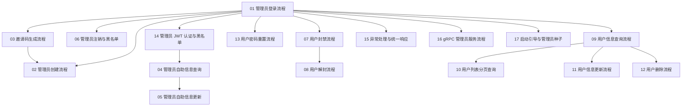

# admin 域 · 流程学习记录（索引）

> 本目录是 RAG-V1 **`service/users/admin`**（管理域 Spring Boot 进程）的真实执行流程讲解集。
> 总索引见 [`../README.md`](../README.md)。本文件是**本域**的索引与学习计划。

---

## 1. 本域文档集说明

| 项 | 内容 |
|---|---|
| 研究对象 | `service/users/admin/` —— 58 个主代码文件 + 4 个测试类 |
| 源码版本 | `/Users/pr/Documents/GitHub/RAG-V1` · `main` · 基线 commit `c665476` |
| 进程形态 | **一个** Spring Boot 进程同时起 Tomcat 与 gRPC Server（D1 + D7） |
| HTTP 端点 | **13 个**，全部 `@PostMapping`，前缀 `/admin/v1`（2 个 public + 11 个 JWT 受保护） |
| gRPC 服务 | `AdminService` —— `proto/src/main/proto/admin.proto` |
| 数据表 | `admin_admin` · `admin_invite` · 读 `users_user`（与 user 域**共用同一张物理表**） |
| 外部依赖 | PostgreSQL · Redis（黑名单）· Nacos（注册 `admin-rpc`） |
| 判定基准 | B 侧 RAG 仓（只读）—— L1/L2/L4 全部以 B 侧为准（D13 + D16） |

### 本域必须先知道的五件事

1. **admin 域与 user 域是「同表不同视角」的孪生域。**
   `users_user` 表被两个进程访问：admin 域管理它（封禁 / 改资料 / 删号 / 重置密码 / 列表查询），
   user 域自己管自己。两域**各自的 DTO / Mapper / Entity 互不复用**。

2. **admin 域的「用户身份」有两套。**
   管理员身份走 JWT claim（`userId` attribute → `AdminApiService` 解析），
   被管理的用户 uid 走 **请求体里的字符串 `uid`**（`@JsonProperty("uid") String uid`），
   由 `AdminApiService#parseUid` 解析。两者在同一个端点里并存，别混。

3. **admin 域**直接**读共享层**错误码表（`service/users/common/.../ErrCodes.java` / `ErrMsg.java`）；
   user 域读域内 `contract/ErrCodes.java` —— 但那是一份**薄转发层**（每个常量都转发自共享层那张表）。
   ⇒ **码值两边完全一致**，差别只在「以哪个类名访问」。读文档时注意出处。

4. **admin 的鉴权判据是「白名单 11 条路径」，不是 URI 前缀。**
   `AdminJwtAuthPaths.PROTECTED_PATHS` 是**枚举出来的 11 条路径**，
   未知路径（如 `/admin/v1/not-exist`）⇒ **放行** ⇒ 由路由层给 404（与 B 侧 `notFoundHandler` 同构）。
   这和 user 域用**前缀** `/user/v1/**` 判受保护是不同的。

5. **admin 域创建管理员走「悲观锁 + 事务」**（`AdminCreateAtomicService#createAdminAtomic`），
   事务内顺序是：`SELECT invite FOR UPDATE` → 校验邀请码 → 校验用户名 → bcrypt → insert admin → 标记邀请码已用。
   **bcrypt 必须在校验之后** —— 顺序本身就是行为契约（详见 [02](./02-管理员创建流程.md)）。

---

## 2. 学习顺序

```
  ①  01 管理员登录流程              ← 尺子：读完就知道主轴了
      │
      ├─► 03 邀请码生成流程          ← 产生 02 的输入
      │     └─► 02 管理员创建流程    ← 消费邀请码（含事务与悲观锁）
      │
      ├─► 04 管理员自助信息查询流程
      │     └─► 05 管理员自助信息更新流程
      │
      ├─► 06 管理员注销与黑名单流程
      │
      ├─► 07 用户封禁流程            ← 下面四篇都作用在 users_user 表上
      │     └─► 08 用户解封流程
      │
      ├─► 09 用户信息查询流程
      │     ├─► 10 用户列表分页查询流程
      │     ├─► 11 用户信息更新流程
      │     ├─► 12 用户删除流程
      │     └─► 13 用户密码重置流程
      │
  ②  14 管理员 JWT 认证与黑名单流程   ← 回头补上鉴权底座
      15 异常处理与统一响应流程
      │
  ③  16 gRPC 管理员服务流程          ← 换一个入口看同一份领域代码
      17 启动引导与管理员种子流程    ← 换一个生命周期维度看
```

**为什么 03 排在 02 前面**：邀请码是管理员创建的**前置输入**。
先看「码怎么来的」，再看「码怎么被消费」，事务边界和悲观锁才有上下文。

---

## 3. 流程文档索引

| 编号 | 文档名称 | 触发场景 | 主要入口 | 流程终点 | 前置知识 |
|---|---|---|---|---|---|
| 01 | [管理员登录流程](./01-管理员登录流程.md) | 管理员提交账号密码 | `AdminController#login` | 客户端拿到 JWT | HTTP 请求处理 |
| 02 | [管理员创建流程](./02-管理员创建流程.md) | 用邀请码创建管理员 | `AdminController#createAdmin` | 管理员落库 + 邀请码标记已用 | 01、03 |
| 03 | [邀请码生成流程](./03-邀请码生成流程.md) | 管理员生成邀请码 | `AdminController#createInviteCode` | 邀请码落库（10 分钟有效） | 01 |
| 04 | [管理员自助信息查询流程](./04-管理员自助信息查询流程.md) | 管理员查自己 | `AdminController#getSelf` | 返回 `admin` | 01 |
| 05 | [管理员自助信息更新流程](./05-管理员自助信息更新流程.md) | 管理员改自己资料 | `AdminController#updateSelf` | 返回 `success` + `admin` | 04 |
| 06 | [管理员注销与黑名单流程](./06-管理员注销与黑名单流程.md) | 管理员退出登录 | `AdminController#logout` | token 进黑名单 | 01 |
| 07 | [用户封禁流程](./07-用户封禁流程.md) | 管理员封禁用户 | `AdminController#banUser` | `users_user.status = 1` | 01 |
| 08 | [用户解封流程](./08-用户解封流程.md) | 管理员解封用户 | `AdminController#unBanUser` | `users_user.status = 0` | 07 |
| 09 | [用户信息查询流程](./09-用户信息查询流程.md) | 管理员查指定用户 | `AdminController#getUser` | 返回 `user` + `found` | 01 |
| 10 | [用户列表分页查询流程](./10-用户列表分页查询流程.md) | 管理员查用户列表 | `AdminController#getUserList` | 返回 `list` + `total` | 09 |
| 11 | [用户信息更新流程](./11-用户信息更新流程.md) | 管理员改用户资料 | `AdminController#updateUser` | 返回 `success` + `user` | 09 |
| 12 | [用户删除流程](./12-用户删除流程.md) | 管理员删除用户 | `AdminController#deleteUser` | 行被删除 | 09 |
| 13 | [用户密码重置流程](./13-用户密码重置流程.md) | 管理员重置用户密码 | `AdminController#resetUserPassword` | 密码被重置为**配置里的默认口令** | 01 |
| 14 | [管理员 JWT 认证与黑名单流程](./14-管理员JWT认证与黑名单流程.md) | 任意受保护路径 | `AdminJwtSignatureFilter` → `AdminJwtAuthInterceptor` | request attribute 就位 | 01 |
| 15 | [异常处理与统一响应流程](./15-异常处理与统一响应流程.md) | 任意异常或正常返回 | `AdminApiExceptionHandler` / `AdminApiResponseAdvice` | 最终 HTTP 响应 | 01 |
| 16 | [gRPC 管理员服务流程](./16-gRPC管理员服务流程.md) | 外部 gRPC 客户端调用 | `AdminGrpcService` | `StreamObserver` 响应 | 01、15 |
| 17 | [启动引导与管理员种子流程](./17-启动引导与管理员种子流程.md) | 进程启动 | `AdminServiceApplication` | 种子管理员就位 + Nacos 注册 | 01 |

---

## 4. 本域流程依赖关系



### 复用机制速查

| 机制 | 完整解释 | 用到它的流程 |
|---|---|---|
| JWT 验签 / claim 提取 | [14](./14-管理员JWT认证与黑名单流程.md) | 全部 11 个受保护端点 |
| 统一响应信封 + 两套 gRPC 码映射 | [15](./15-异常处理与统一响应流程.md) | 全部 |
| Redis 黑名单（写 / 读） | [06](./06-管理员注销与黑名单流程.md) 写 · [14](./14-管理员JWT认证与黑名单流程.md) 读 | 06、14 |
| 雪花 ID 生成 | [02](./02-管理员创建流程.md) | 02 |
| 悲观锁 + 事务边界 | [02](./02-管理员创建流程.md) §5 | 02 |
| `users_user` 表写入（封禁 / 更新 / 删除 / 改密） | [07](./07-用户封禁流程.md) · [11](./11-用户信息更新流程.md) · [12](./12-用户删除流程.md) · [13](./13-用户密码重置流程.md) | 07、08、11、12、13 |

---

## 5. 覆盖状态

| 编号 | 文档 | 状态 |
|---|---|---|
| 01 ~ 17 | 全部 | ✅ 已完成 |

> 「已完成」= 基于**实际读取过的源码**写成，文中定位可在仓库中核对。
> 与 B 侧的对拍结论以 `docs/DRIFT/users/admin/verification-admin-2026-11-02.md` 为准。

---

## 6. 本域源码速查

| 位置 | 路径 |
|---|---|
| 应用入口 | `service/users/admin/src/main/java/com/rag/admin/AdminServiceApplication.java` |
| Controller（13 端点） | `service/users/admin/src/main/java/com/rag/admin/controller/AdminController.java` |
| HTTP 用例 | `service/users/admin/src/main/java/com/rag/admin/service/AdminApiService.java` · `AdminApiSupport.java` · `AdminHelpers.java` · `AdminSpans.java` |
| 领域服务 | `service/users/admin/src/main/java/com/rag/admin/domain/service/AdminDomainService.java` · `AdminCreateAtomicService.java` |
| Mapper | `service/users/admin/src/main/java/com/rag/admin/mapper/AdminMapper.java` · `AdminInviteMapper.java` · `UserMapper.java` |
| 实体 | `service/users/admin/src/main/java/com/rag/admin/domain/entity/AdminEntity.java` · `AdminInviteEntity.java` · `UserEntity.java` |
| 鉴权 | `service/users/admin/src/main/java/com/rag/admin/interceptor/`（3 个类） |
| 响应 / 异常 | `service/users/admin/src/main/java/com/rag/admin/advice/`（2 个类） |
| gRPC | `service/users/admin/src/main/java/com/rag/admin/grpc/AdminGrpcService.java` |
| 启动 | `service/users/admin/src/main/java/com/rag/admin/wiring/`（4 个类，含 `AdminSeederBootstrap`） |
| 配置 | `service/users/admin/src/main/resources/application.yml` |
| 共享错误码 | `service/users/common/src/main/java/com/rag/users/common/ErrCodes.java` · `ErrMsg.java` |
| proto | `proto/src/main/proto/admin.proto` |
