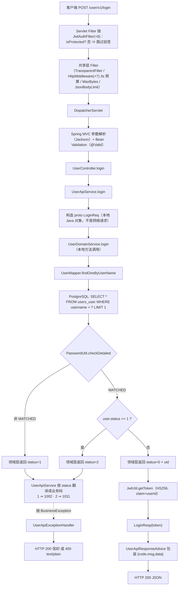
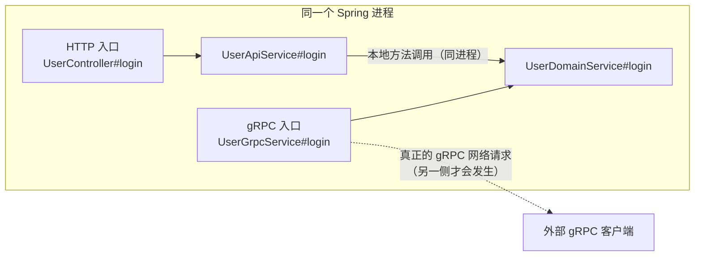
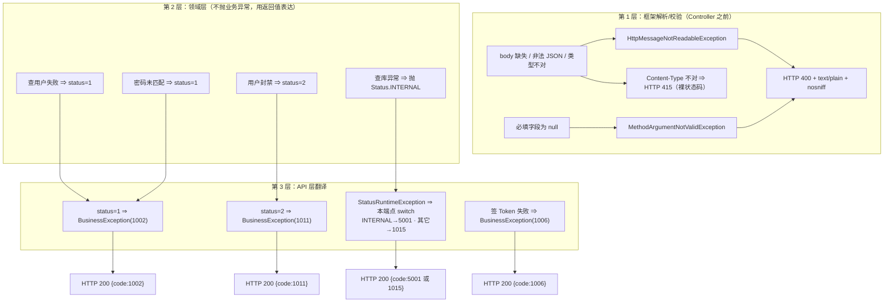
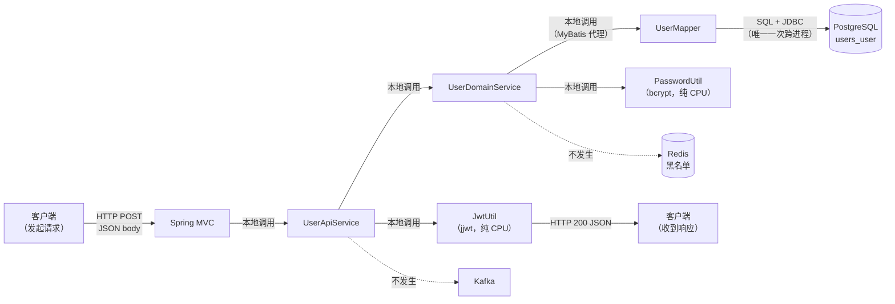

# 01. 用户登录流程

> 一次 `POST /user/v1/login` 从 HTTP 报文进来，到客户端手里拿到一个 JWT，中间到底发生了什么。
> 本文逐行对照本仓 `service/users/user/` 与 `common/` 的**真实源码**写成。

---

## 1. 本次流程的研究范围

我们追踪的是**一个具体的 HTTP 请求**，从 Tomcat 收到字节开始，到响应体写回客户端结束。

**追踪到哪儿为止**

- 完整追踪：`JwtAuthFilter` → `JwtAuthInterceptor` → `DispatcherServlet` 的参数解析与校验 →
  `UserController#login` → `UserApiService#login` → `UserDomainService#login` →
  `UserMapper#findOneByUserName` → PostgreSQL → `PasswordUtil#checkDetailed` →
  `JwtUtil#getToken` → `UserApiResponseAdvice` → 响应体。
- 失败分支也在对应位置展开：每一条失败都追到「HTTP 状态码 + 客户端看到的 body」为止。

**不追踪什么**

| 不追踪                               | 原因                                                               |
| --------------------------------- | ---------------------------------------------------------------- |
| 进程启动（Nacos 注册 / 建表 / workerId 解析） | 与本次请求无关；那是本域索引里《13 应用启动与初始化流程》的主题                                |
| gRPC 入口 `UserGrpcService` 的**执行** | 它是**另一个入口**，不是本次 HTTP 请求走过的一段路。§4.5 只用它来对照说明「proto 类型 ≠ gRPC 调用」 |
| JWT 的**验签**过程                     | 登录是 public 路径，根本不验签。验签是受保护路径的事                                   |
| 头像 / 更新 / 删除 / 注销                 | 其它端点                                                             |

**判定基准**：本仓行为以 B 侧 RAG 仓（只读）为唯一 oracle（D16）。本文只描述本仓源码里**读到的**行为；
凡是源码无法确认的，本文会直接写「源码无法确认」，不补造。

---

## 2. 触发场景与输入

客户端发送：

```
POST /user/v1/login
Content-Type: application/json

{
    "username": "alice",
    "password": "123456"
}
```

这次操作最终要完成三件事：

1. 确认 `username` 对应的用户在 `users_user` 表里存在；
2. 验证提交的密码与库里存的 bcrypt 哈希是否匹配，并确认用户没被封禁；
3. 验证通过后签发一个 HS256 的 JWT，把 Token 交给客户端。

这里先拆开两个容易混的概念：

- **密码验证成功 ≠ 登录流程结束**。领域层只回答「这个用户名+密码组合能不能登录」，不产出 Token。
- **领域层返回成功 ≠ 客户端拿到 Token**。中间还隔着一次 JWT 签发；签发失败照样是登录失败。

因为本项目把「密码校验」和「Token 签发」放在了**两个不同的方法**里（领域层 vs API 层）。

---

## 3. 整体执行路线



这张图是**导航图**，省略了若干框架内部步骤，也没有把所有异常路径画进去。下面逐环节展开。

---

## 4. 逐步讲解

### 4.1 请求是怎么走到 `UserController` 的？

涉及文件：

- `service/users/user/src/main/java/com/rag/user/interceptor/JwtAuthFilter.java`
- `service/users/user/src/main/java/com/rag/user/interceptor/JwtAuthInterceptor.java`
- `service/users/user/src/main/java/com/rag/user/config/WebMvcConfig.java`
- `service/users/user/src/main/java/com/rag/user/controller/UserController.java`

Spring MVC 的处理链大致是：

```
Tomcat 收到 HTTP 请求
  ↓
Servlet Filter 链（JwtAuthFilter、共享层的 TraceparentFilter / HttpMiddleware / MaxBytes / JsonBodyLimit …）
  ↓
DispatcherServlet（找到 @RequestMapping 匹配的 handler 方法）
  ↓
HandlerInterceptor.preHandle（JwtAuthInterceptor）
  ↓
参数解析（Jackson 反序列化 + Bean Validation）
  ↓
调用 Controller 方法
```

**Filter 在 `DispatcherServlet` 外面，Interceptor 在里面**。这个顺序决定了：JWT 验签发生在 3 秒 HTTP 预算**之外**，
黑名单检查发生在预算**之内**。`JwtAuthFilter` 上的 `@Order(Ordered.HIGHEST_PRECEDENCE + 6)`
（`JwtAuthFilter.java:71-73`）就是为这件事排的槽位。

### 4.2 为什么登录不需要 JWT？

`WebMvcConfig`（`WebMvcConfig.java:42-46`）把鉴权拦截器注册在 `/user/v1/**` 上：

```java
@Override
public void addInterceptors(InterceptorRegistry registry) {
    registry.addInterceptor(jwtAuthInterceptor)
            .addPathPatterns("/user/v1/**");
}
```

这句话只说明「**哪些路径会走进拦截器**」，不代表「这些路径都要验签」。
真正的放行判断在拦截器第一段（`JwtAuthInterceptor.java:72-79`）：

```java
@Override
public boolean preHandle(HttpServletRequest request, HttpServletResponse response, Object handler) {
    String uri = request.getRequestURI();

    // public 路径直接放行（与 Go 端 rest.AddRoutes(login, register) 不带 WithJwt 一致）
    if (JwtAuthPaths.isPublic(uri)) {
        return true;
    }
```

`JwtAuthPaths` 把公开路径写死成两个（`JwtAuthPaths.java:41-43`）：

```java
public static final Set<String> PUBLIC_PATHS = Set.of(
        "/user/v1/register", "/user/v1/login"
);
```

所以 `/user/v1/login` 命中 `isPublic` → 拦截器第一段就 `return true` 放行，
**不做验签、不查 Redis 黑名单、不写 `userId` / `jwt_token` 两个 request attribute**。

Filter 侧也是同一份判据（`JwtAuthFilter.java:99-116`）：

```java
HttpServletRequest request = (HttpServletRequest) req;
String uri = request.getRequestURI();
if (JwtAuthPaths.isProtected(uri)) {
    JwtVerificationResult result = verifier.verify(request.getHeader("Authorization"), uri);
    ...
}
chain.doFilter(req, resp);
```

`isProtected(uri)` 对 public 路径返回 false（`JwtAuthPaths.java:75-83`），所以 Filter 也直接跳过验签。

**要分清的两件事**：

- `addPathPatterns("/user/v1/**")` = 拦截器**会在哪些路径上执行**；
- `isPublic(uri)` = 拦截器对当前路径**是否执行身份验证**。

执行了拦截器 ≠ 一定要通过 JWT 验证。正因为有这层白名单，未登录的客户端才有机会调用登录接口。

### 4.3 JSON 怎么变成 `LoginReq`？

客户端发来的是 JSON 文本，但 Java 方法不能直接拿一段文本当业务对象用，所以 Controller 方法的参数是个 record
（`controller/UserController.java:102-105`）：

```java
@PostMapping("/login")
public LoginResp login(@Valid @RequestBody LoginReq req, HttpServletRequest httpRequest) {
    return userApiService.login(req, httpRequest);
}
```

DTO 本体（`dto/auth/LoginReq.java`）：

```java
public record LoginReq(
        @NotNull String username,
        @NotNull String password
) {
}
```

三个框架机制在这里依次发生：

**① `@RequestBody` + Jackson 反序列化**

Spring MVC 看到 `@RequestBody`，就用 `HttpMessageConverter` 读请求体，再交给 Jackson 把 JSON 变成 `LoginReq`。
共享层在 `JsonBodyConverterAutoConfiguration` 里给 Boot 的 `ObjectMapper` 施加了两条强转规则
（数字/布尔不许进 String 字段、浮点不许进整数字段），所以 `{"username": 1}` 会在**反序列化阶段**就失败。

**② `@Valid` + Bean Validation**

对象构造成功后，Spring 触发 Hibernate Validator，逐字段检查 `@NotNull`。

**③ `required` 的默认值是 `true`**

`@RequestBody` 不写 `required` 时默认就是 `true` ⇒ **空 body 会被判为「缺少必需的请求体」**，
Spring 抛 `HttpMessageNotReadableException`。

#### 为什么是 `@NotNull` 而不是 `@NotBlank`？

两者约束不一样：

| 注解 | 约束 |
|---|---|
| `@NotNull` | 值不能是 `null` |
| `@NotBlank` | 不能是 `null`，且不能是空串或纯空白 |

本项目用 `@NotNull` ⇒ **空串 `""` 是合法输入**。

这不是疏忽。真源侧的必填判定（`GoStyleRequired.field(...)`）**只判 null**，不判空串，
所以 Java 侧必须用 `@NotNull` 才能逐条等价。如果有人看到「密码字段」就顺手改成 `@NotBlank`，
接口行为就变了 —— 空串密码会从「能进业务层」变成「被 400 挡掉」。

#### 三种「请求体有问题」要分清

```
body 缺失 / 不是 JSON / 字段类型不对
    ⇒ Jackson 阶段失败
    ⇒ HttpMessageNotReadableException
    ⇒ UserApiExceptionHandler#handleUnreadableBody
    ⇒ HTTP 400 + text/plain + nosniff

body 是合法 JSON（{} 或 {"username":"a"}），但必填字段是 null
    ⇒ Bean Validation 失败
    ⇒ MethodArgumentNotValidException
    ⇒ UserApiExceptionHandler#handleBeanValidation
    ⇒ HTTP 400 + text/plain + nosniff

Content-Type 不是 application/json
    ⇒ HttpMediaTypeNotSupportedException
    ⇒ HTTP 415（裸状态码，无 body）
```

前两种最终都是 **400 + `text/plain`**，不是 200 + JSON 信封。详见 §5。

### 4.4 Controller 为什么还要调 `UserApiService`？

Controller 只做三件事：接 HTTP 参数、调业务、返回业务结果。它不查库、不碰密码、不签 Token。

分工可以这样理解：

```
Controller      处理 HTTP 入口（路由、反序列化、校验）
UserApiService  组织 HTTP API 层业务流程（把领域结果翻译成 API 结果）
UserDomainService 执行用户领域逻辑（查用户、校验密码、判断封禁）
```

`login` 方法还多传了一个 `HttpServletRequest`：

```java
return userApiService.login(req, httpRequest);
```

登录成功路径上**并不用它取 uid**（uid 来自领域层返回的 `rpcResp.getUid()`）。它是给需要从请求上下文取信息的端点准备的
（例如 `logout` 要从 `httpRequest.getAttribute("jwt_token")` 取 token）。
不要因为参数存在，就认定它一定参与了每个步骤。

### 4.5 `UserApiService#login`：DTO → proto，以及「为什么这不是 gRPC 调用」

`service/UserApiService.java:100-108`：

```java
public LoginResp login(com.rag.user.dto.auth.LoginReq req, HttpServletRequest httpRequest) {
    com.rag.proto.user.LoginReq rpcReq = com.rag.proto.user.LoginReq.newBuilder()
            .setUsername(req.username() == null ? "" : req.username())
            .setPassword(req.password() == null ? "" : req.password())
            .build();

    com.rag.proto.user.LoginResp rpcResp;
    try {
        rpcResp = userDomainService.login(rpcReq);
```

`null → ""` 的处理是**防御性**的：正常情况下经过 `@Valid` 的请求不会带 null 字段，
但 proto3 的 `string` 字段不接受 `null`（传 null 会抛 NPE），所以这层兜底必须保留。

#### 这里有两套 `LoginReq`

| 类型 | 归属 | 用途 |
|---|---|---|
| `com.rag.user.dto.auth.LoginReq` | HTTP API 层的 DTO（record） | 承接 Jackson 反序列化 + Bean Validation |
| `com.rag.proto.user.LoginReq` | 根级 `proto/` 模块生成的 protobuf 消息 | 领域层与 gRPC 入口共用的参数类型 |

它们**不是同一个类型**，字段名相同但完全无关。HTTP DTO 的访问器是 `req.username()`（record 分量），
proto 的访问器是 `req.getUsername()`（protobuf 生成）—— 本仓第一轮实现就踩过这个坑
（把 proto 类型当 HTTP 入参，直接编译失败）。

proto 侧的消息定义（`proto/src/main/proto/users.proto:40-48`）：

```protobuf
message LoginReq {
  string username = 1;
  string password = 2;
}

message LoginResp {
  int64 uid = 1;
  uint64 status = 2;
}
```

#### 🔴 为什么类型是 proto，却**不是**一次 gRPC 网络请求

这是本文最容易被误读的一点，单独讲清楚。

看这行代码：

```java
rpcResp = userDomainService.login(rpcReq);
```

`userDomainService` 是**通过构造器注入到 `UserApiService` 里的一个普通 Spring Bean**
（`UserApiService.java:65` 声明字段，`UserApiService.java:70-78` 构造器注入）。
`userDomainService.login(rpcReq)` 就是**一次普通的 Java 方法调用**：
同进程、同线程、同堆内存，没有序列化、没有 channel、没有网络往返。

判断依据（源码可见）：

- 调用点上**没有** `ManagedChannel`、没有 Stub（`UserServiceGrpc` 的 blocking stub 或 future stub）、
  没有目标地址、没有 `withDeadlineAfter`；
- `UserDomainService` 是 `@Service`（`UserDomainService.java:100-101`），被容器直接注入到 API 层；
- 本仓的 user 域**没有任何跨域 gRPC 客户端**：`application.yml` 里 `grpc.client: {}`（`application.yml:87-94`）
  明确写着「本域无跨域 gRPC 调用」。

那为什么还要用 proto 类型？两个原因：

1. **B 侧的形状**：真源里 api 进程通过 gRPC 调 rpc 进程，两边传的就是 protobuf 消息。
   本仓按决策 **D1 + D7** 把 api/rpc 压成**一个进程**，于是「同进程直连」替代了「跨进程 gRPC」，
   但**参数类型保持不变** —— 改动只落在「怎么传」，不落在「传什么」。
2. **一套类型两个入口共用**：`grpc/UserGrpcService.java:86-110` 的 `login` 方法是**另一个入口**，
   它也调**同一份** `userDomainService.login(request)`：

   ```java
   @GrpcService
   public class UserGrpcService extends UserServiceGrpc.UserServiceImplBase {

       @Override
       public void login(LoginReq request, StreamObserver<LoginResp> responseObserver) {
           try {
               LoginResp resp = userDomainService.login(request);
               responseObserver.onNext(resp);
               responseObserver.onCompleted();
           } catch (StatusRuntimeException e) {
               ...
           }
       }
   ```

所以正确的结构图是：



**结论**：proto 类型只说明「数据格式」，不说明「传输方式」。
判断是不是网络请求，要看**调用点上有没有 channel / stub / 地址**，不能看参数类型。

顺带一提：这也解释了为什么**领域层抛的是 `io.grpc.StatusRuntimeException`** ——
它在真源里就是 gRPC 异常，本仓保留了这个类型，API 层照抄真源的 `catch` 与映射表。

### 4.6 `UserDomainService#login`：W1 查用户

领域层入口（`domain/service/UserDomainService.java:161-167`）：

```java
public LoginResp login(LoginReq req) {
    Span span = tracer.spanBuilder("Action-User-Login")
            .setAttribute("biz.username", req.getUsername())
            .startSpan();
    Context otelCtx = Context.current().with(span);
    try {
        checkDeadline();
```

**OpenTelemetry Span**：`tracer` 是 `GlobalOpenTelemetry.getTracer("user-rpc")`（`UserDomainService.java:127`）。
这段代码**不参与业务判断**，它的作用是给这次登录操作记一条追踪（span 名字 `Action-User-Login`，
属性 `biz.username`）。

**`checkDeadline()`**（`UserDomainService.java:140-146`）：

```java
private void checkDeadline() {
    if (Thread.currentThread().isInterrupted() || DeadlineState.isExpired()) {
        throw Status.DEADLINE_EXCEEDED
                .withDescription("rpc deadline reached")
                .asRuntimeException();
    }
}
```

两个条件：

- `Thread.currentThread().isInterrupted()` —— 当前线程被中断；
- `DeadlineState.isExpired()` —— 线程上绑定了 RPC deadline 且已过期。

⚠️ **在本条 HTTP 路径上，`DeadlineState` 是没有绑定的**：`DeadlineState.isExpired()` 在未绑定时返回 `false`
（`DeadlineState.java:109-114`：`d != null && ...`），而绑定动作 `bindToCurrent(...)` 发生在 **gRPC** 服务端拦截器里
（`common/observability/RpcHandleRunner.java:121`）。HTTP 侧的 3 秒预算是共享层 `HttpMiddleware` 用另一套机制实现的
（把链条丢到 worker 线程 + 预算计时），**不写 `DeadlineState`**。

⇒ 所以在 HTTP 登录路径上，`checkDeadline()` 实际上只会因「线程被中断」而抛，
`DEADLINE_EXCEEDED` 这条异常在 HTTP 路径上**不会**被触发（它属于 gRPC 入口的失败分支）。
这正是「同一份领域代码、两个入口、环境不同」的一个好例子。

真正的查库在 W1（`UserDomainService.java:169-172`）：

```java
UserEntity user;
try {
    checkDeadline();
    user = userMapper.findOneByUserName(req.getUsername());
```

#### `findOneByUserName` 是 Mapper 上的 `default` 方法

`mapper/UserMapper.java:53-59`：

```java
default UserEntity findOneByUserName(String username) {
    UserEntity u = selectByUsernameRaw(username);
    if (u == null) {
        throw new NotFoundException("user not found by username: " + username);
    }
    return u;
}
```

它调用的 `selectByUsernameRaw` 才是真正写 SQL 的地方（`UserMapper.java:40-45`）：

```java
@Select("SELECT * FROM users_user WHERE username = #{username} LIMIT 1")
@Results({
        @Result(property = "extraInfo", column = "extra_info",
                javaType = java.util.Map.class, typeHandler = JsonTextTypeHandler.class)
})
UserEntity selectByUsernameRaw(@Param("username") String username);
```

几个细节：

- **`#{username}`** 是 MyBatis 的**预编译占位符**（`?`），不是字符串拼接 ⇒ 无 SQL 注入面。
- **`LIMIT 1`**：即使 `username` 列上有唯一约束，也只取一行。
- **`@Results` 是必须的**：`extra_info` 是 `text` 列（`db/01_create_user.sql:41`），
  MyBatis 不认识 MyBatis-Plus 的 `@TableField`，所以**手写 SQL 必须显式声明 TypeHandler**，
  否则 `extraInfo` 会**静默变成 null**（不报错）。实体上那个 `@TableField(typeHandler = ...)` 只对 MP 自己生成的 SQL 生效。
- **表结构**（`db/01_create_user.sql:33-44`）：

  ```sql
  CREATE TABLE IF NOT EXISTS users_user (
      id          BIGSERIAL PRIMARY KEY,
      uid         BIGINT NOT NULL UNIQUE,
      username    TEXT UNIQUE,
      password    TEXT,
      email       TEXT UNIQUE,
      status      BIGINT NOT NULL DEFAULT 0,
      score       INTEGER,
      extra_info  TEXT,
      create_time TIMESTAMPTZ DEFAULT CURRENT_TIMESTAMP,
      update_time TIMESTAMPTZ DEFAULT CURRENT_TIMESTAMP
  );
  ```

  `username` 上有 UNIQUE 约束，所以「查不到」只可能是真不存在（不会有多行）。

#### 「用户不存在」为什么不直接返回 `null`？

因为本项目把「用户不存在」当成一个**明确的业务情况**，而不是让每个调用者各自判 `null`。
这叫「**error 不是值**」（详见本域索引《02 用户注册流程》里同一个设计在查重场景的用法）。

于是 Mapper 层抛 `NotFoundException`（`exception/UserExceptions.java:32-37`），
领域层在 W1 的第一个 catch 里接住（`UserDomainService.java:179-183`）：

```java
} catch (NotFoundException e) {
    // 用户不存在 → Status=1（D-002：和密码错共用同一个状态码）
    metrics.getLoginUserNotFound().increment();
    logger.logInfo(otelCtx, "login failed : user not found,username : " + req.getUsername());
    return LoginResp.newBuilder().setStatus(1L).build();
}
```

**注意这里没有抛异常，而是返回一个正常的 `LoginResp`。**

#### 🔴 为什么用户不存在不抛 gRPC NOT_FOUND？

因为本登录业务**刻意把两种情况合并**：

- 用户名不存在；
- 用户名存在，但密码错误。

两种都返回 `status = 1`。这样外部调用者**无法只凭登录结果判断某个用户名是否真实存在** ⇒ 减少用户名枚举风险。

所以要分清三层：

| 层 | 「用户不存在」是什么 |
|---|---|
| Mapper 层 | 查询结果为 null ⇒ 抛 `NotFoundException` |
| 领域层 | 识别出的业务状态 ⇒ 转成 `LoginResp.status = 1`（**不是** gRPC 异常） |
| API 层 | 看到 `status == 1` ⇒ 抛 `BusinessException(1002)` |

### 4.7 W2：密码比对

`UserDomainService.java:199-215`：

```java
// W2 密码比对
checkDeadline();
PasswordUtil.Outcome pwOutcome =
        PasswordUtil.checkDetailed(req.getPassword(), user.getPassword());
if (pwOutcome != PasswordUtil.Outcome.MATCHED) {
    // B 侧 DRIFT-004（已修，用户签字）：hash 格式非法时 Go 同样报密码错，对外行为逐字一致；
    // 但 B 侧额外留一道信号 —— Go 侧这一路完全静默。
    if (pwOutcome == PasswordUtil.Outcome.MALFORMED_HASH) {
        span.setAttribute("auth.malformed_hash", true);
        logger.logBusinessErr(otelCtx, ErrCodes.ERROR_REQUEST_PARAM,
                new IllegalArgumentException(
                        "stored bcrypt hash is malformed (username=" + req.getUsername() + ")"));
    }
    metrics.getLoginInternalError().increment();
    logger.logInfo(otelCtx, "login failed: username or password incorrect,username : " + req.getUsername());
    return LoginResp.newBuilder().setStatus(1L).build();
}
```

两个入参：

| 参数 | 来源 | 含义 |
|---|---|---|
| `req.getPassword()` | HTTP 请求（proto） | 用户本次提交的**明文**密码 |
| `user.getPassword()` | 数据库查询结果 | 数据库里存的 **bcrypt 哈希** |

**这里不是把两个字符串直接比。** `PasswordUtil.checkDetailed` 跑的是 bcrypt 校验（`common/security/PasswordUtil.java:99-105`）：

```java
public static Outcome checkDetailed(String rawPassword, String dbHash) {
    try {
        return ENCODER.matches(rawPassword, dbHash) ? Outcome.MATCHED : Outcome.MISMATCHED;
    } catch (RuntimeException e) {
        return Outcome.MALFORMED_HASH;
    }
}
```

`ENCODER` 是 `new BCryptPasswordEncoder(10)`（`PasswordUtil.java:48-49`，`STRENGTH = 10`）。

#### 三个 `Outcome` 各自的含义

`PasswordUtil.java:59-71`：

| `Outcome` | 触发条件 | 对外表现 |
|---|---|---|
| `MATCHED` | 哈希合法且密码匹配 | 继续往下走 |
| `MISMATCHED` | 哈希结构合法，但密码不匹配（绝大多数失败） | `status = 1` |
| `MALFORMED_HASH` | 哈希本身非法（实测触发形态：cost 字段越界，如 `$2a$99$...`） | `status = 1`（对外一样） |

**`MALFORMED_HASH` 有内部信号、对外没差别**：它会额外在 span 上打一个属性 `auth.malformed_hash = true`，
再写一条 `ERROR_REQUEST_PARAM`(1017) 的业务错误日志。但**客户端看到的仍然是 `status = 1`**，
不会把「数据库里的哈希被写坏了」暴露成另一种登录结果。

⇒ 也就是说：**密码错**和**哈希损坏**在登录语义上被统一成「登录失败」，但内部仍留了诊断信号。

> 顺带一个容易看错的点：`metrics.getLoginInternalError().increment()` 在**密码不匹配**时也会 +
> 1（它在 `if` 块里、无条件执行）⇒ 所以「密码打错」会让 `user_rpc_login_total{result="internal_error"}` 增长。
> 这个指标名有点误导，但它是真源照抄的结果。

### 4.8 W3：封禁检查（含 `status = 0L` 这个坑）

`UserDomainService.java:217-229`：

```java
// W3 封禁检查
if (user.getStatus() != null && user.getStatus() == 1L) {
    // 用户被封禁 → Status=2（无 metrics，与 Go 端一致）
    logger.logInfo(otelCtx, "login failed: user banned, username :  " + req.getUsername());
    return LoginResp.newBuilder().setStatus(2L).build();
}
```

业务约定：`status = 1` 表示用户被封禁，其它值不因这条判断而被认定为封禁。

#### 🔴 `!= null` 这一半在实现里**恒为真**

先看实体（`domain/entity/UserEntity.java:82-83`）：

```java
@TableField("status")
private Long status = 0L;
```

字段**有初始化值 `0L`**。再看 MyBatis 的映射规则：MyBatis 的 `DefaultResultSetHandler` 在
「取到的列值为 `null` 且 `callSettersOnNulls == false`（默认值）」时**跳过 setter**。

⇒ 于是：**数据库里 `status` 是 `NULL` 的行，读出来是 `0L`，不是 `null`。**

（DDL 里 `status BIGINT NOT NULL DEFAULT 0`（`db/01_create_user.sql:39`），所以正常写入的行不会是 NULL；
但历史数据、手工改库、或从别的库同步过来的行可能是 NULL —— 这条判定的行为对它们依然要说得清。）

所以 `user.getStatus() != null` 这一半**恒为真**，真正的判据只有 `== 1L`：

| DB 里 `status` | 实体读出来 | `!= null` | `== 1L` | 结论 |
|---|---|---|---|---|
| `0` | `0L` | true | false | 未封禁 ⇒ 放行 |
| `1` | `1L` | true | **true** | **封禁 ⇒ status=2** |
| `NULL` | `0L`（setter 被跳过，初始化值留下） | true | false | 未封禁 ⇒ **放行** |

⇒ **不能**把 `user.getStatus() == null` 读成「数据库里的 status 一定是 NULL」。
真源侧（GORM + `database/sql`）对 NULL 的处理也是「读成 0」，两侧行为一致。

> 这条 `!= null` 保留着是为了与真源的类型形态对齐（真源那边是 int64，不存在 null）。
> 源码里的注释也明说了「不要再把这行读成『status 为 NULL 就当没封禁』的 fail-open 缺陷」——
> 真源走的**正是**「NULL ⇒ 0 ⇒ `status == 1` 判 false ⇒ 放行」这条路径。

另外注意：**封禁分支没有埋点**（源码注释写「无 metrics，与 Go 端一致」）。

### 4.9 W4：成功

`UserDomainService.java:231-240`：

```java
// W4 成功
metrics.getLoginSuccess().increment();
logger.logInfo(otelCtx, "login success,username : " + req.getUsername());
return LoginResp.newBuilder()
        .setUid(user.getUid())
        .setStatus(0L)
        .build();
} finally {
    span.end();
}
```

返回的 proto `LoginResp` 带两个字段：

- `uid` —— 用户的业务 ID（来自 `users_user.uid`）；
- `status = 0` —— 领域层登录成功。

**到这里还没有 Token。** 领域层的任务结束了，它返回的是**领域登录结果**，不是最终的 HTTP 登录响应。

`finally { span.end(); }` 保证无论走哪条分支（成功 / 用户不存在 / 密码错 / 封禁 / 抛异常），
OpenTelemetry span 都会被结束 —— 这是 Java 的 `finally` 语义。

### 4.10 回到 `UserApiService`：三态 → 业务码

控制流回到 `UserApiService#login`。领域层的三态在这里被翻译成 HTTP 层能懂的东西（`UserApiService.java:126-138`）：

```java
// rpcResp.Status == 1 → 密码错或用户不存在（rpc 不区分）
if (rpcResp.getStatus() == 1L) {
    metrics.getLoginWrongPassword().increment();
    log.info("login failed : wrong password,username : {}", req.username());
    throw new BusinessException(ErrCodes.ERROR_LOGIN_WRONG, ErrMsg.getMsg(ErrCodes.ERROR_LOGIN_WRONG));
}

// rpcResp.Status == 2 → 用户封禁（DB status=1）
if (rpcResp.getStatus() == 2L) {
    metrics.getLoginUserBanned().increment();
    log.info("login failed : user banned,username : {}", req.username());
    throw new BusinessException(ErrCodes.ERROR_USER_BANNED, ErrMsg.getMsg(ErrCodes.ERROR_USER_BANNED));
}
```

| 领域层 `status` | 含义 | API 层动作 | 业务码 | 文案 |
|---|---|---|---|---|
| `1` | 用户不存在 **或** 密码错 | `throw BusinessException` | `1002` (`ERROR_LOGIN_WRONG`) | 用户名或密码错误 |
| `2` | 用户被封禁 | `throw BusinessException` | `1011` (`ERROR_USER_BANNED`) | 用户已被封禁 |
| `0` | 成功 | 继续签发 JWT | — | — |

⚠️ **注意这段写法的形状**：它是「**不是 1、不是 2，就往下走**」——
**没有显式写 `if (status == 0)`**。领域层只会返回 0/1/2，所以这个隐含的 else 恰好等价于「成功」；
但如果你只看这段代码，是看不出「显式判断成功」这层语义的。

⚠️ 另一个容易看错的点：`metrics.getLoginWrongPassword()` 在 **`status == 1`** 时递增 ——
而 `status == 1` 同时覆盖了「用户不存在」和「密码错」两种情况。
所以指标 `user_api_intercept_total{path="/user/login",result="wrong_password"}`
**也会被「用户不存在」触发**。指标名字有点窄，行为是对的。

**为什么领域层不直接生成 Token？**
领域层只负责「这个用户能不能登录」；API 层负责「把领域结论变成 API 要的结论」。
JWT 的密钥、过期时间这些是**HTTP 层的配置**（`UserApiProperties`），领域层不持有。

### 4.11 JWT 是怎么签发的？

`UserApiService.java:140-151`：

```java
// 签发 JWT —— 与 Go jwt.GetToken(secret, now, expire, uid) 1:1
long nowSec = System.currentTimeMillis() / 1000L;
long expireSec = properties.getUserAuth().getAccessExpire();
String accessSecret = properties.getUserAuth().getAccessSecret();
String token;
try {
    token = JwtUtil.getToken(accessSecret, nowSec, expireSec, rpcResp.getUid());
} catch (Throwable t) {
    metrics.getLoginTokenError().increment();
    log.error("generate token failed : {}", t.getMessage(), t);
    throw new BusinessException(ErrCodes.ERROR_TOKEN_RUNTIME, ErrMsg.getMsg(ErrCodes.ERROR_TOKEN_RUNTIME));
}
```

**四个输入**：

| 输入 | 来源 | 说明 |
|---|---|---|
| `nowSec` | `System.currentTimeMillis() / 1000L` | 签发时刻（秒） |
| `expireSec` | `properties.getUserAuth().getAccessExpire()` | 有效期（秒） |
| `accessSecret` | `properties.getUserAuth().getAccessSecret()` | HMAC 签名密钥 |
| `rpcResp.getUid()` | 领域层返回 | 当前用户 uid |

**密钥与过期时间从哪来？**

配置类 `config/UserApiProperties.java:38-44`：

```java
@ConfigurationProperties(prefix = "user-api")
public class UserApiProperties {

    private String name = "user-api";

    @NestedConfigurationProperty
    private UserAuth userAuth = new UserAuth();
```

`@ConfigurationProperties(prefix = "user-api")` 把 yml 里的 `user-api.*` 段绑到这个对象上。
对应 `src/main/resources/application.yml:57-60`：

```yaml
user-api:
  user-auth:
    access-secret: ${USER_JWT_SECRET}
    access-expire: ${USER_JWT_EXPIRE:2592000}    # 30 天，与 B 侧 etc/user.yaml 一致
```

- `access-secret` **没有默认值** ⇒ 环境变量 `USER_JWT_SECRET` 没设时，绑上去的是**占位符字面量** `"${USER_JWT_SECRET}"`；
- `access-expire` 默认 `2592000` 秒 = 30 天。

这个密钥**不是可选项**。`UserApiProperties` 里有一段启动期强制检查（`UserApiProperties.java:70-83`）：

```java
@PostConstruct
void verifyAccessSecret() {
    String secret = userAuth == null ? null : userAuth.getAccessSecret();
    if (secret == null || secret.isBlank()) {
        throw new IllegalStateException(
                "user-api.user-auth.access-secret 不能为空：请设置环境变量 USER_JWT_SECRET（与 user-rpc 共享同一把签发密钥）"
                        + "—— 本模块既签发又验签，空密钥会让任何人都能伪造 JWT");
    }
    if (secret.contains("${")) {
        throw new IllegalStateException(
                "user-api.user-auth.access-secret 仍是未解析的占位符（" + secret + "）：请设置环境变量 USER_JWT_SECRET"
                        + "—— 占位符字面量是公开在仓里的常量，拿它当密钥 = 密钥公开");
    }
}
```

两条 fail-closed：**空串** ⇒ 启动失败；**仍是未解析的占位符** ⇒ 启动失败。
后者必须单独判，因为 Spring 的占位符解析器在解析不出来时会把原文留下（`ignoreUnresolvablePlaceholders = true`），
光判「null / 空串」堵不住这条路。

#### 签发本身

`common/security/JwtUtil.java:31-48`：

```java
public static String getToken(String secretKey,
                              long iat,
                              long seconds,
                              long userId) {
    SecretKeySpec key = new SecretKeySpec(padToHmacKeySize(secretKey), "HmacSHA256");
    return Jwts.builder()
            .header().add("typ", "JWT").and()
            .issuedAt(new Date(iat * 1000L))
            .expiration(new Date((iat + seconds) * 1000L))
            .claim("userId", userId)
            .signWith(key, Jwts.SIG.HS256)
            .compact();
}
```

要点：

- **算法钉死 HS256**：JCA 算法名写成 `HmacSHA256`，签名算法写成 `Jwts.SIG.HS256`。
  源码注释解释了原因：jjwt 的 `signWith(Key)` 单参重载会**照着 key 的 JCA 算法名选算法**，
  密钥长度漂移时 `header.alg` 会跟着漂 ⇒ 两处都钉死。
- **claim 名 = `userId`**（`JwtUtil.java:45`）。这是 L1 契约：受保护端点从 token 里取的就是这个 claim。
- **`iat` / `exp`**：`iat` 是签发时刻，`exp = iat + seconds`。
- **密钥补齐**：`padToHmacKeySize`（`JwtUtil.java:102-111`）把不足 32 字节的密钥**补零**到 32 字节，
  因为 jjwt 0.12 强制要求 HMAC key ≥ 256 bit。补零不破坏与真源的互通（HMAC 本身就会把短于分组长度的密钥零填充）。

**签发失败怎么办？** `catch (Throwable t)` 把任何异常（密钥不合法、jjwt 内部错误……）都收敛成
`BusinessException(ERROR_TOKEN_RUNTIME)` = 业务码 `1006`，文案 `TOKEN已过期`。

⇒ **Token 生成失败不会被当作登录成功**，也不会返回半成品 token。

签发成功后（`UserApiService.java:153-156`）：

```java
metrics.getLoginSuccess().increment();
log.info("login success,username : {}", req.username());

return new LoginResp(token);
```

⚠️ 注意 **API 层的 `loginSuccess` 计数在 JWT 签发成功之后才 +1**，
而**领域层的 `loginSuccess` 在 W4 就 +1 了**（还没签 Token）。
⇒ 如果 JWT 签发失败：`user_rpc_login_total{result="success"}` 增长了，但
`user_api_intercept_total{path="/user/login",result="success"}` **不增长**。两个指标的口径本来就不同。

### 4.12 `LoginResp` 怎么变成 HTTP JSON？

`UserApiService` 返回 `new LoginResp(token)`（`dto/auth/LoginResp.java`）：

```java
public record LoginResp(
        String token
) {
}
```

它逐层返回到 Controller，**但客户端收到的 JSON 不止是 `{"token":"..."}`**。

因为 `advice/UserApiResponseAdvice.java:42-49` 注册了一个全局 `ResponseBodyAdvice`：

```java
@RestControllerAdvice
public class UserApiResponseAdvice implements ResponseBodyAdvice<Object> {

    @Override
    public boolean supports(MethodParameter returnType, Class<? extends HttpMessageConverter<?>> converterType) {
        // 拦截所有 Controller 返回值；Controller 自己抛异常由 UserApiExceptionHandler 处理
        return true;
    }
```

`ResponseBodyAdvice` 是 Spring MVC 的扩展点：**Controller 返回值写入响应体之前**会被它过一道。
`supports` 恒返回 `true` ⇒ 所有 Controller 返回值都走包装。

真正包装的地方（`UserApiResponseAdvice.java:52-75`）：

```java
@Override
public Object beforeBodyWrite(Object body, MethodParameter returnType, MediaType selectedContentType,
                              Class<? extends HttpMessageConverter<?>> selectedConverterType,
                              ServerHttpRequest request, ServerHttpResponse response) {
    if (body == null || body instanceof ApiResponse) {
        return body;
    }
    if (selectedContentType != null
            && !MediaType.APPLICATION_JSON.isCompatibleWith(selectedContentType)) {
        return body;
    }
    return new ApiResponse(ErrCodes.SUCCESS, ErrMsg.getMsg(ErrCodes.SUCCESS), body);
}
```

两个「不包装」的守卫，各有各的理由：

- **`body == null || body instanceof ApiResponse`**：异常处理器返回的 `ResponseEntity<ApiResponse>` 的 body 已经是信封了。
  再包一层会变成 `{"code":200,"msg":"OK","data":{"code":1002,"msg":"用户名或密码错误","data":null}}` ——
  顶层 `code` 恒为 200，所有按 `code != 200` 判定失败的客户端会**全部失效**。
- **非 JSON 响应原样透传**：判定条件是「这次写出的到底是不是 JSON」，而不是「body 是不是 String」。
  这样 405 / 415 这类同样走 `text/plain` 的分支才不会被误包。

最终成功响应：

```json
{
    "code": 200,
    "msg": "OK",
    "data": {
        "token": "eyJ0eXAiOiJKV1QiLCJhbGciOiJIUzI1NiJ9..."
    }
}
```

`data` 里才是原来的 `LoginResp`。信封本体是 `common/contract/ApiResponse.java` 的三个字段
`code` / `msg` / `data`，**没有 `@JsonInclude`** ⇒ `data` 为 null 时键仍然存在（`"data":null`）。

---

## 5. 重要分支与失败路径

### 5.1 全失败分支速查

| 发生位置 | 触发条件 | 领域层返回 / 抛出 | API 层转成 | HTTP 状态码 | 客户端看到的 body |
|---|---|---|---|---|---|
| 参数解析 | body 缺失 / 非 JSON / 字段类型不对 | （没进业务层） | — | **400** | `text/plain` 裸文案 + `nosniff` |
| 参数校验 | `username` 或 `password` 为 `null`（含 `{}`） | （没进业务层） | — | **400** | `text/plain` 裸文案 + `nosniff` |
| Content-Type | 不是 `application/json` | （没进业务层） | — | **415** | 空 body |
| 查用户 | 用户名不存在 | `status = 1`（正常返回） | `BusinessException(1002)` | **200** | `{"code":1002,"msg":"用户名或密码错误","data":null}` |
| 密码比对 | 密码不匹配 | `status = 1` | `BusinessException(1002)` | **200** | 同上 |
| 密码比对 | 库里哈希格式非法 | `status = 1`（+ span 属性 + 业务错误日志） | `BusinessException(1002)` | **200** | 同上（**不暴露**哈希损坏） |
| 封禁检查 | `users_user.status = 1` | `status = 2` | `BusinessException(1011)` | **200** | `{"code":1011,"msg":"用户已被封禁","data":null}` |
| 查库 | 数据库异常 | 抛 `Status.INTERNAL` | `BusinessException(5001)` | **200** | `{"code":5001,"msg":"系统内部错误","data":null}` |
| 签 Token | jjwt 抛异常 | — | `BusinessException(1006)` | **200** | `{"code":1006,"msg":"TOKEN已过期","data":null}` |
| HTTP 方法 | 用 GET 打这个端点 | — | — | **405** | 空 body（裸状态码） |

### 5.2 三层失败翻译的总图

把 §5.1 的表画出来，就是这张图 —— 注意**每一层的形状都不同**：



⇒ 三层里，**只有第 1 层会返回非 200 的状态码**；
第 2、3 层都是「HTTP 200 + 信封里的 `code` 表达成败」。

### 5.3 「用户不存在」与「密码错」为什么客户端分不出来？

这是**故意**的。领域层把两者都收敛成 `status = 1`，API 层再统一收敛成 `1002`。

客户端能观察到的差异只有**时间**：密码错要多跑一次 bcrypt（cost=10），
用户不存在不用跑。（⚠️ 两者的时间差有多大，是 bcrypt cost 的通用属性，**本仓没有对应测量**。）
如果要靠响应时间区分用户名是否存在，这个「合并」就被抵消了 ——
但那是真源侧同样存在的特性，本仓照抄，不额外加固。

### 5.4 两条 gRPC → 业务码映射并存（登录端点走哪一套）

`UserApiService#login` 自己写了一个 switch（`UserApiService.java:112-123`）：

```java
// 1:1 对齐 B 侧 LoginLogic 的 switch (e.getStatus().getCode())：
//   codes.Internal → ErrorServerCommon (5001)
//   其它（default）→ CodeServerBusy    (1015)
io.grpc.Status.Code code = e.getStatus().getCode();
if (code == io.grpc.Status.Code.INTERNAL) {
    throw new BusinessException(
            ErrCodes.ERROR_SERVER_COMMON,
            ErrMsg.getMsg(ErrCodes.ERROR_SERVER_COMMON));
}
throw new BusinessException(
        ErrCodes.CODE_SERVER_BUSY,
        ErrMsg.getMsg(ErrCodes.CODE_SERVER_BUSY));
```

而 advice 层还有一套**通用映射**（`UserApiExceptionHandler.java:116-130`）：

```java
private int mapRPCStatusToCode(Status.Code code) {
    if (code == Status.Code.INTERNAL) {
        return ErrCodes.ERROR_SERVER_COMMON;
    }
    if (code == Status.Code.NOT_FOUND) {
        return ErrCodes.ERROR_USER_NOT_EXIST;
    }
    if (code == Status.Code.ALREADY_EXISTS) {
        return ErrCodes.ERROR_USER_EXIST;
    }
    if (code == Status.Code.INVALID_ARGUMENT) {
        return ErrCodes.ERROR;
    }
    return ErrCodes.CODE_SERVER_BUSY;
}
```

**两套并存且不完全相同**，这不是 bug，是照抄真源的结果。

- **登录端点走端点内的那套**：端点自己 catch 了 `StatusRuntimeException`，转成 `BusinessException`，
  **不会**到 advice 的 `handleRPC`。所以登录只可能出现 `5001`（INTERNAL）或 `1015`（其它）；
  通用映射里的 `1003` / `1001` / `500` 在登录路径上**不可达**。
- 其它端点（如注册）走 advice 的通用映射。

⚠️ 顺带一个结论：登录路径上 `DEADLINE_EXCEEDED`（在 gRPC 入口才会出现）落到 `default` ⇒ `1015 服务繁忙`。
这与真源两侧的活体对拍结论一致（超时也是 `{"code":1015,"msg":"服务繁忙"}`）。

### 5.5 异常传播链：从产生到响应

以「数据库查询失败」为例，完整链路：

```
PostgreSQL 连接异常 / SQL 错误
  ↓ 抛 DataAccessException（RuntimeException）
UserMapper.selectByUsernameRaw（MyBatis 代理执行 SQL）
  ↓ 冒泡（不是 NotFoundException，也不是 StatusRuntimeException）
UserDomainService#login 的 catch (Exception e)          ← UserDomainService.java:187
  ↓ metrics.getLoginDbError().increment()
  ↓ span.recordException(e)
  ↓ logger.logBusinessErr(otelCtx, ErrCodes.ERROR_DB_SELECT, e)
  ↓ throw Status.INTERNAL.withDescription("DB查询失败").asRuntimeException()
UserApiService#login 的 catch (StatusRuntimeException e)  ← UserApiService.java:109
  ↓ metrics.getLoginRpcError().increment()
  ↓ log.error("login RPC error, username={}", ...)
  ↓ code == INTERNAL ⇒ throw new BusinessException(ERROR_SERVER_COMMON, "系统内部错误")
UserApiExceptionHandler#handleBusiness                  ← UserApiExceptionHandler.java:56
  ↓ decideStatus(code) ⇒ HttpStatus.OK
  ↓ ResponseEntity.status(200).body(new ApiResponse(5001, "系统内部错误", null))
UserApiResponseAdvice#beforeBodyWrite
  ↓ body instanceof ApiResponse ⇒ 原样返回，不重复包装
HTTP 200  Content-Type: application/json
{"code":5001,"msg":"系统内部错误","data":null}
```

另一条链（参数校验失败）：

```
Bean Validation 发现 username == null
  ↓ 抛 MethodArgumentNotValidException
（Spring MVC 在调用 Controller 方法**之前**抛出 ⇒ Controller / Service / 领域层完全没参与）
UserApiExceptionHandler#handleBeanValidation             ← UserApiExceptionHandler.java:202
  ↓ 取第一个 field error，拼成 "username must not be null"
  ↓ PlainTextErrors.badRequest(message)
HTTP 400  Content-Type: text/plain; charset=utf-8
X-Content-Type-Options: nosniff
username must not be null
```

⚠️ **HTTP 状态码 ≠ 业务码**：
- 业务失败（1002 / 1011 / 5001 / 1006）⇒ **HTTP 200**，成败由 body 里的 `code` 表达；
- 参数解析 / 校验失败 ⇒ **HTTP 400 + `text/plain`**，**没有** `{code,msg,data}` 信封。

不能因为项目有统一响应包装，就认为所有失败都返回 HTTP 200 + JSON 信封。

---

## 6. 数据变化与副作用

| 维度 | 本次登录流程里发生了什么 |
|---|---|
| **数据库读** | `SELECT * FROM users_user WHERE username = ? LIMIT 1`。**只有这一条**，无写操作 |
| **数据库写** | **无**。登录不写任何表（不更新 `last_login`，本仓没有这个字段） |
| **事务** | **本流程无事务**。`service/users/user` 下与本流程相关的类上**没有** `@Transactional`（唯一有事务的是头像相关的 `UserAvatarHistoryMapper`）⇒ 单条 SELECT 走 auto-commit |
| **Redis** | **无**。黑名单检查只在受保护路径上做；登录是 public 路径 ⇒ `JwtAuthInterceptor` 第一段就返回了，`isBlacklisted` 根本没被调用 |
| **远程调用** | **无**。没有 HTTP、没有 gRPC、没有 Nacos、没有 MinIO |
| **消息** | **无**。不发不消费 Kafka |
| **日志** | 领域层 `LoggerFactoryBean#logInfo`（成功/用户不存在/密码错/封禁）；API 层 SLF4J `log.info` / `log.error` |
| **指标** | 见下表 |
| **ID 生成** | **无**。登录不生成 Snowflake ID（`uid` 是从库里读出来的） |
| **Token 生成** | **有**。`JwtUtil.getToken` 产出一个 HS256 JWT |
| **OpenTelemetry** | 领域层起一个 span（`Action-User-Login`，属性 `biz.username`），`finally` 里 `span.end()` |
| **失败后残留** | 失败分支**不写任何数据** ⇒ 没有「写了一半」的中间态。唯一的状态变化是指标计数和日志 |

### 指标明细

| 指标 | 何时 +1 | 覆盖的语义 |
|---|---|---|
| `user_rpc_login_total{result="success"}` | 领域层 W4（**签 Token 之前**） | 领域层判定登录成功 |
| `user_rpc_login_total{result="user_not_found"}` | 领域层 W1 捕获 `NotFoundException` | 用户不存在 |
| `user_rpc_login_total{result="db_error"}` | 领域层 W1 捕获其它 `Exception` | 数据库查询失败 |
| `user_rpc_login_total{result="internal_error"}` | 领域层 W2 密码未匹配（含哈希非法） | **密码错也走这里** |
| `user_api_intercept_total{path="/user/login",result="success"}` | API 层签发 Token 成功后 | 端到端登录成功 |
| `user_api_intercept_total{path="/user/login",result="wrong_password"}` | API 层收到 `status == 1` | **用户不存在也走这里** |
| `user_api_intercept_total{path="/user/login",result="user_banned"}` | API 层收到 `status == 2` | 用户被封禁 |
| `user_api_intercept_total{path="/user/login",result="rpc_error"}` | API 层捕获 `StatusRuntimeException` | 领域层抛了 gRPC 异常 |
| `user_api_intercept_total{path="/user/login",result="token_error"}` | API 层签 Token 失败 | JWT 签发异常 |

⚠️ 三个「名字会骗人」的地方，源码里都对得上：

1. `user_rpc_login_total{result="internal_error"}` **也会被普通密码错触发**；
2. `user_api_intercept_total{result="wrong_password"}` **也会被「用户不存在」触发**；
3. 领域层 `success` 与 API 层 `success` **口径不同**（前者不含签 Token）。

### 数据流转图：哪些边界被跨越，哪些没有



⇒ **整条链上只有一次真正的跨进程通信**（Mapper → PostgreSQL）。
`PasswordUtil` 和 `JwtUtil` 都是**纯 CPU 计算**，不出进程；
Redis 和 Kafka 在这条路径上**完全没有被访问**。

### 事务边界说明

本流程**没有** `@Transactional`，因此：

- 那条 SELECT 是**独立的 auto-commit 语句**；
- 领域层与 API 层之间**没有**原子性需求（只有一次读）；
- 不存在「事务回滚了但 ID 已被消耗」这类问题（本流程也不生成 ID）。

---

## 7. 执行结果

### 成功

请求：

```
POST /user/v1/login
Content-Type: application/json

{"username":"alice","password":"123456"}
```

响应：

```
HTTP/1.1 200
Content-Type: application/json

{
  "code": 200,
  "msg": "OK",
  "data": {
    "token": "eyJ0eXAiOiJKV1QiLCJhbGciOiJIUzI1NiIsInR5cCI6IkpXVCJ9...."
  }
}
```

Token 的 payload 里有一个 `userId` claim（值就是 `users_user.uid`）、一个 `iat`、一个 `exp`（`iat + 2592000` 秒）。

### 失败 · 用户名或密码错误

```
HTTP/1.1 200
Content-Type: application/json

{"code":1002,"msg":"用户名或密码错误","data":null}
```

### 失败 · 用户被封禁

```
HTTP/1.1 200
Content-Type: application/json

{"code":1011,"msg":"用户已被封禁","data":null}
```

### 失败 · 请求体缺必填字段

```
HTTP/1.1 400
Content-Type: text/plain; charset=utf-8
X-Content-Type-Options: nosniff

username must not be null
```

（文案由 Hibernate Validator 决定；**状态码 400 与 `text/plain` 结构**与真源一致，**文案**属已登记的 L3 降级。）

---

## 8. 流程复盘

一次成功登录真正走过的代码：

```
HTTP 请求
  ↓
JwtAuthFilter（public 路径 ⇒ 跳过验签）
  ↓
共享层 Filter 链（trace / 3s 预算 / body 限额）
  ↓
JwtAuthInterceptor（public 路径 ⇒ 第一段就放行）
  ↓
Spring MVC：Jackson 反序列化 + Bean Validation
  ↓
UserController#login
  ↓
UserApiService#login
  ↓
构造 proto LoginReq（本地对象）
  ↓
UserDomainService#login
  ↓
  ├─ UserMapper.findOneByUserName → selectByUsernameRaw → PostgreSQL
  ├─ PasswordUtil.checkDetailed（bcrypt）
  ├─ 封禁判断（status == 1）
  └─ 领域 LoginResp（status=0 + uid）
  ↓
UserApiService#login
  ↓
JwtUtil.getToken（HS256 / claim=userId）
  ↓
HTTP LoginResp(token)
  ↓
UserApiResponseAdvice → {code, msg, data}
  ↓
HTTP 200 JSON
```

值得记住的边界，而不是这条链本身：

1. **Controller 不碰业务**。它接 HTTP 参数、调 Service、返回结果，不查库、不碰密码、不签 Token。
2. **API Service 做「翻译」**：把领域的三态翻译成业务码，把领域结论变成 HTTP 需要的 Token。
3. **领域层做「判定」**：查用户、校验密码、判断封禁 —— 而且**用返回值而不是异常**表达业务失败。
4. **Mapper 负责「执行 + 映射」**：SQL 是手写 `@Select`，`extra_info` 必须显式 `@Results` + TypeHandler，
   否则静默变 null。
5. **`UserApiResponseAdvice` 是唯一的信封产地**：Controller 返回什么它都包一层，但已经是信封 / 非 JSON 的原样放过。
6. **`UserGrpcService` 是另一个入口**：它调用同一份领域代码，**不代表** HTTP 登录调领域层时发生了 gRPC 网络通信。
7. **`status = 1` 合并「用户不存在」与「密码错」**：这是有意的安全取舍，不是 bug。
8. **实体里的 `status = 0L` + MyBatis `callSettersOnNulls=false`**：DB 里 NULL 的行读出来是 `0L`，
   不是 null —— 这直接影响封禁判断。

---

## 9. 源码定位与验证方式

### 9.1 源码定位

| 位置 | 文件 : 行 | 内容 |
|---|---|---|
| 路由 | `service/users/user/src/main/java/com/rag/user/controller/UserController.java:102-105` | `@PostMapping("/login")` → `userApiService.login(req, httpRequest)` |
| HTTP 用例 | `service/users/user/src/main/java/com/rag/user/service/UserApiService.java:100-157` | proto 构造、三态翻译、JWT 签发 |
| DTO | `service/users/user/src/main/java/com/rag/user/dto/auth/LoginReq.java` | `record LoginReq(@NotNull String username, @NotNull String password)` |
| 响应 DTO | `service/users/user/src/main/java/com/rag/user/dto/auth/LoginResp.java` | `record LoginResp(String token)` |
| 领域 | `service/users/user/src/main/java/com/rag/user/domain/service/UserDomainService.java:161-241` | `login`：W1 查 / W2 密码 / W3 封禁 / W4 成功 |
| deadline | `service/users/user/src/main/java/com/rag/user/domain/service/UserDomainService.java:140-146` | `checkDeadline()` |
| Mapper | `service/users/user/src/main/java/com/rag/user/mapper/UserMapper.java:40-59` | `selectByUsernameRaw` / `findOneByUserName` |
| 实体 | `service/users/user/src/main/java/com/rag/user/domain/entity/UserEntity.java:82-83` | `private Long status = 0L;` |
| 密码 | `common/src/main/java/com/rag/common/security/PasswordUtil.java:59-105` | `Outcome` / `checkDetailed` / `encrypt` |
| JWT | `common/src/main/java/com/rag/common/security/JwtUtil.java:31-48` | `getToken`（HS256 / claim `userId`） |
| 密钥补齐 | `common/src/main/java/com/rag/common/security/JwtUtil.java:102-111` | `padToHmacKeySize` |
| 配置 | `service/users/user/src/main/java/com/rag/user/config/UserApiProperties.java:38-44, 70-83` | `@ConfigurationProperties("user-api")` / `@PostConstruct` fail-closed |
| 配置值 | `service/users/user/src/main/resources/application.yml:57-65` | `user-api.user-auth.access-secret` / `access-expire` |
| 响应包装 | `service/users/user/src/main/java/com/rag/user/advice/UserApiResponseAdvice.java:42-75` | `ResponseBodyAdvice` 统一信封 |
| 异常处理 | `service/users/user/src/main/java/com/rag/user/advice/UserApiExceptionHandler.java:56-63, 116-130, 178-210` | 业务异常 / gRPC 映射 / 400 text/plain |
| 公开路径 | `service/users/user/src/main/java/com/rag/user/interceptor/JwtAuthPaths.java:41-43` | `PUBLIC_PATHS = {"/user/v1/register", "/user/v1/login"}` |
| Filter | `service/users/user/src/main/java/com/rag/user/interceptor/JwtAuthFilter.java:99-116` | `doFilter`：protected 才验签 |
| Interceptor | `service/users/user/src/main/java/com/rag/user/interceptor/JwtAuthInterceptor.java:72-79` | `preHandle`：public 放行 |
| 拦截器注册 | `service/users/user/src/main/java/com/rag/user/config/WebMvcConfig.java:42-46` | `addPathPatterns("/user/v1/**")` |
| gRPC 入口 | `service/users/user/src/main/java/com/rag/user/grpc/UserGrpcService.java:86-110` | `@GrpcService` 的 `login`（另一个入口） |
| proto | `proto/src/main/proto/users.proto:40-48` | `message LoginReq` / `message LoginResp` |
| 建表 | `service/users/common/src/main/resources/db/01_create_user.sql:33-44` | `users_user` 表结构 |
| 异常类型 | `service/users/user/src/main/java/com/rag/user/exception/UserExceptions.java:32-37` | `NotFoundException` |
| 错误码 | `service/users/user/src/main/java/com/rag/user/contract/ErrCodes.java` | 域内视图，值转发自 `com.rag.users.common.ErrCodes` |
| 文案 | `service/users/common/src/main/java/com/rag/users/common/ErrMsg.java` | `1002 → 用户名或密码错误` 等 |
| 指标（API） | `service/users/user/src/main/java/com/rag/user/metrics/UserApiMetrics.java:42-66` | `user_api_intercept_total{path,result}` |
| 指标（领域） | `service/users/user/src/main/java/com/rag/user/metrics/UserRpcMetrics.java:63-78` | `user_rpc_login_total{result}` |
| 信封 | `common/src/main/java/com/rag/common/contract/ApiResponse.java` | `code` / `msg` / `data` 三字段 |
| 纯文本 400 | `common/src/main/java/com/rag/common/web/PlainTextErrors.java` | `text/plain; charset=utf-8` + `nosniff` + 尾随 `\n` |

### 9.2 怎么自己验证

**真 HTTP 契约测试**：`service/users/user/src/test/java/com/rag/user/api/UserApiHttpContractTest.java`
（**真 Tomcat**，不是 MockMvc）：

| 测试方法 | 验证了什么 |
|---|---|
| `publicLoginPathDoesNotRequireJwt` | public 路径无 Authorization 也能走到业务层（不是 401） |
| `missingRequiredFieldIsPlainText400` | `{}` ⇒ **400 + text/plain + nosniff** |
| `envelopeAlwaysHasThreeFields` | 信封恒为 `{code,msg,data}` 三字段 |
| `getOnPostOnlyEndpointIs405` | GET 打 POST 端点 ⇒ 405 裸状态码 |
| `registerLoginGetHappyPath` | **端到端**：register → login → get（真 PG + 真 bcrypt + 真 JWT） |

**领域层 / 契约测试**：`service/users/user/src/test/java/com/rag/user/grpc/UserGrpcServiceContractTest.java`
（gRPC 入口走同一份领域代码）。

**真源对齐结论**：`docs/DRIFT/users/verification-users-user-2026-11-02.md`
（含 `register → login → get` 端到端 PASS 记录与指标名/label 逐条核对）。

**手工跑一遍**：

```bash
# 需要 PostgreSQL（表由 SchemaInitializer 幂等建出）
export USER_JWT_SECRET='<任意至少 32 字节的字符串>'

curl -i -X POST http://localhost:8881/user/v1/login \
  -H 'Content-Type: application/json' \
  -d '{"username":"<已注册的用户名>","password":"<密码>"}'
```

---

## 10. 交叉引用

- 本域文档索引与学习顺序：[`./README.md`](./README.md)
- 同为 public 端点、可对照阅读：[`./02-用户注册流程.md`](./02-用户注册流程.md)
  （注册流程里同样用了「Mapper 的 `default` 方法用异常表达『找不到』」这套设计，方向正好相反：登录用它表示失败，注册用它表示**成功**）
- 鉴权两段式（Filter 验签 → Interceptor 授权）、`isPublic` / `isProtected` 两份判据、
  以及「密钥从哪来、为什么启动就会失败」：
  [`./10-JWT认证与身份传递流程.md`](./10-JWT认证与身份传递流程.md) §4.1 · §4.4 · §4.12
  —— 本文只讲到「public 路径为什么被放行」，受保护路径上的验签细节在那里。
- 统一信封的构造、`decideStatus` 为什么不由业务码决定、**两套 gRPC 码映射并存**、
  以及 400 的精确形状（`text/plain` + `nosniff` + 尾随 `\n`）：
  [`./11-HTTP统一响应与异常处理流程.md`](./11-HTTP统一响应与异常处理流程.md) §4.1 · §4.4 · §5.3 · §5.4
- 同一个 `UserDomainService` 的另一个入口（真正的 gRPC 网络请求长什么样）：
  [`./12-gRPC用户服务流程.md`](./12-gRPC用户服务流程.md) §4.3 · §4.7
