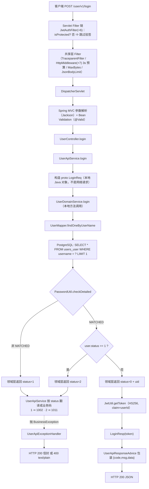
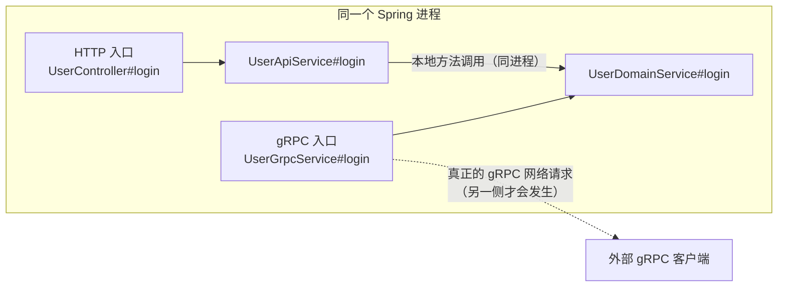
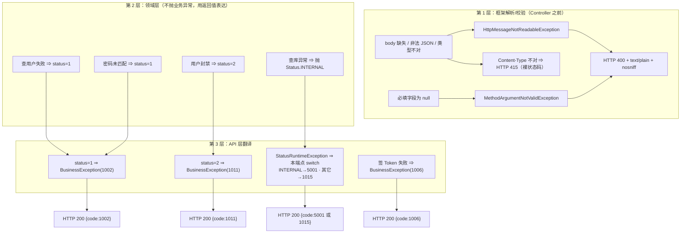
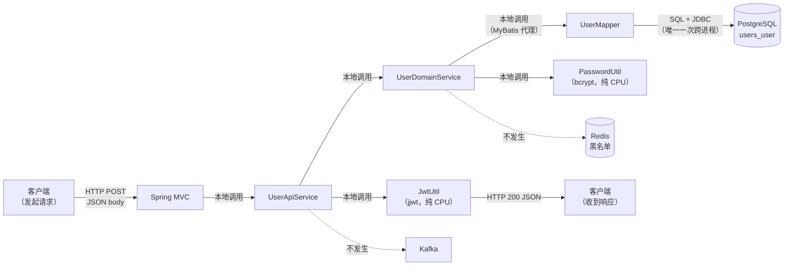
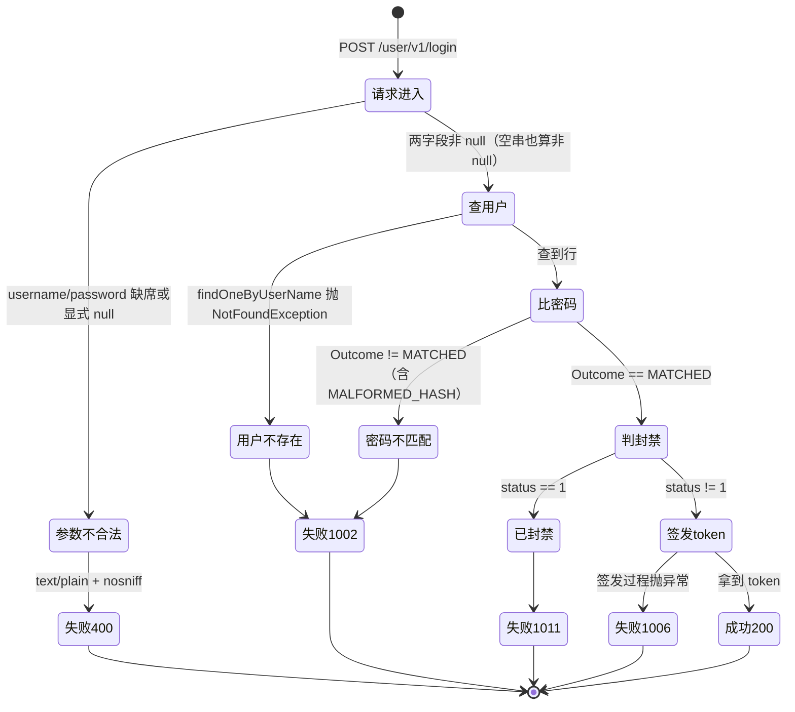

# 01. 用户登录流程

> 一次 `POST /user/v1/login` 从 HTTP 报文进来，到客户端手里拿到一个 JWT，中间到底发生了什么。
> 本文逐行对照本仓 `service/users/user/` 与 `common/` 的**真实源码**写成。

---

## 1. 本次流程的研究范围

我们追踪的是**一个具体的 HTTP 请求**，从 Tomcat 收到字节开始，到响应体写回客户端结束。

**追踪到哪儿为止**

- 完整追踪：`JwtAuthFilter` → `JwtAuthInterceptor` → `DispatcherServlet` 的参数解析与校验 →
  `UserController#login` → `UserApiService#login` → `UserDomainService#login` →
  `UserMapper#findOneByUserName` → PostgreSQL → `PasswordUtil#checkDetailed` →
  `JwtUtil#getToken` → `UserApiResponseAdvice` → 响应体。
- 失败分支也在对应位置展开：每一条失败都追到「HTTP 状态码 + 客户端看到的 body」为止。

**不追踪什么**

| 不追踪                               | 原因                                                               |
| --------------------------------- | ---------------------------------------------------------------- |
| 进程启动（Nacos 注册 / 建表 / workerId 解析） | 与本次请求无关；那是本域索引里《13 应用启动与初始化流程》的主题                                |
| gRPC 入口 `UserGrpcService` 的**执行** | 它是**另一个入口**，不是本次 HTTP 请求走过的一段路。§4.5 只用它来对照说明「proto 类型 ≠ gRPC 调用」 |
| JWT 的**验签**过程                     | 登录是 public 路径，根本不验签。验签是受保护路径的事                                   |
| 头像 / 更新 / 删除 / 注销                 | 其它端点                                                             |

**判定基准**：本仓行为以 B 侧 RAG 仓（只读）为唯一 oracle（D16）。本文只描述本仓源码里**读到的**行为；
凡是源码无法确认的，本文会直接写「源码无法确认」，不补造。

---

## 2. 触发场景与输入

客户端发送：

```
POST /user/v1/login
Content-Type: application/json

{
    "username": "alice",
    "password": "123456"
}
```

这次操作最终要完成三件事：

1. 确认 `username` 对应的用户在 `users_user` 表里存在；
2. 验证提交的密码与库里存的 bcrypt 哈希是否匹配，并确认用户没被封禁；
3. 验证通过后签发一个 HS256 的 JWT，把 Token 交给客户端。

这里先拆开两个容易混的概念：

- **密码验证成功 ≠ 登录流程结束**。领域层只回答「这个用户名+密码组合能不能登录」，不产出 Token。
- **领域层返回成功 ≠ 客户端拿到 Token**。中间还隔着一次 JWT 签发；签发失败照样是登录失败。

因为本项目把「密码校验」和「Token 签发」放在了**两个不同的方法**里（领域层 vs API 层）。

---

## 3. 整体执行路线



这张图是**导航图**，省略了若干框架内部步骤，也没有把所有异常路径画进去。下面逐环节展开。

---

## 4. 逐步讲解

### 4.1 请求是怎么走到 `UserController` 的？

涉及文件：

- `service/users/user/src/main/java/com/rag/user/interceptor/JwtAuthFilter.java`
- `service/users/user/src/main/java/com/rag/user/interceptor/JwtAuthInterceptor.java`
- `service/users/user/src/main/java/com/rag/user/config/WebMvcConfig.java`
- `service/users/user/src/main/java/com/rag/user/controller/UserController.java`

Spring MVC 的处理链大致是：

```
Tomcat 收到 HTTP 请求
  ↓
Servlet Filter 链（JwtAuthFilter、共享层的 TraceparentFilter / HttpMiddleware / MaxBytes / JsonBodyLimit …）
  ↓
DispatcherServlet（找到 @RequestMapping 匹配的 handler 方法）
  ↓
HandlerInterceptor.preHandle（JwtAuthInterceptor）
  ↓
参数解析（Jackson 反序列化 + Bean Validation）
  ↓
调用 Controller 方法
```

**Filter 在 `DispatcherServlet` 外面，Interceptor 在里面**。这个顺序决定了：JWT 验签发生在 3 秒 HTTP 预算**之外**，
黑名单检查发生在预算**之内**。`JwtAuthFilter` 上的 `@Order(Ordered.HIGHEST_PRECEDENCE + 6)`
（`JwtAuthFilter.java:71-73`）就是为这件事排的槽位。

### 4.2 为什么登录不需要 JWT？

`WebMvcConfig`（`WebMvcConfig.java:42-46`）把鉴权拦截器注册在 `/user/v1/**` 上：

```java
@Override
public void addInterceptors(InterceptorRegistry registry) {
    registry.addInterceptor(jwtAuthInterceptor)
            .addPathPatterns("/user/v1/**");
}
```

这句话只说明「**哪些路径会走进拦截器**」，不代表「这些路径都要验签」。
真正的放行判断在拦截器第一段（`JwtAuthInterceptor.java:72-79`）：

```java
@Override
public boolean preHandle(HttpServletRequest request, HttpServletResponse response, Object handler) {
    String uri = request.getRequestURI();

    // public 路径直接放行（与 Go 端 rest.AddRoutes(login, register) 不带 WithJwt 一致）
    if (JwtAuthPaths.isPublic(uri)) {
        return true;
    }
```

`JwtAuthPaths` 把公开路径写死成两个（`JwtAuthPaths.java:41-43`）：

```java
public static final Set<String> PUBLIC_PATHS = Set.of(
        "/user/v1/register", "/user/v1/login"
);
```

所以 `/user/v1/login` 命中 `isPublic` → 拦截器第一段就 `return true` 放行，
**不做验签、不查 Redis 黑名单、不写 `userId` / `jwt_token` 两个 request attribute**。

Filter 侧也是同一份判据（`JwtAuthFilter.java:99-116`）：

```java
HttpServletRequest request = (HttpServletRequest) req;
String uri = request.getRequestURI();
if (JwtAuthPaths.isProtected(uri)) {
    JwtVerificationResult result = verifier.verify(request.getHeader("Authorization"), uri);
    ...
}
chain.doFilter(req, resp);
```

`isProtected(uri)` 对 public 路径返回 false（`JwtAuthPaths.java:75-83`），所以 Filter 也直接跳过验签。

**要分清的两件事**：

- `addPathPatterns("/user/v1/**")` = 拦截器**会在哪些路径上执行**；
- `isPublic(uri)` = 拦截器对当前路径**是否执行身份验证**。

执行了拦截器 ≠ 一定要通过 JWT 验证。正因为有这层白名单，未登录的客户端才有机会调用登录接口。

### 4.3 JSON 怎么变成 `LoginReq`？

客户端发来的是 JSON 文本，但 Java 方法不能直接拿一段文本当业务对象用，所以 Controller 方法的参数是个 record
（`controller/UserController.java:102-105`）：

```java
@PostMapping("/login")
public LoginResp login(@Valid @RequestBody LoginReq req, HttpServletRequest httpRequest) {
    return userApiService.login(req, httpRequest);
}
```

DTO 本体（`dto/auth/LoginReq.java`）：

```java
public record LoginReq(
        @NotNull String username,
        @NotNull String password
) {
}
```

三个框架机制在这里依次发生：

**① `@RequestBody` + Jackson 反序列化**

Spring MVC 看到 `@RequestBody`，就用 `HttpMessageConverter` 读请求体，再交给 Jackson 把 JSON 变成 `LoginReq`。
共享层在 `JsonBodyConverterAutoConfiguration` 里给 Boot 的 `ObjectMapper` 施加了两条强转规则
（数字/布尔不许进 String 字段、浮点不许进整数字段），所以 `{"username": 1}` 会在**反序列化阶段**就失败。

**② `@Valid` + Bean Validation**

对象构造成功后，Spring 触发 Hibernate Validator，逐字段检查 `@NotNull`。

**③ `required` 的默认值是 `true`**

`@RequestBody` 不写 `required` 时默认就是 `true` ⇒ **空 body 会被判为「缺少必需的请求体」**，
Spring 抛 `HttpMessageNotReadableException`。

#### 为什么是 `@NotNull` 而不是 `@NotBlank`？

两者约束不一样：

| 注解 | 约束 |
|---|---|
| `@NotNull` | 值不能是 `null` |
| `@NotBlank` | 不能是 `null`，且不能是空串或纯空白 |

本项目用 `@NotNull` ⇒ **空串 `""` 是合法输入**。

这不是疏忽。真源侧的必填判定（`GoStyleRequired.field(...)`）**只判 null**，不判空串，
所以 Java 侧必须用 `@NotNull` 才能逐条等价。如果有人看到「密码字段」就顺手改成 `@NotBlank`，
接口行为就变了 —— 空串密码会从「能进业务层」变成「被 400 挡掉」。

#### 三种「请求体有问题」要分清

```
body 缺失 / 不是 JSON / 字段类型不对
    ⇒ Jackson 阶段失败
    ⇒ HttpMessageNotReadableException
    ⇒ UserApiExceptionHandler#handleUnreadableBody
    ⇒ HTTP 400 + text/plain + nosniff

body 是合法 JSON（{} 或 {"username":"a"}），但必填字段是 null
    ⇒ Bean Validation 失败
    ⇒ MethodArgumentNotValidException
    ⇒ UserApiExceptionHandler#handleBeanValidation
    ⇒ HTTP 400 + text/plain + nosniff

Content-Type 不是 application/json
    ⇒ HttpMediaTypeNotSupportedException
    ⇒ HTTP 415（裸状态码，无 body）
```

前两种最终都是 **400 + `text/plain`**，不是 200 + JSON 信封。详见 §5。

### 4.4 Controller 为什么还要调 `UserApiService`？

Controller 只做三件事：接 HTTP 参数、调业务、返回业务结果。它不查库、不碰密码、不签 Token。

分工可以这样理解：

```
Controller      处理 HTTP 入口（路由、反序列化、校验）
UserApiService  组织 HTTP API 层业务流程（把领域结果翻译成 API 结果）
UserDomainService 执行用户领域逻辑（查用户、校验密码、判断封禁）
```

`login` 方法还多传了一个 `HttpServletRequest`：

```java
return userApiService.login(req, httpRequest);
```

登录成功路径上**并不用它取 uid**（uid 来自领域层返回的 `rpcResp.getUid()`）。它是给需要从请求上下文取信息的端点准备的
（例如 `logout` 要从 `httpRequest.getAttribute("jwt_token")` 取 token）。
不要因为参数存在，就认定它一定参与了每个步骤。

### 4.5 `UserApiService#login`：DTO → proto，以及「为什么这不是 gRPC 调用」

`service/UserApiService.java:100-108`：

```java
public LoginResp login(com.rag.user.dto.auth.LoginReq req, HttpServletRequest httpRequest) {
    com.rag.proto.user.LoginReq rpcReq = com.rag.proto.user.LoginReq.newBuilder()
            .setUsername(req.username() == null ? "" : req.username())
            .setPassword(req.password() == null ? "" : req.password())
            .build();

    com.rag.proto.user.LoginResp rpcResp;
    try {
        rpcResp = userDomainService.login(rpcReq);
```

`null → ""` 的处理是**防御性**的：正常情况下经过 `@Valid` 的请求不会带 null 字段，
但 proto3 的 `string` 字段不接受 `null`（传 null 会抛 NPE），所以这层兜底必须保留。

#### 这里有两套 `LoginReq`

| 类型 | 归属 | 用途 |
|---|---|---|
| `com.rag.user.dto.auth.LoginReq` | HTTP API 层的 DTO（record） | 承接 Jackson 反序列化 + Bean Validation |
| `com.rag.proto.user.LoginReq` | 根级 `proto/` 模块生成的 protobuf 消息 | 领域层与 gRPC 入口共用的参数类型 |

它们**不是同一个类型**，字段名相同但完全无关。HTTP DTO 的访问器是 `req.username()`（record 分量），
proto 的访问器是 `req.getUsername()`（protobuf 生成）—— 本仓第一轮实现就踩过这个坑
（把 proto 类型当 HTTP 入参，直接编译失败）。

proto 侧的消息定义（`proto/src/main/proto/users.proto:40-48`）：

```protobuf
message LoginReq {
  string username = 1;
  string password = 2;
}

message LoginResp {
  int64 uid = 1;
  uint64 status = 2;
}
```

#### 🔴 为什么类型是 proto，却**不是**一次 gRPC 网络请求

这是本文最容易被误读的一点，单独讲清楚。

看这行代码：

```java
rpcResp = userDomainService.login(rpcReq);
```

`userDomainService` 是**通过构造器注入到 `UserApiService` 里的一个普通 Spring Bean**
（`UserApiService.java:65` 声明字段，`UserApiService.java:70-78` 构造器注入）。
`userDomainService.login(rpcReq)` 就是**一次普通的 Java 方法调用**：
同进程、同线程、同堆内存，没有序列化、没有 channel、没有网络往返。

判断依据（源码可见）：

- 调用点上**没有** `ManagedChannel`、没有 Stub（`UserServiceGrpc` 的 blocking stub 或 future stub）、
  没有目标地址、没有 `withDeadlineAfter`；
- `UserDomainService` 是 `@Service`（`UserDomainService.java:100-101`），被容器直接注入到 API 层；
- 本仓的 user 域**没有任何跨域 gRPC 客户端**：`application.yml` 里 `grpc.client: {}`（`application.yml:87-94`）
  明确写着「本域无跨域 gRPC 调用」。

那为什么还要用 proto 类型？两个原因：

1. **B 侧的形状**：真源里 api 进程通过 gRPC 调 rpc 进程，两边传的就是 protobuf 消息。
   本仓按决策 **D1 + D7** 把 api/rpc 压成**一个进程**，于是「同进程直连」替代了「跨进程 gRPC」，
   但**参数类型保持不变** —— 改动只落在「怎么传」，不落在「传什么」。
2. **一套类型两个入口共用**：`grpc/UserGrpcService.java:86-110` 的 `login` 方法是**另一个入口**，
   它也调**同一份** `userDomainService.login(request)`：

   ```java
   @GrpcService
   public class UserGrpcService extends UserServiceGrpc.UserServiceImplBase {

       @Override
       public void login(LoginReq request, StreamObserver<LoginResp> responseObserver) {
           try {
               LoginResp resp = userDomainService.login(request);
               responseObserver.onNext(resp);
               responseObserver.onCompleted();
           } catch (StatusRuntimeException e) {
               ...
           }
       }
   ```

所以正确的结构图是：



**结论**：proto 类型只说明「数据格式」，不说明「传输方式」。
判断是不是网络请求，要看**调用点上有没有 channel / stub / 地址**，不能看参数类型。

顺带一提：这也解释了为什么**领域层抛的是 `io.grpc.StatusRuntimeException`** ——
它在真源里就是 gRPC 异常，本仓保留了这个类型，API 层照抄真源的 `catch` 与映射表。

### 4.6 `UserDomainService#login`：W1 查用户

领域层入口（`domain/service/UserDomainService.java:161-167`）：

```java
public LoginResp login(LoginReq req) {
    Span span = tracer.spanBuilder("Action-User-Login")
            .setAttribute("biz.username", req.getUsername())
            .startSpan();
    Context otelCtx = Context.current().with(span);
    try {
        checkDeadline();
```

**OpenTelemetry Span**：`tracer` 是 `GlobalOpenTelemetry.getTracer("user-rpc")`（`UserDomainService.java:127`）。
这段代码**不参与业务判断**，它的作用是给这次登录操作记一条追踪（span 名字 `Action-User-Login`，
属性 `biz.username`）。

**`checkDeadline()`**（`UserDomainService.java:140-146`）：

```java
private void checkDeadline() {
    if (Thread.currentThread().isInterrupted() || DeadlineState.isExpired()) {
        throw Status.DEADLINE_EXCEEDED
                .withDescription("rpc deadline reached")
                .asRuntimeException();
    }
}
```

两个条件：

- `Thread.currentThread().isInterrupted()` —— 当前线程被中断；
- `DeadlineState.isExpired()` —— 线程上绑定了 RPC deadline 且已过期。

⚠️ **在本条 HTTP 路径上，`DeadlineState` 是没有绑定的**：`DeadlineState.isExpired()` 在未绑定时返回 `false`
（`DeadlineState.java:109-114`：`d != null && ...`），而绑定动作 `bindToCurrent(...)` 发生在 **gRPC** 服务端拦截器里
（`common/observability/RpcHandleRunner.java:121`）。HTTP 侧的 3 秒预算是共享层 `HttpMiddleware` 用另一套机制实现的
（把链条丢到 worker 线程 + 预算计时），**不写 `DeadlineState`**。

⇒ 所以在 HTTP 登录路径上，`checkDeadline()` 实际上只会因「线程被中断」而抛，
`DEADLINE_EXCEEDED` 这条异常在 HTTP 路径上**不会**被触发（它属于 gRPC 入口的失败分支）。
这正是「同一份领域代码、两个入口、环境不同」的一个好例子。

真正的查库在 W1（`UserDomainService.java:169-172`）：

```java
UserEntity user;
try {
    checkDeadline();
    user = userMapper.findOneByUserName(req.getUsername());
```

#### `findOneByUserName` 是 Mapper 上的 `default` 方法

`mapper/UserMapper.java:53-59`：

```java
default UserEntity findOneByUserName(String username) {
    UserEntity u = selectByUsernameRaw(username);
    if (u == null) {
        throw new NotFoundException("user not found by username: " + username);
    }
    return u;
}
```

它调用的 `selectByUsernameRaw` 才是真正写 SQL 的地方（`UserMapper.java:40-45`）：

```java
@Select("SELECT * FROM users_user WHERE username = #{username} LIMIT 1")
@Results({
        @Result(property = "extraInfo", column = "extra_info",
                javaType = java.util.Map.class, typeHandler = JsonTextTypeHandler.class)
})
UserEntity selectByUsernameRaw(@Param("username") String username);
```

几个细节：

- **`#{username}`** 是 MyBatis 的**预编译占位符**（`?`），不是字符串拼接 ⇒ 无 SQL 注入面。
- **`LIMIT 1`**：即使 `username` 列上有唯一约束，也只取一行。
- **`@Results` 是必须的**：`extra_info` 是 `text` 列（`db/01_create_user.sql:41`），
  MyBatis 不认识 MyBatis-Plus 的 `@TableField`，所以**手写 SQL 必须显式声明 TypeHandler**，
  否则 `extraInfo` 会**静默变成 null**（不报错）。实体上那个 `@TableField(typeHandler = ...)` 只对 MP 自己生成的 SQL 生效。
- **表结构**（`db/01_create_user.sql:33-44`）：

  ```sql
  CREATE TABLE IF NOT EXISTS users_user (
      id          BIGSERIAL PRIMARY KEY,
      uid         BIGINT NOT NULL UNIQUE,
      username    TEXT UNIQUE,
      password    TEXT,
      email       TEXT UNIQUE,
      status      BIGINT NOT NULL DEFAULT 0,
      score       INTEGER,
      extra_info  TEXT,
      create_time TIMESTAMPTZ DEFAULT CURRENT_TIMESTAMP,
      update_time TIMESTAMPTZ DEFAULT CURRENT_TIMESTAMP
  );
  ```

  `username` 上有 UNIQUE 约束，所以「查不到」只可能是真不存在（不会有多行）。

#### 「用户不存在」为什么不直接返回 `null`？

因为本项目把「用户不存在」当成一个**明确的业务情况**，而不是让每个调用者各自判 `null`。
这叫「**error 不是值**」（详见本域索引《02 用户注册流程》里同一个设计在查重场景的用法）。

于是 Mapper 层抛 `NotFoundException`（`exception/UserExceptions.java:32-37`），
领域层在 W1 的第一个 catch 里接住（`UserDomainService.java:179-183`）：

```java
} catch (NotFoundException e) {
    // 用户不存在 → Status=1（D-002：和密码错共用同一个状态码）
    metrics.getLoginUserNotFound().increment();
    logger.logInfo(otelCtx, "login failed : user not found,username : " + req.getUsername());
    return LoginResp.newBuilder().setStatus(1L).build();
}
```

**注意这里没有抛异常，而是返回一个正常的 `LoginResp`。**

#### 🔴 为什么用户不存在不抛 gRPC NOT_FOUND？

因为本登录业务**刻意把两种情况合并**：

- 用户名不存在；
- 用户名存在，但密码错误。

两种都返回 `status = 1`。这样外部调用者**无法只凭登录结果判断某个用户名是否真实存在** ⇒ 减少用户名枚举风险。

所以要分清三层：

| 层 | 「用户不存在」是什么 |
|---|---|
| Mapper 层 | 查询结果为 null ⇒ 抛 `NotFoundException` |
| 领域层 | 识别出的业务状态 ⇒ 转成 `LoginResp.status = 1`（**不是** gRPC 异常） |
| API 层 | 看到 `status == 1` ⇒ 抛 `BusinessException(1002)` |

### 4.7 W2：密码比对

`UserDomainService.java:199-215`：

```java
// W2 密码比对
checkDeadline();
PasswordUtil.Outcome pwOutcome =
        PasswordUtil.checkDetailed(req.getPassword(), user.getPassword());
if (pwOutcome != PasswordUtil.Outcome.MATCHED) {
    // B 侧 DRIFT-004（已修，用户签字）：hash 格式非法时 Go 同样报密码错，对外行为逐字一致；
    // 但 B 侧额外留一道信号 —— Go 侧这一路完全静默。
    if (pwOutcome == PasswordUtil.Outcome.MALFORMED_HASH) {
        span.setAttribute("auth.malformed_hash", true);
        logger.logBusinessErr(otelCtx, ErrCodes.ERROR_REQUEST_PARAM,
                new IllegalArgumentException(
                        "stored bcrypt hash is malformed (username=" + req.getUsername() + ")"));
    }
    metrics.getLoginInternalError().increment();
    logger.logInfo(otelCtx, "login failed: username or password incorrect,username : " + req.getUsername());
    return LoginResp.newBuilder().setStatus(1L).build();
}
```

两个入参：

| 参数 | 来源 | 含义 |
|---|---|---|
| `req.getPassword()` | HTTP 请求（proto） | 用户本次提交的**明文**密码 |
| `user.getPassword()` | 数据库查询结果 | 数据库里存的 **bcrypt 哈希** |

**这里不是把两个字符串直接比。** `PasswordUtil.checkDetailed` 跑的是 bcrypt 校验（`common/security/PasswordUtil.java:99-105`）：

```java
public static Outcome checkDetailed(String rawPassword, String dbHash) {
    try {
        return ENCODER.matches(rawPassword, dbHash) ? Outcome.MATCHED : Outcome.MISMATCHED;
    } catch (RuntimeException e) {
        return Outcome.MALFORMED_HASH;
    }
}
```

`ENCODER` 是 `new BCryptPasswordEncoder(10)`（`PasswordUtil.java:48-49`，`STRENGTH = 10`）。

#### 三个 `Outcome` 各自的含义

`PasswordUtil.java:59-71`：

| `Outcome` | 触发条件 | 对外表现 |
|---|---|---|
| `MATCHED` | 哈希合法且密码匹配 | 继续往下走 |
| `MISMATCHED` | 哈希结构合法，但密码不匹配（绝大多数失败） | `status = 1` |
| `MALFORMED_HASH` | 哈希本身非法（实测触发形态：cost 字段越界，如 `$2a$99$...`） | `status = 1`（对外一样） |

**`MALFORMED_HASH` 有内部信号、对外没差别**：它会额外在 span 上打一个属性 `auth.malformed_hash = true`，
再写一条 `ERROR_REQUEST_PARAM`(1017) 的业务错误日志。但**客户端看到的仍然是 `status = 1`**，
不会把「数据库里的哈希被写坏了」暴露成另一种登录结果。

⇒ 也就是说：**密码错**和**哈希损坏**在登录语义上被统一成「登录失败」，但内部仍留了诊断信号。

> 顺带一个容易看错的点：`metrics.getLoginInternalError().increment()` 在**密码不匹配**时也会 +
> 1（它在 `if` 块里、无条件执行）⇒ 所以「密码打错」会让 `user_rpc_login_total{result="internal_error"}` 增长。
> 这个指标名有点误导，但它是真源照抄的结果。

### 4.8 W3：封禁检查（含 `status = 0L` 这个坑）

`UserDomainService.java:217-229`：

```java
// W3 封禁检查
if (user.getStatus() != null && user.getStatus() == 1L) {
    // 用户被封禁 → Status=2（无 metrics，与 Go 端一致）
    logger.logInfo(otelCtx, "login failed: user banned, username :  " + req.getUsername());
    return LoginResp.newBuilder().setStatus(2L).build();
}
```

业务约定：`status = 1` 表示用户被封禁，其它值不因这条判断而被认定为封禁。

#### 🔴 `!= null` 这一半在实现里**恒为真**

先看实体（`domain/entity/UserEntity.java:82-83`）：

```java
@TableField("status")
private Long status = 0L;
```

字段**有初始化值 `0L`**。再看 MyBatis 的映射规则：MyBatis 的 `DefaultResultSetHandler` 在
「取到的列值为 `null` 且 `callSettersOnNulls == false`（默认值）」时**跳过 setter**。

⇒ 于是：**数据库里 `status` 是 `NULL` 的行，读出来是 `0L`，不是 `null`。**

（DDL 里 `status BIGINT NOT NULL DEFAULT 0`（`db/01_create_user.sql:39`），所以正常写入的行不会是 NULL；
但历史数据、手工改库、或从别的库同步过来的行可能是 NULL —— 这条判定的行为对它们依然要说得清。）

所以 `user.getStatus() != null` 这一半**恒为真**，真正的判据只有 `== 1L`：

| DB 里 `status` | 实体读出来 | `!= null` | `== 1L` | 结论 |
|---|---|---|---|---|
| `0` | `0L` | true | false | 未封禁 ⇒ 放行 |
| `1` | `1L` | true | **true** | **封禁 ⇒ status=2** |
| `NULL` | `0L`（setter 被跳过，初始化值留下） | true | false | 未封禁 ⇒ **放行** |

⇒ **不能**把 `user.getStatus() == null` 读成「数据库里的 status 一定是 NULL」。
真源侧（GORM + `database/sql`）对 NULL 的处理也是「读成 0」，两侧行为一致。

> 这条 `!= null` 保留着是为了与真源的类型形态对齐（真源那边是 int64，不存在 null）。
> 源码里的注释也明说了「不要再把这行读成『status 为 NULL 就当没封禁』的 fail-open 缺陷」——
> 真源走的**正是**「NULL ⇒ 0 ⇒ `status == 1` 判 false ⇒ 放行」这条路径。

另外注意：**封禁分支没有埋点**（源码注释写「无 metrics，与 Go 端一致」）。

### 4.9 W4：成功

`UserDomainService.java:231-240`：

```java
// W4 成功
metrics.getLoginSuccess().increment();
logger.logInfo(otelCtx, "login success,username : " + req.getUsername());
return LoginResp.newBuilder()
        .setUid(user.getUid())
        .setStatus(0L)
        .build();
} finally {
    span.end();
}
```

返回的 proto `LoginResp` 带两个字段：

- `uid` —— 用户的业务 ID（来自 `users_user.uid`）；
- `status = 0` —— 领域层登录成功。

**到这里还没有 Token。** 领域层的任务结束了，它返回的是**领域登录结果**，不是最终的 HTTP 登录响应。

`finally { span.end(); }` 保证无论走哪条分支（成功 / 用户不存在 / 密码错 / 封禁 / 抛异常），
OpenTelemetry span 都会被结束 —— 这是 Java 的 `finally` 语义。

### 4.10 回到 `UserApiService`：三态 → 业务码

控制流回到 `UserApiService#login`。领域层的三态在这里被翻译成 HTTP 层能懂的东西（`UserApiService.java:126-138`）：

```java
// rpcResp.Status == 1 → 密码错或用户不存在（rpc 不区分）
if (rpcResp.getStatus() == 1L) {
    metrics.getLoginWrongPassword().increment();
    log.info("login failed : wrong password,username : {}", req.username());
    throw new BusinessException(ErrCodes.ERROR_LOGIN_WRONG, ErrMsg.getMsg(ErrCodes.ERROR_LOGIN_WRONG));
}

// rpcResp.Status == 2 → 用户封禁（DB status=1）
if (rpcResp.getStatus() == 2L) {
    metrics.getLoginUserBanned().increment();
    log.info("login failed : user banned,username : {}", req.username());
    throw new BusinessException(ErrCodes.ERROR_USER_BANNED, ErrMsg.getMsg(ErrCodes.ERROR_USER_BANNED));
}
```

| 领域层 `status` | 含义 | API 层动作 | 业务码 | 文案 |
|---|---|---|---|---|
| `1` | 用户不存在 **或** 密码错 | `throw BusinessException` | `1002` (`ERROR_LOGIN_WRONG`) | 用户名或密码错误 |
| `2` | 用户被封禁 | `throw BusinessException` | `1011` (`ERROR_USER_BANNED`) | 用户已被封禁 |
| `0` | 成功 | 继续签发 JWT | — | — |

⚠️ **注意这段写法的形状**：它是「**不是 1、不是 2，就往下走**」——
**没有显式写 `if (status == 0)`**。领域层只会返回 0/1/2，所以这个隐含的 else 恰好等价于「成功」；
但如果你只看这段代码，是看不出「显式判断成功」这层语义的。

⚠️ 另一个容易看错的点：`metrics.getLoginWrongPassword()` 在 **`status == 1`** 时递增 ——
而 `status == 1` 同时覆盖了「用户不存在」和「密码错」两种情况。
所以指标 `user_api_intercept_total{path="/user/login",result="wrong_password"}`
**也会被「用户不存在」触发**。指标名字有点窄，行为是对的。

**为什么领域层不直接生成 Token？**
领域层只负责「这个用户能不能登录」；API 层负责「把领域结论变成 API 要的结论」。
JWT 的密钥、过期时间这些是**HTTP 层的配置**（`UserApiProperties`），领域层不持有。

### 4.11 JWT 是怎么签发的？

`UserApiService.java:140-151`：

```java
// 签发 JWT —— 与 Go jwt.GetToken(secret, now, expire, uid) 1:1
long nowSec = System.currentTimeMillis() / 1000L;
long expireSec = properties.getUserAuth().getAccessExpire();
String accessSecret = properties.getUserAuth().getAccessSecret();
String token;
try {
    token = JwtUtil.getToken(accessSecret, nowSec, expireSec, rpcResp.getUid());
} catch (Throwable t) {
    metrics.getLoginTokenError().increment();
    log.error("generate token failed : {}", t.getMessage(), t);
    throw new BusinessException(ErrCodes.ERROR_TOKEN_RUNTIME, ErrMsg.getMsg(ErrCodes.ERROR_TOKEN_RUNTIME));
}
```

**四个输入**：

| 输入 | 来源 | 说明 |
|---|---|---|
| `nowSec` | `System.currentTimeMillis() / 1000L` | 签发时刻（秒） |
| `expireSec` | `properties.getUserAuth().getAccessExpire()` | 有效期（秒） |
| `accessSecret` | `properties.getUserAuth().getAccessSecret()` | HMAC 签名密钥 |
| `rpcResp.getUid()` | 领域层返回 | 当前用户 uid |

**密钥与过期时间从哪来？**

配置类 `config/UserApiProperties.java:38-44`：

```java
@ConfigurationProperties(prefix = "user-api")
public class UserApiProperties {

    private String name = "user-api";

    @NestedConfigurationProperty
    private UserAuth userAuth = new UserAuth();
```

`@ConfigurationProperties(prefix = "user-api")` 把 yml 里的 `user-api.*` 段绑到这个对象上。
对应 `src/main/resources/application.yml:57-60`：

```yaml
user-api:
  user-auth:
    access-secret: ${USER_JWT_SECRET}
    access-expire: ${USER_JWT_EXPIRE:2592000}    # 30 天，与 B 侧 etc/user.yaml 一致
```

- `access-secret` **没有默认值** ⇒ 环境变量 `USER_JWT_SECRET` 没设时，绑上去的是**占位符字面量** `"${USER_JWT_SECRET}"`；
- `access-expire` 默认 `2592000` 秒 = 30 天。

这个密钥**不是可选项**。`UserApiProperties` 里有一段启动期强制检查（`UserApiProperties.java:70-83`）：

```java
@PostConstruct
void verifyAccessSecret() {
    String secret = userAuth == null ? null : userAuth.getAccessSecret();
    if (secret == null || secret.isBlank()) {
        throw new IllegalStateException(
                "user-api.user-auth.access-secret 不能为空：请设置环境变量 USER_JWT_SECRET（与 user-rpc 共享同一把签发密钥）"
                        + "—— 本模块既签发又验签，空密钥会让任何人都能伪造 JWT");
    }
    if (secret.contains("${")) {
        throw new IllegalStateException(
                "user-api.user-auth.access-secret 仍是未解析的占位符（" + secret + "）：请设置环境变量 USER_JWT_SECRET"
                        + "—— 占位符字面量是公开在仓里的常量，拿它当密钥 = 密钥公开");
    }
}
```

两条 fail-closed：**空串** ⇒ 启动失败；**仍是未解析的占位符** ⇒ 启动失败。
后者必须单独判，因为 Spring 的占位符解析器在解析不出来时会把原文留下（`ignoreUnresolvablePlaceholders = true`），
光判「null / 空串」堵不住这条路。

#### 签发本身

`common/security/JwtUtil.java:31-48`：

```java
public static String getToken(String secretKey,
                              long iat,
                              long seconds,
                              long userId) {
    SecretKeySpec key = new SecretKeySpec(padToHmacKeySize(secretKey), "HmacSHA256");
    return Jwts.builder()
            .header().add("typ", "JWT").and()
            .issuedAt(new Date(iat * 1000L))
            .expiration(new Date((iat + seconds) * 1000L))
            .claim("userId", userId)
            .signWith(key, Jwts.SIG.HS256)
            .compact();
}
```

要点：

- **算法钉死 HS256**：JCA 算法名写成 `HmacSHA256`，签名算法写成 `Jwts.SIG.HS256`。
  源码注释解释了原因：jjwt 的 `signWith(Key)` 单参重载会**照着 key 的 JCA 算法名选算法**，
  密钥长度漂移时 `header.alg` 会跟着漂 ⇒ 两处都钉死。
- **claim 名 = `userId`**（`JwtUtil.java:45`）。这是 L1 契约：受保护端点从 token 里取的就是这个 claim。
- **`iat` / `exp`**：`iat` 是签发时刻，`exp = iat + seconds`。
- **密钥补齐**：`padToHmacKeySize`（`JwtUtil.java:102-111`）把不足 32 字节的密钥**补零**到 32 字节，
  因为 jjwt 0.12 强制要求 HMAC key ≥ 256 bit。补零不破坏与真源的互通（HMAC 本身就会把短于分组长度的密钥零填充）。

**签发失败怎么办？** `catch (Throwable t)` 把任何异常（密钥不合法、jjwt 内部错误……）都收敛成
`BusinessException(ERROR_TOKEN_RUNTIME)` = 业务码 `1006`，文案 `TOKEN已过期`。

⇒ **Token 生成失败不会被当作登录成功**，也不会返回半成品 token。

签发成功后（`UserApiService.java:153-156`）：

```java
metrics.getLoginSuccess().increment();
log.info("login success,username : {}", req.username());

return new LoginResp(token);
```

⚠️ 注意 **API 层的 `loginSuccess` 计数在 JWT 签发成功之后才 +1**，
而**领域层的 `loginSuccess` 在 W4 就 +1 了**（还没签 Token）。
⇒ 如果 JWT 签发失败：`user_rpc_login_total{result="success"}` 增长了，但
`user_api_intercept_total{path="/user/login",result="success"}` **不增长**。两个指标的口径本来就不同。

### 4.12 `LoginResp` 怎么变成 HTTP JSON？

`UserApiService` 返回 `new LoginResp(token)`（`dto/auth/LoginResp.java`）：

```java
public record LoginResp(
        String token
) {
}
```

它逐层返回到 Controller，**但客户端收到的 JSON 不止是 `{"token":"..."}`**。

因为 `advice/UserApiResponseAdvice.java:42-49` 注册了一个全局 `ResponseBodyAdvice`：

```java
@RestControllerAdvice
public class UserApiResponseAdvice implements ResponseBodyAdvice<Object> {

    @Override
    public boolean supports(MethodParameter returnType, Class<? extends HttpMessageConverter<?>> converterType) {
        // 拦截所有 Controller 返回值；Controller 自己抛异常由 UserApiExceptionHandler 处理
        return true;
    }
```

`ResponseBodyAdvice` 是 Spring MVC 的扩展点：**Controller 返回值写入响应体之前**会被它过一道。
`supports` 恒返回 `true` ⇒ 所有 Controller 返回值都走包装。

真正包装的地方（`UserApiResponseAdvice.java:52-75`）：

```java
@Override
public Object beforeBodyWrite(Object body, MethodParameter returnType, MediaType selectedContentType,
                              Class<? extends HttpMessageConverter<?>> selectedConverterType,
                              ServerHttpRequest request, ServerHttpResponse response) {
    if (body == null || body instanceof ApiResponse) {
        return body;
    }
    if (selectedContentType != null
            && !MediaType.APPLICATION_JSON.isCompatibleWith(selectedContentType)) {
        return body;
    }
    return new ApiResponse(ErrCodes.SUCCESS, ErrMsg.getMsg(ErrCodes.SUCCESS), body);
}
```

两个「不包装」的守卫，各有各的理由：

- **`body == null || body instanceof ApiResponse`**：异常处理器返回的 `ResponseEntity<ApiResponse>` 的 body 已经是信封了。
  再包一层会变成 `{"code":200,"msg":"OK","data":{"code":1002,"msg":"用户名或密码错误","data":null}}` ——
  顶层 `code` 恒为 200，所有按 `code != 200` 判定失败的客户端会**全部失效**。
- **非 JSON 响应原样透传**：判定条件是「这次写出的到底是不是 JSON」，而不是「body 是不是 String」。
  这样 405 / 415 这类同样走 `text/plain` 的分支才不会被误包。

最终成功响应：

```json
{
    "code": 200,
    "msg": "OK",
    "data": {
        "token": "eyJ0eXAiOiJKV1QiLCJhbGciOiJIUzI1NiJ9..."
    }
}
```

`data` 里才是原来的 `LoginResp`。信封本体是 `common/contract/ApiResponse.java` 的三个字段
`code` / `msg` / `data`，**没有 `@JsonInclude`** ⇒ `data` 为 null 时键仍然存在（`"data":null`）。

---

## 5. 重要分支与失败路径

### 5.1 全失败分支速查

| 发生位置 | 触发条件 | 领域层返回 / 抛出 | API 层转成 | HTTP 状态码 | 客户端看到的 body |
|---|---|---|---|---|---|
| 参数解析 | body 缺失 / 非 JSON / 字段类型不对 | （没进业务层） | — | **400** | `text/plain` 裸文案 + `nosniff` |
| 参数校验 | `username` 或 `password` 为 `null`（含 `{}`） | （没进业务层） | — | **400** | `text/plain` 裸文案 + `nosniff` |
| Content-Type | 不是 `application/json` | （没进业务层） | — | **415** | 空 body |
| 查用户 | 用户名不存在 | `status = 1`（正常返回） | `BusinessException(1002)` | **200** | `{"code":1002,"msg":"用户名或密码错误","data":null}` |
| 密码比对 | 密码不匹配 | `status = 1` | `BusinessException(1002)` | **200** | 同上 |
| 密码比对 | 库里哈希格式非法 | `status = 1`（+ span 属性 + 业务错误日志） | `BusinessException(1002)` | **200** | 同上（**不暴露**哈希损坏） |
| 封禁检查 | `users_user.status = 1` | `status = 2` | `BusinessException(1011)` | **200** | `{"code":1011,"msg":"用户已被封禁","data":null}` |
| 查库 | 数据库异常 | 抛 `Status.INTERNAL` | `BusinessException(5001)` | **200** | `{"code":5001,"msg":"系统内部错误","data":null}` |
| 签 Token | jjwt 抛异常 | — | `BusinessException(1006)` | **200** | `{"code":1006,"msg":"TOKEN已过期","data":null}` |
| HTTP 方法 | 用 GET 打这个端点 | — | — | **405** | 空 body（裸状态码） |

### 5.2 三层失败翻译的总图

把 §5.1 的表画出来，就是这张图 —— 注意**每一层的形状都不同**：



⇒ 三层里，**只有第 1 层会返回非 200 的状态码**；
第 2、3 层都是「HTTP 200 + 信封里的 `code` 表达成败」。

### 5.3 「用户不存在」与「密码错」为什么客户端分不出来？

这是**故意**的。领域层把两者都收敛成 `status = 1`，API 层再统一收敛成 `1002`。

客户端能观察到的差异只有**时间**：密码错要多跑一次 bcrypt（cost=10），
用户不存在不用跑。（⚠️ 两者的时间差有多大，是 bcrypt cost 的通用属性，**本仓没有对应测量**。）
如果要靠响应时间区分用户名是否存在，这个「合并」就被抵消了 ——
但那是真源侧同样存在的特性，本仓照抄，不额外加固。

### 5.4 两条 gRPC → 业务码映射并存（登录端点走哪一套）

`UserApiService#login` 自己写了一个 switch（`UserApiService.java:112-123`）：

```java
// 1:1 对齐 B 侧 LoginLogic 的 switch (e.getStatus().getCode())：
//   codes.Internal → ErrorServerCommon (5001)
//   其它（default）→ CodeServerBusy    (1015)
io.grpc.Status.Code code = e.getStatus().getCode();
if (code == io.grpc.Status.Code.INTERNAL) {
    throw new BusinessException(
            ErrCodes.ERROR_SERVER_COMMON,
            ErrMsg.getMsg(ErrCodes.ERROR_SERVER_COMMON));
}
throw new BusinessException(
        ErrCodes.CODE_SERVER_BUSY,
        ErrMsg.getMsg(ErrCodes.CODE_SERVER_BUSY));
```

而 advice 层还有一套**通用映射**（`UserApiExceptionHandler.java:116-130`）：

```java
private int mapRPCStatusToCode(Status.Code code) {
    if (code == Status.Code.INTERNAL) {
        return ErrCodes.ERROR_SERVER_COMMON;
    }
    if (code == Status.Code.NOT_FOUND) {
        return ErrCodes.ERROR_USER_NOT_EXIST;
    }
    if (code == Status.Code.ALREADY_EXISTS) {
        return ErrCodes.ERROR_USER_EXIST;
    }
    if (code == Status.Code.INVALID_ARGUMENT) {
        return ErrCodes.ERROR;
    }
    return ErrCodes.CODE_SERVER_BUSY;
}
```

**两套并存且不完全相同**，这不是 bug，是照抄真源的结果。

- **登录端点走端点内的那套**：端点自己 catch 了 `StatusRuntimeException`，转成 `BusinessException`，
  **不会**到 advice 的 `handleRPC`。所以登录只可能出现 `5001`（INTERNAL）或 `1015`（其它）；
  通用映射里的 `1003` / `1001` / `500` 在登录路径上**不可达**。
- 其它端点（如注册）走 advice 的通用映射。

⚠️ 顺带一个结论：登录路径上 `DEADLINE_EXCEEDED`（在 gRPC 入口才会出现）落到 `default` ⇒ `1015 服务繁忙`。
这与真源两侧的活体对拍结论一致（超时也是 `{"code":1015,"msg":"服务繁忙"}`）。

### 5.5 异常传播链：从产生到响应

以「数据库查询失败」为例，完整链路：

```
PostgreSQL 连接异常 / SQL 错误
  ↓ 抛 DataAccessException（RuntimeException）
UserMapper.selectByUsernameRaw（MyBatis 代理执行 SQL）
  ↓ 冒泡（不是 NotFoundException，也不是 StatusRuntimeException）
UserDomainService#login 的 catch (Exception e)          ← UserDomainService.java:187
  ↓ metrics.getLoginDbError().increment()
  ↓ span.recordException(e)
  ↓ logger.logBusinessErr(otelCtx, ErrCodes.ERROR_DB_SELECT, e)
  ↓ throw Status.INTERNAL.withDescription("DB查询失败").asRuntimeException()
UserApiService#login 的 catch (StatusRuntimeException e)  ← UserApiService.java:109
  ↓ metrics.getLoginRpcError().increment()
  ↓ log.error("login RPC error, username={}", ...)
  ↓ code == INTERNAL ⇒ throw new BusinessException(ERROR_SERVER_COMMON, "系统内部错误")
UserApiExceptionHandler#handleBusiness                  ← UserApiExceptionHandler.java:56
  ↓ decideStatus(code) ⇒ HttpStatus.OK
  ↓ ResponseEntity.status(200).body(new ApiResponse(5001, "系统内部错误", null))
UserApiResponseAdvice#beforeBodyWrite
  ↓ body instanceof ApiResponse ⇒ 原样返回，不重复包装
HTTP 200  Content-Type: application/json
{"code":5001,"msg":"系统内部错误","data":null}
```

另一条链（参数校验失败）：

```
Bean Validation 发现 username == null
  ↓ 抛 MethodArgumentNotValidException
（Spring MVC 在调用 Controller 方法**之前**抛出 ⇒ Controller / Service / 领域层完全没参与）
UserApiExceptionHandler#handleBeanValidation             ← UserApiExceptionHandler.java:202
  ↓ 取第一个 field error，拼成 "username must not be null"
  ↓ PlainTextErrors.badRequest(message)
HTTP 400  Content-Type: text/plain; charset=utf-8
X-Content-Type-Options: nosniff
username must not be null
```

⚠️ **HTTP 状态码 ≠ 业务码**：
- 业务失败（1002 / 1011 / 5001 / 1006）⇒ **HTTP 200**，成败由 body 里的 `code` 表达；
- 参数解析 / 校验失败 ⇒ **HTTP 400 + `text/plain`**，**没有** `{code,msg,data}` 信封。

不能因为项目有统一响应包装，就认为所有失败都返回 HTTP 200 + JSON 信封。

---

## 6. 数据变化与副作用

| 维度 | 本次登录流程里发生了什么 |
|---|---|
| **数据库读** | `SELECT * FROM users_user WHERE username = ? LIMIT 1`。**只有这一条**，无写操作 |
| **数据库写** | **无**。登录不写任何表（不更新 `last_login`，本仓没有这个字段） |
| **事务** | **本流程无事务**。`service/users/user` 下与本流程相关的类上**没有** `@Transactional`（唯一有事务的是头像相关的 `UserAvatarHistoryMapper`）⇒ 单条 SELECT 走 auto-commit |
| **Redis** | **无**。黑名单检查只在受保护路径上做；登录是 public 路径 ⇒ `JwtAuthInterceptor` 第一段就返回了，`isBlacklisted` 根本没被调用 |
| **远程调用** | **无**。没有 HTTP、没有 gRPC、没有 Nacos、没有 MinIO |
| **消息** | **无**。不发不消费 Kafka |
| **日志** | 领域层 `LoggerFactoryBean#logInfo`（成功/用户不存在/密码错/封禁）；API 层 SLF4J `log.info` / `log.error` |
| **指标** | 见下表 |
| **ID 生成** | **无**。登录不生成 Snowflake ID（`uid` 是从库里读出来的） |
| **Token 生成** | **有**。`JwtUtil.getToken` 产出一个 HS256 JWT |
| **OpenTelemetry** | 领域层起一个 span（`Action-User-Login`，属性 `biz.username`），`finally` 里 `span.end()` |
| **失败后残留** | 失败分支**不写任何数据** ⇒ 没有「写了一半」的中间态。唯一的状态变化是指标计数和日志 |

### 指标明细

| 指标 | 何时 +1 | 覆盖的语义 |
|---|---|---|
| `user_rpc_login_total{result="success"}` | 领域层 W4（**签 Token 之前**） | 领域层判定登录成功 |
| `user_rpc_login_total{result="user_not_found"}` | 领域层 W1 捕获 `NotFoundException` | 用户不存在 |
| `user_rpc_login_total{result="db_error"}` | 领域层 W1 捕获其它 `Exception` | 数据库查询失败 |
| `user_rpc_login_total{result="internal_error"}` | 领域层 W2 密码未匹配（含哈希非法） | **密码错也走这里** |
| `user_api_intercept_total{path="/user/login",result="success"}` | API 层签发 Token 成功后 | 端到端登录成功 |
| `user_api_intercept_total{path="/user/login",result="wrong_password"}` | API 层收到 `status == 1` | **用户不存在也走这里** |
| `user_api_intercept_total{path="/user/login",result="user_banned"}` | API 层收到 `status == 2` | 用户被封禁 |
| `user_api_intercept_total{path="/user/login",result="rpc_error"}` | API 层捕获 `StatusRuntimeException` | 领域层抛了 gRPC 异常 |
| `user_api_intercept_total{path="/user/login",result="token_error"}` | API 层签 Token 失败 | JWT 签发异常 |

⚠️ 三个「名字会骗人」的地方，源码里都对得上：

1. `user_rpc_login_total{result="internal_error"}` **也会被普通密码错触发**；
2. `user_api_intercept_total{result="wrong_password"}` **也会被「用户不存在」触发**；
3. 领域层 `success` 与 API 层 `success` **口径不同**（前者不含签 Token）。

### 数据流转图：哪些边界被跨越，哪些没有



⇒ **整条链上只有一次真正的跨进程通信**（Mapper → PostgreSQL）。
`PasswordUtil` 和 `JwtUtil` 都是**纯 CPU 计算**，不出进程；
Redis 和 Kafka 在这条路径上**完全没有被访问**。

### 事务边界说明

本流程**没有** `@Transactional`，因此：

- 那条 SELECT 是**独立的 auto-commit 语句**；
- 领域层与 API 层之间**没有**原子性需求（只有一次读）；
- 不存在「事务回滚了但 ID 已被消耗」这类问题（本流程也不生成 ID）。

---

## 7. 执行结果

### 成功

请求：

```
POST /user/v1/login
Content-Type: application/json

{"username":"alice","password":"123456"}
```

响应：

```
HTTP/1.1 200
Content-Type: application/json

{
  "code": 200,
  "msg": "OK",
  "data": {
    "token": "eyJ0eXAiOiJKV1QiLCJhbGciOiJIUzI1NiIsInR5cCI6IkpXVCJ9...."
  }
}
```

Token 的 payload 里有一个 `userId` claim（值就是 `users_user.uid`）、一个 `iat`、一个 `exp`（`iat + 2592000` 秒）。

### 失败 · 用户名或密码错误

```
HTTP/1.1 200
Content-Type: application/json

{"code":1002,"msg":"用户名或密码错误","data":null}
```

### 失败 · 用户被封禁

```
HTTP/1.1 200
Content-Type: application/json

{"code":1011,"msg":"用户已被封禁","data":null}
```

### 失败 · 请求体缺必填字段

```
HTTP/1.1 400
Content-Type: text/plain; charset=utf-8
X-Content-Type-Options: nosniff

username must not be null
```

（文案由 Hibernate Validator 决定；**状态码 400 与 `text/plain` 结构**与真源一致，**文案**属已登记的 L3 降级。）

---

## 8. 流程复盘

一次成功登录真正走过的代码：

```
HTTP 请求
  ↓
JwtAuthFilter（public 路径 ⇒ 跳过验签）
  ↓
共享层 Filter 链（trace / 3s 预算 / body 限额）
  ↓
JwtAuthInterceptor（public 路径 ⇒ 第一段就放行）
  ↓
Spring MVC：Jackson 反序列化 + Bean Validation
  ↓
UserController#login
  ↓
UserApiService#login
  ↓
构造 proto LoginReq（本地对象）
  ↓
UserDomainService#login
  ↓
  ├─ UserMapper.findOneByUserName → selectByUsernameRaw → PostgreSQL
  ├─ PasswordUtil.checkDetailed（bcrypt）
  ├─ 封禁判断（status == 1）
  └─ 领域 LoginResp（status=0 + uid）
  ↓
UserApiService#login
  ↓
JwtUtil.getToken（HS256 / claim=userId）
  ↓
HTTP LoginResp(token)
  ↓
UserApiResponseAdvice → {code, msg, data}
  ↓
HTTP 200 JSON
```

值得记住的边界，而不是这条链本身：

1. **Controller 不碰业务**。它接 HTTP 参数、调 Service、返回结果，不查库、不碰密码、不签 Token。
2. **API Service 做「翻译」**：把领域的三态翻译成业务码，把领域结论变成 HTTP 需要的 Token。
3. **领域层做「判定」**：查用户、校验密码、判断封禁 —— 而且**用返回值而不是异常**表达业务失败。
4. **Mapper 负责「执行 + 映射」**：SQL 是手写 `@Select`，`extra_info` 必须显式 `@Results` + TypeHandler，
   否则静默变 null。
5. **`UserApiResponseAdvice` 是唯一的信封产地**：Controller 返回什么它都包一层，但已经是信封 / 非 JSON 的原样放过。
6. **`UserGrpcService` 是另一个入口**：它调用同一份领域代码，**不代表** HTTP 登录调领域层时发生了 gRPC 网络通信。
7. **`status = 1` 合并「用户不存在」与「密码错」**：这是有意的安全取舍，不是 bug。
8. **实体里的 `status = 0L` + MyBatis `callSettersOnNulls=false`**：DB 里 NULL 的行读出来是 `0L`，
   不是 null —— 这直接影响封禁判断。

---

## 9. 源码定位与验证方式

### 9.1 源码定位

| 位置 | 文件 : 行 | 内容 |
|---|---|---|
| 路由 | `service/users/user/src/main/java/com/rag/user/controller/UserController.java:102-105` | `@PostMapping("/login")` → `userApiService.login(req, httpRequest)` |
| HTTP 用例 | `service/users/user/src/main/java/com/rag/user/service/UserApiService.java:100-157` | proto 构造、三态翻译、JWT 签发 |
| DTO | `service/users/user/src/main/java/com/rag/user/dto/auth/LoginReq.java` | `record LoginReq(@NotNull String username, @NotNull String password)` |
| 响应 DTO | `service/users/user/src/main/java/com/rag/user/dto/auth/LoginResp.java` | `record LoginResp(String token)` |
| 领域 | `service/users/user/src/main/java/com/rag/user/domain/service/UserDomainService.java:161-241` | `login`：W1 查 / W2 密码 / W3 封禁 / W4 成功 |
| deadline | `service/users/user/src/main/java/com/rag/user/domain/service/UserDomainService.java:140-146` | `checkDeadline()` |
| Mapper | `service/users/user/src/main/java/com/rag/user/mapper/UserMapper.java:40-59` | `selectByUsernameRaw` / `findOneByUserName` |
| 实体 | `service/users/user/src/main/java/com/rag/user/domain/entity/UserEntity.java:82-83` | `private Long status = 0L;` |
| 密码 | `common/src/main/java/com/rag/common/security/PasswordUtil.java:59-105` | `Outcome` / `checkDetailed` / `encrypt` |
| JWT | `common/src/main/java/com/rag/common/security/JwtUtil.java:31-48` | `getToken`（HS256 / claim `userId`） |
| 密钥补齐 | `common/src/main/java/com/rag/common/security/JwtUtil.java:102-111` | `padToHmacKeySize` |
| 配置 | `service/users/user/src/main/java/com/rag/user/config/UserApiProperties.java:38-44, 70-83` | `@ConfigurationProperties("user-api")` / `@PostConstruct` fail-closed |
| 配置值 | `service/users/user/src/main/resources/application.yml:57-65` | `user-api.user-auth.access-secret` / `access-expire` |
| 响应包装 | `service/users/user/src/main/java/com/rag/user/advice/UserApiResponseAdvice.java:42-75` | `ResponseBodyAdvice` 统一信封 |
| 异常处理 | `service/users/user/src/main/java/com/rag/user/advice/UserApiExceptionHandler.java:56-63, 116-130, 178-210` | 业务异常 / gRPC 映射 / 400 text/plain |
| 公开路径 | `service/users/user/src/main/java/com/rag/user/interceptor/JwtAuthPaths.java:41-43` | `PUBLIC_PATHS = {"/user/v1/register", "/user/v1/login"}` |
| Filter | `service/users/user/src/main/java/com/rag/user/interceptor/JwtAuthFilter.java:99-116` | `doFilter`：protected 才验签 |
| Interceptor | `service/users/user/src/main/java/com/rag/user/interceptor/JwtAuthInterceptor.java:72-79` | `preHandle`：public 放行 |
| 拦截器注册 | `service/users/user/src/main/java/com/rag/user/config/WebMvcConfig.java:42-46` | `addPathPatterns("/user/v1/**")` |
| gRPC 入口 | `service/users/user/src/main/java/com/rag/user/grpc/UserGrpcService.java:86-110` | `@GrpcService` 的 `login`（另一个入口） |
| proto | `proto/src/main/proto/users.proto:40-48` | `message LoginReq` / `message LoginResp` |
| 建表 | `service/users/common/src/main/resources/db/01_create_user.sql:33-44` | `users_user` 表结构 |
| 异常类型 | `service/users/user/src/main/java/com/rag/user/exception/UserExceptions.java:32-37` | `NotFoundException` |
| 错误码 | `service/users/user/src/main/java/com/rag/user/contract/ErrCodes.java` | 域内视图，值转发自 `com.rag.users.common.ErrCodes` |
| 文案 | `service/users/common/src/main/java/com/rag/users/common/ErrMsg.java` | `1002 → 用户名或密码错误` 等 |
| 指标（API） | `service/users/user/src/main/java/com/rag/user/metrics/UserApiMetrics.java:42-66` | `user_api_intercept_total{path,result}` |
| 指标（领域） | `service/users/user/src/main/java/com/rag/user/metrics/UserRpcMetrics.java:63-78` | `user_rpc_login_total{result}` |
| 信封 | `common/src/main/java/com/rag/common/contract/ApiResponse.java` | `code` / `msg` / `data` 三字段 |
| 纯文本 400 | `common/src/main/java/com/rag/common/web/PlainTextErrors.java` | `text/plain; charset=utf-8` + `nosniff` + 尾随 `\n` |

### 9.2 怎么自己验证

**真 HTTP 契约测试**：`service/users/user/src/test/java/com/rag/user/api/UserApiHttpContractTest.java`
（**真 Tomcat**，不是 MockMvc）：

| 测试方法 | 验证了什么 |
|---|---|
| `publicLoginPathDoesNotRequireJwt` | public 路径无 Authorization 也能走到业务层（不是 401） |
| `missingRequiredFieldIsPlainText400` | `{}` ⇒ **400 + text/plain + nosniff** |
| `envelopeAlwaysHasThreeFields` | 信封恒为 `{code,msg,data}` 三字段 |
| `getOnPostOnlyEndpointIs405` | GET 打 POST 端点 ⇒ 405 裸状态码 |
| `registerLoginGetHappyPath` | **端到端**：register → login → get（真 PG + 真 bcrypt + 真 JWT） |

**领域层 / 契约测试**：`service/users/user/src/test/java/com/rag/user/grpc/UserGrpcServiceContractTest.java`
（gRPC 入口走同一份领域代码）。

**真源对齐结论**：`docs/DRIFT/users/verification-users-user-2026-11-02.md`
（含 `register → login → get` 端到端 PASS 记录与指标名/label 逐条核对）。

**手工跑一遍**：

```bash
# 需要 PostgreSQL（表由 SchemaInitializer 幂等建出）
export USER_JWT_SECRET='<任意至少 32 字节的字符串>'

curl -i -X POST http://localhost:8881/user/v1/login \
  -H 'Content-Type: application/json' \
  -d '{"username":"<已注册的用户名>","password":"<密码>"}'
```

---

## 10. 交叉引用

- 本域文档索引与学习顺序：[`./README.md`](./README.md)
- 同为 public 端点、可对照阅读：[`./02-用户注册流程.md`](./02-用户注册流程.md)
  （注册流程里同样用了「Mapper 的 `default` 方法用异常表达『找不到』」这套设计，方向正好相反：登录用它表示失败，注册用它表示**成功**）
- 鉴权两段式（Filter 验签 → Interceptor 授权）、`isPublic` / `isProtected` 两份判据、
  以及「密钥从哪来、为什么启动就会失败」：
  [`./10-JWT认证与身份传递流程.md`](./10-JWT认证与身份传递流程.md) §4.1 · §4.4 · §4.12
  —— 本文只讲到「public 路径为什么被放行」，受保护路径上的验签细节在那里。
- 统一信封的构造、`decideStatus` 为什么不由业务码决定、**两套 gRPC 码映射并存**、
  以及 400 的精确形状（`text/plain` + `nosniff` + 尾随 `\n`）：
  [`./11-HTTP统一响应与异常处理流程.md`](./11-HTTP统一响应与异常处理流程.md) §4.1 · §4.4 · §5.3 · §5.4
- 同一个 `UserDomainService` 的另一个入口（真正的 gRPC 网络请求长什么样）：
  [`./12-gRPC用户服务流程.md`](./12-gRPC用户服务流程.md) §4.3 · §4.7

---

## 11. 从需求到实现：如果让我重新开发「用户登录」

> **本章与前 10 章的分工**
> 第 1~10 章回答的是「这套代码跑起来时，运行时到底发生了什么」。
> 本章反过来回答：**如果我只拿到一句业务需求，我该怎么一步步把它推导出上面那套代码。**
>
> 本章**不重复**前面的运行流程（重复一遍不会让我更会写代码），只讲**推导过程**：
> 先定行为 → 再定组件 → 再写代码 → 再验证 → 出问题怎么查 → 需求变了怎么改。

### 11.0 本章的证据分级（通篇使用）

| 标记 | 含义 | 本章用它回答什么 |
|---|---|---|
| 【事实】 | 可在**当前仓库源码**里直接确认的行为 | 「它现在**是什么**」——附 `文件:行号` |
| 【契约】 | 可在 **proto / 建表 SQL / 共享层 / B 侧台账**里确认的要求 | 「它**必须**是什么」——附契约出处 |
| 【推导】 | 由前两类推出的设计要求 | 「它**应该**是什么」——**不冒充原作者的意图** |
| 【存疑】 | 现有资料不足以确定 | 明说「不知道」，不编 |

⚠️ **本章没有原始需求文档。** 整个仓库里**不存在**「登录功能 PRD」这类文件
⇒ ⇒ 本章的「需求」是**从现有行为反向还原出来的需求模型**，
**不是**原开发者真实的需求记录。
⇒ ⇒ 所以本章里凡属「原作者当初为什么这么设计」的判断，一律标【存疑】，不标【事实】。
⇒ ⇒ 这也正是本章存在的意义：**从行为反推需求，再从需求正推实现**，
如果反推出来的需求推不回现有实现，那说明我漏了某个约束。

---

### 11.A 从需求推导业务行为

#### 11.A.1 手上的原始输入，和它到底有多原始

如果我现在只接到一句需求，它长这样：

> 「用户用用户名和密码登录，登录成功给他发一个 token。」

这句话**写不出一行代码**，因为它没有回答任何一条**可被测试**的问题：

- 用哪个用户名？登录名是 `username` 还是 `account`？
- 密码错的返回码是多少？
- 用户不存在和密码错要不要区分？（这决定我要不要防用户名枚举）
- 用户被封禁了算登录成功吗？
- token 里放什么？有效期多久？谁签的？密钥从哪来？
- 参数不合法时返回 HTTP 400 还是 200 + 业务码？

⇒ **第一步不是写代码，是把这句话变成一组可判定的行为。**
下面这一节就是「怎么变」。

#### 11.A.2 推导的七个问题，以及每个问题的答案出处

| # | 我必须先回答的问题 | 本项目里的答案 | 证据等级 | 依据 |
|---|---|---|---|---|
| Q1 | 谁发起？ | 匿名客户端（未登录用户） | 【契约】 | `interceptor/JwtAuthPaths.java:41-43` —— login 与 register 是仅有的两个 public 路径 |
| Q2 | 输入是什么？ | `username` + `password`，两个字符串 | 【事实】 | `dto/auth/LoginReq.java:25-28` |
| Q3 | 系统要执行哪些动作？ | 查用户 → 比密码 → 判封禁 → 签 token → 回 token | 【事实】 | `domain/service/UserDomainService.java:167-237` ＋ `service/UserApiService.java:141-151` |
| Q4 | 什么算成功？ | 拿到一个 `token` 字符串 | 【事实】 | `service/UserApiService.java:153-156` ＋ `dto/auth/LoginResp.java:15-17` |
| Q5 | 什么必须拒绝？ | 用户不存在 / 密码错 / 已封禁 / 入参缺失 | 【事实】 | `service/UserApiService.java:127-138` ＋ `dto/auth/LoginReq.java:26-27` |
| Q6 | 边界与失败？ | 空 body、字段缺席、显式 null、**空串**、hash 损坏、DB 不可用、密钥未配置 | 【事实】/【契约】 | 见 11.A.3 表 |
| Q7 | 哪些行为必须保持？ | HTTP 方法、路径、信封形状、错误码语义、JWT claim 名与算法 | 【契约】 | `proto/src/main/proto/users.proto:40-48` ＋ `advice/UserApiExceptionHandler.java:123-137,355-357` |

> 🔴 **注意 Q6 里那个「空串」**——它是本项目里最容易被写错的一条：
> B 侧的必填校验**只判 null**（`GoStyleRequired.field`）⇒ **空串是合法输入**。
> ⇒ 若我写 `@NotBlank`，我就比契约**多拒了一类合法输入**。
> 依据见 `docs/L3-降级清单.md` D-01 的 dated note。

#### 11.A.3 行为清单（这是本章后面所有推导的**唯一输入**）

| 编号 | 行为 | 成功判据 | 失败判据 / 形态 | 证据等级 | 依据 |
|---|---|---|---|---|---|
| **B-01** | 端点形态：`POST /user/v1/login`，JSON body | 路由命中 | 非 POST ⇒ **405 裸状态码**（无 body、无 Allow 头） | 【契约】 | `controller/UserController.java:75-77,102-105` ＋ `advice/UserApiExceptionHandler.java:299-303` |
| **B-02** | 登录是 public 路径 | 无 `Authorization` 也能走到业务层 | 缺 token **不**是 401 | 【契约】 | `interceptor/JwtAuthPaths.java:41-43,60-62` |
| **B-03** | 入参：`username` / `password` 必填 | 两个字段非 null | 缺席/显式 null ⇒ **HTTP 400 + `text/plain` + `nosniff`**；**空串放行** | 【事实】+【契约】 | `dto/auth/LoginReq.java:25-28` ＋ `advice/UserApiExceptionHandler.java:217-222` ＋ L3 降级 D-01 |
| **B-04** | 用户不存在 | — | 与「密码错」**同一个码 1002**（防用户名枚举） | 【事实】 | `service/UserApiService.java:127-131` ＋ `domain/service/UserDomainService.java:179-183` |
| **B-05** | 密码错 | — | 同上：**1002** | 【事实】 | `service/UserApiService.java:127-131` |
| **B-06** | DB 里的 hash 损坏 | — | 对外**仍是 1002**；内部额外打 `auth.malformed_hash=true` 信号 | 【事实】 | `domain/service/UserDomainService.java:200-215` ＋ `common/.../PasswordUtil.java:59-72,99-105` |
| **B-07** | 用户被封禁（`status=1`） | — | **1011**，且**不**与 1002 合并 | 【事实】 | `domain/service/UserDomainService.java:224-229` ＋ `service/UserApiService.java:134-138` |
| **B-08** | 登录成功 | 签出 token，响应 `data.token` 非空 | 签发抛异常 ⇒ **1006** | 【事实】 | `service/UserApiService.java:140-156` |
| **B-09** | token 形态 | HS256，claim `userId` = `users_user.uid`，`exp = iat + access-expire` | 密钥为空/占位符 ⇒ **启动失败**（不是运行时失败） | 【契约】+【事实】 | `common/.../JwtUtil.java:31-48` ＋ `config/UserApiProperties.java:55-61,71-84` |
| **B-10** | 业务失败的 HTTP 形态 | — | **HTTP 200** + 信封 `{code,msg,data}`；**只有**框架级错误（400/405/415）与鉴权失败（401）例外 | 【事实】 | `advice/UserApiExceptionHandler.java:63-70,355-357` ＋ `advice/UserApiResponseAdvice.java:42-75` |
| **B-11** | 依赖故障 | — | 领域层 `INTERNAL` ⇒ **5001**；其它 gRPC 码 ⇒ **1015** | 【事实】 | `service/UserApiService.java:107-124` |
| **B-12** | 登录**不写库** | 只读一次 `users_user` | 无 INSERT/UPDATE/DELETE | 【事实】 | `domain/service/UserDomainService.java:172`（唯一一次 DB 调用） |
| **B-13** | 可观测 | 5 个计数器：`success` / `wrong_password` / `user_banned` / `token_error` / `rpc_error` | — | 【事实】 | `metrics/UserApiMetrics.java:66-90` |
| **B-14** | 400 的**报哪个字段**是确定的 | 同一输入多次请求，响应体逐字相同 | 报的是**DTO 声明序里的第一个违规** | 【事实】 | `advice/UserApiExceptionHandler.java:224-295` ＋ `api/UserApiHttpContractTest.java:200-241` |

> **B-04 与 B-07 放在一起看，是本流程最关键的一对约束**：
> 「不存在」和「密码错」必须合并（防枚举），但「封禁」**不能**合并——
> 合并掉会让「账号被封」的用户以为是自己密码错了，反复重试。
> ⇒ 【推导】封禁状态对**账号主人**是可见的、对**攻击者**不可见 ⇒
> 它能被单独告知，而「用户是否存在」不能。

#### 11.A.4 需求里没写、但动手前必须自己定下来的五件事

这五件事**不在需求里**，但不定下来，写出来的系统一定会在某处出问题。
它们是**从 B-04/B-06/B-09/B-13 这类行为反查出来的**：

1. **【推导】错误信息不能区分「用户不存在」与「密码错」。**
   否则可被用来枚举已注册用户名。⇒ 推导出 B-04。
2. **【推导】hash 损坏必须与「密码错」对外同形。**
   否则「库被写坏」这件事会变成对外的信号（且能被用来区分哪些账号被改过）。⇒ 推导出 B-06，
   并且要求**内部**留信号（`MALFORMED_HASH`）——对外同形、内部可观测，两件事不冲突。
3. **【推导】签名密钥必须在启动期 fail-closed。**
   空密钥 ⇒ token 可被任何人伪造 ⇒ 这不是「登录时才发现」的问题，是**进程不该起来**的问题。
   ⇒ 推导出 B-09 的启动期校验 ⇒ `config/UserApiProperties.java:71-84`。
4. **【推导】失败路径必须可分型计数。**
   「登录成功率」这个指标没有分型就没有用：失败到底是密码错、封禁、还是 DB 挂了？⇒ 推导出 B-13。
5. **【推导】错误响应的形状必须与成功响应同构。**
   客户端不应该在失败时换一套解析逻辑 ⇒ 推导出 B-10 的统一信封。

#### 11.A.5 必须保持不变的既有行为（改代码时的红线）

这些不是「我这次要做的」，而是**已经存在、别人可能已经依赖**的行为：

| 红线 | 为什么不能动 | 依据 |
|---|---|---|
| 路径与 method（`POST /user/v1/login`） | 客户端按它写死了 | 【契约】`UserController.java:102` |
| 错误码语义（1002 / 1011 / 1006 / 5001 / 1015） | 客户端分支逻辑挂在码上 | 【契约】`contract/ErrCodes.java` ＋ `contract/ErrMsg.java` |
| 信封三字段 `{code,msg,data}` | 客户端统一解包 | 【契约】`common/.../contract/ApiResponse.java` |
| JWT 算法 HS256 + claim 名 `userId` + `exp` 语义 | 别的服务/客户端会验签它 | 【契约】`common/.../JwtUtil.java:31-48` |
| 「不存在 ≡ 密码错」 | 一旦拆开就是安全回退 | 【事实】`UserApiService.java:127-131` |
| 400 的 `text/plain` 形状 | B 侧就是这个形状（D-01 只降级了文案） | 【契约】`advice/UserApiExceptionHandler.java:185-189,217-222` |

#### 11.A.6 从行为清单到状态机

行为清单是**平铺的**，实现需要一个**有序的判定过程**。把它画成状态机：



> **这张图不是「代码流程图」，是「需求状态机」**——它是 11.B 推导组件时最直接的依据：
> 每个状态要落到哪个组件上、哪个状态需要抛异常、哪个状态需要计数，都由这张图决定。
> 把它和第 3 章的运行路线图对照着看，能看出**「需求状态」与「执行位置」是两套坐标**。

---

### 11.B 从业务行为推导组件设计

> 🔴 **本章最容易走偏的地方**：直接抄文件树，然后逐个解释职责。
> 那样得到的是「**这套系统有哪些文件**」，不是「**我该写哪些文件、为什么**」。
> 正确的顺序是：**行为 → 需要谁来做 → 已有能力能否承担 → 落成什么文件**。

#### 11.B.1 推导的第一问：每个行为要交给谁承担

| 行为 | 承担者 | 为什么是它（而不是别的） |
|---|---|---|
| B-01 路由与 method | `UserController` | Spring MVC 只认 `@RestController`；路由声明是**协议层**职责 |
| B-03 入参校验 | `LoginReq` record + `@Valid` | 校验规则应当**贴在数据形状上**，不是散落在调用方 |
| B-02 放行判据 | `JwtAuthPaths` | Filter 与 Interceptor **必须共用同一份判据**，否则出现鉴权缝隙（见 §10.1） |
| B-04~B-07 业务判定 | `UserDomainService` | 这是**领域判定**，与 HTTP、与 gRPC 都无关 ⇒ 必须能被两个入口复用 |
| B-08/B-09 token | `UserApiService` + 共享层 `JwtUtil` | 「签发 HTTP 需要的凭证」是**用例层**职责；「怎么签」是**通用能力** |
| B-10 响应形状 | `UserApiResponseAdvice` | 一处统一，业务代码不写信封 |
| B-10 异常→码 | `UserApiExceptionHandler` | 异常翻译是**边界职责**，不属于任何一个业务方法 |
| B-11 gRPC 码→业务码 | `UserApiService` 的 catch ＋ advice 的通用映射 | **两套并存**是契约的一部分（见 §5.4） |
| B-13 计数 | `UserApiMetrics`（API 侧）＋ `UserRpcMetrics`（领域侧） | 分层埋点，各层只管自己看得见的那一段 |

#### 11.B.2 为什么必须分层：三个「合并掉会怎样」的反事实

组件设计最容易变成「凭喜好拆文件」。这里用**反事实**逼出每一层的存在理由：

| 假设合并 | 会发生什么 | 结论 |
|---|---|---|
| 把 `UserDomainService` 塞进 `UserApiService` | gRPC 入口 `UserGrpcService` 就**没有可复用的业务代码**了 —— 它得复制一份判定逻辑，或者 HTTP 端点直接放弃领域层 | ⇒ 领域判定必须独立于**协议** |
| 把 `LoginReq`（DTO）换成直接用 proto 的 `LoginReq` | HTTP 的 JSON 字段名与 proto 字段名被绑死（proto 侧改名 = HTTP 契约改名）；且 `@NotNull` 这类**HTTP 侧校验**会污染跨协议类型 | ⇒ **DTO 与 Proto 必须分开** |
| 把「签发 token」放进 `UserDomainService` | 领域层要依赖 HTTP 配置（密钥、有效期），领域层被**协议环境污染**；且 `UserDomainService` 会被 `UserGrpcService` 复用 ⇒ 同一段代码有时签 token 有时不签 | ⇒ 「用不用 token」是**用例**属性，不是领域属性 |

#### 11.B.3 DTO / Proto / Entity：这些"简单文件"是怎么被推导出来的

> 题目要求这类文件必须有充分推导。它们代码量少，但**每一个字段都是一次决策**。

##### `LoginReq`（HTTP 请求体）

| 推导问题 | 推导过程 | 结论 |
|---|---|---|
| 为什么需要一个请求类型？ | Spring MVC 需要一个**类型**来承接 JSON；没有它，Controller 只能收 `Map` 或 `String` 然后自己解析 ⇒ 校验、文档、类型安全全部落空 | 需要一个 record |
| 为什么是 record 而不是 class？ | 请求体是**只读数据**，没有行为、不需要 setter；本项目 D5 决策统一用 immutable record | `record` |
| 为什么有 `username` 和 `password`？ | 需求 Q2；且**只有**这两个字段参与登录判定 —— 多一个字段（如 `captcha`）就是多一个契约 | 2 个分量 |
| 为什么类型是 `String`？ | 用户名是变长文本；密码在传输层是明文，**哈希发生在落库时**（`PasswordUtil.encrypt`），不是在这里 | 都是 `String` |
| 字段名叫什么？ | 必须与**客户端已有契约**一致。本项目里它由 B 侧契约钉死：JSON 键名 = Java 字段名（无 `@JsonProperty`） | `username` / `password` |
| 校验用什么注解？ | 契约要求「缺席与显式 null 拒绝、空串放行」⇒ `@NotNull` 正好；`@NotBlank` 会**多拒空串** ⇒ 不等价 | `@NotNull` |
| 为什么不用 proto 的 `LoginReq`？ | proto 类型是**跨协议**契约（gRPC 入口也要用），HTTP 的字段名/校验策略与它无关 ⇒ 见 11.B.2 第二行 | 独立 DTO |
| 它怎么被使用？ | Controller 直接收它 → API 层把它**翻译**成 proto（`UserApiService.java:101-104`） | 只在 HTTP 边界存在 |

> ⚠️ **如果 `username` 这个字段以后要改名，会连带影响什么？**
> ① 客户端 JSON 键名（**外部契约**）② `UserApiService` 的 proto 构造（`:102`）
> ③ B 侧契约（**L1 冻结**）④ 领域层的 `getUsername()`（`:172,213`）
> ⑤ 指标 label / 日志里的用户名（`:111,129,154`）
> ⇒ 结论：**DTO 字段是契约，改它要走决策流程，不是改个名字的事**。

##### proto 的 `LoginReq` / `LoginResp`（跨协议契约）

| 推导问题 | 结论 | 依据 |
|---|---|---|
| 为什么领域层要收 proto 类型？ | 领域层被 **HTTP 与 gRPC 两个入口**复用 ⇒ 参数类型必须是**协议中立**的 ⇒ 选两边都有的 proto | 【契约】`proto/src/main/proto/users.proto:40-48` |
| `LoginResp` 为什么是 `uid` + `status` 两个字段？ | 因为领域层要表达**三态**：`status=0` 成功（带 uid）/`status=1` 用户不存在或密码错/`status=2` 封禁 | 【事实】`UserDomainService.java:183,214,228,234-237` |
| 为什么 `status` 是 `uint64` 而不是 `int32`？ | 契约冻结，照抄；且 `status` 是**状态码**不是数量 | 【契约】`users.proto:47` |
| 三态为什么不直接用异常表达？ | 「用户不存在」在登录语境下**不是异常**，是一个正常业务结论（凭据不匹配）；异常会把**可预期**的失败变成**错误路径**（且要靠 catch 还原）⇒ 用返回值 | 【推导】 |
| proto 里为什么没有 `token`？ | token 是 **HTTP 侧的交付物**；gRPC 入口不签 token（见 §4.5 的两套 `LoginReq`）⇒ 领域层不该产出它 | 【事实】`UserApiService.java:140-156` |

##### `UserEntity`（表映射）

| 推导问题 | 结论 | 依据 |
|---|---|---|
| 表名从哪来？ | 契约：`users_user` | 【契约】`service/users/common/src/main/resources/db/01_create_user.sql:33` |
| 主键为什么有两个（`id` + `uid`）？ | `id` 是 PG 自增代理键；`uid` 是**雪花 ID 业务主键**，是 JWT claim 与对外身份 ⇒ 两者不能合一 | 【契约】`sql:34-35` ＋ `UserEntity.java:85-89` |
| 为什么 `status` 的初值是 `0L` 而不是 `null`？ | 这是**等价性载体**，不是随手写的默认值：MyBatis 的 `callSettersOnNulls=false` ⇒ DB 里 NULL 的行读出来是 `0L`（不是 null）⇒ 与 Go 侧「NULL 读成 0」逐条同形 ⇒ 若删掉 `= 0L`，`status IS NULL` 的行会读成 null，封禁判定路径就变了 | 【事实】`UserEntity.java:104-119` |
| 为什么 `extraInfo` 需要 TypeHandler？ | `extra_info` 是 `text` 列，存 JSON 文本 ⇒ 需要自定义 TypeHandler 做序列化/反序列化 | 【事实】`UserEntity.java:27-31` ＋ `UserMapper.java:34-45` |
| 为什么 `autoResultMap = true` 不能去掉？ | 去掉后 MP 自己生成的 ResultMap **不采用**字段上的 TypeHandler ⇒ JSON 文本读出来是 null，**且不报错** | 【事实】`UserEntity.java:30-32` |

#### 11.B.4 框架替我做了什么、我仍然必须自己写什么

| 职责 | 框架承担 | 我必须自己写 |
|---|---|---|
| JSON → 对象 | Jackson（`@RequestBody`） | 字段与类型；以及**未知字段**要不要报错（默认不报 ⇒ 客户端拼错字段名会静默变 null） |
| 参数校验 | Hibernate Validator（`@Valid`） | 校验**规则本身**（`@NotNull` vs `@NotBlank` 的选择） |
| 路由 | Spring MVC（`@PostMapping`） | 路径与 method（**契约**） |
| 统一响应 | `ResponseBodyAdvice`（本项目自己写的 `UserApiResponseAdvice`） | 信封字段与**哪些响应不被包装** |
| 异常→HTTP | Spring MVC 异常解析 + 本项目 `@RestControllerAdvice` | 每种异常对应的码与状态码 |
| Bean 装配 | Spring 容器 | 类之间的依赖关系；**谁不该被 Spring 管** |
| 事务 | `@Transactional` 代理 | **事务边界画在哪**（登录是只读 ⇒ 本流程无事务） |
| SQL 执行 | MyBatis-Plus | SQL 本身、**ResultMap**、TypeHandler（`@Select` 手写时 MP 不认 `@TableField`） |

> ⚠️ **框架承担 ≠ 业务行为被免除**：
> `@Valid` 帮你校验，但**「什么算合法」是业务决定**；
> `@Transactional` 帮你开事务，但**「哪里是边界」是业务决定**；
> `ResponseBodyAdvice` 帮你包信封，但**「哪些码该走 200」是业务决定**（`decideStatus` 全返回 200 就是一条业务决定）。

---

### 11.C 从空文件推导代码实现

> 本节不讲「现在这个文件里写了什么」（前 10 章已经讲过），
> 讲的是「**从一个空文件开始，我按什么顺序写、每一步凭什么**」。

#### 11.C.1 动手前先钉死的四张清单

| 清单 | 内容（以登录为例） | 从哪来 |
|---|---|---|
| ① 协议清单 | 方法、路径、请求体形状、响应体形状、错误码 | 11.A.3 行为清单 ＋ 契约 |
| ② 字段清单 | 每个字段：名字 / 类型 / 是否必填 / 来源 / 谁消费 | 11.B.3 推导结果 |
| ③ 行为清单 | 每个判定：条件 / 成立时做什么 / 不成立时做什么 | 11.A.3 ＋ 11.A.6 状态机 |
| ④ 契约清单 | 不能改的东西 + 改动需要谁拍板 | 11.A.5 红线表 |

**没有这四张清单就开写文件，是绝大多数「写完才发现字段不对」的根因。**

#### 11.C.2 `LoginReq`：从空文件到 29 行

```java
// 步骤 1：先建文件与包 —— 放在 dto/auth/ 下，因为它是「鉴权相关」的请求体
package com.rag.user.dto.auth;

// 步骤 2：确定校验注解的语义 —— 只判 null ⇒ jakarta.validation.constraints.NotNull
import jakarta.validation.constraints.NotNull;

// 步骤 3：写成 record（只读数据，无行为）—— 分量顺序 = 判定顺序（见步骤 5）
public record LoginReq(
        @NotNull String username,   // 分量 1：契约字段名 + 必填语义
        @NotNull String password    // 分量 2：同上
) {
}
```

**每一步的依据：**

| 步骤 | 我怎么知道该这么写 |
|---|---|
| 1. 放 `dto/auth/` 而不是 `dto/` 平铺 | 同一业务对象的 DTO 放一个子包（本项目 D11 决策）；`auth` 这个子包名来自「登录/注销这一组」 |
| 2. 为什么是 `@NotNull` 而不是 `@NotBlank` | B 侧 `GoStyleRequired.field` **只判 null** ⇒ 空串合法 ⇒ `@NotBlank` 会多拒一类合法输入（L3 降级 D-01 的 dated note） |
| 3. 为什么是 record | 请求体无行为、只读 ⇒ record（项目 D5 决策） |
| 4. 分量名为什么正好是 `username` / `password` | 客户端 JSON 键名 = Java 字段名（B 侧无 `@JsonProperty`）⇒ 改名字就是改外部契约 |
| 5. **分量顺序为什么重要** | 400 报错时取「**DTO 声明序里的第一个违规**」（`UserApiExceptionHandler.java:260-295`）⇒ 声明顺序 = 报哪个字段 ⇒ **顺序是行为，不是排版** |

> 🔴 **第 5 条是本项目里「一行代码顺序错了就是行为错了」的活例子**：
> Hibernate Validator 把违规装进 `HashSet` ⇒ 遍历顺序随 hash 变
> ⇒ 实现曾用 `getFieldErrors().findFirst()` ⇒ **同一输入连打 6 次出了 3 种文案**
> ⇒ 现在改成按声明序取第一条，并要求各 request record 的声明序与 B 侧判定序逐个一致。
> 证据：`advice/UserApiExceptionHandler.java:224-259` ＋ `api/UserApiHttpContractTest.java:200-241`。

#### 11.C.3 `UserController#login`：12 行里每行的来源

```java
@PostMapping("/login")                                   // ① 路径 + method：契约
public LoginResp login(@Valid @RequestBody LoginReq req, // ② 参数：类型来自字段清单
                       HttpServletRequest httpRequest) { // ③ 为什么还要它？
    return userApiService.login(req, httpRequest);        // ④ 控制器不碰业务
}
```

| 行 | 依据 | 反事实 |
|---|---|---|
| ① | B-01；`UserController.java:102` 逐字照抄 | 改 method ⇒ 客户端 405 |
| ② | B-03；`@Valid` 触发校验，**不写**校验 ⇒ 违规不会被拦 | 去掉 `@Valid` ⇒ 缺字段直接进业务层 ⇒ 变成 1002 而不是 400 |
| ③ | 本流程**不需要**它，但**签名统一**要求每个端点都带 | `HttpServletRequest` 是后续从 attribute 取身份的唯一通道 ⇒ 登录虽是 public，但方法签名保持一致（其余 8 个端点**必须**有它） |
| ④ | 11.B.2：Controller 不做业务判定 | 在 Controller 里判密码 ⇒ 领域层与 gRPC 入口各写一份 |

#### 11.C.4 `UserApiService#login`：五段式结构是怎么排出来的

实现顺序**不是**随便排的，它由 11.A.6 状态机 + 11.A.5 红线共同决定：

| 段 | 代码位置 | 为什么排在这个位置 |
|---|---|---|
| **① 翻译** | `:101-104` | 先把 DTO 变成 proto。**放在最前**是因为领域层只认 proto；`null → ""` 的兜底是 proto3 的 string 字段不能为 null 的硬约束 |
| **② 调领域层（带异常翻译）** | `:107-124` | 必须用 try/catch 包住，且**只区分两支**：`INTERNAL → 5001`，其它 → `1015`。这两支是**契约**（B-11），不是「随手映射」 |
| **③ 判三态** | `:127-138` | 领域层**不抛异常**地表达了失败 ⇒ 这里必须逐态翻译成业务码。`status==1` 与 `status==2` 的**顺序**不能反（1 先判） |
| **④ 签 token** | `:140-151` | 签发是**成功之后**才做的事 ⇒ 必须放在三态判定**之后** ⇒ 否则会给失败登录也签 token |
| **⑤ 计数 + 返回** | `:153-156` | 最后才计成功 ⇒ 失败路径不会误计成功 |

> ⚠️ **一个容易被写错的点**：②的 catch 里把 `INTERNAL` 映成 5001、其它映成 1015，
> **这与 advice 里的通用映射不一样**（通用映射还区分 `NOT_FOUND`/`ALREADY_EXISTS`）。
> ⇒ 【契约】login 端点**只走自己这套**。理由是 B 侧 `LoginLogic` 的 switch 就只有这两格。
> ⇒ **写代码时不能图省事用「通用映射」**——那会把 `NOT_FOUND` 映成 1003，与 B 不一致。

#### 11.C.5 `UserDomainService#login`：W1–W4 的顺序是怎么定出来的

顺序的确定依据是**依赖关系**，不是习惯：

| 步 | 做什么 | 为什么必须在这个位置 |
|---|---|---|
| W0 | `checkDeadline()` | 每个昂贵动作前查一次预算（`:167,171`）⇒ 放在最前 + 每个 DB/bcrypt 前 |
| W1 | 查用户 | **先查**是因为「用户不存在」比「密码错」更廉价？不全是 —— 更重要的是：**没有用户就没有 hash 可比** |
| W2 | 比密码 | 必须拿到 hash 才能比 ⇒ 依赖 W1 |
| W3 | 判封禁 | 必须在**密码正确之后** ⇒ 否则「被封禁的账号」会泄露「这个账号存在」⇒ **破坏 B-04 的防枚举语义** |
| W4 | 返回成功 | —— |

> 🔴 **W3 排在 W2 之后，是本章最重要的一条「顺序即语义」**：
> 如果先判封禁再判密码，那么攻击者只要拿一个已封禁的用户名，就能得到 1011（不同于 1002）
> ⇒ **用户名的存在性被泄露** ⇒ 防枚举形同虚设。
> ⇒ 也就是说：**同一段判定代码，换个顺序就是一个安全漏洞**。

#### 11.C.6 `UserMapper`：为什么「找不到」是异常而不是 `null`

```java
@Select("SELECT * FROM users_user WHERE username = #{username} LIMIT 1")
@Results({ @Result(property = "extraInfo", column = "extra_info",
                    javaType = java.util.Map.class, typeHandler = JsonTextTypeHandler.class) })
UserEntity selectByUsernameRaw(@Param("username") String username);   // 返回 null 表示"没有"

default UserEntity findOneByUserName(String username) {                  // 抛异常表示"没有"
    UserEntity u = selectByUsernameRaw(username);
    if (u == null) { throw new NotFoundException("user not found by username: " + username); }
    return u;
}
```

| 决策 | 依据 |
|---|---|
| 为什么手写 `@Select` 而不用 MP 的 `selectOne`？ | 需要**显式 `@Results`** 才能让 `extra_info` 用上 TypeHandler；MP 自动生成的 SQL 不带自定义 ResultMap ⇒ `extraInfo` **静默变 null**（`UserMapper.java:34-45`） |
| 为什么分成 `raw`（返回 null）+ `findOne`（抛异常）两个方法？ | 登录需要「找不到」是一个**结论**（→ status=1）；而删除等路径需要「找不到」是一个**错误**（→ NOT_FOUND）。两种语义共用一次查询 ⇒ 分成两个方法，各自的调用方读起来语义明确 |
| 为什么在 Mapper 层抛 `NotFoundException`？ | 让**领域层**不必为每个查询写 `if (u == null)` ⇒ 判定集中在一处；且该异常在领域层被翻译成 gRPC `NOT_FOUND` 或登录的 status=1 |
| 为什么 Mapper 里能抛业务语义异常？ | 这是**刻意的表达层选择**：B 侧的 `(user, err)` 二元组在 Java 里最自然的对应就是「返回 null + 抛异常」⇒ 逐条同构 |

#### 11.C.7 实现顺序（谁先谁后）与每步的完成判据

| 序 | 先做哪一步 | 为什么不能颠倒 | 完成判据 |
|---|---|---|---|
| 1 | **表结构 + proto** | DTO/Entity/Mapper 都依赖它们的形状 | 表能建出来、proto 能生成 |
| 2 | **Entity + Mapper** | 依赖表结构 | 能查出对象，`extraInfo` 不为 null |
| 3 | **领域服务** | 依赖 Mapper | 三态能按预期返回 |
| 4 | **DTO + Controller** | 依赖领域层的返回形状 | 请求能被解析、校验能拦 |
| 5 | **API Service（翻译层）** | 依赖领域层与 DTO 两边 | 三态能翻译成 1002/1011 |
| 6 | **advice + 指标** | 依赖最终抛什么 | 失败响应形状正确、计数正确 |
| 7 | **测试** | 依赖全部 | 见 11.D |

---

### 11.D 如何验证实现符合需求

> 🔴 **本章的红线**：**「能编译」「测试通过」「代码看起来没问题」三者都不等于「行为正确」**。
> 验证的对象是 11.A.3 的**行为清单**，不是「类有没有写」。

#### 11.D.1 从行为清单推导用例，并对照现有测试

| 行为 | 推导出的用例 | 本项目现状 | 依据 |
|---|---|---|---|
| B-01 | `GET /user/v1/login` ⇒ 405 | ✅ 已覆盖 | `api/UserApiHttpContractTest.java:88-94` |
| B-02 | 无 token 调 login ⇒ 不是 401，且业务码是 1002 | ✅ 已覆盖 | 同上 `:130-140` |
| B-03 | `{}` ⇒ 400 + text/plain + nosniff | ✅ 已覆盖 | 同上 `:184-198` |
| B-03 | **`username: ""` ⇒ 应当被接受（走到业务层，不是 400）** | ⚠️ **未覆盖** | 依据：L3 降级 D-01 的 dated note（空串合法） |
| B-04 | 用户不存在 ⇒ 1002 | ✅ 已覆盖（同上 `:130-140`） | | |
| B-05 | **密码错 ⇒ 1002** | ⚠️ **未覆盖**（现有测试只覆盖「查无此人」这一条 1002） | |
| B-06 | hash 损坏 ⇒ 对外 1002，内部有 `auth.malformed_hash` 信号 | ⚠️ **未覆盖** | 依据：`UserDomainService.java:205-210` |
| B-07 | 封禁用户 ⇒ 1011 | ⚠️ **未覆盖**（需要预置 `status=1` 的行） | 依据：`UserDomainService.java:224-229` |
| B-08 | 端到端 register → login → get | ✅ 已覆盖 | 同上 `:279-317` |
| B-10 | 信封恒为三字段 | ✅ 已覆盖 | 同上 `:144-155` |
| B-11 | 领域层 `INTERNAL` ⇒ 5001；其它 ⇒ 1015 | ⚠️ **未覆盖**（需要注入 DB 故障） | 依据：`UserApiService.java:107-124` |
| B-13 | 5 个计数器各自递增 | ⚠️ **未覆盖** | 依据：`metrics/UserApiMetrics.java:66-90` |
| B-14 | 同一输入的 400 响应体逐次相同 | ✅ 已覆盖（连打 8 次比对） | 同上 `:200-241` |

⇒ **诚实的结论**：B-03（空串）、B-05（密码错）、B-06（hash 损坏）、B-07（封禁）、B-11（依赖故障）、B-13（指标）
这 **6 条行为当前没有测试覆盖**，它们目前只有**源码层面的推导**。

#### 11.D.2 三类结论必须分开写

| 类别 | 本流程里的具体内容 | 怎么标注 |
|---|---|---|
| **已运行验证** | B-01、B-02、B-03（缺席/null 形态）、B-04、B-08、B-10、B-14 | 「真 Tomcat + 真 PG 断言通过」（`api/UserApiHttpContractTest.java`） |
| **仅源码推导，未运行** | B-05、B-06、B-07、B-11、B-12、B-13、空串放行 | 「源码推导，未运行」 |
| **无法确认** | 原作者是否**有意**合并 1002（vs 恰好这么实现）；`access-expire=2592000`（30 天）是否来自需求 | 【存疑】 |

> ⚠️ **不要把「仅源码推导」写成「测试通过」**。
> 这两类混在一起，下次有人改动实现时，就分不清哪些行为**有回归保护**、哪些只是**看起来对**。

#### 11.D.3 怎么验证「副作用」，而不只是「返回值」

「接口返回 200 + token」**不**证明系统做对了。对每个会改变状态的行为，要问**「世界的哪个角落变了」**：

| 行为 | 返回值能证明什么 | 真正要查的地方 |
|---|---|---|
| B-08 登录成功 | 返回了 token | **签名密钥是否同一个**签发/验签：用这个 token 打一个受保护端点，看是否 200（`:279-317` 的端到端用例就是这么做的） |
| B-12 登录不写库 | 返回 200 | 查 `users_user` 的 `update_time` **没有变化** ⇒ 证明登录是纯只读 |
| B-13 计数 | — | 查指标 `user_api_intercept_total{path="/user/login",result="..."}` 的各分型 |
| B-14 确定性 | 响应体 | 同一请求**连打多次**逐字比对（`:200-241`） |

#### 11.D.4 怎么验证「错误码映射」，而不只是「抛了异常」

常见错误写法：测试只断言「抛了 `BusinessException`」⇒ **任何码都算通过**。
正确写法要断言**三件事**：

1. **HTTP 状态码**（本流程业务失败 ⇒ 200；框架错误 ⇒ 400）
2. **body 里的业务码**（1002 / 1011 / 1006 / 5001 / 1015）
3. **body 的形状**（信封三字段 vs `text/plain`）

⇒ 例：`publicLoginPathDoesNotRequireJwt` 断言的是 `status == 200` **且** `body.code == 1002`，
**不是**「不是 401 就行」。

#### 11.D.5 回归范围：改了这个流程，什么必须重新验

| 改动类型 | 必须回归 |
|---|---|
| 改 `LoginReq` 字段 | B-03 + B-14（**声明序变了 ⇒ 400 报的字段就变了**）＋ 客户端契约 |
| 改领域层判定顺序 | B-04 + B-05 + B-07（顺序即语义，见 11.C.5） |
| 改错误码映射 | B-04 + B-07 + B-10 + B-11 |
| 改 token 签发 | B-08 + B-09 ＋ **用新 token 打受保护端点**（跨文档回归：`./10-JWT认证与身份传递流程.md`） |
| 改 JWT 算法/claim 名 | 跨文档：`./10` §4 ＋ `./12-gRPC用户服务流程.md`（另一个入口也用同一套身份） |
| 改 `users_user` 表 | 跨文档：`./02-用户注册流程.md`（写入方）＋ `./03`/`./04`（读写方）＋ `./05`（删除方） |

---

### 11.E 出现问题时如何定位

> 🔴 **红线**：定位不是「看日志 / 查数据库 / 上 Debug」。
> 定位是**一串有顺序的排除**，每一步都问「**这一步的检查能排除什么**」。
> 下面三个案例都来自本流程**真实存在的机制**（不是虚构的故障剧本）。

#### 11.E.1 案例一：登录永远返回 1002，但密码确认是对的

| 要素 | 内容 |
|---|---|
| **1. 故障现象** | 客户端提交正确的用户名与密码，恒定收到 `{code:1002, msg:"用户名或密码错误"}`；但注册是成功的（同账号能注册、能被管理端查到） |
| **2. 预期行为** | 200 + `data.token` |
| **3. 实际行为** | 恒 1002。**关键点：1002 有两个来源** —— API 层 `status==1`（`:127-131`），而 `status==1` 又来自领域层的两种情形（查无此人 `:179-183` / 密码不匹配 `:202-215`）⇒ **1002 本身不区分是哪一种** ⇒ 必须靠别处的证据分离 |
| **4. 排查入口** | 从**两个指标**的差值入手，而不是从日志措辞入手：`user_api_intercept_total{result="wrong_password"}`（API 层）＋ 领域层的 `loginUserNotFound`（`UserRpcMetrics`）⇒ **领域层 not_found 计数在涨 ⇒ 用户根本没查到** ⇒ 方向立刻从「密码」转到「查询」 |
| **5. 检查顺序** | ① 两个计数器哪个在涨（分离「查不到」vs「密码不符」）→ ② 若查不到：查 `users_user` 里到底有没有这一行（`SELECT * FROM users_user WHERE username = ?`）→ ③ 若有行：查**这一行被读成了什么** → ④ 查 Mapper 的 ResultMap → ⑤ 查输入是否与库里一致（空格 / 大小写 / 前缀） |
| **6. 可能原因** | ① 用户名带了首尾空格（`findOneByUserName` **不 trim**，而头像那边有 `normalizeAvatarUrl` 这种 trim 辅助 ⇒ **登录路径没有**）② 行确实存在，但 `password` 列读成了 null ③ ResultMap 映射错列 ④ 库里 `username` 的大小写/编码与输入不一致 ⑤ `extra_info` 的 TypeHandler 缺失导致整行映射异常（`UserMapper.java:34-45` 明确警告过「静默变 null」） |
| **7. 排除过程** | 用**一条只读 SQL**（不经过 Mapper）直接把那一行 `SELECT username, password, status FROM users_user WHERE username = ?` 打出来：若 SQL 也查不到 ⇒ 排除 ②③④（问题在数据/输入，不在 Java 侧）⇒ 若 SQL 查得到而 Mapper 查不到 ⇒ 问题落在 **Mapper / ResultMap** ⇒ 若两者都查得到 ⇒ 落在**密码比对**（W2）⇒ 再看 `PasswordUtil.checkDetailed` 返回的 `Outcome` 是不是 `MATCHED`（区分 `MISMATCHED` 与 `MALFORMED_HASH`） |
| **8. 根因确认** | 判据 = **让机制停下来**：把 `PasswordUtil.checkDetailed` 的 `Outcome` 打进日志/指标后重跑 —— 若打出 `MALFORMED_HASH`，说明 hash 结构非法（不是密码错）⇒ 根因在**库里的 hash 字段**，不是用户输入 ⇒ 对应 B-06 的内部信号 |
| **9. 影响范围** | 同一个 Mapper 被注册/查询/更新流程共用 ⇒ 若根因是 ResultMap 映射错列，则**注册后立刻登录也会失败**，且 `extra_info` 相关功能会一起坏 ⇒ 影响面不止登录 |
| **10. 修复与验证** | 修 `UserMapper` 的 `@Results`（或输入的 trim 归一化）⇒ 回归 **B-03（空串/空格边界）、B-04、B-05、B-08**；并补一条「查不到 vs 密码错」的**分型断言**，让下一次同类故障**第一眼就能分离** |

#### 11.E.2 案例二：400 的错误文案每次请求都不一样

| 要素 | 内容 |
|---|---|
| **1. 故障现象** | `POST /user/v1/login` 带 `{}`，返回 400，但**每次请求的响应体文字不同**（有时说 username、有时说 password） |
| **2. 预期行为** | 同一输入 ⇒ 同一输出。客户端按文案解析、回归断言钉字段，都要求**确定性** |
| **3. 实际行为** | 响应体非确定 ⇒ 实测曾连打 6 次出 **3 种**文案 |
| **4. 排查入口** | `advice/UserApiExceptionHandler.java:217-222`（`handleBeanValidation`）—— 它决定「报哪条违规」；再看它调用的 `firstViolationInDeclarationOrder`（`:260-274`） |
| **5. 检查顺序** | ① 看它取违规的方式（是不是 `getFieldErrors().findFirst()`）⇒ ② 若是，看 `getFieldErrors()` 返回的集合是什么类型（**`HashSet`** ⇒ 顺序随 hash 变）③ 看 DTO 的**声明顺序**与业务期望的**判定顺序**是否一致 |
| **6. 可能原因** | ① `HashSet` 遍历顺序不确定（**主因**）② DTO 声明顺序与期望判定顺序不一致（会稳定地报错字段，但报的是**错的那个**）③ 同一请求走了不同的校验路径（如有的字段命中类级约束、有的命中字段级约束） |
| **7. 排除过程** | 用**同一请求连打 N 次**（N ≥ 8）逐字比对：若 N 次里出现 ≥2 种文案 ⇒ 排除 ②③（它们是稳定的）⇒ 确认是**顺序不确定**⇒ 再回到 ①：把取法改成「按 DTO 声明序排序后取第一条」，重打 N 次 ⇒ 全部相同 ⇒ **修复被验证** |
| **8. 根因确认** | 根因 = **违规集合是 `HashSet`**，而取法依赖了它的遍历顺序 ⇒ 判据不是「我觉得 HashSet 无序」，而是「连打 N 次出现多种输出」这条**可复现证据** |
| **9. 影响范围** | 不止登录：所有用 `@Valid` 的端点（register / avatar / avatar-select）都受影响 ⇒ 客户端解析不稳、**回归断言写不实** ⇒ 进一步：任何「按 DTO 声明序对齐业务判定序」的约定都依赖这条修复 |
| **10. 修复与验证** | 改为按声明序取第一条（现已实装于 `:260-295`）⇒ 回归 **B-03、B-14**；并把「声明序 = 业务判定序」写成**显式约定**（各 request record 的分量顺序不可随意调整） |

#### 11.E.3 案例三：登录拿到了 token，但下一个受保护端点一直 401

| 要素 | 内容 |
|---|---|
| **1. 故障现象** | `/user/v1/login` 返回 200 + token；带这个 token 打 `/user/v1/get` ⇒ **HTTP 401** |
| **2. 预期行为** | 同一个进程签发、同一个进程验签 ⇒ 200 |
| **3. 实际行为** | 签发成功、验签失败 |
| **4. 排查入口** | **验签的「来源」**，不是验签的「结果」：探针读 request attribute `JwtAuthFilter.VERIFICATION_SOURCE_ATTRIBUTE` ⇒ 值应是 `"filter"`；若是 `"inline"`，说明**验签发生在 Interceptor 的兜底分支里**，而不是 Filter 里 |
| **5. 检查顺序** | ① 验签来源是 filter 还是 inline（用探针 filter 把 attribute 抄进响应头——本项目已有这个探针：`api/UserApiHttpContractTest.java:246-260` 的 `jwtVerificationHappensInFilter`）⇒ ② 若 inline：查 Filter 为什么没跑（路径判据 / Filter 注册 order）⇒ ③ 若 filter：查**签发端与验签端用的密钥是不是同一份**（含**补齐**是否一致）⇒ ④ 查 token 的 `alg` 头是否漂成了 HS384/HS512 ⇒ ⑤ 查 `exp` 与服务器时钟 |
| **6. 可能原因** | ① **密钥不同**（签发用 `user-api.user-auth.access-secret`，验签用另一份配置）② **密钥补齐不一致**（`JwtUtil.padToHmacKeySize` 必须在**两侧共用同一份**；各写各的 ⇒ 补出的长度/内容不同 ⇒ 一侧签的 token 另一侧验不过）③ **`alg` 漂移**：jjwt 的 `signWith(Key)` 单参重载会**照着 key 的 JCA 算法名**选算法 ⇒ 密钥长度变化 ⇒ `header.alg` 跟着变 ⇒ 对端按 HS256 验就失败（`JwtUtil.java:22-27,35-40` 明确钉死了这点）④ **过期**：`|exp - iat|` 与 `access-expire` 不一致 ⑤ **Filter 没跑**（路径判据把它当 public 放行了） |
| **7. 排除过程** | ① 探针看来源 ⇒ 若是 `filter`，**排除 ⑤**（Filter 确实跑了）；② **把签发出来的 token 用同一份密钥本地验签**（离线一步）⇒ 验不过 ⇒ 密钥/alg 问题（②③）；验得过 ⇒ 问题在**验签端读到的密钥**与签发端不是同一份 ⇒ 查配置绑定；③ 若验签端读到的是**未补齐**的原始密钥 ⇒ 对上 ② |
| **8. 根因确认** | 判据 = **两侧同源的字节级比较**：签发端实际使用的 key 字节（补齐后）与验签端实际使用的 key 字节（补齐后）必须**逐字节相同** ⇒ 相同 ⇒ 排除密钥；不同 ⇒ 根因就是补齐/配置不一致 |
| **9. 影响范围** | 整个域的 **7 个受保护端点**全部不可用（不只是 `get`）⇒ 而且**症状与「token 过期」几乎一样**（都是 401）⇒ 必须靠上面那几步分离，否则会一直往「过期」方向查 |
| **10. 修复与验证** | 统一密钥来源与补齐实现（共享层 `JwtUtil` 已是单一实现）⇒ 回归 **B-08、B-09** ＋ 跨文档回归 `./10-JWT认证与身份传递流程.md` 的全部受保护端点 ＋ `api/UserApiHttpContractTest.java:279-317` 的端到端用例 |

#### 11.E.4 三类故障的「第一动作」速查

| 症状 | 第一动作 | 为什么先做这个 |
|---|---|---|
| 恒 1002 | 看**两个计数器**哪个在涨（API 层 vs 领域层 not_found） | 1002 有两个来源，先分离再深挖 |
| 400 文案飘 | 同一请求连打 8 次比对 | 一次比对看不出「非确定性」 |
| 登录成功但下一跳 401 | 看**验签来源**（filter / inline） | 401 的成因跨度太大，先把范围砍掉一半 |

---

### 11.F 需求变化时如何修改

> 本节的三个场景**刻意分成三类**：
> **F-1** = 当前项目**已实现**、可以照着讲的真实改动路径；
> **F-2** = 当前项目**未实现**、纯**教学假设**（明确标记）；
> **F-3** = **看似相关但不应该改**（说明为什么）。

#### 11.F.1 场景一（教学假设）：新增「登录失败次数限制」

> ⚠️ **当前项目没有这个功能** ⇒ 本节是**假设场景**，不是对现有源码的描述。
> 它的价值在于：**演示如何把一条新需求的影响面摊开**。

| # | 内容 |
|---|---|
| **1. 原有业务行为** | 登录 = 查用户 → 比密码 → 判封禁 → 签 token；失败一律 1002/1011；**不写库**（B-01~B-14） |
| **2. 新需求改变了什么** | 同一账号连续失败 N 次后，在一段时间内**拒绝一切登录尝试**（返回新的错误码，如 1016「尝试过多」） |
| **3. 哪些原有行为必须保持不变** | ① 成功路径**不变**（不触发限制时行为逐字相同）② **不存在 ≠ 密码错**的合并**不能拆**（否则限制功能会把「枚举」变成「限速枚举」，反而更糟）③ 封禁仍走 1011，与新码**分开** ④ 失败仍不写 `users_user` |
| **4. 哪些组件需要修改** | ① **新增**：一个失败计数存储（Redis，key 形如 `user:login_fail:<username>`，TTL = 限制窗口）② **新增**：错误码 1016 + 文案（`contract/ErrCodes` / `ErrMsg`，**取值转发自共享层**）③ **改**：`UserDomainService#login`（W2 失败分支里递增计数；W4 成功分支里清零）④ **改**：`UserApiService#login`（新增 `status==3` 的翻译分支）⑤ **改**：proto（新增 `status=3`）—— ⚠️ **这是 L1 契约改动** |
| **5. 为什么这些组件需要修改** | 计数必须在**判定发生的那个层**（领域层）⇒ 否则 HTTP 入口与 gRPC 入口会各记各的；翻译必须在**翻译层**（API Service）⇒ 保持「领域层表达状态、API 层翻译状态」的既有分工 |
| **6. 哪些组件不应该修改** | ① `LoginReq`/`LoginResp`（输入输出契约不变）② `UserMapper` / `UserEntity` / 表结构（**失败次数不该落 `users_user`** —— 它是**瞬时状态**，落库会让「解封」与「限制」两个概念混在一起）③ `JwtAuthPaths`（登录仍是 public）④ `UserApiExceptionHandler`（新码仍是业务码 ⇒ 仍走 HTTP 200 信封） |
| **7. 是否需要新增 DTO / Entity / 字段 / 方法 / 配置 / 约束** | 需要：**配置**（阈值 N、窗口长度）＋ **存储**（Redis）＋ **错误码**。不需要：新 DTO、新 Entity、新表、新 DB 约束 |
| **8. 是否影响接口契约 / Proto / DB 结构 / 其它服务** | **影响 proto**（新增 `status=3` ⇒ proto 字段是**追加**还是复用？追加更安全）⇒ 走**决策流程**（L1 变更）。**不影响** DB 结构。**可能影响**其它服务：若别方也消费 `user.proto.LoginResp` ⇒ 需同步评审（新增字段对旧消费者是兼容的） |
| **9. 是否影响事务 / 幂等 / 并发 / 安全性 / 异常处理** | **并发**：两个并发失败请求会各 +1 ⇒ 计数本身是幂等友好的（Redis `INCR`），但「达到 N 就封」的判定与递增**必须原子**（Lua 或 `INCR` 后返回值判定）⇒ 否则会超发。**幂等**：同一账号失败 N 次 ⇒ 计数 N —— 这是**期望**的，不追求幂等。**安全性**：限制会**降低**暴力破解效率，但**不能**替代「不存在 ≡ 密码错」；且**不能**把「被限制」与「不存在」用同一个码（否则可枚举）。**事务**：Redis 操作**不在** DB 事务里 ⇒ 失败计数**可能与 DB 状态不一致**（可接受：它是尽力而为的信号） |
| **10. 合理的修改顺序** | ① 先定**错误码与文案**（契约）→ ② 再定**proto 追加字段**（L1，走决策）→ ③ 再加**存储与配置**（可独立上线、默认关闭）→ ④ 再改**领域层**（递增/清零）→ ⑤ 再改**API 层翻译** → ⑥ 最后**开开关** ⇒ 顺序的价值：**每一步都能单独验证**，且 proto 变更先于实现，避免出现「客户端先收到新码、后端还没实现」的窗口 |
| **11. 需要验证哪些新行为** | ① 连续失败达 N 次 ⇒ 第 N+1 次返回新码 ② 限制窗口过后自动恢复 ③ **成功后计数被清零**（否则「失败 3 次 → 登录成功 1 次 → 再失败 1 次就被限」是错的）④ 限制**不影响**正确登录（即使已达阈值？⇒ **需求要说清楚**：达阈值后是否连正确密码也拒？本场景取「是」⇒ 必须在需求里写明）⑤ 并发失败 ⇒ 计数不多不少 ⑥ **不存在账号**同样计数（否则可枚举！） |
| **12. 需要回归哪些旧行为** | B-01、B-02、B-04、B-05、B-07、B-08、B-10、B-13（**新增计数分型不能污染既有 5 个计数器的语义**）＋ 跨文档 `./06-用户注销与黑名单流程.md`（**黑名单也是 Redis**，两套 Redis key 前缀不能混：黑名单是 `user:jwt_blacklist:*`，新增的应是 `user:login_fail:*`） |

#### 11.F.2 场景二（教学假设）：登录成功后一并返回用户信息

> ⚠️ 同样是**假设场景**：当前实现的 `LoginResp` **只有** `token` 一个字段（`dto/auth/LoginResp.java:15-17`）。

| # | 内容 |
|---|---|
| **1. 原有行为** | 成功 ⇒ `{code:200, msg:"OK", data:{token:"..."}}` |
| **2. 新需求** | 客户端不想再调一次 `/user/v1/get` ⇒ 登录响应里直接带 `user` |
| **3. 必须保持的** | ① `token` 字段**必须在**（客户端旧版本只认它）② 信封三字段形状不变 ③ 失败路径**不带** user（失败时压根没有 user） |
| **4. 需要改的组件** | ① `LoginResp` record：加一个 `UserInfo user` 分量 ② `UserApiService#login`：成功分支里把领域层已经查到的用户信息带出来 |
| **5. 为什么是这两个** | 领域层**已经查到了整行用户**（W1）⇒ 复用它**不需要第二次查询** ⇒ 这是「零额外成本」的改动 |
| **6. 不应该改的** | ① **领域层**：不应为了「返回更多字段」而改 proto 的 `LoginResp`（领域层职责是判定，不是组装 HTTP 响应）② `UserMapper`：不应加新查询来"再查一次"（多一次 DB 往返，收益为零）③ 表结构、proto、错误码：**全都不动** |
| **7. 需要新增什么** | 一个 DTO 字段（复用已有的 `dto/user/UserInfo`）＋ 一个转换调用（已有 `UserApiSupport#fromProto`，`service/UserApiSupport.java:73`）⇒ **不新增文件** |
| **8. 影响契约吗** | **影响 HTTP 响应契约**（`data` 多一个键）⇒ 严格说是**加字段**，对旧客户端**兼容**；但若客户端用**严格反序列化**（拒绝未知字段）⇒ 会破 ⇒ 需要在需求里确认客户端形态 |
| **9. 事务 / 幂等 / 并发 / 安全 / 异常** | **安全**：⚠️ 返回的 user 字段必须是**已脱敏**的（如 `password` 绝不能进响应体；`extraInfo` 是否全量返回要定）。**幂等/并发**：无影响。**事务**：无（仍是只读） |
| **10. 修改顺序** | ① 先定 `UserInfo` 里**哪些字段可外泄**（安全前置）→ ② 改 DTO → ③ 改 API 层组装 → ④ 补测试断言（响应里**不得**出现 password） |
| **11. 验证新行为** | 成功响应含 `data.user.username`；**不含** `password`；失败响应不含 `user` 键 |
| **12. 回归旧行为** | B-08（token 仍在）＋ B-10（信封三字段）＋ 端到端用例 `:279-317`（它断言 `data.token` 非空 ⇒ 仍然成立） |

#### 11.F.3 场景三：看似相关、但**不应该**改的地方

| 看着该改 | 为什么**不该**改 |
|---|---|
| 「1002 不好用，给「用户不存在」单独一个码」 | 会**拆掉防枚举**（B-04）⇒ 安全回退 ⇒ **需求再急也不能这么改** |
| 「登录要写一条审计日志到 `users_user`」 | 会让登录**从只读变成写**（B-12）⇒ 引入事务、引入行锁、引入「登录可能失败」⇒ 审计日志应当走**独立通道**（日志/消息），不是业务表 |
| 「把 `status` 的初值从 `0L` 改成 `null` 更语义」 | `= 0L` 是**与 Go 侧「NULL 读成 0」的等价性载体**（`UserEntity.java:104-119`）⇒ 改了会让 `status IS NULL` 的行走**不同分支** ⇒ 这是**行为改动**，不是表达优化 ⇒ 要改必须先证伪两侧等价性 |
| 「把 `UserDomainService` 的三态改成抛异常，代码更干净」 | 三态是**契约**（proto `status` 字段）⇒ 改它 = 改 L1；而且异常化会让 gRPC 入口的行为**一起变**（它也用同一个领域服务） |
| 「用 `@NotBlank` 替代 `@NotNull`，更安全」 | 会**多拒一类合法输入**（空串）⇒ 与 B 侧不等价 ⇒ 除非需求**明确**要收紧，否则不改（要改就走降级登记） |

#### 11.F.4 修改的四种类型，一句话区分

| 类型 | 判断标准 | 处理方式 |
|---|---|---|
| **需求确实要求改** | 新需求直接点名了它 | 改，并补验证 |
| **为保持原有行为必须同步改** | 不改它，新需求就会**破坏**旧行为 | 一起改，且**在回归清单里显式列出** |
| **看似相关但不该改** | 改了会让**别的**契约漂移 | **不改**，把理由写进台账/注释 |
| **项目没实现、仅教学演示** | 现状里根本不存在 | **明确标记为假设**，不得写成「现有功能」 |

---

### 11.G 本章的边界

| 项 | 说明 |
|---|---|
| **本章能给你什么** | 一条**可复用**的推导链：需求 → 行为清单 → 组件 → 代码 → 验证 → 排错 → 变更 |
| **本章给不了什么** | 「原作者当初为什么这么写」——仓库里没有需求文档与设计记录 ⇒ 这类问题一律【存疑】 |
| **哪些内容是本域特有的** | 「不存在 ≡ 密码错」「封禁要单独报」「声明序 = 判定序」「登录不写库」——这些是**登录业务**的属性，换个业务要重新推导 |
| **哪些内容是通用的** | 「先定行为再定组件」「顺序即语义」「区分已验证/仅推导」「同一输入必须确定性输出」「对外同形、内部留信号」——这些在别的业务同样成立 |

> 📌 **下一章开始，请带着本章的「行为清单」去读**：
> 每一篇流程文档的末尾都有一段同样结构的新增章节（A 从需求推导业务行为 → F 需求变化时如何修改），
> 但**每篇推导出来的行为清单都不同** —— 登录和注册都涉及 DTO，但字段来源、业务约束、失败条件与验证方法并不一样。
> 总索引见 [`../README.md`](../README.md)。
