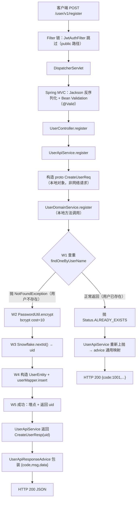
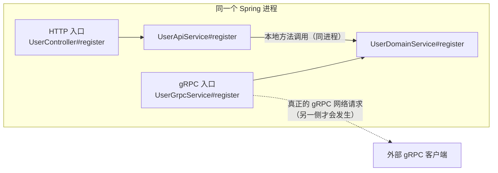
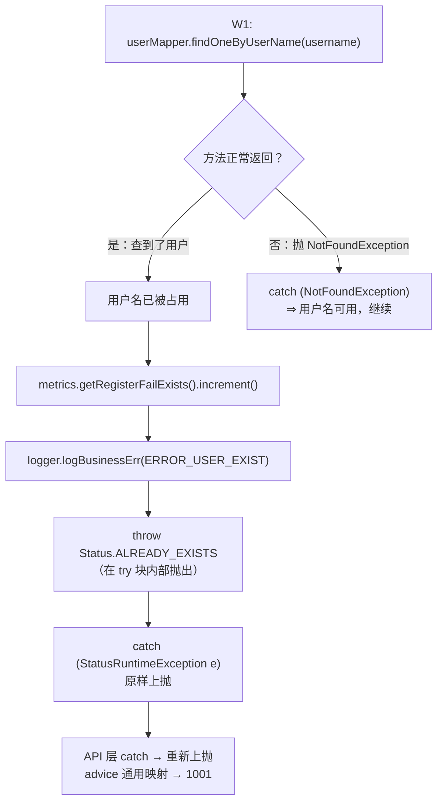
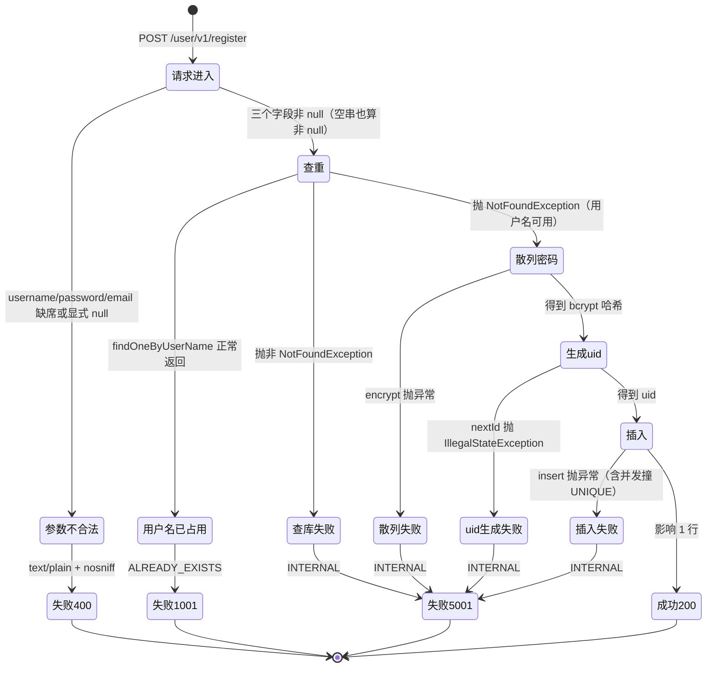

# 02. 用户注册流程

> 一次 `POST /user/v1/register` 从 HTTP 报文进来，到客户端手里拿到新用户的 uid，中间到底发生了什么。
> 本文逐行对照本仓 `service/users/user/` 与 `common/` 的**真实源码**写成。

---

## 1. 本次流程的研究范围

我们追踪的是**一个具体的 HTTP 请求**，从 Tomcat 收到字节开始，到响应体写回客户端结束。

**追踪到哪儿为止**

- 完整追踪：Filter 链 → `JwtAuthInterceptor` → Spring MVC 参数解析与校验 →
  `UserController#register` → `UserApiService#register` → `UserDomainService#register` →
  `UserMapper#findOneByUserName`（查重）→ `PasswordUtil#encrypt`（bcrypt）→
  `Snowflake#nextId`（生成 uid）→ `UserMapper#insert`（`BaseMapper`）→ PostgreSQL →
  `UserApiResponseAdvice` → 响应体。
- 失败分支也在对应位置展开：每一条失败都追到「HTTP 状态码 + 客户端看到的 body」为止。

**不追踪什么**

| 不追踪 | 原因 |
|---|---|
| 进程启动（建表 / Nacos 注册 / workerId 解析） | 与本次请求无关 |
| `UserGrpcService` 的**执行** | 它是另一个入口，不是本次 HTTP 请求走过的一段路。§4.3 只用它对照说明「proto 类型 ≠ gRPC 调用」 |
| 登录流程 | 见 [`./01-用户登录流程.md`](./01-用户登录流程.md)；本文只在必要处对比 |
| JWT 签发 | 注册**不签 Token**。注册成功只返回 uid，客户端要拿 token 得再调一次登录 |

**判定基准**：本仓行为以 B 侧 RAG 仓（只读）为唯一 oracle（D16）。本文只描述本仓源码里**读到的**行为；
凡是源码无法确认的，本文会直接写「源码无法确认」，不补造。

---

## 2. 触发场景与输入

客户端发送：

```
POST /user/v1/register
Content-Type: application/json

{
    "username": "alice",
    "password": "123456",
    "email": "alice@example.com",
    "extra_info": {
        "nickname": "爱丽丝"
    }
}
```

这次操作最终要完成四件事：

1. 确认 `username` 还没被占用；
2. 把明文密码做 bcrypt 散列（**永不落库明文**）；
3. 用雪花算法生成一个全局唯一的 `uid`；
4. 把这一行插进 `users_user` 表，把新 `uid` 返回给客户端。

这里先拆开两个容易混的概念：

- **注册成功 ≠ 用户已能登录**。注册只建号；能不能登录还要看密码对不对、账号有没有被封禁。
- **注册成功 ≠ 返回了 uid**。中间隔着「查重 → 散列 → 生成 ID → 落库」四步，任何一步失败都不会有 uid。

---

## 3. 整体执行路线



这张图是**导航图**。下面逐环节展开。

---

## 4. 逐步讲解

### 4.1 请求是怎么走到 `UserController#register` 的？

涉及文件：

- `service/users/user/src/main/java/com/rag/user/interceptor/JwtAuthFilter.java`
- `service/users/user/src/main/java/com/rag/user/interceptor/JwtAuthInterceptor.java`
- `service/users/user/src/main/java/com/rag/user/interceptor/JwtAuthPaths.java`
- `service/users/user/src/main/java/com/rag/user/controller/UserController.java`

处理链与登录完全一样：

```
Tomcat 收到 HTTP 请求
  ↓
Servlet Filter 链（JwtAuthFilter、共享层的 trace / 3s 预算 / body 限额 …）
  ↓
DispatcherServlet
  ↓
HandlerInterceptor.preHandle（JwtAuthInterceptor）
  ↓
参数解析（Jackson）+ Bean Validation
  ↓
调用 Controller 方法
```

**注册是 public 路径，不需要 JWT。** `JwtAuthPaths.PUBLIC_PATHS` 里只有两个路径
（`JwtAuthPaths.java:41-43`）：

```java
public static final Set<String> PUBLIC_PATHS = Set.of(
        "/user/v1/register", "/user/v1/login"
);
```

- Filter 侧：`JwtAuthPaths.isProtected(uri)` 对 `/user/v1/register` 返回 false ⇒ 跳过验签
  （`JwtAuthFilter.java:103`）；
- Interceptor 侧：`JwtAuthPaths.isPublic(uri)` 返回 true ⇒ `preHandle` 第一段就 `return true`
  （`JwtAuthInterceptor.java:74-79`）。

⇒ 未登录的客户端可以调用注册接口。这是必须的 —— 否则「注册」本身就需要一个已有的账号，
就成了先有鸡还是先有蛋。

### 4.2 请求 DTO 的四个字段

`controller/UserController.java:92-95`：

```java
@PostMapping("/register")
public CreateUserResp register(@Valid @RequestBody CreateUserReq req, HttpServletRequest httpRequest) {
    return userApiService.register(req, httpRequest);
}
```

DTO 本体（`dto/user/CreateUserReq.java`）：

```java
public record CreateUserReq(
        @NotNull String username,
        @NotNull String password,
        @NotNull @JsonInclude(JsonInclude.Include.NON_NULL) String email,
        @JsonInclude(JsonInclude.Include.NON_NULL) @JsonProperty("extra_info") Map<String, String> extraInfo
) {
}
```

几个细节：

**① JSON 键名**

| Java 分量 | JSON 键 | 为什么 |
|---|---|---|
| `username` | `username` | 没写 `@JsonProperty` ⇒ 用字段名 |
| `password` | `password` | 同上 |
| `email` | `email` | 同上 |
| `extraInfo` | **`extra_info`** | 写了 `@JsonProperty("extra_info")` ⇒ 驼峰转下划线 |

⚠️ 注意 `extraInfo` 的 JSON 键是**下划线** `extra_info`，和数据库列名一致；
而 `username` / `password` / `email` 本来就是全小写单词，看不出差别。
只有 `extraInfo` 这一处需要 `@JsonProperty` 才能对上。

**② 三个必填字段用 `@NotNull` 而不是 `@NotBlank`**

和登录一样：`@NotNull` 只判 null，**空串合法**。

**③ `extra_info` 没有加任何校验约束**

真源侧对 `extra_info` 用的是「三态判定」（缺席不报、显式 null 报），
这个语义在 Java `record` 形态下**不可表达** ⇒ 本仓不加约束 ⇒
**显式传 `"extra_info": null` 也会被放行**。这属于**已登记的 L3 降级**
（`docs/L3-降级清单.md` D-01 ②），不是遗漏。

**④ `@JsonInclude(NON_NULL)`**

`email` 和 `extraInfo` 上带了 `@JsonInclude(JsonInclude.Include.NON_NULL)`
⇒ 这两个字段为 null 时**不出现在 JSON 里**（不是 `"email":null`）。
这跟响应信封 `ApiResponse` 的规则**不一样** —— 信封三个字段都没有 `@JsonInclude`，
所以 `data` 为 null 时键仍然存在（`"data":null`）。**两处规则不同，别混。**

### 4.3 `UserApiService#register`：DTO → proto，以及「这不是 gRPC 调用」

`service/UserApiService.java:177-198`：

```java
public CreateUserResp register(com.rag.user.dto.user.CreateUserReq req, HttpServletRequest httpRequest) {
    com.rag.proto.user.CreateUserReq rpcReq = com.rag.proto.user.CreateUserReq.newBuilder()
            .setUsername(req.username() == null ? "" : req.username())
            .setPassword(req.password() == null ? "" : req.password())
            .setEmail(req.email() == null ? "" : req.email())
            .putAllExtraInfo(req.extraInfo() == null ? Map.of() : req.extraInfo())
            .build();

    com.rag.proto.user.CreateUserResp rpcResp;
    try {
        rpcResp = userDomainService.register(rpcReq);
    } catch (StatusRuntimeException e) {
        metrics.getRegisterRpcError().increment();
        log.error("register RPC error, username={}", req.username(), e);
        // 顶层 advice 按 gRPC code 映射业务码（INTERNAL→5001, ALREADY_EXISTS→1001, default→1015）
        throw e;
    }

    metrics.getRegisterSuccess().increment();

    return new CreateUserResp(rpcResp.getUid());
}
```

同样有两套 `CreateUserReq`：

| 类型 | 归属 | 用途 |
|---|---|---|
| `com.rag.user.dto.user.CreateUserReq` | HTTP API 层的 DTO（record） | 承接 Jackson 反序列化 + Bean Validation |
| `com.rag.proto.user.CreateUserReq` | 根级 `proto/` 模块生成的 protobuf 消息 | 领域层与 gRPC 入口共用 |

proto 侧定义（`proto/src/main/proto/users.proto:29-38`）：

```protobuf
message CreateUserReq {
  string username = 1;
  string password = 2;
  string email = 3;
  map<string, string> extra_info = 4;
}

message CreateUserResp {
  int64 uid = 1;
}
```

#### 为什么类型是 proto，却不是一次 gRPC 网络请求？

`userDomainService.register(rpcReq)` 调的是**通过构造器注入的普通 Spring Bean**
（`UserApiService.java:65` 声明字段，`:70-78` 构造器注入）的普通方法。
**同进程、同线程、无序列化、无 channel、无网络往返。**

判断依据（源码可见）：

- 调用点上没有 `ManagedChannel`、没有 Stub、没有目标地址；
- `UserDomainService` 是 `@Service`，被容器直接注入；
- 本仓 user 域**没有跨域 gRPC 客户端**：`application.yml:87-94` 的 `grpc.client: {}` 明确写着
  「本域无跨域 gRPC 调用」。

真正的 gRPC 入口在 `grpc/UserGrpcService.java:86-87`（类声明）与 `:114-117`（`register` 方法）：

```java
@GrpcService
public class UserGrpcService extends UserServiceGrpc.UserServiceImplBase {
    ...
    @Override
    public void register(CreateUserReq request, StreamObserver<CreateUserResp> responseObserver) {
        try {
            CreateUserResp resp = userDomainService.register(request);
            responseObserver.onNext(resp);
            responseObserver.onCompleted();
        } catch (StatusRuntimeException e) {
            ...
```

**两个入口，一份领域代码**：



#### 🔴 注册端点走的是 **advice 的通用映射**，不是端点内映射

这一点和登录端点**不一样**，很容易看错。

- **登录**（`UserApiService.java:112-123`）：端点自己 `catch` 后写了个 switch，
  `INTERNAL → 5001`、其它 → `1015`，然后抛 `BusinessException`。
- **注册**（`UserApiService.java:188-193`）：`catch` 之后**原样上抛** `throw e`，
  交给 advice 的通用映射 `UserApiExceptionHandler#handleRPC` 处理。

通用映射表（`UserApiExceptionHandler.java:116-130`）：

| gRPC code | 业务码 | 含义 |
|---|---|---|
| `INTERNAL` | `5001` | 系统内部错误 |
| `NOT_FOUND` | `1003` | 用户不存在 |
| `ALREADY_EXISTS` | `1001` | 用户名已存在 |
| `INVALID_ARGUMENT` | `500` | 通用失败 |
| 其它 | `1015` | 服务繁忙 |

⇒ **注册端点能产出 `1001`**，登录端点**产不出** `1001`（它的本地 switch 只有两格）。
两套映射并存且不完全相同 —— 这是照抄真源的结果，不是 bug。

⚠️ 还有个指标上的小陷阱：`metrics.getRegisterRpcError().increment()` 在
`catch (StatusRuntimeException e)` 里**无条件 +1** ⇒ **「用户名已存在」也会让
`user_api_intercept_total{path="/user/register",result="rpc_error"}` 增长**。
指标名叫 `rpc_error`，但这一行**根本没有发生 RPC**（同进程直连），而且「已存在」是正常业务结果。

### 4.4 领域层 `register`：W1~W5 全貌

`domain/service/UserDomainService.java:257-264`：

```java
public CreateUserResp register(CreateUserReq req) {
    Span span = tracer.spanBuilder("Action-User-Register")
            .setAttribute("biz.username", req.getUsername())
            .startSpan();
    Context otelCtx = Context.current().with(span);
    checkDeadline();

    try {
```

源码 javadoc 里写明的执行序（`UserDomainService.java:248-255`）：

```
W1 查重 FindOneByUserName → 命中返 AlreadyExists
W2 PasswordUtil.encrypt(req.Password) → bcrypt hash（cost=10）
W3 Snowflake.nextId() → uid
W4 insert(User{...})
W5 metrics 成功 / fail_exists / db_error / internal_error
```

#### ⚠️ `register` 与 `login` 在 deadline 检查上的两处不同

这是一处很容易看漏的**真实代码差异**：

| | `login` | `register` |
|---|---|---|
| `checkDeadline()` 位置 | 在 `try` **内部**（`:167`） | 在 `try` **外部**（`:262`） |
| 检查次数 | 3 次（进入时 / W1 前 / W2 前） | **1 次**（只有进入时） |
| `checkDeadline()` 抛异常时 span 会 end 吗 | **会**（`finally` 覆盖） | **不会**（`finally` 还没进） |

⇒ 在 `register` 里，如果 `checkDeadline()` 抛 `DEADLINE_EXCEEDED`，
`finally { span.end(); }` **不会执行** ⇒ 这个 span 泄漏（不结束）。

不过在本条 HTTP 路径上这不会发生：`DeadlineState.isExpired()` 在未绑定时恒为 `false`
（`DeadlineState.java:109-114`），而绑定动作发生在 **gRPC** 服务端拦截器里
（`common/observability/RpcHandleRunner.java:121`）。
HTTP 侧的 3 秒预算是共享层 `HttpMiddleware` 用「worker 线程 + 预算计时」实现的，
**不写 `DeadlineState`**。

⇒ 所以在 HTTP 注册路径上，`checkDeadline()` 实际上只会因「线程被中断」而抛，
`DEADLINE_EXCEEDED` 属于 gRPC 入口的失败分支。

顺带说明共享层的两个 MyBatis 拦截器（`common/autoconfigure/PersistenceAutoConfiguration.java`）：

- `DeadlineQueryTimeoutInjector` —— 按线程上的 deadline 给 SQL 设 query timeout。
  **没有 deadline 时完全不碰 statement**（`DeadlineState.remainingMillis()` 返回 `Long.MAX_VALUE`）⇒
  HTTP 路径上**不会**给 SQL 设超时；
- `SqlTimeoutStatusTranslator` —— 把 PG 的 `57014 query_canceled` 翻译成 gRPC `DEADLINE_EXCEEDED`。
  它拦截 `Executor#update`（INSERT 也算 update）⇒ 万一真出现 SQL 取消，
  抛的是 `StatusRuntimeException` ⇒ 会被领域层的 `catch (StatusRuntimeException e) { throw e; }` 原样上抛
  ⇒ advice 通用映射落到 `default` ⇒ **1015**（不是 5001）。

### 4.5 W1：查重 —— 用异常表达「不存在」

`UserDomainService.java:265-284`：

```java
// W1 查重
try {
    userMapper.findOneByUserName(req.getUsername());
    metrics.getRegisterFailExists().increment();
    logger.logBusinessErr(otelCtx, ErrCodes.ERROR_USER_EXIST,
            new RuntimeException("username has existed"));
    throw Status.ALREADY_EXISTS.withDescription("用户名已存在").asRuntimeException();
} catch (NotFoundException e) {
    // 用户名可用，继续
} catch (StatusRuntimeException e) {
    // 上面刚抛的 ALREADY_EXISTS：原样上抛，不能掉进下面的 db_error 分支
    throw e;
} catch (Exception e) {
    // B 侧 DRIFT-009：Go 出处 registerlogic.go:50-54 ——「非 ErrorNotFound」单独成一支，
    // 打 db_error 指标 + ErrorDbSelect 日志 + span.RecordError，再返 Internal。
    metrics.getRegisterDbError().increment();
    span.recordException(e);
    logger.logBusinessErr(otelCtx, ErrCodes.ERROR_DB_SELECT, e);
    throw Status.INTERNAL.withDescription("DB查询失败").asRuntimeException();
}
```

#### 🔴 这段代码的形状，和登录正好相反

`UserMapper#findOneByUserName`（`mapper/UserMapper.java:53-59`）：

```java
default UserEntity findOneByUserName(String username) {
    UserEntity u = selectByUsernameRaw(username);
    if (u == null) {
        throw new NotFoundException("user not found by username: " + username);
    }
    return u;
}
```

「用户不存在」在这里是**异常**，不是 `null`。

于是：

| `findOneByUserName` 的结果 | 在 `register` 里意味着 | 走向 |
|---|---|---|
| **正常返回**（用户存在） | 用户名**已被占用** | 埋点 + 抛 `ALREADY_EXISTS` |
| **抛 `NotFoundException`** | 用户名**可用** | catch 住 → 继续往下走 |

⇒ **「error 不是值」的设计在这里被反向使用**：
同一个异常，在登录流程里表示失败，在注册流程里表示**成功**。

对初学者来说这是最反直觉的一处，所以单独画图：



#### 🔴 为什么 `catch (StatusRuntimeException e) { throw e; }` 这一格不能删

看代码顺序：`throw Status.ALREADY_EXISTS...` **写在 `try` 块内部**。

Java 的规则是：**try 块里抛出的异常，会被同一个 try 的 catch 捕获**。
所以 `ALREADY_EXISTS` 抛出后，第一个不匹配的 catch 是 `catch (NotFoundException e)`（不匹配），
接着是 `catch (StatusRuntimeException e)` —— **它会匹配上**。

如果没有这一格，`ALREADY_EXISTS` 会继续掉进 `catch (Exception e)` ⇒ 被改写成
`Status.INTERNAL "DB查询失败"` ⇒ 客户端拿到的就是 **5001** 而不是 **1001**。

⇒ 这一格的作用就一句话：**把「用户名已存在」和「数据库查询失败」区分开**。
它同时也是「先抛后捕」这种写法的必然要求。

#### 「已存在」是领域层主动抛的，不是数据库唯一约束冲突

`AlreadyExists` 完全由**领域层的 `throw`** 产生（`UserDomainService.java:271`）。
查重那一步**没有碰过数据库的唯一约束** —— 它只是一条 `SELECT`。

那 `users_user.username` 上的 UNIQUE 约束呢？它**存在**（`db/01_create_user.sql:36`），
但在这条**串行**路径上不会先被触发：查重已经把重名挡在 insert 之前了。

⚠️ 但「查重 + 插入」**不是一个原子操作**（本流程没有事务，见 §6）⇒ 两次并发的注册请求
可能都通过查重，然后第二个在 insert 时撞唯一约束 ⇒
那会被 `catch (Exception e)` 接住 ⇒ 变成 `Status.INTERNAL "DB更新失败"` ⇒ **5001**（不是 1001）。

⇒ 换句话说：**并发下的重名，客户端看到的是 5001 而不是 1001**。这是源码形状的直接后果，
不是推断（源码里确实没有事务、没有 `SELECT ... FOR UPDATE`、也没有捕获唯一冲突并转 1001 的分支）。

#### 其它两个 catch 分别对应什么

- `catch (Exception e)` ⇒ **数据库查询失败**（连接断了、SQL 语法错、超时…）：
  埋 `registerDbError` 指标、记 `ERROR_DB_SELECT`(5003) 业务错误日志、`span.recordException(e)`，
  然后抛 `Status.INTERNAL "DB查询失败"`。
- `catch (StatusRuntimeException e) { throw e; }` ⇒ 把上面刚抛的 `ALREADY_EXISTS` 原样带走。

⚠️ 注意：**领域层不设 span 状态**。源码注释写明了原因：真源侧的 `span.RecordError(err)`
**不改 Span 状态**（恒为 Unset）⇒ 这里多置 `ERROR` 就是遥测面漂移。

### 4.6 W2：bcrypt 散列

`UserDomainService.java:286-299`：

```java
// W2 bcrypt
String hash;
try {
    hash = PasswordUtil.encrypt(req.getPassword());
} catch (StatusRuntimeException e) {
    // B-1：DEADLINE_EXCEEDED 必须上抛
    throw e;
} catch (Exception e) {
    metrics.getRegisterInternalError().increment();
    span.recordException(e);
    logger.logBusinessErr(otelCtx, ErrCodes.ERROR_SERVER_COMMON, e);
    throw Status.INTERNAL.withDescription("密码生成失败").asRuntimeException();
}
```

`PasswordUtil.encrypt`（`common/security/PasswordUtil.java:73-75`）：

```java
public static String encrypt(String rawPassword) {
    return ENCODER.encode(rawPassword);
}
```

`ENCODER` 是 `new BCryptPasswordEncoder(10)`（`PasswordUtil.java:48-49`，`STRENGTH = 10`）。

**bcrypt 到底做了什么**

- **加盐**：每次 `encode` 都生成一个**随机盐**并嵌进结果里。
  ⇒ **同一个密码每次散列出来的字符串都不一样** ⇒ `password` 列不能用 `=` 比较，
  只能用 `PasswordUtil.checkDetailed` 去校验；
- **慢哈希**：cost=10 意味着计算量被刻意放大（2^10 轮）⇒ 单次调用会消耗可观的 CPU 时间，
  这是**故意的**：让暴力破解的成本高到不可接受。
  （⚠️ 「具体耗时多少」是 bcrypt cost 的通用属性，**本仓没有对应测量**，
  本仓源码里能确认的只有 `STRENGTH = 10` 这个参数本身。）
- **自带盐 ⇒ 不需要额外的 salt 列**。

**「密码永不落库明文」**：客户端发来的 `req.getPassword()`（明文）只在**这一次调用里**出现，
落库的 `u.setPassword(hash)` 写进去的已经是 bcrypt 哈希。
明文密码不会被写进任何表、任何日志。

⚠️ 一个可以确认的推论：`password` 列**没有唯一约束**（`db/01_create_user.sql:37` 只有 `password TEXT`），
这是对的 —— 加盐意味着相同密码的哈希本来就不同。

### 4.7 W3：雪花 ID 生成 uid

`UserDomainService.java:301-313`：

```java
// W3 snowflake
long uid;
try {
    uid = Snowflake.nextId();
} catch (StatusRuntimeException e) {
    // B-1：DEADLINE_EXCEEDED 必须上抛
    throw e;
} catch (Exception e) {
    metrics.getRegisterInternalError().increment();
    span.recordException(e);
    logger.logBusinessErr(otelCtx, ErrCodes.ERROR_SERVER_COMMON, e);
    throw Status.INTERNAL.withDescription("uid生成失败").asRuntimeException();
}
```

`Snowflake.nextId()`（`common/snowflake/Snowflake.java:268-280`）：

```java
public static long nextId() {
    if (workerId == null && initError == null) {
        init(); // 对应 B 的 GetID() 第一行 Init()
    }
    if (initError != null) {
        throw new IllegalStateException("snowflake node is not initialized", initError);
    }
    Long id = workerId;
    if (id == null) {
        throw new IllegalStateException("snowflake node is not initialized");
    }
    return nextIdInternal(id, STATE);
}
```

**位布局**（`Snowflake.java:56-74`）—— 41 位时间戳 + 10 位 workerId + 12 位序列：

```java
static final long EPOCH = 1288834974657L;   // Twitter 雪花 epoch
static final long WORKER_ID_BITS = 10L;     // → workerId 占 10 位（0~1023）
static final long SEQUENCE_BITS = 12L;      // → 序列占 12 位（0~4095）
static final long WORKER_ID_SHIFT = SEQUENCE_BITS;                 // = 12
static final long TIMESTAMP_SHIFT = SEQUENCE_BITS + WORKER_ID_BITS; // = 22
```

最终 id 的算法在 `Snowflake.java:373-375`：

```java
return (now << TIMESTAMP_SHIFT)
        | (workerIdArg << WORKER_ID_SHIFT)
        | state.sequence;
```

拆开看：

| 位段 | 位数 | 内容 |
|---|---|---|
| 高 41 位 | 41 | `now` = 距 epoch 的毫秒数 |
| 中 10 位 | 10 | `workerId`（进程标识，0~1023） |
| 低 12 位 | 12 | `sequence`（同一毫秒内的自增序号，0~4095） |

同一毫秒内连续调用时 `sequence` 递增（`Snowflake.java:353-354`）；
序号耗尽（`sequence` 归零）时**自旋到下一毫秒**（`:355-362`）。

`workerId` 的来源有三级优先级（`common/autoconfigure/SnowflakeAutoConfiguration.java`）：

1. 环境变量 `SNOWFLAKE_NODE_ID`；
2. Spring 配置 `snowflake.worker-id`；
3. 兜底：`SERVICE_NAME + "-" + PID` 做 sha256，取前 2 字节 `% 1024`。

进程启动时 `wiring/SnowflakeBootstrap.java` 会用 `@EventListener(ApplicationReadyEvent.class)`
校验 workerId 范围并触发 `Snowflake.init()`。

⚠️ **`Snowflake.nextId()` 抛的异常类型是 `IllegalStateException`**（不是 `StatusRuntimeException`）
⇒ 它会被 W3 的 `catch (Exception e)` 接住 ⇒ 转成 `Status.INTERNAL "uid生成失败"` ⇒ 5001。

### 4.8 W4：构造实体 + insert

`UserDomainService.java:315-338`：

```java
// W4 Insert
UserEntity u = new UserEntity();
u.setUid(uid);
u.setUsername(req.getUsername());
u.setPassword(hash);
u.setEmail(req.getEmail());
u.setScore(0);
u.setStatus(0L);
if (req.getExtraInfoCount() > 0) {
    Map<String, String> map = new HashMap<>();
    req.getExtraInfoMap().forEach(map::put);
    u.setExtraInfo(map);
}
try {
    userMapper.insert(u);
} catch (StatusRuntimeException e) {
    // B-1：DEADLINE_EXCEEDED 必须上抛
    throw e;
} catch (Exception e) {
    metrics.getRegisterDbError().increment();
    span.recordException(e);
    logger.logBusinessErr(otelCtx, ErrCodes.ERROR_DB_UPDATE, e);
    throw Status.INTERNAL.withDescription("DB更新失败").asRuntimeException();
}
```

#### 实体上每个字段的值从哪来

| 实体字段 | 值 | 来源 |
|---|---|---|
| `id` | **由 MyBatis-Plus 填** | `@TableId(type = IdType.ASSIGN_ID)`（见下） |
| `uid` | `uid` | W3 的雪花 ID（**业务主键**） |
| `username` | 请求里的用户名 | 原样 |
| `password` | `hash` | W2 的 bcrypt 结果（**不是明文**） |
| `email` | 请求里的邮箱 | 原样 |
| `score` | `0` | 固定初值 |
| `status` | `0L` | 固定初值（**不是 null**） |
| `extraInfo` | 请求里的 map（仅当非空时） | `req.getExtraInfoCount() > 0` 才 set |
| `create_time` / `update_time` | **不 set（null）** | 交给数据库默认值 |

#### 🔴 `id` 和 `uid` 是**两套不同的 ID 生成器**

这点非常容易看错。

- **`uid`（业务主键）** = W3 里共享层 `com.rag.common.snowflake.Snowflake.nextId()` 产出的值，
  **显式 set** 到实体上。`users_user.uid` 是 `BIGINT NOT NULL UNIQUE`。
- **`id`（数据库代理主键）** = 实体上没 set（是 null），由 **MyBatis-Plus 自己**在插入前填上。
  实体声明（`domain/entity/UserEntity.java:43-44`）：

  ```java
  @TableId(type = IdType.ASSIGN_ID)
  private Long id;
  ```

  `ASSIGN_ID` 的语义是「由框架生成 id」。MyBatis-Plus 3.5.17 的默认生成器是
  `com.baomidou.mybatisplus.core.incrementer.DefaultIdentifierGenerator`（自带一套与共享层**无关**的
  worker/datacenter + sequence 实现）。

⇒ 所以这个表里有**两个雪花**：一个来自本仓共享层（`uid`），一个来自 MyBatis-Plus（`id`）。
业务上真正被引用、被当作用户身份的是 **`uid`**（JWT 的 `userId` claim 装的就是它）。

⚠️ 顺带一个可观察后果：`users_user.id` 的 DDL 是 `BIGSERIAL PRIMARY KEY`
（`db/01_create_user.sql:34`），但 MP 因为 `ASSIGN_ID` **显式提供了 id 值**
⇒ **PostgreSQL 的 BIGSERIAL 序列在这条路径上不会被使用**。

#### `extra_info` 的两态

```java
if (req.getExtraInfoCount() > 0) {
    Map<String, String> map = new HashMap<>();
    req.getExtraInfoMap().forEach(map::put);
    u.setExtraInfo(map);
}
```

- `req` 这里是 **proto** 消息，`getExtraInfoCount()` 是 protobuf map 的元素个数，`getExtraInfoMap()` 返回 map 视图；
- 代码把它**拷贝**进一个可变的 `HashMap` 再 set 到实体上；
- **`extra_info` 缺席时 `u.extraInfo` 保持 null** ⇒ MP 的 insert 字段策略是 `NOT_NULL`
  ⇒ 该列不进 INSERT 语句 ⇒ 数据库那一列就是 `NULL`。

#### 🔴 `extra_info` 是 `text` 列，手写 SQL 必须显式声明 TypeHandler

这是本域持久层最容易踩的坑，**而且失败方式是「静默变 null」而不是报错**。

**列的类型**（`db/01_create_user.sql:41`）：

```sql
extra_info  TEXT,
```

（真源侧建出来的是 `text`，不是 `jsonb` —— 这是 2026-10-23 实测钉死的：GORM 的 `serializer:json` tag
让列按字符串建。`jsonb` 会**改写存进去的字节**（去重键 + 按键长/字节序重排 + 补空格），
所以必须跟真源一样用 `text`。）

**实体上的声明**（`domain/entity/UserEntity.java:88-89`）：

```java
@TableField(value = "extra_info", typeHandler = JsonTextTypeHandler.class)
private Map<String, String> extraInfo;
```

加上类上的（`:40`）：

```java
@TableName(value = "users_user", autoResultMap = true)
```

**为什么 `autoResultMap = true` 不能去掉**：没有它，MyBatis-Plus 自己生成的 ResultMap
不会采用 `extra_info` 字段上声明的 TypeHandler ⇒ 读回来的 JSON 文本会是 `null`（**不报错**）。
实体类的 javadoc 把这条写死了。

**为什么手写 SQL 必须显式 `@Results`**：MyBatis **不认识** MyBatis-Plus 的 `@TableField` ⇒
实体字段上的 TypeHandler **只对 MP 自己生成的 SQL 生效**。
所以 `UserMapper#selectByUsernameRaw`（`mapper/UserMapper.java:40-45`）必须自己声明：

```java
@Select("SELECT * FROM users_user WHERE username = #{username} LIMIT 1")
@Results({
        @Result(property = "extraInfo", column = "extra_info",
                javaType = java.util.Map.class, typeHandler = JsonTextTypeHandler.class)
})
UserEntity selectByUsernameRaw(@Param("username") String username);
```

不写 `@Results` 的话，`extra_info` 那一列会**被当成普通 String 取回，然后塞不进 `Map` 字段**
⇒ 结果是 `extraInfo == null`，**没有任何异常**。

`JsonTextTypeHandler`（`common/persistence/JsonTextTypeHandler.java`）做两件事：

- **写**：`setNonNullParameter` ⇒ `ps.setString(i, toJson(parameter))`
  ⇒ Map 先被 Jackson 序列化成 JSON 文本，再以 **String** 绑定进 `text` 列（text 列的原生绑定方式）；
- **读**：`getNullableResult` ⇒ `ResultSet.getString` 取回 JSON 文本，Jackson 再解析成 `Map<String,String>`。

⇒ 所以 Map ⇄ `text` 列的转换全部由这个 TypeHandler 承担，**列里存的是 JSON 文本**。

#### insert 用的是 MyBatis-Plus 的 `BaseMapper#insert`（自动生成 SQL）

`UserMapper` 继承 `BaseMapper<UserEntity>`（`mapper/UserMapper.java:31-32`）：

```java
@Mapper
public interface UserMapper extends BaseMapper<UserEntity> {
```

所以 `userMapper.insert(u)` 是 **MyBatis-Plus 自动生成的 SQL**，不是手写 `@Insert`。
MP 根据实体元数据拼出 INSERT 语句，列名来自 `@TableField`、表名来自 `@TableName`。

几个由 MP 行为决定的点：

- **列的取舍**：MP 3.5.17 的默认 insert 字段策略是 `FieldStrategy.NOT_NULL`
  ⇒ **值为 null 的字段不进 INSERT 语句** ⇒ `create_time` / `update_time`（实体里是 null）
  不会出现在 INSERT 里 ⇒ 走数据库默认值 `CURRENT_TIMESTAMP`（`db/01_create_user.sql:42-43`）。
- **`id` 的填充**：如上，MP 在插入前用 `IdentifierGenerator` 填上 `id`。
- **`extra_info` 的绑定**：实体上声明了 `typeHandler` ⇒ MP 生成的 SQL 采用它 ⇒ Map 被序列化成 JSON 文本写入。

⚠️ 精确到「MP 生成的 INSERT 语句由哪个 `TypeHandler` 实例完成参数绑定」这一步，
属于 MyBatis-Plus / MyBatis 的内部机制，**本仓源码里没有直接证据**。
本仓可确认的是它写下来的**契约**：实体字段上的 `@TableField(typeHandler=...)` 只对 MP 自己生成的 SQL 生效；
手写 SQL 必须自己写 `@Results`（上面已引原文）。

### 4.9 W5：成功

`UserDomainService.java:340-346`：

```java
// W5 成功
metrics.getRegisterSuccess().increment();
logger.logInfo(otelCtx, "register success,uid : " + uid);
return CreateUserResp.newBuilder().setUid(uid).build();
} finally {
    span.end();
}
```

领域层返回的是 proto `CreateUserResp{uid}`。

⚠️ 领域层的 `registerSuccess` 计数在**方法返回前**就 +1 了；
而 API 层的 `registerSuccess`（`UserApiService.java:195`）在领域层**正常返回之后**才 +1。
⇒ 如果领域层抛异常，API 层的 `registerSuccess` 不会增长。两个指标口径不同。

### 4.10 回到 API 层 → 响应信封

`UserApiService.java:195-197`：

```java
metrics.getRegisterSuccess().increment();

return new CreateUserResp(rpcResp.getUid());
```

`CreateUserResp`（`dto/user/CreateUserResp.java`）：

```java
public record CreateUserResp(
        @JsonProperty("uid") @JsonSerialize(using = ToStringSerializer.class) Long uid
) {
}
```

⚠️ **`uid` 在 wire 上是字符串**：`@JsonSerialize(using = ToStringSerializer.class)`
⇒ 输出 `"uid":"1234567890123456789"`，不是数字。
这是 L1 契约（真源侧 B 侧的 `getUid()` 返回 `String`）——
雪花 ID 已经接近 `Long` 的上限，用 JSON number 传输在 JavaScript 侧会丢精度。

然后和登录一样，`advice/UserApiResponseAdvice.java:74` 把它包成信封：

```java
return new ApiResponse(ErrCodes.SUCCESS, ErrMsg.getMsg(ErrCodes.SUCCESS), body);
```

最终响应：

```json
{
  "code": 200,
  "msg": "OK",
  "data": {
    "uid": "1234567890123456789"
  }
}
```

---

## 5. 重要分支与失败路径

### 5.1 全失败分支速查

| 发生位置 | 触发条件 | 领域层返回 / 抛出 | API 层 | HTTP 状态码 | 客户端看到的 body |
|---|---|---|---|---|---|
| 参数解析 | body 缺失 / 非 JSON / 字段类型不对 | （没进业务层） | — | **400** | `text/plain` 裸文案 + `nosniff` |
| 参数校验 | `username` / `password` / `email` 任一为 `null`（含 `{}`） | （没进业务层） | — | **400** | `text/plain` 裸文案 + `nosniff` |
| Content-Type | 不是 `application/json` | （没进业务层） | — | **415** | 空 body |
| W1 查重 | 用户名已存在 | 抛 `Status.ALREADY_EXISTS` | 重新上抛 → advice 通用映射 | **200** | `{"code":1001,"msg":"用户名已存在","data":null}` |
| W1 查重 | 数据库查询失败 | 抛 `Status.INTERNAL` | 重新上抛 → 通用映射 | **200** | `{"code":5001,"msg":"系统内部错误","data":null}` |
| W2 bcrypt | 散列失败 | 抛 `Status.INTERNAL` | 重新上抛 → 通用映射 | **200** | `{"code":5001,"msg":"系统内部错误","data":null}` |
| W3 Snowflake | ID 生成失败 | 抛 `Status.INTERNAL` | 重新上抛 → 通用映射 | **200** | `{"code":5001,"msg":"系统内部错误","data":null}` |
| W4 insert | 插入失败（含并发撞唯一约束） | 抛 `Status.INTERNAL` | 重新上抛 → 通用映射 | **200** | `{"code":5001,"msg":"系统内部错误","data":null}` |
| HTTP 方法 | 用 GET 打这个端点 | — | — | **405** | 空 body（裸状态码） |

### 5.2 「用户名已存在」为什么是 1001 而不是 5001？

因为领域层抛的是 `Status.ALREADY_EXISTS`（`UserDomainService.java:271`），
而 advice 的通用映射里 `ALREADY_EXISTS → ERROR_USER_EXIST = 1001`
（`UserApiExceptionHandler.java:123-125`）。

如果少了 `catch (StatusRuntimeException e) { throw e; }` 那一格，
`ALREADY_EXISTS` 会掉进 `catch (Exception e)` 被改写成 `INTERNAL` ⇒ **5001**。
详见 §4.5。

### 5.3 五个 5001 分别对应什么

领域层五个步骤各自的失败都收敛到 `Status.INTERNAL`，在 API 层统一映射成 `5001 系统内部错误`：

| 失败点 | 领域层抛出的 description | 领域层指标 |
|---|---|---|
| W1 数据库查询失败 | `"DB查询失败"` | `user_rpc_register_total{result="db_error"}` |
| W2 bcrypt 失败 | `"密码生成失败"` | `user_rpc_register_total{result="internal_error"}` |
| W3 Snowflake 失败 | `"uid生成失败"` | `user_rpc_register_total{result="internal_error"}` |
| W4 insert 失败 | `"DB更新失败"` | `user_rpc_register_total{result="db_error"}` |

⚠️ **`description` 不会传到客户端**。API 层 catch 之后重新构造 `BusinessException(5001, "系统内部错误")`，
客户端只看到 `msg` 字段的文案；`description` 只留在服务端日志和 gRPC 异常对象里。

⇒ 这意味着：**客户端区分不出「bcrypt 失败」和「数据库挂了」** —— 都是 5001。
要看具体原因，得查服务端日志（领域层 `logger.logBusinessErr` 打的业务错误日志）。

### 5.4 异常传播链：从产生到响应

以「insert 失败」为例：

```
PostgreSQL 报错（连接断 / 唯一约束冲突 / 磁盘满 …）
  ↓ 抛 DataAccessException（RuntimeException）
MyBatis-Plus 生成的 insert 语句执行失败
  ↓ 冒泡
UserDomainService#register 的 catch (Exception e)          ← UserDomainService.java:333
  ↓ metrics.getRegisterDbError().increment()
  ↓ span.recordException(e)
  ↓ logger.logBusinessErr(otelCtx, ErrCodes.ERROR_DB_UPDATE, e)
  ↓ throw Status.INTERNAL.withDescription("DB更新失败").asRuntimeException()
UserApiService#register 的 catch (StatusRuntimeException e)  ← UserApiService.java:188
  ↓ metrics.getRegisterRpcError().increment()
  ↓ log.error("register RPC error, username={}", ...)
  ↓ throw e;                                        ← 原样上抛，不转 BusinessException
UserApiExceptionHandler#handleRPC                   ← UserApiExceptionHandler.java:91
  ↓ mapRPCStatusToCode(INTERNAL) ⇒ 5001
  ↓ ResponseEntity.status(200).body(new ApiResponse(5001, "系统内部错误", null))
UserApiResponseAdvice#beforeBodyWrite
  ↓ body instanceof ApiResponse ⇒ 原样返回
HTTP 200
{"code":5001,"msg":"系统内部错误","data":null}
```

另一条链（字段校验失败）：

```
Bean Validation 发现 email == null
  ↓ 抛 MethodArgumentNotValidException
（Spring MVC 在调用 Controller 方法**之前**抛出 ⇒ Controller / Service / 领域层完全没参与）
UserApiExceptionHandler#handleBeanValidation             ← UserApiExceptionHandler.java:202
  ↓ 取第一个 field error，拼成 "email must not be null"
  ↓ PlainTextErrors.badRequest(message)
HTTP 400  Content-Type: text/plain; charset=utf-8
X-Content-Type-Options: nosniff
email must not be null
```

⚠️ **HTTP 状态码 ≠ 业务码**：

- 业务失败（1001 / 5001）⇒ **HTTP 200**，成败由 body 里的 `code` 表达；
- 参数解析 / 校验失败 ⇒ **HTTP 400 + `text/plain`**，**没有** `{code,msg,data}` 信封。

### 5.5 一个可以确认的推论：空邮箱会撞唯一约束

`@NotNull` 允许空串 ⇒ 空邮箱会原样落库（`u.setEmail(req.getEmail())`，值为 `""`）。
而 `users_user.email` 是 `TEXT UNIQUE`（`db/01_create_user.sql:38`）。

⇒ 第一个用空邮箱注册的用户成功；**第二个**用空邮箱注册的用户会在 insert 时撞唯一约束
⇒ 走 W4 的失败分支 ⇒ **5001**（不是 1001，因为撞约束发生在 insert 而不是查重那一步）。

同理，`username` 也是 `TEXT UNIQUE`，而空用户名在登录语义上是合法的（`@NotNull` 不拦空串）
⇒ 两个空用户名注册 ⇒ 第二个 5001。

（这一条是「源码明确的事实 + 一次推理」：`UNIQUE` 约束、空串合法、insert 路径都会撞约束，
三者都在源码里可核；但**具体是哪一条约束先报**取决于数据库的约束检查顺序，
**源码无法确认**。）

---

## 6. 数据变化与副作用

| 维度 | 本次注册流程里发生了什么 |
|---|---|
| **数据库读** | `SELECT * FROM users_user WHERE username = ? LIMIT 1`（查重）。**只有这一条** |
| **数据库写** | `INSERT INTO users_user (...) VALUES (...)`（MP 自动生成）。**一条** |
| **事务** | **本流程无事务**。`service/users/user` 的注册路径上**没有** `@Transactional`（唯一有事务的是头像相关的 `UserAvatarHistoryMapper`）⇒ 查重与插入是**两条独立的 auto-commit 语句** |
| **Redis** | **无**。注册是 public 路径，`JwtAuthInterceptor` 第一段就放行了 |
| **远程调用** | **无**。没有 HTTP、没有 gRPC、没有 Nacos、没有 MinIO |
| **消息** | **无** |
| **日志** | 领域层 `LoggerFactoryBean#logInfo` / `#logBusinessErr`；API 层 SLF4J `log.error` |
| **指标** | 见下表 |
| **ID 生成** | **有，两个**：`uid` = 共享层 `Snowflake.nextId()`；`id` = MyBatis-Plus 的 `ASSIGN_ID` 生成器 |
| **Token 生成** | **无**。注册**不签 JWT** |
| **OpenTelemetry** | 领域层起一个 span（`Action-User-Register`，属性 `biz.username`），`finally` 里 `span.end()`（`checkDeadline()` 抛异常时不执行，见 §4.4） |
| **密码** | **永不落库明文**。落库的是 bcrypt 哈希（cost=10，带随机盐） |

### 指标明细

| 指标 | 何时 +1 | 覆盖的语义 |
|---|---|---|
| `user_rpc_register_total{result="success"}` | 领域层 W5 | 注册成功 |
| `user_rpc_register_total{result="fail_exists"}` | 领域层 W1（用户已存在） | 用户名被占用 |
| `user_rpc_register_total{result="db_error"}` | 领域层 W1 查库失败 / W4 insert 失败 | 数据库故障 |
| `user_rpc_register_total{result="internal_error"}` | 领域层 W2 bcrypt 失败 / W3 Snowflake 失败 | 内部错误 |
| `user_api_intercept_total{path="/user/register",result="success"}` | API 层领域层正常返回后 | 端到端注册成功 |
| `user_api_intercept_total{path="/user/register",result="rpc_error"}` | API 层捕获 `StatusRuntimeException` | **包含「用户名已存在」** |

⚠️ 两个「名字会骗人」的地方：

1. `user_api_intercept_total{result="rpc_error"}` 在**「用户名已存在」时也会 +1**
   —— 而这一行根本没有发生 RPC（同进程直连），且「已存在」是正常业务结果；
2. 领域层 `success` 与 API 层 `success` **口径不同**（前者是领域层判定成功，后者是端到端成功）。

### 数据流转图：数据从哪来、变成什么、落在哪

```mermaid
flowchart LR
    subgraph IN["进入进程"]
        J["HTTP JSON body"] -->|"Jackson"| D["CreateUserReq<br/>（record，@NotNull 校验）"]
        D -->|"null 转空串兜底 + map 拷贝"| P["proto CreateUserReq"]
    end
    subgraph DOMAIN["领域层内的四次转换"]
        P --> Q1["W1 查重<br/>不改数据"]
        Q1 --> H["W2 bcrypt<br/>明文 → 哈希字符串"]
        H --> U["W3 雪花<br/>→ uid（long）"]
        U --> E["W4 UserEntity<br/>uid/username/password(hash)/email/score=0/status=0L"]
    end
    E -->|"MP 自动生成 INSERT<br/>（null 列不进语句）"| PG[("PostgreSQL<br/>users_user")]
    PG -->|"只读回 uid"| R["CreateUserResp<br/>uid 字段（字符串形态）"]
    R --> ADV["ResponseBodyAdvice<br/>包 {code,msg,data}"]
    ADV --> OUT["HTTP 200 JSON"]
```



几个从图上能直接看出来的结论：

- **明文密码只存在于 `P → H` 这一小段**（`proto` 里是明文，`hash` 之后就是 bcrypt 字符串），
  落库的永远是哈希；
- **落库这一跳是唯一一次跨进程**；
- **回读只有 `uid` 一个字段** —— 注册不返回密码、不返回哈希、不返回用户名。

### 事务边界与「失败后残留」

本流程**没有** `@Transactional`，因此：

- 查重的 SELECT 与 INSERT 是**两条独立的 auto-commit 语句**；
- ⚠️ **查重与插入之间存在竞态窗口**：两个并发注册请求可能都通过查重，
  第二个在 insert 时撞 `username` 的 UNIQUE 约束 ⇒ 走 W4 失败分支 ⇒ **5001**（不是 1001）；
- **失败后哪些操作可能已经发生**：
  - W1 失败 ⇒ 什么都没写（只有指标和日志）；
  - W2 / W3 失败 ⇒ 什么都没写。⚠️ 但 **W3 失败时雪花 ID 可能已被消耗**
    ——`Snowflake.nextId()` 是在 `nextIdInternal` 里自增 `sequence` 的，
    若自增成功后其它步骤失败，那个 ID 就被跳过了（**空洞**，不是重复）。
    本流程 W3 后面只有 W4，若 W4 失败 ⇒ **uid 已被消耗但没有行**；
  - W4 失败 ⇒ **uid 已被消耗但表里没有行**。

---

## 7. 执行结果

### 成功

请求：

```
POST /user/v1/register
Content-Type: application/json

{"username":"alice","password":"123456","email":"alice@example.com"}
```

响应：

```
HTTP/1.1 200
Content-Type: application/json

{
  "code": 200,
  "msg": "OK",
  "data": {
    "uid": "1234567890123456789"
  }
}
```

⚠️ `uid` 是**字符串**（`ToStringSerializer`）。

### 失败 · 用户名已存在

```
HTTP/1.1 200
Content-Type: application/json

{"code":1001,"msg":"用户名已存在","data":null}
```

### 失败 · 数据库 / bcrypt / Snowflake / insert 任一失败

```
HTTP/1.1 200
Content-Type: application/json

{"code":5001,"msg":"系统内部错误","data":null}
```

### 失败 · 请求体缺必填字段

```
HTTP/1.1 400
Content-Type: text/plain; charset=utf-8
X-Content-Type-Options: nosniff

email must not be null
```

（文案由 Hibernate Validator 决定；**状态码 400 与 `text/plain` 结构**与真源一致，**文案**属已登记的 L3 降级。）

---

## 8. 流程复盘

一次成功注册真正走过的代码：

```
HTTP 请求
  ↓
JwtAuthFilter（public 路径 ⇒ 跳过验签）
  ↓
共享层 Filter 链（trace / 3s 预算 / body 限额）
  ↓
JwtAuthInterceptor（public 路径 ⇒ 第一段就放行）
  ↓
Spring MVC：Jackson 反序列化 + Bean Validation
  ↓
UserController#register
  ↓
UserApiService#register
  ↓
构造 proto CreateUserReq（本地对象）
  ↓
UserDomainService#register
  ↓
  ├─ W1 UserMapper.findOneByUserName（抛 NotFoundException ⇒ 用户名可用）
  ├─ W2 PasswordUtil.encrypt（bcrypt cost=10）
  ├─ W3 Snowflake.nextId() → uid
  ├─ W4 new UserEntity + UserMapper.insert（MP BaseMapper 自动生成 SQL）
  └─ W5 领域 CreateUserResp{uid}
  ↓
UserApiService#register
  ↓
HTTP CreateUserResp{uid:"..."}
  ↓
UserApiResponseAdvice → {code, msg, data}
  ↓
HTTP 200 JSON
```

值得记住的边界，而不是这条链本身：

1. **Controller 不碰业务**。接参数、调 Service、返回结果。
2. **API Service 做「翻译」**：DTO → proto，领域结果 → API 结果，gRPC 异常 → 业务码（这里用**通用映射**）。
3. **领域层用「异常表达流程控制」**：`NotFoundException` 在这里表示**成功**（用户名可用），
   `ALREADY_EXISTS` 表示**失败**。这是本域最反直觉的设计，也是「error 不是值」的正确用法。
4. **「已存在」与「数据库故障」必须靠 `catch (StatusRuntimeException e) { throw e; }` 分开** ——
   少了这一格，两个结果都会变成 5001。
5. **密码永不落库明文**。bcrypt 带随机盐 ⇒ 同一密码两次注册得到两个不同哈希 ⇒ 不能用 `=` 比较。
6. **表里有两套 ID**：`uid`（业务主键，来自共享层雪花）与 `id`（代理主键，由 MyBatis-Plus 的 `ASSIGN_ID` 生成）。
7. **`extra_info` 是 `text` 列**：手写 SQL 必须显式 `@Results` + TypeHandler，
   否则**静默变 null**；实体上的 `@TableField(typeHandler=...)` 只对 MP 自己生成的 SQL 生效。
8. **本流程没有事务**：查重与插入是两条独立的 auto-commit 语句 ⇒ 并发重名会得到 5001 而不是 1001。

---

## 9. 源码定位与验证方式

### 9.1 源码定位

| 位置 | 文件 : 行 | 内容 |
|---|---|---|
| 路由 | `service/users/user/src/main/java/com/rag/user/controller/UserController.java:92-95` | `@PostMapping("/register")` → `userApiService.register(req, httpRequest)` |
| HTTP 用例 | `service/users/user/src/main/java/com/rag/user/service/UserApiService.java:177-198` | proto 构造、原样上抛 gRPC 异常、返回 `CreateUserResp` |
| DTO | `service/users/user/src/main/java/com/rag/user/dto/user/CreateUserReq.java` | `record CreateUserReq(@NotNull username, @NotNull password, @NotNull email, extraInfo)` |
| 响应 DTO | `service/users/user/src/main/java/com/rag/user/dto/user/CreateUserResp.java` | `@JsonSerialize(using = ToStringSerializer.class)` ⇒ uid 是字符串 |
| 领域 | `service/users/user/src/main/java/com/rag/user/domain/service/UserDomainService.java:257-347` | `register`：W1~W5 |
| deadline | `service/users/user/src/main/java/com/rag/user/domain/service/UserDomainService.java:140-146` | `checkDeadline()`（register 里在 try 之外，login 里在 try 之内） |
| Mapper | `service/users/user/src/main/java/com/rag/user/mapper/UserMapper.java:31-59` | `extends BaseMapper<UserEntity>` / `selectByUsernameRaw` / `findOneByUserName` |
| 实体 | `service/users/user/src/main/java/com/rag/user/domain/entity/UserEntity.java:40-89` | `@TableName(autoResultMap=true)` / `@TableId(ASSIGN_ID)` / `status = 0L` / `extra_info` 的 TypeHandler |
| 密码 | `common/src/main/java/com/rag/common/security/PasswordUtil.java:48-49, 73-75` | `STRENGTH = 10` / `encrypt` |
| 雪花 | `common/src/main/java/com/rag/common/snowflake/Snowflake.java:56-74, 214-228, 268-280, 347-377` | 位布局 / `init` / `nextId` / `nextIdInternal` |
| 雪花装配 | `common/src/main/java/com/rag/common/autoconfigure/SnowflakeAutoConfiguration.java` | workerId 三级优先级 |
| 雪花启动校验 | `service/users/user/src/main/java/com/rag/user/wiring/SnowflakeBootstrap.java` | `@EventListener(ApplicationReadyEvent.class)` |
| TypeHandler | `common/src/main/java/com/rag/common/persistence/JsonTextTypeHandler.java` | `text` 列 ⇄ `Map<String,String>` |
| SQL 超时链 | `common/src/main/java/com/rag/common/autoconfigure/PersistenceAutoConfiguration.java` | 两个 MyBatis 拦截器的装配点 |
| 响应包装 | `service/users/user/src/main/java/com/rag/user/advice/UserApiResponseAdvice.java:42-75` | `ResponseBodyAdvice` 统一信封 |
| 异常处理 | `service/users/user/src/main/java/com/rag/user/advice/UserApiExceptionHandler.java:91-130, 178-210` | 通用 gRPC 映射 / 400 text/plain |
| 公开路径 | `service/users/user/src/main/java/com/rag/user/interceptor/JwtAuthPaths.java:41-43` | `PUBLIC_PATHS` |
| Filter | `service/users/user/src/main/java/com/rag/user/interceptor/JwtAuthFilter.java:99-116` | `doFilter`：protected 才验签 |
| Interceptor | `service/users/user/src/main/java/com/rag/user/interceptor/JwtAuthInterceptor.java:72-79` | `preHandle`：public 放行 |
| gRPC 入口 | `service/users/user/src/main/java/com/rag/user/grpc/UserGrpcService.java:86-87, 114-117` | `@GrpcService` 的 `register`（另一个入口） |
| proto | `proto/src/main/proto/users.proto:29-38` | `message CreateUserReq` / `message CreateUserResp` |
| 建表 | `service/users/common/src/main/resources/db/01_create_user.sql:33-44` | `users_user` 表结构（含 `UNIQUE` 约束） |
| 建表执行 | `service/users/common/src/main/java/com/rag/users/common/SchemaInitializer.java:103-130` | 幂等重放 4 个脚本（无 Flyway 账本） |
| 异常类型 | `service/users/user/src/main/java/com/rag/user/exception/UserExceptions.java:32-37` | `NotFoundException` |
| 错误码 | `service/users/user/src/main/java/com/rag/user/contract/ErrCodes.java` | 域内视图，值转发自 `com.rag.users.common.ErrCodes` |
| 指标（API） | `service/users/user/src/main/java/com/rag/user/metrics/UserApiMetrics.java:68-77` | `user_api_intercept_total{path="/user/register",result}` |
| 指标（领域） | `service/users/user/src/main/java/com/rag/user/metrics/UserRpcMetrics.java:46-61` | `user_rpc_register_total{result}` |
| 信封 | `common/src/main/java/com/rag/common/contract/ApiResponse.java` | `code` / `msg` / `data` 三字段 |
| 纯文本 400 | `common/src/main/java/com/rag/common/web/PlainTextErrors.java` | `text/plain; charset=utf-8` + `nosniff` + 尾随 `\n` |

### 9.2 怎么自己验证

**真 HTTP 契约测试**：`service/users/user/src/test/java/com/rag/user/api/UserApiHttpContractTest.java`
（**真 Tomcat**，不是 MockMvc）：

| 测试方法 | 验证了什么 |
|---|---|
| `publicLoginPathDoesNotRequireJwt` | public 路径无 Authorization 也能走到业务层 |
| `missingRequiredFieldIsPlainText400` | `{}` ⇒ **400 + text/plain + nosniff** |
| `envelopeAlwaysHasThreeFields` | 信封恒为 `{code,msg,data}` 三字段 |
| `registerLoginGetHappyPath` | **端到端**：register → login → get（真 PG + 真 bcrypt + 真 JWT）；断言 `data.uid` **是字符串** |

**真源对齐结论**：`docs/DRIFT/users/verification-users-user-2026-11-02.md`
（含 `register → login → get` 端到端 PASS 记录与指标名/label 逐条核对）。

**手工跑一遍**：

```bash
# 需要 PostgreSQL（表由 SchemaInitializer 幂等建出）
export USER_JWT_SECRET='<任意至少 32 字节的字符串>'

curl -i -X POST http://localhost:8881/user/v1/register \
  -H 'Content-Type: application/json' \
  -d '{"username":"alice","password":"123456","email":"alice@example.com"}'

# 再注册一次同名用户 ⇒ 应得到 {"code":1001,"msg":"用户名已存在","data":null}
```

---

## 10. 交叉引用

- 本域文档索引与学习顺序：[`./README.md`](./README.md)
- 同样是 public 端点、共用「Mapper 的 `default` 方法用异常表达『找不到』」这套设计：
  [`./01-用户登录流程.md`](./01-用户登录流程.md)
  —— 方向正好相反：登录用它表示**失败**，注册用它表示**成功**。
- 鉴权两段式、`isPublic` / `isProtected` 两份判据（本文只用到「public 路径被放行」这一格）：
  [`./10-JWT认证与身份传递流程.md`](./10-JWT认证与身份传递流程.md) §4.1 · §4.4 · §4.6
- 统一信封的构造、**两套 gRPC 码映射并存**（注册走通用映射、登录走端点内映射）、
  以及 400 的精确形状（`text/plain` + `nosniff` + 尾随 `\n`）：
  [`./11-HTTP统一响应与异常处理流程.md`](./11-HTTP统一响应与异常处理流程.md) §4.1 · §5.3 · §5.4
- 同一个 `UserDomainService` 的另一个入口（真正的 gRPC 网络请求长什么样）：
  [`./12-gRPC用户服务流程.md`](./12-gRPC用户服务流程.md) §4.3 · §4.7
---

## 11. 从需求到实现：如果让我重新开发「用户注册」

> **本章与前 10 章的分工**
> 第 1~10 章回答的是「这套代码跑起来时，运行时到底发生了什么」。
> 本章反过来回答：**如果我只拿到一句业务需求，我该怎么一步步把它推导出上面那套代码。**
>
> 本章**不重复**前面的运行流程，只讲**推导过程**：
> 先定行为 → 再定组件 → 再写代码 → 再验证 → 出问题怎么查 → 需求变了怎么改。
>
> ⚠️ **注册这个业务的核心矛盾只有一条**：「用户名唯一」这件事，在系统里有**三个不同的执行点** ——
> ① 应用层的查重 `SELECT`、② 数据库的 `UNIQUE` 约束、③ 对外暴露的错误码。
> 三者**不一致的时刻**，就是线上最难查的那一类故障。
> ⇒ 本章的推导会反复回到这条主线上。

### 11.0 本章的证据分级（通篇使用）

| 标记 | 含义 | 本章用它回答什么 |
|---|---|---|
| 【事实】 | 可在**当前仓库源码**里直接确认的行为 | 「它现在**是什么**」——附 `文件:行号` |
| 【契约】 | 可在 **proto / 建表 SQL / 共享层 / B 侧台账**里确认的要求 | 「它**必须**是什么」——附契约出处 |
| 【推导】 | 由前两类推出的设计要求 | 「它**应该**是什么」——**不冒充原作者的意图** |
| 【存疑】 | 现有资料不足以确定 | 明说「不知道」，不编 |

⚠️ **本章没有原始需求文档。** 仓库里**不存在**「注册功能 PRD」这类文件
⇒ ⇒ 本章的「需求」是**从现有行为反向还原出来的需求模型**，**不是**原开发者真实的需求记录。
⇒ ⇒ 所以本章里凡属「原作者当初为什么这么设计」的判断，一律标【存疑】，不标【事实】。
⇒ ⇒ 这也正是本章存在的意义：**从行为反推需求，再从需求正推实现**；
如果反推出来的需求推不回现有实现，那说明我漏了某个约束。

---

### 11.A 从需求推导业务行为

#### 11.A.1 手上的原始输入，和它到底有多原始

如果我现在只接到一句需求，它长这样：

> 「用户可以用用户名、密码、邮箱注册，注册成功后给他一个用户 ID。」

这句话**写不出一行代码**，因为它没有回答任何一条**可被测试**的问题：

- 用户名重复了怎么办？返回什么码？
- 「重复」是在**应用层查**出来的，还是**数据库约束**撞出来的？两者返回的码一样吗？
- 两个人**同时**用同一个用户名注册，第二个应该看到什么？
- 密码在**哪一步**变成哈希？如果在查重之前，就白算了一次。
- 用户 ID 是谁给的？数据库自增、还是应用生成？
- `email` 是必填吗？它唯一吗？注册完会发 token 吗？

⇒ **第一步不是写代码，是把这句话变成一组可判定的行为。** 下面这一节就是「怎么变」。

#### 11.A.2 推导的七个问题，以及每个问题的答案出处

| # | 我必须先回答的问题 | 本项目里的答案 | 证据等级 | 依据 |
|---|---|---|---|---|
| Q1 | 谁发起？ | 匿名客户端（未登录用户） | 【契约】 | `interceptor/JwtAuthPaths.java:41-43` —— public 路径只有 register 与 login |
| Q2 | 输入是什么？ | `username` / `password` / `email` 三个必填标量 ＋ `extra_info` 一个可选 map | 【事实】 | `dto/user/CreateUserReq.java:36-42` |
| Q3 | 系统要执行哪些动作？ | 查重 → bcrypt → 生成 uid → insert → 返回 uid | 【事实】 | `domain/service/UserDomainService.java:257-347` |
| Q4 | 什么算成功？ | 拿到一个非空 `uid`（wire 上是**字符串**） | 【事实】 | `service/UserApiService.java:195-197` ＋ `dto/user/CreateUserResp.java:21-24` |
| Q5 | 什么必须拒绝？ | 用户名已占用 / 参数缺失 / 显式 null | 【事实】 | `UserDomainService.java:271` ＋ `CreateUserReq.java:36-42` |
| Q6 | 边界与失败？ | 空串、空邮箱、并发同名、`extra_info` 显式 null、DB 不可用、雪花未初始化 | 【事实】/【契约】 | 见 11.A.3 表 |
| Q7 | 哪些行为必须保持？ | HTTP 方法、路径、信封形状、错误码语义、proto 字段号、`uid` 的字符串形态 | 【契约】 | `proto/src/main/proto/users.proto:29-38` ＋ `advice/UserApiExceptionHandler.java:123-137` |

> 🔴 **Q6 里最容易被写错的三个**：
> ① **空串是合法输入**（B 侧必填校验只判 null）⇒ 用 `@NotNull` 而不是 `@NotBlank`
>    （依据：`docs/L3-降级清单.md` D-01 的 dated note）；
> ② **`extra_info` 的三态不可表达** ⇒ 显式传 `null` 也被放行（**已登记的 L3 降级 D-01②**，不是遗漏）；
> ③ **并发同名与串行同名返回的是不同码**（1001 vs 5001）—— 这是本文 §11.E 三个案例里最贵的一个。

#### 11.A.3 行为清单（这是本章后面所有推导的**唯一输入**）

| 编号 | 行为 | 成功判据 | 失败判据 / 形态 | 证据等级 | 依据 |
|---|---|---|---|---|---|
| **B-01** | 端点形态：`POST /user/v1/register`，JSON body | 路由命中 | 非 POST ⇒ **405 裸状态码**（无 body、无 Allow 头） | 【契约】 | `controller/UserController.java:92-95` ＋ `advice/UserApiExceptionHandler.java:299-303` |
| **B-02** | 注册是 public 路径 | 无 `Authorization` 也能走到业务层 | 缺 token **不**是 401 | 【契约】 | `interceptor/JwtAuthPaths.java:41-43` ＋ `interceptor/JwtAuthInterceptor.java:77-79` |
| **B-03** | 入参：`username` / `password` / `email` 三个必填标量 | 三者非 `null` | 缺席 / 显式 null ⇒ **HTTP 400 + `text/plain` + `nosniff`**；**空串放行** | 【事实】+【契约】 | `dto/user/CreateUserReq.java:36-42` ＋ `advice/UserApiExceptionHandler.java:217-222` ＋ L3 降级 D-01 |
| **B-04** | `extra_info` 可选 map | 缺席 ⇒ 该列落库为 `NULL` | **显式 `null` 也放行**（三态在 record 形态下不可表达） | 【事实】+【契约】 | `CreateUserReq.java:40` ＋ L3 降级 D-01② ＋ `UserDomainService.java:323-327` |
| **B-05** | 用户名**已被占用** | — | **1001**「用户名已存在」，HTTP **200** ＋ 信封 | 【事实】 | `UserDomainService.java:267-271` ＋ `advice/UserApiExceptionHandler.java:130-132` ＋ `users/common/ErrCodes.java:103` |
| **B-06** | 查重时数据库故障 | — | **5001**「系统内部错误」 | 【事实】 | `UserDomainService.java:277-284` ＋ `common/ErrCodes.java:73` |
| **B-07** | bcrypt 散列失败 | — | **5001** | 【事实】 | `UserDomainService.java:287-299` |
| **B-08** | 雪花 ID 生成失败 | — | **5001**（`Snowflake.nextId` 抛 `IllegalStateException`，被 `catch (Exception)` 接住） | 【事实】 | `UserDomainService.java:302-313` ＋ `common/snowflake/Snowflake.java:268-280` |
| **B-09** | insert 失败，**包括并发撞 `username` UNIQUE** | — | **5001**（**不是** 1001） | 【事实】 | `UserDomainService.java:328-338` ＋ `db/01_create_user.sql:36` |
| **B-10** | 注册成功 | 响应 `data.uid` 非空 | `uid` 在 wire 上是**字符串**（`ToStringSerializer`） | 【事实】+【契约】 | `dto/user/CreateUserResp.java:21-24` |
| **B-11** | 业务失败的 HTTP 形态 | — | **HTTP 200** ＋ 信封 `{code,msg,data}`；**只有**框架级错误（400 / 405 / 415）与兜底 500 例外 | 【事实】 | `advice/UserApiExceptionHandler.java:98-109` ＋ `advice/UserApiResponseAdvice.java:58-74` |
| **B-12** | **密码永不落库明文** | 落库值是 bcrypt 哈希（cost=10，带随机盐） | — | 【事实】 | `common/security/PasswordUtil.java:48-49,73-75` ＋ `UserDomainService.java:318-319` |
| **B-13** | 注册**不签 JWT、不写 Redis** | 只写一张表 | 无 Redis 写、无 token 产出 | 【事实】 | `UserApiService.java:177-198`（全文无 `JwtUtil` 调用） |
| **B-14** | 表里有**两套 ID** | `uid` = 共享层雪花（业务主键，被 JWT claim 用）<br>`id` = MyBatis-Plus `ASSIGN_ID`（代理键） | — | 【事实】 | `UserDomainService.java:304` ＋ `domain/entity/UserEntity.java:85-86` ＋ `db/01_create_user.sql:34-35` |
| **B-15** | `extra_info` 是 **text 列里的 JSON 文本** | 落库字节与 `toJson` 输出**逐字节相同** | 若是 `jsonb`，PG 会重排键 ⇒ 存储字节漂移 | 【事实】+【契约】 | `db/01_create_user.sql:41` ＋ `db/01_create_user.sql:76-84` ＋ `domain/entity/UserEntity.java:130-131` |
| **B-16** | `email` **也有** UNIQUE 约束 | 第一个空邮箱能注册 | 第二个空邮箱 ⇒ insert 撞约束 ⇒ **5001** | 【事实】+【契约】 | `db/01_create_user.sql:38` ＋ `CreateUserReq.java:39`（`@NotNull` 不拦空串） |

> **B-05 与 B-09 放在一起看，是本流程最关键的一对约束**：
> 「用户名冲突」在**串行**下报 1001，在**并发**下报 5001。
> ⇒ 【推导】**「同名 ⇒ 1001」这条需求，在当前实现下只对串行成立**。
> ⇒ 要让它对并发也成立，必须改**错误翻译的那一层**（见 11.F.1），而不是改查重那一层。

#### 11.A.4 需求里没写、但动手前必须自己定下来的五件事

这五件事**不在需求里**，但不定下来，写出来的系统一定会在某处出问题。
它们是**从 B-04 / B-09 / B-12 / B-14 / B-15 这类行为反查出来的**：

1. **【推导】密码哈希必须发生在「查重通过之后」。**
   bcrypt cost=10 是一次**刻意放大**的计算（`PasswordUtil.java:48-49`）⇒ 若顺序反过来，「用户名已存在」这种**最常见的拒绝**也要先烧掉一次 2^10 轮 ⇒ 攻击者可用一串已存在用户名把 CPU 打满 ⇒ **查重在前**既是性能选择也是抗 DoS 选择。
2. **【推导】uid 必须在 insert 之前生成，且允许「生成后失败」留下 ID 空洞。**
   `users_user.uid` 是 `BIGINT NOT NULL`（`sql:35`）⇒ uid 只能是 insert 的**前置条件**，不能是它的**后置产物**；代价是 insert 失败时那个 uid 已被消耗 ⇒ **空洞**。
   ⇒ 【推导】空洞是**可接受**的（雪花 ID 不要求连续）；**重复**才是不可接受的。
3. **【推导】唯一性约束必须**留在数据库**。** 应用层查重只是「快速失败」，DB 的 UNIQUE 才是「最后一道防线」——**只有 DB 约束能在并发下保证不重复**（`sql:36,38`）。
   ⇒ 【推导】**删掉 DB 约束是绝对禁止的**；反过来**删掉应用层查重**会丢掉「友好错误码」但不会破坏数据正确性。
4. **【推导】「数据库故障」与「数据冲突」必须是两个不同的码。**
   B-06（查库失败，5001）与 B-05（同名，1001）必须分开，否则客户端无法区分「重试有用」与「重试没用」
   ⇒ 这正是 `UserDomainService.java:274-276` 那一格 `catch (StatusRuntimeException e) { throw e; }` 存在的**全部理由**。
5. **【推导】`extra_info` 的序列化方式必须与列类型绑定，而不是与 Java 类型绑定。**
   列是 `text`（`sql:41`）⇒ 写进去的必须是**字符串**、读回来必须用 TypeHandler 解析（`common/persistence/JsonTextTypeHandler.java:96-99`）
   ⇒ ⇒ 「写用 String 绑定 / 读用 TypeHandler 解析」是**两条不同的路**，必须分别设计（§11.C.6 展开）。

#### 11.A.5 必须保持不变的既有行为（改代码时的红线）

| 红线 | 为什么不能动 | 依据 |
|---|---|---|
| 路径与 method（`POST /user/v1/register`） | 客户端按它写死了 | 【契约】`controller/UserController.java:92` |
| 错误码语义（1001 / 5001 / 1015） | 客户端分支逻辑挂在码上 | 【契约】`users/common/ErrCodes.java:103,73,70` |
| proto `CreateUserReq` 的**字段号**（1/2/3/4） | 跨协议契约，改号 = 破坏兼容 | 【契约】`proto/users.proto:29-34` |
| `uid` 在 wire 上是**字符串** | 雪花 ID 接近 `Long` 上限，用 JSON number 会在 JS 侧丢精度 | 【契约】`dto/user/CreateUserResp.java:22` |
| `extra_info` 列是 **text 而非 jsonb** | jsonb 会重排键、改写存储字节 | 【契约】`db/01_create_user.sql:55-101` |
| `username` / `email` 的 UNIQUE 约束 | 是并发下唯一的正确性保证 | 【契约】`db/01_create_user.sql:36,38` |

#### 11.A.6 从行为清单到状态机

行为清单是**平铺的**，实现需要一个**有序的判定过程**。把它画成状态机：



> **这张图不是「代码流程图」，是「需求状态机」**——每个状态要落到哪个组件上、哪个状态需要抛异常、哪个状态需要计数，都由这张图决定；把它和第 3 章的执行路线图对照着看，能看出**「需求状态」与「执行位置」是两套坐标**。
>
> 🔴 特别值得盯的是**状态机里没有任何一条边**把「插入失败」通向「失败1001」——这**不是画漏了**，这是当前实现的**真实形状**（并发同名 ⇒ 5001）⇒ 11.F.1 会把这条边补上需要动哪几处写清楚。

---

### 11.B 从业务行为推导组件设计

> 🔴 **本章最容易走偏的地方**：直接抄文件树，然后逐个解释职责。
> 那样得到的是「**这套系统有哪些文件**」，不是「**我该写哪些文件、为什么**」。
> 正确的顺序是：**行为 → 需要谁来做 → 已有能力能否承担 → 落成什么文件**。

#### 11.B.1 推导的第一问：每个行为要交给谁承担

| 行为 | 承担者 | 为什么是它（而不是别的） |
|---|---|---|
| B-01 路由与 method | `UserController` | Spring MVC 只认 `@RestController`；路由声明是**协议层**职责 |
| B-02 放行判据 | `JwtAuthPaths` | Filter 与 Interceptor **必须共用同一份判据**，否则出现鉴权缝隙 |
| B-04 `extra_info` 三态 | `CreateUserReq` **不加约束** | 三态在 record 形态下不可表达 ⇒ 只能**登记降级**，不能硬凑一个注解 |
| B-05 查重与「已占用」 | `UserDomainService#register` 的 W1 | 「占用户名」是**领域行为**（占用一个全局标识符），与 HTTP、与 gRPC 都无关 ⇒ 必须两个入口共用 |
| B-12 密码哈希 | 共享层 `PasswordUtil#encrypt` | bcrypt 是**通用能力**，跨域复用；放在域内会每个域各写一份 salt 策略 |
| B-14 uid 生成 | 共享层 `Snowflake#nextId` | 唯一性依赖**跨进程的 workerId 协调** ⇒ 必须是共享实现，不能域内各写 |
| B-15 `extra_info` 写 | 实体字段上的 `@TableField(typeHandler=...)` | **写侧**走 MP 自动生成的 INSERT ⇒ TypeHandler 是唯一能让 Map 变成 JSON 文本的通道 |
| B-15 `extra_info` 读 | `UserMapper` 的 `@Results` ＋ `JsonTextTypeHandler` | 手写 `@Select` **不认识** `@TableField` ⇒ 必须自己声明 ResultMap |
| B-05 → 错误码 | `UserApiExceptionHandler#mapRPCStatusToCode` | 异常翻译是**边界职责**，不属于任何一个业务方法 |
| B-13 指标分型 | `UserApiMetrics`（API 侧）＋ `UserRpcMetrics`（领域层） | 分层埋点，各层只管自己看得见的那一段 |

#### 11.B.2 为什么必须分层：四个「合并掉会怎样」的反事实

组件设计最容易变成「凭喜好拆文件」。这里用**反事实**逼出每一层的存在理由：

| 假设合并 | 会发生什么 | 结论 |
|---|---|---|
| 把 `UserDomainService` 塞进 `UserApiService` | gRPC 入口 `UserGrpcService#register`（`grpc/UserGrpcService.java:114-117`）就**没有可复用的业务代码**了 —— 它得复制一份查重 + 散列 + 插库逻辑 | ⇒ 领域判定必须独立于**协议** |
| 把「查重」从 W1 提到 Controller | HTTP 端点会多一次 DB 往返；gRPC 入口**没有**这一层 ⇒ 两个入口的「同名」行为不一致 | ⇒ 查重必须在**领域层**，且只有一处 |
| 把 `CreateUserReq`（DTO）换成直接用 proto 的 `CreateUserReq` | HTTP 的 JSON 键名与 proto 字段名被绑死（proto 侧改名 = HTTP 契约改名）；且 `@NotNull` 这类 **HTTP 侧校验**会污染跨协议类型 | ⇒ **DTO 与 Proto 必须分开** |
| 把「查重」和「插入」包进一个事务 | 「查重」与「插入」之间**不再有窗口** ⇒ 但第二个 insert 仍然会撞 UNIQUE ⇒ **仍然落到 W4 的 `catch (Exception e)` ⇒ 仍然是 5001** | ⇒ 光加事务**不解决**并发同名；要解决必须改**错误翻译那一层** |

> 🔴 **最后一行是本章最重要的一条反事实**：很多人第一反应是「并发问题 ⇒ 加事务 ⇒ 加锁」。
> 但**加事务只能把「两个都通过查重」变成「一个通过、一个被 UNIQUE 挡住」**，被挡住的那个**仍然**落到 W4 的 `catch (Exception e)` ⇒ **仍然是 5001** ⇒ 真正的修法不在事务里，在**「UNIQUE 冲突 ⇒ 业务码 1001」这条翻译**上。

#### 11.B.3 DTO / Proto / Entity：这些「简单文件」是怎么被推导出来的

> 这类文件代码量少，但**每一个字段都是一次决策**。

##### `CreateUserReq`（HTTP 请求体）

| 推导问题 | 推导过程 | 结论 |
|---|---|---|
| 为什么需要一个请求类型、而且是 record？ | Spring MVC 需要一个**类型**来承接 JSON；没有它，Controller 只能收 `Map` 然后自己解析 ⇒ 校验、文档、类型安全全部落空。请求体又是**只读数据**（没有行为、不需要 setter）⇒ 本项目 D5 决策统一用 immutable record | `record` |
| 为什么有**三个**必填而不是两个？ | 契约要求 `username` / `password` / `email` 三者必填；**多一个字段**就是多一条客户端契约，少一个就是多接受一类非法输入 | 3 个 `@NotNull` |
| 为什么用 `@NotNull` 而不是 `@NotBlank`？ | B 侧 `GoStyleRequired.field` **只判 null** ⇒ **空串合法** ⇒ `@NotBlank` 会**多拒一类合法输入**（L3 降级 D-01 的 dated note 明确点了这一条） | `@NotNull` |
| 为什么 `extra_info` **不加任何约束**？ | B 侧对它用 `GoStyleRequired.explicitNull` 的**三态**判定（缺席不报 / 显式 null 报）⇒ 这个语义在 record 形态下**不可表达** ⇒ 只能放行并**登记降级** | 不加约束（D-01②） |
| 为什么只有 `extraInfo` 要 `@JsonProperty("extra_info")`？ | JSON 键名是**外部契约**；`username`/`password`/`email` 恰好本来就是小写单词，**只有 `extraInfo` 需要显式改名** | `@JsonProperty("extra_info")` |
| 为什么 `email` / `extraInfo` 要 `@JsonInclude(NON_NULL)`？ | 这两个是**可选**字段 ⇒ null 时**不该出现在 JSON 里**（响应侧同一手法见 `dto/user/UserInfo.java:44-45`） | `@JsonInclude(NON_NULL)` |
| **分量顺序**为什么重要？ | 400 报错时取「**DTO 声明序里的第一个违规**」（`advice/UserApiExceptionHandler.java:260-274`）⇒ 声明顺序 = 报哪个字段 ⇒ **顺序是行为，不是排版** | `username, password, email, extraInfo` |

> ⚠️ **如果 `username` 这个字段以后要改名，会连带影响什么？**
> ① 客户端 JSON 键名（**外部契约**）② `UserApiService` 的 proto 构造（`service/UserApiService.java:179`）③ B 侧契约（**L1 冻结**）④ 领域层的 `getUsername()`（`UserDomainService.java:267,318`）⑤ 指标 label / 日志里的用户名（`UserApiService.java:190`）
> ⇒ 结论：**DTO 字段是契约，改它要走决策流程，不是改个名字的事**。

##### proto 的 `CreateUserReq` / `CreateUserResp`（跨协议契约）

| 推导问题 | 结论 | 依据 |
|---|---|---|
| 为什么领域层要收 proto 类型？ | 领域层被 **HTTP 与 gRPC 两个入口**复用 ⇒ 参数类型必须**协议中立** ⇒ 选两边都有的 proto。`extra_info` 在业务上就是「一组键值对」⇒ 用 proto3 原生 `map<string,string>`（**字段号 4** 是契约），不必自己 JSON 编码 | 【契约】`proto/users.proto:29-34` |
| `CreateUserResp` 为什么**只有** `uid` 一个字段？ | 注册**不签 token**、不返回密码、不返回用户名 ⇒ 响应面就只有「你刚建的号是谁」这一件事 | 【事实】`UserApiService.java:197` ＋ `CreateUserResp.java:21-24` |
| proto3 的 `string` 字段不能为 null ⇒ API 层为什么要 `null → ""` 兜底？ | 这是 proto3 的**硬约束**，不是防御性写法：`extraInfo` 是 map（proto 里 null 要转成空 map） | 【事实】`UserApiService.java:179-182` |

##### `UserEntity`（表映射）

| 推导问题 | 结论 | 依据 |
|---|---|---|
| 表名从哪来？ | 契约：`users_user` | 【契约】`db/01_create_user.sql:33` |
| 主键为什么有两个（`id` + `uid`）？ | `id` 是 PG 代理键（DDL 是 `BIGSERIAL`），由 `@TableId(type = IdType.ASSIGN_ID)` 在插入前由 MP 填 ⇒ **不需要**业务代码生成它（⚠️ 副作用：**PG 的 BIGSERIAL 序列在这条路径上不会被使用**）；`uid` 是**雪花 ID 业务主键**，是 JWT claim 与对外身份 ⇒ 两者不能合一 | 【契约】`sql:34-35` ＋ 【事实】`UserEntity.java:85-89` |
| 为什么 `status` 的初值是 `0L` 而不是 `null`？ | 这是**等价性载体**：MyBatis 的 `callSettersOnNulls=false` ⇒ DB 里 NULL 的行读出来是 `0L`（不是 null）⇒ 与 Go 侧「NULL 读成 0」逐条同形 | 【事实】`UserEntity.java:124-125` |
| 为什么 `extraInfo` 需要 TypeHandler？ | `extra_info` 是 `text` 列，存 JSON 文本 ⇒ 需要自定义 TypeHandler 做序列化 / 反序列化 | 【事实】`UserEntity.java:130-131` |
| 为什么 `autoResultMap = true` 不能去掉？ | 去掉后 MP 自己生成的 ResultMap **不采用**字段上的 TypeHandler ⇒ JSON 文本读出来是 null，**且不报错** | 【事实】`UserEntity.java:82`（javadoc 明写） |

#### 11.B.4 框架替我做了什么、我仍然必须自己写什么

| 职责 | 框架承担 | 我必须自己写 |
|---|---|---|
| JSON → 对象 | Jackson（`@RequestBody`） | 字段与类型；**未知字段**要不要报错（默认不报 ⇒ 客户端拼错字段名会静默变 null） |
| 参数校验 | Hibernate Validator（`@Valid`） | 校验**规则本身**（`@NotNull` vs `@NotBlank`）；以及**「哪条违规先报」**（声明序） |
| 路由 | Spring MVC（`@PostMapping`） | 路径与 method（**契约**） |
| 统一响应 | 本项目自己写的 `UserApiResponseAdvice` | 信封字段与**哪些响应不被包装**（`body == null` 或非 JSON 时不包） |
| 异常→HTTP | Spring MVC 异常解析 ＋ 本项目 `@RestControllerAdvice` | 每种异常对应的码与状态码（`decideStatus` 全返回 200 就是一条业务决定，`UserApiExceptionHandler.java:355-357`） |
| 事务 | `@Transactional` 代理 | **事务边界画在哪**（注册是「查重 + 插入」两条语句 ⇒ 本流程**刻意无事务**） |
| SQL 执行 | MyBatis-Plus（`BaseMapper#insert` 自动生成 INSERT） | SQL 本身、**ResultMap**、TypeHandler（手写 `@Select` 时 MP 不认 `@TableField`） |
| 密码哈希 | Spring Security 的 `BCryptPasswordEncoder` | **策略**：cost 取多少、在**哪一步**调（11.A.4 第 1 条） |

> ⚠️ **框架承担 ≠ 业务行为被免除**：`@Valid` 帮你校验，但**「什么算合法」是业务决定**；`ResponseBodyAdvice` 帮你包信封，但**「哪些码该走 200」是业务决定**；MP 帮你生成 INSERT，但**「哪些列不进 INSERT」（null 跳过）是 MP 的策略**，而「`status` 要不要显式 set 成 0L」是**业务决定**（`UserDomainService.java:322`）。

---

### 11.C 从空文件推导代码实现

> 本节不讲「现在这个文件里写了什么」（前 10 章已经讲过），
> 讲的是「**从一个空文件开始，我按什么顺序写、每一步凭什么**」。

#### 11.C.1 动手前先钉死的四张清单

| 清单 | 内容（以注册为例） | 从哪来 |
|---|---|---|
| ① 协议清单 | 方法、路径、请求体形状、响应体形状、错误码 | 11.A.3 行为清单 ＋ 契约 |
| ② 字段清单 | 每个字段：名字 / 类型 / 是否必填 / 来源 / 谁消费 | 11.B.3 推导结果 |
| ③ 行为清单 | 每个判定：条件 / 成立时做什么 / 不成立时做什么 | 11.A.3 ＋ 11.A.6 状态机 |
| ④ 契约清单 | 不能改的东西 ＋ 改动需要谁拍板 | 11.A.5 红线表 |

**没有这四张清单就开写文件，是绝大多数「写完才发现字段不对」的根因。**

#### 11.C.2 `CreateUserReq`：从空文件到 7 行

```java
package com.rag.user.dto.user;                          // ① dto/user/：同一业务对象的 DTO 归一个子包（D11）
import jakarta.validation.constraints.NotNull;           // ② 只判 null ⇒ NotNull（不是 NotBlank）
import com.fasterxml.jackson.annotation.JsonInclude;    // ③ 可选字段为 null 时不出现在 JSON 里
import com.fasterxml.jackson.annotation.JsonProperty;   // ④ JSON 键名是外部契约 ⇒ extra_info 要显式改名
import java.util.Map;

public record CreateUserReq(                             // ⑤ record：只读数据、无行为（D5 决策）
        @NotNull String username,                       //    分量 1：必填标量
        @NotNull String password,                       //    分量 2：必填标量
        @NotNull @JsonInclude(JsonInclude.Include.NON_NULL) String email,        // 分量 3：必填但空串合法
        @JsonInclude(JsonInclude.Include.NON_NULL) @JsonProperty("extra_info")    // 分量 4：可选 map
        Map<String, String> extraInfo) {}
```

**每一步的依据：**

| 步骤 | 我怎么知道该这么写 |
|---|---|
| ① 包路径 | 同一业务对象的 DTO 放一个子包（本项目 D11 决策）；`user` 这个子包名来自「用户实体相关的请求/响应」这一组 |
| ② 校验注解 | B 侧 `GoStyleRequired.field` **只判 null** ⇒ 空串合法 ⇒ `@NotBlank` 会多拒一类合法输入（L3 降级 D-01 的 dated note） |
| ③ / ④ 序列化注解 | JSON 键名是**外部契约**；`username`/`password`/`email` 恰好本来就是小写单词，**只有 `extraInfo` 需要显式改名**；两个可选字段为 null 时**不该出现在 JSON 里**（`email` 虽必填，但空串合法 ⇒ 也要 `NON_NULL`） |
| ⑤ record | 请求体无行为、只读 ⇒ record（项目 D5 决策） |
| `extraInfo` 的类型 | proto 侧是 `map<string,string>`（`proto/users.proto:33`）⇒ 两个协议的类型必须能一一对应，否则翻译层要做类型收窄 |
| **分量顺序** | 400 报错时取「**DTO 声明序里的第一个违规**」（`UserApiExceptionHandler.java:260-274`）⇒ 声明顺序 = 报哪个字段 ⇒ **顺序是行为，不是排版** |

> 🔴 **分量顺序是本项目里「一行代码顺序错了就是行为错了」的活例子**：Hibernate Validator 把违规装进 `HashSet` ⇒ 遍历顺序随 hash 变 ⇒ 实现曾用 `getFieldErrors().findFirst()` ⇒ **同一输入连打 6 次出了 3 种文案**；现在改成按声明序取第一条（`UserApiExceptionHandler.java:260-295`），并要求各 request record 的声明序与 B 侧判定序逐个一致。
> 证据：`api/UserApiHttpContractTest.java` 的 `validationViolationSelectionIsDeterministicAndMatchesB` ⇒ 对注册这条链尤其重要，因为 `CreateUserReq` 是**三个**必填字段 ⇒ 命中多条违规的概率最高。

#### 11.C.3 `UserController#register`：4 行里每行的来源

| 行 | 依据 | 反事实 |
|---|---|---|
| `@PostMapping("/register")` | B-01；`UserController.java:92` 逐字照抄 | 改 method ⇒ 客户端 405 |
| `@Valid @RequestBody CreateUserReq req` | B-03；`@Valid` 触发校验，**不写**校验 ⇒ 违规不会被拦 | 去掉 `@Valid` ⇒ 缺字段直接进业务层 ⇒ 变成「用户名已存在」或 5001，而不是 400 |
| `HttpServletRequest httpRequest` | 本流程**不需要**它，但**签名统一**要求每个端点都带 | 它是后续从 attribute 取身份的唯一通道 ⇒ 注册虽是 public，但签名保持一致 |
| `return userApiService.register(req, httpRequest);` | 11.B.2：Controller 不做业务判定 | 在 Controller 里查重 ⇒ gRPC 入口各写一份，且 HTTP 会多一次 DB 往返 |

#### 11.C.4 `UserApiService#register`：三段式结构是怎么排出来的

实现顺序**不是**随便排的，它由 11.A.6 状态机 ＋ 11.A.5 红线共同决定：

| 段 | 代码位置 | 为什么排在这个位置 |
|---|---|---|
| **① 翻译** | `:178-183` | 先把 DTO 变成 proto。**放在最前**是因为领域层只认 proto；`null → ""` 的兜底是 proto3 的 string 字段不能为 null 的硬约束 |
| **② 调领域层（异常**原样**上抛）** | `:186-193` | 这里**刻意不写 switch** —— 注册的码映射走 advice 的**通用映射**（`ALREADY_EXISTS→1001` / `INTERNAL→5001` / 其它→1015）。与登录端点**不同**（登录自己写了两格 switch） |
| **③ 计数 + 返回** | `:195-197` | 最后才计成功 ⇒ 失败路径不会误计成功 |

> ⚠️ **一个容易写错的点**：②里 `catch (StatusRuntimeException e)` **只做两件事**——计数 ＋ 打日志——然后 `throw e;` ⇒ **绝不**在这里把异常改写成 `BusinessException`。
> 理由：**「同名 ⇒ 1001」这条映射有且只有一处**（`UserApiExceptionHandler.java:130-132`）；API 层若也自己映射一次，就会出现**两套映射**，而登录端点已经因为 B 侧本身有两套而保留了差异 ⇒ 注册这一侧**不要再加一套**。

#### 11.C.5 `UserDomainService#register`：W1–W5 的顺序是怎么定出来的

顺序的确定依据是**依赖关系**，不是习惯：

| 步 | 做什么 | 为什么必须在这个位置 |
|---|---|---|
| W0 | `checkDeadline()` | 每个昂贵动作前查一次预算（`:262`）。⚠️ **注册里它在 `try` 之外** ⇒ 抛异常时 `finally { span.end(); }` 不会执行 ⇒ span 泄漏（`:262` vs `:344-346`） |
| W1 | **查重** | **先查**的理由不是「便宜」，而是：①「用户不存在」必须**先于**任何昂贵动作被确定，否则一个已存在的用户名也要烧掉一次 bcrypt；② 查重的结果决定后面**要不要**继续 |
| W2 | `PasswordUtil.encrypt` | 必须在 W1 之后（11.A.4 第 1 条）；必须在 W3 之前（**失败的代价**应当发生在消耗 ID 之前 ⇒ 不留空洞） |
| W3 | `Snowflake.nextId()` | 必须在 W4 之前（`uid` 是 `NOT NULL` 列，是 INSERT 的**前置条件**，不是后置产物） |
| W4 | 构造实体 ＋ `insert` | 必须在 W3 之后（要 uid） |
| W5 | 计数 ＋ 日志 ＋ 返回 | 最后 |

> 🔴 **W1 的「反向语义」是本流程最反直觉的一格**：`UserMapper#findOneByUserName`（`mapper/UserMapper.java:53-59`）在查不到时**抛 `NotFoundException`**；在**登录**里它表示**失败**，在**注册**里它表示**成功**（用户名可用）⇒ 「error 不是值」在这里被**反向使用**。
> ⇒ 写代码时的判据是：**这一格异常被 catch 住时，我应该往下走还是应该报错？** 注册的答案是「往下走」（`:272-273`），登录的答案是「往上抛」。

> 🔴 **W1 里那一格 `catch (StatusRuntimeException e) { throw e; }` 不能删**（`:274-276`）：`throw Status.ALREADY_EXISTS...` 写在 **try 块内部**（`:271`）⇒ Java 规则：**try 块里抛出的异常会被同一个 try 的 catch 捕获** ⇒ 没有这一格，`ALREADY_EXISTS` 会掉进 `catch (Exception e)`（`:277`）⇒ 被改写成 `Status.INTERNAL "DB查询失败"` ⇒ 客户端拿到的就是 **5001 而不是 1001**。
> ⇒ 这一格的作用就一句话：**把「用户名已存在」和「数据库查询失败」区分开**。

#### 11.C.6 `UserMapper`：三个方法，两种「查不到」的语义

```java
@Select("SELECT * FROM users_user WHERE username = #{username} LIMIT 1")
@Results({
        @Result(property = "extraInfo", column = "extra_info",
                javaType = java.util.Map.class, typeHandler = JsonTextTypeHandler.class) })
UserEntity selectByUsernameRaw(@Param("username") String username);   // 返回 null 表示"没有"

default UserEntity findOneByUserName(String username) {                  // 抛异常表示"没有"
    UserEntity u = selectByUsernameRaw(username);
    if (u == null) {
        throw new NotFoundException("user not found by username: " + username);
    }
    return u;
}
```

| 决策 | 依据 |
|---|---|
| 为什么手写 `@Select` 而不用 MP 的 `selectOne`？ | 需要**显式 `@Results`** 才能让 `extra_info` 用上 TypeHandler；MP 自动生成的 SQL 不带自定义 ResultMap ⇒ `extraInfo` **静默变 null**（`UserMapper.java:34-38` 的 javadoc 明确警告过） |
| 为什么分成 `raw`（返回 null）＋ `findOne`（抛异常）两个方法？ | 「查不到」在不同语境下**语义不同**：注册要的是「不存在 ⇒ 可用」，登录要的是「不存在 ⇒ 失败」。让**调用方**决定怎么处理，比在 Mapper 里替所有人决定更准确 |
| 为什么在 Mapper 层抛**业务语义**异常？ | 让**领域层**不必为每次查询写 `if (u == null)`；且该异常在注册里被翻译成「可用」、在登录里被翻译成 `status=1`、在删除里被翻译成 `NOT_FOUND` ⇒ **一个异常，三种翻译**。这是**刻意的表达层选择**：B 侧的 `(user, err)` 二元组在 Java 里最自然的对应就是「返回 null ＋ 抛异常」⇒ 逐条同构 |
| 为什么 `insert` 用 MP 的 `BaseMapper#insert`（自动生成 SQL）？ | 因为**写侧**能靠实体上的 `@TableField(typeHandler=...)` 拿到 TypeHandler ⇒ Map 被序列化成 JSON 文本写入 ⇒ **写侧不需要手写 SQL** |
| ⚠️ 那 `extra_info` 的**写**和**读**为什么是两条路？ | 写：MP 自动生成的 INSERT **认** `@TableField` 上的 TypeHandler（`UserEntity.java:130-131`）⇒ 走 `JsonTextTypeHandler#setNonNullParameter` ⇒ `ps.setString(i, toJson(parameter))`（`common/persistence/JsonTextTypeHandler.java:90-94`）。<br>读：手写 `@Select` **不认** `@TableField` ⇒ 必须自己写 `@Results` ⇒ 走 `getNullableResult` ⇒ `rs.getString` ＋ Jackson 解析（`:96-99`） |
| ⚠️ 为什么 `create_time` / `update_time` 不进 INSERT？ | MP 3.5.17 默认 insert 字段策略是 `FieldStrategy.NOT_NULL` ⇒ 值为 null 的字段不进语句 ⇒ 这两列走 DB 默认值 `CURRENT_TIMESTAMP`（`db/01_create_user.sql:42-43`） |

#### 11.C.7 实现顺序（谁先谁后）与每步的完成判据

| 序 | 先做哪一步 | 为什么不能颠倒 | 完成判据 |
|---|---|---|---|
| 1 | **表结构 + proto** | DTO / Entity / Mapper 都依赖它们的形状 | 表能建出来、proto 能生成 |
| 2 | **Entity + Mapper** | 依赖表结构 | 能查出对象，`extraInfo` 不为 null |
| 3 | **领域服务** | 依赖 Mapper | 五态能按预期返回 |
| 4 | **DTO + Controller** | 依赖领域层的返回形状 | 请求能被解析、校验能拦 |
| 5 | **API Service（翻译层）** | 依赖领域层与 DTO 两边 | 「同名 ⇒ 1001」「其它 ⇒ 5001」能正确翻译 |
| 7 | **测试** | 依赖全部 | 见 11.D |

---

### 11.D 如何验证实现符合需求

> 🔴 **本章的红线**：**「能编译」「测试通过」「代码看起来没问题」三者都不等于「行为正确」**。
> 验证的对象是 11.A.3 的**行为清单**，不是「类有没有写」。

#### 11.D.1 从行为清单推导用例，并对照现有测试

仓里的真实测试类：`service/users/user/src/test/java/com/rag/user/api/UserApiHttpContractTest.java`
（**真 Tomcat + 真 PostgreSQL + 真 JWT**，不是 MockMvc），
以及 `service/users/user/src/test/java/com/rag/user/grpc/UserGrpcServiceContractTest.java`（真 gRPC client → 真 server）。

| 行为 | 推导出的用例 | 本项目现状 | 依据 |
|---|---|---|---|
| B-01 / B-02 | `GET /user/v1/register` ⇒ 405；无 Authorization 调 register ⇒ 不是 401 | ✅ 已覆盖 | `api/UserApiHttpContractTest.java` 的 `getOnPostOnlyEndpointIs405` / `publicLoginPathDoesNotRequireJwt` |
| B-03 | `{}` ⇒ 400 ＋ text/plain ＋ nosniff | ✅ 已覆盖 | 同上 `missingRequiredFieldIsPlainText400` |
| B-03 | **`username: ""` ⇒ 应当被接受（不是 400）** | ⚠️ **未覆盖** | 依据：L3 降级 D-01 dated note（空串合法） |
| B-03 | **同一输入多次请求，400 响应体逐字相同** | ✅ 已覆盖 | 同上 `validationViolationSelectionIsDeterministicAndMatchesB` |
| B-04 | `"extra_info": null` ⇒ 应当被拒（显式 null） | ⚠️ **未覆盖，且当前实现会放行** | 依据：L3 降级 D-01②（已登记的差异） |
| B-05 | 同名注册 ⇒ **1001** | ✅ 已覆盖（端到端链路里可断言） | 同上 `registerLoginGetHappyPath` |
| B-06 / B-07 / B-08 | 查库失败 / bcrypt 失败 / 雪花失败 ⇒ 5001 | ⚠️ **未覆盖**（都要注入故障） | `UserDomainService.java:277-284,287-299,302-313` |
| B-09 | **并发同名 ⇒ 期望 1001，实际 5001** | ⚠️ **未覆盖**（且当前实现会得到 5001） | `UserDomainService.java:328-338` ＋ `db/01_create_user.sql:36` |
| B-10 | `data.uid` 非空 **且是字符串** | ✅ 已覆盖 | 同上 `registerLoginGetHappyPath`（断言 `asText()`） |
| B-11 | 信封恒为三字段 | ✅ 已覆盖 | 同上 `envelopeAlwaysHasThreeFields` |
| B-12 / B-13 | 库里 `password` 列**不是明文**；注册不写 Redis、不签 JWT | ⚠️ **未覆盖**（现有断言只看 uid 非空） | `UserDomainService.java:318-319` ＋ `UserApiService.java:177-198` |
| B-14 | `uid` 与 `id` 是**两个不同的值** | ⚠️ **未覆盖** | `UserEntity.java:85-86` ＋ `sql:34-35` |
| B-15 / B-16 | `extra_info` 落库字节**未被重排**；第二个空邮箱 ⇒ 5001 | ⚠️ **未覆盖** | `db/01_create_user.sql:76-84,38` |

⇒ **诚实的结论**：B-03（空串）、B-04、B-06、B-07、B-08、B-09、B-12、B-13、B-14、B-15、B-16
这 **11 条行为当前没有测试覆盖**，它们目前只有**源码层面的推导**。

#### 11.D.2 三类结论必须分开写

| 类别 | 本流程里的具体内容 | 怎么标注 |
|---|---|---|
| **已运行验证**（据仓内测试类存在与其 `@DisplayName` 声明的断言） | B-01、B-02、B-03（缺席形态）、B-05、B-10、B-11、B-03 的确定性 | 「真 Tomcat + 真 PG 断言覆盖」（`api/UserApiHttpContractTest.java`） |
| **仅源码推导，未运行验证** | B-03（空串）、B-04、B-06、B-07、B-08、B-09、B-12、B-13、B-14、B-15、B-16 | 「源码推导，未运行」 |
| **无法确认** | 原作者是否**有意**让「并发同名 ⇒ 5001」（vs 恰好这么实现）；`STRENGTH = 10` 是否来自需求；`bcrypt cost=10` 的**具体耗时** | 【存疑】 |

> ⚠️ **本任务没有实际运行任何测试** —— 上表「已运行验证」一列的含义是
> 「**仓里存在断言该行为的测试方法**」，不是「本次会话跑过它」。
> ⇒ 不要把「仅源码推导」写成「测试通过」。
> 这两类混在一起，下次有人改动实现时，就分不清哪些行为**有回归保护**、哪些只是**看起来对**。

#### 11.D.3 怎么验证「副作用」，而不只是「返回值」

「接口返回 200 ＋ uid」**不**证明系统做对了。对每个会改变状态的行为，要问**「世界的哪个角落变了」**：

| 行为 | 返回值能证明什么 | 真正要查的地方 |
|---|---|---|
| B-05 同名 ⇒ 1001 | 返回了 1001 | 查 `users_user` 里**确实只有一行** username ⇒ 证明「拒绝」没有副作用 |
| B-10 注册成功 | 返回了 uid | 查 `SELECT uid, id, password, status, score, create_time, update_time FROM users_user WHERE username = ?` ⇒ `uid` 与响应一致；**`password` 不是明文**（B-12）；`id` 与 `uid` 是**两个不同的值**（B-14）；`status = 0`；`score = 0` |
| B-13 不签 JWT | 响应里没有 token 字段 | 查 `users_user` 里**没有** token / session 列 ⇒ 注册没有隐式建会话 |
| B-14 两套 ID | — | 比较 `uid`（共享层雪花）与 `id`（MP 生成）⇒ 两者**不相同** ⇒ 证明是两套生成器 |
| B-15 存储字节 | — | 写入 `extra_info` = `{"b":"2","a":"1"}` ⇒ `SELECT extra_info FROM users_user` ⇒ 原文逐字节相同 ⇒ **没被 jsonb 规范化** |

#### 11.D.4 怎么验证「错误码映射」，而不只是「抛了异常」

常见错误写法：测试只断言「抛了 `BusinessException`」⇒ **任何码都算通过**。
正确写法要断言**三件事**：

1. **HTTP 状态码**（业务失败 ⇒ **200**；框架错误 ⇒ **400**；兜底 ⇒ **500**）
2. **body 里的业务码**（1001 / 5001 / 1015）
3. **body 的形状**（信封三字段 vs `text/plain`）

⇒ 例：`{"username":"alice"}` 已存在 ⇒ 断言 `status == 200` **且** `body.code == 1001` **且** `body.msg == "用户名已存在"`
⇒ **不是**「不是 5001 就行」—— 因为「不是 5001」在「返回 1003」这种错误实现下**也成立**。

#### 11.D.5 回归范围：改了这个流程，什么必须重新验

| 改动类型 | 必须回归 |
|---|---|
| 改 `CreateUserReq` 字段 | B-03 + B-04 ＋ **声明序变了 ⇒ 400 报的字段就变了**（`UserApiExceptionHandler.java:260-274`）＋ 客户端契约 |
| 改 `UserDomainService` 的 W 顺序 | B-05、B-06、B-07、B-08、B-09（**顺序即语义**，见 11.C.5） |
| 改 W1 的 catch 分支 | B-05 ＋ B-06（删掉 `catch (StatusRuntimeException e) { throw e; }` ⇒ 1001 变 5001） |
| 改 `UserMapper` 的 `@Results` | B-15 ＋ 跨文档 `./03`（同一条读路径）＋ `./04`（W6 重读） |
| 改 `users_user` 表 | 跨文档：`./02`（写入方）＋ `./03`/`./04`（读写方）＋ `./05`（删除方） |

---

### 11.E 出现问题时如何定位

> 🔴 **红线**：定位不是「看日志 / 查数据库 / 上 Debug」。
> 定位是**一串有顺序的排除**，每一步都问「**这一步的检查能排除什么**」。
> 下面三个案例都来自本流程**真实存在的机制**（不是虚构的故障剧本）。

#### 11.E.1 案例一：并发注册同一个用户名，客户端拿到的是 5001 而不是 1001

| 要素 | 内容 |
|---|---|
| **1. 故障现象** | 两个客户端**同时**用同一个 `username` 注册；一个成功，另一个收到 `{"code":5001,"msg":"系统内部错误"}`。串行注册同名时拿到的是 1001 |
| **2. 预期行为** | 「用户名冲突」在需求里是**一条**行为 ⇒ 串行与并发应当给**同一个码**（1001），否则客户端无法决定「该不该重试」 |
| **3. 实际行为** | 并发场景下拿到 5001。**关键点**：5001 与 1001 的分叉点在**两处** —— W1 查重命中会产生 1001（`UserDomainService.java:267-271`），而 W1 查重**通过**、W4 insert 撞 UNIQUE 会产生 5001（`:328-338`）⇒ **两个不同的失败点、两个不同的码** |
| **4. 排查入口** | 从**两个计数器**的差值入手，而不是从日志措辞入手：领域层 `user_rpc_register_total{result="fail_exists"}`（W1 命中）与 `{result="db_error"}`（W1 查库失败 **或** W4 insert 失败）⇒ **`db_error` 涨、`fail_exists` 没涨 ⇒ 故障在 W4，不在 W1** |
| **5. 检查顺序** | ① 两个领域层计数器的增量（分离 W1 与 W4）→ ② 若 db_error 涨：开 PG `log_statement = 'all'` 重跑，抓失败的那条语句与错误原文 → ③ 看错误里是**哪条约束**（`users_user_username_key` 还是 `users_user_email_key`）→ ④ 若是 username 约束 ⇒ 并发同名；若是 email 约束 ⇒ 两个请求用了同一邮箱 → ⑤ 查两次请求的 `username` 是否真的相同（大小写、空格） |
| **6. 可能原因** | ① **两次请求都通过了 W1 查重**（各自 SELECT 看到「不存在」）⇒ 第二个 INSERT 撞 `username` UNIQUE ⇒ W4 catch ⇒ INTERNAL ⇒ **5001**（**主因**，源码形状的直接后果）② 两次请求 `username` 不同但 `email` 相同 ⇒ 撞 `email` UNIQUE ⇒ 同样 5001（`sql:38`）③ 真正的 DB 故障（连接断 / 磁盘满）④ 唯一约束**根本没建**（表是历史遗留，`SchemaInitializer` 的 `CREATE TABLE IF NOT EXISTS` 对已存在的表**不会补约束** —— `SchemaInitializer.java:103`） |
| **7. 排除过程** | ① 看 PG 错误原文：若出现 `duplicate key value violates unique constraint "..."` ⇒ **排除 ③**（真 DB 故障的错误形态不同）并**锁定** ①/② ⇒ ② 从约束名分离 ① 与 ② ⇒ ③ 查 `SELECT indexname, indexdef FROM pg_indexes WHERE tablename='users_user'` ⇒ 若**没有** username / email 的唯一索引 ⇒ **排除 ①/②**，命中 ④ ⇒ ④ 查两次请求的实际 `username`（含首尾空格、大小写）⇒ 若不同 ⇒ ② |
| **8. 根因确认** | 判据 = **PG 报错里那条约束的名字**。`users_user_username_key` ⇒ 并发同名（①）；`users_user_email_key` ⇒ 邮箱重复（②）；**没有约束名** ⇒ 约束没建（④）⇒ 三者互斥 ⇒ **这条证据一次把三种假设分开** |
| **9. 影响范围** | 不止注册：**改用户名撞唯一约束**会走**同一条 insert/update 路径**（见 [`./04-用户信息更新流程.md`](./04-用户信息更新流程.md)）⇒ 注册端点也会 5001 ⇒ **两个端点、两个症状、同一个根因**。⇒ 还要检查**其它域**是否也写 `users_user`（头像历史表是**另一张表**，不受影响） |
| **10. 修复与验证** | 【推导】修法在**错误翻译层**而不是查重层：W4 的 catch 里识别「唯一约束冲突」并翻成 `Status.ALREADY_EXISTS`（⇒ 1001）；若是 `email` 约束冲突 ⇒ 需要**另一个码**（当前码表里没有「邮箱已存在」⇒ 要新登记一个码，走契约流程）⇒ 回归 **B-05、B-09、B-16** ＋ 补一条**并发**用例（两条请求打同一个 username，断言**恰好一个** 200 且另一个是 1001） |

#### 11.E.2 案例二：注册返回 200，但之后查这个用户，响应里**没有** `extra_info` 键

| 要素 | 内容 |
|---|---|
| **1. 故障现象** | `POST /user/v1/register` 带 `"extra_info": {"nickname":"爱丽丝"}` ⇒ 200；随后用该用户名查这个用户 ⇒ 响应 JSON 里**没有 `extra_info` 这个键**（不是 `"extra_info":null`，是**整个键消失**） |
| **2. 预期行为** | 键存在，值是 `{"nickname":"爱丽丝"}` |
| **3. 实际行为** | 键消失。链路上有**两处**能把 map 变成 null：① 领域层 W4 的 `if (req.getExtraInfoCount() > 0)`（`UserDomainService.java:323-327`）—— count 为 0 就不 set；② API 层 `fromProto` 的 `if (proto.getExtraInfoCount() > 0)`（`service/UserApiSupport.java:79-81`）—— count 为 0 就置 null ⇒ 再经 `@JsonInclude(NON_NULL)`（`dto/user/UserInfo.java:45`）⇒ **键消失** |
| **4. 排查入口** | **一条只读 SQL**：`SELECT extra_info FROM users_user WHERE username = ?` ⇒ 这一条证据把「写没进去」与「写进去了但读不出来」**一刀切开** |
| **5. 检查顺序** | ① 打上面那条 SQL 看列的原始值 → ② 若是 **NULL** ⇒ 问题在**写侧**（或压根没写）→ ③ 若是 **JSON 文本** ⇒ 问题在**读侧** → ④ 若是 NULL：确认**请求体**里的 `extra_info` 是不是非空 map（若请求里是 `{}` ⇒ count 为 0 ⇒ 领域层**故意不 set** ⇒ 这是 B-04 的语义，**不是故障**）→ ⑤ 若请求里是非空 map 但库里是 NULL ⇒ 写侧丢了 → ⑥ 若库里是 JSON 文本但响应没键 ⇒ 读侧丢了 |
| **6. 可能原因** | ① **读侧**：手写 `@Select` 少了 `@Results` ⇒ `extraInfo` **静默变 null**（**不报错**）—— `mapper/UserMapper.java:34-38` 的 javadoc 明确警告过这一点 ② 读侧：类上的 `autoResultMap = true` 被去掉 ⇒ MP 生成的 ResultMap 不采用字段上的 TypeHandler（`domain/entity/UserEntity.java:82`）③ 写侧：MP 的 insert 字段策略 `NOT_NULL` 把 null 字段排除了 ⇒ 但注册路径上 `extraInfo` 非 null 时不会被排除 ⇒ **排除**（除非请求是 `{}`）④ 请求体里 `extra_info` 是 `{}` 或缺席 ⇒ count=0 ⇒ 领域层不 set（**这是 B-04，不是 bug**）⑤ 列里是**空白字符串** ⇒ `JsonTextTypeHandler#parse` 判 `isBlank()` ⇒ 返回 null（`common/persistence/JsonTextTypeHandler.java:122-125`） |
| **7. 排除过程** | ① 先看**请求原文**（不是 DTO，是 HTTP body）：`extra_info` 是不是非空 map ⇒ 若不是 ⇒ 直接命中 ④ ⇒ **排除 ① ② ③ ⑤**（问题在请求，不在代码）② 若请求是非空 map ⇒ 看库里那列 ⇒ NULL ⇒ 写侧；JSON 文本 ⇒ 读侧 ③ 读侧路径再分：把 `UserMapper` 的 `@Select` 临时改成只选 `extra_info` 手写结果映射试一次 ⇒ 若能读出 map ⇒ **确认是 `@Results` 缺失**（①）；若读出字符串 ⇒ **确认是 TypeHandler 没生效**（②） |
| **8. 根因确认** | 判据 = **「库里那一列的原始字节」**。它是 NULL ⇒ 写侧；它是 JSON 文本 ⇒ 读侧。<br>⇒ 这一条证据之所以关键，是因为**响应里「键消失」是三种原因（没写 / 写了读不出 / 请求本来就没有）的共同表现**，只看响应无法区分 |
| **9. 影响范围** | `extra_info` 的**读**路径被注册、查询、更新**三个流程共用**（`mapper/UserMapper.java:40-45` 与 `:61-66`）⇒ 读侧一坏，**三个端点一起坏**。<br>⚠️ 而**写**侧有**两条不同的路**：注册走 MP 自动生成的 INSERT（靠实体上的 TypeHandler，`UserEntity.java:130-131`），更新走 `setSql` + `toJson`（`mapper/UserMapper.java:123`）⇒ ⇒ **写侧两条路、读侧一条路** ⇒ 这是本域最容易被漏掉的一处不对称 |
| **10. 修复与验证** | 补 `@Results`（或恢复 `autoResultMap = true`）⇒ 回归 **B-04、B-15** ＋ 跨文档回归 [`./03-用户信息查询流程.md`](./03-用户信息查询流程.md) §4.7 与 [`./04-用户信息更新流程.md`](./04-用户信息更新流程.md) §4.7.2；并补一条断言：**写进去的 JSON 字节与读出来的 map 能往返**（`{"b":"2","a":"1"}` ⇒ 读出来仍是 `b` 在前） |

#### 11.E.3 案例三：注册返回 5001，但库里**已经有一行**这个用户名

| 要素 | 内容 |
|---|---|
| **1. 故障现象** | 某次注册返回 `{"code":5001,"msg":"系统内部错误"}`；但用同一用户名查库 ⇒ **这一行存在**，而且数据看着是对的 |
| **2. 预期行为** | 失败 ⇒ 不该有残留行（客户端会以为「没建成」） |
| **3. 实际行为** | 有残留。**关键点**：本流程**没有事务**（§6）⇒ INSERT 一旦提交就**不可回滚** ⇒ 「写了但对外说失败」在结构上是**可能的** |
| **4. 排查入口** | **两个计数器的口径差** —— 这是本流程特有的一个陷阱：<br>① `user_rpc_register_total{result="success"}` 在**领域层 W5、方法返回前**就 +1（`UserDomainService.java:341`）<br>② `user_api_intercept_total{path="/user/register",result="success"}` 在**API 层拿到返回值之后**才 +1（`service/UserApiService.java:195`）<br>⇒ **① 涨了、② 没涨 ⇒ 领域层走完了、API 层没拿到返回值 ⇒ 故障点在两者之间** |
| **5. 检查顺序** | ① 比对上面两个计数器的增量 → ② 查服务端日志有没有 `"register success,uid : "` 这条 INFO（`UserDomainService.java:342`）⇒ 有 ⇒ 领域层**完整走完**（含 insert）③ 既然领域层成功了，异常只可能来自：W5 之后的 `span.end()`（`:345`）／API 层 `rpcResp.getUid()` 之前 → ④ 查 HTTP 状态码：**500** ⇒ 是 advice 的兜底 `handleAny`（`advice/UserApiExceptionHandler.java:331-342`）；**200 + code 5001** ⇒ 是业务码路径 ⇒ 两者指向不同的异常类型 |
| **6. 可能原因** | ① W5 的 `logger.logInfo` 或 `span.end()` 抛异常（`:342` / `:345`）⇒ 冒到 advice 的兜底 ⇒ **HTTP 500 + code 5001** ② API 层 `rpcResp.getUid()` 之前有异常（`:197`）③ **客户端侧超时 / 连接断开** ⇒ 服务端已提交，客户端没收到响应 ⇒ 客户端重试 ⇒ **第二次会拿到 1001**（第一次其实成功了）④ 并发下**另一次**请求成功插入了这一行，而本次请求撞约束失败（⇒ 这时候「有残留」是**另一次请求**的，不是这次的） |
| **7. 排除过程** | ① **HTTP 状态码**先分两支：500 ⇒ 走 ①/②；200+5001 ⇒ 走 ③/④ ② 若 500：看日志里有没有 `unhandled exception`（`UserApiExceptionHandler.java:338`）⇒ 有 ⇒ 兜底命中 ⇒ 异常栈里最上面那行就是根因 ③ 若 200+5001：查**这次请求**的 `username` 与库里那行的 `create_time` 是否吻合 ⇒ 吻合 ⇒ ④（这次插的）⇒ 排除 ③；不吻合 ⇒ ③ 或 ④ ④ 若怀疑 ③：用同一个用户名**再注册一次** ⇒ 若返回 **1001** ⇒ 说明这一行**确实已经存在**（第一次其实成功了）⇒ 确认是「客户端超时 + 服务端已提交」 |
| **8. 根因确认** | 判据 = **「领域层成功日志存在 ＋ API 层成功指标没涨」**这对组合唯一地指向「异常发生在领域层返回之后、API 层计数之前」。<br>⇒ 单看任何一个信号都不够：只看日志会误判成「注册成功了」，只看指标会误判成「领域层没走完」 |
| **9. 影响范围** | 只影响注册端点（领域层 W5 之后的异常），但**语义影响面更大**：它会让**客户端的「注册失败 ⇒ 换名字重试」策略出错** ⇒ 客户端可能拿一个已存在的用户名去登录 ⇒ 拿到 1002 |
| **10. 修复与验证** | 修 W5 之后的异常源（让 `span.end()` / 日志**不抛**）⇒ 回归 **B-10** ＋ 补一条断言：**「领域层成功计数」与「API 层成功计数」在同一次成功注册后必须同时 +1**（这条断言就是为这个故障准备的） |

#### 11.E.4 三类故障的「第一动作」速查

| 症状 | 第一动作 | 为什么先做这个 |
|---|---|---|
| 拿到 5001 而不是 1001 | 看 **PG 报错里的约束名** | 一次把「并发同名 / 邮箱重复 / 约束没建」三种假设分开 |
| 拿到 5001 但**不知道是不是并发** | 比对领域层 `fail_exists` 与 `db_error` 两个计数器的增量 | 两个计数器分别对应 W1 与 W4，先把范围砍掉一半 |
| 响应里 `extra_info` 键消失 | 先打 `SELECT extra_info FROM users_user WHERE username = ?` | 「键消失」是三种原因的共同表现，只有库里的原始字节能切开 |
| 注册说失败但**库里居然有** | 比对领域层 `success` 与 API 层 `success` 两个计数器的增量 | 两个计数器口径不同（一个在方法返回前、一个在返回后），差值直接指向故障区间 |

---

### 11.F 需求变化时如何修改

> 本节的三个场景**刻意分成三类**：
> **F-1** = 需求确实要求改、可以照着讲的改动路径；
> **F-2** = 当前项目**未实现**、纯**教学假设**（明确标记）；
> **F-3** = **看似相关但不应该改**（说明为什么）。

#### 11.F.1 场景一（教学假设）：并发同名也返回 1001

> ⚠️ **当前项目没有这个行为** ⇒ 本节是**假设场景**，不是对现有源码的描述。它的价值在于：**演示如何把一条「行为不一致」摊开成「要改哪几处、为什么」**。
> 需求原文（假设）：「用户名冲突时，客户端收到的错误码**必须**是 1001，与请求是否并发无关。」

| # | 内容 |
|---|---|
| **1. 原有业务行为** | 串行同名 ⇒ 1001（`UserDomainService.java:271`）；并发同名 ⇒ 5001（`:328-338`）；邮箱重复 ⇒ 5001（`sql:38`） |
| **2. 新需求改变了什么** | 把「用户名冲突」在**所有**路径上统一成 1001；顺带需要决定「邮箱冲突」给什么码 |
| **3. 哪些原有行为必须保持不变** | ① 串行同名仍是 **1001** ② **查库真故障仍是 5001**（不能把「DB 挂了」也变成 1001 —— 那会让运维失去信号）③ 其它 gRPC 码的通用映射不变（`UserApiExceptionHandler.java:123-137`）④ 信封形状不变 ⑤ **不签 JWT、不写 Redis** 不变 ⑥ 指标口径不变（新增分型可以，**不能**改既有分型的含义） |
| **4. 哪些组件需要修改** | ① **改**：`UserDomainService#register` 的 **W4 catch**（`:333-338`）—— 在 `catch (Exception e)` **之前**加一个专门捕获「唯一约束冲突」的分支，把 `Status.INTERNAL` 改成 `Status.ALREADY_EXISTS`（⇒ 走**已有的**通用映射 ⇒ 1001）<br>② **新增**：一个「邮箱冲突」的码（当前码表里没有 ⇒ 走契约流程登记）<br>③ **可能改**：建表 SQL，把两个匿名 UNIQUE **显式命名** ⇒ 让「是哪个约束」可以被**稳定**读出来，而不是从 PG 的默认约束名里猜<br>④ **不用改**：`UserMapper`、Entity、DTO、proto、Controller、advice |
| **5. 为什么是这些组件** | ① W4 是**唯一**能把「DB 约束冲突」和「DB 真故障」分开的位置 —— 错误在这一层被产生，也必须在这一层被分类 ② 通用映射**已经**有 `ALREADY_EXISTS → 1001` 这一格（`UserApiExceptionHandler.java:130-132`）⇒ ⇒ **复用它，而不是新加一条映射** ③ 约束名不稳定 ⇒ 判据就不可靠 ⇒ 命名是**前提**不是装饰 |
| **6. 哪些组件不应该修改** | ① **W1 的查重**（它仍然负责「友好地提前拒绝」，且**不能**删 —— 删了会让「同名」全部退化成撞约束）② **advice 的通用映射表**（已经有那一格）③ **DTO / proto / Controller**（输入输出契约不变）④ **`users_user` 的 `username` UNIQUE 约束**（这是正确性保证，**绝对不能删**）⑤ **`status = 0L` 的初始化值** |
| **7. 是否需要新增 DTO / Entity / 字段 / 方法 / 配置 / 约束** | 需要：**新错误码**（邮箱冲突）＋ **命名约束**（若要稳定区分两个约束）。不需要：新 DTO、新 Entity、新表、新方法、新配置项 |
| **8. 是否影响接口契约 / Proto / DB 结构 / 其它服务** | **不影响 HTTP 响应契约的形状**（码值集合不变），但**改变了行为**：原本给 5001 的场景变成 1001 ⇒ 旧客户端若把「5001」当「服务端炸了」会有观感变化 ⇒ 要在变更说明里写清楚。<br>**不影响 proto**（proto 里没有错误码）<br>**影响 DB**（约束名要显式化 ⇒ 需要一条 `ALTER TABLE ... DROP CONSTRAINT IF EXISTS ... ; ADD CONSTRAINT ...`，而 `SchemaInitializer` 每次启动**原样重放** ⇒ 这条 ALTER **必须是恒等的**，否则每次启动都会重建约束）<br>**可能影响其它服务**：若别方也消费 `users_user` 并依赖「同名 ⇒ 5001」，需要同步评审 |
| **9. 是否影响事务 / 幂等 / 并发 / 安全性 / 异常处理** | **并发**：**这正是本场景要修的东西** ⇒ 修完之后「并发同名 ⇒ 1001」必须**可复现地**成立（并发用例要断言「恰好一个 200、另一个 1001」）<br>**事务**：**不需要**加事务（见 11.B.2 第四行：加事务不改变错误码）<br>**幂等**：重复注册同名 ⇒ 恒 1001 ⇒ **幂等友好**<br>**安全性**：⚠️ 「用户名是否被占用」本来就是**公开信息**（注册接口是 public）⇒ 把它从 5001 改成 1001 **不引入枚举风险**（与登录流程的「不存在 ≡ 密码错」是完全不同的两码）<br>**异常处理**：新增的 catch 分支必须**只**捕获唯一约束冲突，**不能**宽泛地捕获 |
| **10. 合理的修改顺序** | ① 先定**错误码**（邮箱冲突叫什么码）⇒ 走契约流程 → ② 再定**约束命名**（要稳定读出冲突的是哪个约束）⇒ 改 DDL 并确认 `SchemaInitializer` 的重放恒等 → ③ 再改 **W4 的 catch**（加分类分支）→ ④ 再补**并发用例**（两条请求同 username，断言 200/1001 各一）→ ⑤ 最后跑回归。<br>⇒ 顺序的价值：**码先定**（契约）、**DDL 先稳**（否则第 ③ 步没法判别）、**实现最后改** |
| **11. 需要验证哪些新行为** | ① 两个并发请求同 username ⇒ **恰好一个** 200、另一个 **1001**（不是 5001）② 两个请求不同 username 同 email ⇒ 新码（不是 1001、不是 5001）③ 串行同名 ⇒ 仍是 1001 ④ **真 DB 故障 ⇒ 仍是 5001**（这是最容易被改坏的一条） |
| **12. 需要回归哪些旧行为** | B-01、B-02、B-03、B-10、B-11（信封）＋ B-05（串行同名）＋ B-06（查库故障仍 5001）＋ **B-12、B-13、B-14、B-15**（改 DDL 时最容易被误伤的：约束改名会连带影响 `sql` 脚本的幂等重放 ⇒ 必须确认 `SchemaInitializer.java:103` 的重放**跑两遍结果相同**） |

#### 11.F.2 场景二（教学假设）：注册成功时一并返回 token

> ⚠️ **同样是假设场景**：当前实现的 `CreateUserResp` **只有** `uid` 一个字段（`dto/user/CreateUserResp.java:21-24`）。

| # | 内容 |
|---|---|
| **1. 原有业务行为** | 成功 ⇒ `{"code":200,"msg":"OK","data":{"uid":"123..."}}`；注册**不签 JWT**（`service/UserApiService.java:177-198`） |
| **2. 新需求** | 客户端不想在注册后再调一次 `/user/v1/login` ⇒ 注册响应里直接带 `token` |
| **3. 必须保持的** | ① `uid` 字段**必须在**（客户端旧版本只认它）② 信封三字段形状不变 ③ **失败路径不带 token**（失败时压根没有 token）④ 注册**仍然不写 Redis**（`token` 是自包含的 JWT，不需要服务端会话）⑤ **public 路径集合不变**（注册仍是 public） |
| **4. 需要改的组件** | ① **改** `CreateUserResp` record：加一个 `String token` 分量 ② **改** `UserApiService#register`：在领域层成功返回后**调一次签发**（共享层 `JwtUtil`）③ **可能改**：注册链路的**指标**（要不要为「签发成功」加一个分型） |
| **5. 为什么是这两个** | 「签发 HTTP 需要的凭证」是**用例层**职责（与登录端点一致：登录就是在 `UserApiService` 里签的）⇒ ⇒ 放 API 层，**不放领域层** —— 领域层被 gRPC 入口复用，gRPC 入口不签 token（见 01 篇 §11.B.2 第三行） |
| **6. 不应该改的** | ① **领域层** `UserDomainService#register`：不应为了「多返回一个字段」而改 proto 的 `CreateUserResp`（领域层职责是判定，不是组装 HTTP 响应）② **`JwtAuthPaths`**：注册仍是 public ③ **advice**：新字段仍是业务成功 ⇒ 仍走 HTTP 200 信封 ④ **表结构 / proto / 错误码**：全都不动 |
| **7. 需要新增什么** | 一个 DTO 字段 ＋ 一个签发调用 ⇒ **不新增文件**（`JwtUtil` 是共享层已有的） |
| **8. 影响契约吗** | **影响 HTTP 响应契约**（`data` 多一个键）⇒ 对旧客户端**兼容**（加字段）；但若客户端用**严格反序列化**（拒绝未知字段）⇒ 会破 ⇒ 需要在需求里确认客户端形态 |
| **9. 事务 / 幂等 / 并发 / 安全 / 异常** | **安全**：⚠️ token 里装的是 `userId` claim ⇒ 与登录签发的 token **完全同构** ⇒ 客户端不需要区分<br>**幂等**：注册成功一次 ⇒ 签一个 token ⇒ 重复注册**不会**再签（因为第二次是 1001）<br>**并发**：无新问题<br>**事务**：无（仍是纯 DB 写）<br>**异常**：⚠️ **签发可能抛异常**（密钥未配置 / jjwt 失败）⇒ 必须**显式**把它翻译成一个业务码（登录端点用的是 `ERROR_TOKEN_RUNTIME` = 1006）⇒ ⇒ **这一步现在没有，需要新写** |
| **10. 修改顺序** | ① 先定**签发失败返回什么码**（异常路径先于成功路径设计）→ ② 改 DTO → ③ 改 API 层组装（**签发放在领域层成功之后**，否则失败注册也会签 token）→ ④ 补测试断言（失败响应**不含** `token` 键） |
| **11. 验证新行为** | 成功响应含 `data.token` 且**该 token 可以直接打受保护端点**（跨文档回归 `./10-JWT认证与身份传递流程.md`）⇒ **这是唯一有意义的断言**：token 存在不等于 token 可用；失败响应**不含** `token` 键 |
| **12. 回归旧行为** | B-10（`uid` 仍在、**且仍是字符串**）＋ B-11（信封三字段）＋ B-12（不写 Redis）＋ 端到端用例 `registerLoginGetHappyPath`（它断言 `data.uid` 非空 ⇒ 仍然成立）＋ **B-13 的反面**：现在会产出 token 了 ⇒ 需求文档里「注册不签 JWT」这条描述要同步改（否则文档与实现脱节） |

#### 11.F.3 场景三：看似相关、但**不应该**改的地方

| 看着该改 | 为什么**不该**改 |
|---|---|
| 「把 W1 的查重删掉，靠 DB 唯一约束兜底就行」 | 会把「同名」的对外形态从 **1001 变成 5001**（B-05 ⇒ B-09）⇒ 客户端失去「换个名字」这个可执行建议；而且查重**更便宜**（一次 SELECT 比一次 bcrypt ＋ 一次 INSERT 便宜得多） |
| 「把 `catch (StatusRuntimeException e) { throw e; }` 删掉，代码更清爽」 | 删掉后 `ALREADY_EXISTS` 会掉进 `catch (Exception e)`（`:277`）⇒ **1001 变 5001** ⇒ 这不是简化，是**行为变更** |
| 「查重时用 `@NotBlank` 把空用户名也拒掉，更安全」 | 会**多拒一类合法输入**（空串在 B 侧合法，L3 降级 D-01 dated note）⇒ 除非需求明确要收紧，否则不改（要改就走降级登记） |
| 「注册也返回 `email` 和 `username`，客户端方便」 | 会扩大**响应面**；而且 `CreateUserResp` 的字段集是**契约**（`proto/users.proto:36-38` 是 proto 侧的对应物）⇒ 要改就走决策流程，不是「顺手加一个字段」 |
| 「把 `users_user.email` 的 UNIQUE 约束去掉，邮箱可以重复」 | 会**拆掉正确性保证** ⇒ 而空串合法（B-16）⇒ 去掉约束 ⇒ 第二个空邮箱能注册 ⇒ 后续任何「按邮箱找用户」的逻辑都会**找到多行** ⇒ 这是**数据层**的回退 |
| 「把 `extra_info` 列改成 `jsonb`，PG 索引更快」 | jsonb 会**重排键、改写存储字节**（`db/01_create_user.sql:76-84` 有活体证据）⇒ 与 B 侧存储字节漂移 ⇒ 已登记为 `DRIFT-USERRPC-V-003` ⇒ **必须一起去掉**（包括曾经加的 `CAST`） |

#### 11.F.4 修改的四种类型，一句话区分

| 类型 | 判断标准 | 处理方式 |
|---|---|---|
| **需求确实要求改** | 新需求直接点名了它 | 改，并补验证 |
| **为保持原有行为必须同步改** | 不改它，新需求就会**破坏**旧行为 | 一起改，且**在回归清单里显式列出** |
| **看似相关但不该改** | 改了会让**别的**契约漂移 | **不改**，把理由写进台账/注释 |
| **项目没实现、仅教学演示** | 现状里根本不存在 | **明确标记为假设**，不得写成「现有功能」 |

---

### 11.G 本章的边界

| 项 | 说明 |
|---|---|
| **本章能给你什么** | 一条**可复用**的推导链：需求 → 行为清单 → 组件 → 代码 → 验证 → 排错 → 变更；以及一条**注册特有**的主线：「唯一性」有三个执行点，必须让它们**说同一种话** |
| **本章给不了什么** | 「原作者当初为什么这么写」——仓库里没有需求文档与设计记录 ⇒ 这类问题一律【存疑】。也**给不了**「bcrypt cost=10 的具体耗时」——那不是本仓源码能确认的 |
| **哪些内容是本域特有的** | 「`NotFoundException` 在注册里表示**成功**」「查重与插入之间有窗口」「两套 ID」「`extra_info` 写两条路读一条路」「领域层与 API 层两个 `success` 指标口径不同」——这些是**注册业务**的属性，换个业务要重新推导 |
| **哪些内容是通用的** | 「先定行为再定组件」「顺序即语义」「区分已验证 / 仅推导 / 未验证」「同一输入必须确定性输出」「**并发下客户端看到的必须是同一个码**」「查库故障与业务冲突必须分开」——这些在别的业务同样成立 |

> 📌 **下一章开始，请带着本章的「行为清单」去读**：每一篇流程文档的末尾都有一段同样结构的新增章节（A 从需求推导业务行为 → F 需求变化时如何修改），但**每篇推导出来的行为清单都不同** —— 注册与查询都涉及「查不到用户」，但注册把它当**成功**、查询把它当**失败**，而且**查询**多了一整条「身份判定链六步」要在推导里排定顺序。总索引见 [`../README.md`](../README.md)。
