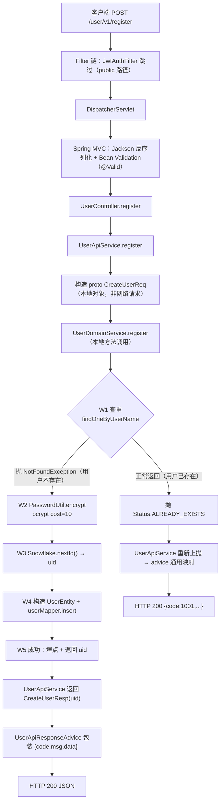
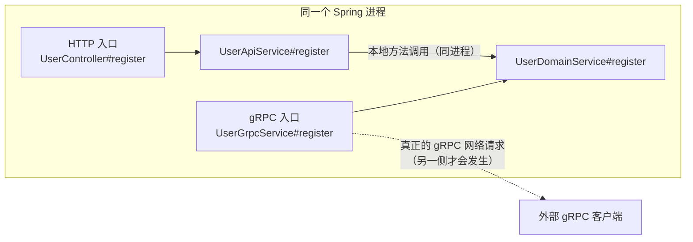
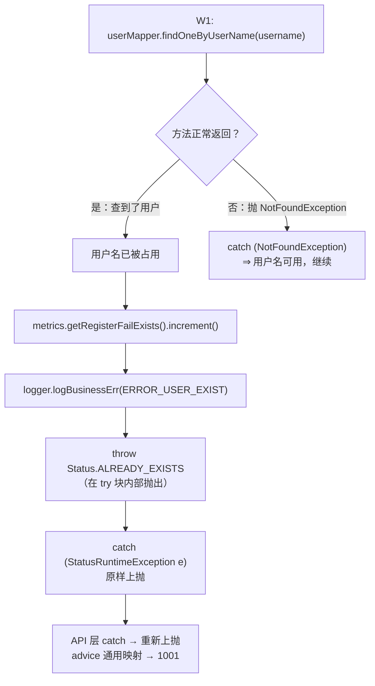

# 02. 用户注册流程

> 一次 `POST /user/v1/register` 从 HTTP 报文进来，到客户端手里拿到新用户的 uid，中间到底发生了什么。
> 本文逐行对照本仓 `service/users/user/` 与 `common/` 的**真实源码**写成。

---

## 1. 本次流程的研究范围

我们追踪的是**一个具体的 HTTP 请求**，从 Tomcat 收到字节开始，到响应体写回客户端结束。

**追踪到哪儿为止**

- 完整追踪：Filter 链 → `JwtAuthInterceptor` → Spring MVC 参数解析与校验 →
  `UserController#register` → `UserApiService#register` → `UserDomainService#register` →
  `UserMapper#findOneByUserName`（查重）→ `PasswordUtil#encrypt`（bcrypt）→
  `Snowflake#nextId`（生成 uid）→ `UserMapper#insert`（`BaseMapper`）→ PostgreSQL →
  `UserApiResponseAdvice` → 响应体。
- 失败分支也在对应位置展开：每一条失败都追到「HTTP 状态码 + 客户端看到的 body」为止。

**不追踪什么**

| 不追踪 | 原因 |
|---|---|
| 进程启动（建表 / Nacos 注册 / workerId 解析） | 与本次请求无关 |
| `UserGrpcService` 的**执行** | 它是另一个入口，不是本次 HTTP 请求走过的一段路。§4.3 只用它对照说明「proto 类型 ≠ gRPC 调用」 |
| 登录流程 | 见 [`./01-用户登录流程.md`](./01-用户登录流程.md)；本文只在必要处对比 |
| JWT 签发 | 注册**不签 Token**。注册成功只返回 uid，客户端要拿 token 得再调一次登录 |

**判定基准**：本仓行为以 B 侧 RAG 仓（只读）为唯一 oracle（D16）。本文只描述本仓源码里**读到的**行为；
凡是源码无法确认的，本文会直接写「源码无法确认」，不补造。

---

## 2. 触发场景与输入

客户端发送：

```
POST /user/v1/register
Content-Type: application/json

{
    "username": "alice",
    "password": "123456",
    "email": "alice@example.com",
    "extra_info": {
        "nickname": "爱丽丝"
    }
}
```

这次操作最终要完成四件事：

1. 确认 `username` 还没被占用；
2. 把明文密码做 bcrypt 散列（**永不落库明文**）；
3. 用雪花算法生成一个全局唯一的 `uid`；
4. 把这一行插进 `users_user` 表，把新 `uid` 返回给客户端。

这里先拆开两个容易混的概念：

- **注册成功 ≠ 用户已能登录**。注册只建号；能不能登录还要看密码对不对、账号有没有被封禁。
- **注册成功 ≠ 返回了 uid**。中间隔着「查重 → 散列 → 生成 ID → 落库」四步，任何一步失败都不会有 uid。

---

## 3. 整体执行路线



这张图是**导航图**。下面逐环节展开。

---

## 4. 逐步讲解

### 4.1 请求是怎么走到 `UserController#register` 的？

涉及文件：

- `service/users/user/src/main/java/com/rag/user/interceptor/JwtAuthFilter.java`
- `service/users/user/src/main/java/com/rag/user/interceptor/JwtAuthInterceptor.java`
- `service/users/user/src/main/java/com/rag/user/interceptor/JwtAuthPaths.java`
- `service/users/user/src/main/java/com/rag/user/controller/UserController.java`

处理链与登录完全一样：

```
Tomcat 收到 HTTP 请求
  ↓
Servlet Filter 链（JwtAuthFilter、共享层的 trace / 3s 预算 / body 限额 …）
  ↓
DispatcherServlet
  ↓
HandlerInterceptor.preHandle（JwtAuthInterceptor）
  ↓
参数解析（Jackson）+ Bean Validation
  ↓
调用 Controller 方法
```

**注册是 public 路径，不需要 JWT。** `JwtAuthPaths.PUBLIC_PATHS` 里只有两个路径
（`JwtAuthPaths.java:41-43`）：

```java
public static final Set<String> PUBLIC_PATHS = Set.of(
        "/user/v1/register", "/user/v1/login"
);
```

- Filter 侧：`JwtAuthPaths.isProtected(uri)` 对 `/user/v1/register` 返回 false ⇒ 跳过验签
  （`JwtAuthFilter.java:103`）；
- Interceptor 侧：`JwtAuthPaths.isPublic(uri)` 返回 true ⇒ `preHandle` 第一段就 `return true`
  （`JwtAuthInterceptor.java:74-79`）。

⇒ 未登录的客户端可以调用注册接口。这是必须的 —— 否则「注册」本身就需要一个已有的账号，
就成了先有鸡还是先有蛋。

### 4.2 请求 DTO 的四个字段

`controller/UserController.java:92-95`：

```java
@PostMapping("/register")
public CreateUserResp register(@Valid @RequestBody CreateUserReq req, HttpServletRequest httpRequest) {
    return userApiService.register(req, httpRequest);
}
```

DTO 本体（`dto/user/CreateUserReq.java`）：

```java
public record CreateUserReq(
        @NotNull String username,
        @NotNull String password,
        @NotNull @JsonInclude(JsonInclude.Include.NON_NULL) String email,
        @JsonInclude(JsonInclude.Include.NON_NULL) @JsonProperty("extra_info") Map<String, String> extraInfo
) {
}
```

几个细节：

**① JSON 键名**

| Java 分量 | JSON 键 | 为什么 |
|---|---|---|
| `username` | `username` | 没写 `@JsonProperty` ⇒ 用字段名 |
| `password` | `password` | 同上 |
| `email` | `email` | 同上 |
| `extraInfo` | **`extra_info`** | 写了 `@JsonProperty("extra_info")` ⇒ 驼峰转下划线 |

⚠️ 注意 `extraInfo` 的 JSON 键是**下划线** `extra_info`，和数据库列名一致；
而 `username` / `password` / `email` 本来就是全小写单词，看不出差别。
只有 `extraInfo` 这一处需要 `@JsonProperty` 才能对上。

**② 三个必填字段用 `@NotNull` 而不是 `@NotBlank`**

和登录一样：`@NotNull` 只判 null，**空串合法**。

**③ `extra_info` 没有加任何校验约束**

真源侧对 `extra_info` 用的是「三态判定」（缺席不报、显式 null 报），
这个语义在 Java `record` 形态下**不可表达** ⇒ 本仓不加约束 ⇒
**显式传 `"extra_info": null` 也会被放行**。这属于**已登记的 L3 降级**
（`docs/L3-降级清单.md` D-01 ②），不是遗漏。

**④ `@JsonInclude(NON_NULL)`**

`email` 和 `extraInfo` 上带了 `@JsonInclude(JsonInclude.Include.NON_NULL)`
⇒ 这两个字段为 null 时**不出现在 JSON 里**（不是 `"email":null`）。
这跟响应信封 `ApiResponse` 的规则**不一样** —— 信封三个字段都没有 `@JsonInclude`，
所以 `data` 为 null 时键仍然存在（`"data":null`）。**两处规则不同，别混。**

### 4.3 `UserApiService#register`：DTO → proto，以及「这不是 gRPC 调用」

`service/UserApiService.java:177-198`：

```java
public CreateUserResp register(com.rag.user.dto.user.CreateUserReq req, HttpServletRequest httpRequest) {
    com.rag.proto.user.CreateUserReq rpcReq = com.rag.proto.user.CreateUserReq.newBuilder()
            .setUsername(req.username() == null ? "" : req.username())
            .setPassword(req.password() == null ? "" : req.password())
            .setEmail(req.email() == null ? "" : req.email())
            .putAllExtraInfo(req.extraInfo() == null ? Map.of() : req.extraInfo())
            .build();

    com.rag.proto.user.CreateUserResp rpcResp;
    try {
        rpcResp = userDomainService.register(rpcReq);
    } catch (StatusRuntimeException e) {
        metrics.getRegisterRpcError().increment();
        log.error("register RPC error, username={}", req.username(), e);
        // 顶层 advice 按 gRPC code 映射业务码（INTERNAL→5001, ALREADY_EXISTS→1001, default→1015）
        throw e;
    }

    metrics.getRegisterSuccess().increment();

    return new CreateUserResp(rpcResp.getUid());
}
```

同样有两套 `CreateUserReq`：

| 类型 | 归属 | 用途 |
|---|---|---|
| `com.rag.user.dto.user.CreateUserReq` | HTTP API 层的 DTO（record） | 承接 Jackson 反序列化 + Bean Validation |
| `com.rag.proto.user.CreateUserReq` | 根级 `proto/` 模块生成的 protobuf 消息 | 领域层与 gRPC 入口共用 |

proto 侧定义（`proto/src/main/proto/users.proto:29-38`）：

```protobuf
message CreateUserReq {
  string username = 1;
  string password = 2;
  string email = 3;
  map<string, string> extra_info = 4;
}

message CreateUserResp {
  int64 uid = 1;
}
```

#### 为什么类型是 proto，却不是一次 gRPC 网络请求？

`userDomainService.register(rpcReq)` 调的是**通过构造器注入的普通 Spring Bean**
（`UserApiService.java:65` 声明字段，`:70-78` 构造器注入）的普通方法。
**同进程、同线程、无序列化、无 channel、无网络往返。**

判断依据（源码可见）：

- 调用点上没有 `ManagedChannel`、没有 Stub、没有目标地址；
- `UserDomainService` 是 `@Service`，被容器直接注入；
- 本仓 user 域**没有跨域 gRPC 客户端**：`application.yml:87-94` 的 `grpc.client: {}` 明确写着
  「本域无跨域 gRPC 调用」。

真正的 gRPC 入口在 `grpc/UserGrpcService.java:86-87`（类声明）与 `:114-117`（`register` 方法）：

```java
@GrpcService
public class UserGrpcService extends UserServiceGrpc.UserServiceImplBase {
    ...
    @Override
    public void register(CreateUserReq request, StreamObserver<CreateUserResp> responseObserver) {
        try {
            CreateUserResp resp = userDomainService.register(request);
            responseObserver.onNext(resp);
            responseObserver.onCompleted();
        } catch (StatusRuntimeException e) {
            ...
```

**两个入口，一份领域代码**：



#### 🔴 注册端点走的是 **advice 的通用映射**，不是端点内映射

这一点和登录端点**不一样**，很容易看错。

- **登录**（`UserApiService.java:112-123`）：端点自己 `catch` 后写了个 switch，
  `INTERNAL → 5001`、其它 → `1015`，然后抛 `BusinessException`。
- **注册**（`UserApiService.java:188-193`）：`catch` 之后**原样上抛** `throw e`，
  交给 advice 的通用映射 `UserApiExceptionHandler#handleRPC` 处理。

通用映射表（`UserApiExceptionHandler.java:116-130`）：

| gRPC code | 业务码 | 含义 |
|---|---|---|
| `INTERNAL` | `5001` | 系统内部错误 |
| `NOT_FOUND` | `1003` | 用户不存在 |
| `ALREADY_EXISTS` | `1001` | 用户名已存在 |
| `INVALID_ARGUMENT` | `500` | 通用失败 |
| 其它 | `1015` | 服务繁忙 |

⇒ **注册端点能产出 `1001`**，登录端点**产不出** `1001`（它的本地 switch 只有两格）。
两套映射并存且不完全相同 —— 这是照抄真源的结果，不是 bug。

⚠️ 还有个指标上的小陷阱：`metrics.getRegisterRpcError().increment()` 在
`catch (StatusRuntimeException e)` 里**无条件 +1** ⇒ **「用户名已存在」也会让
`user_api_intercept_total{path="/user/register",result="rpc_error"}` 增长**。
指标名叫 `rpc_error`，但这一行**根本没有发生 RPC**（同进程直连），而且「已存在」是正常业务结果。

### 4.4 领域层 `register`：W1~W5 全貌

`domain/service/UserDomainService.java:257-264`：

```java
public CreateUserResp register(CreateUserReq req) {
    Span span = tracer.spanBuilder("Action-User-Register")
            .setAttribute("biz.username", req.getUsername())
            .startSpan();
    Context otelCtx = Context.current().with(span);
    checkDeadline();

    try {
```

源码 javadoc 里写明的执行序（`UserDomainService.java:248-255`）：

```
W1 查重 FindOneByUserName → 命中返 AlreadyExists
W2 PasswordUtil.encrypt(req.Password) → bcrypt hash（cost=10）
W3 Snowflake.nextId() → uid
W4 insert(User{...})
W5 metrics 成功 / fail_exists / db_error / internal_error
```

#### ⚠️ `register` 与 `login` 在 deadline 检查上的两处不同

这是一处很容易看漏的**真实代码差异**：

| | `login` | `register` |
|---|---|---|
| `checkDeadline()` 位置 | 在 `try` **内部**（`:167`） | 在 `try` **外部**（`:262`） |
| 检查次数 | 3 次（进入时 / W1 前 / W2 前） | **1 次**（只有进入时） |
| `checkDeadline()` 抛异常时 span 会 end 吗 | **会**（`finally` 覆盖） | **不会**（`finally` 还没进） |

⇒ 在 `register` 里，如果 `checkDeadline()` 抛 `DEADLINE_EXCEEDED`，
`finally { span.end(); }` **不会执行** ⇒ 这个 span 泄漏（不结束）。

不过在本条 HTTP 路径上这不会发生：`DeadlineState.isExpired()` 在未绑定时恒为 `false`
（`DeadlineState.java:109-114`），而绑定动作发生在 **gRPC** 服务端拦截器里
（`common/observability/RpcHandleRunner.java:121`）。
HTTP 侧的 3 秒预算是共享层 `HttpMiddleware` 用「worker 线程 + 预算计时」实现的，
**不写 `DeadlineState`**。

⇒ 所以在 HTTP 注册路径上，`checkDeadline()` 实际上只会因「线程被中断」而抛，
`DEADLINE_EXCEEDED` 属于 gRPC 入口的失败分支。

顺带说明共享层的两个 MyBatis 拦截器（`common/autoconfigure/PersistenceAutoConfiguration.java`）：

- `DeadlineQueryTimeoutInjector` —— 按线程上的 deadline 给 SQL 设 query timeout。
  **没有 deadline 时完全不碰 statement**（`DeadlineState.remainingMillis()` 返回 `Long.MAX_VALUE`）⇒
  HTTP 路径上**不会**给 SQL 设超时；
- `SqlTimeoutStatusTranslator` —— 把 PG 的 `57014 query_canceled` 翻译成 gRPC `DEADLINE_EXCEEDED`。
  它拦截 `Executor#update`（INSERT 也算 update）⇒ 万一真出现 SQL 取消，
  抛的是 `StatusRuntimeException` ⇒ 会被领域层的 `catch (StatusRuntimeException e) { throw e; }` 原样上抛
  ⇒ advice 通用映射落到 `default` ⇒ **1015**（不是 5001）。

### 4.5 W1：查重 —— 用异常表达「不存在」

`UserDomainService.java:265-284`：

```java
// W1 查重
try {
    userMapper.findOneByUserName(req.getUsername());
    metrics.getRegisterFailExists().increment();
    logger.logBusinessErr(otelCtx, ErrCodes.ERROR_USER_EXIST,
            new RuntimeException("username has existed"));
    throw Status.ALREADY_EXISTS.withDescription("用户名已存在").asRuntimeException();
} catch (NotFoundException e) {
    // 用户名可用，继续
} catch (StatusRuntimeException e) {
    // 上面刚抛的 ALREADY_EXISTS：原样上抛，不能掉进下面的 db_error 分支
    throw e;
} catch (Exception e) {
    // B 侧 DRIFT-009：Go 出处 registerlogic.go:50-54 ——「非 ErrorNotFound」单独成一支，
    // 打 db_error 指标 + ErrorDbSelect 日志 + span.RecordError，再返 Internal。
    metrics.getRegisterDbError().increment();
    span.recordException(e);
    logger.logBusinessErr(otelCtx, ErrCodes.ERROR_DB_SELECT, e);
    throw Status.INTERNAL.withDescription("DB查询失败").asRuntimeException();
}
```

#### 🔴 这段代码的形状，和登录正好相反

`UserMapper#findOneByUserName`（`mapper/UserMapper.java:53-59`）：

```java
default UserEntity findOneByUserName(String username) {
    UserEntity u = selectByUsernameRaw(username);
    if (u == null) {
        throw new NotFoundException("user not found by username: " + username);
    }
    return u;
}
```

「用户不存在」在这里是**异常**，不是 `null`。

于是：

| `findOneByUserName` 的结果 | 在 `register` 里意味着 | 走向 |
|---|---|---|
| **正常返回**（用户存在） | 用户名**已被占用** | 埋点 + 抛 `ALREADY_EXISTS` |
| **抛 `NotFoundException`** | 用户名**可用** | catch 住 → 继续往下走 |

⇒ **「error 不是值」的设计在这里被反向使用**：
同一个异常，在登录流程里表示失败，在注册流程里表示**成功**。

对初学者来说这是最反直觉的一处，所以单独画图：



#### 🔴 为什么 `catch (StatusRuntimeException e) { throw e; }` 这一格不能删

看代码顺序：`throw Status.ALREADY_EXISTS...` **写在 `try` 块内部**。

Java 的规则是：**try 块里抛出的异常，会被同一个 try 的 catch 捕获**。
所以 `ALREADY_EXISTS` 抛出后，第一个不匹配的 catch 是 `catch (NotFoundException e)`（不匹配），
接着是 `catch (StatusRuntimeException e)` —— **它会匹配上**。

如果没有这一格，`ALREADY_EXISTS` 会继续掉进 `catch (Exception e)` ⇒ 被改写成
`Status.INTERNAL "DB查询失败"` ⇒ 客户端拿到的就是 **5001** 而不是 **1001**。

⇒ 这一格的作用就一句话：**把「用户名已存在」和「数据库查询失败」区分开**。
它同时也是「先抛后捕」这种写法的必然要求。

#### 「已存在」是领域层主动抛的，不是数据库唯一约束冲突

`AlreadyExists` 完全由**领域层的 `throw`** 产生（`UserDomainService.java:271`）。
查重那一步**没有碰过数据库的唯一约束** —— 它只是一条 `SELECT`。

那 `users_user.username` 上的 UNIQUE 约束呢？它**存在**（`db/01_create_user.sql:36`），
但在这条**串行**路径上不会先被触发：查重已经把重名挡在 insert 之前了。

⚠️ 但「查重 + 插入」**不是一个原子操作**（本流程没有事务，见 §6）⇒ 两次并发的注册请求
可能都通过查重，然后第二个在 insert 时撞唯一约束 ⇒
那会被 `catch (Exception e)` 接住 ⇒ 变成 `Status.INTERNAL "DB更新失败"` ⇒ **5001**（不是 1001）。

⇒ 换句话说：**并发下的重名，客户端看到的是 5001 而不是 1001**。这是源码形状的直接后果，
不是推断（源码里确实没有事务、没有 `SELECT ... FOR UPDATE`、也没有捕获唯一冲突并转 1001 的分支）。

#### 其它两个 catch 分别对应什么

- `catch (Exception e)` ⇒ **数据库查询失败**（连接断了、SQL 语法错、超时…）：
  埋 `registerDbError` 指标、记 `ERROR_DB_SELECT`(5003) 业务错误日志、`span.recordException(e)`，
  然后抛 `Status.INTERNAL "DB查询失败"`。
- `catch (StatusRuntimeException e) { throw e; }` ⇒ 把上面刚抛的 `ALREADY_EXISTS` 原样带走。

⚠️ 注意：**领域层不设 span 状态**。源码注释写明了原因：真源侧的 `span.RecordError(err)`
**不改 Span 状态**（恒为 Unset）⇒ 这里多置 `ERROR` 就是遥测面漂移。

### 4.6 W2：bcrypt 散列

`UserDomainService.java:286-299`：

```java
// W2 bcrypt
String hash;
try {
    hash = PasswordUtil.encrypt(req.getPassword());
} catch (StatusRuntimeException e) {
    // B-1：DEADLINE_EXCEEDED 必须上抛
    throw e;
} catch (Exception e) {
    metrics.getRegisterInternalError().increment();
    span.recordException(e);
    logger.logBusinessErr(otelCtx, ErrCodes.ERROR_SERVER_COMMON, e);
    throw Status.INTERNAL.withDescription("密码生成失败").asRuntimeException();
}
```

`PasswordUtil.encrypt`（`common/security/PasswordUtil.java:73-75`）：

```java
public static String encrypt(String rawPassword) {
    return ENCODER.encode(rawPassword);
}
```

`ENCODER` 是 `new BCryptPasswordEncoder(10)`（`PasswordUtil.java:48-49`，`STRENGTH = 10`）。

**bcrypt 到底做了什么**

- **加盐**：每次 `encode` 都生成一个**随机盐**并嵌进结果里。
  ⇒ **同一个密码每次散列出来的字符串都不一样** ⇒ `password` 列不能用 `=` 比较，
  只能用 `PasswordUtil.checkDetailed` 去校验；
- **慢哈希**：cost=10 意味着计算量被刻意放大（2^10 轮）⇒ 单次调用会消耗可观的 CPU 时间，
  这是**故意的**：让暴力破解的成本高到不可接受。
  （⚠️ 「具体耗时多少」是 bcrypt cost 的通用属性，**本仓没有对应测量**，
  本仓源码里能确认的只有 `STRENGTH = 10` 这个参数本身。）
- **自带盐 ⇒ 不需要额外的 salt 列**。

**「密码永不落库明文」**：客户端发来的 `req.getPassword()`（明文）只在**这一次调用里**出现，
落库的 `u.setPassword(hash)` 写进去的已经是 bcrypt 哈希。
明文密码不会被写进任何表、任何日志。

⚠️ 一个可以确认的推论：`password` 列**没有唯一约束**（`db/01_create_user.sql:37` 只有 `password TEXT`），
这是对的 —— 加盐意味着相同密码的哈希本来就不同。

### 4.7 W3：雪花 ID 生成 uid

`UserDomainService.java:301-313`：

```java
// W3 snowflake
long uid;
try {
    uid = Snowflake.nextId();
} catch (StatusRuntimeException e) {
    // B-1：DEADLINE_EXCEEDED 必须上抛
    throw e;
} catch (Exception e) {
    metrics.getRegisterInternalError().increment();
    span.recordException(e);
    logger.logBusinessErr(otelCtx, ErrCodes.ERROR_SERVER_COMMON, e);
    throw Status.INTERNAL.withDescription("uid生成失败").asRuntimeException();
}
```

`Snowflake.nextId()`（`common/snowflake/Snowflake.java:268-280`）：

```java
public static long nextId() {
    if (workerId == null && initError == null) {
        init(); // 对应 B 的 GetID() 第一行 Init()
    }
    if (initError != null) {
        throw new IllegalStateException("snowflake node is not initialized", initError);
    }
    Long id = workerId;
    if (id == null) {
        throw new IllegalStateException("snowflake node is not initialized");
    }
    return nextIdInternal(id, STATE);
}
```

**位布局**（`Snowflake.java:56-74`）—— 41 位时间戳 + 10 位 workerId + 12 位序列：

```java
static final long EPOCH = 1288834974657L;   // Twitter 雪花 epoch
static final long WORKER_ID_BITS = 10L;     // → workerId 占 10 位（0~1023）
static final long SEQUENCE_BITS = 12L;      // → 序列占 12 位（0~4095）
static final long WORKER_ID_SHIFT = SEQUENCE_BITS;                 // = 12
static final long TIMESTAMP_SHIFT = SEQUENCE_BITS + WORKER_ID_BITS; // = 22
```

最终 id 的算法在 `Snowflake.java:373-375`：

```java
return (now << TIMESTAMP_SHIFT)
        | (workerIdArg << WORKER_ID_SHIFT)
        | state.sequence;
```

拆开看：

| 位段 | 位数 | 内容 |
|---|---|---|
| 高 41 位 | 41 | `now` = 距 epoch 的毫秒数 |
| 中 10 位 | 10 | `workerId`（进程标识，0~1023） |
| 低 12 位 | 12 | `sequence`（同一毫秒内的自增序号，0~4095） |

同一毫秒内连续调用时 `sequence` 递增（`Snowflake.java:353-354`）；
序号耗尽（`sequence` 归零）时**自旋到下一毫秒**（`:355-362`）。

`workerId` 的来源有三级优先级（`common/autoconfigure/SnowflakeAutoConfiguration.java`）：

1. 环境变量 `SNOWFLAKE_NODE_ID`；
2. Spring 配置 `snowflake.worker-id`；
3. 兜底：`SERVICE_NAME + "-" + PID` 做 sha256，取前 2 字节 `% 1024`。

进程启动时 `wiring/SnowflakeBootstrap.java` 会用 `@EventListener(ApplicationReadyEvent.class)`
校验 workerId 范围并触发 `Snowflake.init()`。

⚠️ **`Snowflake.nextId()` 抛的异常类型是 `IllegalStateException`**（不是 `StatusRuntimeException`）
⇒ 它会被 W3 的 `catch (Exception e)` 接住 ⇒ 转成 `Status.INTERNAL "uid生成失败"` ⇒ 5001。

### 4.8 W4：构造实体 + insert

`UserDomainService.java:315-338`：

```java
// W4 Insert
UserEntity u = new UserEntity();
u.setUid(uid);
u.setUsername(req.getUsername());
u.setPassword(hash);
u.setEmail(req.getEmail());
u.setScore(0);
u.setStatus(0L);
if (req.getExtraInfoCount() > 0) {
    Map<String, String> map = new HashMap<>();
    req.getExtraInfoMap().forEach(map::put);
    u.setExtraInfo(map);
}
try {
    userMapper.insert(u);
} catch (StatusRuntimeException e) {
    // B-1：DEADLINE_EXCEEDED 必须上抛
    throw e;
} catch (Exception e) {
    metrics.getRegisterDbError().increment();
    span.recordException(e);
    logger.logBusinessErr(otelCtx, ErrCodes.ERROR_DB_UPDATE, e);
    throw Status.INTERNAL.withDescription("DB更新失败").asRuntimeException();
}
```

#### 实体上每个字段的值从哪来

| 实体字段 | 值 | 来源 |
|---|---|---|
| `id` | **由 MyBatis-Plus 填** | `@TableId(type = IdType.ASSIGN_ID)`（见下） |
| `uid` | `uid` | W3 的雪花 ID（**业务主键**） |
| `username` | 请求里的用户名 | 原样 |
| `password` | `hash` | W2 的 bcrypt 结果（**不是明文**） |
| `email` | 请求里的邮箱 | 原样 |
| `score` | `0` | 固定初值 |
| `status` | `0L` | 固定初值（**不是 null**） |
| `extraInfo` | 请求里的 map（仅当非空时） | `req.getExtraInfoCount() > 0` 才 set |
| `create_time` / `update_time` | **不 set（null）** | 交给数据库默认值 |

#### 🔴 `id` 和 `uid` 是**两套不同的 ID 生成器**

这点非常容易看错。

- **`uid`（业务主键）** = W3 里共享层 `com.rag.common.snowflake.Snowflake.nextId()` 产出的值，
  **显式 set** 到实体上。`users_user.uid` 是 `BIGINT NOT NULL UNIQUE`。
- **`id`（数据库代理主键）** = 实体上没 set（是 null），由 **MyBatis-Plus 自己**在插入前填上。
  实体声明（`domain/entity/UserEntity.java:43-44`）：

  ```java
  @TableId(type = IdType.ASSIGN_ID)
  private Long id;
  ```

  `ASSIGN_ID` 的语义是「由框架生成 id」。MyBatis-Plus 3.5.17 的默认生成器是
  `com.baomidou.mybatisplus.core.incrementer.DefaultIdentifierGenerator`（自带一套与共享层**无关**的
  worker/datacenter + sequence 实现）。

⇒ 所以这个表里有**两个雪花**：一个来自本仓共享层（`uid`），一个来自 MyBatis-Plus（`id`）。
业务上真正被引用、被当作用户身份的是 **`uid`**（JWT 的 `userId` claim 装的就是它）。

⚠️ 顺带一个可观察后果：`users_user.id` 的 DDL 是 `BIGSERIAL PRIMARY KEY`
（`db/01_create_user.sql:34`），但 MP 因为 `ASSIGN_ID` **显式提供了 id 值**
⇒ **PostgreSQL 的 BIGSERIAL 序列在这条路径上不会被使用**。

#### `extra_info` 的两态

```java
if (req.getExtraInfoCount() > 0) {
    Map<String, String> map = new HashMap<>();
    req.getExtraInfoMap().forEach(map::put);
    u.setExtraInfo(map);
}
```

- `req` 这里是 **proto** 消息，`getExtraInfoCount()` 是 protobuf map 的元素个数，`getExtraInfoMap()` 返回 map 视图；
- 代码把它**拷贝**进一个可变的 `HashMap` 再 set 到实体上；
- **`extra_info` 缺席时 `u.extraInfo` 保持 null** ⇒ MP 的 insert 字段策略是 `NOT_NULL`
  ⇒ 该列不进 INSERT 语句 ⇒ 数据库那一列就是 `NULL`。

#### 🔴 `extra_info` 是 `text` 列，手写 SQL 必须显式声明 TypeHandler

这是本域持久层最容易踩的坑，**而且失败方式是「静默变 null」而不是报错**。

**列的类型**（`db/01_create_user.sql:41`）：

```sql
extra_info  TEXT,
```

（真源侧建出来的是 `text`，不是 `jsonb` —— 这是 2026-10-23 实测钉死的：GORM 的 `serializer:json` tag
让列按字符串建。`jsonb` 会**改写存进去的字节**（去重键 + 按键长/字节序重排 + 补空格），
所以必须跟真源一样用 `text`。）

**实体上的声明**（`domain/entity/UserEntity.java:88-89`）：

```java
@TableField(value = "extra_info", typeHandler = JsonTextTypeHandler.class)
private Map<String, String> extraInfo;
```

加上类上的（`:40`）：

```java
@TableName(value = "users_user", autoResultMap = true)
```

**为什么 `autoResultMap = true` 不能去掉**：没有它，MyBatis-Plus 自己生成的 ResultMap
不会采用 `extra_info` 字段上声明的 TypeHandler ⇒ 读回来的 JSON 文本会是 `null`（**不报错**）。
实体类的 javadoc 把这条写死了。

**为什么手写 SQL 必须显式 `@Results`**：MyBatis **不认识** MyBatis-Plus 的 `@TableField` ⇒
实体字段上的 TypeHandler **只对 MP 自己生成的 SQL 生效**。
所以 `UserMapper#selectByUsernameRaw`（`mapper/UserMapper.java:40-45`）必须自己声明：

```java
@Select("SELECT * FROM users_user WHERE username = #{username} LIMIT 1")
@Results({
        @Result(property = "extraInfo", column = "extra_info",
                javaType = java.util.Map.class, typeHandler = JsonTextTypeHandler.class)
})
UserEntity selectByUsernameRaw(@Param("username") String username);
```

不写 `@Results` 的话，`extra_info` 那一列会**被当成普通 String 取回，然后塞不进 `Map` 字段**
⇒ 结果是 `extraInfo == null`，**没有任何异常**。

`JsonTextTypeHandler`（`common/persistence/JsonTextTypeHandler.java`）做两件事：

- **写**：`setNonNullParameter` ⇒ `ps.setString(i, toJson(parameter))`
  ⇒ Map 先被 Jackson 序列化成 JSON 文本，再以 **String** 绑定进 `text` 列（text 列的原生绑定方式）；
- **读**：`getNullableResult` ⇒ `ResultSet.getString` 取回 JSON 文本，Jackson 再解析成 `Map<String,String>`。

⇒ 所以 Map ⇄ `text` 列的转换全部由这个 TypeHandler 承担，**列里存的是 JSON 文本**。

#### insert 用的是 MyBatis-Plus 的 `BaseMapper#insert`（自动生成 SQL）

`UserMapper` 继承 `BaseMapper<UserEntity>`（`mapper/UserMapper.java:31-32`）：

```java
@Mapper
public interface UserMapper extends BaseMapper<UserEntity> {
```

所以 `userMapper.insert(u)` 是 **MyBatis-Plus 自动生成的 SQL**，不是手写 `@Insert`。
MP 根据实体元数据拼出 INSERT 语句，列名来自 `@TableField`、表名来自 `@TableName`。

几个由 MP 行为决定的点：

- **列的取舍**：MP 3.5.17 的默认 insert 字段策略是 `FieldStrategy.NOT_NULL`
  ⇒ **值为 null 的字段不进 INSERT 语句** ⇒ `create_time` / `update_time`（实体里是 null）
  不会出现在 INSERT 里 ⇒ 走数据库默认值 `CURRENT_TIMESTAMP`（`db/01_create_user.sql:42-43`）。
- **`id` 的填充**：如上，MP 在插入前用 `IdentifierGenerator` 填上 `id`。
- **`extra_info` 的绑定**：实体上声明了 `typeHandler` ⇒ MP 生成的 SQL 采用它 ⇒ Map 被序列化成 JSON 文本写入。

⚠️ 精确到「MP 生成的 INSERT 语句由哪个 `TypeHandler` 实例完成参数绑定」这一步，
属于 MyBatis-Plus / MyBatis 的内部机制，**本仓源码里没有直接证据**。
本仓可确认的是它写下来的**契约**：实体字段上的 `@TableField(typeHandler=...)` 只对 MP 自己生成的 SQL 生效；
手写 SQL 必须自己写 `@Results`（上面已引原文）。

### 4.9 W5：成功

`UserDomainService.java:340-346`：

```java
// W5 成功
metrics.getRegisterSuccess().increment();
logger.logInfo(otelCtx, "register success,uid : " + uid);
return CreateUserResp.newBuilder().setUid(uid).build();
} finally {
    span.end();
}
```

领域层返回的是 proto `CreateUserResp{uid}`。

⚠️ 领域层的 `registerSuccess` 计数在**方法返回前**就 +1 了；
而 API 层的 `registerSuccess`（`UserApiService.java:195`）在领域层**正常返回之后**才 +1。
⇒ 如果领域层抛异常，API 层的 `registerSuccess` 不会增长。两个指标口径不同。

### 4.10 回到 API 层 → 响应信封

`UserApiService.java:195-197`：

```java
metrics.getRegisterSuccess().increment();

return new CreateUserResp(rpcResp.getUid());
```

`CreateUserResp`（`dto/user/CreateUserResp.java`）：

```java
public record CreateUserResp(
        @JsonProperty("uid") @JsonSerialize(using = ToStringSerializer.class) Long uid
) {
}
```

⚠️ **`uid` 在 wire 上是字符串**：`@JsonSerialize(using = ToStringSerializer.class)`
⇒ 输出 `"uid":"1234567890123456789"`，不是数字。
这是 L1 契约（真源侧 B 侧的 `getUid()` 返回 `String`）——
雪花 ID 已经接近 `Long` 的上限，用 JSON number 传输在 JavaScript 侧会丢精度。

然后和登录一样，`advice/UserApiResponseAdvice.java:74` 把它包成信封：

```java
return new ApiResponse(ErrCodes.SUCCESS, ErrMsg.getMsg(ErrCodes.SUCCESS), body);
```

最终响应：

```json
{
  "code": 200,
  "msg": "OK",
  "data": {
    "uid": "1234567890123456789"
  }
}
```

---

## 5. 重要分支与失败路径

### 5.1 全失败分支速查

| 发生位置 | 触发条件 | 领域层返回 / 抛出 | API 层 | HTTP 状态码 | 客户端看到的 body |
|---|---|---|---|---|---|
| 参数解析 | body 缺失 / 非 JSON / 字段类型不对 | （没进业务层） | — | **400** | `text/plain` 裸文案 + `nosniff` |
| 参数校验 | `username` / `password` / `email` 任一为 `null`（含 `{}`） | （没进业务层） | — | **400** | `text/plain` 裸文案 + `nosniff` |
| Content-Type | 不是 `application/json` | （没进业务层） | — | **415** | 空 body |
| W1 查重 | 用户名已存在 | 抛 `Status.ALREADY_EXISTS` | 重新上抛 → advice 通用映射 | **200** | `{"code":1001,"msg":"用户名已存在","data":null}` |
| W1 查重 | 数据库查询失败 | 抛 `Status.INTERNAL` | 重新上抛 → 通用映射 | **200** | `{"code":5001,"msg":"系统内部错误","data":null}` |
| W2 bcrypt | 散列失败 | 抛 `Status.INTERNAL` | 重新上抛 → 通用映射 | **200** | `{"code":5001,"msg":"系统内部错误","data":null}` |
| W3 Snowflake | ID 生成失败 | 抛 `Status.INTERNAL` | 重新上抛 → 通用映射 | **200** | `{"code":5001,"msg":"系统内部错误","data":null}` |
| W4 insert | 插入失败（含并发撞唯一约束） | 抛 `Status.INTERNAL` | 重新上抛 → 通用映射 | **200** | `{"code":5001,"msg":"系统内部错误","data":null}` |
| HTTP 方法 | 用 GET 打这个端点 | — | — | **405** | 空 body（裸状态码） |

### 5.2 「用户名已存在」为什么是 1001 而不是 5001？

因为领域层抛的是 `Status.ALREADY_EXISTS`（`UserDomainService.java:271`），
而 advice 的通用映射里 `ALREADY_EXISTS → ERROR_USER_EXIST = 1001`
（`UserApiExceptionHandler.java:123-125`）。

如果少了 `catch (StatusRuntimeException e) { throw e; }` 那一格，
`ALREADY_EXISTS` 会掉进 `catch (Exception e)` 被改写成 `INTERNAL` ⇒ **5001**。
详见 §4.5。

### 5.3 五个 5001 分别对应什么

领域层五个步骤各自的失败都收敛到 `Status.INTERNAL`，在 API 层统一映射成 `5001 系统内部错误`：

| 失败点 | 领域层抛出的 description | 领域层指标 |
|---|---|---|
| W1 数据库查询失败 | `"DB查询失败"` | `user_rpc_register_total{result="db_error"}` |
| W2 bcrypt 失败 | `"密码生成失败"` | `user_rpc_register_total{result="internal_error"}` |
| W3 Snowflake 失败 | `"uid生成失败"` | `user_rpc_register_total{result="internal_error"}` |
| W4 insert 失败 | `"DB更新失败"` | `user_rpc_register_total{result="db_error"}` |

⚠️ **`description` 不会传到客户端**。API 层 catch 之后重新构造 `BusinessException(5001, "系统内部错误")`，
客户端只看到 `msg` 字段的文案；`description` 只留在服务端日志和 gRPC 异常对象里。

⇒ 这意味着：**客户端区分不出「bcrypt 失败」和「数据库挂了」** —— 都是 5001。
要看具体原因，得查服务端日志（领域层 `logger.logBusinessErr` 打的业务错误日志）。

### 5.4 异常传播链：从产生到响应

以「insert 失败」为例：

```
PostgreSQL 报错（连接断 / 唯一约束冲突 / 磁盘满 …）
  ↓ 抛 DataAccessException（RuntimeException）
MyBatis-Plus 生成的 insert 语句执行失败
  ↓ 冒泡
UserDomainService#register 的 catch (Exception e)          ← UserDomainService.java:333
  ↓ metrics.getRegisterDbError().increment()
  ↓ span.recordException(e)
  ↓ logger.logBusinessErr(otelCtx, ErrCodes.ERROR_DB_UPDATE, e)
  ↓ throw Status.INTERNAL.withDescription("DB更新失败").asRuntimeException()
UserApiService#register 的 catch (StatusRuntimeException e)  ← UserApiService.java:188
  ↓ metrics.getRegisterRpcError().increment()
  ↓ log.error("register RPC error, username={}", ...)
  ↓ throw e;                                        ← 原样上抛，不转 BusinessException
UserApiExceptionHandler#handleRPC                   ← UserApiExceptionHandler.java:91
  ↓ mapRPCStatusToCode(INTERNAL) ⇒ 5001
  ↓ ResponseEntity.status(200).body(new ApiResponse(5001, "系统内部错误", null))
UserApiResponseAdvice#beforeBodyWrite
  ↓ body instanceof ApiResponse ⇒ 原样返回
HTTP 200
{"code":5001,"msg":"系统内部错误","data":null}
```

另一条链（字段校验失败）：

```
Bean Validation 发现 email == null
  ↓ 抛 MethodArgumentNotValidException
（Spring MVC 在调用 Controller 方法**之前**抛出 ⇒ Controller / Service / 领域层完全没参与）
UserApiExceptionHandler#handleBeanValidation             ← UserApiExceptionHandler.java:202
  ↓ 取第一个 field error，拼成 "email must not be null"
  ↓ PlainTextErrors.badRequest(message)
HTTP 400  Content-Type: text/plain; charset=utf-8
X-Content-Type-Options: nosniff
email must not be null
```

⚠️ **HTTP 状态码 ≠ 业务码**：

- 业务失败（1001 / 5001）⇒ **HTTP 200**，成败由 body 里的 `code` 表达；
- 参数解析 / 校验失败 ⇒ **HTTP 400 + `text/plain`**，**没有** `{code,msg,data}` 信封。

### 5.5 一个可以确认的推论：空邮箱会撞唯一约束

`@NotNull` 允许空串 ⇒ 空邮箱会原样落库（`u.setEmail(req.getEmail())`，值为 `""`）。
而 `users_user.email` 是 `TEXT UNIQUE`（`db/01_create_user.sql:38`）。

⇒ 第一个用空邮箱注册的用户成功；**第二个**用空邮箱注册的用户会在 insert 时撞唯一约束
⇒ 走 W4 的失败分支 ⇒ **5001**（不是 1001，因为撞约束发生在 insert 而不是查重那一步）。

同理，`username` 也是 `TEXT UNIQUE`，而空用户名在登录语义上是合法的（`@NotNull` 不拦空串）
⇒ 两个空用户名注册 ⇒ 第二个 5001。

（这一条是「源码明确的事实 + 一次推理」：`UNIQUE` 约束、空串合法、insert 路径都会撞约束，
三者都在源码里可核；但**具体是哪一条约束先报**取决于数据库的约束检查顺序，
**源码无法确认**。）

---

## 6. 数据变化与副作用

| 维度 | 本次注册流程里发生了什么 |
|---|---|
| **数据库读** | `SELECT * FROM users_user WHERE username = ? LIMIT 1`（查重）。**只有这一条** |
| **数据库写** | `INSERT INTO users_user (...) VALUES (...)`（MP 自动生成）。**一条** |
| **事务** | **本流程无事务**。`service/users/user` 的注册路径上**没有** `@Transactional`（唯一有事务的是头像相关的 `UserAvatarHistoryMapper`）⇒ 查重与插入是**两条独立的 auto-commit 语句** |
| **Redis** | **无**。注册是 public 路径，`JwtAuthInterceptor` 第一段就放行了 |
| **远程调用** | **无**。没有 HTTP、没有 gRPC、没有 Nacos、没有 MinIO |
| **消息** | **无** |
| **日志** | 领域层 `LoggerFactoryBean#logInfo` / `#logBusinessErr`；API 层 SLF4J `log.error` |
| **指标** | 见下表 |
| **ID 生成** | **有，两个**：`uid` = 共享层 `Snowflake.nextId()`；`id` = MyBatis-Plus 的 `ASSIGN_ID` 生成器 |
| **Token 生成** | **无**。注册**不签 JWT** |
| **OpenTelemetry** | 领域层起一个 span（`Action-User-Register`，属性 `biz.username`），`finally` 里 `span.end()`（`checkDeadline()` 抛异常时不执行，见 §4.4） |
| **密码** | **永不落库明文**。落库的是 bcrypt 哈希（cost=10，带随机盐） |

### 指标明细

| 指标 | 何时 +1 | 覆盖的语义 |
|---|---|---|
| `user_rpc_register_total{result="success"}` | 领域层 W5 | 注册成功 |
| `user_rpc_register_total{result="fail_exists"}` | 领域层 W1（用户已存在） | 用户名被占用 |
| `user_rpc_register_total{result="db_error"}` | 领域层 W1 查库失败 / W4 insert 失败 | 数据库故障 |
| `user_rpc_register_total{result="internal_error"}` | 领域层 W2 bcrypt 失败 / W3 Snowflake 失败 | 内部错误 |
| `user_api_intercept_total{path="/user/register",result="success"}` | API 层领域层正常返回后 | 端到端注册成功 |
| `user_api_intercept_total{path="/user/register",result="rpc_error"}` | API 层捕获 `StatusRuntimeException` | **包含「用户名已存在」** |

⚠️ 两个「名字会骗人」的地方：

1. `user_api_intercept_total{result="rpc_error"}` 在**「用户名已存在」时也会 +1**
   —— 而这一行根本没有发生 RPC（同进程直连），且「已存在」是正常业务结果；
2. 领域层 `success` 与 API 层 `success` **口径不同**（前者是领域层判定成功，后者是端到端成功）。

### 数据流转图：数据从哪来、变成什么、落在哪

```mermaid
flowchart LR
    subgraph IN["进入进程"]
        J["HTTP JSON body"] -->|"Jackson"| D["CreateUserReq<br/>（record，@NotNull 校验）"]
        D -->|"null 转空串兜底 + map 拷贝"| P["proto CreateUserReq"]
    end
    subgraph DOMAIN["领域层内的四次转换"]
        P --> Q1["W1 查重<br/>不改数据"]
        Q1 --> H["W2 bcrypt<br/>明文 → 哈希字符串"]
        H --> U["W3 雪花<br/>→ uid（long）"]
        U --> E["W4 UserEntity<br/>uid/username/password(hash)/email/score=0/status=0L"]
    end
    E -->|"MP 自动生成 INSERT<br/>（null 列不进语句）"| PG[("PostgreSQL<br/>users_user")]
    PG -->|"只读回 uid"| R["CreateUserResp<br/>uid 字段（字符串形态）"]
    R --> ADV["ResponseBodyAdvice<br/>包 {code,msg,data}"]
    ADV --> OUT["HTTP 200 JSON"]
```



几个从图上能直接看出来的结论：

- **明文密码只存在于 `P → H` 这一小段**（`proto` 里是明文，`hash` 之后就是 bcrypt 字符串），
  落库的永远是哈希；
- **落库这一跳是唯一一次跨进程**；
- **回读只有 `uid` 一个字段** —— 注册不返回密码、不返回哈希、不返回用户名。

### 事务边界与「失败后残留」

本流程**没有** `@Transactional`，因此：

- 查重的 SELECT 与 INSERT 是**两条独立的 auto-commit 语句**；
- ⚠️ **查重与插入之间存在竞态窗口**：两个并发注册请求可能都通过查重，
  第二个在 insert 时撞 `username` 的 UNIQUE 约束 ⇒ 走 W4 失败分支 ⇒ **5001**（不是 1001）；
- **失败后哪些操作可能已经发生**：
  - W1 失败 ⇒ 什么都没写（只有指标和日志）；
  - W2 / W3 失败 ⇒ 什么都没写。⚠️ 但 **W3 失败时雪花 ID 可能已被消耗**
    ——`Snowflake.nextId()` 是在 `nextIdInternal` 里自增 `sequence` 的，
    若自增成功后其它步骤失败，那个 ID 就被跳过了（**空洞**，不是重复）。
    本流程 W3 后面只有 W4，若 W4 失败 ⇒ **uid 已被消耗但没有行**；
  - W4 失败 ⇒ **uid 已被消耗但表里没有行**。

---

## 7. 执行结果

### 成功

请求：

```
POST /user/v1/register
Content-Type: application/json

{"username":"alice","password":"123456","email":"alice@example.com"}
```

响应：

```
HTTP/1.1 200
Content-Type: application/json

{
  "code": 200,
  "msg": "OK",
  "data": {
    "uid": "1234567890123456789"
  }
}
```

⚠️ `uid` 是**字符串**（`ToStringSerializer`）。

### 失败 · 用户名已存在

```
HTTP/1.1 200
Content-Type: application/json

{"code":1001,"msg":"用户名已存在","data":null}
```

### 失败 · 数据库 / bcrypt / Snowflake / insert 任一失败

```
HTTP/1.1 200
Content-Type: application/json

{"code":5001,"msg":"系统内部错误","data":null}
```

### 失败 · 请求体缺必填字段

```
HTTP/1.1 400
Content-Type: text/plain; charset=utf-8
X-Content-Type-Options: nosniff

email must not be null
```

（文案由 Hibernate Validator 决定；**状态码 400 与 `text/plain` 结构**与真源一致，**文案**属已登记的 L3 降级。）

---

## 8. 流程复盘

一次成功注册真正走过的代码：

```
HTTP 请求
  ↓
JwtAuthFilter（public 路径 ⇒ 跳过验签）
  ↓
共享层 Filter 链（trace / 3s 预算 / body 限额）
  ↓
JwtAuthInterceptor（public 路径 ⇒ 第一段就放行）
  ↓
Spring MVC：Jackson 反序列化 + Bean Validation
  ↓
UserController#register
  ↓
UserApiService#register
  ↓
构造 proto CreateUserReq（本地对象）
  ↓
UserDomainService#register
  ↓
  ├─ W1 UserMapper.findOneByUserName（抛 NotFoundException ⇒ 用户名可用）
  ├─ W2 PasswordUtil.encrypt（bcrypt cost=10）
  ├─ W3 Snowflake.nextId() → uid
  ├─ W4 new UserEntity + UserMapper.insert（MP BaseMapper 自动生成 SQL）
  └─ W5 领域 CreateUserResp{uid}
  ↓
UserApiService#register
  ↓
HTTP CreateUserResp{uid:"..."}
  ↓
UserApiResponseAdvice → {code, msg, data}
  ↓
HTTP 200 JSON
```

值得记住的边界，而不是这条链本身：

1. **Controller 不碰业务**。接参数、调 Service、返回结果。
2. **API Service 做「翻译」**：DTO → proto，领域结果 → API 结果，gRPC 异常 → 业务码（这里用**通用映射**）。
3. **领域层用「异常表达流程控制」**：`NotFoundException` 在这里表示**成功**（用户名可用），
   `ALREADY_EXISTS` 表示**失败**。这是本域最反直觉的设计，也是「error 不是值」的正确用法。
4. **「已存在」与「数据库故障」必须靠 `catch (StatusRuntimeException e) { throw e; }` 分开** ——
   少了这一格，两个结果都会变成 5001。
5. **密码永不落库明文**。bcrypt 带随机盐 ⇒ 同一密码两次注册得到两个不同哈希 ⇒ 不能用 `=` 比较。
6. **表里有两套 ID**：`uid`（业务主键，来自共享层雪花）与 `id`（代理主键，由 MyBatis-Plus 的 `ASSIGN_ID` 生成）。
7. **`extra_info` 是 `text` 列**：手写 SQL 必须显式 `@Results` + TypeHandler，
   否则**静默变 null**；实体上的 `@TableField(typeHandler=...)` 只对 MP 自己生成的 SQL 生效。
8. **本流程没有事务**：查重与插入是两条独立的 auto-commit 语句 ⇒ 并发重名会得到 5001 而不是 1001。

---

## 9. 源码定位与验证方式

### 9.1 源码定位

| 位置 | 文件 : 行 | 内容 |
|---|---|---|
| 路由 | `service/users/user/src/main/java/com/rag/user/controller/UserController.java:92-95` | `@PostMapping("/register")` → `userApiService.register(req, httpRequest)` |
| HTTP 用例 | `service/users/user/src/main/java/com/rag/user/service/UserApiService.java:177-198` | proto 构造、原样上抛 gRPC 异常、返回 `CreateUserResp` |
| DTO | `service/users/user/src/main/java/com/rag/user/dto/user/CreateUserReq.java` | `record CreateUserReq(@NotNull username, @NotNull password, @NotNull email, extraInfo)` |
| 响应 DTO | `service/users/user/src/main/java/com/rag/user/dto/user/CreateUserResp.java` | `@JsonSerialize(using = ToStringSerializer.class)` ⇒ uid 是字符串 |
| 领域 | `service/users/user/src/main/java/com/rag/user/domain/service/UserDomainService.java:257-347` | `register`：W1~W5 |
| deadline | `service/users/user/src/main/java/com/rag/user/domain/service/UserDomainService.java:140-146` | `checkDeadline()`（register 里在 try 之外，login 里在 try 之内） |
| Mapper | `service/users/user/src/main/java/com/rag/user/mapper/UserMapper.java:31-59` | `extends BaseMapper<UserEntity>` / `selectByUsernameRaw` / `findOneByUserName` |
| 实体 | `service/users/user/src/main/java/com/rag/user/domain/entity/UserEntity.java:40-89` | `@TableName(autoResultMap=true)` / `@TableId(ASSIGN_ID)` / `status = 0L` / `extra_info` 的 TypeHandler |
| 密码 | `common/src/main/java/com/rag/common/security/PasswordUtil.java:48-49, 73-75` | `STRENGTH = 10` / `encrypt` |
| 雪花 | `common/src/main/java/com/rag/common/snowflake/Snowflake.java:56-74, 214-228, 268-280, 347-377` | 位布局 / `init` / `nextId` / `nextIdInternal` |
| 雪花装配 | `common/src/main/java/com/rag/common/autoconfigure/SnowflakeAutoConfiguration.java` | workerId 三级优先级 |
| 雪花启动校验 | `service/users/user/src/main/java/com/rag/user/wiring/SnowflakeBootstrap.java` | `@EventListener(ApplicationReadyEvent.class)` |
| TypeHandler | `common/src/main/java/com/rag/common/persistence/JsonTextTypeHandler.java` | `text` 列 ⇄ `Map<String,String>` |
| SQL 超时链 | `common/src/main/java/com/rag/common/autoconfigure/PersistenceAutoConfiguration.java` | 两个 MyBatis 拦截器的装配点 |
| 响应包装 | `service/users/user/src/main/java/com/rag/user/advice/UserApiResponseAdvice.java:42-75` | `ResponseBodyAdvice` 统一信封 |
| 异常处理 | `service/users/user/src/main/java/com/rag/user/advice/UserApiExceptionHandler.java:91-130, 178-210` | 通用 gRPC 映射 / 400 text/plain |
| 公开路径 | `service/users/user/src/main/java/com/rag/user/interceptor/JwtAuthPaths.java:41-43` | `PUBLIC_PATHS` |
| Filter | `service/users/user/src/main/java/com/rag/user/interceptor/JwtAuthFilter.java:99-116` | `doFilter`：protected 才验签 |
| Interceptor | `service/users/user/src/main/java/com/rag/user/interceptor/JwtAuthInterceptor.java:72-79` | `preHandle`：public 放行 |
| gRPC 入口 | `service/users/user/src/main/java/com/rag/user/grpc/UserGrpcService.java:86-87, 114-117` | `@GrpcService` 的 `register`（另一个入口） |
| proto | `proto/src/main/proto/users.proto:29-38` | `message CreateUserReq` / `message CreateUserResp` |
| 建表 | `service/users/common/src/main/resources/db/01_create_user.sql:33-44` | `users_user` 表结构（含 `UNIQUE` 约束） |
| 建表执行 | `service/users/common/src/main/java/com/rag/users/common/SchemaInitializer.java:103-130` | 幂等重放 4 个脚本（无 Flyway 账本） |
| 异常类型 | `service/users/user/src/main/java/com/rag/user/exception/UserExceptions.java:32-37` | `NotFoundException` |
| 错误码 | `service/users/user/src/main/java/com/rag/user/contract/ErrCodes.java` | 域内视图，值转发自 `com.rag.users.common.ErrCodes` |
| 指标（API） | `service/users/user/src/main/java/com/rag/user/metrics/UserApiMetrics.java:68-77` | `user_api_intercept_total{path="/user/register",result}` |
| 指标（领域） | `service/users/user/src/main/java/com/rag/user/metrics/UserRpcMetrics.java:46-61` | `user_rpc_register_total{result}` |
| 信封 | `common/src/main/java/com/rag/common/contract/ApiResponse.java` | `code` / `msg` / `data` 三字段 |
| 纯文本 400 | `common/src/main/java/com/rag/common/web/PlainTextErrors.java` | `text/plain; charset=utf-8` + `nosniff` + 尾随 `\n` |

### 9.2 怎么自己验证

**真 HTTP 契约测试**：`service/users/user/src/test/java/com/rag/user/api/UserApiHttpContractTest.java`
（**真 Tomcat**，不是 MockMvc）：

| 测试方法 | 验证了什么 |
|---|---|
| `publicLoginPathDoesNotRequireJwt` | public 路径无 Authorization 也能走到业务层 |
| `missingRequiredFieldIsPlainText400` | `{}` ⇒ **400 + text/plain + nosniff** |
| `envelopeAlwaysHasThreeFields` | 信封恒为 `{code,msg,data}` 三字段 |
| `registerLoginGetHappyPath` | **端到端**：register → login → get（真 PG + 真 bcrypt + 真 JWT）；断言 `data.uid` **是字符串** |

**真源对齐结论**：`docs/DRIFT/users/verification-users-user-2026-11-02.md`
（含 `register → login → get` 端到端 PASS 记录与指标名/label 逐条核对）。

**手工跑一遍**：

```bash
# 需要 PostgreSQL（表由 SchemaInitializer 幂等建出）
export USER_JWT_SECRET='<任意至少 32 字节的字符串>'

curl -i -X POST http://localhost:8881/user/v1/register \
  -H 'Content-Type: application/json' \
  -d '{"username":"alice","password":"123456","email":"alice@example.com"}'

# 再注册一次同名用户 ⇒ 应得到 {"code":1001,"msg":"用户名已存在","data":null}
```

---

## 10. 交叉引用

- 本域文档索引与学习顺序：[`./README.md`](./README.md)
- 同样是 public 端点、共用「Mapper 的 `default` 方法用异常表达『找不到』」这套设计：
  [`./01-用户登录流程.md`](./01-用户登录流程.md)
  —— 方向正好相反：登录用它表示**失败**，注册用它表示**成功**。
- 鉴权两段式、`isPublic` / `isProtected` 两份判据（本文只用到「public 路径被放行」这一格）：
  [`./10-JWT认证与身份传递流程.md`](./10-JWT认证与身份传递流程.md) §4.1 · §4.4 · §4.6
- 统一信封的构造、**两套 gRPC 码映射并存**（注册走通用映射、登录走端点内映射）、
  以及 400 的精确形状（`text/plain` + `nosniff` + 尾随 `\n`）：
  [`./11-HTTP统一响应与异常处理流程.md`](./11-HTTP统一响应与异常处理流程.md) §4.1 · §5.3 · §5.4
- 同一个 `UserDomainService` 的另一个入口（真正的 gRPC 网络请求长什么样）：
  [`./12-gRPC用户服务流程.md`](./12-gRPC用户服务流程.md) §4.3 · §4.7
