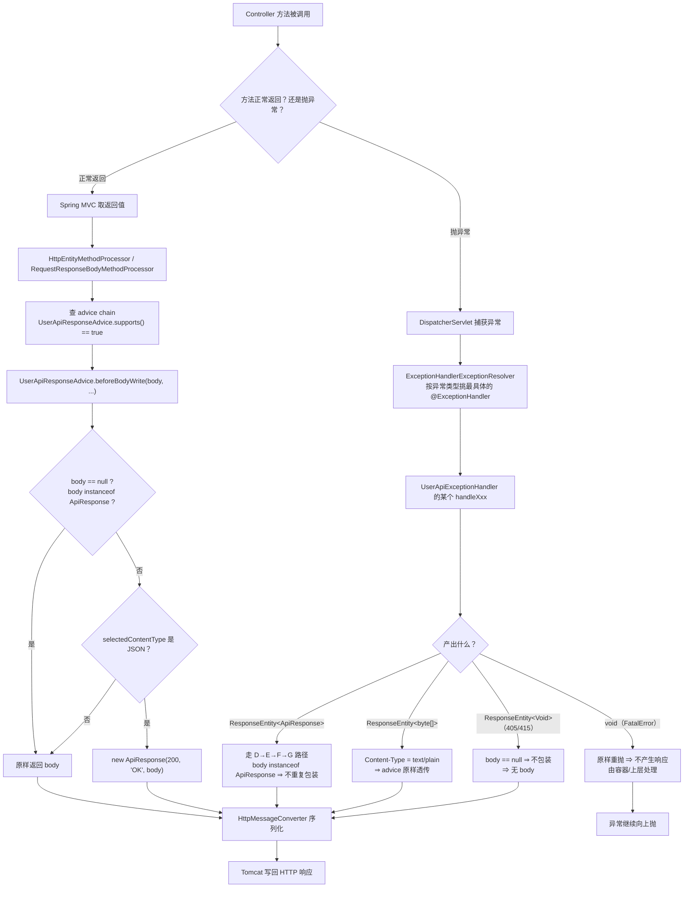
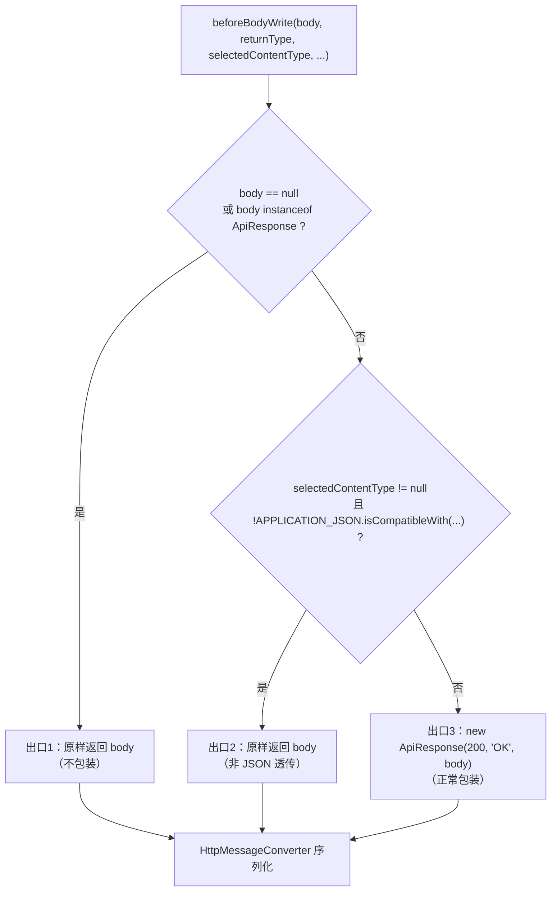
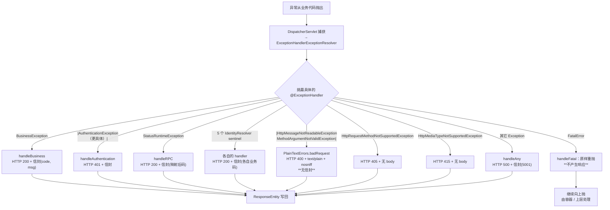
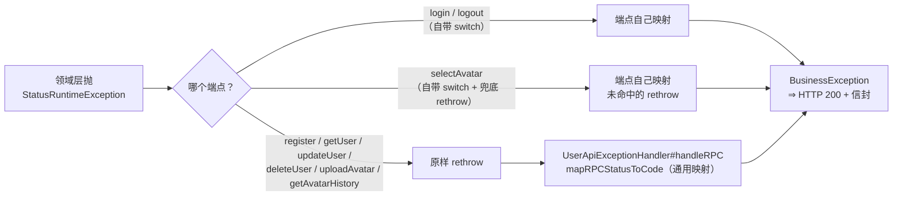
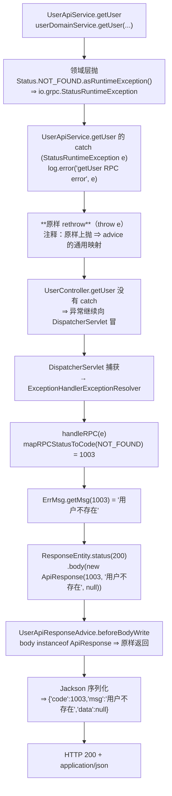
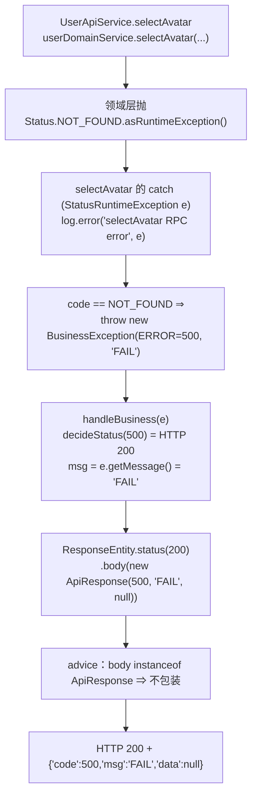
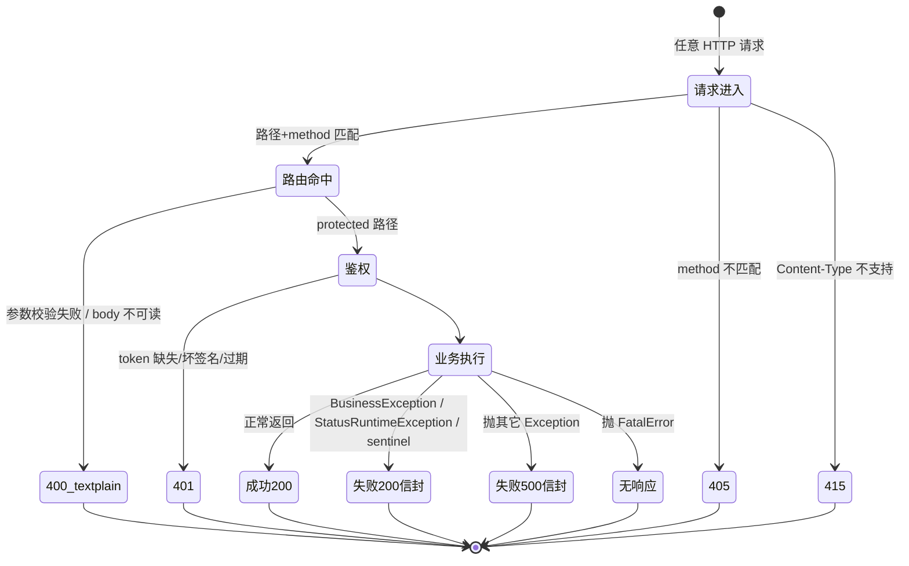

# 11. HTTP 统一响应与异常处理流程

> 本文是 `service/users/user` 域的**机制类**文档：讲清「不管业务成功还是失败，客户端最终收到的那个 HTTP 响应是怎么造出来的」。
> 本文不讲业务逻辑，只讲**出口**。

---

## 1. 本次流程的研究范围

本文追踪的是「**一个请求走完之后，响应是怎么被写出去**」这件事，具体到两个出口：

| 出口 | 承载类 | 触发时机 |
|---|---|---|
| **正常出口** | `advice/UserApiResponseAdvice.java` | Controller 方法正常返回 |
| **异常出口** | `advice/UserApiExceptionHandler.java` | 任意异常从业务代码里抛出来 |

**追踪到哪里为止**：

```
Controller 方法返回 / 抛出异常
  → Spring MVC 选中处理分支
  → 产出 ResponseEntity
  → （可选）ResponseBodyAdvice 包装
  → HttpMessageConverter 序列化
  → Tomcat 写回 HTTP 响应
```

**不追踪什么**：

- **不追踪** 业务代码里为什么会抛这些异常（那是 01~09 号文档）；
- **不追踪** 鉴权链本身（那是 [`./10-JWT认证与身份传递流程.md`](./10-JWT认证与身份传递流程.md)），
  本文只在「401 由谁产出」这一处出现它；
- **不追踪** gRPC 入口的异常处理（那是 12 号文档，gRPC 侧走的是 `StreamObserver.onError`，不经过本文这两个类）。

**本文要回答的核心问题**：

> 同一个「失败」，在本项目里有**三种截然不同的 HTTP 形态**：
> `HTTP 200 + JSON 信封`、`HTTP 400/405/415 + text/plain`、`HTTP 401 + JSON 信封`。
> **是谁在决定用哪一种？**

---

## 2. 触发场景与输入

### 2.1 三个具体请求

**请求 A —— 正常**：

```
POST /user/v1/login HTTP/1.1
Content-Type: application/json

{"username":"alice","password":"123456"}
```

**请求 B —— 业务失败**（用户名不存在 → 业务层抛 `BusinessException(1002)`）：

```
POST /user/v1/login HTTP/1.1
Content-Type: application/json

{"username":"nobody","password":"whatever"}
```

**请求 C —— 框架级失败**（body 缺必填字段 → Spring 抛 `MethodArgumentNotValidException`）：

```
POST /user/v1/login HTTP/1.1
Content-Type: application/json

{}
```

### 2.2 三种请求的出口完全不同

| | HTTP 状态码 | Content-Type | body 形态 |
|---|---|---|---|
| A 正常 | 200 | `application/json` | `{"code":200,"msg":"OK","data":{...}}` |
| B 业务失败 | **200** | `application/json` | `{"code":1002,"msg":"用户名或密码错误","data":null}` |
| C 框架级失败 | **400** | `text/plain; charset=utf-8` | **裸文本**，没有信封 |

**「有统一包装」不等于「所有失败都是 JSON 信封」** —— 这是本文最重要的一句话，§6 会展开。

---

## 3. 整体执行路线



---

## 4. 逐步讲解

### 4.1 正常路径：`ResponseBodyAdvice` 怎么造出信封

`UserApiResponseAdvice`（`service/users/user/src/main/java/com/rag/user/advice/UserApiResponseAdvice.java`）：

```java
@RestControllerAdvice
public class UserApiResponseAdvice implements ResponseBodyAdvice<Object> {

    @Override
    public boolean supports(MethodParameter returnType, Class<? extends HttpMessageConverter<?>> converterType) {
        // 拦截所有 Controller 返回值；Controller 自己抛异常由 UserApiExceptionHandler 处理
        return true;
    }

    @Override
    public Object beforeBodyWrite(Object body, MethodParameter returnType, MediaType selectedContentType,
                                  Class<? extends HttpMessageConverter<?>> selectedConverterType,
                                  ServerHttpRequest request, ServerHttpResponse response) {
        if (body == null || body instanceof ApiResponse) {
            return body;
        }
        if (selectedContentType != null
                && !MediaType.APPLICATION_JSON.isCompatibleWith(selectedContentType)) {
            return body;
        }
        return new ApiResponse(ErrCodes.SUCCESS, ErrMsg.getMsg(ErrCodes.SUCCESS), body);
    }
}
```
（`UserApiResponseAdvice.java:42-75`）

**框架职责**：`ResponseBodyAdvice` 是 Spring MVC 提供的扩展点，在**Controller 返回值即将被写进 HTTP 响应体之前**被调用。
它的返回值**替换**原来的 body。`supports` 返回 `true` 意味着「所有 Controller 返回值都要过我的 `beforeBodyWrite`」。

**框架什么时候触发它**：由 `AbstractMessageConverterMethodProcessor#writeWithMessageConverters` 统一调用 ——
它负责找到合适的 `HttpMessageConverter`，并在真正写 body **之前**先跑一遍 advice chain。

**`beforeBodyWrite` 的四个出口**：



逐个说清**为什么**：

#### 出口 1：`body == null || body instanceof ApiResponse` ⇒ 不包装

```java
if (body == null || body instanceof ApiResponse) {
    return body;
}
```
（`:58-60`）

两个理由，**第二个更重要**：

- **`body == null`**：`@ExceptionHandler` 里 405 / 415 产出的是 `ResponseEntity<Void>`（body 为 null）。
  如果不判空，`null` 会被包成 `{"code":200,"msg":"OK","data":null}` ⇒
  **把 405 / 415 的空响应体篡改成了「成功」**。源码注释写得很直白：

  > null body（如框架级错误直接返回无 body 的 ResponseEntity）也不能包，
  > 否则会把 400/405/415 的空响应体篡改成 {"code":200,...}。

- **`body instanceof ApiResponse`**：`@ExceptionHandler` 返回的是 `ResponseEntity<ApiResponse>`，
  它的 body **本身就是** `ApiResponse` ⇒ 不该再包一层。
  `UserApiResponseAdvice` 的类注释（`:32-41`）给了一个具体后果：

  > 若这里无条件再包一层，错误响应会变成 `{"code":200,"msg":"OK","data":{"code":1003,...}}` ——
  > **顶层 code 恒为 200，所有按 `code != 200` 判定失败的客户端会全部失效。**

  ⇒ 这就是「只包一层」这条硬约束的意义。

#### 出口 2：非 JSON Content-Type ⇒ 原样透传

```java
if (selectedContentType != null
        && !MediaType.APPLICATION_JSON.isCompatibleWith(selectedContentType)) {
    return body;
}
```
（`:70-73`）

源码注释（`:61-69`）解释了它针对的是哪条路径：

> 【DRIFT-006】非 JSON 响应必须原样透传，不能包 envelope。
> Go 出处：go-zero `rest/httpx/responses.go` 的 `doHandleError` 在 `handler == nil` 时走
> `http.Error(w, err.Error(), http.StatusBadRequest)` —— 产出的是
> `Content-Type: text/plain; charset=utf-8` + 裸文本，**没有 {code,msg,data} 结构**。

⚠️ **判定条件是「这次写出的到底是不是 JSON」，而不是「body 是不是字符串」** ——
否则 405 / 415 这类同样走 `text/plain` 的分支会被漏判。

⇒ 实测：`application/json` 与 `application/json;charset=utf-8` 会被包装；
`text/plain`、`application/octet-stream` 等一律不包装。

#### 出口 3：正常包装

```java
return new ApiResponse(ErrCodes.SUCCESS, ErrMsg.getMsg(ErrCodes.SUCCESS), body);
```
（`:74`）

`ErrCodes.SUCCESS` = **200**，`ErrMsg.getMsg(200)` = **`"OK"`**。

⇒ 请求 A 的最终 body：

```json
{"code":200,"msg":"OK","data":{"token":"eyJhbGciOiJIUzI1NiJ9..."}}
```

### 4.2 `ApiResponse` 的三个字段

`common/src/main/java/com/rag/common/contract/ApiResponse.java:59-67`：

```java
@Getter
@Setter
@NoArgsConstructor
@AllArgsConstructor
public class ApiResponse {
    private int code;
    private String msg;
    private Object data;
}
```

| 字段 | 类型 | 含义 | 取值来源 |
|---|---|---|---|
| `code` | `int` | 业务码 | 成功恒为 200；失败时来自异常或映射表 |
| `msg` | `String` | 提示文案 | 成功恒为 `"OK"`；失败时来自 `ErrMsg` |
| `data` | `Object` | 业务数据 | 成功时 = Controller 的原始返回值；失败时恒为 `null` |

**Lombok 注解各自的作用**：

| 注解 | 生成的东西 | 谁在用 |
|---|---|---|
| `@Getter` | `getCode()` / `getMsg()` / `getData()` | **Jackson** 靠 getter 推出 JSON 键名 |
| `@Setter` | 三个 setter | 供代码反序列化/修改用 |
| `@NoArgsConstructor` | 无参构造 | **Jackson 反序列化**需要（虽然本项目只序列化不反序列化） |
| `@AllArgsConstructor` | 三参构造 | 本项目**全靠它**造信封：`new ApiResponse(code, msg, data)` |

⚠️ **三条 L1 硬约束**（`ApiResponse.java:17-24`）：

1. **键名与顺序**：`code` → `msg` → `data`，逐条一致 ⇒ 不可调序、不可改名；
2. **无 `omitempty`**：B 侧三个字段都没有 `omitempty` ⇒ `data` 为 null 时**仍然出现**（`"data":null`）
   ⇒ Java 侧**不得**加 `@JsonInclude(NON_NULL)` / `@JsonInclude(NON_EMPTY)`
   ⇒ 否则 `data` 键会消失 ⇒ **可观察形状不等价**；
3. **不可用 `ProblemDetail` 替换** ⇒ 本类是**唯一**信封载体。

守门测试：`UserApiHttpContractTest#envelopeAlwaysHasThreeFields`（`UserApiHttpContractTest.java:144-155`）
断言 `body.size() == 3` 且 `code` / `msg` / `data` 三个键都存在。

### 4.3 异常路径：异常怎么被交给 `@ExceptionHandler`

Controller 方法抛出异常后，**Controller 自己不处理**。控制流是：

```
Controller 方法抛出异常
  ↓
DispatcherServlet#doDispatch 捕获（try/catch 包住整个 handler 执行）
  ↓
processDispatchResult → processHandlerException
  ↓
ExceptionHandlerExceptionResolver（advice chain 里的一个 resolver）
  ↓ 按异常类型挑「最具体」的 @ExceptionHandler 方法
  ↓ 调用它，拿到它的返回值（ResponseEntity / 普通对象 / void）
  ↓ 这个返回值被当作「Controller 的返回值」继续往下走
  ↓ ⇒ **也会再经过 ResponseBodyAdvice**
```

**关键点**：`@ExceptionHandler` 方法的返回值走的是**和 Controller 返回值完全相同**的那条路。
这就是为什么 `UserApiResponseAdvice` 必须判 `body instanceof ApiResponse` ——
否则错误信封会被再包一层（§4.1 出口 1）。

**Spring 怎么挑 handler**：按异常类型的**具体程度**匹配，**最具体的胜出**。
本项目的类型层次是：

```
RuntimeException
  └─ BusinessException          (code + msg)
       └─ AuthenticationException   (继承而来，语义上 = HTTP 401)
```

⇒ `AuthenticationException` 有自己专门的 handler（`:75-80`），
它比 `handleBusiness`（`:56-63`）更具体 ⇒ **只有拦截器抛出的鉴权失败走 401 那条**。

`UserApiExceptionHandler.java:66-69` 的注释确认了这个顺序：

> Spring 按「最具体」挑 handler：`AuthenticationException extends BusinessException`，
> 因此本方法优先于上面的 `handleBusiness`，只有拦截器抛出的鉴权失败会走这里。

### 4.4 `decideStatus`：为什么业务码不决定 HTTP 状态码

`UserApiExceptionHandler.java:269-271`：

```java
private HttpStatus decideStatus(int code) {
    return HttpStatus.OK;
}
```

⚠️ **参数 `code` 完全没被用到** —— 这个方法恒返回 `HttpStatus.OK`。

它的 javadoc（`:260-268`）说明了理由：

> 与 Go 端 `httpx.OkJson` 1:1：Go 侧所有 Logic 结果都经 envelope 输出，
> HTTP 状态码恒为 200，业务成败完全由 body 里的 `code` 表达。
>
> ⚠️ **鉴权层不走本方法**：鉴权失败由 `handleAuthentication` 单独产出 401 ⇒
> ⇒ 1006 在两层都可能出现时，**按码分流会把两层重新搅在一起**（B 侧 `DRIFT-004` 的教训）。

⇒ 换句话说：**「业务码 → HTTP 状态码」这个映射在本项目里是「恒等 200」**，
401 是**类型**决定的（`AuthenticationException`），不是码决定的。

---

## 5. 重要分支与失败路径

### 5.1 完整异常分支表

这是本文的**核心表**。左边是异常类型，中间是 HTTP 状态码，右边是 body 形态：

| 异常类型 | 处理器（`UserApiExceptionHandler.java`） | HTTP 状态码 | body | Content-Type |
|---|---|---|---|---|
| `BusinessException` | `handleBusiness`（`:56-63`） | **200**（`decideStatus` 恒定） | `{"code":<code>,"msg":<异常 message>,"data":null}` | `application/json` |
| `AuthenticationException` | `handleAuthentication`（`:75-80`） | **401** | `{"code":1006,"msg":"TOKEN已过期","data":null}` | `application/json` |
| `StatusRuntimeException` | `handleRPC`（`:91-102`） | **200** | `{"code":<映射后码>,"msg":<映射后码的文案>,"data":null}` | `application/json` |
| `IdentityResolver.ErrInvalidClaimException` | `handleErrInvalidClaim`（`:134-139`） | **200** | `{"code":1006,"msg":"TOKEN已过期","data":null}` | `application/json` |
| `IdentityResolver.ErrUserNotFoundException` | `handleErrUserNotFound`（`:141-146`） | **200** | `{"code":1003,"msg":"用户不存在","data":null}` | `application/json` |
| `IdentityResolver.ErrUserInactiveException` | `handleErrUserInactive`（`:148-153`） | **200** | `{"code":1011,"msg":"用户已被封禁","data":null}` | `application/json` |
| `IdentityResolver.ErrStatusUnavailableException` | `handleErrStatusUnavailable`（`:155-160`） | **200** | `{"code":1015,"msg":"服务繁忙","data":null}` | `application/json` |
| `IdentityResolver.ErrIdentityMismatchException` | `handleErrIdentityMismatch`（`:162-167`） | **200** | `{"code":5001,"msg":"系统内部错误","data":null}` | `application/json` |
| `HttpMessageNotReadableException` | `handleUnreadableBody`（`:178-182`） | **400** | **裸文本**（异常 message + `\n`） | `text/plain; charset=utf-8` ＋ `X-Content-Type-Options: nosniff` |
| `MethodArgumentNotValidException` | `handleBeanValidation`（`:202-210`） | **400** | **裸文本**（字段名 + 校验消息 + `\n`） | 同上 |
| `HttpRequestMethodNotSupportedException` | `handleMethodNotSupported`（`:213-217`） | **405** | **无 body** | — |
| `HttpMediaTypeNotSupportedException` | `handleMediaTypeNotSupported`（`:220-224`） | **415** | **无 body** | — |
| `FatalError` | `handleFatal`（`:237-241`） | **不产生响应** | 原样重抛 | — |
| 其它 `Exception` | `handleAny`（`:245-256`） | **500** | `{"code":5001,"msg":"系统内部错误","data":null}` | `application/json` |



### 5.2 `FatalError`：唯一「故意不返回」的分支

```java
@ExceptionHandler(FatalError.class)
public void handleFatal(FatalError e) {
    // 故意不返回 ResponseEntity：让异常继续向上抛
    throw e;
}
```
（`UserApiExceptionHandler.java:237-241`）

**为什么**：`FatalError` 的契约是「fatal 之后必须停止接流量」（`common/.../logger/FatalError.java:20-30`）。
如果把它当成普通业务异常处理 ⇒ 请求看起来「失败了」，而**进程带着致命状态继续正常服务** ——
这正是 Go 侧绝不会发生的情况。

`handleAny` 里还有一道保险（`:249-251`）：

```java
if (e instanceof FatalError fatal) {
    throw fatal;
}
```

⇒ 即使某个 advice 忘了注册 `FatalError` 分支，也不会把它包成 200 业务信封。

⚠️ **本项目的 `FatalError` 没有做 `System.exit(1)`**（`:235`：「刻意不做 `System.exit(1)`：终止决策权留给调用 `logFatal` 的位置」）。
所以「fatal 后一定终止」这个契约在 Java 侧是**收窄**的：只有「无人 catch」时才会终止。

### 5.3 🔴 两套 gRPC 码映射并存

本项目有**两套**「gRPC `Status.Code` → 业务码」的映射：

**第一套：advice 里的通用映射**（`UserApiExceptionHandler.java:116-130`）：

```java
private int mapRPCStatusToCode(Status.Code code) {
    if (code == Status.Code.INTERNAL) {
        return ErrCodes.ERROR_SERVER_COMMON;      // 5001
    }
    if (code == Status.Code.NOT_FOUND) {
        return ErrCodes.ERROR_USER_NOT_EXIST;     // 1003
    }
    if (code == Status.Code.ALREADY_EXISTS) {
        return ErrCodes.ERROR_USER_EXIST;         // 1001
    }
    if (code == Status.Code.INVALID_ARGUMENT) {
        return ErrCodes.ERROR;                    // 500
    }
    return ErrCodes.CODE_SERVER_BUSY;             // 1015
}
```

**第二套：端点自己写的 switch**（在 `UserApiService` 各方法里）。

⚠️ **两套不完全相同 ⇒ 同一类异常在不同端点可能得到不同业务码。**



#### 逐端点对照表（全部来自 `UserApiService.java` 的真实 catch 块）

| 端点 | catch 位置 | gRPC code | 得到的业务码 | HTTP |
|---|---|---|---|---|
| `login` | `:109-124` | `INTERNAL` | **5001** | 200 |
| `login` | `:109-124` | 其它一律 | **1015** | 200 |
| `logout` | `:416-427` | `INTERNAL` | **5001** | 200 |
| `logout` | `:416-427` | 其它一律（含 `INVALID_ARGUMENT`） | **1015** | 200 |
| `selectAvatar` | `:539-555` | `NOT_FOUND` | **500** | 200 |
| `selectAvatar` | `:539-555` | `INVALID_ARGUMENT` | **500** | 200 |
| `selectAvatar` | `:539-555` | 其它（`INTERNAL` 等） | rethrow ⇒ 通用映射 | 200 |
| `register` | `:188-193` | 全部 | rethrow ⇒ 通用映射 | 200 |
| `getUser` | `:246-250` | 全部 | rethrow ⇒ 通用映射 | 200 |
| `updateUser` | `:328-331` | 全部 | rethrow ⇒ 通用映射 | 200 |
| `deleteUser` | `:370-373` | 全部 | rethrow ⇒ 通用映射 | 200 |
| `uploadAvatar` | `:484-487` | 全部 | rethrow ⇒ 通用映射 | 200 |
| `getAvatarHistory` | `:600-603` | 全部 | rethrow ⇒ 通用映射 | 200 |

#### 三个具体分叉（这就是「两套并存」的全部后果）

**分叉 1：`INVALID_ARGUMENT`**

| 来源 | `INVALID_ARGUMENT` ⇒ |
|---|---|
| 通用映射（`mapRPCStatusToCode`） | **500** |
| `logout` 端点自带 switch（`:419-426`） | **1015** |

`logout` 的注释写明了为什么（`UserApiService.java:401-403`）：

> 🔴 B 侧 `DRIFT-USERAPI-003 已修`：**刻意不**复用 advice 的通用 gRPC 映射
> （那个通用映射会把 `INVALID_ARGUMENT` 映成 500，而 B 侧的 logout switch 里根本没有这一格）
> ⇒ ⇒ 本类的 catch **显式写出** B 的两条分支。

**分叉 2：`NOT_FOUND`**

| 来源 | `NOT_FOUND` ⇒ |
|---|---|
| 通用映射 | **1003**（用户不存在） |
| `selectAvatar` 端点自带 switch（`:549-553`） | **500** |

`selectAvatar` 的注释（`:546-548`）说明了为什么**不能**用通用映射：

> NOT_FOUND 的差异不是「看起来更合理」的改写，而是**抹掉了 Go 刻意保留的区分**：
> 「头像历史不存在」(500) 与「用户不存在」(1003) 被合并后，
> 客户端可以据此枚举某个 uid 是否存在 ⇒ 必须显式保留。

**分叉 3：`INTERNAL` 之外的「其它」**

`login` 与 `logout` 都是「`INTERNAL` → 5001，其它一律 1015」。
而通用映射里 `ALREADY_EXISTS` → 1001、`NOT_FOUND` → 1003、`INVALID_ARGUMENT` → 500。
⇒ 同一个 `NOT_FOUND`，走 `login` 得 1015，走 `getUser` 得 1003。

⚠️ **这不是 bug，是照抄真源的结果**（`UserApiExceptionHandler.java:87-89`）：

> ⚠️ **本方法是「通用映射」**：个别端点在 api 层**显式**覆盖了它
> ⇒ ⇒ **不要把通用映射当成唯一口径**。

### 5.4 `PlainTextErrors.badRequest`：400 的精确形状

`common/src/main/java/com/rag/common/web/PlainTextErrors.java:72-89`：

```java
public static ResponseEntity<byte[]> badRequest(String message) {
    return text(HttpStatus.BAD_REQUEST, message);
}

public static ResponseEntity<byte[]> text(HttpStatus status, String message) {
    byte[] body = ((message == null ? "" : message) + "\n").getBytes(StandardCharsets.UTF_8);
    return ResponseEntity.status(status)
            .header(HttpHeaders.CONTENT_TYPE, TEXT_PLAIN_UTF8)
            .header("X-Content-Type-Options", "nosniff")
            .body(body);
}
```

三个要点：

1. **状态码 400**；
2. **两个 header**：`Content-Type: text/plain; charset=utf-8` ＋ `X-Content-Type-Options: nosniff`；
3. ⚠️ **body 末尾追加一个 `\n`**（`:84` 的 `+ "\n"`）—— 这是 B 侧 `http.Error` 用 `fmt.Fprintln` 的等价物。
   javadoc 明确写「调用方**不要**自己加」（`:69-70`）。

⚠️ **这个 `byte[]` body 怎么绕过 `ResponseBodyAdvice` 的包装？**
靠的正是 §4.1 的**出口 2** —— `selectedContentType` 是 `text/plain` ⇒ 不是 JSON ⇒ 原样透传。
（如果只判「body 是不是 `ApiResponse`」而漏掉 Content-Type 判定，这个 `byte[]` 就会被包成
`{"code":200,"msg":"OK","data":[123,34,...]}` —— body 变成字节数组的 JSON。）

#### 两条 400 分支的文案来源不同

| 异常 | body 文本 |
|---|---|
| `HttpMessageNotReadableException` | `e.getMessage()`（Jackson 的解析错误描述） |
| `MethodArgumentNotValidException` | 第一个字段错误的「字段名 + 默认消息」（`:204-207`） |

⚠️ **`MethodArgumentNotValidException` 这条是已批准的 L3 降级**（决策 D5，`docs/L3-降级清单.md` D-01）：
状态码 400 不变、错误结构（text/plain ＋ nosniff ＋ 尾换行）不变，**只有文案**由 Hibernate Validator 决定 ⇒ 与真源不同。

### 5.5 405 / 415：裸状态码，无 body

```java
@ExceptionHandler(HttpRequestMethodNotSupportedException.class)
public ResponseEntity<Void> handleMethodNotSupported(HttpRequestMethodNotSupportedException e) {
    log.warn("method not supported : {}", e.getMessage());
    return ResponseEntity.status(HttpStatus.METHOD_NOT_ALLOWED).build();
}
```
（`UserApiExceptionHandler.java:213-217`）

`ResponseEntity.status(405).build()` ⇒ **body 为 null** ⇒
① `UserApiResponseAdvice` 的出口 1（`body == null`）⇒ 不包装；
② 最终响应 **405 + 空 body**。

⚠️ **没有 `Allow` 头** —— 源码注释（`:37`）说：「B 侧 Java 版返回**裸状态码**（无 Allow 头、无 body）⇒ C 侧逐条照抄」。

守门测试：`UserApiHttpContractTest#getOnPostOnlyEndpointIs405`（`:88-94`）断言 405 且 `body` 为 null 或空。

### 5.6 一个容易忽略的分支：404 被兜底吃掉，变成 500

本域**没有** 404 分支 ⇒ `NoResourceFoundException` / `NoHandlerFoundException` 会落到 `handleAny(Exception)` ⇒
**HTTP 500 + `{code:5001}`**。

守门测试 `UserApiHttpContractTest#unknownPathOutsideUserPrefixIs500Envelope`（`:96-112`）的注释解释：

> ⚠️ **不是 404** —— B 侧的兜底 `@ExceptionHandler(Exception.class) handleAny`
> 会把 Spring 的 404 异常一并兜住 ⇒ 返回 **HTTP 500 + {code:5001,msg,data}**。
> ⇒ 这是 **B 侧自身**的语义（标准 Spring 语义本该是 404）⇒ 按 D16 **继承**，不回溯修改。

而 `/user/v1/**` 下的未知路径是 **401**（拦截器先于 404 触发）—— 见
`UserApiHttpContractTest#unknownPathInsideUserPrefixIs401`（`:114-126`）。

### 5.7 一条完整的异常传播链（从产生到响应）

以「领域层查不到用户」为例：



**对照另一条链**（同一个异常类型，不同端点）：



⚠️ **同一个 `NOT_FOUND`，两条链给出 1003 和 500 两个不同的业务码** —— 这就是 §5.3 的分叉 2。

---

## 6. 数据变化与副作用

### 6.1 副作用清单

| 类别 | 本流程中是否发生 | 说明 |
|---|---|---|
| **数据库读写** | ❌ 不发生 | 两个 advice 类**完全不碰数据库**。它们拿到的是已经算好的业务码 |
| **Redis 读写** | ❌ 不发生 | 不碰 Redis（Redis 只在 `JwtAuthInterceptor` 的黑名单检查里读，见 10 号文档） |
| **事务** | ❌ 不发生 | 没有 `@Transactional`，没有数据库连接 |
| **远程调用** | ❌ 不发生 | 无 gRPC / HTTP / Nacos / MinIO 调用 |
| **消息** | ❌ 不发生 | 无 Kafka 生产/消费 |
| **日志** | ✅ 发生 | 见 §6.2 |
| **指标** | ❌ **不发生** | ⚠️ **两个 advice 类都没有注入 `MeterRegistry`，也没有任何 `Counter` 调用** ⇒ **异常路径上不产生任何指标**。<br>⇒ 指标只在 `UserApiService` 的具体 catch 块里打点（如 `user_api_intercept_total{path="/user/login",result="rpc_error"}`），**鉴权失败 / 参数校验失败 / 400 / 405 / 415 / 500 都没有指标** |
| **ID 生成** | ❌ 不发生 | 无 Snowflake 调用 |
| **Token 生成** | ❌ 不发生 | 不签发、不解析 token |

⚠️ **「异常路径没有指标」这件事值得强调**：
`UserApiExceptionHandler` 的类注释里提到「metrics 由 `GlobalExceptionHandler` 统一处理」（那是 `BusinessException` 的旧注释），
但**本仓的 `UserApiExceptionHandler` 实际上一个指标都没写** ——
所有业务码映射出来的失败，**在 Prometheus 里都看不到计数**。

### 6.2 日志明细

| 级别 | handler | 触发 | 内容 |
|---|---|---|---|
| `error` | `handleBusiness` | 任何 `BusinessException` | `BusinessException code={} msg={}` |
| `warn` | `handleAuthentication` | 鉴权失败 | `AuthenticationException code={} msg={}` |
| `error` | `handleRPC` | gRPC 状态异常 | `gRPC StatusRuntimeException code={} mapped to businessCode={} desc={}`（**带堆栈**） |
| `error` | 5 个 sentinel handler | 身份判定失败 | `ErrInvalidClaim : {}` / `ErrUserNotFound : {}` / `ErrUserInactive : {}` / `ErrStatusUnavailable : {}` / `ErrIdentityMismatch : {}` |
| `warn` | `handleUnreadableBody` | 请求体不可读 | `unreadable request body : {}` |
| `warn` | `handleBeanValidation` | 校验失败 | `bean validation failed : {}` |
| `warn` | `handleMethodNotSupported` | 405 | `method not supported : {}` |
| `warn` | `handleMediaTypeNotSupported` | 415 | `media type not supported : {}` |
| `error` | `handleAny` | 未捕获异常 | `unhandled exception`（**带堆栈**） |
| —— | `handleFatal` | `FatalError` | **不打日志**（直接重抛） |

⚠️ **日志级别的区分是有意义的**：
`error` = 服务端/业务异常（需要人看）；`warn` = 客户端搞错了（401 / 400 / 405 / 415）；
`handleFatal` 不打日志是因为**致命日志在别处已经打过**了（`logFatal` 的位置）。

### 6.3 响应体的构造路径

一条请求的响应体是被**两个类接力**造出来的：

```
正常路径：
  Controller 返回值 DTO
    → ResponseBodyAdvice.beforeBodyWrite
      → new ApiResponse(200, "OK", DTO)
        → Jackson 序列化 → {"code":200,"msg":"OK","data":DTO}

异常路径：
  异常 → handler 算出 (code, msg)
    → new ApiResponse(code, msg, null)
      → ResponseEntity.status(状态码)
        → ResponseBodyAdvice.beforeBodyWrite（判到 instanceof ApiResponse ⇒ 不包装）
          → Jackson 序列化 → {"code":code,"msg":msg,"data":null}
```

⇒ **两种路径都只包一层**，这是硬约束（§4.1 出口 1）。

---

## 7. 执行结果

### 7.1 请求 A —— 正常（登录成功）

```http
HTTP/1.1 200
Content-Type: application/json

{"code":200,"msg":"OK","data":{"token":"eyJhbGciOiJIUzI1NiJ9..."}}
```

### 7.2 请求 B —— 业务失败（用户名不存在）

```http
HTTP/1.1 200
Content-Type: application/json

{"code":1002,"msg":"用户名或密码错误","data":null}
```

⚠️ **HTTP 200**。客户端必须读 body 里的 `code` 才知道失败了。

### 7.3 请求 C —— 框架级失败（缺必填字段）

```http
HTTP/1.1 400
Content-Type: text/plain; charset=utf-8
X-Content-Type-Options: nosniff

username must not be null
```

（最后有一个 `\n`。文案由 Hibernate Validator 的默认消息决定（`@NotNull` ⇒ `must not be null`）⇒ 与真源不同，属已登记的 L3 降级。
⚠️ 也就是说：**结构可断言，文案不可断言**。）

⚠️ **没有 `code` / `msg` / `data`** —— 这个响应不是信封。

### 7.4 鉴权失败（protected 路径缺 token）

```http
HTTP/1.1 401
Content-Type: application/json

{"code":1006,"msg":"TOKEN已过期","data":null}
```

### 7.5 方法不支持（GET 打 POST 端点）

```http
HTTP/1.1 405
```

⚠️ **无 body、无 `Allow` 头**。

### 7.6 Content-Type 不支持

```http
HTTP/1.1 415
```

⚠️ **无 body**。

### 7.7 未捕获异常

```http
HTTP/1.1 500
Content-Type: application/json

{"code":5001,"msg":"系统内部错误","data":null}
```

### 7.8 未知路径（不在 `/user/v1/**` 下）

```http
HTTP/1.1 500
Content-Type: application/json

{"code":5001,"msg":"系统内部错误","data":null}
```

⚠️ **不是 404**（§5.6）。

---

## 8. 流程复盘

### 8.1 走过的代码

```
Controller 方法返回 / 抛异常
  ↓
【正常】
  ResponseBodyAdvice.supports() == true
    → beforeBodyWrite(body, ...)
        ├─ body == null || body instanceof ApiResponse ⇒ 原样
        ├─ Content-Type 非 JSON ⇒ 原样
        └─ 否则 ⇒ new ApiResponse(200, "OK", body)
  ↓
【异常】
  DispatcherServlet 捕获 → ExceptionHandlerExceptionResolver
    → 按类型挑最具体的 @ExceptionHandler：
        BusinessException            → handleBusiness        → 200 + 信封
        AuthenticationException      → handleAuthentication  → 401 + 信封
        StatusRuntimeException       → handleRPC             → 200 + 信封（通用映射）
        5 个 IdentityResolver sentinel → 各自的 handle        → 200 + 信封
        HttpMessageNotReadableException / MethodArgumentNotValidException
                                   → PlainTextErrors.badRequest → 400 + text/plain + nosniff
        HttpRequestMethodNotSupportedException → 405 无 body
        HttpMediaTypeNotSupportedException     → 415 无 body
        FatalError                  → handleFatal           → 原样重抛
        其它 Exception               → handleAny             → 500 + 信封(5001)
  ↓
（handler 的返回值也再走一遍 ResponseBodyAdvice ⇒ 靠 instanceof 判定不重复包装）
  ↓
HttpMessageConverter 序列化 → Tomcat 写回
```

### 8.2 边界结论

1. **信封只有一个载体**：`ApiResponse`，三个字段 `code` / `msg` / `data`，只包一层。
2. **`ResponseBodyAdvice` 有三个「不包装」出口**：`body == null` / `body instanceof ApiResponse` / 非 JSON Content-Type。
   少任何一个都会产出畸形响应。
3. **HTTP 状态码 ≠ 业务码**。业务失败基本是 **HTTP 200 + body 里的 code**；
   框架级错误保留 400 / 405 / 415 + `text/plain`；鉴权失败保留 401。
4. **层次由异常类型承载，不由业务码承载**。1006 在 401 和 200 两种响应里都出现过
   ⇒ 按码分流会把鉴权层和业务层搅在一起。
5. **两套 gRPC 码映射并存**：端点自带 switch 与 advice 的通用映射**不完全相同**
   ⇒ 同一类异常在不同端点可能得到不同业务码（`NOT_FOUND` 在 `getUser` 是 1003、在 `selectAvatar` 是 500）。
6. **`FatalError` 故意不返回**，原样重抛 ⇒ 绝不转成 200 业务信封。
7. **`decideStatus(code)` 恒返回 200**，参数根本没被用到 —— 业务码不决定 HTTP 状态码。
8. **异常路径上没有任何指标** —— 两个 advice 类都不注入 `MeterRegistry`。
9. **`404` 会被兜底吃掉变成 500** —— 继承自真源，不是标准 Spring 语义。
10. **`text/plain` 的 body 末尾有一个 `\n`**，由 `PlainTextErrors` 统一补，调用方不要自己加。

---

## 9. 源码定位与验证方式

### 9.1 源码定位

| 位置 | 文件 : 行 | 内容 |
|---|---|---|
| 响应包装 | `service/users/user/src/main/java/com/rag/user/advice/UserApiResponseAdvice.java:42-75` | `supports` / `beforeBodyWrite` |
| 不包装出口 1 | `service/users/user/src/main/java/com/rag/user/advice/UserApiResponseAdvice.java:58-60` | `body == null \|\| body instanceof ApiResponse` |
| 不包装出口 2 | `service/users/user/src/main/java/com/rag/user/advice/UserApiResponseAdvice.java:70-73` | 非 JSON Content-Type 原样透传 |
| 异常处理器总表 | `service/users/user/src/main/java/com/rag/user/advice/UserApiExceptionHandler.java:49-271` | 12 个 `@ExceptionHandler` |
| 业务异常 | `service/users/user/src/main/java/com/rag/user/advice/UserApiExceptionHandler.java:56-63` | `handleBusiness` → 200 + 信封 |
| 鉴权异常 | `service/users/user/src/main/java/com/rag/user/advice/UserApiExceptionHandler.java:75-80` | `handleAuthentication` → 401 + 信封 |
| gRPC 通用映射 | `service/users/user/src/main/java/com/rag/user/advice/UserApiExceptionHandler.java:91-102, 116-130` | `handleRPC` + `mapRPCStatusToCode` |
| 5 个 sentinel | `service/users/user/src/main/java/com/rag/user/advice/UserApiExceptionHandler.java:134-167` | 各自业务码 + 200 |
| 400 · body 不可读 | `service/users/user/src/main/java/com/rag/user/advice/UserApiExceptionHandler.java:178-182` | `PlainTextErrors.badRequest` |
| 400 · 校验失败 | `service/users/user/src/main/java/com/rag/user/advice/UserApiExceptionHandler.java:202-210` | 取第一个字段错误 |
| 405 | `service/users/user/src/main/java/com/rag/user/advice/UserApiExceptionHandler.java:213-217` | 裸状态码、无 body |
| 415 | `service/users/user/src/main/java/com/rag/user/advice/UserApiExceptionHandler.java:220-224` | 裸状态码、无 body |
| FatalError | `service/users/user/src/main/java/com/rag/user/advice/UserApiExceptionHandler.java:237-241` | 原样重抛 |
| 兜底 500 | `service/users/user/src/main/java/com/rag/user/advice/UserApiExceptionHandler.java:245-256` | `handleAny` → 500 + 5001 |
| 业务码 → 状态码 | `service/users/user/src/main/java/com/rag/user/advice/UserApiExceptionHandler.java:269-271` | `decideStatus` 恒 200 |
| 信封 | `common/src/main/java/com/rag/common/contract/ApiResponse.java:59-67` | `code` / `msg` / `data` + Lombok |
| 纯文本 400 | `common/src/main/java/com/rag/common/web/PlainTextErrors.java:72-89` | `badRequest` / `text`（`+ "\n"` + nosniff） |
| 业务异常类型 | `common/src/main/java/com/rag/common/exception/BusinessException.java:33-45` | `code` + `msg` |
| 鉴权异常类型 | `common/src/main/java/com/rag/common/exception/AuthenticationException.java:50-54` | `extends BusinessException` |
| 致命异常类型 | `common/src/main/java/com/rag/common/logger/FatalError.java:41-47` | `extends RuntimeException` |
| 错误码（域内视图） | `service/users/user/src/main/java/com/rag/user/contract/ErrCodes.java` | 转发自 `com.rag.users.common.ErrCodes` |
| 错误文案 | `service/users/user/src/main/java/com/rag/user/contract/ErrMsg.java:42-44` | 转发自共享层 `ErrMsg.getMsg` |
| 5 个 sentinel 类型 | `service/users/common/src/main/java/com/rag/users/common/IdentityResolver.java:362-394` | 5 个 `RuntimeException` 子类 |
| 端点自带映射 1 | `service/users/user/src/main/java/com/rag/user/service/UserApiService.java:109-124` | `login`：INTERNAL→5001 / 其它→1015 |
| 端点自带映射 2 | `service/users/user/src/main/java/com/rag/user/service/UserApiService.java:416-427` | `logout`：INTERNAL→5001 / 其它→1015 |
| 端点自带映射 3 | `service/users/user/src/main/java/com/rag/user/service/UserApiService.java:539-555` | `selectAvatar`：NOT_FOUND/INVALID_ARGUMENT→500 |
| 原样上抛的端点 | `service/users/user/src/main/java/com/rag/user/service/UserApiService.java:192, 249, 330, 372, 486, 602` | `register` / `getUser` / `updateUser` / `deleteUser` / `uploadAvatar` / `getAvatarHistory` |
| 指标（API 层） | `service/users/user/src/main/java/com/rag/user/metrics/UserApiMetrics.java:42-78` | `user_api_intercept_total{path,result}` —— **只在 Service 里打，不在 advice 里** |

### 9.2 怎么自己验证

**真 HTTP 契约测试**：`service/users/user/src/test/java/com/rag/user/api/UserApiHttpContractTest.java`
（**真 Tomcat**，不是 MockMvc）：

| 测试方法 | 验证了什么 |
|---|---|
| `envelopeAlwaysHasThreeFields` | 信封恒为 `{code,msg,data}` **三字段**（`data` 为 null 时也在） |
| `getOnPostOnlyEndpointIs405` | GET 打 POST 端点 ⇒ **405 + 空 body**（不是 405 + 信封） |
| `missingRequiredFieldIsPlainText400` | 缺必填字段 ⇒ **400 + `text/plain` + `X-Content-Type-Options: nosniff`** |
| `protectedPathWithoutTokenIs401` | 缺 `Authorization` ⇒ **HTTP 401** + body `code=1006` + `data` 字段存在 |
| `protectedPathWithGarbageTokenIs401` | 坏签名 ⇒ **HTTP 401** |
| `validSignatureButUnknownUserIsBusinessError` | 签名合法但用户不存在 ⇒ **HTTP 200 + code 1003** |
| `unknownPathOutsideUserPrefixIs500Envelope` | 未知路径 ⇒ **500 + `{code:5001}`**（不是 404） |
| `unknownPathInsideUserPrefixIs401` | `/user/v1/**` 下未知路径 ⇒ **401**（拦截器先于 404） |
| `publicLoginPathDoesNotRequireJwt` | public 路径无 token ⇒ **200 + code 1002**（业务失败，不是 401） |
| `registerLoginGetHappyPath` | 端到端：register → login → get（真 PG + 真 bcrypt + 真 JWT） |

**手工跑一遍**：

```bash
export USER_JWT_SECRET='<任意至少 32 字节的字符串>'

# 400 + text/plain（缺必填字段）
curl -i -X POST http://localhost:8881/user/v1/login \
  -H 'Content-Type: application/json' -d '{}'

# 200 + 信封（业务失败）
curl -i -X POST http://localhost:8881/user/v1/login \
  -H 'Content-Type: application/json' -d '{"username":"nobody","password":"x"}'

# 405 + 无 body
curl -i http://localhost:8881/user/v1/login

# 500 + 信封（未知路径）
curl -i -X POST http://localhost:8881/not-exist -d '{}'
```

---

## 10. 交叉引用

- 本域文档索引与学习顺序：[`./README.md`](./README.md)
- JWT 认证链（本文的 401 是谁抛的）：
  [`./10-JWT认证与身份传递流程.md`](./10-JWT认证与身份传递流程.md) §4.8
- 登录端点怎么把三态翻译成业务码（`BusinessException` 的产生点）：
  [`./01-用户登录流程.md`](./01-用户登录流程.md) §4.10
- 两套 gRPC 映射在业务侧的落点（`UserApiService` 的 catch 块）：
  [`./01-用户登录流程.md`](./01-用户登录流程.md) §5.3
- gRPC 入口的异常处理（**不走**本文这两个类）：
  [`./12-gRPC用户服务流程.md`](./12-gRPC用户服务流程.md)
---

## 11. 从需求到实现：如果让我重新开发「HTTP 统一响应与异常处理」

> **本章与前 10 章的分工**
> 第 1~10 章回答的是「这套代码跑起来时，一个 HTTP 请求的响应是怎么被造出来的」。
> 本章反过来回答：**如果我只拿到一句「所有接口统一返回格式，失败要有错误码」的需求，我该怎么把它推导出上面那套机制。**
>
> 本章**不重复**前面的运行流程（响应是怎么写出去的，§3/§4 已经讲过），只讲**推导过程**：
> 先定行为 → 再定组件 → 再写代码 → 再验证 → 出问题怎么查 → 需求变了怎么改。
>
> ⚠️ **本章没有原始需求文档。** 全仓**不存在**「统一响应与异常处理 PRD」这类文件
> ⇒ 本章的「需求」是**从现有行为反向还原出来的需求模型**，**不是**原开发者真实的需求记录。
> ⇒ 凡属「原作者当初为什么这么设计」的判断，一律标【存疑】。

### 11.0 本章的证据分级（通篇使用）

| 标记 | 含义 | 本章用它回答什么 |
|---|---|---|
| 【事实】 | 可在**当前仓库源码**里直接确认的行为 | 「它现在**是什么**」——附 `文件:行号` |
| 【契约】 | 可在 **proto / 建表 SQL / 共享层 / B 侧台账 / 已登记降级清单**里确认的要求 | 「它**必须**是什么」——附契约出处 |
| 【推导】 | 由前两类推出的设计要求 | 「它**应该**是什么」——**不冒充原作者的意图** |
| 【存疑】 | 现有资料不足以确定 | 明说「不知道」，不编 |

> ⚠️ **口径**：本章引用的行号是**我自己逐个打开文件核对过的**，与本文 §9.1 的「源码定位」表**可能有几行偏差**（那张表写于更早的提交）⇒ 以本章为准。

---

### 11.A 从需求推导业务行为

#### 11.A.1 手上的原始输入，和它到底有多原始

如果我现在只接到一句需求，它长这样：

> 「所有接口统一返回 `{code, msg, data}`，失败要有错误码。」

这句话**写不出一行代码**，因为它没有回答任何一条**可被测试**的问题：

- 客户端还要不要为每个端点写不同的解析？（「统一」到底统一了哪一层）
- 失败是用 HTTP 状态码表达，还是用 body 里的 `code` 表达？两个都用的话哪个说了算？
- 框架级的失败（JSON 解析失败、参数校验失败、method 不支持）算不算「失败」？要不要也套信封？
- 成功和失败**形状**一样吗（`data` 在失败时是省略还是 `null`）？错误码从哪来、一份码表放哪、同一个码在不同端点是不是同一个意思？

⇒ **第一步不是写代码，是把这句话变成一组可判定的行为。**

#### 11.A.2 推导的七个问题，以及每个问题的答案出处

| # | 我必须先回答的问题 | 本项目里的答案 | 证据等级 | 依据 |
|---|---|---|---|---|
| Q1 | 这个机制解决什么系统要求？ | 让客户端**只有一套**解包逻辑；失败与成功**同构**；层次（鉴权/业务/框架）由**异常类型**承载而不是由码承载 | 【推导】 | 见 11.A.4 |
| Q2 | 成功的响应形状是什么？ | `{code:200, msg:"OK", data:<业务对象>}`，**恒三字段** | 【契约】 | `common/.../contract/ApiResponse.java:65-67` ＋ `:17-24` 的三条 L1 硬约束 |
| Q3 | 失败的响应形状有几种？ | **三种**：① HTTP 200 + 信封 ② HTTP 400/405/415 + `text/plain`（或无 body）③ HTTP 401 + 信封 | 【事实】 | `advice/UserApiExceptionHandler.java:63-342` 全表 |
| Q4 | 业务码怎么定？ | 域内常量集 `ErrCodes`（码值）＋ `ErrMsg`（码→文案），**不在同一类里** | 【契约】 | `service/users/common/.../ErrCodes.java:64-148` ＋ `ErrMsg.java:46-80` |
| Q5 | 未知码怎么办？ | 回落 `ERROR`(500) 的文案 `"FAIL"`，**不返回 null、不抛异常** | 【契约】 | `service/users/common/.../ErrMsg.java:95-97` |
| Q6 | 层次怎么区分？ | **按异常类型**（`AuthenticationException` → 401；`BusinessException` → 200 信封），**不按业务码** | 【事实】 | `UserApiExceptionHandler.java:82-87` ＋ `:346-354` 的 javadoc |
| Q7 | 哪些行为**不能**被这个机制改动？ | 信封三字段与顺序、错误码取值与文案、400 的 `text/plain`+`nosniff`+尾换行、405/415 裸状态码 | 【契约】 | `ApiResponse.java:17-24` ＋ `PlainTextErrors.java:83-89` ＋ `docs/L3-降级清单.md` D-01 |

> 🔴 **Q6 是本机制最容易被写错的一条**：1006（TOKEN 已过期）在两种响应里都出现过 ——
> 鉴权层是 **HTTP 401 + `{code:1006}`**，业务层是 **HTTP 200 + `{code:1006}`**（`UserApiExceptionHandler.java:141-146`）。
> ⇒ 如果我按**码**分流（`code==1006 ⇒ 401`），客户端就没法写「401 ⇒ 刷新 token；其它 code ⇒ 提示用户」。
> ⇒ 源码 javadoc 把这条教训写死了（`:352-353`：「按码分流会把两层重新搅在一起（B 侧 `DRIFT-004` 的教训）」）。

#### 11.A.3 行为清单（这是本章后面所有推导的**唯一输入**）

| 编号 | 行为 | 成功判据 | 失败判据 / 形态 | 证据等级 | 依据 |
|---|---|---|---|---|---|
| **B-01** | 成功响应**恒**是 `{code,msg,data}` 三字段，且 `data` 为 null 时**仍然出现**（`"data":null`） | `body.size()==3` 且三个键都在 | —— | 【契约】 | `ApiResponse.java:65-67` ＋ `:20-23` ＋ `UserApiHttpContractTest#envelopeAlwaysHasThreeFields`（`:144-155`） |
| **B-02** | 成功码恒 200 / 文案恒 `"OK"`；业务失败：**HTTP 200** + 信封 `{code:<业务码>,msg,data:null}` | `code==200 && msg=="OK"` | body 顶层 `code` = 业务码 | 【事实】 | `UserApiResponseAdvice.java:74` ＋ `UserApiExceptionHandler.java:63-70` ＋ `:355-357`（`decideStatus` 恒 `OK`） |
| **B-03** | 鉴权失败：**HTTP 401** + 信封 | —— | `code==1006` | 【事实】 | `UserApiExceptionHandler.java:82-87` |
| **B-04** | 框架级失败：**不进信封** | —— | 400 + `text/plain; charset=utf-8` + `X-Content-Type-Options: nosniff` + body 末尾一个 `\n`；405/415 = **裸状态码、无 body、无 `Allow` 头** | 【契约】 | `PlainTextErrors.java:83-89` ＋ `UserApiExceptionHandler.java:299-310` |
| **B-05** | **只包一层**（幂等） | 错误响应顶层 `code` 是业务码，**不是** 200 | 若被包两层 ⇒ `{"code":200,"msg":"OK","data":{"code":1003,...}}` | 【事实】 | `UserApiResponseAdvice.java:58-60` ＋其 javadoc `:32-41` |
| **B-06** | 非 JSON Content-Type 一律**透传** | 405/415/400 的 body 原样出去 | 若不判 Content-Type ⇒ `byte[]` 被包成 `{"code":200,...,"data":[123,34,...]}` | 【事实】 | `UserApiResponseAdvice.java:70-73` ＋ `PlainTextErrors.java:83-89` |
| **B-07** | gRPC `Status` → 业务码：**两套映射并存** | 同一 `NOT_FOUND`：`getUser` ⇒ 1003；`selectAvatar` ⇒ 500 | —— | 【事实】 | `UserApiExceptionHandler.java:123-137`（通用）＋ `UserApiService.java:109-124` / `:416-427` / `:539-555`（端点自写） |
| **B-08** | `FatalError` **不产生响应**，原样重抛 | —— | 不被包成任何信封 | 【事实】 | `UserApiExceptionHandler.java:323-327` ＋ `:335-337` 的二次保险 ＋ `common/.../logger/FatalError.java:22-38` |
| **B-09** | 400 报**哪个字段**是确定的；但**文案**由 Hibernate Validator 决定 | 同一输入连打 8 次响应体逐字相同 | 文案与 B 侧 `field "x" is not set` **不同** ⇒ 已登记降级 | 【事实】+【契约】 | `UserApiExceptionHandler.java:260-274` ＋ `:197-203` ＋ `UserApiHttpContractTest#validationViolationSelectionIsDeterministicAndMatchesB`（`:200-242`） ＋ L3 D-01 |
| **B-11** | 404 被兜底吃掉 ⇒ **HTTP 500 + `{code:5001}`** | —— | 不是 404 | 【事实】 | `UserApiExceptionHandler.java:331-342`（`handleAny(Exception)`） |
| **B-12** | 异常路径**不产生任何指标** | —— | 400/405/415/401/500 都没有 Prometheus 计数 | 【事实】 | 两个 advice 类都不注入 `MeterRegistry`；指标只在 `UserApiService` 的 catch 块里打（`metrics/UserApiMetrics.java:66-97`） |

> **B-07 与 B-12 放在一起看，是本机制最容易「以为懂了」的一对**：
> 客户端看到的业务码是**两个不同翻译器的产物**（端点自写 switch ＋ advice 通用映射），
> 而**指标只在端点自写的那一侧**才打得到 ⇒ 「B-07 说这个端点会得到 1015」与「B-12 说异常路径没有指标」可以同时成立，
> 因为 `register`/`getUser`/… 这 6 个端点是**原样 rethrow**（`UserApiService.java:192,249,330,372,486,602`），**不经过** `UserApiService` 的 catch。

#### 11.A.4 需求里没写、但动手前必须自己定下来的六件事

这六件事**不在需求里**，但不定下来，写出来的系统一定会在某处出问题。它们是**从 B-02/B-04/B-05/B-07/B-11 这类行为反查出来的**：

1. **【推导】成功与失败的响应必须同构，失败时 `data` 显式为 `null`。**
   否则客户端要写两套解包 ⇒ 「统一」的收益当场蒸发 ⇒ 推导出 B-01，以及 `ApiResponse` **不得**加 `@JsonInclude(NON_NULL)`。
2. **【推导】「包信封」与「翻译异常」必须是两个组件，不能合成一个。**
   二者的 Spring 扩展点不同、能看到的信息不同、输出的东西不同（详见 11.B.2 第一行）⇒ 推导出两个 advice 类分家。
3. **【推导】业务码**不**决定 HTTP 状态码（业务失败一律 200）。**
   若让状态码承载业务语义，客户端就有**两条**错误通道 ⇒ 分支数翻倍；且 `1006` 在鉴权层（401）与业务层（200）出现
   ⇒ **同一个码两种 transport 行为** ⇒ 推导出 `decideStatus` 恒返回 `OK`（B-02）。
4. **【推导】层次由异常类型承载，不由业务码承载。**
   鉴权层的失败必须能被客户端**用 HTTP 语义**识别（401 ⇒ 该刷新 token），业务层的失败必须能被**用业务码**识别（1002）
   ⇒ 推导出 `AuthenticationException extends BusinessException` 且**单独**有 handler（B-03）。
5. **【推导】框架级错误必须绕过信封。**
   在 JSON 解析失败的那一刻**没有任何业务判定失败** ⇒ 报业务码是撒谎；且客户端需要区分「请求写错了」与「业务拒绝了」
   ⇒ 两条通道 ⇒ 推导出 B-04。
6. **【推导】「包一层」必须幂等。**
   因为 `@ExceptionHandler` 的返回值**会再走一遍** `ResponseBodyAdvice`（`UserApiExceptionHandler` 的 javadoc `:32-41`）
   ⇒ 不做幂等判定，错误响应顶层 `code` 恒为 200 ⇒ **所有按 `code != 200` 判失败的客户端全部失效** ⇒ 推导出 B-05。

#### 11.A.5 必须保持不变的既有行为（改代码时的红线）

| 红线 | 为什么不能动 | 依据 |
|---|---|---|
| 信封三字段 `{code,msg,data}` **及顺序**；`data` 为 null 时**不省略** | 客户端统一解包；顺序也是契约（`ApiResponse.java:19`：「逐条一致 ⇒ 不可调序」）；加 `@JsonInclude(NON_NULL)` ⇒ 键消失 ⇒ **可观察形状不等价** | 【契约】`ApiResponse.java:17-24` |
| 业务码取值与文案 | 客户端分支逻辑挂在码上；文案是 L1（`ErrMsg.java:34-35`：「不得顺手润色」） | 【契约】`ErrCodes.java:64-148` ＋ `ErrMsg.java:46-80` |
| 业务失败 **HTTP 200** | 客户端按 `code` 判成败；改状态码 = 改 transport 契约 | 【契约】`UserApiExceptionHandler.java:346-354` |
| 400 的 `text/plain` + `nosniff` + 尾换行；405/415 裸状态码（无 body、无 `Allow` 头） | 结构是契约；400 **只有文案**是已登记降级；405/415 是 B 侧 Java 版原样，逐条照抄 | 【契约】`PlainTextErrors.java:83-89` ＋ L3 D-01 ＋ `UserApiExceptionHandler.java:44` |
| 「只包一层」 | 拆掉 ⇒ 顶层 `code` 恒 200 | 【事实】`UserApiResponseAdvice.java:58-60` |
| `FatalError` 原样重抛 | 契约要求「fatal 后必须停止接流量」 | 【契约】`FatalError.java:22-38` |
| `404 ⇒ 500 + {code:5001}` | 这是 B 侧**自身**的语义（兜底 handler 吃掉 404），按 D16 **继承**不回溯修改 | 【契约】`UserApiHttpContractTest#unknownPathOutsideUserPrefixIs500Envelope`（`:96-112`） |

#### 11.A.6 从行为清单到状态机

行为清单是**平铺的**，实现需要一个**有序的判定过程**。把它画成状态机：



> **这张图不是「代码流程图」，是「需求状态机」**——它是 11.B 推导组件时最直接的依据：
> 每个状态要落到哪个组件上、哪个状态需要抛异常、哪个状态**不进信封**，都由这张图决定。
> 把它和第 3 章的执行路线图对照着看，能看出**「需求状态」与「执行位置」是两套坐标**：
> 例如「失败200信封」这个需求状态，在源码里是**两个**组件接力产出的（handler 造 `ApiResponse` → advice 判定不重复包装）。

---

### 11.B 从业务行为推导组件设计

> 🔴 **本章最容易走偏的地方**：直接抄文件树，然后逐个解释职责 —— 那样得到的是「**这套系统有哪些文件**」，不是「**我该写哪些文件、为什么**」。
> 正确的顺序是：**行为 → 需要谁来做 → 已有能力能否承担 → 落成什么文件**。

#### 11.B.1 推导的第一问：每个行为要交给谁承担

| 行为 | 承担者 | 为什么是它（而不是别的） |
|---|---|---|
| B-01/B-02/B-05/B-06 成功形状 | `UserApiResponseAdvice` | Spring MVC 里**唯一**能拦到「每一个 Controller 返回值」的扩展点就是 `ResponseBodyAdvice`；手写包装要改 9 个端点，且**新端点会忘** |
| B-02/B-07 业务异常 → 业务码 | `UserApiExceptionHandler#handleBusiness` ＋ `mapRPCStatusToCode` | 异常翻译是**边界职责**，不属于任何一个业务方法；`@ExceptionHandler` 是唯一能把异常类型映射到响应的机制 |
| B-03 鉴权失败 → 401 | `UserApiExceptionHandler#handleAuthentication` | 鉴权异常**类型上**是 `BusinessException` 的子类 ⇒ Spring「最具体者胜」自动让它优先 ⇒ 层次由**类型**承载 |
| B-04 框架级失败、B-09 报哪个字段 | `UserApiExceptionHandler` 的 4 个框架级 handler ＋ `firstViolationInDeclarationOrder` ＋ 共享层 `PlainTextErrors` | 状态码/头/裸文本的**精确形状**是跨域复用的 ⇒ 落共享层 `common/web/`；而「按声明序取第一条」需要拿到**目标 DTO 类型** ⇒ 只有异常处理器里才拿得到 `MethodParameter` |
| B-08 致命错误 | `UserApiExceptionHandler#handleFatal` ＋ `handleAny` 里的二次保险 | 「不产生响应」这件事只能由**异常处理器**表达（返回 `void` 并重抛） |
| B-11 404 → 500 | `UserApiExceptionHandler#handleAny(Exception)` | 兜底 handler 覆盖 `Exception` ⇒ 404 异常落进来 ⇒ 变成 500（**这是副作用，不是设计**，但已成契约） |
| B-12 指标 | `UserApiMetrics`（在 `UserApiService` 里打） | **advice 不打指标** ⇒ 异常路径没有计数 ⇒ 排障时「指标没涨」是正常现象 |

#### 11.B.2 为什么必须分层：五个「合并掉会怎样」的反事实

组件设计最容易变成「凭喜好拆文件」。这里用**反事实**逼出每一层的存在理由：

| 假设合并 | 会发生什么 | 结论 |
|---|---|---|
| 把 `UserApiResponseAdvice` 与 `UserApiExceptionHandler` **合成一个** advice 类 | ① 二者的 Spring 扩展点不同：**能看到的输入不同**（`beforeBodyWrite` 只看得到返回值，`@ExceptionHandler` 只看得到异常）。② 更致命的是**输出能力不同**：`@ExceptionHandler` 能返回 `ResponseEntity`（带 status/header/body），`beforeBodyWrite` **只能换 body**、换不了 HTTP 状态码 ⇒ 405/415/400 这三种非 200 形态**根本产不出来**。③ 合成后幂等判定仍然躲不掉 ⇒ 只是把耦合从「类型检查」变成「同一个类里的隐式约定」 | ⇒ **两个组件** |
| 把「业务码 → HTTP 状态码」从 `decideStatus` 里去掉，改成 `status(code==1002 ? 400 : 200)` | 客户端要同时看 HTTP 状态与 body 码；`1006` 在鉴权层（401）与业务层（200）出现 ⇒ **同一个码两种 transport 行为**；「按码分流」还会把鉴权层和业务层搅在一起（`UserApiExceptionHandler.java:352-353` 引的 B 侧 `DRIFT-004` 教训） | ⇒ **业务码不决定状态码**（恒 200） |
| 把「框架级错误」也包进信封 | 400 的**结构**变了（`text/plain` → `application/json`）⇒ 与 B 侧 `http.Error` 形状不等价 ⇒ 违反 L1；且客户端没法用「Content-Type 是不是 JSON」区分「请求写错了」和「业务拒绝了」 | ⇒ **框架级错误不进信封** |
| 把 gRPC 码映射**统一成一套**（删掉端点自写 switch，全走 `mapRPCStatusToCode`） | `selectAvatar` 的 `NOT_FOUND` 从 500 变 1003 ⇒ **「头像历史不存在」与「用户不存在」被合并** ⇒ 客户端可据此枚举某个 uid 是否存在（`UserApiService.java:546-548` 注释原文）；`logout` 的 `INVALID_ARGUMENT` 从 1015 变 500 ⇒ 与 B 侧 `logoutlogic.go` 的 switch 不一致 | ⇒ **通用映射是默认口径，端点自写 switch 是例外覆盖** |
| 把「通用映射」也删掉（每个端点都自己写 switch） | 6 个端点（`register`/`getUser`/`updateUser`/`deleteUser`/`uploadAvatar`/`getAvatarHistory`）现在是**原样 rethrow**（`UserApiService.java:192,249,330,372,486,602`）⇒ 要它们各自写一份 switch = **6 份同样的代码** | ⇒ **保留通用映射** |

> ⚠️ **「两套并存」的正确心智模型**（这是 B-07 最该记住的一句）：
> **`mapRPCStatusToCode` 是「默认口径」，端点 switch 是「按 B 侧逐条照抄的例外」。**
> ⇒ 写新端点时：**默认原样 rethrow**（走通用映射）；只有当该端点的业务语义与通用映射冲突时，才在端点里写自写 switch，并在注释里写明「为什么不能用通用映射」。

#### 11.B.3 DTO / 码表 / 配置类：这些「简单文件」是怎么被推导出来的

> 题目要求这类文件必须有充分推导。它们代码量少，但**每一个字段都是一次决策**。

##### `ApiResponse`（共享层的信封）

| 推导问题 | 推导过程 | 结论 |
|---|---|---|
| 为什么需要一个信封类型、为什么是 class + Lombok？ | 客户端要「只有一套解包逻辑」⇒ 必须有一个**统一的类型**承载 `{code,msg,data}`（各端点各返回各的 map ⇒ 键序/字段名会漂）；它放在**共享层 `contract/`**、被多域与两个入口共用，且 Lombok 的 `@NoArgsConstructor`＋`@AllArgsConstructor` 组合是本仓既有约定（`ApiResponse.java:60-63`） | 一个 class + Lombok |
| 为什么 `code` 是 `int` 不是 `Integer`？ | `code` **永远有值**（成功 200、失败取自码表）⇒ 装箱类型会引入「可能为 null」这条不存在的分支；且 `ErrCodes` 全是 `int` 常量（`ErrCodes.java:64-148`） | `int` |
| 为什么 `msg` 是 `String`、`data` 是 `Object`？ | `msg` 直接对应 JSON 字符串值（`ErrMsg.getMsg` 返回 `String`，`ErrMsg.java:95-97`）；`data` 成功时是 9 个端点各自的 DTO、失败时恒为 `null` ⇒ 泛型无法同时表达，`Object` 让 advice 能塞**任意**返回值 | `String` / `Object` |
| 为什么**不能**加 `@JsonInclude(NON_NULL)`、也**不能**用 `ProblemDetail`？ | B 侧三个字段都没有 `omitempty`（`ApiResponse.java:20-23`）⇒ `data` 为 null 时**必须**出现 `"data":null` ⇒ 加了注解 ⇒ 键消失 ⇒ **可观察形状不等价**；而 `ProblemDetail` 已被登记为「已登记降级项 K-06」（`ApiResponse.java:24`）⇒ 本类是**唯一**信封载体 | 都不加 / 不用 |

> ⚠️ **如果 `msg` 字段以后要改名，会连带影响什么？**
> ① 客户端 JSON 键名（**外部契约**）② `ErrMsg` 的返回值语义 ③ 所有 handler 里的 `new ApiResponse(...)` 位置参数顺序
> ④ **契约测试** `envelopeAlwaysHasThreeFields`（`UserApiHttpContractTest.java:144-155`）会红
> ⇒ 结论：**信封字段是契约**，改它要走决策流程，不是改个名字的事。

##### `PlainTextErrors`（共享层的裸文本 400）

| 推导问题 | 结论 | 依据 |
|---|---|---|
| 为什么需要它？ | 400 的**精确形状**（Content-Type + `nosniff` + 尾换行）是 B 侧 `http.Error` 的逐字等价物（`PlainTextErrors.java:29-35` 的 javadoc 抄了 Go `net/http` 的四件事）⇒ 手写一遍必然漂 ⇒ 收进共享层 | 【契约】`PlainTextErrors.java:50-57` |
| 为什么 `text(...)` 而不是只提供 `badRequest(...)`？ | B 侧 `httpx/responses.go:150-153` 的 `IsGrpcError` 分支会按 gRPC 码映出 500/503/504/429/404 ⇒ 需要一个「任意状态 + 裸文本」的入口（`:76-82`）；且 body 用 `byte[]` ⇒ Spring 不再二次序列化、尾换行逐字可控 | 【契约】`PlainTextErrors.java:76-88` |
| 尾随 `\n` 谁加？**为什么**不提供 envelope 版本？ | `\n` **本方法加**（`:84`）⇒ 调用方**不要**自己加（`:69-70`）⇒ 双重加会得到两个换行；而「envelope 版本」**刻意不提供**（`:91-101`）⇒ 提供它等于把「什么时候用哪种形状」从**唯一一处**散成两处 | 【事实】 |

##### `ErrCodes` + `ErrMsg`（域内码表）

| 推导问题 | 结论 | 依据 |
|---|---|---|
| 为什么**拆成两个类**？ | B 侧是**一个 enum**同时带 `code` 与 `msg`（`ErrCodes.java:11-16` 的 javadoc）⇒ C 侧按「码值集」＋「码→文案映射」拆 ⇒ 一个类只管一件事；且 `ErrCodes` 里**没有文案**，避免「同一个码在两个类里各有一份文案」的漂移面（`ErrCodes.java:58-59`） | 【契约】`ErrCodes.java:8-16` |
| 为什么未知码**回落**到 `"FAIL"` 而不是抛异常？ | B 侧 `of(int)` 用 `getOrDefault(code, ERROR)` ⇒ 回落 `ERROR` 的文案 ⇒ C 侧必须同款回落（`ErrMsg.java:24-27`）⇒ 任何未知码在两侧都得到同一个字符串 | 【契约】`ErrMsg.java:85-97` |
| 为什么 `ErrMsg` 用 `HashMap`、`ErrCodes.codes()` 用 `LinkedHashSet`？码值集合为什么**不能跨域统一**？ | 前者**只按 key 查**（顺序无关）；后者要暴露**可枚举视图**给自检/对拍用 ⇒ 迭代顺序必须**稳定** ⇒ `LinkedHashSet`（`ErrCodes.java:162-173`）；而统一码值 = 改 8 个域的可见行为（L1）—— B 侧实测 8 个域的码值/文案/语言都各不相同（`ErrCodes.java:20-33`） | 【事实】+【契约】 |

##### `IdentityResolver` 的 5 个 sentinel 异常

【事实】它们是 `service/users/common/.../IdentityResolver.java:360-393` 里的 5 个 `extends RuntimeException` 的静态嵌套类。
**推导依据三条**：① 它们的**业务码各不相同**（1006 / 1003 / 1011 / 1015 / 5001）⇒ 若都用同一个 `BusinessException`，handler 就得靠 `getMessage()` 反查码 ⇒ 脆；分成 5 个类型 ⇒ handler 一对一 ⇒ **类型承载层次**（11.A.4 第 4 条）；
② 它们**不能**做成 `BusinessException` 的子类 —— 那 Spring 的「最具体者胜」会把它们**全部**导到 `handleBusiness`（200 信封）而不是各自不同的码 ⇒ 必须直接继承 `RuntimeException`；
③ 放**共享层**而不是 user 域私有 ⇒ 因为 `admin` 域也用同一个 `IdentityResolver`。

#### 11.B.4 框架替我做了什么、我仍然必须自己写什么

| 职责 | 框架承担 | 我必须自己写 |
|---|---|---|
| JSON → 对象 ＋ 参数校验 | Jackson（`@RequestBody`）＋ Hibernate Validator（`@Valid`） | 字段与类型、**未知字段**要不要报错（默认不报 ⇒ 客户端拼错字段名会静默变 null）；校验**规则本身**（`@NotNull` vs `@NotBlank`） |
| 异常→响应 | Spring MVC 的 `ExceptionHandlerExceptionResolver`（按类型挑最具体的 `@ExceptionHandler`） | **每种异常对应的码与状态码**（12 个 handler 就是这 12 条决策） |
| 统一响应 | `ResponseBodyAdvice` 扩展点 | 信封字段、**哪些响应不被包装**（三个出口） |

> ⚠️ **框架承担 ≠ 业务行为被免除**：
> `ResponseBodyAdvice` 帮你包信封，但**「哪些码该走 200、哪些该走 400」是业务决定**；
> `@ExceptionHandler` 帮你把异常变成响应，但**「哪个异常对应哪个业务码」是业务决定**；
> Hibernate Validator 帮你校验，但**「报哪个字段、文案长什么样」是行为决定**（B-09 与 B-10 就是两条不同的决定）。

---

### 11.C 从空文件推导代码实现

> 本节不讲「现在这个文件里写了什么」（前 10 章已经讲过），
> 讲的是「**从一个空文件开始，我按什么顺序写、每一步凭什么**」。

#### 11.C.1 动手前先钉死的四张清单

| 清单 | 内容（以统一响应为例） | 从哪来 |
|---|---|---|
| ① 形态清单 | 有哪几种响应形态？每种的 status / Content-Type / body 结构 | 11.A.3 的 B-01~B-04、B-08 |
| ② 码表清单 | 每个码：值 / 文案 / 谁产出 / 谁消费 | `ErrCodes` ＋ `ErrMsg` ＋ 11.A.2 的 Q4/Q5 |
| ③ 判定清单 | 每种异常：判定依据 / 落哪个 handler / 产什么 | 11.A.6 状态机 ＋ `UserApiExceptionHandler` 的 12 个 handler |
| ④ 契约清单 | 不能改的东西 ＋ 改动需要谁拍板 | 11.A.5 红线表 |

**没有这四张清单就开写文件，就是绝大多数「写完才发现形状不对」的根因。**

#### 11.C.2 `ApiResponse`：从空文件到 3 个字段

```java
// 步骤 1：放共享层 contract/（不是域内）—— 它是「唯一信封载体」，被多域共用
//   依据：ApiResponse.java:27-32 的改名说明
package com.rag.common.contract;

// 步骤 2：加 Lombok —— 四个注解各有用处，少一个就有洞
//   @Getter → Jackson 靠 getter 推 JSON 键名；@Setter → 供代码修改用
//   @NoArgsConstructor → Jackson 反序列化需要；@AllArgsConstructor → 全靠它造信封
@Getter @Setter @NoArgsConstructor @AllArgsConstructor
public class ApiResponse {
    // 步骤 3：三个字段的顺序 = JSON 键序 = 契约
    private int code;        // 业务码：int（永远有值）
    private String msg;      // 提示文案：String
    private Object data;     // 业务数据：Object（成功=DTO，失败=null）
}
```

| 步骤 | 我怎么知道该这么写 |
|---|---|
| 1. 放共享层 `contract/` | 它是**全局 L1 信封**、被多域共用 ⇒ 落 `contract/` 以与各域「错误契约」区分（`ApiResponse.java:27-32`） |
| 2. 为什么是这四个 Lombok 注解 | `@Getter` ⇒ Jackson 靠 getter 推键名；`@AllArgsConstructor` ⇒ 全项目造信封都靠它；少 `@NoArgsConstructor` ⇒ 反序列化会炸 |
| 3. 为什么字段**顺序**是 code→msg→data | B 侧 struct tag 顺序 = Jackson 字段声明顺序（`ApiResponse.java:13-14`）⇒ **调序就是改契约** |
| 4~5. 为什么 `data` 用 `Object`、为什么不加 `@JsonInclude(NON_NULL)` | 成功时是 9 种 DTO 之一、失败时是 `null` ⇒ 泛型表达不了；而 B 侧无 `omitempty` ⇒ `"data":null` 必须出现 ⇒ 加了注解 ⇒ 键消失 ⇒ 可观察形状不等价（`ApiResponse.java:20-23`） |

#### 11.C.3 `PlainTextErrors`：从空文件到 2 个方法

```java
public final class PlainTextErrors {

    // 步骤 1：Content-Type 常量 —— 与 B 侧 http.Error 逐字一致
    private static final String TEXT_PLAIN_UTF8 = "text/plain; charset=utf-8";

    private PlainTextErrors() { }        // 步骤 2：纯静态工具 ⇒ 私有构造

    // 步骤 3：400 入口 —— 委托给 text()，不重复实现
    public static ResponseEntity<byte[]> badRequest(String message) {
        return text(HttpStatus.BAD_REQUEST, message);
    }

    // 步骤 4：任意状态 + 裸文本；步骤 5：尾换行在这里加（调用方不要自己加）
    // 步骤 6：Content-Type + nosniff 两个头；body 用 byte[] ⇒ Spring 不再二次序列化
    public static ResponseEntity<byte[]> text(HttpStatus status, String message) {
        byte[] body = ((message == null ? "" : message) + "\n").getBytes(StandardCharsets.UTF_8);
        return ResponseEntity.status(status)
                .header(HttpHeaders.CONTENT_TYPE, TEXT_PLAIN_UTF8)
                .header("X-Content-Type-Options", "nosniff").body(body);
    }
}
```

| 步骤 | 依据 | 反事实 |
|---|---|---|
| 1~2 | 它是**跨域复用**的裸文本形状 ⇒ 共享层 `common/web/`；纯静态 ⇒ 私有构造 | 放域内 ⇒ admin 域要复制一份 |
| 3 | 只有 400 两种来源（body 不可读 / 校验失败）⇒ 一个入口够 | 每个 handler 各拼一次 ⇒ 尾换行迟早不一致 |
| 5 | B 侧 `fmt.Fprintln` 补一个 `\n`（`PlainTextErrors.java:34`）⇒ 逐字等价 | 不加 ⇒ 响应体与 B 侧差一个字节 ⇒ 对拍必红 |
| 6 | 两个头逐字照抄 `net/http` 的 `http.Error`（`:29-35` 的 javadoc） | 少 `nosniff` ⇒ 与 B 侧不等价 |

#### 11.C.4 `UserApiResponseAdvice`：三个出口的顺序是怎么排出来的

> （§4.1 已经贴过这个类的完整源码，这里只写**三处关键决策**与它们的位置依据。）

```java
if (body == null || body instanceof ApiResponse) { return body; }        // 出口 1（最前）
if (selectedContentType != null
        && !MediaType.APPLICATION_JSON.isCompatibleWith(selectedContentType)) { return body; }  // 出口 2
return new ApiResponse(ErrCodes.SUCCESS, ErrMsg.getMsg(ErrCodes.SUCCESS), body);                  // 出口 3
```

| 出口 | 顺序为什么在这里 | 依据 |
|---|---|---|
| **出口 1 在最前** | 它是**幂等判定**（B-05）⇒ 必须**先于**任何「要不要包」的判断；且 `body == null` 必须在最前 ⇒ 否则 405/415 的空 body 会被包成 `{"code":200,...}` | 【事实】`UserApiResponseAdvice.java:58-60` ＋ javadoc `:55-57` |
| **出口 2 在中间** | 判定的是「**这次写出的到底是不是 JSON**」，不是「body 是不是字符串」⇒ 只有拿到 `selectedContentType` 才判得了 | 【事实】`:61-73`（DRIFT-006 的注释就在 `:61-69`） |
| **出口 3 在最后** | 前两个出口都是「不包装」，剩下的是「包装」⇒ 天然兜底 | 【事实】`:74` |

> ⚠️ **顺序即语义**：把出口 2 与出口 1 对调**不会**出错（两者都是原样返回），
> 但把出口 2 **删掉**就会把 `byte[]` body 包成 `{"code":200,...,"data":[123,34,...]}` ⇒ 400 的响应体变成字节数组的 JSON ⇒ **客户端解析必炸**。
> ⇒ 也就是说：**三个出口少一个就产出畸形响应**（§8.2 结论 2）。

#### 11.C.5 `UserApiExceptionHandler`：12 个 handler 的**顺序**是怎么排出来的

`@ExceptionHandler` 方法之间**没有**书写顺序语义（Spring 按异常类型的**具体程度**匹配），但**类里的分组顺序**对应**层次**：

| 分组（源码注释里的编号） | handler | 覆盖的异常 | 产出的形态 |
|---|---|---|---|
| 1 | `handleBusiness`（`:63-70`） | `BusinessException` | 200 + 信封 |
| 2 | `handleAuthentication`（`:82-87`） | `AuthenticationException` | **401** + 信封 |
| 3 | `handleRPC`（`:98-109`） | `StatusRuntimeException` | 200 + 信封（通用映射） |
| 4 | 5 个 sentinel handler（`:141-174`） | `IdentityResolver` 的 5 个 | 200 + 信封（各自码） |
| 5 | 4 个框架级（`:185-310`） | body 不可读 / 校验失败 / 405 / 415 | **400 text/plain** / **405 裸** / **415 裸** |
| 6 | `handleFatal`（`:323-327`） | `FatalError` | **不产生响应** |
| 7 | `handleAny`（`:331-342`） | 其它 `Exception` | 500 + 信封 `{code:5001}` |

**排序依据（不是排版）：** ① `handleAuthentication` **必须**继承 `BusinessException` ⇒ Spring 按「最具体」挑 handler ⇒ **层次由类型承载**（11.A.4 第 4 条）；
② `handleAny` **必须**放最后且覆盖 `Exception`，且里面**还要再判一次 `FatalError`**（`:335-337`）⇒ 它是兜底，一旦更具体就会吃掉所有分支；再判一次是「保险」：即使某个 advice 忘了注册 `FatalError` 分支，也不把它包成 200 信封（`:333-334` 的注释）；
④ `handleFatal` 返回 **`void`** 而非 `ResponseEntity` ⇒ 只有「不返回任何东西 + 重抛」才能表达「不产生响应」；
⑤ `decideStatus` 放在**类尾**（`:355-357`）⇒ 它是**被调用方**的策略，不是一个 handler ⇒ 放在尾部靠前会被误读成第 8 个 handler。

#### 11.C.6 `decideStatus`：为什么留着一个不用的参数

```java
private HttpStatus decideStatus(int code) {
    return HttpStatus.OK;
}
```
（`UserApiExceptionHandler.java:355-357`）

| 问题 | 答案 |
|---|---|
| 参数 `code` 为什么不用？ | 【事实】它恒返回 `HttpStatus.OK` ⇒ 参数确实是死的。 |
| 为什么**不**把参数删掉、直接 `ResponseEntity.status(HttpStatus.OK)`？ | 【推导】把「业务码 → HTTP 状态码」这条**决策点**显式留在代码里（而不是散落在 12 个 handler 的 `status(...)` 调用里）⇒ 将来若要改口径（例如给某个码单独一个 429），**只有一处要改**；而且改动的范围一眼可见。 |
| 为什么这个决策点是「恒 200」？这是不是「冗余代码」？ | 【契约】javadoc `:346-354` 写明：与 Go 端 `httpx.OkJson` 1:1（HTTP 恒 200，业务成败由 body 的 `code` 表达）；且**鉴权层不走本方法**（401 由 `handleAuthentication` 单独产出）。【推导】它**不是**冗余代码，而是一处**被显式命名、且带完整理由的策略**：删掉它、把 `status(...)` 散回 12 处 ⇒ 「业务失败恒 200」就变成 12 处**隐含约定** ⇒ 以后有人写新 handler 时很容易写成 400 |

#### 11.C.7 实现顺序（谁先谁后）与每步的完成判据

| 序 | 先做哪一步 | 为什么不能颠倒 | 完成判据 |
|---|---|---|---|
| 1 | **码表**（`ErrCodes` + `ErrMsg`） | 所有 handler 都要引用码与文案 | `ErrMsg.getMsg(未知码)` 返回 `"FAIL"` 而不是 null |
| 2 | **信封**（`ApiResponse`） | advice 与 handler 都要造它 | `new ApiResponse(200,"OK",null)` 序列化出三个键 |
| 3 | **裸文本 400**（`PlainTextErrors`） | 两个框架级 handler 依赖它 | 响应 `Content-Type: text/plain; charset=utf-8` ＋ `nosniff`，body 末尾有 `\n` |
| 4 | **异常类型层次**（`BusinessException` / `AuthenticationException` / `FatalError` / 5 个 sentinel） | handler 的**匹配**依赖类型层次 | 抛 `AuthenticationException` 走 401 而不是 200 |
| 5 | **advice**（成功包装 + 三个出口） | handler 的返回值会再过一次它 ⇒ 幂等判定必须先存在 | 错误响应顶层 `code` 是业务码，**不是** 200 |
| 6 | **exception handler**（12 个） ＋ **测试** | 依赖前四步的类型与码表；测试依赖全部 | 每种异常都落到预期形态（见 11.D） |

---

### 11.D 如何验证实现符合需求

> 🔴 **本章的红线**：**「能编译」「测试通过」「代码看起来没问题」都不等于「行为正确」** —— 验证的对象是 11.A.3 的**行为清单**，不是「类有没有写」。

#### 11.D.1 从行为清单推导用例，并对照现有测试

| 行为 | 推导出的用例 | 本项目现状 | 依据 |
|---|---|---|---|
| B-01 | 信封恒三字段、`data` 为 null 时键仍在 | ✅ 已覆盖 | `UserApiHttpContractTest#envelopeAlwaysHasThreeFields`（`:144-155`） |
| B-02 | 成功 `code==200`；业务失败 = HTTP 200 + 业务码 | ✅ 已覆盖 | `registerLoginGetHappyPath`（`:291`）＋ `publicLoginPathDoesNotRequireJwt`（`:130-140`） |
| B-03 | 缺 token = HTTP 401 + `code==1006`；坏签名 = HTTP 401 | ✅ 已覆盖 | `protectedPathWithoutTokenIs401`（`:159-168`）＋ `protectedPathWithGarbageTokenIs401`（`:170-180`） |
| B-04 | 缺必填字段 = 400 + `text/plain` + `nosniff`；GET 打 POST 端点 = 405 + 空 body | ✅ 已覆盖 | `missingRequiredFieldIsPlainText400`（`:184-198`）＋ `getOnPostOnlyEndpointIs405`（`:88-94`） |
| B-04 | **Content-Type 不支持 = 415 + 空 body** | ⚠️ **未覆盖**（现有测试类里没有 415 用例） | `UserApiExceptionHandler.java:306-310` |
| B-05/B-06 | 只包一层 ＋ 非 JSON 透传 | ✅ 已覆盖（间接） | `validSignatureButUnknownUserIsBusinessError`（`:263-277`）断言 `code==1003` 且 HTTP 200；若被包两层 ⇒ 顶层 code 会是 200 |
| B-07 | `NOT_FOUND` 在 `getUser` ⇒ 1003 | ✅ 已覆盖 | 同上 `:276` |
| B-07 | **`NOT_FOUND` 在 `selectAvatar` ⇒ 500** | ⚠️ **未覆盖** | `UserApiService.java:539-555` |
| B-07 | **`INVALID_ARGUMENT` 在 `logout` ⇒ 1015（不是 500）** | ⚠️ **未覆盖** | `UserApiService.java:416-427` |
| B-08 | `FatalError` 不产生响应 | ⚠️ **未覆盖**（本域 HTTP 测试里没有 fatal 用例） | `UserApiExceptionHandler.java:323-327` |
| B-09 | 同一输入的 400 响应体逐次相同 | ✅ 已覆盖（连打 8 次比对） | `validationViolationSelectionIsDeterministicAndMatchesB`（`:200-242`） |
| B-10 | 400 文案形态与 B 不同 | ⛔ **按降级豁免** | L3 D-01：「对拍时不断言文案形态」 |
| B-11/B-12 | 未知路径 = 500 + `{code:5001}`（不是 404）；`/user/v1/**` 下未知路径 = 401；异常路径无指标 | ✅ 前两条已覆盖；⛔ 指标那条**不可测**（是「没有」而不是「有」） | `unknownPathOutsideUserPrefixIs500Envelope`（`:96-112`）＋ `unknownPathInsideUserPrefixIs401`（`:114-126`）；两个 advice 类都不注入 `MeterRegistry` |

⇒ **诚实的结论**：B-04（415）、B-07（`selectAvatar`/`logout` 两个分叉）、B-08 这 **4 条行为当前没有测试覆盖**，它们目前只有**源码层面的推导**。

#### 11.D.2 三类结论必须分开写

| 类别 | 本流程里的具体内容 | 怎么标注 |
|---|---|---|
| **已运行验证** | B-01、B-02、B-03、B-04（400/405）、B-05、B-06、B-07（`getUser` 一条）、B-09、B-11 | 「真 Tomcat + 真 PG 断言通过」（`UserApiHttpContractTest.java`） |
| **仅源码推导，未运行** | B-04（415）、B-07（`selectAvatar`/`logout`）、B-08、B-12、未知码回落 `"FAIL"` | 「源码推导，未运行」 |
| **无法确认** | 原作者当初**为什么**把 `decideStatus` 写成恒 200（是「照抄 Go」还是「先这么定」） | 【存疑】 |

> ⚠️ **不要把「仅源码推导」写成「测试通过」** —— 这两类混在一起，下次有人改动实现时就分不清哪些行为**有回归保护**、哪些只是**看起来对**。

#### 11.D.3 怎么验证「形状」，而不只是「返回值」

本机制**几乎没有副作用**（不写库、不发消息、不改 Redis）⇒ 它的验证对象不是「世界的哪个角落变了」，而是「**响应这个对象本身的四个维度**」：

| 维度 | 怎么验 | 为什么不能只验一个 |
|---|---|---|
| **HTTP 状态码** | `resp.getStatusCode().value()` | 只验 body ⇒ 「200 + `{code:1002}`」与「400 + `{code:1002}`」分不清 ⇒ 客户端的 transport 分支写不对 |
| **Content-Type ＋ 额外 header** | `resp.getHeaders().getContentType()` ＋ `getFirst("X-Content-Type-Options")` | 400 的结构（`text/plain` vs `application/json`）是契约本体；`nosniff` 是 B 侧 `http.Error` 的四件事之一 |
| **body 形状** | `MAPPER.readTree(body).size() == 3` ＋ 逐个 `has("code"/"msg"/"data")` | 只验 `code` ⇒ 「被包两层」的错误响应**也**有 `code`（值是 200）⇒ 必须同时验 `size==3` |

⇒ 这就是 `envelopeAlwaysHasThreeFields` 为什么要断言 `body.size() == 3` 而不只是 `body.get("code")`：
**「顶层 code」不足以证明「只包了一层」** —— 包两层时顶层 code 是 200，但只断言「`code` 存在」的话两层包和一层包都能过。

#### 11.D.4 怎么验证「错误码映射」，而不只是「抛了异常」

常见错误写法：测试只断言「抛了 `BusinessException`」⇒ **任何码都算通过**。正确写法要断言**三件事**：

1. **HTTP 状态码**（业务失败 ⇒ 200；鉴权失败 ⇒ 401；框架级 ⇒ 400/405/415；未捕获 ⇒ 500）
2. **body 里的业务码**（1002 / 1003 / 1006 / 5001 / 1015）
3. **body 的形状**（信封三字段 vs `text/plain` vs 空 body）

⇒ 例：`publicLoginPathDoesNotRequireJwt` 断言的是 `status == 200` **且** `body.code == 1002`，**不是**「不是 401 就行」（`:136-139`）。

⚠️ **映射测试必须挑「同一个 gRPC 码在不同端点落到不同业务码」的那条**：
`NOT_FOUND` 在 `getUser` 是 1003、在 `selectAvatar` 是 500 —— 只测其中一条，**另一半分叉没有任何回归保护**（这正是 11.D.1 里那两条「未覆盖」的由来）。

#### 11.D.5 回归范围：改了这个机制，什么必须重新验

| 改动类型 | 必须回归 |
|---|---|
| 改 `ApiResponse` 字段/顺序/注解 | B-01、B-02、B-05 ＋ **全部** 9 个端点（信封是全局的） |
| 改 `decideStatus` | B-02、B-03、B-11 ＋ **所有**业务失败路径（HTTP 状态码是 transport 契约） |
| 改 `handleAny` 的兜底码 | B-11（未知路径现在就是 500）＋ 真实未捕获异常的形状 |
| 改 `mapRPCStatusToCode` / 某个端点的自写 switch | 前者 ⇒ B-07 全部四条 ＋ 6 个原样 rethrow 的端点；后者 ⇒ 只影响该端点的 B-07 分叉（两套并存 ⇒ 改一处只影响一处） |
| 改 `PlainTextErrors` | B-04、B-06 ＋ 跨文档：其它域也在用这个共享类 |
| 改 `firstViolationInDeclarationOrder` | B-09 ＋ 各 request record 的**声明序**（声明序 = 判定序，是一条约定） |
| 改 `FatalError` 分支 | B-08 ＋ 共享层 `FatalErrorNotSwallowedTest` |

---

### 11.E 出现问题时如何定位

> 🔴 **红线**：定位不是「看日志 / 查数据库 / 上 Debug」，而是**一串有顺序的排除**，每一步都问「**这一步的检查能排除什么**」。下面三个案例都来自本机制**真实存在的代码路径**（不是虚构的故障剧本）。

#### 11.E.1 案例一：业务异常被兜底成 500（`handleAny` 吃掉了本该是业务码的异常）

| 要素 | 内容 |
|---|---|
| **1. 故障现象** | 某个端点本该返回 `{code:1002, msg:"用户名或密码错误"}`（HTTP 200），实际收到 **HTTP 500 + `{code:5001, msg:"系统内部错误"}`**；且日志里只有一条 `unhandled exception` 带堆栈，**看不到业务码** |
| **2. 预期行为** | 业务失败 ⇒ HTTP 200 + 业务码（B-02） |
| **3. 实际行为** | 落进 `handleAny(Exception)`（`UserApiExceptionHandler.java:331-342`）⇒ 500 + 5001 |
| **4. 排查入口** | **异常的真实类型**，不是响应体。从 `handleAny` 的 `log.error("unhandled exception", e)` 拿**堆栈顶的类型名**（`:338`）⇒ 再对照 12 个 handler 的参数类型（`:63,82,98,141,148,155,162,169,185,217,299,306,323`） |
| **5. 检查顺序** | ① 堆栈顶是什么类型？② 它是 `BusinessException` 的**子类**吗（`AuthenticationException` 是）？③ 若是 `BusinessException`，为什么 `handleBusiness` 没接住它？—— 检查它是不是被**包在别的异常里**（`CompletionException` / `UndeclaredThrowableException`）④ 若类型不在 12 个 handler 里 ⇒ 落 `handleAny` 是**正确**行为，问题是「这个类型该被谁接」 |
| **6. 可能原因** | ① 业务代码抛的是**另一个** `BusinessException`（不是 `com.rag.common.exception` 那个）⇒ 类型不匹配 ② 异常在 `CompletableFuture` / 响应式链里被**包装**过 ③ 异常发生在**异步线程**上 ⇒ Spring MVC 的 `ExceptionHandlerExceptionResolver` 只处理**同步**调用栈里的异常 ④ 该异常被某个端点**主动 rethrow** 了（如 `UserApiService.java:554` 的 `throw e;`）⇒ 那它本该由更外层的 handler 接 |
| **7. 排除过程** | ① 把堆栈顶类型**逐字**抄下来（不要看 message，message 是业务文案不是类型）② 在 `UserApiExceptionHandler` 里 grep 这个类型名 ⇒ **找不到** ⇒ 排除 ①、④ ③ 看堆栈里有没有 `CompletionException` / `UndeclaredThrowableException` 的壳 ⇒ 有 ⇒ 排除 ②、**定位到 ③** ④ 若类型不在任何 handler 里 ⇒ 确认它是不是 `RuntimeException` 的直接子类 ⇒ 是 ⇒ 落 `handleAny` 是设计内的 ⇒ 结论转为「**这个异常类型缺一个 handler**」 |
| **8. 根因确认** | 判据 = **「异常类型 ↔ handler 参数类型」的逐条对照表**：12 个 handler 的参数类型与堆栈顶类型**不是 is-a 关系** ⇒ 根因确定在「类型没有对应的 handler」，而不是「handler 写错了码」。这一步必须靠**类型**确认，不能靠 message 猜。 |
| **9. 影响范围** | `handleAny` 是**全局兜底** ⇒ 一旦有异常漏进兜底，**所有**端点的失败形态都可能是 500 ⇒ 客户端的「按 code 分支」逻辑对该异常全部失效 ⇒ 影响面是**全部 9 个端点**，不是单个端点 |
| **10. 修复与验证** | 为该异常类型补一个 `@ExceptionHandler`（或把它**并入**已有的正确 handler）⇒ 回归 **B-02、B-11** ＋ 补一条「该异常 ⇒ 预期形态」的断言，让下一次同类故障**第一眼就能分离**（而不是全部塌成 5001） |

#### 11.E.2 案例二：400 的错误文案每次请求都不一样（报哪个字段不确定）

| 要素 | 内容 |
|---|---|
| **1. 故障现象** | `POST /user/v1/login` 带 `{}`，返回 400，但**每次请求的响应体文字不同**（有时说 username、有时说 password） |
| **2. 预期行为** | 同一输入 ⇒ 同一输出。客户端按文案解析、回归断言钉字段，都要求**确定性** |
| **3. 实际行为** | 响应体非确定 ⇒ 实测曾连打 6 次出 **3 种**文案（源码 javadoc `:232-234` 记着这次实测） |
| **4. 排查入口** | `UserApiExceptionHandler#handleBeanValidation`（`:217-222`）—— 它决定「报哪条违规」；再看它调用的 `firstViolationInDeclarationOrder`（`:260-274`） |
| **5. 检查顺序** | ① 看它取违规的方式（是不是 `getFieldErrors().findFirst()`）⇒ ② 若是，看 `getFieldErrors()` 返回的集合是什么类型（**`HashSet`** ⇒ 顺序随 hash 变）③ 看 DTO 的**声明顺序**与业务期望的**判定顺序**是否一致 ④ 看 `declarationOrder`（`:280-295`）能不能拿到 record 的声明序（拿不到 ⇒ 退化为「按字段名字典序」） |
| **6. 可能原因** | ① **`HashSet` 遍历顺序不确定**（主因）② DTO 声明顺序与期望判定顺序不一致（会**稳定地**报错字段，但报的是**错的那个**）③ 目标类不是 record ⇒ `declarationOrder` 返回空表 ⇒ 退化为字典序（仍是确定的）④ 取不到字段级违规（只有对象级约束）⇒ 退化为异常自带消息 |
| **7. 排除过程** | 用**同一请求连打 N 次**（N ≥ 8）逐字比对：若 N 次里出现 ≥2 种文案 ⇒ 排除 ②③④（它们都是稳定的）⇒ 确认是**顺序不确定** ⇒ 再回到 ①：把取法改成「按 DTO 声明序排序后取第一条」，重打 N 次 ⇒ 全部相同 ⇒ **修复被验证** |
| **8. 根因确认** | 根因 = **违规集合是 `HashSet`**，而取法依赖了它的遍历顺序 ⇒ 判据不是「我觉得 HashSet 无序」，而是「连打 N 次出现多种输出」这条**可复现证据** |
| **9. 影响范围** | 不止一个端点：所有用 `@Valid` 的端点（register / login / avatar / avatar-select）都受影响 ⇒ 客户端解析不稳、**回归断言写不实** ⇒ 进一步：任何「按 DTO 声明序对齐业务判定序」的约定都依赖这条修复 |
| **10. 修复与验证** | 改为按声明序取第一条（现已实装于 `:260-274`）⇒ 回归 **B-09**（`validationViolationSelectionIsDeterministicAndMatchesB`，`:200-242`，它连打 8 次）＋ 并把「声明序 = 业务判定序」写成**显式约定**（各 request record 的分量顺序不可随意调整） |

#### 11.E.3 案例三：同一个 gRPC 码在两个端点落到了**不同**业务码，客户端以为系统坏了

| 要素 | 内容 |
|---|---|
| **1. 故障现象** | 同一个「用户不存在」的失败：`/user/v1/get` 返回 `{code:1003, msg:"用户不存在"}`，而「选头像」端点返回 `{code:500, msg:"FAIL"}` ⇒ 客户端日志里同一个原因出现两个码 ⇒ 监控按码告警时**一半告警不触发** |
| **2. 预期行为** | 「用户不存在」在所有端点是**同一个码**（1003） |
| **3. 实际行为** | 一个 1003、一个 500 ⇒ **但这在本项目里是「契约要求的正确行为」**（见 11.B.2 第四行）⇒ 所以本案例的真正问题不是「码不一样」，而是「**它被改成了不一样**」 |
| **4. 排查入口** | **不是**从「为什么不一样」下手，而是从「**哪个码才是对的**」下手 ⇒ 查端点自己的 catch 块：`UserApiService.java:539-555`（`selectAvatar`）的注释 `:546-548` 直接写了理由 |
| **5. 检查顺序** | ① 列出这个 gRPC 码在**哪些端点**有自写 switch：`login`（`:109-124`）、`logout`（`:416-427`）、`selectAvatar`（`:539-555`）② 列出**哪些端点原样 rethrow**（`:192,249,330,372,486,602`）⇒ 它们走通用映射 ③ 对每个自写 switch，问「它的分支表是照哪份真源抄的」——源码注释里都写了出处（B 侧 `logoutlogic.go:45-54` / `selectavatarlogic.go:54-61`）④ 确认通用映射（`UserApiExceptionHandler.java:123-137`）的分叉 |
| **6. 可能原因** | ① **真的分叉**（本例）——`selectAvatar` 刻意把 `NOT_FOUND` 映成 500，是为了**不合并**「头像历史不存在」与「用户不存在」⇒ 否则客户端可据此枚举 uid 是否存在 ② **误用通用映射**：有人图省事，在 `selectAvatar` 里删掉自写 switch 改走通用映射 ⇒ 1003 回来了 ⇒ **安全回退** ③ **端点漏了 catch** ⇒ `StatusRuntimeException` 落到 `handleAny` ⇒ 500 + 5001（**第三种码**） |
| **7. 排除过程** | ① 先看响应**有没有** 5001（兜底码）⇒ 有 ⇒ 走 ③（漏 catch）；无 ⇒ 走 ② ② 打开端点的 catch 块看**有没有**自写 switch ⇒ 没有 ⇒ 排除 ①、确认 ② ③ 打开通用映射看 `NOT_FOUND` 落在哪 ⇒ 1003 ⇒ 与端点自写表冲突 ⇒ **确认 ②**（被误改成通用映射了） |
| **8. 根因确认** | 判据 = **「端点自写 switch 的分支表」与「通用映射的分支表」逐条对照**，并回到**真源出处**（源码注释里写的 B 侧文件与行号）⇒ 真源说 `selectAvatar` 的 `NOT_FOUND` 是 500 ⇒ 通用映射的 1003 在这个端点是**错的** ⇒ 根因 = 通用映射被当成了「唯一口径」 |
| **9. 影响范围** | 只影响**用了自写 switch 的三个端点**（`login`/`logout`/`selectAvatar`）—— 其余 6 个端点本来就走通用映射 ⇒ 影响面**不是全局的**（这与 11.F 里「改 `mapRPCStatusToCode` ⇒ 影响全部端点」正好相反）⇒ 另外，`selectAvatar` 的分叉被改坏 ⇒ 引入的是**安全回退**（可枚举 uid） |
| **10. 修复与验证** | 恢复端点自写 switch ⇒ 回归 **B-07（`selectAvatar` 那条：应为 500）** ＋ B-07（`getUser` 那条：应为 1003，确认没被连累）＋ 补一条**同时断言两个端点不同码**的测试，让「通用映射 ≠ 唯一口径」这件事**有回归保护** |

#### 11.E.4 三类故障的「第一动作」速查

| 症状 | 第一动作 | 为什么先做这个 |
|---|---|---|
| 业务失败变成 500 + 5001 | 看 `handleAny` 打的**堆栈顶类型名** | 5001 是**兜底码**，意味着「没有 handler 接住它」⇒ 类型是唯一入口 |
| 400 文案飘 | 同一请求连打 8 次比对 | 一次比对看不出「非确定性」 |
| 同一个原因出现两个业务码 | 先看**有没有 5001** | 5001 ⇒ 是漏 catch；不是 ⇒ 是**两套映射并存**（去查端点自写 switch） |
| 错误响应顶层 `code` 恒 200 | 看 `beforeBodyWrite` 的**出口 1**还在不在 | 这是「包了两层」的典型症状（`UserApiResponseAdvice.java:38-41` 描述过这个后果） |
| 400 变成了 JSON | 看 `handleBeanValidation` 返回的类型 | 返回 `ResponseEntity<ApiResponse>` 就是形状被改了 |

---

### 11.F 需求变化时如何修改

> 本节三个场景**刻意分成三类**：F-1 与 F-2 = 当前项目**未实现**、纯**教学假设**（明确标记）；F-3 = **看似相关但不应该改**（说明为什么）。

#### 11.F.1 场景一（教学假设）：新增一个业务码「积分不足（3001）」并要求它返回 HTTP 402

> ⚠️ **当前项目没有这个「按业务码改 HTTP 状态码」的能力** ⇒ 本节是**假设场景**，不是对现有源码的描述。
> 它的价值在于：**演示如何把一条新需求的影响面摊开**。

| # | 内容 |
|---|---|
| **1. 原有业务行为** | 业务失败**一律 HTTP 200** + `{code,msg,data:null}`；`decideStatus(code)` 恒返回 `OK`（`UserApiExceptionHandler.java:355-357`）；码表是 `ErrCodes`（码值）＋ `ErrMsg`（文案）两处 |
| **2. 新需求改变了什么** | 新增码 `3001`（`ERROR_POINTS_INSUFFICIENT` **其实已经在码表里**，见 `ErrCodes.java:148`）并要求它**单独**返回 HTTP 402（Payment Required） |
| **3. 哪些原有行为必须保持不变** | ① **其它所有业务码仍然 200**（否则客户端所有分支都要改）② 信封三字段与顺序不变 ③ `3001` 的文案不变（`ErrMsg.java:77` 已登记）④ 鉴权失败仍然 401（**层次不能混**）⑤ 框架级错误仍然 400/405/415 且**不进信封** |
| **4. 哪些组件需要修改** | ① **改**：`UserApiExceptionHandler#decideStatus`（`:355-357`）—— 这是**唯一**的策略点 ② **不改**：码表（3001 已存在）③ **不改**：任何端点的业务代码（抛 `BusinessException(3001, ...)` 即可）④ **可能新增**：一个「哪些码要非 200」的常量表 |
| **5. 为什么这些组件需要修改** | 因为「业务码 → HTTP 状态码」这条决策**被显式收口在 `decideStatus` 一个方法里**（11.C.6）⇒ 只改这一处 ⇒ 影响面可控且一眼可见。若当初把 `status(...)` 散在 12 个 handler 里，现在就要改 12 处 |
| **6. 哪些组件不应该修改** | ① `ApiResponse`（形状不变）② `UserApiResponseAdvice`（包装逻辑不变）③ `PlainTextErrors`（框架级错误形状不变）④ `handleAuthentication`（401 是鉴权层的，不归 `decideStatus` 管） |
| **7. 是否需要新增 DTO / Entity / 字段 / 方法 / 配置 / 约束** | 需要：**新增 1 个方法或 1 张常量表**（如 `Set<Integer> NON_200_CODES`）＋ 业务侧 1 处抛 `BusinessException(3001, ...)`。**不需要**：新 DTO、新 Entity、新表、新 DB 约束、新配置项（码是固定的） |
| **8. 是否影响接口契约 / Proto / DB 结构 / 其它服务** | **影响 HTTP transport 契约**（该码的响应从 200 变 402）⇒ 客户端若只按 `code` 分支则不受影响；若按 HTTP 状态分支则要改 ⇒ 属 L1 级变更，**要走决策流程**。**不影响** proto（gRPC 侧无此码）、DB、其它服务（共享层 `ApiResponse`/`PlainTextErrors` 不动） |
| **9. 是否影响事务 / 幂等 / 并发 / 安全性 / 异常处理** | **事务/幂等/并发**：无（纯响应层改动）。**安全性**：⚠️ 要确认 3001 不会泄露「用户余额」这类本不该在失败路径暴露的信息 ⇒ 若会，**不要**用 402（它是一个语义明确的支付语义码），继续用 200 + 3001。**异常处理**：`decideStatus` 只被 `handleBusiness` 调（`:68`）⇒ 影响面限于业务异常；`handleRPC`（`:108`）走的是**硬编码** `HttpStatus.OK` ⇒ **不**受 `decideStatus` 影响（⚠️ 容易漏的点：`decideStatus` 改了，但 `handleRPC` 没跟着改 ⇒ 两处不一致） |
| **10. 合理的修改顺序** | ① 先确认「非 200 的码集合」并写进决策记录 → ② 改 `decideStatus`（**同时**确认 `handleRPC` 是否也要走它）→ ③ 业务侧抛新码 → ④ 补测试断言 **三件事**（HTTP 状态码 / body 码 / body 形状）→ ⑤ 回归全部 9 个端点的业务失败形态 |
| **11. 需要验证哪些新行为** | ① 3001 ⇒ HTTP 402 + `{code:3001,msg:"积分余量不足",data:null}` ② 其它码 ⇒ **仍然** HTTP 200 ③ 3001 的 body **仍是三字段信封**（不是裸文本）④ 3001 与 1002 同时存在时**互不影响** |
| **12. 需要回归哪些旧行为** | B-02（业务失败恒 200 —— **但只对「非 3001 的码」成立** ⇒ 这条要改写成「除白名单外恒 200」）＋ B-01、B-03、B-05、B-11 ＋ **所有** 9 个端点的失败响应（`decideStatus` 是全局策略点） |

#### 11.F.2 场景二（教学假设）：给所有错误响应带上一个 `requestId`，便于对账

> ⚠️ 同样是**假设场景**：当前实现的信封**只有三个字段**（`ApiResponse.java:65-67`），
> 加 `requestId` 会**破坏 B-01 的三字段契约** ⇒ 这是一个「必须走决策流程」的改动。

| # | 内容 |
|---|---|
| **1. 原有行为** | 成功与失败都是**恰好三字段** `{code,msg,data}`；`data` 为 null 时仍在（`ApiResponse.java:20-23`） |
| **2. 新需求** | 每个响应都带一个 `requestId`，客户端报错时把它报给运维，运维拿它去日志里查 |
| **3. 必须保持的** | ① `code`/`msg`/`data` **三个键仍在、顺序仍在**（B-01）② `data` 为 null 时仍在 ③ 业务码取值与文案不变 ④ 400/405/415 的**非信封**形态**不变**（它们不是信封，加 `requestId` 要另想办法） |
| **4. 需要改的组件** | ① `ApiResponse`：**加第四个字段** ② `UserApiResponseAdvice`：成功路径要填 `requestId` ③ `UserApiExceptionHandler`：**12 个 handler 每一个**都要填 ⇒ ⚠️ 这是本场景最大的工作量，且**最容易漏**（漏一个 ⇒ 那个异常的响应没有 `requestId`） |
| **5. 为什么是这两个** | 信封是**唯一**的载体 ⇒ 字段只能加在它身上；而两个 advice 是**唯二**造信封的地方 ⇒ 就这两个类。但「12 个 handler 都要改」这件事本身，就是「为什么当初把信封字段收在一个类里」的答案 |
| **6. 不应该改的** | ① `PlainTextErrors`（400 是裸文本，**不是信封**）⇒ 要加 `requestId` 只能加 **header**（如 `X-Request-Id`），不能改正文 ② `handleFatal`（不产生响应）③ `handleAny` 的 5001 —— 实际上**兜底最好也要带**，因为它是最需要排查的一类 |
| **7. 需要新增什么** | **新字段 1 个**（`ApiResponse.requestId`）＋ **新方法 1 个**（一个统一的「取当前 requestId」的工具，否则 12 个 handler 各写一遍取法 ⇒ 又是 12 处约定）＋ **配置 0 个** |
| **8. 影响契约吗** | **影响**：`ApiResponse` 从三字段变四字段 ⇒ **客户端若用严格反序列化（拒绝未知字段）会破** ⇒ 必须先确认客户端形态。**这是 L1 级变更**（`ApiResponse.java:17-24` 的三条硬约束里明写「键名与顺序逐条一致 ⇒ 不可调序、不可改名」—— 加字段是否允许，那三条**没说**，所以要**走决策**）。**不影响** proto、DB、其它服务 |
| **9. 事务 / 幂等 / 并发 / 安全 / 异常** | **事务/幂等/并发**：无。**安全**：⚠️ `requestId` **不能**泄露内部信息（如堆栈、主机名）⇒ 必须是**随机生成**的对外 id，且**不能**是「可反推用户」的值。**异常**：⚠️ `requestId` 的**生成**本身不能抛异常 ⇒ 否则「给错误加上下文」这个动作会把一个可恢复的错误变成 500 ⇒ 生成必须 try-catch 兜底成「无 id」 |
| **10. 修改顺序** | ① 先定「加字段 vs 加 header」的方案（**推荐 header**：不动信封 ⇒ 不破 B-01）→ ② 定 id 的来源与格式（随机？traceId？两者结合？）→ ③ 若走字段方案：先改 `ApiResponse` → ④ 改 advice（成功路径）→ ⑤ 改 **12 个** handler（失败路径）→ ⑥ 补测试（断言 `body.size()` 从 3 变 4 ⇒ **B-01 的守门测试会红，必须同步改**） |
| **11. 验证新行为** | ① 成功响应有 `requestId` 且**非空** ② 每种失败响应都有（**12 种都要试**，不能只试一种）③ 同一请求的 id 唯一；不同请求的 id 不同 ④ 400/405/415 的形态符合方案（若走 header 方案 ⇒ 断言 header 存在、body 仍是裸文本） |
| **12. 回归旧行为** | B-01（**注意：这条会被本需求主动打破** ⇒ 必须先决策再改）＋ B-02、B-03、B-05、B-09、B-11 ＋ `envelopeAlwaysHasThreeFields`（它断言 `size()==3` ⇒ **必然要改** ⇒ 改的时候要在测试里写明「为什么从 3 变 4」） |

#### 11.F.3 场景三：看似相关、但**不应该**改的地方

| 看着该改 | 为什么**不该**改 |
|---|---|
| 「`decideStatus` 没用参数，是死代码，删掉」 | 它是**被显式命名、带理由的策略点**（11.C.6）⇒ 删掉 ⇒ 「业务失败恒 200」从 1 处显式约定变成 12 处隐含约定 ⇒ 新 handler 极易写成 400 |
| 「用 Spring 的 `ProblemDetail` 代替自定义信封」 | `ApiResponse.java:24` 已把「不可用 `ProblemDetail` 替换」列为**已登记降级项 K-06** ⇒ 它是**唯一**信封载体 ⇒ 换掉 = 改 L1 |
| 「给 `ApiResponse` 加 `@JsonInclude(NON_NULL)` 让 body 干净点」 | 会让 `"data"` 键在失败时消失 ⇒ **可观察形状不等价**（`ApiResponse.java:20-23` 明确禁止）⇒ 且 `envelopeAlwaysHasThreeFields` 断言 `size()==3` 会红 |
| 「400 也包成信封，客户端统一解析」 | ① 违反 L1（400 的 `text/plain` 形状是 B 侧 `http.Error` 的逐字等价物）② JSON 解析失败的那一刻**没有任何业务判定失败** ⇒ 报业务码是撒谎 ③ 客户端会失去「请求写错了 vs 业务拒绝了」的区分 |
| 「把 `handleAny` 改成不吞 404，返回标准 404」 | 现在是 **500 + `{code:5001}`**（B-11），这是 B 侧**自身**的语义（兜底 handler 吃掉 404），按 D16 **继承**、不回溯修改 ⇒ 改它是**偏离**，不是修 bug |
| 「把 `mapRPCStatusToCode` 统一成端点自写 switch 的口径（或反过来）」 | 11.B.2 第四行已论证：统一 = 拆掉 B 侧刻意保留的区分 ⇒ 客户端可枚举 uid ⇒ **安全回退** |
| 「`handleFatal` 里补一个 `System.exit(1)`，让 fatal 真的终止进程」 | `FatalError.java:22-38` 的契约**明确不恢复** `System.exit(1)`：它会绕过 Spring 的 graceful shutdown、`@PreDestroy` 与 Bean 生命周期回调 ⇒ 终止决策权留给调用 `logFatal` 的位置（`UserApiExceptionHandler.java:321` 的注释同款） |
| 「给异常路径补上 Prometheus 计数，让监控能看失败率」 | 这**不是**「不该改」，而是**属于另一个需求**：它会新增指标（名字/label 是业务定义 ⇒ L1 契约面）⇒ 需要单独决策；且它**必须**打在 advice 里（现在只在 `UserApiService` 的 catch 里打 ⇒ 6 个原样 rethrow 的端点仍然没有 API 层计数）⇒ 落点选择本身就要推一遍 |

#### 11.F.4 修改的四种类型，一句话区分

| 类型 | 判断标准 | 处理方式 |
|---|---|---|
| **需求确实要求改** | 新需求直接点名了它 | 改，并补验证 |
| **为保持原有行为必须同步改** | 不改它，新需求就会**破坏**旧行为 | 一起改，且**在回归清单里显式列出** |
| **看似相关但不该改** | 改了会让**别的**契约漂移 | **不改**，把理由写进台账/注释 |
| **项目没实现、仅教学演示** | 现状里根本不存在 | **明确标记为假设**，不得写成「现有功能」 |

---

### 11.G 本章的边界

| 项 | 说明 |
|---|---|
| **本章能给你什么** | 一条**可复用**的推导链：需求 → 行为清单 → 组件 → 代码 → 验证 → 排错 → 变更；以及一条**公共机制专属**的判断法：「**一条失败要落成哪种形态，是按层次（异常类型）决定的，不是按错误码决定的**」 |
| **本章给不了什么** | 「原作者当初为什么这么写」——仓库里没有需求文档与设计记录 ⇒ 一律【存疑】；本章行号与本文 §9.1 可能差几行（那张表写于更早的提交） |
| **哪些内容是本机制特有的** | 「只包一层」「三个出口」「恒 200」「框架级错误不进信封」「层次由类型承载」「两套 gRPC 映射并存」「FatalError 原样重抛」——这些是**这个域的响应契约**的属性，换一个域要重新推导 |
| **哪些内容是通用的** | 「先定行为再定组件」「顺序即语义」「区分已验证/仅推导」「同一输入必须确定性输出」「改公共机制 ⇒ 影响面是全局的」「**改策略点而不改散落各处的实现**」——这些在别的公共机制同样成立 |

> 📌 **下一章请带着本章的「行为清单」去读**：
> [`./12-gRPC用户服务流程.md`](./12-gRPC用户服务流程.md) 讲的是**同一个领域的另一个入口** ——
> 它不经过本文这两个 advice 类 ⇒ 错误形态完全不同（gRPC status code + description，而不是业务码 + 信封）。
> 两篇对照着看，才看得清「**响应形状是入口的属性，不是领域的属性**」。
