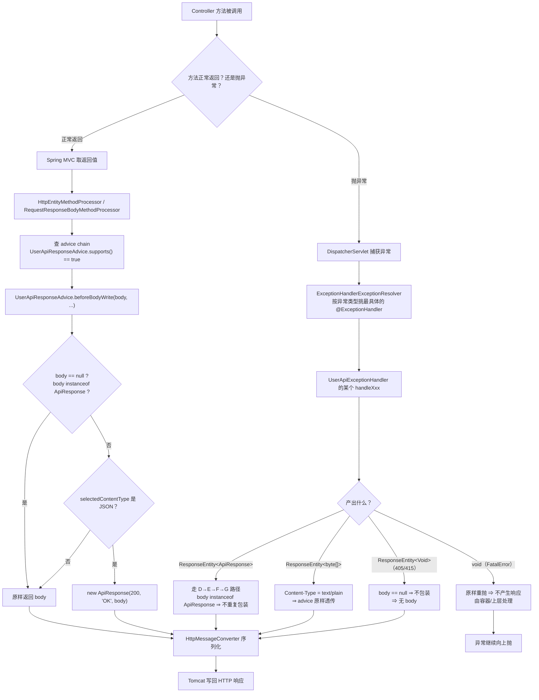
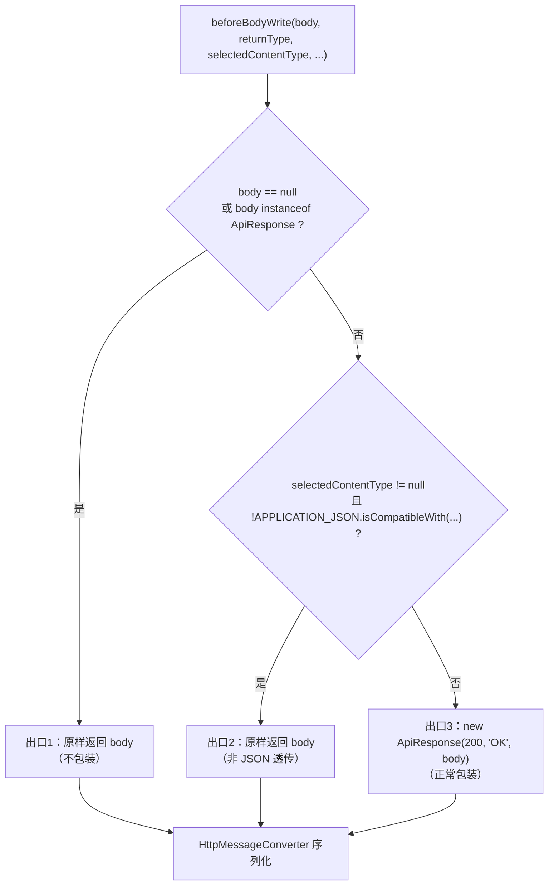
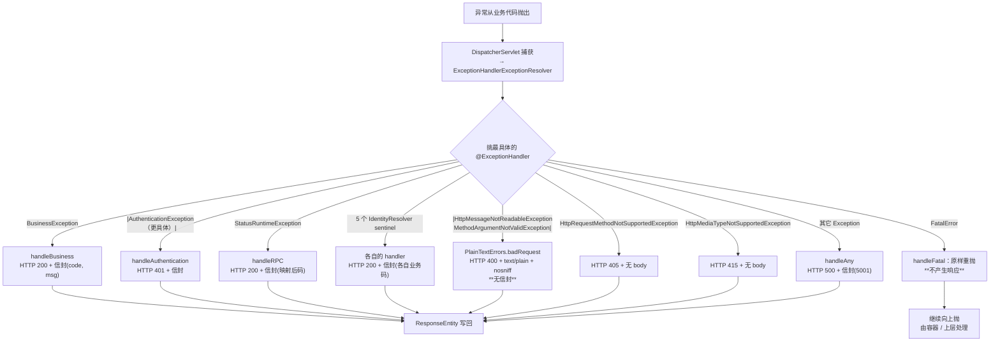
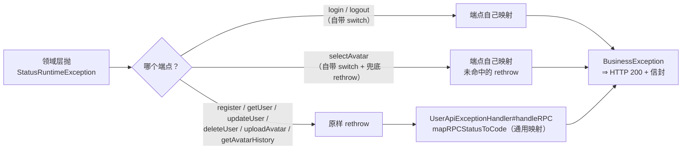
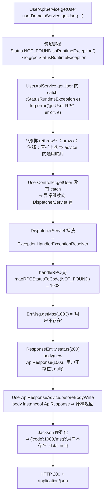
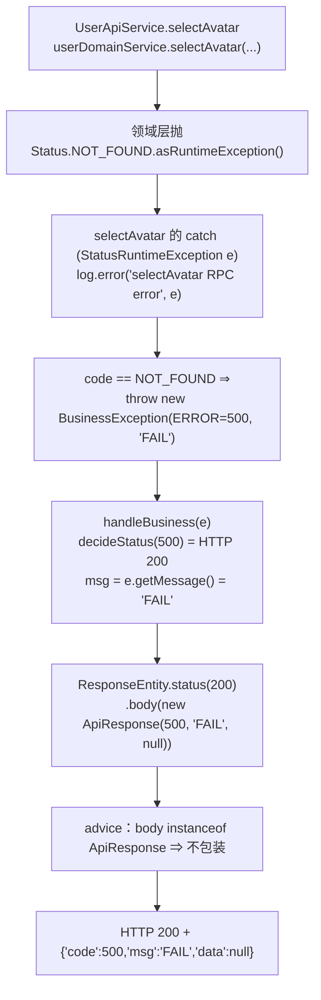

# 11. HTTP 统一响应与异常处理流程

> 本文是 `service/users/user` 域的**机制类**文档：讲清「不管业务成功还是失败，客户端最终收到的那个 HTTP 响应是怎么造出来的」。
> 本文不讲业务逻辑，只讲**出口**。

---

## 1. 本次流程的研究范围

本文追踪的是「**一个请求走完之后，响应是怎么被写出去**」这件事，具体到两个出口：

| 出口 | 承载类 | 触发时机 |
|---|---|---|
| **正常出口** | `advice/UserApiResponseAdvice.java` | Controller 方法正常返回 |
| **异常出口** | `advice/UserApiExceptionHandler.java` | 任意异常从业务代码里抛出来 |

**追踪到哪里为止**：

```
Controller 方法返回 / 抛出异常
  → Spring MVC 选中处理分支
  → 产出 ResponseEntity
  → （可选）ResponseBodyAdvice 包装
  → HttpMessageConverter 序列化
  → Tomcat 写回 HTTP 响应
```

**不追踪什么**：

- **不追踪** 业务代码里为什么会抛这些异常（那是 01~09 号文档）；
- **不追踪** 鉴权链本身（那是 [`./10-JWT认证与身份传递流程.md`](./10-JWT认证与身份传递流程.md)），
  本文只在「401 由谁产出」这一处出现它；
- **不追踪** gRPC 入口的异常处理（那是 12 号文档，gRPC 侧走的是 `StreamObserver.onError`，不经过本文这两个类）。

**本文要回答的核心问题**：

> 同一个「失败」，在本项目里有**三种截然不同的 HTTP 形态**：
> `HTTP 200 + JSON 信封`、`HTTP 400/405/415 + text/plain`、`HTTP 401 + JSON 信封`。
> **是谁在决定用哪一种？**

---

## 2. 触发场景与输入

### 2.1 三个具体请求

**请求 A —— 正常**：

```
POST /user/v1/login HTTP/1.1
Content-Type: application/json

{"username":"alice","password":"123456"}
```

**请求 B —— 业务失败**（用户名不存在 → 业务层抛 `BusinessException(1002)`）：

```
POST /user/v1/login HTTP/1.1
Content-Type: application/json

{"username":"nobody","password":"whatever"}
```

**请求 C —— 框架级失败**（body 缺必填字段 → Spring 抛 `MethodArgumentNotValidException`）：

```
POST /user/v1/login HTTP/1.1
Content-Type: application/json

{}
```

### 2.2 三种请求的出口完全不同

| | HTTP 状态码 | Content-Type | body 形态 |
|---|---|---|---|
| A 正常 | 200 | `application/json` | `{"code":200,"msg":"OK","data":{...}}` |
| B 业务失败 | **200** | `application/json` | `{"code":1002,"msg":"用户名或密码错误","data":null}` |
| C 框架级失败 | **400** | `text/plain; charset=utf-8` | **裸文本**，没有信封 |

**「有统一包装」不等于「所有失败都是 JSON 信封」** —— 这是本文最重要的一句话，§6 会展开。

---

## 3. 整体执行路线



---

## 4. 逐步讲解

### 4.1 正常路径：`ResponseBodyAdvice` 怎么造出信封

`UserApiResponseAdvice`（`service/users/user/src/main/java/com/rag/user/advice/UserApiResponseAdvice.java`）：

```java
@RestControllerAdvice
public class UserApiResponseAdvice implements ResponseBodyAdvice<Object> {

    @Override
    public boolean supports(MethodParameter returnType, Class<? extends HttpMessageConverter<?>> converterType) {
        // 拦截所有 Controller 返回值；Controller 自己抛异常由 UserApiExceptionHandler 处理
        return true;
    }

    @Override
    public Object beforeBodyWrite(Object body, MethodParameter returnType, MediaType selectedContentType,
                                  Class<? extends HttpMessageConverter<?>> selectedConverterType,
                                  ServerHttpRequest request, ServerHttpResponse response) {
        if (body == null || body instanceof ApiResponse) {
            return body;
        }
        if (selectedContentType != null
                && !MediaType.APPLICATION_JSON.isCompatibleWith(selectedContentType)) {
            return body;
        }
        return new ApiResponse(ErrCodes.SUCCESS, ErrMsg.getMsg(ErrCodes.SUCCESS), body);
    }
}
```
（`UserApiResponseAdvice.java:42-75`）

**框架职责**：`ResponseBodyAdvice` 是 Spring MVC 提供的扩展点，在**Controller 返回值即将被写进 HTTP 响应体之前**被调用。
它的返回值**替换**原来的 body。`supports` 返回 `true` 意味着「所有 Controller 返回值都要过我的 `beforeBodyWrite`」。

**框架什么时候触发它**：由 `AbstractMessageConverterMethodProcessor#writeWithMessageConverters` 统一调用 ——
它负责找到合适的 `HttpMessageConverter`，并在真正写 body **之前**先跑一遍 advice chain。

**`beforeBodyWrite` 的四个出口**：



逐个说清**为什么**：

#### 出口 1：`body == null || body instanceof ApiResponse` ⇒ 不包装

```java
if (body == null || body instanceof ApiResponse) {
    return body;
}
```
（`:58-60`）

两个理由，**第二个更重要**：

- **`body == null`**：`@ExceptionHandler` 里 405 / 415 产出的是 `ResponseEntity<Void>`（body 为 null）。
  如果不判空，`null` 会被包成 `{"code":200,"msg":"OK","data":null}` ⇒
  **把 405 / 415 的空响应体篡改成了「成功」**。源码注释写得很直白：

  > null body（如框架级错误直接返回无 body 的 ResponseEntity）也不能包，
  > 否则会把 400/405/415 的空响应体篡改成 {"code":200,...}。

- **`body instanceof ApiResponse`**：`@ExceptionHandler` 返回的是 `ResponseEntity<ApiResponse>`，
  它的 body **本身就是** `ApiResponse` ⇒ 不该再包一层。
  `UserApiResponseAdvice` 的类注释（`:32-41`）给了一个具体后果：

  > 若这里无条件再包一层，错误响应会变成 `{"code":200,"msg":"OK","data":{"code":1003,...}}` ——
  > **顶层 code 恒为 200，所有按 `code != 200` 判定失败的客户端会全部失效。**

  ⇒ 这就是「只包一层」这条硬约束的意义。

#### 出口 2：非 JSON Content-Type ⇒ 原样透传

```java
if (selectedContentType != null
        && !MediaType.APPLICATION_JSON.isCompatibleWith(selectedContentType)) {
    return body;
}
```
（`:70-73`）

源码注释（`:61-69`）解释了它针对的是哪条路径：

> 【DRIFT-006】非 JSON 响应必须原样透传，不能包 envelope。
> Go 出处：go-zero `rest/httpx/responses.go` 的 `doHandleError` 在 `handler == nil` 时走
> `http.Error(w, err.Error(), http.StatusBadRequest)` —— 产出的是
> `Content-Type: text/plain; charset=utf-8` + 裸文本，**没有 {code,msg,data} 结构**。

⚠️ **判定条件是「这次写出的到底是不是 JSON」，而不是「body 是不是字符串」** ——
否则 405 / 415 这类同样走 `text/plain` 的分支会被漏判。

⇒ 实测：`application/json` 与 `application/json;charset=utf-8` 会被包装；
`text/plain`、`application/octet-stream` 等一律不包装。

#### 出口 3：正常包装

```java
return new ApiResponse(ErrCodes.SUCCESS, ErrMsg.getMsg(ErrCodes.SUCCESS), body);
```
（`:74`）

`ErrCodes.SUCCESS` = **200**，`ErrMsg.getMsg(200)` = **`"OK"`**。

⇒ 请求 A 的最终 body：

```json
{"code":200,"msg":"OK","data":{"token":"eyJhbGciOiJIUzI1NiJ9..."}}
```

### 4.2 `ApiResponse` 的三个字段

`common/src/main/java/com/rag/common/contract/ApiResponse.java:59-67`：

```java
@Getter
@Setter
@NoArgsConstructor
@AllArgsConstructor
public class ApiResponse {
    private int code;
    private String msg;
    private Object data;
}
```

| 字段 | 类型 | 含义 | 取值来源 |
|---|---|---|---|
| `code` | `int` | 业务码 | 成功恒为 200；失败时来自异常或映射表 |
| `msg` | `String` | 提示文案 | 成功恒为 `"OK"`；失败时来自 `ErrMsg` |
| `data` | `Object` | 业务数据 | 成功时 = Controller 的原始返回值；失败时恒为 `null` |

**Lombok 注解各自的作用**：

| 注解 | 生成的东西 | 谁在用 |
|---|---|---|
| `@Getter` | `getCode()` / `getMsg()` / `getData()` | **Jackson** 靠 getter 推出 JSON 键名 |
| `@Setter` | 三个 setter | 供代码反序列化/修改用 |
| `@NoArgsConstructor` | 无参构造 | **Jackson 反序列化**需要（虽然本项目只序列化不反序列化） |
| `@AllArgsConstructor` | 三参构造 | 本项目**全靠它**造信封：`new ApiResponse(code, msg, data)` |

⚠️ **三条 L1 硬约束**（`ApiResponse.java:17-24`）：

1. **键名与顺序**：`code` → `msg` → `data`，逐条一致 ⇒ 不可调序、不可改名；
2. **无 `omitempty`**：B 侧三个字段都没有 `omitempty` ⇒ `data` 为 null 时**仍然出现**（`"data":null`）
   ⇒ Java 侧**不得**加 `@JsonInclude(NON_NULL)` / `@JsonInclude(NON_EMPTY)`
   ⇒ 否则 `data` 键会消失 ⇒ **可观察形状不等价**；
3. **不可用 `ProblemDetail` 替换** ⇒ 本类是**唯一**信封载体。

守门测试：`UserApiHttpContractTest#envelopeAlwaysHasThreeFields`（`UserApiHttpContractTest.java:144-155`）
断言 `body.size() == 3` 且 `code` / `msg` / `data` 三个键都存在。

### 4.3 异常路径：异常怎么被交给 `@ExceptionHandler`

Controller 方法抛出异常后，**Controller 自己不处理**。控制流是：

```
Controller 方法抛出异常
  ↓
DispatcherServlet#doDispatch 捕获（try/catch 包住整个 handler 执行）
  ↓
processDispatchResult → processHandlerException
  ↓
ExceptionHandlerExceptionResolver（advice chain 里的一个 resolver）
  ↓ 按异常类型挑「最具体」的 @ExceptionHandler 方法
  ↓ 调用它，拿到它的返回值（ResponseEntity / 普通对象 / void）
  ↓ 这个返回值被当作「Controller 的返回值」继续往下走
  ↓ ⇒ **也会再经过 ResponseBodyAdvice**
```

**关键点**：`@ExceptionHandler` 方法的返回值走的是**和 Controller 返回值完全相同**的那条路。
这就是为什么 `UserApiResponseAdvice` 必须判 `body instanceof ApiResponse` ——
否则错误信封会被再包一层（§4.1 出口 1）。

**Spring 怎么挑 handler**：按异常类型的**具体程度**匹配，**最具体的胜出**。
本项目的类型层次是：

```
RuntimeException
  └─ BusinessException          (code + msg)
       └─ AuthenticationException   (继承而来，语义上 = HTTP 401)
```

⇒ `AuthenticationException` 有自己专门的 handler（`:75-80`），
它比 `handleBusiness`（`:56-63`）更具体 ⇒ **只有拦截器抛出的鉴权失败走 401 那条**。

`UserApiExceptionHandler.java:66-69` 的注释确认了这个顺序：

> Spring 按「最具体」挑 handler：`AuthenticationException extends BusinessException`，
> 因此本方法优先于上面的 `handleBusiness`，只有拦截器抛出的鉴权失败会走这里。

### 4.4 `decideStatus`：为什么业务码不决定 HTTP 状态码

`UserApiExceptionHandler.java:269-271`：

```java
private HttpStatus decideStatus(int code) {
    return HttpStatus.OK;
}
```

⚠️ **参数 `code` 完全没被用到** —— 这个方法恒返回 `HttpStatus.OK`。

它的 javadoc（`:260-268`）说明了理由：

> 与 Go 端 `httpx.OkJson` 1:1：Go 侧所有 Logic 结果都经 envelope 输出，
> HTTP 状态码恒为 200，业务成败完全由 body 里的 `code` 表达。
>
> ⚠️ **鉴权层不走本方法**：鉴权失败由 `handleAuthentication` 单独产出 401 ⇒
> ⇒ 1006 在两层都可能出现时，**按码分流会把两层重新搅在一起**（B 侧 `DRIFT-004` 的教训）。

⇒ 换句话说：**「业务码 → HTTP 状态码」这个映射在本项目里是「恒等 200」**，
401 是**类型**决定的（`AuthenticationException`），不是码决定的。

---

## 5. 重要分支与失败路径

### 5.1 完整异常分支表

这是本文的**核心表**。左边是异常类型，中间是 HTTP 状态码，右边是 body 形态：

| 异常类型 | 处理器（`UserApiExceptionHandler.java`） | HTTP 状态码 | body | Content-Type |
|---|---|---|---|---|
| `BusinessException` | `handleBusiness`（`:56-63`） | **200**（`decideStatus` 恒定） | `{"code":<code>,"msg":<异常 message>,"data":null}` | `application/json` |
| `AuthenticationException` | `handleAuthentication`（`:75-80`） | **401** | `{"code":1006,"msg":"TOKEN已过期","data":null}` | `application/json` |
| `StatusRuntimeException` | `handleRPC`（`:91-102`） | **200** | `{"code":<映射后码>,"msg":<映射后码的文案>,"data":null}` | `application/json` |
| `IdentityResolver.ErrInvalidClaimException` | `handleErrInvalidClaim`（`:134-139`） | **200** | `{"code":1006,"msg":"TOKEN已过期","data":null}` | `application/json` |
| `IdentityResolver.ErrUserNotFoundException` | `handleErrUserNotFound`（`:141-146`） | **200** | `{"code":1003,"msg":"用户不存在","data":null}` | `application/json` |
| `IdentityResolver.ErrUserInactiveException` | `handleErrUserInactive`（`:148-153`） | **200** | `{"code":1011,"msg":"用户已被封禁","data":null}` | `application/json` |
| `IdentityResolver.ErrStatusUnavailableException` | `handleErrStatusUnavailable`（`:155-160`） | **200** | `{"code":1015,"msg":"服务繁忙","data":null}` | `application/json` |
| `IdentityResolver.ErrIdentityMismatchException` | `handleErrIdentityMismatch`（`:162-167`） | **200** | `{"code":5001,"msg":"系统内部错误","data":null}` | `application/json` |
| `HttpMessageNotReadableException` | `handleUnreadableBody`（`:178-182`） | **400** | **裸文本**（异常 message + `\n`） | `text/plain; charset=utf-8` ＋ `X-Content-Type-Options: nosniff` |
| `MethodArgumentNotValidException` | `handleBeanValidation`（`:202-210`） | **400** | **裸文本**（字段名 + 校验消息 + `\n`） | 同上 |
| `HttpRequestMethodNotSupportedException` | `handleMethodNotSupported`（`:213-217`） | **405** | **无 body** | — |
| `HttpMediaTypeNotSupportedException` | `handleMediaTypeNotSupported`（`:220-224`） | **415** | **无 body** | — |
| `FatalError` | `handleFatal`（`:237-241`） | **不产生响应** | 原样重抛 | — |
| 其它 `Exception` | `handleAny`（`:245-256`） | **500** | `{"code":5001,"msg":"系统内部错误","data":null}` | `application/json` |



### 5.2 `FatalError`：唯一「故意不返回」的分支

```java
@ExceptionHandler(FatalError.class)
public void handleFatal(FatalError e) {
    // 故意不返回 ResponseEntity：让异常继续向上抛
    throw e;
}
```
（`UserApiExceptionHandler.java:237-241`）

**为什么**：`FatalError` 的契约是「fatal 之后必须停止接流量」（`common/.../logger/FatalError.java:20-30`）。
如果把它当成普通业务异常处理 ⇒ 请求看起来「失败了」，而**进程带着致命状态继续正常服务** ——
这正是 Go 侧绝不会发生的情况。

`handleAny` 里还有一道保险（`:249-251`）：

```java
if (e instanceof FatalError fatal) {
    throw fatal;
}
```

⇒ 即使某个 advice 忘了注册 `FatalError` 分支，也不会把它包成 200 业务信封。

⚠️ **本项目的 `FatalError` 没有做 `System.exit(1)`**（`:235`：「刻意不做 `System.exit(1)`：终止决策权留给调用 `logFatal` 的位置」）。
所以「fatal 后一定终止」这个契约在 Java 侧是**收窄**的：只有「无人 catch」时才会终止。

### 5.3 🔴 两套 gRPC 码映射并存

本项目有**两套**「gRPC `Status.Code` → 业务码」的映射：

**第一套：advice 里的通用映射**（`UserApiExceptionHandler.java:116-130`）：

```java
private int mapRPCStatusToCode(Status.Code code) {
    if (code == Status.Code.INTERNAL) {
        return ErrCodes.ERROR_SERVER_COMMON;      // 5001
    }
    if (code == Status.Code.NOT_FOUND) {
        return ErrCodes.ERROR_USER_NOT_EXIST;     // 1003
    }
    if (code == Status.Code.ALREADY_EXISTS) {
        return ErrCodes.ERROR_USER_EXIST;         // 1001
    }
    if (code == Status.Code.INVALID_ARGUMENT) {
        return ErrCodes.ERROR;                    // 500
    }
    return ErrCodes.CODE_SERVER_BUSY;             // 1015
}
```

**第二套：端点自己写的 switch**（在 `UserApiService` 各方法里）。

⚠️ **两套不完全相同 ⇒ 同一类异常在不同端点可能得到不同业务码。**



#### 逐端点对照表（全部来自 `UserApiService.java` 的真实 catch 块）

| 端点 | catch 位置 | gRPC code | 得到的业务码 | HTTP |
|---|---|---|---|---|
| `login` | `:109-124` | `INTERNAL` | **5001** | 200 |
| `login` | `:109-124` | 其它一律 | **1015** | 200 |
| `logout` | `:416-427` | `INTERNAL` | **5001** | 200 |
| `logout` | `:416-427` | 其它一律（含 `INVALID_ARGUMENT`） | **1015** | 200 |
| `selectAvatar` | `:539-555` | `NOT_FOUND` | **500** | 200 |
| `selectAvatar` | `:539-555` | `INVALID_ARGUMENT` | **500** | 200 |
| `selectAvatar` | `:539-555` | 其它（`INTERNAL` 等） | rethrow ⇒ 通用映射 | 200 |
| `register` | `:188-193` | 全部 | rethrow ⇒ 通用映射 | 200 |
| `getUser` | `:246-250` | 全部 | rethrow ⇒ 通用映射 | 200 |
| `updateUser` | `:328-331` | 全部 | rethrow ⇒ 通用映射 | 200 |
| `deleteUser` | `:370-373` | 全部 | rethrow ⇒ 通用映射 | 200 |
| `uploadAvatar` | `:484-487` | 全部 | rethrow ⇒ 通用映射 | 200 |
| `getAvatarHistory` | `:600-603` | 全部 | rethrow ⇒ 通用映射 | 200 |

#### 三个具体分叉（这就是「两套并存」的全部后果）

**分叉 1：`INVALID_ARGUMENT`**

| 来源 | `INVALID_ARGUMENT` ⇒ |
|---|---|
| 通用映射（`mapRPCStatusToCode`） | **500** |
| `logout` 端点自带 switch（`:419-426`） | **1015** |

`logout` 的注释写明了为什么（`UserApiService.java:401-403`）：

> 🔴 B 侧 `DRIFT-USERAPI-003 已修`：**刻意不**复用 advice 的通用 gRPC 映射
> （那个通用映射会把 `INVALID_ARGUMENT` 映成 500，而 B 侧的 logout switch 里根本没有这一格）
> ⇒ ⇒ 本类的 catch **显式写出** B 的两条分支。

**分叉 2：`NOT_FOUND`**

| 来源 | `NOT_FOUND` ⇒ |
|---|---|
| 通用映射 | **1003**（用户不存在） |
| `selectAvatar` 端点自带 switch（`:549-553`） | **500** |

`selectAvatar` 的注释（`:546-548`）说明了为什么**不能**用通用映射：

> NOT_FOUND 的差异不是「看起来更合理」的改写，而是**抹掉了 Go 刻意保留的区分**：
> 「头像历史不存在」(500) 与「用户不存在」(1003) 被合并后，
> 客户端可以据此枚举某个 uid 是否存在 ⇒ 必须显式保留。

**分叉 3：`INTERNAL` 之外的「其它」**

`login` 与 `logout` 都是「`INTERNAL` → 5001，其它一律 1015」。
而通用映射里 `ALREADY_EXISTS` → 1001、`NOT_FOUND` → 1003、`INVALID_ARGUMENT` → 500。
⇒ 同一个 `NOT_FOUND`，走 `login` 得 1015，走 `getUser` 得 1003。

⚠️ **这不是 bug，是照抄真源的结果**（`UserApiExceptionHandler.java:87-89`）：

> ⚠️ **本方法是「通用映射」**：个别端点在 api 层**显式**覆盖了它
> ⇒ ⇒ **不要把通用映射当成唯一口径**。

### 5.4 `PlainTextErrors.badRequest`：400 的精确形状

`common/src/main/java/com/rag/common/web/PlainTextErrors.java:72-89`：

```java
public static ResponseEntity<byte[]> badRequest(String message) {
    return text(HttpStatus.BAD_REQUEST, message);
}

public static ResponseEntity<byte[]> text(HttpStatus status, String message) {
    byte[] body = ((message == null ? "" : message) + "\n").getBytes(StandardCharsets.UTF_8);
    return ResponseEntity.status(status)
            .header(HttpHeaders.CONTENT_TYPE, TEXT_PLAIN_UTF8)
            .header("X-Content-Type-Options", "nosniff")
            .body(body);
}
```

三个要点：

1. **状态码 400**；
2. **两个 header**：`Content-Type: text/plain; charset=utf-8` ＋ `X-Content-Type-Options: nosniff`；
3. ⚠️ **body 末尾追加一个 `\n`**（`:84` 的 `+ "\n"`）—— 这是 B 侧 `http.Error` 用 `fmt.Fprintln` 的等价物。
   javadoc 明确写「调用方**不要**自己加」（`:69-70`）。

⚠️ **这个 `byte[]` body 怎么绕过 `ResponseBodyAdvice` 的包装？**
靠的正是 §4.1 的**出口 2** —— `selectedContentType` 是 `text/plain` ⇒ 不是 JSON ⇒ 原样透传。
（如果只判「body 是不是 `ApiResponse`」而漏掉 Content-Type 判定，这个 `byte[]` 就会被包成
`{"code":200,"msg":"OK","data":[123,34,...]}` —— body 变成字节数组的 JSON。）

#### 两条 400 分支的文案来源不同

| 异常 | body 文本 |
|---|---|
| `HttpMessageNotReadableException` | `e.getMessage()`（Jackson 的解析错误描述） |
| `MethodArgumentNotValidException` | 第一个字段错误的「字段名 + 默认消息」（`:204-207`） |

⚠️ **`MethodArgumentNotValidException` 这条是已批准的 L3 降级**（决策 D5，`docs/L3-降级清单.md` D-01）：
状态码 400 不变、错误结构（text/plain ＋ nosniff ＋ 尾换行）不变，**只有文案**由 Hibernate Validator 决定 ⇒ 与真源不同。

### 5.5 405 / 415：裸状态码，无 body

```java
@ExceptionHandler(HttpRequestMethodNotSupportedException.class)
public ResponseEntity<Void> handleMethodNotSupported(HttpRequestMethodNotSupportedException e) {
    log.warn("method not supported : {}", e.getMessage());
    return ResponseEntity.status(HttpStatus.METHOD_NOT_ALLOWED).build();
}
```
（`UserApiExceptionHandler.java:213-217`）

`ResponseEntity.status(405).build()` ⇒ **body 为 null** ⇒
① `UserApiResponseAdvice` 的出口 1（`body == null`）⇒ 不包装；
② 最终响应 **405 + 空 body**。

⚠️ **没有 `Allow` 头** —— 源码注释（`:37`）说：「B 侧 Java 版返回**裸状态码**（无 Allow 头、无 body）⇒ C 侧逐条照抄」。

守门测试：`UserApiHttpContractTest#getOnPostOnlyEndpointIs405`（`:88-94`）断言 405 且 `body` 为 null 或空。

### 5.6 一个容易忽略的分支：404 被兜底吃掉，变成 500

本域**没有** 404 分支 ⇒ `NoResourceFoundException` / `NoHandlerFoundException` 会落到 `handleAny(Exception)` ⇒
**HTTP 500 + `{code:5001}`**。

守门测试 `UserApiHttpContractTest#unknownPathOutsideUserPrefixIs500Envelope`（`:96-112`）的注释解释：

> ⚠️ **不是 404** —— B 侧的兜底 `@ExceptionHandler(Exception.class) handleAny`
> 会把 Spring 的 404 异常一并兜住 ⇒ 返回 **HTTP 500 + {code:5001,msg,data}**。
> ⇒ 这是 **B 侧自身**的语义（标准 Spring 语义本该是 404）⇒ 按 D16 **继承**，不回溯修改。

而 `/user/v1/**` 下的未知路径是 **401**（拦截器先于 404 触发）—— 见
`UserApiHttpContractTest#unknownPathInsideUserPrefixIs401`（`:114-126`）。

### 5.7 一条完整的异常传播链（从产生到响应）

以「领域层查不到用户」为例：



**对照另一条链**（同一个异常类型，不同端点）：



⚠️ **同一个 `NOT_FOUND`，两条链给出 1003 和 500 两个不同的业务码** —— 这就是 §5.3 的分叉 2。

---

## 6. 数据变化与副作用

### 6.1 副作用清单

| 类别 | 本流程中是否发生 | 说明 |
|---|---|---|
| **数据库读写** | ❌ 不发生 | 两个 advice 类**完全不碰数据库**。它们拿到的是已经算好的业务码 |
| **Redis 读写** | ❌ 不发生 | 不碰 Redis（Redis 只在 `JwtAuthInterceptor` 的黑名单检查里读，见 10 号文档） |
| **事务** | ❌ 不发生 | 没有 `@Transactional`，没有数据库连接 |
| **远程调用** | ❌ 不发生 | 无 gRPC / HTTP / Nacos / MinIO 调用 |
| **消息** | ❌ 不发生 | 无 Kafka 生产/消费 |
| **日志** | ✅ 发生 | 见 §6.2 |
| **指标** | ❌ **不发生** | ⚠️ **两个 advice 类都没有注入 `MeterRegistry`，也没有任何 `Counter` 调用** ⇒ **异常路径上不产生任何指标**。<br>⇒ 指标只在 `UserApiService` 的具体 catch 块里打点（如 `user_api_intercept_total{path="/user/login",result="rpc_error"}`），**鉴权失败 / 参数校验失败 / 400 / 405 / 415 / 500 都没有指标** |
| **ID 生成** | ❌ 不发生 | 无 Snowflake 调用 |
| **Token 生成** | ❌ 不发生 | 不签发、不解析 token |

⚠️ **「异常路径没有指标」这件事值得强调**：
`UserApiExceptionHandler` 的类注释里提到「metrics 由 `GlobalExceptionHandler` 统一处理」（那是 `BusinessException` 的旧注释），
但**本仓的 `UserApiExceptionHandler` 实际上一个指标都没写** ——
所有业务码映射出来的失败，**在 Prometheus 里都看不到计数**。

### 6.2 日志明细

| 级别 | handler | 触发 | 内容 |
|---|---|---|---|
| `error` | `handleBusiness` | 任何 `BusinessException` | `BusinessException code={} msg={}` |
| `warn` | `handleAuthentication` | 鉴权失败 | `AuthenticationException code={} msg={}` |
| `error` | `handleRPC` | gRPC 状态异常 | `gRPC StatusRuntimeException code={} mapped to businessCode={} desc={}`（**带堆栈**） |
| `error` | 5 个 sentinel handler | 身份判定失败 | `ErrInvalidClaim : {}` / `ErrUserNotFound : {}` / `ErrUserInactive : {}` / `ErrStatusUnavailable : {}` / `ErrIdentityMismatch : {}` |
| `warn` | `handleUnreadableBody` | 请求体不可读 | `unreadable request body : {}` |
| `warn` | `handleBeanValidation` | 校验失败 | `bean validation failed : {}` |
| `warn` | `handleMethodNotSupported` | 405 | `method not supported : {}` |
| `warn` | `handleMediaTypeNotSupported` | 415 | `media type not supported : {}` |
| `error` | `handleAny` | 未捕获异常 | `unhandled exception`（**带堆栈**） |
| —— | `handleFatal` | `FatalError` | **不打日志**（直接重抛） |

⚠️ **日志级别的区分是有意义的**：
`error` = 服务端/业务异常（需要人看）；`warn` = 客户端搞错了（401 / 400 / 405 / 415）；
`handleFatal` 不打日志是因为**致命日志在别处已经打过**了（`logFatal` 的位置）。

### 6.3 响应体的构造路径

一条请求的响应体是被**两个类接力**造出来的：

```
正常路径：
  Controller 返回值 DTO
    → ResponseBodyAdvice.beforeBodyWrite
      → new ApiResponse(200, "OK", DTO)
        → Jackson 序列化 → {"code":200,"msg":"OK","data":DTO}

异常路径：
  异常 → handler 算出 (code, msg)
    → new ApiResponse(code, msg, null)
      → ResponseEntity.status(状态码)
        → ResponseBodyAdvice.beforeBodyWrite（判到 instanceof ApiResponse ⇒ 不包装）
          → Jackson 序列化 → {"code":code,"msg":msg,"data":null}
```

⇒ **两种路径都只包一层**，这是硬约束（§4.1 出口 1）。

---

## 7. 执行结果

### 7.1 请求 A —— 正常（登录成功）

```http
HTTP/1.1 200
Content-Type: application/json

{"code":200,"msg":"OK","data":{"token":"eyJhbGciOiJIUzI1NiJ9..."}}
```

### 7.2 请求 B —— 业务失败（用户名不存在）

```http
HTTP/1.1 200
Content-Type: application/json

{"code":1002,"msg":"用户名或密码错误","data":null}
```

⚠️ **HTTP 200**。客户端必须读 body 里的 `code` 才知道失败了。

### 7.3 请求 C —— 框架级失败（缺必填字段）

```http
HTTP/1.1 400
Content-Type: text/plain; charset=utf-8
X-Content-Type-Options: nosniff

username must not be null
```

（最后有一个 `\n`。文案由 Hibernate Validator 的默认消息决定（`@NotNull` ⇒ `must not be null`）⇒ 与真源不同，属已登记的 L3 降级。
⚠️ 也就是说：**结构可断言，文案不可断言**。）

⚠️ **没有 `code` / `msg` / `data`** —— 这个响应不是信封。

### 7.4 鉴权失败（protected 路径缺 token）

```http
HTTP/1.1 401
Content-Type: application/json

{"code":1006,"msg":"TOKEN已过期","data":null}
```

### 7.5 方法不支持（GET 打 POST 端点）

```http
HTTP/1.1 405
```

⚠️ **无 body、无 `Allow` 头**。

### 7.6 Content-Type 不支持

```http
HTTP/1.1 415
```

⚠️ **无 body**。

### 7.7 未捕获异常

```http
HTTP/1.1 500
Content-Type: application/json

{"code":5001,"msg":"系统内部错误","data":null}
```

### 7.8 未知路径（不在 `/user/v1/**` 下）

```http
HTTP/1.1 500
Content-Type: application/json

{"code":5001,"msg":"系统内部错误","data":null}
```

⚠️ **不是 404**（§5.6）。

---

## 8. 流程复盘

### 8.1 走过的代码

```
Controller 方法返回 / 抛异常
  ↓
【正常】
  ResponseBodyAdvice.supports() == true
    → beforeBodyWrite(body, ...)
        ├─ body == null || body instanceof ApiResponse ⇒ 原样
        ├─ Content-Type 非 JSON ⇒ 原样
        └─ 否则 ⇒ new ApiResponse(200, "OK", body)
  ↓
【异常】
  DispatcherServlet 捕获 → ExceptionHandlerExceptionResolver
    → 按类型挑最具体的 @ExceptionHandler：
        BusinessException            → handleBusiness        → 200 + 信封
        AuthenticationException      → handleAuthentication  → 401 + 信封
        StatusRuntimeException       → handleRPC             → 200 + 信封（通用映射）
        5 个 IdentityResolver sentinel → 各自的 handle        → 200 + 信封
        HttpMessageNotReadableException / MethodArgumentNotValidException
                                   → PlainTextErrors.badRequest → 400 + text/plain + nosniff
        HttpRequestMethodNotSupportedException → 405 无 body
        HttpMediaTypeNotSupportedException     → 415 无 body
        FatalError                  → handleFatal           → 原样重抛
        其它 Exception               → handleAny             → 500 + 信封(5001)
  ↓
（handler 的返回值也再走一遍 ResponseBodyAdvice ⇒ 靠 instanceof 判定不重复包装）
  ↓
HttpMessageConverter 序列化 → Tomcat 写回
```

### 8.2 边界结论

1. **信封只有一个载体**：`ApiResponse`，三个字段 `code` / `msg` / `data`，只包一层。
2. **`ResponseBodyAdvice` 有三个「不包装」出口**：`body == null` / `body instanceof ApiResponse` / 非 JSON Content-Type。
   少任何一个都会产出畸形响应。
3. **HTTP 状态码 ≠ 业务码**。业务失败基本是 **HTTP 200 + body 里的 code**；
   框架级错误保留 400 / 405 / 415 + `text/plain`；鉴权失败保留 401。
4. **层次由异常类型承载，不由业务码承载**。1006 在 401 和 200 两种响应里都出现过
   ⇒ 按码分流会把鉴权层和业务层搅在一起。
5. **两套 gRPC 码映射并存**：端点自带 switch 与 advice 的通用映射**不完全相同**
   ⇒ 同一类异常在不同端点可能得到不同业务码（`NOT_FOUND` 在 `getUser` 是 1003、在 `selectAvatar` 是 500）。
6. **`FatalError` 故意不返回**，原样重抛 ⇒ 绝不转成 200 业务信封。
7. **`decideStatus(code)` 恒返回 200**，参数根本没被用到 —— 业务码不决定 HTTP 状态码。
8. **异常路径上没有任何指标** —— 两个 advice 类都不注入 `MeterRegistry`。
9. **`404` 会被兜底吃掉变成 500** —— 继承自真源，不是标准 Spring 语义。
10. **`text/plain` 的 body 末尾有一个 `\n`**，由 `PlainTextErrors` 统一补，调用方不要自己加。

---

## 9. 源码定位与验证方式

### 9.1 源码定位

| 位置 | 文件 : 行 | 内容 |
|---|---|---|
| 响应包装 | `service/users/user/src/main/java/com/rag/user/advice/UserApiResponseAdvice.java:42-75` | `supports` / `beforeBodyWrite` |
| 不包装出口 1 | `service/users/user/src/main/java/com/rag/user/advice/UserApiResponseAdvice.java:58-60` | `body == null \|\| body instanceof ApiResponse` |
| 不包装出口 2 | `service/users/user/src/main/java/com/rag/user/advice/UserApiResponseAdvice.java:70-73` | 非 JSON Content-Type 原样透传 |
| 异常处理器总表 | `service/users/user/src/main/java/com/rag/user/advice/UserApiExceptionHandler.java:49-271` | 12 个 `@ExceptionHandler` |
| 业务异常 | `service/users/user/src/main/java/com/rag/user/advice/UserApiExceptionHandler.java:56-63` | `handleBusiness` → 200 + 信封 |
| 鉴权异常 | `service/users/user/src/main/java/com/rag/user/advice/UserApiExceptionHandler.java:75-80` | `handleAuthentication` → 401 + 信封 |
| gRPC 通用映射 | `service/users/user/src/main/java/com/rag/user/advice/UserApiExceptionHandler.java:91-102, 116-130` | `handleRPC` + `mapRPCStatusToCode` |
| 5 个 sentinel | `service/users/user/src/main/java/com/rag/user/advice/UserApiExceptionHandler.java:134-167` | 各自业务码 + 200 |
| 400 · body 不可读 | `service/users/user/src/main/java/com/rag/user/advice/UserApiExceptionHandler.java:178-182` | `PlainTextErrors.badRequest` |
| 400 · 校验失败 | `service/users/user/src/main/java/com/rag/user/advice/UserApiExceptionHandler.java:202-210` | 取第一个字段错误 |
| 405 | `service/users/user/src/main/java/com/rag/user/advice/UserApiExceptionHandler.java:213-217` | 裸状态码、无 body |
| 415 | `service/users/user/src/main/java/com/rag/user/advice/UserApiExceptionHandler.java:220-224` | 裸状态码、无 body |
| FatalError | `service/users/user/src/main/java/com/rag/user/advice/UserApiExceptionHandler.java:237-241` | 原样重抛 |
| 兜底 500 | `service/users/user/src/main/java/com/rag/user/advice/UserApiExceptionHandler.java:245-256` | `handleAny` → 500 + 5001 |
| 业务码 → 状态码 | `service/users/user/src/main/java/com/rag/user/advice/UserApiExceptionHandler.java:269-271` | `decideStatus` 恒 200 |
| 信封 | `common/src/main/java/com/rag/common/contract/ApiResponse.java:59-67` | `code` / `msg` / `data` + Lombok |
| 纯文本 400 | `common/src/main/java/com/rag/common/web/PlainTextErrors.java:72-89` | `badRequest` / `text`（`+ "\n"` + nosniff） |
| 业务异常类型 | `common/src/main/java/com/rag/common/exception/BusinessException.java:33-45` | `code` + `msg` |
| 鉴权异常类型 | `common/src/main/java/com/rag/common/exception/AuthenticationException.java:50-54` | `extends BusinessException` |
| 致命异常类型 | `common/src/main/java/com/rag/common/logger/FatalError.java:41-47` | `extends RuntimeException` |
| 错误码（域内视图） | `service/users/user/src/main/java/com/rag/user/contract/ErrCodes.java` | 转发自 `com.rag.users.common.ErrCodes` |
| 错误文案 | `service/users/user/src/main/java/com/rag/user/contract/ErrMsg.java:42-44` | 转发自共享层 `ErrMsg.getMsg` |
| 5 个 sentinel 类型 | `service/users/common/src/main/java/com/rag/users/common/IdentityResolver.java:362-394` | 5 个 `RuntimeException` 子类 |
| 端点自带映射 1 | `service/users/user/src/main/java/com/rag/user/service/UserApiService.java:109-124` | `login`：INTERNAL→5001 / 其它→1015 |
| 端点自带映射 2 | `service/users/user/src/main/java/com/rag/user/service/UserApiService.java:416-427` | `logout`：INTERNAL→5001 / 其它→1015 |
| 端点自带映射 3 | `service/users/user/src/main/java/com/rag/user/service/UserApiService.java:539-555` | `selectAvatar`：NOT_FOUND/INVALID_ARGUMENT→500 |
| 原样上抛的端点 | `service/users/user/src/main/java/com/rag/user/service/UserApiService.java:192, 249, 330, 372, 486, 602` | `register` / `getUser` / `updateUser` / `deleteUser` / `uploadAvatar` / `getAvatarHistory` |
| 指标（API 层） | `service/users/user/src/main/java/com/rag/user/metrics/UserApiMetrics.java:42-78` | `user_api_intercept_total{path,result}` —— **只在 Service 里打，不在 advice 里** |

### 9.2 怎么自己验证

**真 HTTP 契约测试**：`service/users/user/src/test/java/com/rag/user/api/UserApiHttpContractTest.java`
（**真 Tomcat**，不是 MockMvc）：

| 测试方法 | 验证了什么 |
|---|---|
| `envelopeAlwaysHasThreeFields` | 信封恒为 `{code,msg,data}` **三字段**（`data` 为 null 时也在） |
| `getOnPostOnlyEndpointIs405` | GET 打 POST 端点 ⇒ **405 + 空 body**（不是 405 + 信封） |
| `missingRequiredFieldIsPlainText400` | 缺必填字段 ⇒ **400 + `text/plain` + `X-Content-Type-Options: nosniff`** |
| `protectedPathWithoutTokenIs401` | 缺 `Authorization` ⇒ **HTTP 401** + body `code=1006` + `data` 字段存在 |
| `protectedPathWithGarbageTokenIs401` | 坏签名 ⇒ **HTTP 401** |
| `validSignatureButUnknownUserIsBusinessError` | 签名合法但用户不存在 ⇒ **HTTP 200 + code 1003** |
| `unknownPathOutsideUserPrefixIs500Envelope` | 未知路径 ⇒ **500 + `{code:5001}`**（不是 404） |
| `unknownPathInsideUserPrefixIs401` | `/user/v1/**` 下未知路径 ⇒ **401**（拦截器先于 404） |
| `publicLoginPathDoesNotRequireJwt` | public 路径无 token ⇒ **200 + code 1002**（业务失败，不是 401） |
| `registerLoginGetHappyPath` | 端到端：register → login → get（真 PG + 真 bcrypt + 真 JWT） |

**手工跑一遍**：

```bash
export USER_JWT_SECRET='<任意至少 32 字节的字符串>'

# 400 + text/plain（缺必填字段）
curl -i -X POST http://localhost:8881/user/v1/login \
  -H 'Content-Type: application/json' -d '{}'

# 200 + 信封（业务失败）
curl -i -X POST http://localhost:8881/user/v1/login \
  -H 'Content-Type: application/json' -d '{"username":"nobody","password":"x"}'

# 405 + 无 body
curl -i http://localhost:8881/user/v1/login

# 500 + 信封（未知路径）
curl -i -X POST http://localhost:8881/not-exist -d '{}'
```

---

## 10. 交叉引用

- 本域文档索引与学习顺序：[`./README.md`](./README.md)
- JWT 认证链（本文的 401 是谁抛的）：
  [`./10-JWT认证与身份传递流程.md`](./10-JWT认证与身份传递流程.md) §4.8
- 登录端点怎么把三态翻译成业务码（`BusinessException` 的产生点）：
  [`./01-用户登录流程.md`](./01-用户登录流程.md) §4.10
- 两套 gRPC 映射在业务侧的落点（`UserApiService` 的 catch 块）：
  [`./01-用户登录流程.md`](./01-用户登录流程.md) §5.3
- gRPC 入口的异常处理（**不走**本文这两个类）：
  [`./12-gRPC用户服务流程.md`](./12-gRPC用户服务流程.md)
