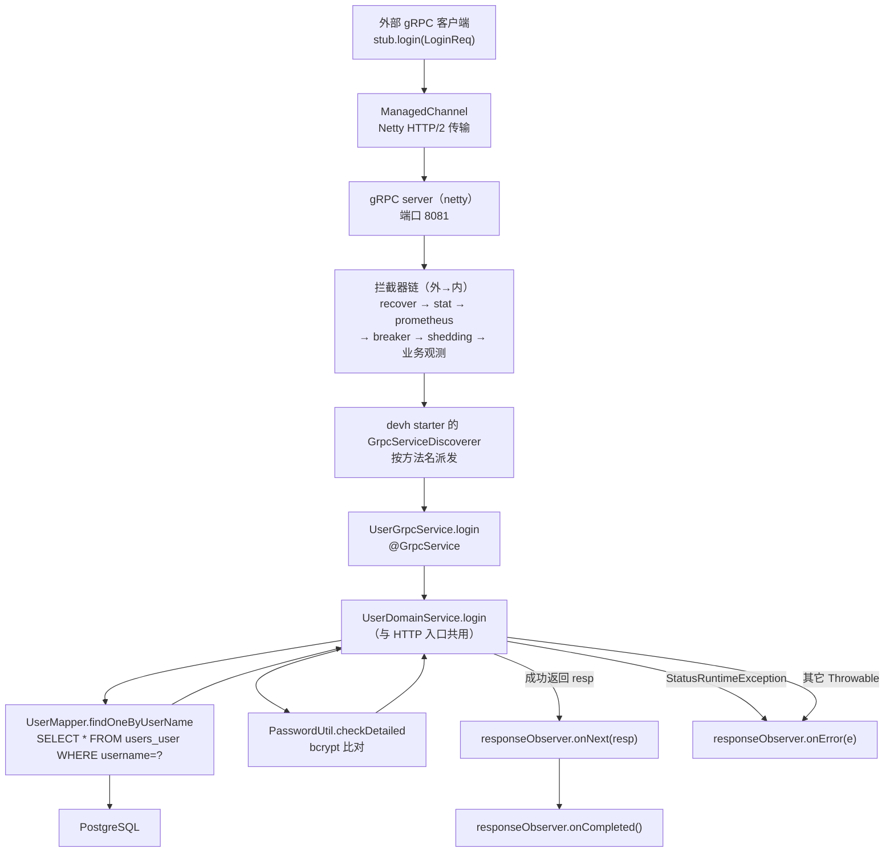
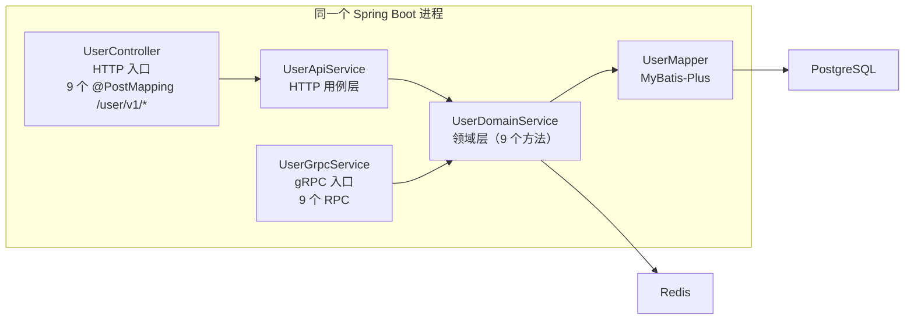
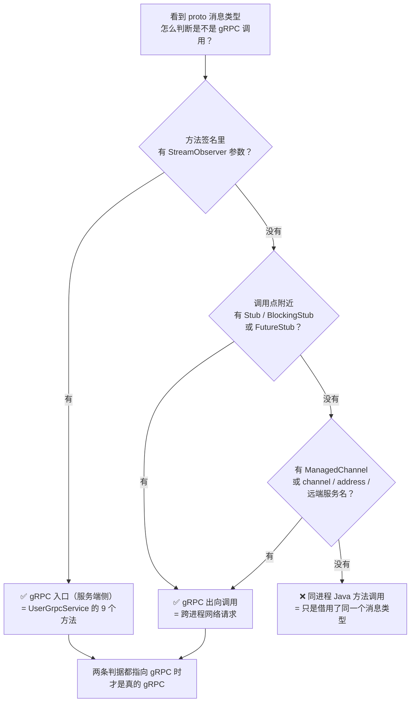
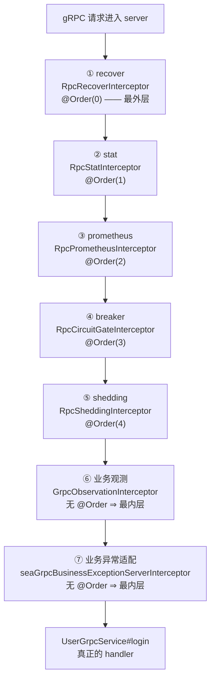
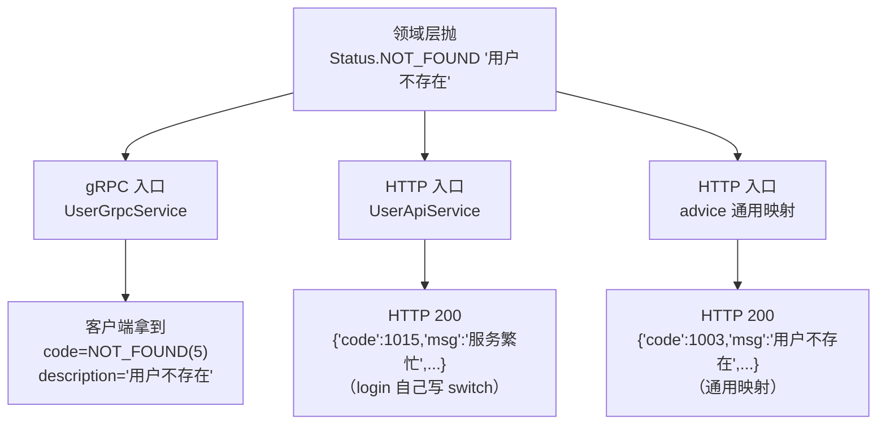
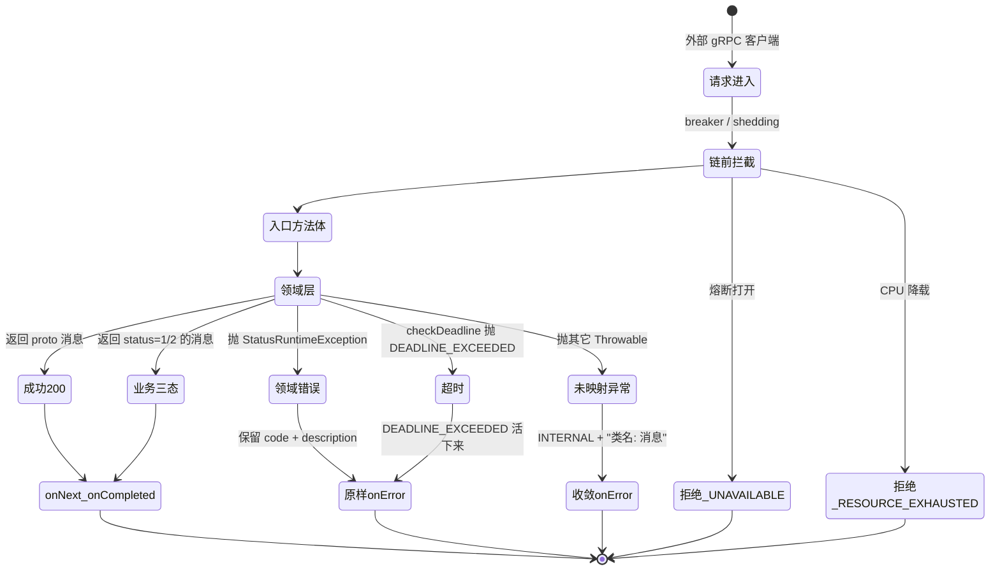

# 12. gRPC 用户服务流程

> 本篇讲的是：**换一个入口**（不是 HTTP，而是 gRPC），同一份 `UserDomainService` 会怎么被调用、
> 抛出的错误会变成什么形状、以及「proto 消息类型」到底意味着什么。

---

## 1. 本次流程的研究范围

### 1.1 我们要追踪什么

假设有一个**外部 gRPC 客户端**（不是本进程内的代码）调用 `UserService.Login`：

```
grpcurl -plaintext -d '{"username":"alice","password":"123456"}' \
        -import-path proto/src/main/proto -proto users.proto \
        localhost:8081 user.UserService/Login
```

本次追踪：从这个请求**进入本进程的 gRPC server**，一直到**客户端收到响应或错误**为止。

具体覆盖：

| 覆盖 | 内容 |
|---|---|
| ✅ 入口装配 | gRPC server 是谁起的、`@GrpcService` 是怎么被发现的、请求怎么被派发到 `UserGrpcService#login` |
| ✅ 拦截器链 | 共享层挂在 gRPC server 上的 6 层拦截器，各自做了什么 |
| ✅ 入口方法体 | `UserGrpcService#login` 的三段式（try / catch `StatusRuntimeException` / catch `Throwable`） |
| ✅ 领域层 | `UserDomainService` 9 个方法在 gRPC 入口下的真实执行（DB / Redis / Snowflake / bcrypt） |
| ✅ 错误形态 | 同一个领域错误，在 gRPC 侧与 HTTP 侧分别长什么样（**本篇最值得看的对比**） |
| ✅ deadline | deadline 的载体在哪、谁负责绑定、`DEADLINE_EXCEEDED` 为什么活下来 |

### 1.2 我们**不**追踪什么

| 不追踪 | 原因 |
|---|---|
| protobuf 的线格式编码（varint / tag / length-delimited） | 属于 protobuf 库内部，与本仓业务代码无关 |
| grpc-java 的 Netty 传输层（HTTP/2 帧、HPACK、流控） | 属于 grpc-java 内部 |
| MyBatis-Plus 如何拼 SQL | 属于持久层专题；本篇只说「发出哪条 SQL、查哪张表」 |
| HTTP 入口的完整流程 | 见 [01-用户登录流程.md](./01-用户登录流程.md) §6（领域层三态）、[11-HTTP统一响应与异常处理流程.md](./11-HTTP统一响应与异常处理流程.md) §4（两套映射的落点） |

### 1.3 先记住三条结论（后面会逐条兑现）

1. **本进程同时有两扇门**：`UserController`（HTTP）和 `UserGrpcService`（gRPC），
   两扇门后面是**同一份** `UserDomainService`。
2. **proto 消息类型 ≠ gRPC 调用**。`UserApiService` 也用 proto 消息当参数，但那是**同进程 Java 方法调用**。
3. **同一份领域代码，两种入口的对外错误形态不同**：gRPC 侧带出原始 `Status` code + description，
   HTTP 侧翻译成业务码（`code` 字段，HTTP 状态码仍是 200）。

---

## 2. 触发场景与输入

### 2.1 一次 `UserService.Login` 调用

**服务端地址**（`service/users/user/src/main/resources/application.yml:82-86`）：

```yaml
grpc:
  server:
    port: ${USER_GRPC_PORT:8081}
    address: 0.0.0.0
    reflection-service-enabled: false
```

⇒ 默认监听 `0.0.0.0:8081`（`reflection-service-enabled: false` ⇒ 反射服务没开 ⇒ `grpcurl` 必须带 `-import-path` + `-proto`）。

**请求消息**（`proto/src/main/proto/users.proto:40-43`）：

```proto
message LoginReq {
  string username = 1;
  string password = 2;
}
```

**客户端发出的内容**（proto3 + JSON 编码时）：

```json
{
  "username": "alice",
  "password": "123456"
}
```

**服务端要回的**（`users.proto:45-48`）：

```proto
message LoginResp {
  int64 uid = 1;
  uint64 status = 2;
}
```

⚠️ 注意 `LoginResp.status` 不是「HTTP 状态码」，也不是 gRPC 的 `Status.Code`，
它是**业务三态**：`0` = 成功 / `1` = 用户名错或密码错 / `2` = 被封禁。

### 2.2 这 9 个 RPC 长什么样

`proto/src/main/proto/users.proto:118-128`：

```proto
service UserService {
  rpc GetUser(GetUserReq) returns (GetUserResp);
  rpc Register(CreateUserReq) returns (CreateUserResp);
  rpc Login(LoginReq) returns (LoginResp);
  rpc Logout(LogoutReq) returns (LogoutResp);
  rpc UpdateUser(UpdateUserReq) returns (UpdateUserResp);
  rpc UploadAvatar(UploadAvatarReq) returns (UploadAvatarResp);
  rpc GetAvatarHistory(GetAvatarHistoryReq) returns (GetAvatarHistoryResp);
  rpc SelectAvatar(SelectAvatarReq) returns (SelectAvatarResp);
  rpc DeleteUser(DeleteUserReq) returns (DeleteUserResp);
}
```

**全部是 unary（一元）RPC**：一个请求 → 一个响应。
「一元」这件事在 Java 侧的形状就是：**方法签名末尾有一个 `StreamObserver` 参数**，
服务端对它调 `onNext`（发数据）+ `onCompleted`（发结束）或 `onError`（发错误）。

---

## 3. 整体执行路线



**这张图省略了什么**：

- 拦截器链内部每层各自的动作（见 §4.4.2）；
- 领域层内部的 4 个工作步骤（W1 查用户 / W2 密码 / W3 封禁 / W4 成功，见 §4.6）；
- 异常路径的完整分支（见 §5）。

---

## 4. 逐步讲解

### 4.1 第一步：先看契约 —— proto 是「复制粘贴」来的，不是翻译的

`proto/src/main/proto/users.proto` 的头部：

```proto
syntax = "proto3";

package user;

option java_package = "com.rag.proto.user";
option java_multiple_files = true;
```

这里有 4 个事实要分清：

| 事实 | 含义 |
|---|---|
| `package user;` | **proto 包名** ⇒ gRPC 的服务全名空间是 `user.UserService` |
| `option java_package = "com.rag.proto.user";` | **Java 生成代码的包名**（与 proto 包名**不是一回事**） |
| `option java_multiple_files = true;` | 每个 `message` 单独一个 `.java` 文件，而不是全塞进一个 `OuterClass` |
| `java_outer_classname` 未显式写 | ⇒ 生成的 service 类名由 **`service` 名字 + `Grpc`** 推导 ⇒ `UserServiceGrpc` |

生成物落在**根级 `proto/` 模块**（`service/users/user/pom.xml:110-112` 依赖 `com.rag:proto`），
不是 user 域的模块里。Java 侧引用的就是生成出来的：

```java
import com.rag.proto.user.LoginReq;
import com.rag.proto.user.LoginResp;
import com.rag.proto.user.UserServiceGrpc;
```

⚠️ **`package user;` 与 `java_package` 的分工**（很容易看错）：

- `package user;` 决定 **wire 上**的方法全路径（`/user.UserService/Login`）⇒ 这是**跨语言契约**，
  Go 客户端、Java 客户端、Python 客户端都必须一致。
- `java_package` 只决定 **Java 代码里 import 的包名** ⇒ 改成什么都**不影响 wire**。

⇒ 所以「pb 包名是 `com.rag.proto.user`」是**纯表达层**；改它不需要动任何客户端。

### 4.2 第二步（最关键）：这个进程里有两扇门，后面是同一份代码

本仓的 user 域是 **api + rpc 合并后的单一进程**（决策 D1 + D7：真源 B 侧是 `user-api` / `user-rpc` 两个进程）。
合并之后，**同一份领域实现被两个入口共用**：



**这张图是本篇的核心结论。** 三条推论：

1. **领域层不知道自己被谁调用**。`UserDomainService` 里没有一句 `if (是 HTTP)`。
   它只管抛 `io.grpc.Status` 异常、返回 proto 消息。
2. **入口层负责「翻译」**。HTTP 侧由 `UserApiService` + `UserApiExceptionHandler` 翻译；
   gRPC 侧由 `UserGrpcService` 翻译（翻译得**少得多**，见 §4.7）。
3. **所以「同一个 bug 在两个入口表现不同」是完全可能的** —— 这不是玄学，是两个翻译层不同。

### 4.3 第三步：`proto` 消息类型**不等于** gRPC 调用（本文最重要的一节）

#### 4.3.1 一个真实的混淆点

HTTP 侧的 `UserApiService#login`（`service/users/user/src/main/java/com/rag/user/service/UserApiService.java:100-124`）：

```java
public LoginResp login(com.rag.user.dto.auth.LoginReq req, HttpServletRequest httpRequest) {
    com.rag.proto.user.LoginReq rpcReq = com.rag.proto.user.LoginReq.newBuilder()
            .setUsername(req.username() == null ? "" : req.username())
            .setPassword(req.password() == null ? "" : req.password())
            .build();

    com.rag.proto.user.LoginResp rpcResp;
    try {
        rpcResp = userDomainService.login(rpcReq);
    } catch (StatusRuntimeException e) {
        ...
    }
```

变量名叫 `rpcReq`，类型是 proto 生成的消息，领域层方法还返回 proto 消息 ——
**看起来像是走了一次 gRPC**。

**但它不是。** 这一行：

```java
rpcResp = userDomainService.login(rpcReq);
```

是**同一个 Spring 容器里两个 Java 对象之间的方法调用**。没有序列化，没有 socket，没有网络。

#### 4.3.2 判据：四个「有 / 没有」



把判据套到本仓两个真实调用点上：

| 判据 | `UserApiService#login` → 领域层 | `UserGrpcService#login`（被 starter 调用） |
|---|---|---|
| 方法签名有 `StreamObserver`？ | ❌ 没有 | ✅ **有**：`login(LoginReq, StreamObserver<LoginResp>)` |
| 有 Stub（`newBlockingStub(...)`）？ | ❌ 没有 | ✅ 有（客户端侧才有，本仓的**测试**里用了） |
| 有 `ManagedChannel`？ | ❌ 没有 | ✅ 有（客户端侧） |
| 有端口 / 地址 / 远端服务名？ | ❌ 没有 | ✅ 有：`grpc.server.port` = 8081、`user-rpc` |
| **结论** | **同进程 Java 调用** | **真 gRPC 网络调用** |

#### 4.3.3 为什么这个区分值得花一节

因为它决定了你**怎么排障**：

- 如果是 `UserApiService` 那一侧出问题 ⇒ 查**进程内**的对象状态、Spring Bean、SQL；
- 如果是 gRPC 那一侧出问题 ⇒ 还要查**网络**：端口通不通、channel 建没建上、拦截器链挂没挂上。

把两者混为一谈，最典型的症状是「我改了 `UserDomainService` 的代码，HTTP 生效了但 gRPC 没生效」——
其实往往是**两端走的是不同版本的进程**，或者**只重启了 HTTP 那一侧的调用方**。

### 4.4 第四步：请求怎么进入 `UserGrpcService#login`

这一段全是 **框架机制**，但初学者最容易在这里卡住，所以逐层拆。

#### 4.4.1 gRPC server 是谁起的？—— `@GrpcService` + starter

`service/users/user/src/main/java/com/rag/user/grpc/UserGrpcService.java:86-95`：

```java
@GrpcService
public class UserGrpcService extends UserServiceGrpc.UserServiceImplBase {

    private static final Logger log = LoggerFactory.getLogger(UserGrpcService.class);

    private final UserDomainService userDomainService;

    public UserGrpcService(UserDomainService userDomainService) {
        this.userDomainService = userDomainService;
    }
```

三个要点：

1. **`@GrpcService`**（`net.devh.boot.grpc.server.service.GrpcService`）是 devh starter 的标记注解。
   starter 的 `GrpcServiceDiscoverer` 扫描容器里带这个注解的 Bean ⇒ 把它的
   `bindService()` 注册进 gRPC server 的 service registry。
2. **`extends UserServiceGrpc.UserServiceImplBase`** 是 protobuf 生成的抽象基类，
   里面声明了 9 个抽象方法 + 一个 `bindService()`（把方法名映射到实现）。
   ⇒ 所以本类里 9 个方法都带 `@Override`。
3. **构造器注入 `UserDomainService`** ⇒ `UserGrpcService` 是一个普通 Spring Bean，
   领域层是它的一个字段 ⇒ 调用 `userDomainService.login(request)` 就是**字段上的方法调用**。

依赖侧（`service/users/user/pom.xml:86-103`）：

```xml
<dependency>
    <groupId>net.devh</groupId><artifactId>grpc-server-spring-boot-starter</artifactId>
    <exclusions>
        <exclusion>
            <groupId>io.grpc</groupId>
            <artifactId>grpc-core</artifactId>
        </exclusion>
    </exclusions>
</dependency>
```

⚠️ `grpc-core` 被 **exclude** 掉了 ⇒ 版本统一由根 pom 的 `grpc.version`（1.63.0）管。
这样做的原因写在 pom 注释里：devh starter 会拖自己的 `grpc-core` ⇒ 版本会漂。

#### 4.4.2 中间还有一条 6 层的拦截器链

**devh starter 只认 `GrpcServerConfigurer`** —— 只往容器里扔一个 `ServerInterceptor` Bean 是**没用的**，
因为 starter 不会自动把它挂到 server 上。真正的挂载点在共享层：

`common/src/main/java/com/rag/common/autoconfigure/ProtectionAutoConfiguration.java:230-243`：

```java
@Bean
@ConditionalOnClass(name = "net.devh.boot.grpc.server.serverfactory.GrpcServerConfigurer")
@ConditionalOnMissingBean(name = "seaGrpcServerConfigurer")
public net.devh.boot.grpc.server.serverfactory.GrpcServerConfigurer seaGrpcServerConfigurer(
        ObjectProvider<ServerInterceptor> interceptors) {
    return server -> {
        List<ServerInterceptor> ordered = interceptors.orderedStream().toList();
        ServerInterceptor chain = RpcProtectionChain.compose(ordered);
        if (chain != null) {
            server.intercept(chain);
        }
    };
}
```

⇒ 容器里**全部** `ServerInterceptor` Bean 被收集、按 `@Order` 排序、拼成**一条**链。

链序（`ProtectionAutoConfiguration.java:263-267` 的常量 + `RpcProtectionChain.compose`）：



每层各做什么（**只讲和本流程有关的**）：

| 层 | 在本流程里做什么 |
|---|---|
| ① recover | 兜住 handler 里的 `Error`（如 `StackOverflowError`）⇒ 以 `INTERNAL + "panic: …"` 关闭调用；**进程存活** |
| ② stat | 在 `close()` 时喂一条耗时样本给进程内聚合器（每 60s 打一行统计日志） |
| ③ prometheus | 在 `close()` 时记一条耗时分布 + 一条状态码计数（`rpc_server_requests_duration_ms` / `rpc_server_requests_code`） |
| ④ breaker | 熔断：连续失败超阈值 ⇒ 直接 `UNAVAILABLE + "circuit breaker is open"`，**不进 handler** |
| ⑤ shedding | CPU 自适应降载 ⇒ `RESOURCE_EXHAUSTED + "service overloaded"`，**不进 handler**。⚠️ 它关的是**本层包装过的** call（`RpcSheddingInterceptor.java:245`）⇒ 外层 breaker 的 close 观察点**会被触发** ⇒ **持续降载最终会把熔断器打开** |
| ⑥ 业务观测 | 起一个 Observation；并按 `observability.rpc-timeout`（本域 = **2s**）调度一个超时任务 |
| ⑦ 业务异常适配 | 只在 status 的 cause 是 `BusinessException` 时改写 status（user 域**没有**这条路径，见下） |

⚠️ 两个容易看错的点：

- **③ prometheus 在 ④⑤ 的外面**。所以被熔断/降载拒绝的请求**也会**被记一条指标
  （B 侧同形）。若把 prometheus 放到里面，这两类请求在指标里会**整个消失**。
- **⑥ 与 ⑦ 都没有 `@Order`** ⇒ 都落在 `Ordered.LOWEST_PRECEDENCE` ⇒
  **两者之间的相对先后，源码无法确认**（`orderedStream()` 对同序 Bean 只保证稳定，不保证语义序）。

关于 ⑦：`GrpcExceptionMapperAutoConfiguration` 提供的这个拦截器，业务上是给**跨域 gRPC 调用**
准备的（B 侧把业务码当 status code 用，grpc-java 承载不了 ⇒ 降级成 trailer `sea-biz-code`）。
**user 域的 `UserGrpcService` 抛的是 `io.grpc.Status`，不是 `BusinessException`** ⇒
这一层在本流程里**不产生任何改写**（`businessExceptionOf(status)` 返回 `null` ⇒ 原样 `super.close`）。

#### 4.4.3 starter 怎么把「方法名」派发到 `login`

protobuf 生成的 `UserServiceGrpc` 内部有一张方法表：

| 方法全路径 | Java 方法名 |
|---|---|
| `/user.UserService/GetUser` | `getUser` |
| `/user.UserService/Register` | `register` |
| `/user.UserService/Login` | `login` |
| `/user.UserService/Logout` | `logout` |
| `/user.UserService/UpdateUser` | `updateUser` |
| `/user.UserService/UploadAvatar` | `uploadAvatar` |
| `/user.UserService/GetAvatarHistory` | `getAvatarHistory` |
| `/user.UserService/SelectAvatar` | `selectAvatar` |
| `/user.UserService/DeleteUser` | `deleteUser` |

⚠️ 「方法全路径」是 **gRPC 的命名规则**（框架机制）：
`/{proto package}.{service 名}/{method 名}`。本域 proto package 是 `user` ⇒ 前缀 `/user.UserService/`。
这与 `java_package` **无关**。

派发发生在 **grpc-java 的 `Listener#onHalfClose()`** 里 —— 这是理解后面几节的关键：

- `onHalfClose` = 「客户端把请求这一半发完了」⇒ 服务端在这里跑 handler。
- ⇒ 所以「handler 到底跑在哪个线程、什么时候跑」这件事，是 `onHalfClose` 决定的。
- `RpcRecoverInterceptor` / `RpcStatInterceptor` / `RpcPrometheusInterceptor` **都特意包了 `onHalfClose`**，
  正是因为「只包 `startCall` 的话，handler 里的 panic 一条都兜不住」。

### 4.5 第五步：`UserGrpcService#login` 的三段式

`service/users/user/src/main/java/com/rag/user/grpc/UserGrpcService.java:97-112`：

```java
@Override
public void login(LoginReq request, StreamObserver<LoginResp> responseObserver) {
    try {
        LoginResp resp = userDomainService.login(request);
        responseObserver.onNext(resp);
        responseObserver.onCompleted();
    } catch (StatusRuntimeException e) {
        log.error("login RPC failed: {}", e.getStatus(), e);
        responseObserver.onError(e);
    } catch (Throwable t) {
        log.error("login RPC failed with unmapped throwable", t);
        responseObserver.onError(Status.INTERNAL
                .withDescription(t.getClass().getSimpleName() + ": " + t.getMessage())
                .asRuntimeException());
    }
}
```

**9 个方法全是这 3 段**（`register` 115-129、`logout` 131-146、`getUser` 148-163、
`updateUser` 165-180、`deleteUser` 182-197、`selectAvatar` 199-214、`uploadAvatar` 216-231、
`getAvatarHistory` 233-248）—— 只有方法名和消息类型不同。

逐条解释：

| 段 | 做什么 | 为什么 |
|---|---|---|
| `try { ... }` | 调领域层 | 领域层是**同步**的（没有 `@Async`）⇒ 这里就是一次普通方法调用 |
| `responseObserver.onNext(resp)` | 把响应消息推给客户端 | unary RPC 只推**一个**消息 |
| `responseObserver.onCompleted()` | 告诉客户端「正常结束」 | 对应 gRPC 的 ` trailers: grpc-status: 0` |
| `catch (StatusRuntimeException e)` → `onError(e)` | **原样**把异常交给 gRPC | 领域层已经把「业务失败」表达成 `Status` 了 ⇒ 这里**一个字都不改** |
| `catch (Throwable t)` → `onError(INTERNAL + "类名: 消息")` | 兜底收敛 | 没被映射的异常 ⇒ 统一成 `INTERNAL`，description = `t.getClass().getSimpleName() + ": " + t.getMessage()` |

⚠️ **第二层 catch 为什么不能省**（类注释里写明了 B 侧的 DRIFT-02）：

- grpc-java 在 handler 抛出**非** `StatusException` 的异常时，会把它包成 `UNKNOWN` 发给客户端。
- 有了第二层 catch ⇒ 客户端拿到的是 `INTERNAL`（13），description 里有类型名和消息；
- 少了它 ⇒ 客户端拿到 `UNKNOWN`（2），description 为 `null` ⇒ **状态码退化**。

⇒ 这一层是**可观察契约**，不是防御性冗余。

⚠️ 还有一个细节：`onNext` / `onCompleted` 之后**没有** `try-catch` 包裹的兜底。
如果 `onNext` 自己抛（比如客户端已断开），异常会从 `try` 块里**逃出去** ⇒ 落到 recover 层。

### 4.6 第六步：领域层真的做了什么

`UserDomainService#login`（`service/users/user/src/main/java/com/rag/user/domain/service/UserDomainService.java:161-241`）
在 gRPC 入口下的执行（省略了日志与指标埋点）：

```java
public LoginResp login(LoginReq req) {
    Span span = tracer.spanBuilder("Action-User-Login")
            .setAttribute("biz.username", req.getUsername())
            .startSpan();
    Context otelCtx = Context.current().with(span);
    try {
        checkDeadline();
        // W1 查用户
        UserEntity user;
        try {
            checkDeadline();
            user = userMapper.findOneByUserName(req.getUsername());
        } catch (NotFoundException e) {
            metrics.getLoginUserNotFound().increment();
            logger.logInfo(otelCtx, "login failed : user not found,username : " + req.getUsername());
            return LoginResp.newBuilder().setStatus(1L).build();
        } catch (StatusRuntimeException e) {
            // B-1：DEADLINE_EXCEEDED 必须上抛，不能掉进下面的 db_error 分支被改写成 INTERNAL。
            throw e;
        } catch (Exception e) {
            metrics.getLoginDbError().increment();
            span.recordException(e);
            logger.logBusinessErr(otelCtx, ErrCodes.ERROR_DB_SELECT, e);
            throw Status.INTERNAL.withDescription("DB查询失败").asRuntimeException();
        }

        // W2 密码比对
        checkDeadline();
        PasswordUtil.Outcome pwOutcome =
                PasswordUtil.checkDetailed(req.getPassword(), user.getPassword());
        if (pwOutcome != PasswordUtil.Outcome.MATCHED) {
            ...
            return LoginResp.newBuilder().setStatus(1L).build();
        }

        // W3 封禁检查
        if (user.getStatus() != null && user.getStatus() == 1L) {
            ...
            return LoginResp.newBuilder().setStatus(2L).build();
        }

        // W4 成功
        metrics.getLoginSuccess().increment();
        logger.logInfo(otelCtx, "login success,username : " + req.getUsername());
        return LoginResp.newBuilder()
                .setUid(user.getUid())
                .setStatus(0L)
                .build();
    } finally {
        span.end();
    }
}
```

**W1 的 SQL**（`service/users/user/src/main/java/com/rag/user/mapper/UserMapper.java:40-59`）：

```java
@Select("SELECT * FROM users_user WHERE username = #{username} LIMIT 1")
@Results({
        @Result(property = "extraInfo", column = "extra_info",
                javaType = java.util.Map.class, typeHandler = JsonTextTypeHandler.class)
})
UserEntity selectByUsernameRaw(@Param("username") String username);

default UserEntity findOneByUserName(String username) {
    UserEntity u = selectByUsernameRaw(username);
    if (u == null) {
        throw new NotFoundException("user not found by username: " + username);
    }
    return u;
}
```

要点：

- **`@Results` 里那个 `typeHandler` 不能省**：手写 `@Select` 不认 MyBatis-Plus 的 `@TableField`，
  不显式声明 ⇒ `extra_info`（TEXT 列）会**静默变成 null**，**不报错**。
- **「找不到」是 error 不是值**：`findOneByUserName` 是 Mapper 接口里的 `default` 方法，
  查不到直接抛 `NotFoundException` ⇒ 上层不用各自判 `null`。
- `NotFoundException` 是**本域自定义**的普通异常（`com.rag.user.exception.UserExceptions.NotFoundException`），
  **不是** gRPC 的 `StatusRuntimeException` ⇒ 它必须被领域层翻译成 `Status` 才能出去。

**W2 的 bcrypt 比对**：`PasswordUtil.checkDetailed(明文, 库里的哈希)` 返回一个 `Outcome`
（`MATCHED` / 不匹配 / `MALFORMED_HASH`）。不是字符串比较。

**W3 的封禁判断**：`user.getStatus() == 1L` ⇒ 封禁。
⚠️ `user.getStatus() != null` 这一半**恒为真**（`UserEntity.status` 初始化为 `0L`，
MyBatis 默认 `callSettersOnNulls=false` ⇒ DB 里是 NULL 时 setter 被跳过 ⇒ 读出来是 `0L` 而非 `null`）。
这是刻意保留的写法（类注释里专门写了三条理由），不要"顺手改成 `!= null` 判断"。

**三态返回**：注意 `status=1` / `status=2` 都是**正常的返回值**，不是异常 ⇒
**gRPC 客户端拿到的是 `Status.Code.OK`**，业务失败信息在 `LoginResp.status` 里。

### 4.7 第七步（重点）：同一个领域错误，两种入口长什么样

这是本篇**最值得看**的一节。

#### 4.7.1 gRPC 侧：原样带出

领域层抛的每一个 `Status`，在 gRPC 侧**一个字都不改**：

| 领域层抛出的 | gRPC 客户端看到 |
|---|---|
| `Status.NOT_FOUND.withDescription("用户不存在")` | `StatusRuntimeException`：code = `NOT_FOUND`(5)，description = `"用户不存在"` |
| `Status.INTERNAL.withDescription("DB查询失败")` | code = `INTERNAL`(13)，description = `"DB查询失败"` |
| `Status.ALREADY_EXISTS.withDescription("用户名已存在")` | code = `ALREADY_EXISTS`(6)，description = `"用户名已存在"` |
| `Status.INVALID_ARGUMENT.withDescription("history_id is required")` | code = `INVALID_ARGUMENT`(3)，description = `"history_id is required"` |
| `Status.DEADLINE_EXCEEDED.withDescription("rpc deadline reached")` | code = `DEADLINE_EXCEEDED`(4)，description = `"rpc deadline reached"` |
| 未映射异常（如 `IllegalStateException("boom")`） | code = `INTERNAL`(13)，description = `"IllegalStateException: boom"` |

#### 4.7.2 HTTP 侧：翻译成业务码

HTTP 侧的**两套映射并存**：

**① 端点自己写的 switch**（6 个端点：`login` / `logout` / `selectAvatar` …）：

```java
// UserApiService#login:109-124
} catch (StatusRuntimeException e) {
    metrics.getLoginRpcError().increment();
    log.error("login RPC error, username={}", req.username(), e);
    io.grpc.Status.Code code = e.getStatus().getCode();
    if (code == io.grpc.Status.Code.INTERNAL) {
        throw new BusinessException(
                ErrCodes.ERROR_SERVER_COMMON,      // 5001
                ErrMsg.getMsg(ErrCodes.ERROR_SERVER_COMMON));
    }
    throw new BusinessException(
            ErrCodes.CODE_SERVER_BUSY,            // 1015
            ErrMsg.getMsg(ErrCodes.CODE_SERVER_BUSY));
}
```

**② advice 层的通用映射**（`advice/UserApiExceptionHandler.java:116-130`）：

```java
private int mapRPCStatusToCode(Status.Code code) {
    if (code == Status.Code.INTERNAL) {
        return ErrCodes.ERROR_SERVER_COMMON;   // 5001
    }
    if (code == Status.Code.NOT_FOUND) {
        return ErrCodes.ERROR_USER_NOT_EXIST;   // 1003
    }
    if (code == Status.Code.ALREADY_EXISTS) {
        return ErrCodes.ERROR_USER_EXIST;       // 1001
    }
    if (code == Status.Code.INVALID_ARGUMENT) {
        return ErrCodes.ERROR;                  // 500
    }
    return ErrCodes.CODE_SERVER_BUSY;           // 1015（default）
}
```

⚠️ **哪些端点走哪一套**（源码明确）：

| 端点 | 处理方式 | 后果 |
|---|---|---|
| `login` | **自己写 switch**：INTERNAL → 5001；其它 → 1015 | `DEADLINE_EXCEEDED` 落 **1015** |
| `logout` | **自己写 switch**：INTERNAL → 5001；其它 → 1015 | `INVALID_ARGUMENT` 也落 **1015**（**不是** 500） |
| `selectAvatar` | **自己写 switch**：`NOT_FOUND`/`INVALID_ARGUMENT` → 500；其它原样上抛 | `NOT_FOUND` 落 **500**（**不是** 1003） |
| `register` / `getUser` / `updateUser` / `deleteUser` / `uploadAvatar` / `getAvatarHistory` | **原样上抛** ⇒ advice 通用映射 | `NOT_FOUND` → 1003、`ALREADY_EXISTS` → 1001、`INVALID_ARGUMENT` → 500、其它 → 1015 |

#### 4.7.3 对照图



#### 4.7.4 为什么 HTTP 侧永远是 200

`advice/UserApiExceptionHandler.java:91-102`：

```java
@ExceptionHandler(StatusRuntimeException.class)
public ResponseEntity<ApiResponse> handleRPC(StatusRuntimeException e) {
    Status.Code code = e.getStatus().getCode();
    int businessCode = mapRPCStatusToCode(code);
    String msg = ErrMsg.getMsg(businessCode);
    ...
    return ResponseEntity.status(HttpStatus.OK).body(new ApiResponse(businessCode, msg, null));
}
```

⇒ **HTTP 状态码恒为 200**，业务成败靠 body 里的 `code` 表达。
（`decideStatus(int)` 也恒返回 `HttpStatus.OK`，见同文件 `:269-271`。）

⇒ **同一份领域代码**：
- gRPC 客户端看到「gRPC 语义」：可枚举的 `Status.Code` + 自由文本 description；
- HTTP 客户端看到「业务语义」：`1003` / `1015` / `5001` / `500` + 固定文案。

### 4.8 第八步：deadline 从哪来

#### 4.8.1 领域层怎么用 deadline

`UserDomainService.java:140-146`：

```java
private void checkDeadline() {
    if (Thread.currentThread().isInterrupted() || DeadlineState.isExpired()) {
        throw Status.DEADLINE_EXCEEDED
                .withDescription("rpc deadline reached")
                .asRuntimeException();
    }
}
```

**调用点**（全仓共 **10 处**，逐个核对过行号）：

| 领域方法 | `checkDeadline()` 的行号 | 次数 |
|---|---|---|
| `login` | `:167`（进方法）、`:171`（W1 查用户前）、`:199`（W2 密码前） | **3** |
| `register` | `:262`（进方法，**在 try 之前**） | 1 |
| `getUser` | `:365` | 1 |
| `updateUser` | `:426` | 1 |
| `deleteUser` | `:544` | 1 |
| `selectAvatar` | `:597` | 1 |
| `uploadAvatar` | `:647` | 1 |
| `getAvatarHistory` | `:710` | 1 |
| `logout` | **无** | **0** |

⚠️ **两个容易看错的细节**：

1. **只有 `login` 是「每个业务步骤前都查」**（3 次）。其余 7 个方法都只在**入口查一次**
   ⇒ 类注释里那句「每次业务步骤前 checkDeadline」（D-018）**只对 `login` 成立**。
2. **`logout` 入口不设 deadline 闸门** —— 领域层注释明说「入口**不设** deadline 闸门 … 是「让写去失败」不是「入口拒」」。

#### 4.8.2 载体是什么

`common/src/main/java/com/rag/common/observability/DeadlineState.java`：

```java
private static final ThreadLocal<Long> DEADLINE_NANOS = new ThreadLocal<>();   // :62

public static boolean isExpired() {                                              // :110
    Long d = DEADLINE_NANOS.get();
    // 用减法而不是 now >= d：单调钟会回绕（292 年）⇒ 差值法仍正确
    return d != null && monotonicNanos.getAsLong() - d >= 0;
}

public static Scope bindRemainingNanos(long remainingNanos) {                  // :169
    long now = monotonicNanos.getAsLong();
    DEADLINE_NANOS.set(
            (remainingNanos == Long.MAX_VALUE || remainingNanos > Long.MAX_VALUE - now)
                    ? Long.MAX_VALUE
                    : now + remainingNanos);
    return () -> DEADLINE_NANOS.remove();
}
```

三个设计点：

| 点 | 说明 |
|---|---|
| **载体是 `ThreadLocal`** | ⇒ 只能在**真正跑 handler 的那个线程**上读得到。设在别的线程上对 handler 不可见。 |
| **存的是单调钟纳秒的绝对到期时刻** | ⇒ 不受 NTP 校正 / 改系统时间影响；也避免了毫秒截断 |
| **未绑定时 `isExpired()` 恒为 `false`** | ⇒ **no-op**（类注释与 `UserDomainService` 的注释都写了这一点） |

`bindToCurrent(long epochMillis)`（`:154-157`）是**兼容入口**：入参仍是墙钟 epoch 毫秒
（在绑定瞬间换算成剩余预算），新代码用 `bindRemainingNanos`。

#### 4.8.3 谁来绑定？—— 本仓现状要说清楚

`DeadlineState` 的类注释里写着绑定点：

> 实际生效路径：`{@link #newUnaryServerInterceptor}` 的 `onHalfClose` 在**真正跑 handler 的线程**上
> `{@link #bindToCurrent(long)}`（M7 修复）。

⚠️ **但 `newUnaryServerInterceptor` 这个类在本仓不存在**。全仓 grep 的结果：

- `DeadlineState.bindRemainingNanos(...)` 的**生产调用点只有一处**：
  `common/src/main/java/com/rag/common/observability/RpcHandleRunner.java:121` ——
  「非 gRPC Server 场景下的业务调用入口」，把业务扔到独立线程跑、给那个 worker 线程绑预算。
- 而 `RpcHandleRunner.handle(...)` 在本仓**只有测试在调用**（`common/src/test/.../RpcHandleRunnerTest.java`），
  **没有生产调用方**。
- gRPC 服务端那 6 层拦截器里，**没有任何一层调用 `DeadlineState.bind*`**。

⇒ **结论（源码明确）**：在本仓当前的 gRPC 服务端路径上，**`DeadlineState` 从未被绑定**
⇒ `DeadlineState.isExpired()` 恒为 `false`
⇒ `checkDeadline()` 在 gRPC 路径上**实际只剩 `Thread.currentThread().isInterrupted()` 一条**会触发。

#### 4.8.4 那 gRPC 的 2 秒超时是谁做的

是**业务观测层**（`common/src/main/java/com/rag/common/autoconfigure/ObservabilityAutoConfiguration.java:293-301`）：

```java
private ScheduledFuture<?> scheduleTimeout(ServerCall<?, ?> call, Duration timeout) {
    if (timeout == null || timeout.isZero() || timeout.isNegative()) {
        return null;
    }
    return timeoutScheduler().schedule(
            () -> call.close(Status.DEADLINE_EXCEEDED
                    .withDescription("rpc deadline exceeded"), new Metadata()),
            timeout.toNanos(), TimeUnit.NANOSECONDS);
}
```

`timeout` 来自 `ObservabilityProperties#getRpcTimeout()`（`observability.rpc-timeout`），
本域 `application.yml:75-77` 写的是 **2s**。

⚠️ 这个超时**只关闭 call**，它：

- ✅ 让**客户端**看到 `DEADLINE_EXCEEDED`；
- ❌ **不**给 handler 线程绑 deadline；
- ❌ **不**中断 handler 线程（grpc-java 的 `ServerCall#close()` 无法取消已在跑的 handler）。

⇒ 所以「handler 还在跑，但客户端已经收到 DEADLINE_EXCEEDED」是本仓 gRPC 路径上**真实存在**的状态。
这正是 `RpcHandleRunner` 类注释里写的对比：

> gRPC 拦截器路径**没有**（真正打断业务线程）的能力（grpc-java 的 `ServerCall#close()` 无法取消已在跑的 handler）
> ⇒ 业务 handler 若要感知超时，gRPC 路径只能靠 `DeadlineState#isExpired()` 主动自查。

⇒ 两句话合起来：**本仓 gRPC 路径上，`DeadlineState.isExpired()` 恒 false（没绑），
而 `ServerCall#close()` 又打断不了业务线程** ⇒ **领域层的 `checkDeadline()` 在 gRPC 路径上基本不会触发**。

> 📌 这属于「源码明确」的事实陈述，不是推测：绑定点缺失是 grep 出来的；
> `close()` 打断不了 handler 是 grpc-java 的机制 + 本仓 `RpcHandleRunner` 类注释的自述。

### 4.9 第九步：`DEADLINE_EXCEEDED` 为什么不会被改写成 `INTERNAL`

这是 **catch 顺序** 决定的，不是运气。

领域层每个 DB 调用的写法（以 `login` 为例，`UserDomainService.java:179-196`）：

```java
} catch (NotFoundException e) {
    // 用户不存在 → Status=1（D-002：和密码错共用同一个状态码）
    metrics.getLoginUserNotFound().increment();
    logger.logInfo(otelCtx, "login failed : user not found,username : " + req.getUsername());
    return LoginResp.newBuilder().setStatus(1L).build();
} catch (StatusRuntimeException e) {
    // B-1：DEADLINE_EXCEEDED 必须上抛，不能掉进下面的 db_error 分支被改写成 INTERNAL。
    throw e;
} catch (Exception e) {
    metrics.getLoginDbError().increment();
    span.recordException(e);
    logger.logBusinessErr(otelCtx, ErrCodes.ERROR_DB_SELECT, e);
    throw Status.INTERNAL.withDescription("DB查询失败").asRuntimeException();
}
```

**Java 的 catch 匹配规则**：按书写顺序**逐个匹配**，第一个 `isInstance` 成立的分支胜出。

| 顺序 | catch 的类型 | 能接住什么 | 结果 |
|---|---|---|---|
| ① | `NotFoundException` | 用户不存在 | 转成 `status=1` 的正常返回 |
| ② | `StatusRuntimeException` | **所有 gRPC 状态异常**，含 `DEADLINE_EXCEEDED` | **原样上抛**（`throw e`） |
| ③ | `Exception` | 剩下的一切（含 DB 异常） | 改写成 `INTERNAL` + `"DB查询失败"` |

⚠️ **如果把 ② 删掉**：`StatusRuntimeException` 是 `RuntimeException` 的子类 ⇒ 会落进 ③
⇒ `DEADLINE_EXCEEDED` 会被改写成 `INTERNAL "DB查询失败"` ⇒
**客户端看到的是「数据库故障」，而真实原因是「超时」** ⇒ 排障方向完全错。

⇒ 这就是源码里 18 处同款 `catch (StatusRuntimeException e) { throw e; }` 的共同理由
（`UserDomainService` 类注释的「🔴 B-1 放行分支」段写明了依据）。

**再往上一层**，gRPC 侧 `UserGrpcService#login` 的 catch 顺序也是同一套逻辑：

```java
} catch (StatusRuntimeException e) {
    responseObserver.onError(e);          // 原样 ⇒ DEADLINE_EXCEEDED 活下来
} catch (Throwable t) {
    responseObserver.onError(Status.INTERNAL...);   // 兜底
}
```

⇒ **两层 catch 顺序一致** ⇒ `DEADLINE_EXCEEDED` 从领域层一路活到客户端。

⚠️ 但要区分「活下来」与「会发生」：按 §4.8.3/§4.8.4，在 gRPC 路径上
`checkDeadline()` 本身很难触发 ⇒ 客户端更可能看到的 `DEADLINE_EXCEEDED`
来自**业务观测层的 2s 超时**（description = `"rpc deadline exceeded"`），
而不是领域层那个（description = `"rpc deadline reached"`）。
**两个 description 不一样，可以据此区分来源。**

### 4.10 第十步：9 个 RPC 全表

| # | proto `rpc` | gRPC 全路径 | `UserGrpcService` 方法（行号） | 领域方法（行号） | 领域层「正常返回」 | 领域层「抛出的 Status」 | 副作用 |
|---|---|---|---|---|---|---|---|
| 1 | `GetUser` | `/user.UserService/GetUser` | `getUser`（:149） | `getUser`（:364） | `GetUserResp{user, found=true}` | `NOT_FOUND "用户不存在"` · `INTERNAL "DB查询失败"` | SELECT `users_user` |
| 2 | `Register` | `/user.UserService/Register` | `register`（:115） | `register`（:257） | `CreateUserResp{uid}` | `ALREADY_EXISTS "用户名已存在"` · `INTERNAL "DB查询失败" / "密码生成失败" / "uid生成失败" / "DB更新失败"` | INSERT `users_user` ＋ Snowflake ＋ bcrypt |
| 3 | `Login` | `/user.UserService/Login` | `login`（:98） | `login`（:161） | `LoginResp{uid, status=0/1/2}` | `INTERNAL "DB查询失败"` | SELECT `users_user` ＋ bcrypt |
| 4 | `Logout` | `/user.UserService/Logout` | `logout`（:132） | `logout`（:764） | `LogoutResp{success=false}` ⚠️ | `INVALID_ARGUMENT "Token不能为空"` · `INTERNAL "注销失败,Redis写入异常"` | Redis `SETEX user:jwt_blacklist:<token>` |
| 5 | `UpdateUser` | `/user.UserService/UpdateUser` | `updateUser`（:166） | `updateUser`（:425） | `UpdateUserResp{user}` | `ALREADY_EXISTS "用户名已存在"` · `NOT_FOUND "用户不存在"` · `INTERNAL "DB查询失败"/"密码生成失败"/"DB更新失败"` | UPDATE `users_user` ＋ bcrypt |
| 6 | `UploadAvatar` | `/user.UserService/UploadAvatar` | `uploadAvatar`（:217） | `uploadAvatar`（:646） | `UploadAvatarResp{avatar_url, history}` | `INVALID_ARGUMENT "avatar_url is required"` · `NOT_FOUND "用户不存在"` · `INTERNAL "history_id生成失败" / "DB插入失败"` | 双写 `users_user` ＋ `users_user_avatar_history` ＋ Snowflake |
| 7 | `GetAvatarHistory` | `/user.UserService/GetAvatarHistory` | `getAvatarHistory`（:234） | `getAvatarHistory`（:709） | `GetAvatarHistoryResp{list}` | `NOT_FOUND "用户不存在"` · `INTERNAL "DB查询失败"` | SELECT ×2 |
| 8 | `SelectAvatar` | `/user.UserService/SelectAvatar` | `selectAvatar`（:200） | `selectAvatar`（:596） | `SelectAvatarResp{avatar_url, history}` | `INVALID_ARGUMENT "history_id is required"` · `NOT_FOUND "用户不存在" / "头像历史不存在"` · `INTERNAL "DB更新失败"` | 双写 |
| 9 | `DeleteUser` | `/user.UserService/DeleteUser` | `deleteUser`（:183） | `deleteUser`（:537） | `DeleteUserResp{success=true}` | `NOT_FOUND "用户不存在"` · `INTERNAL "DB查询失败" / "DB更新失败"` | DELETE `users_user` |

⚠️ **第 4 行是一个容易看错的地方**：

领域层 `logout` 的返回值是 `LogoutResp.newBuilder().build()`（`UserDomainService.java:792`）——
**没有 `setSuccess(true)`** ⇒ proto3 的 `bool` 默认值 `false` ⇒
**gRPC 客户端收到的 `LogoutResp.success` 是 `false`**。

而 HTTP 侧的 `UserApiService#logout`（`:429`）**不看领域返回值**，直接 `return new LogoutResp(true);`
⇒ HTTP 客户端看到 `success=true`。

⇒ **同一个业务动作，两种入口的布尔字段语义相反**。这不是 bug，是两侧代码各自写的；
但如果你在 gRPC 侧拿 `success` 判断「注销成功与否」，会得到错误结论。

---

## 5. 重要分支与失败路径

| 发生位置 | 触发条件 | 领域层动作 | gRPC 客户端可观察结果 | HTTP 侧同一情形（对照） |
|---|---|---|---|---|
| `checkDeadline()` | 线程被 interrupt（**或** deadline 已绑且过期） | 抛 `DEADLINE_EXCEEDED "rpc deadline reached"` | code=4 `DEADLINE_EXCEEDED`，desc=`"rpc deadline reached"` | `login` 端点 ⇒ 1015；其它端点 ⇒ 1015（通用映射 default） |
| 业务观测层 2s 超时 | handler 跑超过 `observability.rpc-timeout` | **领域层不受影响，继续跑** | code=4 `DEADLINE_EXCEEDED`，desc=`"rpc deadline exceeded"` | HTTP 侧走的是 `http-timeout: 3s`，路径不同 |
| `findOneByUserName` 返回 null | 用户不存在 | 转成 `LoginResp{status=1}`（**不抛异常**） | code=0 **OK**，消息里 `status=1` | HTTP 侧：1002 `ERROR_LOGIN_WRONG` |
| `PasswordUtil.checkDetailed` 不匹配 | 密码错 | `LoginResp{status=1}` | code=0 OK，`status=1` | HTTP 侧：1002 |
| 库里 `status == 1` | 用户被封禁 | `LoginResp{status=2}` | code=0 OK，`status=2` | HTTP 侧：1011 `ERROR_USER_BANNED` |
| DB 查询抛异常 | PG 挂了 / SQL 语法错 | `INTERNAL "DB查询失败"` | code=13 `INTERNAL`，desc=`"DB查询失败"` | HTTP 侧：5001（`login` 自己写 / 通用映射都是 5001） |
| `register` 用户名已存在 | 查重命中 | `ALREADY_EXISTS "用户名已存在"` | code=6 `ALREADY_EXISTS` | HTTP 侧：1001 |
| `selectAvatar` 的 `history_id` 为空 | 参数空 | `INVALID_ARGUMENT "history_id is required"` | code=3 `INVALID_ARGUMENT` | HTTP 侧：**500**（`selectAvatar` 自己写 switch） |
| `logout` 的 `token` 为空 | 参数空 | `INVALID_ARGUMENT "Token不能为空"` | code=3 `INVALID_ARGUMENT` | HTTP 侧：**1015**（`logout` 自己写 switch，INVALID_ARGUMENT 落 default） |
| 未映射异常 | 任何 `Throwable`（如 `NullPointerException`） | 领域层不处理 | code=13 `INTERNAL`，desc=`"类名: 消息"` | HTTP 侧：advice 兜底 ⇒ **HTTP 500** ＋ envelope |
| 熔断打开 | breaker 层判定 | **不进 handler** | code=14 `UNAVAILABLE`，desc=`"circuit breaker is open"` | HTTP 侧无此层 |
| 降载触发 | shedding 层判定 | **不进 handler** | code=8 `RESOURCE_EXHAUSTED`，desc=`"service overloaded"` | HTTP 侧有独立的降载 filter |
| handler 抛 `Error`（非 `Exception`） | 例如 `StackOverflowError` | —— | recover 层兜住 ⇒ code=13 `INTERNAL`，desc=`"panic: …"`，**进程存活** | HTTP 侧无对应机制 |

---

## 6. 数据变化与副作用

### 6.1 数据库

| RPC | 读 / 写 | 具体 SQL | 事务 |
|---|---|---|---|
| `Login` / `GetUser` | 读 | `SELECT * FROM users_user WHERE username = ? LIMIT 1` / `... WHERE uid = ? LIMIT 1` | **无事务**（单条 SELECT，autocommit） |
| `Register` | 写 | `INSERT INTO users_user (...)` | 无事务（单条 INSERT） |
| `UpdateUser` | 写 | `UPDATE users_user SET <非空字段>, update_time = CURRENT_TIMESTAMP WHERE uid = ?` | 无事务 |
| `DeleteUser` | 写 | `DELETE FROM users_user WHERE uid = ?` | 无事务 |
| `UploadAvatar` / `SelectAvatar` | 写 | 双写 `users_user` ＋ `users_user_avatar_history` | **有事务**（见下） |
| `GetAvatarHistory` | 读 ×2 | `SELECT ... WHERE uid = ?` ＋ `SELECT ... WHERE uid = ? ORDER BY create_time DESC` | 无事务 |

⚠️ 双写那两条走的是 `avatarHistoryMapper.createAvatarHistory(...)` / `selectAvatarHistory(...)`，
它们是 Mapper 接口上的 `default` 方法，**事务注解挂在 default 方法上**。
⚠️ MyBatis-Plus 的 `@Transactional` 在 **Mapper 接口的 default 方法** 上是否生效，
需要单独验证（Spring AOP 代理的是 Mapper 的**实现代理**，default 方法由 JDK 代理直接执行）——
**本篇不对这一点下结论**，它属于持久层专题（见 [07-头像上传流程.md](./07-头像上传流程.md) §5「双写的事务边界」）。

### 6.2 Redis

只有 `Logout` 写 Redis：

- key：`"user:jwt_blacklist:" + req.getToken()`（`UserDomainService.java:773`）
- value：`"banned"`
- TTL：`properties.getUserAuth().getAccessExpire()` 秒（默认 2592000 = 30 天）
- 写法：`bizRedis.opsForValue().set(key, "banned", Duration.ofSeconds(ttlSeconds))`

⚠️ `logout` 的入口**没有** `checkDeadline()`（领域层注释明说「入口不设 deadline 闸门」）。

### 6.3 ID / Token

| 项 | 本流程是否产生 | 说明 |
|---|---|---|
| Snowflake uid | ✅ 仅 `Register` | `Snowflake.nextId()` ⇒ 写入 `users_user.uid` |
| Snowflake `history_id` | ✅ 仅 `UploadAvatar` | `String.valueOf(Snowflake.nextId())` |
| JWT | ❌ **不产生** | JWT 签发在 **HTTP 侧的 `UserApiService`** ⇒ gRPC 入口**拿不到 token** |

⚠️ **这一条很关键**：gRPC 入口调用的是**领域层**，领域层**不签 JWT**。
⇒ 走 gRPC 进来的人，拿到的是 `uid`，不是 token。

### 6.4 日志与指标

| 类型 | 位置 | 内容 |
|---|---|---|
| 业务日志（Info） | `UserDomainService` | `login success,username : …` / `login failed : user not found,…` 等 |
| 业务错误日志 | `UserDomainService` | `logger.logBusinessErr(otelCtx, ErrCodes.ERROR_DB_SELECT, e)` 等 |
| RPC 错误日志 | `UserGrpcService` | `log.error("login RPC failed: {}", e.getStatus(), e)` |
| OTel Span | `UserDomainService` | `Action-User-Login` / `Action-User-Register` / `Action-User-Delete`（`login` / `register` / `deleteUser` 才有） |
| Micrometer 业务指标 | `UserRpcMetrics` | `user_rpc_login_total{result=success\|user_not_found\|db_error\|internal_error}`、`user_rpc_register_total{result=…}` |
| gRPC 链指标 | `RpcPrometheusInterceptor` | `rpc_server_requests_duration_ms{method}`、`rpc_server_requests_code{method,code}` |
| 统计日志 | `RpcStatMetrics` | 每 60s 一行聚合耗时 |

⚠️ **指标不在 `UserGrpcService` 里**：`user_rpc_login_total` / `user_rpc_register_total`
由**领域层**记录（`UserDomainService` → `UserRpcMetrics`）⇒
**HTTP 入口和 gRPC 入口打的是同一组指标**（因为领域层是共用的）。

---

## 7. 执行结果

### 7.1 gRPC 侧

**成功（登录成功）**：客户端拿到一个 `LoginResp`：

```
LoginResp {
  uid:    1234567890123456789
  status: 0
}
```

gRPC 层的 status = `OK`（0）。

**业务失败（密码错）**：gRPC 层仍然是 `OK`，消息是：

```
LoginResp {
  uid:    0
  status: 1
}
```

⚠️ **业务失败不是 gRPC 错误**。客户端**不能**靠 `Status.Code.OK` 判断「登录成功」，
必须看 `LoginResp.status`。

**领域错误（用户不存在于 `getUser`）**：客户端抛 `StatusRuntimeException`：

```
io.grpc.StatusRuntimeException: NOT_FOUND: 用户不存在
```

⇒ code = `NOT_FOUND`(5)，description = `"用户不存在"`。

**未映射异常**：

```
io.grpc.StatusRuntimeException: INTERNAL: IllegalStateException: boom
```

### 7.2 同一个错误在 HTTP 侧长什么样（对照）

```json
{
  "code": 1003,
  "msg": "用户不存在",
  "data": null
}
```

HTTP 状态码 **200**。

---

## 8. 流程复盘

一次 gRPC `UserService.Login` 调用，真正走过的代码：

```
gRPC 客户端 stub
  ↓ ManagedChannel（Netty / HTTP2）
gRPC server（8081）
  ↓ 拦截器链：recover → stat → prometheus → breaker → shedding → 业务观测 → 业务异常适配
  ↓ devh starter 的 GrpcServiceDiscoverer 派发（onHalfClose）
UserGrpcService#login
  ↓ 同进程 Java 方法调用
UserDomainService#login
  ├─ checkDeadline()
  ├─ UserMapper#findOneByUserName → SELECT * FROM users_user WHERE username = ? LIMIT 1
  ├─ PasswordUtil.checkDetailed（bcrypt）
  ├─ 封禁判断
  └─ LoginResp{uid, status}
  ↓
responseObserver.onNext(resp) → responseObserver.onCompleted()
```

**边界结论（这才是要记住的）**：

1. **两个入口，一份领域代码**。`UserController → UserApiService → UserDomainService` 与
   `UserGrpcService → UserDomainService` 并列。
2. **proto 消息类型只是「消息类型」**。是不是 gRPC 调用，看的是
   **Stub / ManagedChannel / 端口 / 远端服务名 / `StreamObserver`** 有没有出现。
3. **错误形态由入口层决定**。gRPC 侧 = 原始 `Status` code + description；
   HTTP 侧 = 业务码 + 固定文案（HTTP 恒 200）。而且 HTTP 侧**两套映射并存**（端点自己写的 switch ＋ advice 通用映射）。
4. **`DEADLINE_EXCEEDED` 能活下来靠的是 catch 顺序**：`NotFoundException` → `StatusRuntimeException` → `Exception`。
   顺序一变，超时就会被改写成「数据库故障」。
5. **gRPC 侧不签 JWT**。JWT 在 HTTP 侧的 `UserApiService` 里签发。
6. **领域层埋点、入口层翻译**。所以 `user_rpc_login_total` 这组指标 **HTTP 与 gRPC 共用**。

---

## 9. 源码定位与验证方式

### 9.1 源码位置

| 内容 | 文件 | 位置 |
|---|---|---|
| gRPC 服务定义（9 个 rpc） | `proto/src/main/proto/users.proto` | `:118-128`（message 定义 `:11-116`） |
| gRPC 入口实现 | `service/users/user/src/main/java/com/rag/user/grpc/UserGrpcService.java` | 类 `:87`；`login` `:98` |
| 领域层（9 个方法） | `service/users/user/src/main/java/com/rag/user/domain/service/UserDomainService.java` | `checkDeadline` `:140`；`login` `:161` |
| Mapper / SQL | `service/users/user/src/main/java/com/rag/user/mapper/UserMapper.java` | `selectByUsernameRaw` `:40`；`findOneByUserName` `:53` |
| gRPC server 端口 | `service/users/user/src/main/resources/application.yml` | `:82-94` |
| gRPC 依赖 | `service/users/user/pom.xml` | `:83-103`（starter + grpc-core exclude） |
| 拦截链挂载点 | `common/src/main/java/com/rag/common/autoconfigure/ProtectionAutoConfiguration.java` | `:230-243`；链序常量 `:263-267` |
| 链的拼装 | `common/src/main/java/com/rag/common/protection/RpcProtectionChain.java` | `compose` `:70-79` |
| recover 层 | `common/src/main/java/com/rag/common/observability/RpcRecoverInterceptor.java` | `onHalfClose` `:115-122` |
| stat 层 | `common/src/main/java/com/rag/common/observability/RpcStatInterceptor.java` | `onHalfClose` `:126-136` |
| prometheus 层 | `common/src/main/java/com/rag/common/observability/RpcPrometheusInterceptor.java` | `onHalfClose` `:159-168` |
| 业务观测层（含 2s 超时） | `common/src/main/java/com/rag/common/autoconfigure/ObservabilityAutoConfiguration.java` | `:186-192`；`scheduleTimeout` `:293-301` |
| deadline 载体 | `common/src/main/java/com/rag/common/observability/DeadlineState.java` | `isExpired` `:110`；`bindRemainingNanos` `:169` |
| HTTP 侧的 gRPC→业务码通用映射 | `service/users/user/src/main/java/com/rag/user/advice/UserApiExceptionHandler.java` | `handleRPC` `:91`；`mapRPCStatusToCode` `:116` |
| HTTP 侧的端点自写映射 | `service/users/user/src/main/java/com/rag/user/service/UserApiService.java` | `login` `:109-124`；`logout` `:416-427`；`selectAvatar` `:539-555` |
| 业务指标 | `service/users/user/src/main/java/com/rag/user/metrics/UserRpcMetrics.java` | 8 个 Counter 构造 |

### 9.2 测试（可复跑）

`service/users/user/src/test/java/com/rag/user/grpc/UserGrpcServiceContractTest.java`：

| 测试方法 | 断的是什么 | 行号 |
|---|---|---|
| `allNineMethodsAreDispatched` | 9 个方法**全部**能被 starter 派发（真 client → 真 server → 真方法体） | `:112-171` |
| `statusRuntimeExceptionIsPassedThrough` | `StatusRuntimeException` **原样透传**：code 与 description 都保留 | `:175-189` |
| `unmappedThrowableConvergesToInternal` | 未映射异常 ⇒ `INTERNAL` ＋ `"类名: 消息"` | `:193-207` |
| `grpcServiceBeanIsPresent` | `@GrpcService` 被 starter 发现（bean 在容器里） | `:209-213` |

⚠️ 这个测试用 **in-process** gRPC（不是 TCP 端口）：
`@SpringBootTest(properties = "grpc.server.in-process-name=user-grpc-contract-test")`
（`:70`）—— 因为本域有多个 `@SpringBootTest` 上下文，起 TCP 端口会互相撞。
**in-process 仍然是「真 gRPC server」**：真分发 + 真拦截器链，只有传输层不同。
领域服务在这里被 `@MockitoBean` 替身（`:91-92`）—— 它是「被测对象之外的边界」。

```bash
# 只跑本域 gRPC 契约测试
mvn -pl service/users/user -am test -Dtest=UserGrpcServiceContractTest
```

### 9.3 不确定性的边界（明确写出来）

| 问题 | 状态 |
|---|---|
| gRPC 服务端**没有**任何拦截器绑定 `DeadlineState` ⇒ `isExpired()` 恒 false | **源码明确**（全仓 grep：`bindRemainingNanos` 的生产调用点只有 `RpcHandleRunner:121`，而它只有测试调用） |
| `DeadlineState` 类注释提到的 `newUnaryServerInterceptor` | **本仓不存在该类**（那是 RAG / B 侧的类名）⇒ 该注释不能作为本仓绑定点的证据 |
| `GrpcObservationInterceptor`（业务观测）与 `seaGrpcBusinessExceptionServerInterceptor` 的相对顺序 | **源码无法确认**（两者都无 `@Order`，同在 `LOWEST_PRECEDENCE`） |
| gRPC handler 跑在哪个线程池 / 线程名 | **源码无法确认**（由 grpc-java 与 devh starter 决定，本仓未自定义 executor） |
| `@Transactional` 挂在 Mapper `default` 方法上是否真生效 | **本篇不下结论**（属持久层专题，需单独验证） |
| `SELECT *` 返回的列与实体字段的完整映射 | 只核对了 `extra_info` 的 TypeHandler；其余列走 MyBatis 默认映射 |

---

## 相关文档

- [01-用户登录流程.md](./01-用户登录流程.md) —— 同一份领域代码的 HTTP 侧完整流程（含 JWT 签发）
- [02-用户注册流程.md](./02-用户注册流程.md) —— `Register` 的 HTTP 侧（含 bcrypt 与 Snowflake）
- [11-HTTP统一响应与异常处理流程.md](./11-HTTP统一响应与异常处理流程.md) —— HTTP 侧的响应包装与异常映射（两套映射的落点）
- [13-应用启动与初始化流程.md](./13-应用启动与初始化流程.md) —— gRPC server 是在什么时候、由谁起起来的
---

## 10. 从需求到实现：如果让我重新开发「gRPC 用户服务入口」

> **本章与前 9 章的分工**
> 第 1~9 章回答的是「这套代码跑起来时，一次 gRPC 调用在进程里发生了什么」。
> 本章反过来回答：**如果我只拿到一句「对外提供用户服务的 gRPC 接口」，我该怎么把它推导出上面那套入口。**
>
> 本篇的特别之处：它讲的是**同一个领域层（`UserDomainService`）的第二个入口**。所以本章的重点不是「怎么写一个 gRPC 服务」，而是：**为什么要有第二个入口、两个入口如何共用同一份领域代码、代价在哪里、错误语义如何保持一致。**
>
> ⚠️ **本章没有原始需求文档。** 全仓**不存在**「user gRPC 接口 PRD」这类文件
> ⇒ 本章的「需求」是**从现有行为反向还原出来的需求模型**，**不是**原开发者真实的需求记录。
> ⇒ 凡属「原作者当初为什么这么设计」的判断，一律标【存疑】。

### 10.0 本章的证据分级（通篇使用）

| 标记 | 含义 | 本章用它回答什么 |
|---|---|---|
| 【事实】 | 可在**当前仓库源码**里直接确认的行为 | 「它现在**是什么**」——附 `文件:行号` |
| 【契约】 | 可在 **proto / 共享层 / B 侧台账 / 已登记降级清单**里确认的要求 | 「它**必须**是什么」——附契约出处 |
| 【推导】 | 由前两类推出的设计要求 | 「它**应该**是什么」——**不冒充原作者的意图** |
| 【存疑】 | 现有资料不足以确定 | 明说「不知道」，不编 |

> ⚠️ **一处必须先说清的差异（本文 §4.8.3 与当前源码不一致）**：
> 本文 §4.8.3 写的是「在本仓当前的 gRPC 服务端路径上，`DeadlineState` **从未被绑定**」。
> **按当前 `main` 的源码，这条已经不成立** —— 共享层
> `common/src/main/java/com/rag/common/autoconfigure/ObservabilityAutoConfiguration.java:314-331`
> 的 `GrpcObservationInterceptor#withDeadline` 会在 `onHalfClose` 里
> `DeadlineState.bindAbsoluteNanos(absoluteDeadlineNanos)`（该提交为 `702b46b`「gRPC 服务端路径补入向 DeadlineState 绑定」）。
> ⇒ 本章一律按**当前源码**写，并在 10.A.4 与 10.E.2 把它作为一条**可验证的行为**来讲。
> ⇒ 本章引用的行号是我**逐个打开文件核对过的**，与本文 §9.1 可能差几行（那张表写于更早的提交）。

---

### 10.A 从需求推导业务行为

#### 10.A.1 手上的原始输入，和它到底有多原始

如果我现在只接到一句需求，它长这样：

> 「对外提供用户服务的 gRPC 接口，支持注册、登录、查询等操作。」

这句话**写不出一行代码**，因为它没有回答任何一条**可被测试**的问题：

- **谁**调用？（本进程内的 Java 方法调用 ≠ 跨进程 gRPC 调用 —— 这是本篇最容易混淆的一点）
- 为什么已经有 HTTP 入口了还要再来一个？第二个入口的**收益**是什么？
- 几个 RPC？每个 RPC 的**入参/出参**分别是什么？哪些字段是必须的？
- **业务失败**（密码错、用户不存在）用 gRPC 的 **status code** 表达，还是用**消息体里的字段**表达？
- 如果用 status code ⇒ 用哪个标准码？`NOT_FOUND`？`ALREADY_EXISTS`？`INVALID_ARGUMENT`？
- 客户端**超时**了，服务端要不要继续跑？超时怎么表达？
- 同一个业务失败，HTTP 侧返回 1003、gRPC 侧返回 `NOT_FOUND` —— 这两边的语义**必须一致**吗？

⇒ **第一步不是写代码，是把这句话变成一组可判定的行为。**

#### 10.A.2 推导的七个问题，以及每个问题的答案出处

| # | 我必须先回答的问题 | 本项目里的答案 | 证据等级 | 依据 |
|---|---|---|---|---|
| Q1 | 谁发起？ | **外部 gRPC 客户端**（跨进程）⇒ 与 HTTP 入口是两个**独立的对外契约** | 【事实】 | `grpc/UserGrpcService.java:97-98` 的方法签名末尾有 `StreamObserver` |
| Q2 | 为什么要有**第二个**入口？ | ① 对外的 RPC 消费方需要**跨进程**调用 ② 领域层**协议中立**，两个入口共用 ⇒ 业务规则只写一遍 | 【推导】 | 见 10.B.2 第四行 |
| Q3 | 输入输出契约在哪？ | `proto/src/main/proto/users.proto` —— **9 个 rpc**（`:118-127`）＋ 20 个 message（`:11-116`） | 【契约】 | `users.proto:118-127` |
| Q4 | 有几个 RPC、分别对应什么？ | `GetUser` / `Register` / `Login` / `Logout` / `UpdateUser` / `UploadAvatar` / `GetAvatarHistory` / `SelectAvatar` / `DeleteUser` | 【契约】 | `users.proto:118-127` ＋ `UserGrpcService.java:97-248` |
| Q5 | 业务失败怎么表达？ | **两套并存**：① **业务三态**（登录）用**消息体字段** `LoginResp.status`（0/1/2），gRPC status 仍是 `OK` ② **领域错误**（用户不存在、用户名已存在）用 **gRPC status code** | 【事实】 | `UserDomainService.java:161-241`（三态返回）＋ `:601` / `:769`（抛 `Status`） |
| Q6 | 未映射异常怎么办？ | 收敛成 `INTERNAL`，description = `"类名: 消息"` | 【事实】 | `UserGrpcService.java:106-110` |
| Q7 | 超时怎么办？ | ① 业务观测层在 `observability.rpc-timeout`（本域 **2s**）到点 **close** 掉 call ⇒ 客户端看到 `DEADLINE_EXCEEDED` ② 领域层 `checkDeadline()` 主动自查 | 【事实】+【契约】 | `ObservabilityAutoConfiguration.java:387-396` ＋ `UserDomainService.java:140-146` |

> 🔴 **Q5 是本篇最核心的一条**：gRPC 侧**不是**「所有失败都抛异常」—— 登录的「密码错 / 用户不存在 / 已封禁」是**三个正常业务结论**，被编码进 `LoginResp.status`（`users.proto:45-48`），gRPC 的 status 仍是 `OK`(0) ⇒ 客户端**不能**靠 `Status.Code.OK` 判断「登录成功」。⇒ 这是与 HTTP 侧最大的形态差异：HTTP 侧这三态被翻译成 1002 / 1011（见 [`./11-HTTP统一响应与异常处理流程.md`](./11-HTTP统一响应与异常处理流程.md) §5）。

#### 10.A.3 行为清单（这是本章后面所有推导的**唯一输入**）

| 编号 | 行为 | 成功判据 | 失败判据 / 形态 | 证据等级 | 依据 |
|---|---|---|---|---|---|
| **B-01** | 进程里**同时**有两扇门 | HTTP 端点与 gRPC RPC 同时可达 | —— | 【事实】 | `UserServiceApplication.java:91-94`（一个启动类）＋ `grpc/UserGrpcService.java:86-87` |
| **B-02** | gRPC server 由 starter 自动起 | 端口 8081 在听 | —— | 【事实】 | `application.yml:82-86` ＋ `UserServiceApplication.java:84`（类注释） |
| **B-03** | 9 个 RPC 全部可被派发 | 真 client → 真 server → 真方法体 → 拿到响应 | —— | 【事实】 | `UserGrpcServiceContractTest#allNineMethodsAreDispatched`（`:112-171`） |
| **B-04** | 领域层**不知道**自己被谁调用 | `UserDomainService` 里没有一句「是不是 HTTP」 | —— | 【事实】 | `UserDomainService.java:161-241`（只抛 `io.grpc.Status`、只返回 proto 消息） |
| **B-05** | 入口方法体**三段式** | `onNext` + `onCompleted` | `catch(StatusRuntimeException)` ⇒ **原样** `onError(e)`；`catch(Throwable)` ⇒ `INTERNAL` | 【事实】 | `UserGrpcService.java:97-112` |
| **B-06** | `StatusRuntimeException` **原样透传** | code 与 description 都保留 | 被改写成 `INTERNAL` ⇒ 客户端拿到的码退化 | 【事实】 | `UserGrpcService.java:103-105` ＋ `UserGrpcServiceContractTest#statusRuntimeExceptionIsPassedThrough`（`:175-189`） |
| **B-07** | 未映射异常 ⇒ `INTERNAL` | —— | description = `"类名: 消息"`；**少了这层 catch** ⇒ grpc-java 发 `UNKNOWN`(2) 且 description 为 `null` | 【事实】 | `UserGrpcService.java:106-110` ＋ `UserGrpcServiceContractTest#unmappedThrowableConvergesToInternal`（`:193-207`） |
| **B-08** | 领域错误 ⇒ 标准 status code | —— | `NOT_FOUND`(5) / `ALREADY_EXISTS`(6) / `INVALID_ARGUMENT`(3) / `INTERNAL`(13)，description 是中文业务文案 | 【事实】 | `UserDomainService.java:601`（`history_id is required`）＋ `:769`（`Token不能为空`）＋ `:195`（`DB查询失败`） |
| **B-09** | 登录三态是**返回值**，不是异常 | —— | `LoginResp.status` = 0/1/2，gRPC status 仍 `OK` | 【事实】 | `users.proto:45-48` ＋ `UserDomainService.java:183,214,228` |
| **B-10** | gRPC 侧**不签 JWT** | 客户端拿到的是 `uid` | —— | 【事实】 | JWT 签发在 HTTP 侧 `UserApiService#login`（`:140-151`）；领域层不签 |
| **B-11** | `logout` 的 `success` 字段**语义相反** | —— | gRPC 侧领域层返回 `LogoutResp` **没有** `setSuccess(true)` ⇒ proto3 默认 `false`；HTTP 侧直接 `new LogoutResp(true)` ⇒ `true` | 【事实】 | `UserDomainService.java:764`（无 `setSuccess`）＋ `UserApiService.java:429` |
| **B-12** | deadline 由**业务观测层**绑定 | handler 线程上 `DeadlineState.isExpired()` 能读到预算 | 未绑 ⇒ 恒 `false` | 【事实】 | `ObservabilityAutoConfiguration.java:314-331`（`withDeadline` 在 `onHalfClose` 里绑定）＋ `:342-357`（`rpcDeadlineNanos`） |
| **B-13** | 超时**只 close call**，**不打断 handler** | 客户端看到 `DEADLINE_EXCEEDED` | handler 还在跑 | 【事实】 | `ObservabilityAutoConfiguration.java:387-396`（`call.close(...)`） |
| **B-14** | `DEADLINE_EXCEEDED` **不能被改写**成 `INTERNAL` | 客户端看到 code=4 | 落进 `catch(Exception)` ⇒ 变成 `INTERNAL "DB查询失败"` | 【事实】 | `UserDomainService.java:185-187`（`catch (StatusRuntimeException e) { throw e; }`） |
| **B-15** | 拦截器链是**共享层**挂的 | 6 层链真实存在 | 只扔 `ServerInterceptor` Bean **没用**（starter 只认 `GrpcServerConfigurer`） | 【事实】 | `ProtectionAutoConfiguration.java:233-245` ＋ `RpcProtectionChain.compose`（`:70-79`） |
| **B-16** | 熔断 / 降载**不进 handler** | —— | `UNAVAILABLE "circuit breaker is open"` / `RESOURCE_EXHAUSTED "service overloaded"` | 【事实】 | `ProtectionAutoConfiguration.java:263-267`（链序常量） |
| **B-17** | 领域层埋点、入口层翻译 | `user_rpc_login_total` 等由**领域层**记 | ⇒ HTTP 与 gRPC **共用同一组指标** | 【事实】 | `metrics/UserRpcMetrics.java`（8 个 Counter）＋ `UserDomainService` 内的 `metrics.getLoginSuccess()` 等调用 |

> **B-06 与 B-07 是一对**：`catch (StatusRuntimeException)` 保留精确语义，`catch (Throwable)` 兜底防止**状态码退化**（grpc-java 对未映射异常会发 `UNKNOWN`(2) 且 description 为 `null`）⇒ 两层缺一不可，但**作用不同**。
> **B-09 与 B-11 是一对**：领域层对「可预期的业务结论」用**返回值**，对「领域错误」用**异常**
> ⇒ 而 `logout` 的 `success` 字段是**两段代码各写各的**造成的不一致（不是 bug，是两侧各自实现）。

#### 10.A.4 需求里没写、但动手前必须自己定下来的六件事

1. **【推导】必须保留第二个入口，而不是把 HTTP 端点「翻译」成 gRPC。**
   外部 RPC 消费方需要**跨进程**调用，而 HTTP 入口的 DTO 是 **JSON 形状 + Bean Validation 校验**（HTTP 侧专属）
   ⇒ 直接暴露 HTTP DTO 会把 HTTP 契约污染成跨协议契约。
   ⇒ 推导出 B-01、10.B.2 第四行。
2. **【推导】领域层必须**协议中立**：不抛 HTTP 异常、不依赖 `HttpServletRequest`、返回**协议中立的消息类型**。
   ⇒ 这是 proto 消息被选为领域层出入参类型的原因（`UserDomainService` 收 `com.rag.proto.user.LoginReq`）
   ⇒ 推导出 B-04。
3. **【推导】业务结论与领域错误必须用两套通道表达。**
   「密码错」是**可预期的业务结论**（不是错误）⇒ 走返回值；「用户不存在（查 `getUser` 时）」是**领域错误** ⇒ 走异常。
   ⇒ 推导出 B-09 与 B-08 的分工。
4. **【推导】入口必须做「两件事」**：原样透传已映射的状态 ＋ 兜底收敛未映射的异常。
   少了兜底 ⇒ 客户端拿到的码从 `INTERNAL`(13) 退化成 `UNKNOWN`(2) ⇒ **状态码退化**是**可观察的**契约破坏。
   ⇒ 推导出 B-05/B-06/B-07。
5. **【推导】超时必须能被领域层感知，否则「超时」与「慢」无法区分。**
   只 close call 的话，handler 还在跑、副作用可能已经落库 ⇒ 必须有一个**线程内可见的预算载体**。
   ⇒ 推导出 B-12、B-13 与 `DeadlineState`（ThreadLocal + 单调钟纳秒）。
6. **【推导】两个入口的客户端可见语义必须一致。**
   同一个领域错误 ⇒ HTTP 侧 `1003`、gRPC 侧 `NOT_FOUND` —— **不是**「同一个数字」，而是「同一件事在两种协议里的标准表达」。
   ⇒ 推导出 B-06/B-08 与 10.E.1 的排错方法。

#### 10.A.5 必须保持不变的既有行为（改代码时的红线）

| 红线 | 为什么不能动 | 依据 |
|---|---|---|
| proto 的 **message 名 / 字段名 / 字段号** | 跨语言契约（Go / Java / Python 客户端都靠它）⇒ 改字段号 = 破坏 wire 兼容 | 【契约】`users.proto:11-116` ＋ `:118-127` |
| `package user;`（wire 上的方法全路径 `/user.UserService/…`） | 与 `java_package` **不是一回事**；改它 = 改 wire | 【契约】`users.proto:3` vs `:8` |
| `LoginResp.status` 的三态取值（0/1/2） | 客户端分支逻辑挂在它上面 | 【契约】`users.proto:45-48` ＋ `UserDomainService.java:183,214,228` |
| `StatusRuntimeException` 原样透传 | 客户端靠精确的 status code 分支 | 【事实】`UserGrpcService.java:103-105` |
| 未映射异常 ⇒ `INTERNAL` + `"类名: 消息"` | 少了这层 ⇒ 客户端看到 `UNKNOWN` + `null` description ⇒ **状态码退化** | 【事实】`UserGrpcService.java:106-110` |
| 拦截器链序（recover → stat → prometheus → breaker → shedding → 业务观测） | 链序是**行为契约**（prometheus 在 breaker 外层 ⇒ 被拒绝的请求也进指标） | 【契约】`ProtectionAutoConfiguration.java:263-267` ＋ `RpcProtectionChain.compose`（`:70-79`） |
| Redis 黑名单 key 字面量 `user:jwt_blacklist:<token>` | HTTP 中间件用**同一格式**去查（`D-006`） | 【契约】`UserDomainService.java:761` |
| `grpc.server.port` = 8081、**反射服务关闭** | Nacos 注册与运维探针指着这个端口 | 【契约】`application.yml:82-86` ＋ `NacosRegistration.java:103` |

#### 10.A.6 从行为清单到状态机



> **这张图是「需求状态机」**：它把 B-05~B-08、B-13、B-14、B-16 画成一条有序判定链。
> 最值得看的是**「领域错误」与「未映射异常」分到两个出口**——
> 这正是 B-06 与 B-07 的差别，也是 10.C 里那两层 catch 的由来。

---

### 10.B 从业务行为推导组件设计

> 🔴 **本章最容易走偏的地方**：把「gRPC 服务」当成一个独立业务来分析。
> 那样得到的是「一套新的 CRUD」，而不是「**同一份领域代码的第二个入口**」。

#### 10.B.1 推导的第一问：每个行为要交给谁承担

| 行为 | 承担者 | 为什么是它（而不是别的） |
|---|---|---|
| B-02 gRPC server 起来 | devh starter（`@GrpcService` 被扫到即注册） | 框架机制；域内**零装配代码** | 
| B-03 方法派发 | starter 的 `GrpcServiceDiscoverer` ＋ protobuf 生成的 `bindService()` | 框架机制 ⇒ 域内只写方法体 |
| B-15/B-16 拦截器链 | 共享层 `ProtectionAutoConfiguration#seaGrpcServerConfigurer` | 链序是**跨域共享**的行为契约 ⇒ 不能各域各挂一份 |
| B-05/B-06/B-07 异常 → status | `UserGrpcService` 的两层 catch | **入口层**职责：它知道「这里是 gRPC 边界」 |
| B-08/B-09/B-14 领域判定与抛错 | `UserDomainService` | **协议中立**的领域判定 ⇒ 两个入口共用（见 10.B.2 第四行） |
| B-12/B-13 deadline 绑定与超时 | 共享层 `ObservabilityAutoConfiguration.GrpcObservationInterceptor` | 与 HTTP 侧的 `http-timeout` 同属「超时预算」能力 ⇒ 收在共享层 |
| B-17 指标 | `UserRpcMetrics`（在**领域层**打） | 领域层埋点 ⇒ HTTP 与 gRPC 共用同一组指标 |
| B-10 JWT | **不在** gRPC 入口 | token 是 HTTP 侧的交付物；gRPC 入口拿 `uid` |

#### 10.B.2 为什么必须这样分层：四个「合并掉会怎样」的反事实

| 假设合并 | 会发生什么 | 结论 |
|---|---|---|
| 把 gRPC 入口**删掉**，只留 HTTP | 外部 RPC 消费方失去入口；且 proto 契约冻结在 `users.proto` ⇒ 别的语言的客户端全部断 | ⇒ **必须保留第二入口**（B-01） |
| 把 `UserGrpcService` 的 9 个方法**各写各的逻辑**（不调领域层） | 业务规则写两遍 ⇒ 改一条规则要改两处 ⇒ 两边必然漂 ⇒ HTTP 与 gRPC 的错误语义会分叉 | ⇒ 入口必须**只做翻译** |
| 把第二层 catch（`catch (Throwable)`）**删掉** | grpc-java 把未映射异常发成 `UNKNOWN`(2)，description 为 `null` ⇒ 客户端拿到的状态码**退化** ⇒ 这是**可观察的**契约破坏 | ⇒ **两层 catch 都要有**，但作用不同（B-06 / B-07） |
| 把领域层改成**直接抛 HTTP 异常**（`BusinessException`） | gRPC 入口无法把它映射成标准 status code ⇒ 每层都要自己翻译 ⇒ 翻译规则散落 ⇒ HTTP 侧那两套映射也会失效 | ⇒ 领域层抛 **gRPC 标准码**（`io.grpc.Status`）⇒ 由入口翻译（B-04 / B-08） |
| 把领域层改成**收 HTTP DTO** | 领域层被 HTTP 污染 ⇒ gRPC 入口也得造 HTTP DTO ⇒ `UserApiService` 与 `UserGrpcService` 都得做 DTO↔proto 翻译 ⇒ 翻译写两遍 | ⇒ 领域层收 **proto 消息**（协议中立） |

> ⚠️ **「共用领域层」的收益与代价，一句话总结**：**收益** = 业务规则只有一份；**代价** = 「领域错误怎么表达」成了**跨协议的翻译责任**，而这个翻译**在两侧是不同实现**（HTTP 侧两套映射、gRPC 侧原样透传）⇒ 于是「同一个 bug 在两个入口表现不同」是**结构上可能的**，不是玄学（10.E.1 就是这个结构的直接后果）。

#### 10.B.3 proto 与其它「简单文件」：逐字段推导

##### `users.proto` 里的 `LoginReq` / `LoginResp`

| 推导问题 | 结论 | 依据 |
|---|---|---|
| 为什么 proto 里要**再定义一套** `LoginReq`，而 HTTP 侧也有一个 `LoginReq`？ | HTTP 侧那个是 **record + Bean Validation**（JSON 键名、校验注解是 HTTP 专属）；proto 这个是 **wire 契约**（字段号、类型、跨语言）⇒ 两者**不是同一个东西**，只是同名 | 【事实】`dto/auth/LoginReq.java`（record）vs `users.proto:40-43` |
| 为什么 `LoginResp.status` 是 `uint64` 不是 `int32`？ | 契约冻结，照抄；且 `status` 是**状态码**不是数量 ⇒ 无符号更贴合 | 【契约】`users.proto:47` |
| 为什么 `LoginResp` 里**没有** `token`？ | token 是 **HTTP 侧的交付物**（B-10）；gRPC 入口不签 token ⇒ 领域层不该产出它 | 【事实】`UserApiService.java:140-151` 是唯一签发点 |
| 为什么 `LoginResp` 有 `uid` 但失败时 `uid` 是 0？ | proto3 的标量**没有 presence**（`int64` 不会是 null）⇒ 失败态只能靠 `status` 区分，`uid` 自然为 0 | 【事实】`users.proto:45-48` ＋ `UserDomainService.java:214,228` |
| `status` 的三态怎么定的？ | 0 = 成功、1 = 用户不存在**或**密码错（**故意不区分**，防用户名枚举）、2 = 已封禁 | 【事实】`UserDomainService.java:161-241` 的三处 `setStatus(...)` |

> ⚠️ **字段号是唯一不能碰的东西**：proto3 的 `= 1` / `= 2` 是 **wire 契约**。
> 改字段号 ⇒ 旧客户端把新字段当旧字段解析 ⇒ 数据静默错位 ⇒ **不报错**。
> 加字段 ⇒ 必须用**新的字段号**，不能复用 ⇒ 这是 10.E.3 的核心。

##### `LogoutResp`（一个「契约与实现不一致」的样本）

| 推导问题 | 结论 | 依据 |
|---|---|---|
| 它为什么只有一个 `bool success`？ | 注销只有「成 / 不成」两态 ⇒ 一个布尔够 | 【契约】`users.proto:54-56` |
| 为什么 gRPC 侧拿到的是 `false`？ | 领域层 `logout` 返回 `LogoutResp.newBuilder().build()`，**没有** `setSuccess(true)` ⇒ proto3 布尔默认 `false` | 【事实】`UserDomainService.java:764`（方法体）＋ 本文 §4.10 的对照 |
| 这算不算 bug？ | 【推导】不算「协议 bug」，算**两侧各自实现**的结果：HTTP 侧 `UserApiService#logout` 压根不看领域返回值，直接 `new LogoutResp(true)`（`:429`）⇒ 两边**同义不同值** ⇒ 客户端**不能**拿 gRPC 的 `success` 判断注销是否成功 |

#### 10.B.4 框架替我做了什么、我仍然必须自己写什么

| 职责 | 框架承担 | 我必须自己写 |
|---|---|---|
| gRPC server 启动 / 端口 | devh starter（`grpc.server.port`） | **不写** server 代码，只写 `@GrpcService` 类 |
| 方法派发 / 编解码 | starter + protobuf 生成的 `UserServiceGrpc` | **不写** dispatch 逻辑 |
| 拦截器链挂载 | starter 只认 `GrpcServerConfigurer` ⇒ 共享层 `ProtectionAutoConfiguration` 挂 | 域内**零装配**（这是 D3 starter 化的收益） |
| `StreamObserver` 的语义 | grpc-java：`onNext` / `onCompleted` / `onError` | **不写** ⇒ 但**必须正确用**（尤其 `onError` 的载荷） |
| 异常 → status code | grpc-java 会把未映射异常包成 `UNKNOWN` | **必须自己写**两层 catch（B-06 / B-07） |
| deadline 预算载体 | 共享层 `DeadlineState`（ThreadLocal + 单调钟） | 领域层**主动自查**（`checkDeadline()`）⇒ 不自查就永远看不到预算 |

> ⚠️ **框架承担 ≠ 业务行为被免除**：
> grpc-java 负责把 `onError(Throwable)` 变成 wire 上的 status ⇒ 但**「这个异常该不该被翻译成 `INTERNAL`」是业务决定**
> （把 `NOT_FOUND` 也包成 `INTERNAL` ⇒ 客户端无法枚举与否都会拿到同一个码 ⇒ 语义丢失）。

---

### 10.C 从空文件推导代码实现

#### 10.C.1 动手前先钉死的三张清单

| 清单 | 内容 | 从哪来 |
|---|---|---|
| ① RPC 清单 | 9 个 RPC：名字 / 入参 message / 出参 message / 对应领域方法 | 10.A.2 的 Q4 ＋ `users.proto:118-127` |
| ② 错误清单 | 每个领域结论：错误 or 返回值？对应哪个 `Status.Code`？description 是什么？ | 10.A.3 的 B-05~B-09 |
| ③ 契约清单 | 不能改的东西（proto 字段号、`Status.Code` 语义、链序）＋ 改动需要谁拍板 | 10.A.5 红线表 |

#### 10.C.2 `users.proto` 的 `service` 段：从空文件到 9 个 rpc

```proto
syntax = "proto3";

package user;                                  // ① wire 上的方法全路径前缀：/user.UserService/...

option java_package = "com.rag.proto.user";    // ② 只决定 Java import 的包名，不影响 wire
option java_multiple_files = true;             // ③ 每个 message 单独一个 .java

message LoginReq {                             // ④ 消息体：字段号一旦定下不可改
  string username = 1;
  string password = 2;
}
message LoginResp {
  int64  uid    = 1;
  uint64 status = 2;                           // ⑤ 三态业务结论，不是 HTTP 状态码
}

service UserService {                           // ⑥ 服务名 = 方法全路径的第二段
  rpc GetUser(GetUserReq) returns (GetUserResp);
  rpc Register(CreateUserReq) returns (CreateUserResp);
  rpc Login(LoginReq) returns (LoginResp);
  rpc Logout(LogoutReq) returns (LogoutResp);
  rpc UpdateUser(UpdateUserReq) returns (UpdateUserResp);
  rpc UploadAvatar(UploadAvatarReq) returns (UploadAvatarResp);
  rpc GetAvatarHistory(GetAvatarHistoryReq) returns (GetAvatarHistoryResp);
  rpc SelectAvatar(SelectAvatarReq) returns (SelectAvatarResp);
  rpc DeleteUser(DeleteUserReq) returns (DeleteUserResp);
}
```

| 步骤 | 我怎么知道该这么写 |
|---|---|
| ① | 方法全路径 = `/{proto package}.{service 名}/{method 名}` ⇒ **`package` 决定了 wire** ⇒ 它是**跨语言**契约（Go 客户端也是这个路径） |
| ② | Java 侧 import 的包名 ⇒ 改成什么都**不影响 wire** ⇒ 可以自由改（但要同步改所有 import） |
| ③ | 每个 message 单独成文件 ⇒ Java 侧 `import com.rag.proto.user.LoginReq` 不用写 `UserProto.LoginReq` |
| ④ | 字段号**只增不改不复用** ⇒ 这是 proto3 的兼容性铁律（10.E.3） |
| ⑤ | `status` 用 `uint64` ⇒ 它是**状态码**；且失败时 `uid` 自然为 0 ⇒ 客户端**必须**先看 `status` |
| ⑥ | 9 个 rpc 的顺序**不影响** wire（每个 rpc 独立寻址）⇒ 顺序只是可读性 |

#### 10.C.3 `UserGrpcService#login`：三段式与它的**执行顺序依据**

```java
@GrpcService                                    // ① starter 的标记注解 ⇒ 被扫到即注册
public class UserGrpcService extends UserServiceGrpc.UserServiceImplBase {

    private final UserDomainService userDomainService;   // ② 构造器注入领域层

    public UserGrpcService(UserDomainService userDomainService) {
        this.userDomainService = userDomainService;
    }

    @Override
    public void login(LoginReq request, StreamObserver<LoginResp> responseObserver) {
        try {
            LoginResp resp = userDomainService.login(request);   // ③ 同进程方法调用，不是网络
            responseObserver.onNext(resp);                        // ④ 推消息
            responseObserver.onCompleted();                       // ⑤ 结束（trailers: grpc-status: 0）
        } catch (StatusRuntimeException e) {                      // ⑥ 第一层：原样透传
            log.error("login RPC failed: {}", e.getStatus(), e);
            responseObserver.onError(e);
        } catch (Throwable t) {                                   // ⑦ 第二层：兜底收敛
            log.error("login RPC failed with unmapped throwable", t);
            responseObserver.onError(Status.INTERNAL
                    .withDescription(t.getClass().getSimpleName() + ": " + t.getMessage())
                    .asRuntimeException());
        }
    }
}
```

| 步骤 | 依据 | 反事实 |
|---|---|---|
| ① | `@GrpcService` 是 devh starter 的标记 ⇒ `GrpcServiceDiscoverer` 扫到就注册（`UserGrpcService.java:86`） | 不加 ⇒ 方法**永不被派发**（bean 在，但不在 service registry 里） |
| ② | 构造器注入 ⇒ 是普通 Spring Bean，领域层是它的一个字段 | 静态拿实例 ⇒ 断掉容器管理 |
| ③ | 领域层是**同步**的（没有 `@Async`）⇒ 这里就是一次普通方法调用 ⇒ **没有序列化、没有 socket** | 若领域层是异步 ⇒ `onNext` 的时机就变了 |
| ④⑤ | unary RPC 推**一个**消息 + 一个「结束」 | 只 `onNext` 不 `onCompleted` ⇒ 客户端**永远等不到结束** |
| ⑥ | 领域层已经把「业务失败」表达成 `Status` 了 ⇒ 这里**一个字都不改** | 把 ⑥ 也映成 `INTERNAL` ⇒ `NOT_FOUND` 变成 `INTERNAL` ⇒ 客户端无法区分「不存在」与「故障」 |
| ⑦ | 兜底**收敛**（不是「兜底吞掉」）⇒ 客户端至少拿到 `INTERNAL` 而不是 `UNKNOWN` + `null` description | 删掉 ⑦ ⇒ grpc-java 发 `UNKNOWN`(2) ⇒ **状态码退化** |

> ⚠️ **9 个方法为什么能「长得几乎一样」**：
> 因为它们**各自只有 3 段**，差别只有「方法名 / 消息类型 / log 文案」。
> ⇒ 写第一个方法时把三段结构**定死**，后面 8 个照抄 ⇒ 这不是「复制粘贴偷懒」，
> 而是**「入口只做翻译」这条设计**（10.B.2 第二行）的直接结果：
> 入口层没有业务可写 ⇒ 它的形状必然是模板。

#### 10.C.4 领域层：`Status` 与「返回值」的分工是怎么排出来的

```java
// 分支一：业务结论 ⇒ 返回值（不是异常）
if (user.getStatus() != null && user.getStatus() == 1L) {
    return LoginResp.newBuilder().setStatus(2L).build();   // 已封禁
}

// 分支二：领域错误 ⇒ 抛 gRPC 标准码
if (historyId.isEmpty()) {
    throw Status.INVALID_ARGUMENT.withDescription("history_id is required").asRuntimeException();
}

// 分支三：DB 故障 ⇒ 抛 INTERNAL，并**保留** DEADLINE_EXCEEDED
try {
    user = userMapper.findOneByUserName(req.getUsername());
} catch (NotFoundException e) {
    return LoginResp.newBuilder().setStatus(1L).build();   // 用户不存在 ≡ 密码错
} catch (StatusRuntimeException e) {
    throw e;                                                // ⚠️ 必须放行，否则超时会被改写成 INTERNAL
} catch (Exception e) {
    throw Status.INTERNAL.withDescription("DB查询失败").asRuntimeException();
}
```

| 决策 | 依据 |
|---|---|
| 为什么 `NOT_FOUND`（查无此人）走**返回值**而不是抛异常？ | 登录语义下「查无此人」≡「密码错」（防用户名枚举）⇒ 它是**凭据不匹配**这个结论的一部分，不是错误 ⇒ 抛异常会把**可预期**的失败变成错误路径 |
| 为什么 `history_id` 为空走**异常**？ | 它是**调用方传错了参数** ⇒ 没有任何业务结论可返回 ⇒ `INVALID_ARGUMENT` 是标准码里最贴切的一个 |
| 为什么 `catch (StatusRuntimeException e) { throw e; }` **必须写**？ | Java 的 catch 按书写顺序匹配：`StatusRuntimeException` 是 `RuntimeException` 的子类 ⇒ **若删掉这一层**，`DEADLINE_EXCEEDED` 会落进 `catch (Exception)` ⇒ 被改写成 `INTERNAL "DB查询失败"` ⇒ **客户端看到的是「数据库故障」，而真实原因是「超时」** ⇒ 排障方向完全错（B-14） |
| 为什么 description 用**中文业务文案**？ | 它是**客户端可见**的（`Status.getDescription()`）⇒ 属 wire 契约面 ⇒ 与 B 侧的文案逐字一致 |

#### 10.C.5 实现顺序（谁先谁后）与每步的完成判据

| 序 | 先做哪一步 | 为什么不能颠倒 | 完成判据 |
|---|---|---|---|
| 1 | **proto**（message + service） | Java 侧一切类型都从它生成 | `mvn -pl proto compile` 能生成 `UserServiceGrpc` |
| 2 | **领域层**（判定 + 抛 `Status`） | 入口只是它的调用方 | 领域层能在**不启动 gRPC** 的情况下被测（HTTP 契约测试就是这样跑真领域层的） |
| 3 | **`UserGrpcService`**（9 个方法体） | 依赖领域层的方法签名 | 真 client 能调通 9 个方法 |
| 4 | **拦截器链挂载** | 链序是行为契约 | 链序断言通过（共享层的 `ProtectionAutoConfigurationWiringTest`） |
| 5 | **测试** | 依赖全部 | 见 10.D |

---

### 10.D 如何验证实现符合需求

> 🔴 **本章的红线**：**「能编译」「测试通过」「代码看起来没问题」都不等于「行为正确」**。
> 验证的对象是 10.A.3 的**行为清单**，不是「类有没有写」。

#### 10.D.1 从行为清单推导用例，并对照现有测试

| 行为 | 推导出的用例 | 本项目现状 | 依据 |
|---|---|---|---|
| B-03 | 9 个 RPC 全部可被派发（真 client → 真 server → 真方法体） | ✅ 已覆盖 | `UserGrpcServiceContractTest#allNineMethodsAreDispatched`（`:112-171`） |
| B-03 | `@GrpcService` 被 starter 发现（bean 在容器里） | ✅ 已覆盖 | `UserGrpcServiceContractTest#grpcServiceBeanIsPresent`（`:209-213`） |
| B-06 | `StatusRuntimeException` 原样透传（code 与 description 都保留） | ✅ 已覆盖 | `UserGrpcServiceContractTest#statusRuntimeExceptionIsPassedThrough`（`:175-189`） |
| B-07 | 未映射异常 ⇒ `INTERNAL` ＋ `"类名: 消息"` | ✅ 已覆盖 | `UserGrpcServiceContractTest#unmappedThrowableConvergesToInternal`（`:193-207`） |
| B-09 | 登录三态是**返回值**（gRPC status 仍 `OK`） | ⚠️ **未覆盖**（现有 gRPC 测试用 mock 领域层 ⇒ 三态的值由 mock 决定） | 依据：`UserGrpcServiceContractTest.java:91-92`（`@MockitoBean`） |
| B-08 | 领域错误的 description 逐字一致（如 `"history_id is required"`） | ⚠️ **未覆盖** | 依据：`UserDomainService.java:601` |
| B-11 | `logout` 的 `success` 在 gRPC 侧是 `false` | ⚠️ **未覆盖**（现有测试 mock 返回 `setSuccess(true)` ⇒ 断言的是 mock 值） | 依据：`UserGrpcServiceContractTest.java:132-134` |
| B-13 | 超时只 close call，**handler 仍在跑** | ⚠️ **未覆盖** | 依据：`ObservabilityAutoConfiguration.java:387-396` |
| B-14 | `DEADLINE_EXCEEDED` 不被改写成 `INTERNAL` | ⚠️ **未覆盖**（需要注入一个 `Status.DEADLINE_EXCEEDED` 的领域异常） | 依据：`UserDomainService.java:185-187` |
| B-15 | 拦截器链序 = recover → stat → prometheus → breaker → shedding → 业务观测 | ⚠️ **不在本域测试**（由共享层的 `ProtectionAutoConfigurationWiringTest` 守） | 依据：`ProtectionAutoConfiguration.java:263-267` |
| B-16 | 熔断 / 降载拒绝的 shape（`UNAVAILABLE` / `RESOURCE_EXHAUSTED` + 固定 description） | ⚠️ **不在本域测试**（共享层守） | 依据：`ProtectionAutoConfiguration.java:263-267` |
| B-17 | `user_rpc_login_total` 由领域层记 ⇒ 两入口共用 | ⚠️ **未覆盖**（本域测试不打指标断言） | 依据：`metrics/UserRpcMetrics.java` |

⇒ **诚实的结论**：gRPC 侧的**入口层**（B-03/B-06/B-07）有真 gRPC server 的覆盖；
但**领域层在 gRPC 语境下的语义**（B-08/B-09/B-11/B-14）**没有测试覆盖**，
因为现有 gRPC 测试把领域层**替身**掉了（`:91-92` 的 `@MockitoBean`）⇒ 那是「被测对象之外的边界」。
⇒ 领域层自身的行为由 **HTTP 契约测试**（真 PG + 真 bcrypt）覆盖 ⇒ 两者合起来才是完整证据链（该测试类的类注释也是这么写的）。

#### 10.D.2 三类结论必须分开写

| 类别 | 本流程里的具体内容 | 怎么标注 |
|---|---|---|
| **已运行验证** | B-03、B-06、B-07（真 in-process gRPC server、真 proto 编解码、真 starter 分发） | 「真 client → 真 server 断言通过」（`UserGrpcServiceContractTest.java`） |
| **仅源码推导，未运行** | B-08、B-09、B-11、B-12、B-13、B-14、B-17 | 「源码推导，未运行」 |
| **无法确认** | handler 到底跑在哪个线程池 / 线程名（**由 grpc-java 与 devh starter 决定，本仓未自定义 executor**）；`@Transactional` 挂在 Mapper `default` 方法上是否真生效（属持久层专题） | 【存疑】 |

> ⚠️ **不要把「仅源码推导」写成「测试通过」** —— 这两类混在一起，
> 下次有人改动实现时就分不清哪些行为**有回归保护**、哪些只是**看起来对**。

#### 10.D.3 怎么验「status code ＋ description」，而不只是「抛了异常」

常见错误写法：测试只断言「客户端抛了 `StatusRuntimeException`」⇒ **任何码都算通过**。
正确写法要断言**三件事**：

1. **status code**（`e.getStatus().getCode()` ⇒ `NOT_FOUND` / `ALREADY_EXISTS` / `INVALID_ARGUMENT` / `INTERNAL` / `DEADLINE_EXCEEDED`）
2. **description**（`e.getStatus().getDescription()` ⇒ 逐字文案）
3. **「没有降级」**（`code != UNKNOWN` ⇒ 说明第二层 catch 生效了）

⇒ 例：`statusRuntimeExceptionIsPassedThrough` 断言 `getCode() == NOT_FOUND` **且** `getDescription() == "用户不存在"`；
`unmappedThrowableConvergesToInternal` 断言 `getCode() == INTERNAL` **且** `getDescription() == "IllegalStateException: boom"`。

⚠️ **断言 description 要逐字**：它出现在 wire 上 ⇒ 属契约面 ⇒ 只断言「非空」会漏掉「文案漂了」。

#### 10.D.4 怎么验「副作用」，而不只是「返回值」

| 行为 | 返回值能证明什么 | 真正要查的地方 |
|---|---|---|
| B-09 登录三态 | 客户端拿到 `status=1` | **要查 DB 那一行有没有被改** ⇒ 登录是纯只读 ⇒ 查 `users_user.update_time` 没变 |
| B-11 `logout` | 客户端拿到 `success=false` | **Redis 里有没有 `user:jwt_blacklist:<token>`** ⇒ `success` 字段**不能**代表注销是否成功（B-11） |
| B-14 超时 | 客户端拿到 `DEADLINE_EXCEEDED` | **那条写有没有落库** ⇒ 超时只 close call（B-13）⇒ handler 可能已经把副作用写下去了 |
| B-17 指标 | —— | 查 `user_rpc_login_total{result=...}` 的分型 ⇒ 因为埋点在**领域层** ⇒ HTTP 与 gRPC 共用 |

#### 10.D.5 回归范围：改了这个入口，什么必须重新验

| 改动类型 | 必须回归 |
|---|---|
| 改 proto 的**字段号 / 字段名 / message 名** | **跨语言兼容**（Go / Python 客户端）＋ B-03（9 个方法仍可派发）＋ 本文 §9.2 的契约测试 |
| 改 proto 的 `java_package` | 全部 9 个 import ＋ B-03（**wire 不变** ⇒ 只需重编译） |
| 改 `UserGrpcService` 的某个方法体 | B-03（9 个方法全查）＋ B-06/B-07（两层 catch 还在） |
| 改 `catch` 的**顺序** | B-06（`StatusRuntimeException` 必须先于 `Throwable`）＋ B-14 |
| 改领域层的抛错码 | B-08（description 逐字）＋ **跨文档** HTTP 侧的两套映射（`UserApiService` 的 catch） |
| 改拦截器链序 | 共享层的链序测试 ＋ B-15、B-16（**不是**本域能单测的） |
| 改 `observability.rpc-timeout` | B-12、B-13 ＋ **HTTP 侧的 `http-timeout` 不受影响**（两个键独立） |
| 改 `UserDomainService` 的返回形状 | B-09、B-11 ＋ **跨文档**：HTTP 侧的 `UserApiService` 也要跟着改 |

---

### 10.E 出现问题时如何定位

> 🔴 **红线**：定位不是「看日志 / 查数据库 / 上 Debug」，而是**一串有顺序的排除**，
> 每一步都问「**这一步的检查能排除什么**」。下面三个案例都来自本流程**真实存在的机制**。

#### 10.E.1 案例一：同一个错误，gRPC 入口返回 `INTERNAL`，HTTP 入口返回 1015

| 要素 | 内容 |
|---|---|
| **1. 故障现象** | 同一个领域错误（客户端超时 / `DEADLINE_EXCEEDED`）：HTTP 侧收到 `{code:1015, msg:"服务繁忙"}`，gRPC 侧收到 `INTERNAL: DB查询失败` ⇒ 同一个根因，两套文案 |
| **2. 预期行为** | 两边描述的是**同一件事**（虽然码不同，但都不该说成「数据库故障」） |
| **3. 实际行为** | gRPC 侧说「DB查询失败」，HTTP 侧说「服务繁忙」⇒ **两边至少有一边在说谎** |
| **4. 排查入口** | **原始 status code**，不是两边的最终码。gRPC 侧：`e.getStatus().getCode()`；HTTP 侧：`UserApiService` 的 catch 里打印的 `code`（`UserApiService.java:115`）⇒ 先确定**领域层抛的是什么** |
| **5. 检查顺序** | ① 领域层抛的原始 code 是什么？② gRPC 入口是不是**原样透传**了（`UserGrpcService.java:105` 的 `onError(e)`）？③ 如果 gRPC 侧显示 `INTERNAL` ⇒ 说明领域层抛的**就是** `INTERNAL` ⇒ 往领域层查 ④ 领域层的哪个 catch 把它改成了 `INTERNAL`？⑤ 那个 catch 之前有没有 `catch (StatusRuntimeException e) { throw e; }`？ |
| **6. 可能原因** | ① **领域层的 `catch (StatusRuntimeException e) { throw e; }` 被删掉了** ⇒ `DEADLINE_EXCEEDED` 落进 `catch (Exception)` ⇒ 被改写成 `INTERNAL "DB查询失败"`（B-14）② 领域层某处**主动**抛了 `Status.INTERNAL.withDescription("DB查询失败")`（真的就是 DB 故障）③ gRPC 入口的**第二层 catch** 吃掉了本该透传的异常（只有非 `StatusRuntimeException` 才会）④ HTTP 侧的 `login` 端点自写 switch 把 `DEADLINE_EXCEEDED` 映成了 1015（`UserApiService.java:109-124` 的「其它一律 1015」）—— 这是**契约要求的**（B 侧 `LoginLogic` 的 switch 只有两格） |
| **7. 排除过程** | ① 打出**领域层原始 status code** ⇒ 是 `DEADLINE_EXCEEDED`(4) ⇒ 排除 ② ② 看领域层那段 catch 的**顺序**：有没有 `catch (StatusRuntimeException)` 在 `catch (Exception)` **之前**？没有 ⇒ **确认 ①** ③ 反过来：若原始码本来就是 `INTERNAL` ⇒ 排除 ①③，**确认 ②** ⇒ 那是真的 DB 故障，HTTP 侧的 1015 是 `login` 端点自写 switch 的**契约行为**，不是 bug |
| **8. 根因确认** | 判据 = **「领域层原始 code」这一条证据**。只要拿得到它，两种解释立刻分离：`INTERNAL` ⇒ 真 DB 故障；`DEADLINE_EXCEEDED` ⇒ 改写事故。**没有这一条就永远在两边文案之间猜。** |
| **9. 影响范围** | 领域层被两个入口共用 ⇒ **一次改写事故同时影响 HTTP 与 gRPC**；但**表现形式不同** ⇒ 监控按 gRPC 的 `INTERNAL` 计数、按 HTTP 的 `1015` 计数 ⇒ **两条告警线互相看不见** ⇒ 排障时容易判成「两个独立问题」 |
| **10. 修复与验证** | 若确认是 ① ⇒ 在领域层补回 `catch (StatusRuntimeException e) { throw e; }`（18 处同款，`UserDomainService` 类注释的「🔴 B-1 放行分支」段写明了依据）⇒ 回归 **B-14** ＋ 补一条「注入 `DEADLINE_EXCEEDED` ⇒ 客户端仍看到 code=4」的断言 ＋ 跨文档回归 [`./11`](./11-HTTP统一响应与异常处理流程.md) 的 B-09（两套映射） |

#### 10.E.2 案例二：请求超时了，客户端收到 `DEADLINE_EXCEEDED`，但服务端说「数据库故障」

| 要素 | 内容 |
|---|---|
| **1. 故障现象** | 客户端在 2s 时收到 `DEADLINE_EXCEEDED`；服务端日志里却是 `DB查询失败`，且**没有任何超时相关日志**；再查 DB，发现那条写**已经落库了** |
| **2. 预期行为** | 超时 ⇒ 客户端看到 `DEADLINE_EXCEEDED`；服务端日志里也是超时；且**超时后不应再产生不可回滚的副作用**（或至少要能看出来） |
| **3. 实际行为** | 两处不对：① 服务端把超时说成 DB 故障（见 10.E.1 的 ①）② 副作用已经发生（`DEADLINE_EXCEEDED` 只 close call，**不打断 handler**） |
| **4. 排查入口** | **两个 description 都能区分来源**：领域层抛的是 `"rpc deadline reached"`（`UserDomainService.java:143-145`），业务观测层 close 的是 `"rpc deadline exceeded"`（`ObservabilityAutoConfiguration.java:393`）⇒ **一个 `d` 一个 `e`**，可据此判定来源 |
| **5. 检查顺序** | ① 客户端拿到的 description 是 `"rpc deadline reached"` 还是 `"rpc deadline exceeded"`？② 前者 ⇒ **领域层的 `checkDeadline()` 真的触发了** ⇒ 说明 `DeadlineState` **绑上了**（B-12）③ 后者 ⇒ 是**业务观测层的 2s 定时器**关的 call（B-13）⇒ 领域层**根本没看到预算** ④ 查 `application.yml:75-77` 的 `observability.rpc-timeout` 是不是 2s ⑤ 查领域层那段 catch 的顺序（有没有 `catch (StatusRuntimeException) { throw e; }`） |
| **6. 可能原因** | ① 领域层 catch 顺序错了（超时被改写成 `INTERNAL`）⇒ 服务端说「DB查询失败」 ② `observability.rpc-timeout` **没配**或配成 0 ⇒ `rpcDeadlineNanos` 返回 `Long.MAX_VALUE` ⇒ `withDeadline` 直接返回原 listener（`ObservabilityAutoConfiguration.java:316-318`）⇒ **既不绑预算也不排超时** ⇒ 客户端的 `DEADLINE_EXCEEDED` 只能来自**客户端自己**的 deadline ③ handler 跑得比 2s 长，但预算**确实绑上了** ⇒ 领域层在某次 `checkDeadline()` 时才发现 ⇒ 但那时副作用可能已写 |
| **7. 排除过程** | ① 比对 description 的 `d/e` ⇒ 分离「领域层自查」与「观测层定时器」② 若为 `"rpc deadline exceeded"` ⇒ 排除 ①（领域层没触发）③ 查 `rpcDeadlineNanos`（`:342-357`）：`budget == null || isZero() || isNegative()` ⇒ 返回 `MAX_VALUE` ⇒ **不绑、不排超时** ⇒ **确认 ②**（配置缺失）④ 若为 `"rpc deadline reached"` ⇒ 领域层自查触发了 ⇒ 说明预算绑上了 ⇒ 回到 ⑤ 查 catch 顺序 ⇒ **确认 ①** |
| **8. 根因确认** | 判据 = **description 的逐字比对**（`reached` vs `exceeded`）＋ **配置键是否真的生效**（`observability.rpc-timeout` 无 env 兜底 ⇒ 缺省即 `Duration.ZERO` ⇒ **不配 = 机制静默不生效**）。这两条合起来就能把三种可能原因**逐个排除**，而不是靠猜。 |
| **9. 影响范围** | ① 超时语义在**两个入口**之间不对称：HTTP 侧有独立的 `http-timeout: 3s`（`application.yml:75-77`）⇒ 同一个业务在 HTTP 与 gRPC 下的超时点不同（3s vs 2s）② 副作用「超时后仍落库」影响**写类** RPC（`Register` / `UpdateUser` / `UploadAvatar` / `DeleteUser`），读类 RPC 不受影响 ⇒ 影响面是**写路径** ③ 共享层的 `DeadlineQueryTimeoutInjector` 会给每条 SQL 设 `setQueryTimeout` ⇒ 预算到点 PG 收到 `CancelRequest`（SQLState `57014`）⇒ 事务回滚 ⇒ **但前提是预算真的绑上了** |
| **10. 修复与验证** | ① 配置缺失 ⇒ 补 `observability.rpc-timeout`（本域应写 `2s`）② catch 顺序错 ⇒ 补回 `catch (StatusRuntimeException e) { throw e; }` ⇒ 回归 **B-13、B-14** ＋ 补一条「注入超时 ⇒ description 仍是 `reached`」的断言 ＋ 跨文档回归 HTTP 侧的 `http-timeout` 路径 |

#### 10.E.3 案例三：proto 字段号改了，老客户端开始静默读错数据

| 要素 | 内容 |
|---|---|
| **1. 故障现象** | 改了 proto 之后，**Java 客户端一切正常**，但 **Go / Python 客户端**开始报错或读到错乱的值；更糟的情况是**什么都不报错**，只是 `extra_info` 变成了别的字段的值 |
| **2. 预期行为** | 契约变更应当是**向后兼容**的：新客户端读新字段、旧客户端读旧字段，两边各自正确 |
| **3. 实际行为** | 老客户端把新字段当成旧字段解析 ⇒ **静默错位**（protobuf 按**字段号**匹配，不按名字） |
| **4. 排查入口** | **字段号**，不是字段名。看 `users.proto` 里被改的那一行 `= N`，和 B 侧（或 Go 侧）的 `users.proto` **同一行**逐个比对 |
| **5. 检查顺序** | ① 这次改动是**加字段**还是**改/删/复用字段号**？② 加字段 ⇒ 新号是否**大于**所有已用号、且**没有复用**旧号？③ 改/删/复用 ⇒ **破坏兼容** ④ 字段**类型**有没有变（`int64` ↔ `int32` ↔ `string` 都不兼容；`int32` ↔ `int64`、`uint32` ↔ `int32` 是兼容的）⑤ 有没有把字段从**可选**改成**必填**、或反过来 ⑥ 用 `protoc --decode` 拿真实 wire 数据对一遍 |
| **6. 可能原因** | ① 复用了已删除字段的**旧号**（protobuf 社区最经典的坑：旧号一旦用过就**永久保留**）② 把字段号**重新编号**（比如为了「看起来整齐」把 `uid = 1` 改成 `uid = 2`）③ 改了字段的**类型** ④ 改了 `package user;` ⇒ 方法全路径变 ⇒ 客户端**连不上**（表现为 `UNIMPLEMENTED`，不是数据错）⑤ 只改了 `java_package` ⇒ **wire 不变**（这是安全的） |
| **7. 排除过程** | ① 先看**症状类型**：是「方法调不到（UNIMPLEMENTED）」还是「调到了但数据错」？调不到 ⇒ 优先查 `package`（④）；数据错 ⇒ 优先查字段号/类型（①②③）② 对拍：`protoc --decode=user.LoginResp` 解一份**真实抓包**，逐字段与 proto 定义比对 ③ 看 `git diff` 里被改的那一行的**旧号**与**新号** ⇒ 旧号是否已被别的字段用过？⇒ ① ④ 用 `buf breaking` 之类的工具跑一遍（**本仓没有 ⇒ 只能手工对拍** ⇒ 这是【存疑】的工具缺口） |
| **8. 根因确认** | 判据 = **wire 层的逐字段对拍**，不是「Java 编译通过」。Java 侧重新生成代码后**必然**自洽 ⇒ 它对「字段号被改」这件事**不敏感** ⇒ 所以**只能**用另一语言的客户端或 `--decode` 来证伪。 |
| **9. 影响范围** | ① **所有非 Java 客户端**（Go / Python…）⇒ 而本仓的 proto 是「与 B 侧逐条一致」的 L1 契约（`UserGrpcService.java:49-50` 的类注释：「wire 层完全一致」）⇒ 改字段号会**同时**破坏 B 侧兼容 ② 已部署的**旧版本客户端**（改 proto 不会让旧 jar 变）③ 回滚成本：改回去也不能立刻恢复（**已发出的数据**已经被按新号解析） |
| **10. 修复与验证** | ① **加字段**永远是安全动作（新号、不复用）② 删字段 ⇒ 先**保留**旧号（标 `reserved`）③ 改类型 ⇒ 必须走**双写 / 新字段**的过渡 ④ 验证 = **另一个语言的客户端**用**旧版 proto** 读新版服务端的数据 ⇒ 断言老字段仍正确 ⇒ **只用 Java 客户端验证是不够的** ⑤ 把这次教训写进 proto 的注释里（proto 文件就是契约说明书） |

#### 10.E.4 三类故障的「第一动作」速查

| 症状 | 第一动作 | 为什么先做这个 |
|---|---|---|
| 两边文案对不上 | 拿**领域层原始 status code** | 两边都是**翻译后的**结果 ⇒ 翻译层不是真相 |
| 服务端说「DB 故障」但客户端说超时 | 比对 description 的 `reached` / `exceeded` | 一个字母之差就分清了「领域层自查」与「观测层定时器」 |
| 超时后写还是落了库 | 查 `observability.rpc-timeout` 是否真的配了 | 缺省即 `Duration.ZERO` ⇒ **不配 = 机制静默不生效**（预算不绑 ⇒ 连 SQL 超时都没有） |
| 老客户端读到错乱数据 | 对**字段号**逐个对拍（不是字段名） | protobuf 按号匹配 ⇒ Java 侧必然自洽 ⇒ 只能靠 wire 对拍证伪 |

---

### 10.F 需求变化时如何修改

> 本节三个场景**刻意分成三类**：F-1 与 F-2 = 当前项目**未实现**、纯**教学假设**（明确标记）；
> F-3 = **看似相关但不应该改**（说明为什么）。

#### 10.F.1 场景一（教学假设）：新增一个 RPC「查询用户积分（GetPoints）」

> ⚠️ **当前项目没有这个 RPC** ⇒ 本节是**假设场景**，不是对现有源码的描述。
> 它的价值在于：**演示「加一个 gRPC 方法」到底要碰哪些层**。

| # | 内容 |
|---|---|
| **1. 原有业务行为** | 9 个 RPC（`users.proto:118-127`）＋ 9 个 `UserGrpcService` 方法（`:97-248`）＋ 9 个领域方法；proto 消息在 `users.proto:11-116` |
| **2. 新需求改变了什么** | 新增 `rpc GetPoints(GetPointsReq) returns (GetPointsResp)`，读用户积分 |
| **3. 哪些原有行为必须保持不变** | ① **现有 9 个 rpc 的方法全路径与字段号一个都不能动**（B-01~B-04 的红线）② 现有 message 的字段号不复用 ③ 领域层现有 9 个方法的**判定顺序**不变 ④ HTTP 入口**不受影响**（新功能可以只在 gRPC 侧提供 —— 但这是**需求要写清的**） |
| **4. 需要改的组件** | ① **proto**：加 2 个 message ＋ 1 个 rpc ② **领域层**：加 `getPoints(GetPointsReq)`（读积分表/列）③ **入口层**：加 `getPoints` 方法（**照抄三段式**）④ **可能**加 HTTP 侧的 DTO/端点（**取决于需求是否要求双入口**）⑤ **测试**：加一条「可被派发」的用例 |
| **5. 为什么是这些** | ① proto 是**契约载体**，不改就无从调用 ② 业务规则**必须**落领域层（两个入口共用）③ 入口层**只做翻译** ⇒ 形状必然与其它 8 个方法同型 ⇒ 直接照抄 ④ ④ 要不要做 HTTP 入口是**产品决策**，不是技术决策 ⇒ **必须先问清楚** |
| **6. 不应该改的** | ① 现有 message 的**字段号**（哪怕只是「顺带整理一下」）② 现有 9 个 rpc 的**顺序**（不影响 wire，但改了会让人误以为有语义）③ `UserDomainService` 里其它方法的判定顺序 ④ 现有 catch 的**顺序**（B-14） |
| **7. 是否需要新增 DTO / Entity / 字段 / 方法 / 配置 / 约束** | 需要：新 2 个 proto message ＋ 1 个领域方法 ＋ 1 个入口方法 ＋（若读新表）1 个 Entity ＋ 1 个 Mapper 接口 ＋ **建表 SQL**（若新增表 ⇒ 还要进 `SchemaInitializer.SCRIPTS`，见 [`./13-应用启动与初始化流程.md`](./13-应用启动与初始化流程.md) §4.6.2）。不需要：新配置项（新 RPC 不引入新的超时/开关） |
| **8. 是否影响接口契约 / Proto / DB 结构 / 其它服务** | **影响 proto**（追加 ⇒ 对旧客户端**兼容**，因为新 rpc 是新方法全路径）⇒ **但要走决策流程**（L1 变更）。**若新增表** ⇒ 影响 DB 结构 ⇒ 影响**启动期的 DDL 重放**（`SchemaInitializer` 的 `SCRIPTS` 是**固定 4 个脚本**，加脚本要同时改 `service/users/common` 与 admin 域的调用 ⇒ **两个服务必须用同一批脚本**，否则 advisory lock 的意义就没了） |
| **9. 是否影响事务 / 幂等 / 并发 / 安全性 / 异常处理** | **读路径** ⇒ 无写副作用 ⇒ 无事务要求。**幂等**：读天然幂等。**并发**：无。**安全性**：⚠️ 积分是**敏感数据** ⇒ 若这个 RPC 要对外暴露，必须想清楚「谁能调」（gRPC 入口**目前没有鉴权**！——见 10.F.3 最后一行的说明）⇒ 这不是技术细节，是**必须写进需求**的东西。**异常处理**：新方法**必须**照抄两层 catch，否则就会把「未映射异常 ⇒ UNKNOWN」的坑再踩一次 |
| **10. 合理的修改顺序** | ① 先定 proto（message 字段号从**最大号 +1** 开始）→ ② 先实现**领域层**（能单测，不依赖 gRPC）→ ③ 再写入口方法（照抄三段式）→ ④ 再补「可被派发」的契约测试 → ⑤ 若还要 HTTP 入口 ⇒ 最后做（并按 [`./11`](./11-HTTP统一响应与异常处理流程.md) 的规则决定 HTTP 状态码）⇒ 顺序的价值：**每一步都能单独验证**，且 proto 先于实现 ⇒ 不会出现「客户端先拿到新方法、后端还没实现」的窗口 |
| **11. 需要验证哪些新行为** | ① 真 client 能调到新 rpc ② 返回消息的字段值正确 ③ 领域错误（如用户不存在）⇒ `NOT_FOUND` 且 description 正确 ④ 未映射异常 ⇒ `INTERNAL`（不是 `UNKNOWN`）⑤ **老客户端仍能调旧 9 个 rpc** |
| **12. 需要回归哪些旧行为** | B-03（9 个方法全被派发 —— 新的加进来后要变成 10 个）＋ B-06、B-07（两层 catch）＋ **跨文档** [`./11`](./11-HTTP统一响应与异常处理流程.md) 的 B-07（两套 gRPC 映射：若新领域错误也走 HTTP 入口，则 HTTP 侧也要有对应映射）＋ [`./13`](./13-应用启动与初始化流程.md)（若加了建表脚本 ⇒ 启动期重放要重验） |

#### 10.F.2 场景二（教学假设）：让 gRPC 客户端也能拿到**业务码**（而不只是标准 status code）

> ⚠️ **当前项目的 gRPC 侧只带标准码**（`NOT_FOUND` / `INTERNAL` …），**不带**业务码
> ⇒ 本节是**假设场景**。它的现实对应物是共享层已有的 `sea-biz-code` trailer 机制（已登记降级 D-05）。

| # | 内容 |
|---|---|
| **1. 原有行为** | gRPC 客户端只能看到 **17 个标准 status code** ＋ 自由文本 description；业务码（1001 / 1003 / 1011 …）只在 HTTP 侧的信封里出现 |
| **2. 新需求** | gRPC 客户端也要能按**业务码**分支（与 HTTP 侧同一套码表） |
| **3. 必须保持的** | ① **标准 status code 不变**（`NOT_FOUND` 仍是 `NOT_FOUND`）—— 客户端已有的「按标准码分支」不能被破坏 ② description 的**逐字文案**不变 ③ HTTP 侧的码表与文案不变（共享层 `ErrCodes`/`ErrMsg`） |
| **4. 需要改的组件** | ① 入口层：把领域码**带出去**（要么塞进 description，要么放进 **trailer**）② 若塞 trailer ⇒ 需要客户端拦截器**反读**它 ⇒ 客户端侧也要改 ③ **不改** proto 的 message（除非需求要「消息体里带业务码」⇒ 那是**另一种**更重的方案） |
| **5. 为什么是这两个** | grpc-java **承载不了任意数值 status code**（`Status.fromCodeValue` 对未知码回落 `UNKNOWN`）⇒ 业务码**必须另找载体** ⇒ 现成的载体就是 **trailer 元数据**（共享层已用 `sea-biz-code` 干过一次）⇒ 因此落点是「入口层多写一个 trailer ＋ 客户端多读一个 trailer」，**不动标准码** |
| **6. 不应该改的** | ① **不要**把业务码塞进 `description`（description 是自由文本，客户端要解析字符串 ⇒ 脆）② **不要**为了「统一」而改标准码的映射（B-06）③ **不要**改 proto 字段号来塞码（会破坏兼容，见 10.E.3）④ **不要**在领域层写这个逻辑（领域层**不知道**客户端要什么） |
| **7. 是否需要新增 DTO / Entity / 字段 / 方法 / 配置 / 约束** | 需要：入口层 1 处「写 trailer」 ＋ 客户端 1 个拦截器（`onClose` 里读 trailer）＋ 可能 1 个常量（trailer key 名）。**不需要**：新 proto message、新表、新 Entity。⚠️ trailer key 名**是 wire 上可见的** ⇒ 定名要走决策（共享层已用 `sea-biz-code` ⇒ 沿用它比新造一个更好） |
| **8. 是否影响接口契约 / Proto / DB 结构 / 其它服务** | **影响 wire**（多一个 trailer ⇒ trailer 集合在 wire 上可见）⇒ 属**可观察差异** ⇒ 要登记。**不影响** proto 的 message/字段号 ⇒ 旧客户端**照常工作**（它会忽略不认识的 trailer）。**不影响** DB |
| **9. 是否影响事务 / 幂等 / 并发 / 安全性 / 异常处理** | **事务/幂等/并发**：无。**安全性**：⚠️ trailer 里的业务码**不能**泄露比标准码更多的信息（例如「用户不存在」与「密码错」分开 ⇒ 变成枚举通道）⇒ 必须沿用**合并后的**码语义。**异常**：写 trailer 的动作**本身不能抛异常**（否则会把一个可恢复的错误变成 `INTERNAL`）⇒ 要 try-catch 兜底 |
| **10. 合理的修改顺序** | ① 先定「业务码从哪来」（领域层抛的 `Status` 里没有业务码 ⇒ 需要一层映射 ⇒ 映射表放哪？**共享层**还是域内？）→ ② 定 trailer key 名（沿用 `sea-biz-code`？）→ ③ 改入口层（**只改 gRPC 入口**这一处）→ ④ 改客户端拦截器 → ⑤ 补测试：断言 trailer 存在 **且** 标准码没变 → ⑥ 回归全部 9 个 rpc |
| **11. 需要验证哪些新行为** | ① 客户端能从 trailer 读到业务码 ② **标准 status code 完全没变** ③ description 没变 ④ **老客户端**（不读 trailer）照常工作 ⑤ 业务码与 HTTP 侧同一个错误**一致** |
| **12. 需要回归哪些旧行为** | B-03（9 个方法全被派发）＋ B-06（原样透传：code + description 都保留）＋ B-07（未映射异常 ⇒ `INTERNAL`）＋ **跨文档** [`./11`](./11-HTTP统一响应与异常处理流程.md) 的 B-07（HTTP 侧两套映射仍成立）＋ 共享层的 `GrpcExceptionMapperAutoConfiguration`（它已经有一条 `sea-biz-code` 的路径 ⇒ **不要**造第二套） |

#### 10.F.3 场景三：看似相关、但**不应该**改的地方

| 看着该改 | 为什么**不该**改 |
|---|---|
| 「proto 里字段号看起来不整齐，整理一下」 | 字段号是 **wire 契约**，整理 = 破坏所有非 Java 客户端的兼容（10.E.3）⇒ **格式问题不许动号** |
| 「把 `UserGrpcService` 的 9 个方法合并成一个通用 `invoke(method, request)`」 | 会丢掉**编译期类型检查**（`StreamObserver<LoginResp>` 变成 `StreamObserver<?>`）⇒ 编译期能抓的错变成运行期 ⇒ 而 B-03 正是靠「逐个方法真调一次」来守派发的 |
| 「把领域层改成抛 `BusinessException`，让两个入口用同一套码」 | gRPC 承载不了任意业务码（只能 17 个标准码）⇒ 领域层抛业务码 ⇒ **gRPC 入口侧必须再做一次翻译** ⇒ 翻译规则散落 ⇒ 反而破坏 B-06/B-08 |
| 「在 gRPC 入口加一层鉴权（校验 JWT）」 | 领域层不签 token（B-10）⇒ gRPC 入口**拿不到**用户身份 ⇒ 若要鉴权就是**另一个需求**（需要领域层接受身份参数）⇒ 不能顺手加；而且这会**改变现有 9 个 RPC 的签名** ⇒ 破坏兼容 |
| 「把 `catch (Throwable)` 那层删掉，因为 `catch (StatusRuntimeException)` 已经够了」 | grpc-java 对未映射异常发 `UNKNOWN`(2) + `null` description ⇒ **状态码退化**是**可观察的**契约破坏 ⇒ B-07 必须保留 |
| 「把领域层的 `catch (StatusRuntimeException e) { throw e; }` 删掉，因为 `StatusRuntimeException` 已经被上层 catch 了」 | 上层 catch 的是**已经改写过**的异常 ⇒ 改写发生在领域层 ⇒ 删掉这层 ⇒ `DEADLINE_EXCEEDED` 变 `INTERNAL "DB查询失败"`（B-14）⇒ 客户端看到的是**错误的原因** |
| 「把 `DEADLINE_EXCEEDED` 也统一成 `INTERNAL`，简化客户端逻辑」 | 会把「超时」与「故障」合并 ⇒ 客户端的**重试策略**（超时可重试、故障不重试）就没了 ⇒ 且 B-14 的放行分支存在的唯一理由就是保住它 |
| 「把 `logout` 的 gRPC 侧 `success` 改成 `true`（与 HTTP 侧对齐）」 | ⚠️ 这一条**看起来**像 bug 修复，其实**不是**：领域层返回 `LogoutResp` 但**不设** `success`，是「注销结果由 Redis 写入是否成功决定」的表达；直接写死 `true` 会让客户端在**写黑名单失败**时也以为成功 ⇒ 要改就得让领域层**真的**根据写入结果设置 `success` ⇒ 那是**行为变更**，要走决策 + 改 HTTP 侧同步（HTTP 侧现在也是写死 `true`） |

#### 10.F.4 修改的四种类型，一句话区分

| 类型 | 判断标准 | 处理方式 |
|---|---|---|
| **需求确实要求改** | 新需求直接点名了它 | 改，并补验证 |
| **为保持原有行为必须同步改** | 不改它，新需求就会**破坏**旧行为 | 一起改，且**在回归清单里显式列出** |
| **看似相关但不该改** | 改了会让**别的**契约漂移 | **不改**，把理由写进台账/注释 |
| **项目没实现、仅教学演示** | 现状里根本不存在 | **明确标记为假设**，不得写成「现有功能」 |

---

### 10.G 本章的边界

| 项 | 说明 |
|---|---|
| **本章能给你什么** | 一条**「第二个入口」专属**的推导链：怎么判断「该不该有第二个入口」⇒ 怎么让领域层保持**协议中立** ⇒ 怎么让两个入口的**客户端可见语义一致**；以及一条判断法：「**proto 消息类型 ≠ gRPC 调用**」（判据：`StreamObserver` / Stub / `ManagedChannel` / 端口 / 远端服务名） |
| **本章给不了什么** | 「原作者当初为什么这么设计」——仓库里没有需求文档与设计记录 ⇒ 一律【存疑】；handler 跑在哪个线程池也是【存疑】（由 grpc-java 与 devh starter 决定，本仓未自定义 executor） |
| **哪些内容是本入口特有的** | 「三段式入口」「两层 catch 的分工」「`StatusRuntimeException` 原样透传」「业务三态用返回值不用异常」「`logout` 的 `success` 两边相反」「`java_package` 不影响 wire 而 `package` 影响」——这些是**gRPC 这个协议**的属性，换成 MQ / HTTP2 要重新推导 |
| **哪些内容是通用的** | 「先定行为再定组件」「领域层协议中立」「顺序即语义」「区分已验证/仅推导」「**契约字段号只增不复用**」「**改协议适配层而不是改领域层**」——这些在别的「多入口」场景同样成立 |

> 📌 **下一章请带着本章的「行为清单」去读**：
> [`./13-应用启动与初始化流程.md`](./13-应用启动与初始化流程.md) 讲的是**第三个维度** ——
> 进程**从 `main()` 到「可以接流量」之间**发生了什么。
> 本篇的 gRPC server 就是在那一段里被装配起来的（§4.4.1 讲「装配完之后怎么被调用」，
> 13 号文档讲「**什么时候**被装配」）。
> 三篇连起来看，才看得清「**协议适配（12）→ 响应塑形（11）→ 生命周期（13）**」这三层各自负责什么。
