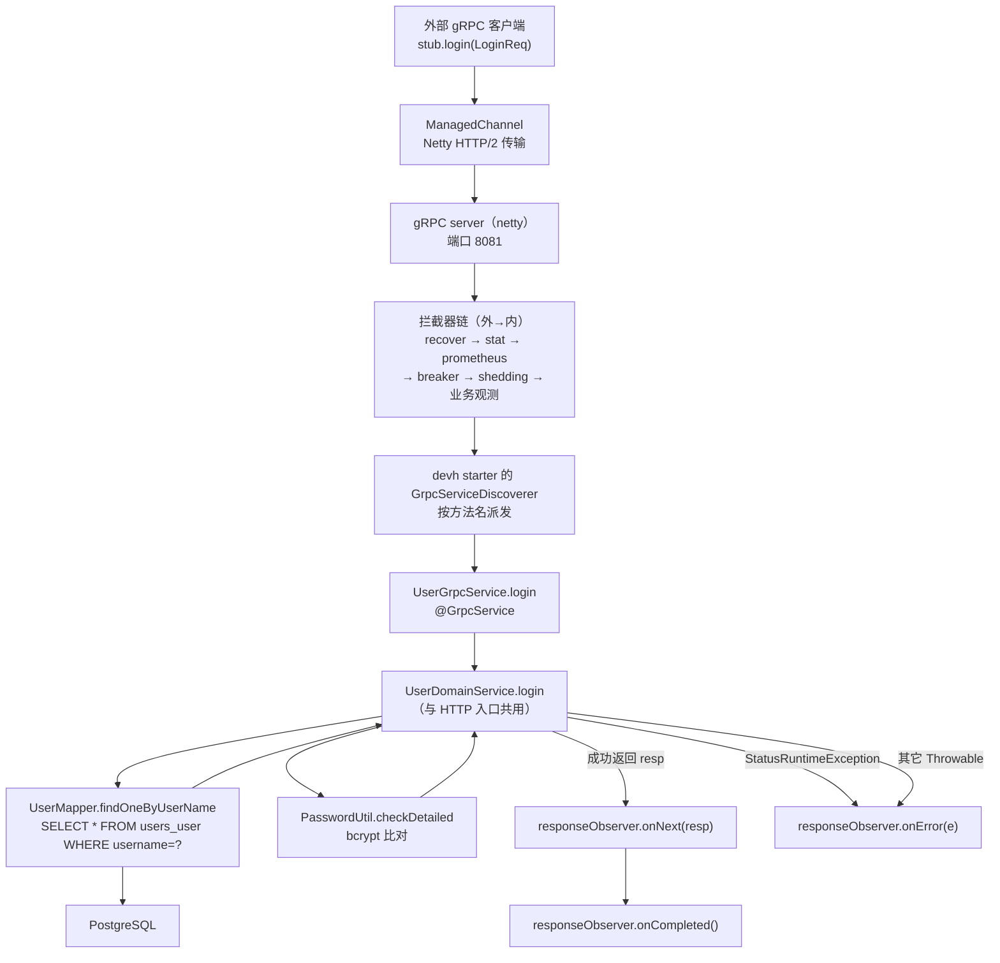
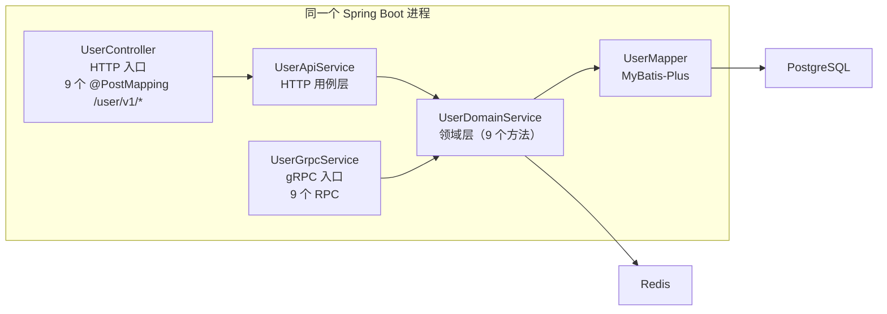
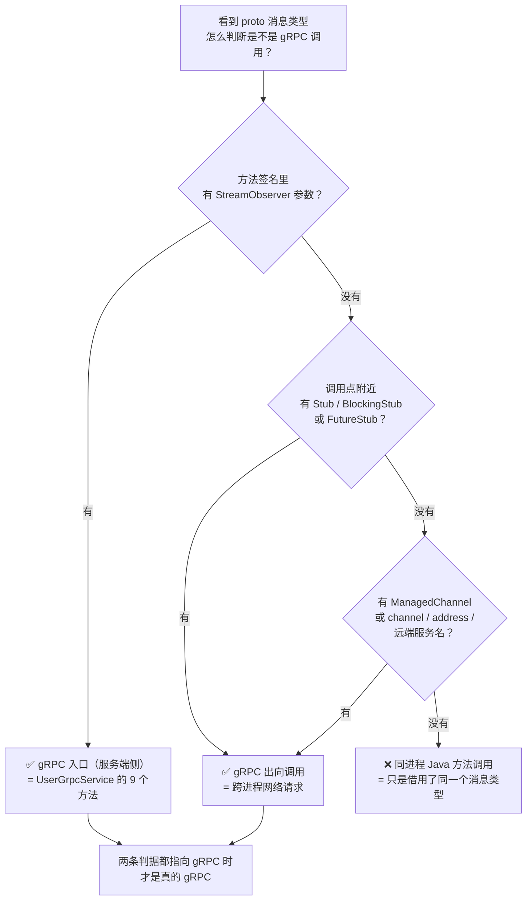
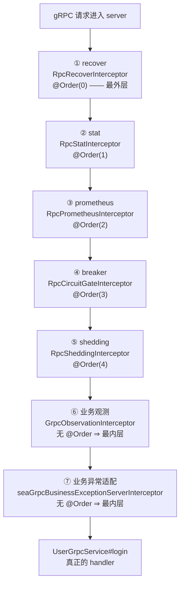
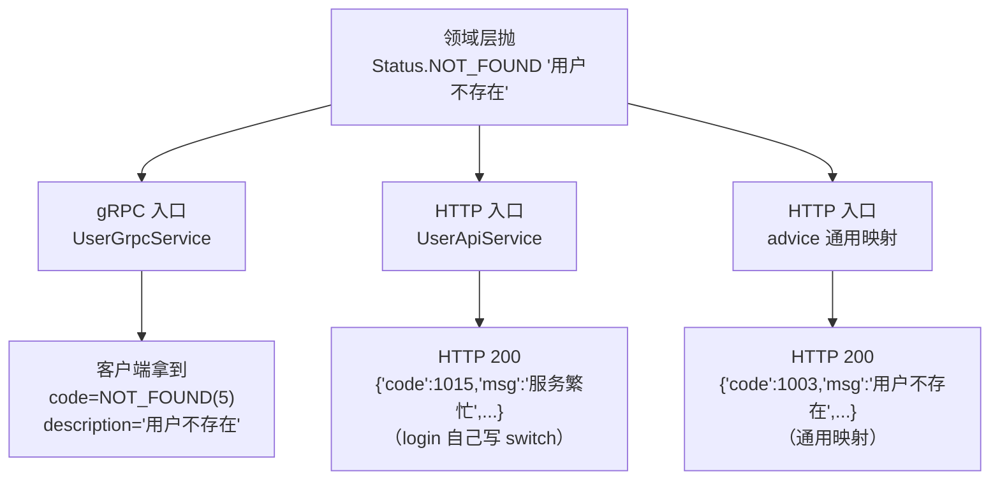

# 12. gRPC 用户服务流程

> 本篇讲的是：**换一个入口**（不是 HTTP，而是 gRPC），同一份 `UserDomainService` 会怎么被调用、
> 抛出的错误会变成什么形状、以及「proto 消息类型」到底意味着什么。

---

## 1. 本次流程的研究范围

### 1.1 我们要追踪什么

假设有一个**外部 gRPC 客户端**（不是本进程内的代码）调用 `UserService.Login`：

```
grpcurl -plaintext -d '{"username":"alice","password":"123456"}' \
        -import-path proto/src/main/proto -proto users.proto \
        localhost:8081 user.UserService/Login
```

本次追踪：从这个请求**进入本进程的 gRPC server**，一直到**客户端收到响应或错误**为止。

具体覆盖：

| 覆盖 | 内容 |
|---|---|
| ✅ 入口装配 | gRPC server 是谁起的、`@GrpcService` 是怎么被发现的、请求怎么被派发到 `UserGrpcService#login` |
| ✅ 拦截器链 | 共享层挂在 gRPC server 上的 6 层拦截器，各自做了什么 |
| ✅ 入口方法体 | `UserGrpcService#login` 的三段式（try / catch `StatusRuntimeException` / catch `Throwable`） |
| ✅ 领域层 | `UserDomainService` 9 个方法在 gRPC 入口下的真实执行（DB / Redis / Snowflake / bcrypt） |
| ✅ 错误形态 | 同一个领域错误，在 gRPC 侧与 HTTP 侧分别长什么样（**本篇最值得看的对比**） |
| ✅ deadline | deadline 的载体在哪、谁负责绑定、`DEADLINE_EXCEEDED` 为什么活下来 |

### 1.2 我们**不**追踪什么

| 不追踪 | 原因 |
|---|---|
| protobuf 的线格式编码（varint / tag / length-delimited） | 属于 protobuf 库内部，与本仓业务代码无关 |
| grpc-java 的 Netty 传输层（HTTP/2 帧、HPACK、流控） | 属于 grpc-java 内部 |
| MyBatis-Plus 如何拼 SQL | 属于持久层专题；本篇只说「发出哪条 SQL、查哪张表」 |
| HTTP 入口的完整流程 | 见 [01-用户登录流程.md](./01-用户登录流程.md) §6（领域层三态）、[11-HTTP统一响应与异常处理流程.md](./11-HTTP统一响应与异常处理流程.md) §4（两套映射的落点） |

### 1.3 先记住三条结论（后面会逐条兑现）

1. **本进程同时有两扇门**：`UserController`（HTTP）和 `UserGrpcService`（gRPC），
   两扇门后面是**同一份** `UserDomainService`。
2. **proto 消息类型 ≠ gRPC 调用**。`UserApiService` 也用 proto 消息当参数，但那是**同进程 Java 方法调用**。
3. **同一份领域代码，两种入口的对外错误形态不同**：gRPC 侧带出原始 `Status` code + description，
   HTTP 侧翻译成业务码（`code` 字段，HTTP 状态码仍是 200）。

---

## 2. 触发场景与输入

### 2.1 一次 `UserService.Login` 调用

**服务端地址**（`service/users/user/src/main/resources/application.yml:82-86`）：

```yaml
grpc:
  server:
    port: ${USER_GRPC_PORT:8081}
    address: 0.0.0.0
    reflection-service-enabled: false
```

⇒ 默认监听 `0.0.0.0:8081`（`reflection-service-enabled: false` ⇒ 反射服务没开 ⇒ `grpcurl` 必须带 `-import-path` + `-proto`）。

**请求消息**（`proto/src/main/proto/users.proto:40-43`）：

```proto
message LoginReq {
  string username = 1;
  string password = 2;
}
```

**客户端发出的内容**（proto3 + JSON 编码时）：

```json
{
  "username": "alice",
  "password": "123456"
}
```

**服务端要回的**（`users.proto:45-48`）：

```proto
message LoginResp {
  int64 uid = 1;
  uint64 status = 2;
}
```

⚠️ 注意 `LoginResp.status` 不是「HTTP 状态码」，也不是 gRPC 的 `Status.Code`，
它是**业务三态**：`0` = 成功 / `1` = 用户名错或密码错 / `2` = 被封禁。

### 2.2 这 9 个 RPC 长什么样

`proto/src/main/proto/users.proto:118-128`：

```proto
service UserService {
  rpc GetUser(GetUserReq) returns (GetUserResp);
  rpc Register(CreateUserReq) returns (CreateUserResp);
  rpc Login(LoginReq) returns (LoginResp);
  rpc Logout(LogoutReq) returns (LogoutResp);
  rpc UpdateUser(UpdateUserReq) returns (UpdateUserResp);
  rpc UploadAvatar(UploadAvatarReq) returns (UploadAvatarResp);
  rpc GetAvatarHistory(GetAvatarHistoryReq) returns (GetAvatarHistoryResp);
  rpc SelectAvatar(SelectAvatarReq) returns (SelectAvatarResp);
  rpc DeleteUser(DeleteUserReq) returns (DeleteUserResp);
}
```

**全部是 unary（一元）RPC**：一个请求 → 一个响应。
「一元」这件事在 Java 侧的形状就是：**方法签名末尾有一个 `StreamObserver` 参数**，
服务端对它调 `onNext`（发数据）+ `onCompleted`（发结束）或 `onError`（发错误）。

---

## 3. 整体执行路线



**这张图省略了什么**：

- 拦截器链内部每层各自的动作（见 §4.4.2）；
- 领域层内部的 4 个工作步骤（W1 查用户 / W2 密码 / W3 封禁 / W4 成功，见 §4.6）；
- 异常路径的完整分支（见 §5）。

---

## 4. 逐步讲解

### 4.1 第一步：先看契约 —— proto 是「复制粘贴」来的，不是翻译的

`proto/src/main/proto/users.proto` 的头部：

```proto
syntax = "proto3";

package user;

option java_package = "com.rag.proto.user";
option java_multiple_files = true;
```

这里有 4 个事实要分清：

| 事实 | 含义 |
|---|---|
| `package user;` | **proto 包名** ⇒ gRPC 的服务全名空间是 `user.UserService` |
| `option java_package = "com.rag.proto.user";` | **Java 生成代码的包名**（与 proto 包名**不是一回事**） |
| `option java_multiple_files = true;` | 每个 `message` 单独一个 `.java` 文件，而不是全塞进一个 `OuterClass` |
| `java_outer_classname` 未显式写 | ⇒ 生成的 service 类名由 **`service` 名字 + `Grpc`** 推导 ⇒ `UserServiceGrpc` |

生成物落在**根级 `proto/` 模块**（`service/users/user/pom.xml:110-112` 依赖 `com.rag:proto`），
不是 user 域的模块里。Java 侧引用的就是生成出来的：

```java
import com.rag.proto.user.LoginReq;
import com.rag.proto.user.LoginResp;
import com.rag.proto.user.UserServiceGrpc;
```

⚠️ **`package user;` 与 `java_package` 的分工**（很容易看错）：

- `package user;` 决定 **wire 上**的方法全路径（`/user.UserService/Login`）⇒ 这是**跨语言契约**，
  Go 客户端、Java 客户端、Python 客户端都必须一致。
- `java_package` 只决定 **Java 代码里 import 的包名** ⇒ 改成什么都**不影响 wire**。

⇒ 所以「pb 包名是 `com.rag.proto.user`」是**纯表达层**；改它不需要动任何客户端。

### 4.2 第二步（最关键）：这个进程里有两扇门，后面是同一份代码

本仓的 user 域是 **api + rpc 合并后的单一进程**（决策 D1 + D7：真源 B 侧是 `user-api` / `user-rpc` 两个进程）。
合并之后，**同一份领域实现被两个入口共用**：



**这张图是本篇的核心结论。** 三条推论：

1. **领域层不知道自己被谁调用**。`UserDomainService` 里没有一句 `if (是 HTTP)`。
   它只管抛 `io.grpc.Status` 异常、返回 proto 消息。
2. **入口层负责「翻译」**。HTTP 侧由 `UserApiService` + `UserApiExceptionHandler` 翻译；
   gRPC 侧由 `UserGrpcService` 翻译（翻译得**少得多**，见 §4.7）。
3. **所以「同一个 bug 在两个入口表现不同」是完全可能的** —— 这不是玄学，是两个翻译层不同。

### 4.3 第三步：`proto` 消息类型**不等于** gRPC 调用（本文最重要的一节）

#### 4.3.1 一个真实的混淆点

HTTP 侧的 `UserApiService#login`（`service/users/user/src/main/java/com/rag/user/service/UserApiService.java:100-124`）：

```java
public LoginResp login(com.rag.user.dto.auth.LoginReq req, HttpServletRequest httpRequest) {
    com.rag.proto.user.LoginReq rpcReq = com.rag.proto.user.LoginReq.newBuilder()
            .setUsername(req.username() == null ? "" : req.username())
            .setPassword(req.password() == null ? "" : req.password())
            .build();

    com.rag.proto.user.LoginResp rpcResp;
    try {
        rpcResp = userDomainService.login(rpcReq);
    } catch (StatusRuntimeException e) {
        ...
    }
```

变量名叫 `rpcReq`，类型是 proto 生成的消息，领域层方法还返回 proto 消息 ——
**看起来像是走了一次 gRPC**。

**但它不是。** 这一行：

```java
rpcResp = userDomainService.login(rpcReq);
```

是**同一个 Spring 容器里两个 Java 对象之间的方法调用**。没有序列化，没有 socket，没有网络。

#### 4.3.2 判据：四个「有 / 没有」



把判据套到本仓两个真实调用点上：

| 判据 | `UserApiService#login` → 领域层 | `UserGrpcService#login`（被 starter 调用） |
|---|---|---|
| 方法签名有 `StreamObserver`？ | ❌ 没有 | ✅ **有**：`login(LoginReq, StreamObserver<LoginResp>)` |
| 有 Stub（`newBlockingStub(...)`）？ | ❌ 没有 | ✅ 有（客户端侧才有，本仓的**测试**里用了） |
| 有 `ManagedChannel`？ | ❌ 没有 | ✅ 有（客户端侧） |
| 有端口 / 地址 / 远端服务名？ | ❌ 没有 | ✅ 有：`grpc.server.port` = 8081、`user-rpc` |
| **结论** | **同进程 Java 调用** | **真 gRPC 网络调用** |

#### 4.3.3 为什么这个区分值得花一节

因为它决定了你**怎么排障**：

- 如果是 `UserApiService` 那一侧出问题 ⇒ 查**进程内**的对象状态、Spring Bean、SQL；
- 如果是 gRPC 那一侧出问题 ⇒ 还要查**网络**：端口通不通、channel 建没建上、拦截器链挂没挂上。

把两者混为一谈，最典型的症状是「我改了 `UserDomainService` 的代码，HTTP 生效了但 gRPC 没生效」——
其实往往是**两端走的是不同版本的进程**，或者**只重启了 HTTP 那一侧的调用方**。

### 4.4 第四步：请求怎么进入 `UserGrpcService#login`

这一段全是 **框架机制**，但初学者最容易在这里卡住，所以逐层拆。

#### 4.4.1 gRPC server 是谁起的？—— `@GrpcService` + starter

`service/users/user/src/main/java/com/rag/user/grpc/UserGrpcService.java:86-95`：

```java
@GrpcService
public class UserGrpcService extends UserServiceGrpc.UserServiceImplBase {

    private static final Logger log = LoggerFactory.getLogger(UserGrpcService.class);

    private final UserDomainService userDomainService;

    public UserGrpcService(UserDomainService userDomainService) {
        this.userDomainService = userDomainService;
    }
```

三个要点：

1. **`@GrpcService`**（`net.devh.boot.grpc.server.service.GrpcService`）是 devh starter 的标记注解。
   starter 的 `GrpcServiceDiscoverer` 扫描容器里带这个注解的 Bean ⇒ 把它的
   `bindService()` 注册进 gRPC server 的 service registry。
2. **`extends UserServiceGrpc.UserServiceImplBase`** 是 protobuf 生成的抽象基类，
   里面声明了 9 个抽象方法 + 一个 `bindService()`（把方法名映射到实现）。
   ⇒ 所以本类里 9 个方法都带 `@Override`。
3. **构造器注入 `UserDomainService`** ⇒ `UserGrpcService` 是一个普通 Spring Bean，
   领域层是它的一个字段 ⇒ 调用 `userDomainService.login(request)` 就是**字段上的方法调用**。

依赖侧（`service/users/user/pom.xml:86-103`）：

```xml
<dependency>
    <groupId>net.devh</groupId><artifactId>grpc-server-spring-boot-starter</artifactId>
    <exclusions>
        <exclusion>
            <groupId>io.grpc</groupId>
            <artifactId>grpc-core</artifactId>
        </exclusion>
    </exclusions>
</dependency>
```

⚠️ `grpc-core` 被 **exclude** 掉了 ⇒ 版本统一由根 pom 的 `grpc.version`（1.63.0）管。
这样做的原因写在 pom 注释里：devh starter 会拖自己的 `grpc-core` ⇒ 版本会漂。

#### 4.4.2 中间还有一条 6 层的拦截器链

**devh starter 只认 `GrpcServerConfigurer`** —— 只往容器里扔一个 `ServerInterceptor` Bean 是**没用的**，
因为 starter 不会自动把它挂到 server 上。真正的挂载点在共享层：

`common/src/main/java/com/rag/common/autoconfigure/ProtectionAutoConfiguration.java:230-243`：

```java
@Bean
@ConditionalOnClass(name = "net.devh.boot.grpc.server.serverfactory.GrpcServerConfigurer")
@ConditionalOnMissingBean(name = "seaGrpcServerConfigurer")
public net.devh.boot.grpc.server.serverfactory.GrpcServerConfigurer seaGrpcServerConfigurer(
        ObjectProvider<ServerInterceptor> interceptors) {
    return server -> {
        List<ServerInterceptor> ordered = interceptors.orderedStream().toList();
        ServerInterceptor chain = RpcProtectionChain.compose(ordered);
        if (chain != null) {
            server.intercept(chain);
        }
    };
}
```

⇒ 容器里**全部** `ServerInterceptor` Bean 被收集、按 `@Order` 排序、拼成**一条**链。

链序（`ProtectionAutoConfiguration.java:263-267` 的常量 + `RpcProtectionChain.compose`）：



每层各做什么（**只讲和本流程有关的**）：

| 层 | 在本流程里做什么 |
|---|---|
| ① recover | 兜住 handler 里的 `Error`（如 `StackOverflowError`）⇒ 以 `INTERNAL + "panic: …"` 关闭调用；**进程存活** |
| ② stat | 在 `close()` 时喂一条耗时样本给进程内聚合器（每 60s 打一行统计日志） |
| ③ prometheus | 在 `close()` 时记一条耗时分布 + 一条状态码计数（`rpc_server_requests_duration_ms` / `rpc_server_requests_code`） |
| ④ breaker | 熔断：连续失败超阈值 ⇒ 直接 `UNAVAILABLE + "circuit breaker is open"`，**不进 handler** |
| ⑤ shedding | CPU 自适应降载 ⇒ `RESOURCE_EXHAUSTED + "service overloaded"`，**不进 handler**。⚠️ 它关的是**本层包装过的** call（`RpcSheddingInterceptor.java:245`）⇒ 外层 breaker 的 close 观察点**会被触发** ⇒ **持续降载最终会把熔断器打开** |
| ⑥ 业务观测 | 起一个 Observation；并按 `observability.rpc-timeout`（本域 = **2s**）调度一个超时任务 |
| ⑦ 业务异常适配 | 只在 status 的 cause 是 `BusinessException` 时改写 status（user 域**没有**这条路径，见下） |

⚠️ 两个容易看错的点：

- **③ prometheus 在 ④⑤ 的外面**。所以被熔断/降载拒绝的请求**也会**被记一条指标
  （B 侧同形）。若把 prometheus 放到里面，这两类请求在指标里会**整个消失**。
- **⑥ 与 ⑦ 都没有 `@Order`** ⇒ 都落在 `Ordered.LOWEST_PRECEDENCE` ⇒
  **两者之间的相对先后，源码无法确认**（`orderedStream()` 对同序 Bean 只保证稳定，不保证语义序）。

关于 ⑦：`GrpcExceptionMapperAutoConfiguration` 提供的这个拦截器，业务上是给**跨域 gRPC 调用**
准备的（B 侧把业务码当 status code 用，grpc-java 承载不了 ⇒ 降级成 trailer `sea-biz-code`）。
**user 域的 `UserGrpcService` 抛的是 `io.grpc.Status`，不是 `BusinessException`** ⇒
这一层在本流程里**不产生任何改写**（`businessExceptionOf(status)` 返回 `null` ⇒ 原样 `super.close`）。

#### 4.4.3 starter 怎么把「方法名」派发到 `login`

protobuf 生成的 `UserServiceGrpc` 内部有一张方法表：

| 方法全路径 | Java 方法名 |
|---|---|
| `/user.UserService/GetUser` | `getUser` |
| `/user.UserService/Register` | `register` |
| `/user.UserService/Login` | `login` |
| `/user.UserService/Logout` | `logout` |
| `/user.UserService/UpdateUser` | `updateUser` |
| `/user.UserService/UploadAvatar` | `uploadAvatar` |
| `/user.UserService/GetAvatarHistory` | `getAvatarHistory` |
| `/user.UserService/SelectAvatar` | `selectAvatar` |
| `/user.UserService/DeleteUser` | `deleteUser` |

⚠️ 「方法全路径」是 **gRPC 的命名规则**（框架机制）：
`/{proto package}.{service 名}/{method 名}`。本域 proto package 是 `user` ⇒ 前缀 `/user.UserService/`。
这与 `java_package` **无关**。

派发发生在 **grpc-java 的 `Listener#onHalfClose()`** 里 —— 这是理解后面几节的关键：

- `onHalfClose` = 「客户端把请求这一半发完了」⇒ 服务端在这里跑 handler。
- ⇒ 所以「handler 到底跑在哪个线程、什么时候跑」这件事，是 `onHalfClose` 决定的。
- `RpcRecoverInterceptor` / `RpcStatInterceptor` / `RpcPrometheusInterceptor` **都特意包了 `onHalfClose`**，
  正是因为「只包 `startCall` 的话，handler 里的 panic 一条都兜不住」。

### 4.5 第五步：`UserGrpcService#login` 的三段式

`service/users/user/src/main/java/com/rag/user/grpc/UserGrpcService.java:97-112`：

```java
@Override
public void login(LoginReq request, StreamObserver<LoginResp> responseObserver) {
    try {
        LoginResp resp = userDomainService.login(request);
        responseObserver.onNext(resp);
        responseObserver.onCompleted();
    } catch (StatusRuntimeException e) {
        log.error("login RPC failed: {}", e.getStatus(), e);
        responseObserver.onError(e);
    } catch (Throwable t) {
        log.error("login RPC failed with unmapped throwable", t);
        responseObserver.onError(Status.INTERNAL
                .withDescription(t.getClass().getSimpleName() + ": " + t.getMessage())
                .asRuntimeException());
    }
}
```

**9 个方法全是这 3 段**（`register` 115-129、`logout` 131-146、`getUser` 148-163、
`updateUser` 165-180、`deleteUser` 182-197、`selectAvatar` 199-214、`uploadAvatar` 216-231、
`getAvatarHistory` 233-248）—— 只有方法名和消息类型不同。

逐条解释：

| 段 | 做什么 | 为什么 |
|---|---|---|
| `try { ... }` | 调领域层 | 领域层是**同步**的（没有 `@Async`）⇒ 这里就是一次普通方法调用 |
| `responseObserver.onNext(resp)` | 把响应消息推给客户端 | unary RPC 只推**一个**消息 |
| `responseObserver.onCompleted()` | 告诉客户端「正常结束」 | 对应 gRPC 的 ` trailers: grpc-status: 0` |
| `catch (StatusRuntimeException e)` → `onError(e)` | **原样**把异常交给 gRPC | 领域层已经把「业务失败」表达成 `Status` 了 ⇒ 这里**一个字都不改** |
| `catch (Throwable t)` → `onError(INTERNAL + "类名: 消息")` | 兜底收敛 | 没被映射的异常 ⇒ 统一成 `INTERNAL`，description = `t.getClass().getSimpleName() + ": " + t.getMessage()` |

⚠️ **第二层 catch 为什么不能省**（类注释里写明了 B 侧的 DRIFT-02）：

- grpc-java 在 handler 抛出**非** `StatusException` 的异常时，会把它包成 `UNKNOWN` 发给客户端。
- 有了第二层 catch ⇒ 客户端拿到的是 `INTERNAL`（13），description 里有类型名和消息；
- 少了它 ⇒ 客户端拿到 `UNKNOWN`（2），description 为 `null` ⇒ **状态码退化**。

⇒ 这一层是**可观察契约**，不是防御性冗余。

⚠️ 还有一个细节：`onNext` / `onCompleted` 之后**没有** `try-catch` 包裹的兜底。
如果 `onNext` 自己抛（比如客户端已断开），异常会从 `try` 块里**逃出去** ⇒ 落到 recover 层。

### 4.6 第六步：领域层真的做了什么

`UserDomainService#login`（`service/users/user/src/main/java/com/rag/user/domain/service/UserDomainService.java:161-241`）
在 gRPC 入口下的执行（省略了日志与指标埋点）：

```java
public LoginResp login(LoginReq req) {
    Span span = tracer.spanBuilder("Action-User-Login")
            .setAttribute("biz.username", req.getUsername())
            .startSpan();
    Context otelCtx = Context.current().with(span);
    try {
        checkDeadline();
        // W1 查用户
        UserEntity user;
        try {
            checkDeadline();
            user = userMapper.findOneByUserName(req.getUsername());
        } catch (NotFoundException e) {
            metrics.getLoginUserNotFound().increment();
            logger.logInfo(otelCtx, "login failed : user not found,username : " + req.getUsername());
            return LoginResp.newBuilder().setStatus(1L).build();
        } catch (StatusRuntimeException e) {
            // B-1：DEADLINE_EXCEEDED 必须上抛，不能掉进下面的 db_error 分支被改写成 INTERNAL。
            throw e;
        } catch (Exception e) {
            metrics.getLoginDbError().increment();
            span.recordException(e);
            logger.logBusinessErr(otelCtx, ErrCodes.ERROR_DB_SELECT, e);
            throw Status.INTERNAL.withDescription("DB查询失败").asRuntimeException();
        }

        // W2 密码比对
        checkDeadline();
        PasswordUtil.Outcome pwOutcome =
                PasswordUtil.checkDetailed(req.getPassword(), user.getPassword());
        if (pwOutcome != PasswordUtil.Outcome.MATCHED) {
            ...
            return LoginResp.newBuilder().setStatus(1L).build();
        }

        // W3 封禁检查
        if (user.getStatus() != null && user.getStatus() == 1L) {
            ...
            return LoginResp.newBuilder().setStatus(2L).build();
        }

        // W4 成功
        metrics.getLoginSuccess().increment();
        logger.logInfo(otelCtx, "login success,username : " + req.getUsername());
        return LoginResp.newBuilder()
                .setUid(user.getUid())
                .setStatus(0L)
                .build();
    } finally {
        span.end();
    }
}
```

**W1 的 SQL**（`service/users/user/src/main/java/com/rag/user/mapper/UserMapper.java:40-59`）：

```java
@Select("SELECT * FROM users_user WHERE username = #{username} LIMIT 1")
@Results({
        @Result(property = "extraInfo", column = "extra_info",
                javaType = java.util.Map.class, typeHandler = JsonTextTypeHandler.class)
})
UserEntity selectByUsernameRaw(@Param("username") String username);

default UserEntity findOneByUserName(String username) {
    UserEntity u = selectByUsernameRaw(username);
    if (u == null) {
        throw new NotFoundException("user not found by username: " + username);
    }
    return u;
}
```

要点：

- **`@Results` 里那个 `typeHandler` 不能省**：手写 `@Select` 不认 MyBatis-Plus 的 `@TableField`，
  不显式声明 ⇒ `extra_info`（TEXT 列）会**静默变成 null**，**不报错**。
- **「找不到」是 error 不是值**：`findOneByUserName` 是 Mapper 接口里的 `default` 方法，
  查不到直接抛 `NotFoundException` ⇒ 上层不用各自判 `null`。
- `NotFoundException` 是**本域自定义**的普通异常（`com.rag.user.exception.UserExceptions.NotFoundException`），
  **不是** gRPC 的 `StatusRuntimeException` ⇒ 它必须被领域层翻译成 `Status` 才能出去。

**W2 的 bcrypt 比对**：`PasswordUtil.checkDetailed(明文, 库里的哈希)` 返回一个 `Outcome`
（`MATCHED` / 不匹配 / `MALFORMED_HASH`）。不是字符串比较。

**W3 的封禁判断**：`user.getStatus() == 1L` ⇒ 封禁。
⚠️ `user.getStatus() != null` 这一半**恒为真**（`UserEntity.status` 初始化为 `0L`，
MyBatis 默认 `callSettersOnNulls=false` ⇒ DB 里是 NULL 时 setter 被跳过 ⇒ 读出来是 `0L` 而非 `null`）。
这是刻意保留的写法（类注释里专门写了三条理由），不要"顺手改成 `!= null` 判断"。

**三态返回**：注意 `status=1` / `status=2` 都是**正常的返回值**，不是异常 ⇒
**gRPC 客户端拿到的是 `Status.Code.OK`**，业务失败信息在 `LoginResp.status` 里。

### 4.7 第七步（重点）：同一个领域错误，两种入口长什么样

这是本篇**最值得看**的一节。

#### 4.7.1 gRPC 侧：原样带出

领域层抛的每一个 `Status`，在 gRPC 侧**一个字都不改**：

| 领域层抛出的 | gRPC 客户端看到 |
|---|---|
| `Status.NOT_FOUND.withDescription("用户不存在")` | `StatusRuntimeException`：code = `NOT_FOUND`(5)，description = `"用户不存在"` |
| `Status.INTERNAL.withDescription("DB查询失败")` | code = `INTERNAL`(13)，description = `"DB查询失败"` |
| `Status.ALREADY_EXISTS.withDescription("用户名已存在")` | code = `ALREADY_EXISTS`(6)，description = `"用户名已存在"` |
| `Status.INVALID_ARGUMENT.withDescription("history_id is required")` | code = `INVALID_ARGUMENT`(3)，description = `"history_id is required"` |
| `Status.DEADLINE_EXCEEDED.withDescription("rpc deadline reached")` | code = `DEADLINE_EXCEEDED`(4)，description = `"rpc deadline reached"` |
| 未映射异常（如 `IllegalStateException("boom")`） | code = `INTERNAL`(13)，description = `"IllegalStateException: boom"` |

#### 4.7.2 HTTP 侧：翻译成业务码

HTTP 侧的**两套映射并存**：

**① 端点自己写的 switch**（6 个端点：`login` / `logout` / `selectAvatar` …）：

```java
// UserApiService#login:109-124
} catch (StatusRuntimeException e) {
    metrics.getLoginRpcError().increment();
    log.error("login RPC error, username={}", req.username(), e);
    io.grpc.Status.Code code = e.getStatus().getCode();
    if (code == io.grpc.Status.Code.INTERNAL) {
        throw new BusinessException(
                ErrCodes.ERROR_SERVER_COMMON,      // 5001
                ErrMsg.getMsg(ErrCodes.ERROR_SERVER_COMMON));
    }
    throw new BusinessException(
            ErrCodes.CODE_SERVER_BUSY,            // 1015
            ErrMsg.getMsg(ErrCodes.CODE_SERVER_BUSY));
}
```

**② advice 层的通用映射**（`advice/UserApiExceptionHandler.java:116-130`）：

```java
private int mapRPCStatusToCode(Status.Code code) {
    if (code == Status.Code.INTERNAL) {
        return ErrCodes.ERROR_SERVER_COMMON;   // 5001
    }
    if (code == Status.Code.NOT_FOUND) {
        return ErrCodes.ERROR_USER_NOT_EXIST;   // 1003
    }
    if (code == Status.Code.ALREADY_EXISTS) {
        return ErrCodes.ERROR_USER_EXIST;       // 1001
    }
    if (code == Status.Code.INVALID_ARGUMENT) {
        return ErrCodes.ERROR;                  // 500
    }
    return ErrCodes.CODE_SERVER_BUSY;           // 1015（default）
}
```

⚠️ **哪些端点走哪一套**（源码明确）：

| 端点 | 处理方式 | 后果 |
|---|---|---|
| `login` | **自己写 switch**：INTERNAL → 5001；其它 → 1015 | `DEADLINE_EXCEEDED` 落 **1015** |
| `logout` | **自己写 switch**：INTERNAL → 5001；其它 → 1015 | `INVALID_ARGUMENT` 也落 **1015**（**不是** 500） |
| `selectAvatar` | **自己写 switch**：`NOT_FOUND`/`INVALID_ARGUMENT` → 500；其它原样上抛 | `NOT_FOUND` 落 **500**（**不是** 1003） |
| `register` / `getUser` / `updateUser` / `deleteUser` / `uploadAvatar` / `getAvatarHistory` | **原样上抛** ⇒ advice 通用映射 | `NOT_FOUND` → 1003、`ALREADY_EXISTS` → 1001、`INVALID_ARGUMENT` → 500、其它 → 1015 |

#### 4.7.3 对照图



#### 4.7.4 为什么 HTTP 侧永远是 200

`advice/UserApiExceptionHandler.java:91-102`：

```java
@ExceptionHandler(StatusRuntimeException.class)
public ResponseEntity<ApiResponse> handleRPC(StatusRuntimeException e) {
    Status.Code code = e.getStatus().getCode();
    int businessCode = mapRPCStatusToCode(code);
    String msg = ErrMsg.getMsg(businessCode);
    ...
    return ResponseEntity.status(HttpStatus.OK).body(new ApiResponse(businessCode, msg, null));
}
```

⇒ **HTTP 状态码恒为 200**，业务成败靠 body 里的 `code` 表达。
（`decideStatus(int)` 也恒返回 `HttpStatus.OK`，见同文件 `:269-271`。）

⇒ **同一份领域代码**：
- gRPC 客户端看到「gRPC 语义」：可枚举的 `Status.Code` + 自由文本 description；
- HTTP 客户端看到「业务语义」：`1003` / `1015` / `5001` / `500` + 固定文案。

### 4.8 第八步：deadline 从哪来

#### 4.8.1 领域层怎么用 deadline

`UserDomainService.java:140-146`：

```java
private void checkDeadline() {
    if (Thread.currentThread().isInterrupted() || DeadlineState.isExpired()) {
        throw Status.DEADLINE_EXCEEDED
                .withDescription("rpc deadline reached")
                .asRuntimeException();
    }
}
```

**调用点**（全仓共 **10 处**，逐个核对过行号）：

| 领域方法 | `checkDeadline()` 的行号 | 次数 |
|---|---|---|
| `login` | `:167`（进方法）、`:171`（W1 查用户前）、`:199`（W2 密码前） | **3** |
| `register` | `:262`（进方法，**在 try 之前**） | 1 |
| `getUser` | `:365` | 1 |
| `updateUser` | `:426` | 1 |
| `deleteUser` | `:544` | 1 |
| `selectAvatar` | `:597` | 1 |
| `uploadAvatar` | `:647` | 1 |
| `getAvatarHistory` | `:710` | 1 |
| `logout` | **无** | **0** |

⚠️ **两个容易看错的细节**：

1. **只有 `login` 是「每个业务步骤前都查」**（3 次）。其余 7 个方法都只在**入口查一次**
   ⇒ 类注释里那句「每次业务步骤前 checkDeadline」（D-018）**只对 `login` 成立**。
2. **`logout` 入口不设 deadline 闸门** —— 领域层注释明说「入口**不设** deadline 闸门 … 是「让写去失败」不是「入口拒」」。

#### 4.8.2 载体是什么

`common/src/main/java/com/rag/common/observability/DeadlineState.java`：

```java
private static final ThreadLocal<Long> DEADLINE_NANOS = new ThreadLocal<>();   // :62

public static boolean isExpired() {                                              // :110
    Long d = DEADLINE_NANOS.get();
    // 用减法而不是 now >= d：单调钟会回绕（292 年）⇒ 差值法仍正确
    return d != null && monotonicNanos.getAsLong() - d >= 0;
}

public static Scope bindRemainingNanos(long remainingNanos) {                  // :169
    long now = monotonicNanos.getAsLong();
    DEADLINE_NANOS.set(
            (remainingNanos == Long.MAX_VALUE || remainingNanos > Long.MAX_VALUE - now)
                    ? Long.MAX_VALUE
                    : now + remainingNanos);
    return () -> DEADLINE_NANOS.remove();
}
```

三个设计点：

| 点 | 说明 |
|---|---|
| **载体是 `ThreadLocal`** | ⇒ 只能在**真正跑 handler 的那个线程**上读得到。设在别的线程上对 handler 不可见。 |
| **存的是单调钟纳秒的绝对到期时刻** | ⇒ 不受 NTP 校正 / 改系统时间影响；也避免了毫秒截断 |
| **未绑定时 `isExpired()` 恒为 `false`** | ⇒ **no-op**（类注释与 `UserDomainService` 的注释都写了这一点） |

`bindToCurrent(long epochMillis)`（`:154-157`）是**兼容入口**：入参仍是墙钟 epoch 毫秒
（在绑定瞬间换算成剩余预算），新代码用 `bindRemainingNanos`。

#### 4.8.3 谁来绑定？—— 本仓现状要说清楚

`DeadlineState` 的类注释里写着绑定点：

> 实际生效路径：`{@link #newUnaryServerInterceptor}` 的 `onHalfClose` 在**真正跑 handler 的线程**上
> `{@link #bindToCurrent(long)}`（M7 修复）。

⚠️ **但 `newUnaryServerInterceptor` 这个类在本仓不存在**。全仓 grep 的结果：

- `DeadlineState.bindRemainingNanos(...)` 的**生产调用点只有一处**：
  `common/src/main/java/com/rag/common/observability/RpcHandleRunner.java:121` ——
  「非 gRPC Server 场景下的业务调用入口」，把业务扔到独立线程跑、给那个 worker 线程绑预算。
- 而 `RpcHandleRunner.handle(...)` 在本仓**只有测试在调用**（`common/src/test/.../RpcHandleRunnerTest.java`），
  **没有生产调用方**。
- gRPC 服务端那 6 层拦截器里，**没有任何一层调用 `DeadlineState.bind*`**。

⇒ **结论（源码明确）**：在本仓当前的 gRPC 服务端路径上，**`DeadlineState` 从未被绑定**
⇒ `DeadlineState.isExpired()` 恒为 `false`
⇒ `checkDeadline()` 在 gRPC 路径上**实际只剩 `Thread.currentThread().isInterrupted()` 一条**会触发。

#### 4.8.4 那 gRPC 的 2 秒超时是谁做的

是**业务观测层**（`common/src/main/java/com/rag/common/autoconfigure/ObservabilityAutoConfiguration.java:293-301`）：

```java
private ScheduledFuture<?> scheduleTimeout(ServerCall<?, ?> call, Duration timeout) {
    if (timeout == null || timeout.isZero() || timeout.isNegative()) {
        return null;
    }
    return timeoutScheduler().schedule(
            () -> call.close(Status.DEADLINE_EXCEEDED
                    .withDescription("rpc deadline exceeded"), new Metadata()),
            timeout.toNanos(), TimeUnit.NANOSECONDS);
}
```

`timeout` 来自 `ObservabilityProperties#getRpcTimeout()`（`observability.rpc-timeout`），
本域 `application.yml:75-77` 写的是 **2s**。

⚠️ 这个超时**只关闭 call**，它：

- ✅ 让**客户端**看到 `DEADLINE_EXCEEDED`；
- ❌ **不**给 handler 线程绑 deadline；
- ❌ **不**中断 handler 线程（grpc-java 的 `ServerCall#close()` 无法取消已在跑的 handler）。

⇒ 所以「handler 还在跑，但客户端已经收到 DEADLINE_EXCEEDED」是本仓 gRPC 路径上**真实存在**的状态。
这正是 `RpcHandleRunner` 类注释里写的对比：

> gRPC 拦截器路径**没有**（真正打断业务线程）的能力（grpc-java 的 `ServerCall#close()` 无法取消已在跑的 handler）
> ⇒ 业务 handler 若要感知超时，gRPC 路径只能靠 `DeadlineState#isExpired()` 主动自查。

⇒ 两句话合起来：**本仓 gRPC 路径上，`DeadlineState.isExpired()` 恒 false（没绑），
而 `ServerCall#close()` 又打断不了业务线程** ⇒ **领域层的 `checkDeadline()` 在 gRPC 路径上基本不会触发**。

> 📌 这属于「源码明确」的事实陈述，不是推测：绑定点缺失是 grep 出来的；
> `close()` 打断不了 handler 是 grpc-java 的机制 + 本仓 `RpcHandleRunner` 类注释的自述。

### 4.9 第九步：`DEADLINE_EXCEEDED` 为什么不会被改写成 `INTERNAL`

这是 **catch 顺序** 决定的，不是运气。

领域层每个 DB 调用的写法（以 `login` 为例，`UserDomainService.java:179-196`）：

```java
} catch (NotFoundException e) {
    // 用户不存在 → Status=1（D-002：和密码错共用同一个状态码）
    metrics.getLoginUserNotFound().increment();
    logger.logInfo(otelCtx, "login failed : user not found,username : " + req.getUsername());
    return LoginResp.newBuilder().setStatus(1L).build();
} catch (StatusRuntimeException e) {
    // B-1：DEADLINE_EXCEEDED 必须上抛，不能掉进下面的 db_error 分支被改写成 INTERNAL。
    throw e;
} catch (Exception e) {
    metrics.getLoginDbError().increment();
    span.recordException(e);
    logger.logBusinessErr(otelCtx, ErrCodes.ERROR_DB_SELECT, e);
    throw Status.INTERNAL.withDescription("DB查询失败").asRuntimeException();
}
```

**Java 的 catch 匹配规则**：按书写顺序**逐个匹配**，第一个 `isInstance` 成立的分支胜出。

| 顺序 | catch 的类型 | 能接住什么 | 结果 |
|---|---|---|---|
| ① | `NotFoundException` | 用户不存在 | 转成 `status=1` 的正常返回 |
| ② | `StatusRuntimeException` | **所有 gRPC 状态异常**，含 `DEADLINE_EXCEEDED` | **原样上抛**（`throw e`） |
| ③ | `Exception` | 剩下的一切（含 DB 异常） | 改写成 `INTERNAL` + `"DB查询失败"` |

⚠️ **如果把 ② 删掉**：`StatusRuntimeException` 是 `RuntimeException` 的子类 ⇒ 会落进 ③
⇒ `DEADLINE_EXCEEDED` 会被改写成 `INTERNAL "DB查询失败"` ⇒
**客户端看到的是「数据库故障」，而真实原因是「超时」** ⇒ 排障方向完全错。

⇒ 这就是源码里 18 处同款 `catch (StatusRuntimeException e) { throw e; }` 的共同理由
（`UserDomainService` 类注释的「🔴 B-1 放行分支」段写明了依据）。

**再往上一层**，gRPC 侧 `UserGrpcService#login` 的 catch 顺序也是同一套逻辑：

```java
} catch (StatusRuntimeException e) {
    responseObserver.onError(e);          // 原样 ⇒ DEADLINE_EXCEEDED 活下来
} catch (Throwable t) {
    responseObserver.onError(Status.INTERNAL...);   // 兜底
}
```

⇒ **两层 catch 顺序一致** ⇒ `DEADLINE_EXCEEDED` 从领域层一路活到客户端。

⚠️ 但要区分「活下来」与「会发生」：按 §4.8.3/§4.8.4，在 gRPC 路径上
`checkDeadline()` 本身很难触发 ⇒ 客户端更可能看到的 `DEADLINE_EXCEEDED`
来自**业务观测层的 2s 超时**（description = `"rpc deadline exceeded"`），
而不是领域层那个（description = `"rpc deadline reached"`）。
**两个 description 不一样，可以据此区分来源。**

### 4.10 第十步：9 个 RPC 全表

| # | proto `rpc` | gRPC 全路径 | `UserGrpcService` 方法（行号） | 领域方法（行号） | 领域层「正常返回」 | 领域层「抛出的 Status」 | 副作用 |
|---|---|---|---|---|---|---|---|
| 1 | `GetUser` | `/user.UserService/GetUser` | `getUser`（:149） | `getUser`（:364） | `GetUserResp{user, found=true}` | `NOT_FOUND "用户不存在"` · `INTERNAL "DB查询失败"` | SELECT `users_user` |
| 2 | `Register` | `/user.UserService/Register` | `register`（:115） | `register`（:257） | `CreateUserResp{uid}` | `ALREADY_EXISTS "用户名已存在"` · `INTERNAL "DB查询失败" / "密码生成失败" / "uid生成失败" / "DB更新失败"` | INSERT `users_user` ＋ Snowflake ＋ bcrypt |
| 3 | `Login` | `/user.UserService/Login` | `login`（:98） | `login`（:161） | `LoginResp{uid, status=0/1/2}` | `INTERNAL "DB查询失败"` | SELECT `users_user` ＋ bcrypt |
| 4 | `Logout` | `/user.UserService/Logout` | `logout`（:132） | `logout`（:764） | `LogoutResp{success=false}` ⚠️ | `INVALID_ARGUMENT "Token不能为空"` · `INTERNAL "注销失败,Redis写入异常"` | Redis `SETEX user:jwt_blacklist:<token>` |
| 5 | `UpdateUser` | `/user.UserService/UpdateUser` | `updateUser`（:166） | `updateUser`（:425） | `UpdateUserResp{user}` | `ALREADY_EXISTS "用户名已存在"` · `NOT_FOUND "用户不存在"` · `INTERNAL "DB查询失败"/"密码生成失败"/"DB更新失败"` | UPDATE `users_user` ＋ bcrypt |
| 6 | `UploadAvatar` | `/user.UserService/UploadAvatar` | `uploadAvatar`（:217） | `uploadAvatar`（:646） | `UploadAvatarResp{avatar_url, history}` | `INVALID_ARGUMENT "avatar_url is required"` · `NOT_FOUND "用户不存在"` · `INTERNAL "history_id生成失败" / "DB插入失败"` | 双写 `users_user` ＋ `users_user_avatar_history` ＋ Snowflake |
| 7 | `GetAvatarHistory` | `/user.UserService/GetAvatarHistory` | `getAvatarHistory`（:234） | `getAvatarHistory`（:709） | `GetAvatarHistoryResp{list}` | `NOT_FOUND "用户不存在"` · `INTERNAL "DB查询失败"` | SELECT ×2 |
| 8 | `SelectAvatar` | `/user.UserService/SelectAvatar` | `selectAvatar`（:200） | `selectAvatar`（:596） | `SelectAvatarResp{avatar_url, history}` | `INVALID_ARGUMENT "history_id is required"` · `NOT_FOUND "用户不存在" / "头像历史不存在"` · `INTERNAL "DB更新失败"` | 双写 |
| 9 | `DeleteUser` | `/user.UserService/DeleteUser` | `deleteUser`（:183） | `deleteUser`（:537） | `DeleteUserResp{success=true}` | `NOT_FOUND "用户不存在"` · `INTERNAL "DB查询失败" / "DB更新失败"` | DELETE `users_user` |

⚠️ **第 4 行是一个容易看错的地方**：

领域层 `logout` 的返回值是 `LogoutResp.newBuilder().build()`（`UserDomainService.java:792`）——
**没有 `setSuccess(true)`** ⇒ proto3 的 `bool` 默认值 `false` ⇒
**gRPC 客户端收到的 `LogoutResp.success` 是 `false`**。

而 HTTP 侧的 `UserApiService#logout`（`:429`）**不看领域返回值**，直接 `return new LogoutResp(true);`
⇒ HTTP 客户端看到 `success=true`。

⇒ **同一个业务动作，两种入口的布尔字段语义相反**。这不是 bug，是两侧代码各自写的；
但如果你在 gRPC 侧拿 `success` 判断「注销成功与否」，会得到错误结论。

---

## 5. 重要分支与失败路径

| 发生位置 | 触发条件 | 领域层动作 | gRPC 客户端可观察结果 | HTTP 侧同一情形（对照） |
|---|---|---|---|---|
| `checkDeadline()` | 线程被 interrupt（**或** deadline 已绑且过期） | 抛 `DEADLINE_EXCEEDED "rpc deadline reached"` | code=4 `DEADLINE_EXCEEDED`，desc=`"rpc deadline reached"` | `login` 端点 ⇒ 1015；其它端点 ⇒ 1015（通用映射 default） |
| 业务观测层 2s 超时 | handler 跑超过 `observability.rpc-timeout` | **领域层不受影响，继续跑** | code=4 `DEADLINE_EXCEEDED`，desc=`"rpc deadline exceeded"` | HTTP 侧走的是 `http-timeout: 3s`，路径不同 |
| `findOneByUserName` 返回 null | 用户不存在 | 转成 `LoginResp{status=1}`（**不抛异常**） | code=0 **OK**，消息里 `status=1` | HTTP 侧：1002 `ERROR_LOGIN_WRONG` |
| `PasswordUtil.checkDetailed` 不匹配 | 密码错 | `LoginResp{status=1}` | code=0 OK，`status=1` | HTTP 侧：1002 |
| 库里 `status == 1` | 用户被封禁 | `LoginResp{status=2}` | code=0 OK，`status=2` | HTTP 侧：1011 `ERROR_USER_BANNED` |
| DB 查询抛异常 | PG 挂了 / SQL 语法错 | `INTERNAL "DB查询失败"` | code=13 `INTERNAL`，desc=`"DB查询失败"` | HTTP 侧：5001（`login` 自己写 / 通用映射都是 5001） |
| `register` 用户名已存在 | 查重命中 | `ALREADY_EXISTS "用户名已存在"` | code=6 `ALREADY_EXISTS` | HTTP 侧：1001 |
| `selectAvatar` 的 `history_id` 为空 | 参数空 | `INVALID_ARGUMENT "history_id is required"` | code=3 `INVALID_ARGUMENT` | HTTP 侧：**500**（`selectAvatar` 自己写 switch） |
| `logout` 的 `token` 为空 | 参数空 | `INVALID_ARGUMENT "Token不能为空"` | code=3 `INVALID_ARGUMENT` | HTTP 侧：**1015**（`logout` 自己写 switch，INVALID_ARGUMENT 落 default） |
| 未映射异常 | 任何 `Throwable`（如 `NullPointerException`） | 领域层不处理 | code=13 `INTERNAL`，desc=`"类名: 消息"` | HTTP 侧：advice 兜底 ⇒ **HTTP 500** ＋ envelope |
| 熔断打开 | breaker 层判定 | **不进 handler** | code=14 `UNAVAILABLE`，desc=`"circuit breaker is open"` | HTTP 侧无此层 |
| 降载触发 | shedding 层判定 | **不进 handler** | code=8 `RESOURCE_EXHAUSTED`，desc=`"service overloaded"` | HTTP 侧有独立的降载 filter |
| handler 抛 `Error`（非 `Exception`） | 例如 `StackOverflowError` | —— | recover 层兜住 ⇒ code=13 `INTERNAL`，desc=`"panic: …"`，**进程存活** | HTTP 侧无对应机制 |

---

## 6. 数据变化与副作用

### 6.1 数据库

| RPC | 读 / 写 | 具体 SQL | 事务 |
|---|---|---|---|
| `Login` / `GetUser` | 读 | `SELECT * FROM users_user WHERE username = ? LIMIT 1` / `... WHERE uid = ? LIMIT 1` | **无事务**（单条 SELECT，autocommit） |
| `Register` | 写 | `INSERT INTO users_user (...)` | 无事务（单条 INSERT） |
| `UpdateUser` | 写 | `UPDATE users_user SET <非空字段>, update_time = CURRENT_TIMESTAMP WHERE uid = ?` | 无事务 |
| `DeleteUser` | 写 | `DELETE FROM users_user WHERE uid = ?` | 无事务 |
| `UploadAvatar` / `SelectAvatar` | 写 | 双写 `users_user` ＋ `users_user_avatar_history` | **有事务**（见下） |
| `GetAvatarHistory` | 读 ×2 | `SELECT ... WHERE uid = ?` ＋ `SELECT ... WHERE uid = ? ORDER BY create_time DESC` | 无事务 |

⚠️ 双写那两条走的是 `avatarHistoryMapper.createAvatarHistory(...)` / `selectAvatarHistory(...)`，
它们是 Mapper 接口上的 `default` 方法，**事务注解挂在 default 方法上**。
⚠️ MyBatis-Plus 的 `@Transactional` 在 **Mapper 接口的 default 方法** 上是否生效，
需要单独验证（Spring AOP 代理的是 Mapper 的**实现代理**，default 方法由 JDK 代理直接执行）——
**本篇不对这一点下结论**，它属于持久层专题（见 [07-头像上传流程.md](./07-头像上传流程.md) §5「双写的事务边界」）。

### 6.2 Redis

只有 `Logout` 写 Redis：

- key：`"user:jwt_blacklist:" + req.getToken()`（`UserDomainService.java:773`）
- value：`"banned"`
- TTL：`properties.getUserAuth().getAccessExpire()` 秒（默认 2592000 = 30 天）
- 写法：`bizRedis.opsForValue().set(key, "banned", Duration.ofSeconds(ttlSeconds))`

⚠️ `logout` 的入口**没有** `checkDeadline()`（领域层注释明说「入口不设 deadline 闸门」）。

### 6.3 ID / Token

| 项 | 本流程是否产生 | 说明 |
|---|---|---|
| Snowflake uid | ✅ 仅 `Register` | `Snowflake.nextId()` ⇒ 写入 `users_user.uid` |
| Snowflake `history_id` | ✅ 仅 `UploadAvatar` | `String.valueOf(Snowflake.nextId())` |
| JWT | ❌ **不产生** | JWT 签发在 **HTTP 侧的 `UserApiService`** ⇒ gRPC 入口**拿不到 token** |

⚠️ **这一条很关键**：gRPC 入口调用的是**领域层**，领域层**不签 JWT**。
⇒ 走 gRPC 进来的人，拿到的是 `uid`，不是 token。

### 6.4 日志与指标

| 类型 | 位置 | 内容 |
|---|---|---|
| 业务日志（Info） | `UserDomainService` | `login success,username : …` / `login failed : user not found,…` 等 |
| 业务错误日志 | `UserDomainService` | `logger.logBusinessErr(otelCtx, ErrCodes.ERROR_DB_SELECT, e)` 等 |
| RPC 错误日志 | `UserGrpcService` | `log.error("login RPC failed: {}", e.getStatus(), e)` |
| OTel Span | `UserDomainService` | `Action-User-Login` / `Action-User-Register` / `Action-User-Delete`（`login` / `register` / `deleteUser` 才有） |
| Micrometer 业务指标 | `UserRpcMetrics` | `user_rpc_login_total{result=success\|user_not_found\|db_error\|internal_error}`、`user_rpc_register_total{result=…}` |
| gRPC 链指标 | `RpcPrometheusInterceptor` | `rpc_server_requests_duration_ms{method}`、`rpc_server_requests_code{method,code}` |
| 统计日志 | `RpcStatMetrics` | 每 60s 一行聚合耗时 |

⚠️ **指标不在 `UserGrpcService` 里**：`user_rpc_login_total` / `user_rpc_register_total`
由**领域层**记录（`UserDomainService` → `UserRpcMetrics`）⇒
**HTTP 入口和 gRPC 入口打的是同一组指标**（因为领域层是共用的）。

---

## 7. 执行结果

### 7.1 gRPC 侧

**成功（登录成功）**：客户端拿到一个 `LoginResp`：

```
LoginResp {
  uid:    1234567890123456789
  status: 0
}
```

gRPC 层的 status = `OK`（0）。

**业务失败（密码错）**：gRPC 层仍然是 `OK`，消息是：

```
LoginResp {
  uid:    0
  status: 1
}
```

⚠️ **业务失败不是 gRPC 错误**。客户端**不能**靠 `Status.Code.OK` 判断「登录成功」，
必须看 `LoginResp.status`。

**领域错误（用户不存在于 `getUser`）**：客户端抛 `StatusRuntimeException`：

```
io.grpc.StatusRuntimeException: NOT_FOUND: 用户不存在
```

⇒ code = `NOT_FOUND`(5)，description = `"用户不存在"`。

**未映射异常**：

```
io.grpc.StatusRuntimeException: INTERNAL: IllegalStateException: boom
```

### 7.2 同一个错误在 HTTP 侧长什么样（对照）

```json
{
  "code": 1003,
  "msg": "用户不存在",
  "data": null
}
```

HTTP 状态码 **200**。

---

## 8. 流程复盘

一次 gRPC `UserService.Login` 调用，真正走过的代码：

```
gRPC 客户端 stub
  ↓ ManagedChannel（Netty / HTTP2）
gRPC server（8081）
  ↓ 拦截器链：recover → stat → prometheus → breaker → shedding → 业务观测 → 业务异常适配
  ↓ devh starter 的 GrpcServiceDiscoverer 派发（onHalfClose）
UserGrpcService#login
  ↓ 同进程 Java 方法调用
UserDomainService#login
  ├─ checkDeadline()
  ├─ UserMapper#findOneByUserName → SELECT * FROM users_user WHERE username = ? LIMIT 1
  ├─ PasswordUtil.checkDetailed（bcrypt）
  ├─ 封禁判断
  └─ LoginResp{uid, status}
  ↓
responseObserver.onNext(resp) → responseObserver.onCompleted()
```

**边界结论（这才是要记住的）**：

1. **两个入口，一份领域代码**。`UserController → UserApiService → UserDomainService` 与
   `UserGrpcService → UserDomainService` 并列。
2. **proto 消息类型只是「消息类型」**。是不是 gRPC 调用，看的是
   **Stub / ManagedChannel / 端口 / 远端服务名 / `StreamObserver`** 有没有出现。
3. **错误形态由入口层决定**。gRPC 侧 = 原始 `Status` code + description；
   HTTP 侧 = 业务码 + 固定文案（HTTP 恒 200）。而且 HTTP 侧**两套映射并存**（端点自己写的 switch ＋ advice 通用映射）。
4. **`DEADLINE_EXCEEDED` 能活下来靠的是 catch 顺序**：`NotFoundException` → `StatusRuntimeException` → `Exception`。
   顺序一变，超时就会被改写成「数据库故障」。
5. **gRPC 侧不签 JWT**。JWT 在 HTTP 侧的 `UserApiService` 里签发。
6. **领域层埋点、入口层翻译**。所以 `user_rpc_login_total` 这组指标 **HTTP 与 gRPC 共用**。

---

## 9. 源码定位与验证方式

### 9.1 源码位置

| 内容 | 文件 | 位置 |
|---|---|---|
| gRPC 服务定义（9 个 rpc） | `proto/src/main/proto/users.proto` | `:118-128`（message 定义 `:11-116`） |
| gRPC 入口实现 | `service/users/user/src/main/java/com/rag/user/grpc/UserGrpcService.java` | 类 `:87`；`login` `:98` |
| 领域层（9 个方法） | `service/users/user/src/main/java/com/rag/user/domain/service/UserDomainService.java` | `checkDeadline` `:140`；`login` `:161` |
| Mapper / SQL | `service/users/user/src/main/java/com/rag/user/mapper/UserMapper.java` | `selectByUsernameRaw` `:40`；`findOneByUserName` `:53` |
| gRPC server 端口 | `service/users/user/src/main/resources/application.yml` | `:82-94` |
| gRPC 依赖 | `service/users/user/pom.xml` | `:83-103`（starter + grpc-core exclude） |
| 拦截链挂载点 | `common/src/main/java/com/rag/common/autoconfigure/ProtectionAutoConfiguration.java` | `:230-243`；链序常量 `:263-267` |
| 链的拼装 | `common/src/main/java/com/rag/common/protection/RpcProtectionChain.java` | `compose` `:70-79` |
| recover 层 | `common/src/main/java/com/rag/common/observability/RpcRecoverInterceptor.java` | `onHalfClose` `:115-122` |
| stat 层 | `common/src/main/java/com/rag/common/observability/RpcStatInterceptor.java` | `onHalfClose` `:126-136` |
| prometheus 层 | `common/src/main/java/com/rag/common/observability/RpcPrometheusInterceptor.java` | `onHalfClose` `:159-168` |
| 业务观测层（含 2s 超时） | `common/src/main/java/com/rag/common/autoconfigure/ObservabilityAutoConfiguration.java` | `:186-192`；`scheduleTimeout` `:293-301` |
| deadline 载体 | `common/src/main/java/com/rag/common/observability/DeadlineState.java` | `isExpired` `:110`；`bindRemainingNanos` `:169` |
| HTTP 侧的 gRPC→业务码通用映射 | `service/users/user/src/main/java/com/rag/user/advice/UserApiExceptionHandler.java` | `handleRPC` `:91`；`mapRPCStatusToCode` `:116` |
| HTTP 侧的端点自写映射 | `service/users/user/src/main/java/com/rag/user/service/UserApiService.java` | `login` `:109-124`；`logout` `:416-427`；`selectAvatar` `:539-555` |
| 业务指标 | `service/users/user/src/main/java/com/rag/user/metrics/UserRpcMetrics.java` | 8 个 Counter 构造 |

### 9.2 测试（可复跑）

`service/users/user/src/test/java/com/rag/user/grpc/UserGrpcServiceContractTest.java`：

| 测试方法 | 断的是什么 | 行号 |
|---|---|---|
| `allNineMethodsAreDispatched` | 9 个方法**全部**能被 starter 派发（真 client → 真 server → 真方法体） | `:112-171` |
| `statusRuntimeExceptionIsPassedThrough` | `StatusRuntimeException` **原样透传**：code 与 description 都保留 | `:175-189` |
| `unmappedThrowableConvergesToInternal` | 未映射异常 ⇒ `INTERNAL` ＋ `"类名: 消息"` | `:193-207` |
| `grpcServiceBeanIsPresent` | `@GrpcService` 被 starter 发现（bean 在容器里） | `:209-213` |

⚠️ 这个测试用 **in-process** gRPC（不是 TCP 端口）：
`@SpringBootTest(properties = "grpc.server.in-process-name=user-grpc-contract-test")`
（`:70`）—— 因为本域有多个 `@SpringBootTest` 上下文，起 TCP 端口会互相撞。
**in-process 仍然是「真 gRPC server」**：真分发 + 真拦截器链，只有传输层不同。
领域服务在这里被 `@MockitoBean` 替身（`:91-92`）—— 它是「被测对象之外的边界」。

```bash
# 只跑本域 gRPC 契约测试
mvn -pl service/users/user -am test -Dtest=UserGrpcServiceContractTest
```

### 9.3 不确定性的边界（明确写出来）

| 问题 | 状态 |
|---|---|
| gRPC 服务端**没有**任何拦截器绑定 `DeadlineState` ⇒ `isExpired()` 恒 false | **源码明确**（全仓 grep：`bindRemainingNanos` 的生产调用点只有 `RpcHandleRunner:121`，而它只有测试调用） |
| `DeadlineState` 类注释提到的 `newUnaryServerInterceptor` | **本仓不存在该类**（那是 RAG / B 侧的类名）⇒ 该注释不能作为本仓绑定点的证据 |
| `GrpcObservationInterceptor`（业务观测）与 `seaGrpcBusinessExceptionServerInterceptor` 的相对顺序 | **源码无法确认**（两者都无 `@Order`，同在 `LOWEST_PRECEDENCE`） |
| gRPC handler 跑在哪个线程池 / 线程名 | **源码无法确认**（由 grpc-java 与 devh starter 决定，本仓未自定义 executor） |
| `@Transactional` 挂在 Mapper `default` 方法上是否真生效 | **本篇不下结论**（属持久层专题，需单独验证） |
| `SELECT *` 返回的列与实体字段的完整映射 | 只核对了 `extra_info` 的 TypeHandler；其余列走 MyBatis 默认映射 |

---

## 相关文档

- [01-用户登录流程.md](./01-用户登录流程.md) —— 同一份领域代码的 HTTP 侧完整流程（含 JWT 签发）
- [02-用户注册流程.md](./02-用户注册流程.md) —— `Register` 的 HTTP 侧（含 bcrypt 与 Snowflake）
- [11-HTTP统一响应与异常处理流程.md](./11-HTTP统一响应与异常处理流程.md) —— HTTP 侧的响应包装与异常映射（两套映射的落点）
- [13-应用启动与初始化流程.md](./13-应用启动与初始化流程.md) —— gRPC server 是在什么时候、由谁起起来的
