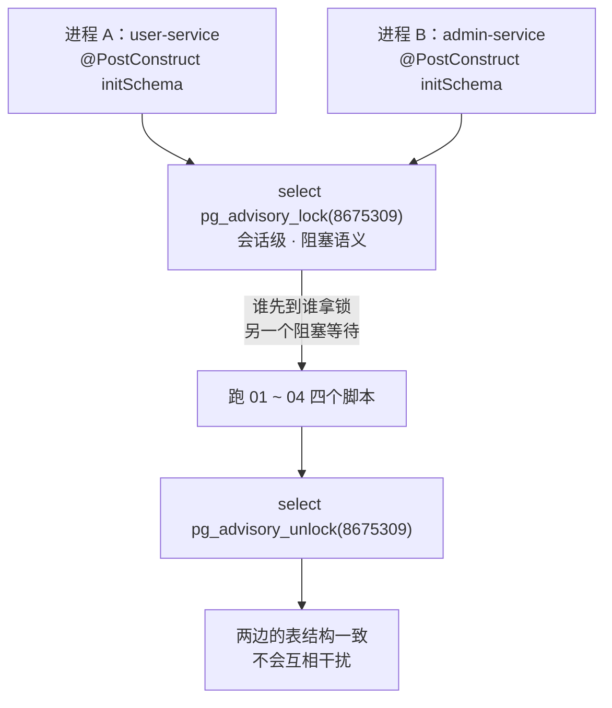
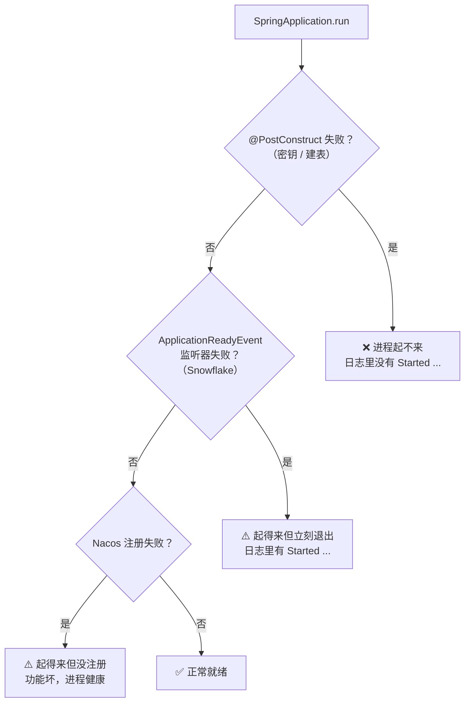

# 13. 应用启动与初始化流程

> 本篇讲的是**另一个维度**：不看某一次请求，而是看**整个进程从 `main()` 到"可以接流量"之间发生了什么**。
> 启动期的每一步都在做一件有副作用的事（建表、校验密钥、解析 workerId、注册到 Nacos），
> 而且**任何一步失败都会让进程起不来** —— 这正是本篇要讲清的东西。

---

## 1. 本次流程的研究范围

### 1.1 我们要追踪什么

```bash
java -jar service/users/user/target/user-service-1.0-SNAPSHOT.jar
# 或者
mvn -pl service/users/user spring-boot:run
```

本次追踪：**从 `main()` 方法的第一行**，到**容器就绪、开始接流量**为止。

具体覆盖 8 个阶段：

| 阶段 | 谁在做 | 做什么 |
|---|---|---|
| ① | `@SpringBootApplication` | 组件扫描 + 自动配置 |
| ② | `@EnableConfigurationProperties` | `application.yml` → 配置对象 |
| ③ | `@MapperScan` | 生成 Mapper 代理 Bean |
| ④ | `UserApiProperties` / `UserRpcProperties` 的 `@PostConstruct` | **密钥校验**（fail-closed） |
| ⑤ | `UserSchemaBootstrap` 的 `@PostConstruct` | **建表**（advisory lock + 4 个脚本） |
| ⑥ | `SnowflakeBootstrap` 的 `@EventListener(ApplicationReadyEvent)` | 校验 workerId + 初始化雪花生成器 |
| ⑦ | `NacosRegistration` 的 `@EventListener(ApplicationReadyEvent)` | 注册 `user-rpc` 到 Nacos |
| ⑧ | `NacosRegistration` 的 `@PreDestroy` | 优雅停机时反注册 |

### 1.2 我们**不**追踪什么

| 不追踪 | 原因 |
|---|---|
| 每一次 HTTP / gRPC 请求的处理 | 见 [01-用户登录流程.md](./01-用户登录流程.md) §4（登录主路径）、[12-gRPC用户服务流程.md](./12-gRPC用户服务流程.md) §4（gRPC 入口） |
| Spring Boot 内部的**全部**源码细节 | 只讲**和本进程启动直接相关**的机制，不写 Spring 百科 |
| 共享层 14 个 auto-config 各自内部 | 只讲它们**在启动期做了什么、失败了会怎样**；细节见共享层文档 |
| 数据库里表结构的全部列 | 只讲建表脚本的**幂等性**与**执行机制**；列定义见 `db/*.sql` 注释 |

### 1.3 启动期最重要的一条纪律

> **启动期的副作用必须是「要么全成、要么全不成」。**

本仓在启动期做了 4 件有副作用的事：写 DDL、注册 Nacos、初始化内存态的雪花生成器、
校验密钥。其中**只有 Nacos 注册允许失败**（失败只记日志），其余三件失败 ⇒ **进程拒绝启动**。

理由写在 `UserSchemaBootstrap` 的类注释里：

> ⚠️ **「不吞异常」是硬要求**：建表失败若被吞 ⇒ 进程会先打印「Started」，
> 然后在第一次 SQL 时才炸 ⇒ 报错长得像业务 bug。

---

## 2. 触发场景与输入

### 2.1 启动命令与产物

| 项 | 值 |
|---|---|
| 可执行 jar | `service/users/user/target/user-service-1.0-SNAPSHOT.jar` |
| `Start-Class` | `com.rag.user.UserServiceApplication`（由 `spring-boot-maven-plugin` 的 `repackage` 打进 `MANIFEST.MF`） |
| 主类 | `service/users/user/src/main/java/com/rag/user/UserServiceApplication.java` |
| HTTP 端口 | `8881`（`${USER_HTTP_PORT:8881}`） |
| gRPC 端口 | `8081`（`${USER_GRPC_PORT:8081}`） |
| Actuator | `http://localhost:8881/actuator/{health,info,prometheus}` |

### 2.2 启动前必须有的环境变量

| 变量 | 缺了会怎样 | 谁在检查 |
|---|---|---|
| `USER_JWT_SECRET` | **进程起不来**（占位符没被解析 ⇒ 密钥校验抛 `IllegalStateException`） | `UserApiProperties` / `UserRpcProperties` 的 `@PostConstruct` |
| `POSTGRES_HOST` / `POSTGRES_DB` / `POSTGRES_USER` / `POSTGRES_PASSWORD` | 有默认值（`postgres` / `first_db` / `admin` / `password`）⇒ **不会**因为缺变量而失败，但连不上库 ⇒ 建表失败 ⇒ 进程起不来 | `UserSchemaBootstrap` |
| `REDIS_ADDR` / `REDIS_PORT` / `REDIS_PASSWORD` | 有默认值 ⇒ **不影响启动**（Redis 只在 logout 时才用） | —— |
| `NACOS_ADDR` / `NACOS_PORT` / `NACOS_NAMESPACE` / `NACOS_GROUP` | 有默认值 ⇒ **不影响启动**（注册失败只记日志） | `NacosRegistration` |
| `SNOWFLAKE_NODE_ID` | 可选 ⇒ 缺了走 `SERVICE_NAME + PID` 的 sha256 兜底 | `Snowflake` |

⚠️ **注意 `application.yml` 里 `user-api.user-auth.access-secret` 与
`user-rpc.user-auth.access-secret` 写的是同一个环境变量**：

```yaml
user-api:
  user-auth:
    access-secret: ${USER_JWT_SECRET}          # ← 无默认值
    access-expire: ${USER_JWT_EXPIRE:2592000}
user-rpc:
  user-auth:
    access-secret: ${USER_JWT_SECRET}          # ← 同一个环境变量
    access-expire: ${USER_JWT_EXPIRE:2592000}
```

⇒ **不可能只配一边而漏掉另一边**（这是 D1 合并进程后保留两份键名的必然结果）。

---

## 3. 整体执行路线

```mermaid
flowchart TD
    MAIN["main(String[] args)<br/>UserServiceApplication:97"]
    RUN["SpringApplication.run(...)"]
    ENV["阶段 A：读配置<br/>application.yml + 环境变量 + profile"]
    CTX["阶段 B：创建 ApplicationContext<br/>+ 注册启动类"]
    REFRESH["阶段 C：refreshContext()<br/>容器 refresh"]
    AUTO["① @EnableAutoConfiguration<br/>14 个 auto-config 生效<br/>（BFPP 阶段）"]
    SCAN["① @ComponentScan<br/>扫 com.rag.user 及子包"]
    BPP["注册 BeanPostProcessor"]
    TOMCAT["创建 Tomcat 实例<br/>（onRefresh 阶段 · 还没监听端口）"]
    SINGLETON["阶段 D：实例化单例 Bean"]
    MAPPER["③ @MapperScan<br/>为 com.rag.user.mapper.* 生成代理 Bean"]
    SECRET["④ UserApiProperties / UserRpcProperties<br/>@PostConstruct verifyAccessSecret<br/>⇒ 密钥闸门"]
    DDL["⑤ UserSchemaBootstrap<br/>@PostConstruct initSchema<br/>⇒ advisory lock + 4 个脚本"]
    LISTEN["启动 Tomcat 生命周期<br/>（finishRefresh 阶段）<br/>⇒ 此刻起 8881 真正开始监听"]
    STARTED["日志：Started UserServiceApplication in N seconds"]
    READY["ApplicationReadyEvent 事件发布"]
    SNOW["⑥ SnowflakeBootstrap.initSnowflake<br/>校验 workerId + Snowflake.init()"]
    NACOS["⑦ NacosRegistration.register<br/>注册 user-rpc @ 8081"]
    RUNNING["进程就绪，开始接流量"]
    STOP["⑧ 进程关闭：@PreDestroy deregister<br/>从 Nacos 注销"]

    MAIN --> RUN --> ENV --> CTX --> REFRESH
    REFRESH --> AUTO --> SCAN --> BPP --> TOMCAT --> SINGLETON
    SINGLETON --> MAPPER --> SECRET --> DDL --> LISTEN --> STARTED --> READY
    READY --> SNOW --> NACOS --> RUNNING
    RUNNING -.->|"SIGTERM / 容器停止"| STOP
```



⚠️ **这张图里有两个"看起来反直觉"的地方**：

1. **Tomcat 实例创建得早，但端口真正开始监听得晚。**
   Spring Boot 的 refresh 顺序是 `onRefresh()`（**创建** web server）→ `finishBeanFactoryInitialization()`
   （**实例化单例 Bean ⇒ 触发 `@PostConstruct` ⇒ 建表**）→ `finishRefresh()`（**启动** web server ⇒ 端口开始监听）。
   ⇒ 所以「端口已经监听、但表还没建好」这个中间态**不存在**：
   **表建好了，端口才开始监听。**
   ⇒ 同理，`ApplicationReadyEvent`（Nacos 注册）时端口**一定已经绑定**了 —— 这正是
   `NacosRegistration` 类注释里「此时端口已真正绑定」那句话的依据。
2. **`Started ...` 日志打在 `ApplicationReadyEvent` 之前**。
   ⇒ 后面两个阶段（Snowflake / Nacos）失败时，**那行 "Started" 已经打出来了**。

---

## 4. 逐步讲解

### 4.1 第一步：`main()` 与 `SpringApplication.run`

`service/users/user/src/main/java/com/rag/user/UserServiceApplication.java:91-99`：

```java
@SpringBootApplication
@EnableConfigurationProperties({UserApiProperties.class, UserRpcProperties.class})
@EnableDiscoveryClient
@MapperScan("com.rag.user.mapper")
public class UserServiceApplication {

    public static void main(String[] args) {
        SpringApplication.run(UserServiceApplication.class, args);
    }
}
```

整个文件只有 **4 个注解 + 1 个 main**，没有一行 `@Import`、没有一行 `scanBasePackages`。
类注释解释了为什么（B 侧 rpc 入口用 `@Import` 逐个拉 9 个共享件；本仓共享层改成了 **starter**，
由 auto-config 提供 ⇒ 域内零装配代码，决策 D3）。

### 4.2 第二步：`@SpringBootApplication` 到底做了什么

`@SpringBootApplication` 是三个注解的组合：

| 组成 | 作用 | 在本进程里的具体后果 |
|---|---|---|
| `@SpringBootConfiguration` | 标记这是配置类 | —— |
| `@EnableAutoConfiguration` | 打开自动配置 | 加载 `common/` 的 **14 个** auto-config（见下表） |
| `@ComponentScan` | 扫描启动类所在包及子包 | 扫 `com.rag.user` 及全部子包 ⇒ `controller` / `service` / `domain` / `interceptor` / `advice` / `config` / `metrics` / `grpc` / `wiring` / `contract` / `dto` / `exception` 全部纳入 |

**14 个 auto-config**（`common/src/main/resources/META-INF/spring/org.springframework.boot.autoconfigure.AutoConfiguration.imports`）：

```
GoStyleOtelAutoConfiguration          WebAutoConfiguration
JsonBodyConverterAutoConfiguration     LoggerAutoConfiguration
ObservabilityAutoConfiguration         ProtectionAutoConfiguration
SnowflakeAutoConfiguration             MybatisPlusOrderingBridgeAutoConfiguration
GrpcExceptionMapperAutoConfiguration   PersistenceAutoConfiguration
RouteTemplateAutoConfiguration         ClientProtectionAutoConfiguration
ClientAutoConfiguration                DeadlineAutoConfiguration
```

⚠️ **框架机制提示**：`@EnableAutoConfiguration` 不是在 main 方法里立刻生效的。
它注册的是**一个 `ImportSelector`**（`AutoConfigurationImportSelector`），
真正被处理是在容器 refresh 的 **`invokeBeanFactoryPostProcessors`** 阶段 ——
因为 `ConfigurationClassPostProcessor` 本身就是 `BeanDefinitionRegistryPostProcessor`。
⇒ **自动配置是容器 refresh 的一部分**，不是「main 里的一步」。

**与 gRPC 的关系**（`UserServiceApplication` 类注释第 84 行）：

> gRPC server 由 `grpc-server-spring-boot-starter` 自动起（`@GrpcService` 被扫描到即可）

⇒ 见 [12-gRPC用户服务流程.md](./12-gRPC用户服务流程.md) §4.4.1。

### 4.3 第三步：`@EnableConfigurationProperties` —— yml 怎么变成对象

```java
@EnableConfigurationProperties({UserApiProperties.class, UserRpcProperties.class})
```

这个注解的作用是：**把这两个类注册成 Bean，并让 Spring 把 yml 里的对应段绑上去**。

| 配置类 | 前缀 | yml 段 | 绑到哪 |
|---|---|---|---|
| `UserApiProperties` | `user-api` | `application.yml:57-60` | `name`（默认 `"user-api"`）+ `userAuth.accessSecret` / `userAuth.accessExpire` |
| `UserRpcProperties` | `user-rpc` | `application.yml:62-65` | `name`（默认 `"user-rpc"`）+ `userAuth.accessSecret` / `userAuth.accessExpire` |

`@NestedConfigurationProperty`（两个类里都有）标记了嵌套对象 `userAuth` ——
告诉 Spring「`userAuth` 是一个嵌套的配置对象，不是一整个扁平的字符串」。

⚠️ **「绑上了」不等于「值是对的」**：

`application.yml` 里写的是 `${USER_JWT_SECRET}`（**没有默认值**）。
Spring 的占位符解析器在 `ignoreUnresolvablePlaceholders = true` 时，
解析不出来就**原样留下字面量** ⇒ 绑到对象上的是字符串 `"${USER_JWT_SECRET}"`，
**不是 null**。

⇒ 所以「只判 null / 空串」堵不住这条路 ⇒ 必须**额外判「值里还有 `${`」**。
这正是下一节的 `@PostConstruct` 干的事。

### 4.4 第四步：`@MapperScan("com.rag.user.mapper")` —— Mapper 代理怎么来的

```java
@MapperScan("com.rag.user.mapper")
```

`@MapperScan` 是 MyBatis-Plus 的注解（`org.mybatis.spring.annotation.MapperScan`），
它会为该包下的**每个 Mapper 接口**注册一个 `MapperFactoryBean` ⇒
容器里最终拿到的是**MyBatis 生成的动态代理对象**，不是接口本身。

本域的 Mapper：

| 接口 | 位置 |
|---|---|
| `UserMapper` | `service/users/user/src/main/java/com/rag/user/mapper/UserMapper.java` |
| `UserAvatarHistoryMapper` | `service/users/user/src/main/java/com/rag/user/mapper/UserAvatarHistoryMapper.java` |

⚠️ **B 侧 api 进程没有 `@MapperScan`**（它不碰 DB）⇒ C 侧合并成单进程后**必须显式加上**，
否则 Mapper 注册不上（`UserServiceApplication` 类注释第 47~52 行写了这条）。

⚠️ **Mapper Bean 是「懒」的吗？** 不是。
`MapperFactoryBean` 会在容器 refresh 的单例实例化阶段被创建 ⇒ **Mapper 的解析（XML / 注解 / TypeHandler 注册）
发生在启动期**，不是第一次调用时。
⇒ **Mapper 写错了 ⇒ 启动就报错**，而不是第一次查库才报错。

### 4.5 第五步（闸门一）：`@PostConstruct` 的密钥校验

`service/users/user/src/main/java/com/rag/user/config/UserApiProperties.java:70-83`：

```java
@PostConstruct
void verifyAccessSecret() {
    String secret = userAuth == null ? null : userAuth.getAccessSecret();
    if (secret == null || secret.isBlank()) {
        throw new IllegalStateException(
                "user-api.user-auth.access-secret 不能为空：请设置环境变量 USER_JWT_SECRET（与 user-rpc 共享同一把签发密钥）"
                        + "—— 本模块既签发又验签，空密钥会让任何人都能伪造 JWT");
    }
    if (secret.contains("${")) {
        throw new IllegalStateException(
                "user-api.user-auth.access-secret 仍是未解析的占位符（" + secret + "）：请设置环境变量 USER_JWT_SECRET"
                        + "—— 占位符字面量是公开在仓里的常量，拿它当密钥 = 密钥公开");
    }
}
```

`UserRpcProperties` 的同名方法（`:61-74`）逻辑完全一样，只是文案里写的是 `user-rpc`。

**两道检查，各挡一种失败**：

| 检查 | 挡住的失败 | 后果 |
|---|---|---|
| `secret == null \|\| secret.isBlank()` | 环境变量被设成空串（`PropertyPlaceholderHelper` 把空串当**合法值**） | 带着**空签名密钥**正常起来 ⇒ 任何人都能伪造 JWT |
| `secret.contains("${")` | 环境变量**没设** ⇒ 绑上的是字面量 `"${USER_JWT_SECRET}"` | 用一个**公开在仓里的常量**当密钥 |

⚠️ **这是「刻意加严」的一处**：`UserRpcProperties` 的类注释说，B 侧 user-rpc **只消费 `AccessExpire`
不消费 `AccessSecret`** ⇒ 本仓这道检查对 user-rpc 侧是**纯 fail-closed 收紧**，
不改变任何已存在的运行时取值。

⚠️ **`@PostConstruct` 什么时候跑**：在**单例 Bean 实例化之后**、
`@Autowired` / 构造器注入完成之后，由 `CommonAnnotationBeanPostProcessor` 调用。
⇒ **它在「Bean 已注入依赖、但还没被使用」的时点执行**。

### 4.6 第六步（闸门二）：`@PostConstruct` 的建表

`service/users/user/src/main/java/com/rag/user/wiring/UserSchemaBootstrap.java:65-93`：

```java
@Component
public class UserSchemaBootstrap {

    private static final Logger log = LoggerFactory.getLogger(UserSchemaBootstrap.class);

    private final DataSource dataSource;
    private final UserRpcProperties properties;

    public UserSchemaBootstrap(DataSource dataSource, UserRpcProperties properties) {
        this.dataSource = dataSource;
        this.properties = properties;
    }

    /**
     * 启动期重放全部 DDL；失败即让进程起不来。
     */
    @PostConstruct
    public void initSchema() {
        String serviceName = properties.getName();
        log.info("{} schema init starting", serviceName);
        try (Connection connection = dataSource.getConnection()) {
            SchemaInitializer.applyAll(connection, serviceName);
        } catch (Exception e) {
            // 不吞：建表失败必须让整个进程起不来，否则进程会「Started」然后在第一次
            // SQL 时才炸，报错长得像业务 bug。对齐 Go 的 log.Fatalln。
            throw new IllegalStateException(serviceName + " 建表失败，进程拒绝启动", e);
        }
        log.info("{} schema init done", serviceName);
    }
}
```

#### 4.6.1 一个容易被忽略的**顺序保证**

`UserSchemaBootstrap` 的**构造器注入**了 `UserRpcProperties`。

⇒ Spring 必须先创建 `UserRpcProperties`（它的 `@PostConstruct verifyAccessSecret` **先跑完**），
才可能创建 `UserSchemaBootstrap`（它的 `@PostConstruct initSchema` **后跑**）。

⇒ **密钥校验一定在建表之前**。这不是巧合，是构造器依赖带来的硬顺序。

⚠️ 反过来：`UserSchemaBootstrap` **不依赖** `UserApiProperties` ⇒
**HTTP 侧那份密钥校验与建表的先后顺序，源码无法确认**（两者都是独立的 Bean）。
（实践中两者都会在 refresh 期间完成，且 HTTP 侧那份失败同样会让进程起不来。）

#### 4.6.2 `SchemaInitializer.applyAll` 做了什么

`service/users/common/src/main/java/com/rag/users/common/SchemaInitializer.java:103-130`：

```java
public static void applyAll(Connection connection, String serviceName) throws SQLException {
    // 先拿会话级 advisory lock：把两个服务并发建表这件事串行化。
    // 拿不到就一直等（PG 的 pg_advisory_lock 是阻塞语义），等到即可，
    // 因为另一个进程执行完就会释放 —— 不会死锁，也不需要超时。
    boolean locked = false;
    try (Statement st = connection.createStatement()) {
        st.execute("select pg_advisory_lock(" + ADVISORY_LOCK_KEY + ")");
        locked = true;
        log.info("schema init [{}]: acquired advisory lock {}", serviceName, ADVISORY_LOCK_KEY);
        for (String script : SCRIPTS) {
            log.info("schema init [{}]: applying {}", serviceName, script);
            // continueOnError=false（ScriptUtils 默认）：任一条语句失败即抛 SQLException。
            ScriptUtils.executeSqlScript(connection, new ClassPathResource(script));
        }
    } finally {
        if (locked) {
            // 会话级锁在连接断开时也会自动释放，这里显式释放只是为了尽快放开，
            // 避免另一个进程干等。失败不抛：解锁失败不影响 DDL 本身的结论。
            try (Statement st = connection.createStatement()) {
                st.execute("select pg_advisory_unlock(" + ADVISORY_LOCK_KEY + ")");
            } catch (SQLException e) {
                log.warn("schema init [{}]: advisory unlock failed (连接断开也会自动释放)",
                        serviceName, e);
            }
        }
    }
    log.info("schema init [{}]: all {} scripts applied", serviceName, SCRIPTS.length);
}
```

三个常量（`:73-86`）：

```java
private static final String[] SCRIPTS = {
        "db/01_create_user.sql",
        "db/02_create_user_avatar_history.sql",
        "db/03_create_admin.sql",
        "db/04_create_admin_invite.sql",
};

private static final long ADVISORY_LOCK_KEY = 8_675_309L;
```

⚠️ **一个容易看错的事实**：**user-service 也会建 admin 的表。**
`SCRIPTS` 是**固定的 4 个脚本**，不区分调用方 ⇒
`user-service` 启动时会把 `admin_admin`（`03`）和 `admin_invite`（`04`）也建出来。
（`admin-service` 同样跑这 4 个脚本。）

#### 4.6.3 advisory lock 为什么必需



**为什么需要它**（`SchemaInitializer` 类注释第 46-48 行）：

> PG advisory lock：同一个常量键 ⇒ 两个进程并发建表时仍然串行化 ⇒ **并发建表不炸**
> （PG 的 `CREATE TABLE IF NOT EXISTS` 在并发下并不安全，
> 后到者可能撞 `pg_type_typname_nsp_index`）。

⚠️ **`pg_advisory_lock` 的三个语义要点**：

| 要点 | 说明 |
|---|---|
| **会话级**（不是 `pg_advisory_xact_lock`） | 锁绑定在**连接**上，不绑定在事务上 ⇒ 需要显式 `unlock` |
| **阻塞语义** | 拿不到锁时**阻塞等待**，不是立刻失败 ⇒ 另一个进程跑完就释放 ⇒ **不会死锁**、不需要超时 |
| **连接断开会自动释放** | 所以 `finally` 里的显式 unlock 失败只 `log.warn`，不抛 |

⚠️ 锁键 `8675309` **两个服务必须用同一个** ⇒ 改键等于让并发建表的保护失效
（`SchemaInitializer.advisoryLockKey()` 就是给守门脚本做对账用的）。

#### 4.6.4 脚本的幂等性

`service/users/common/src/main/resources/db/01_create_user.sql:33-52`：

```sql
CREATE TABLE IF NOT EXISTS users_user (
    id          BIGSERIAL PRIMARY KEY,
    uid         BIGINT NOT NULL UNIQUE,
    username    TEXT UNIQUE,
    password    TEXT,
    email       TEXT UNIQUE,
    status      BIGINT NOT NULL DEFAULT 0,
    score       INTEGER,
    extra_info  TEXT,
    create_time TIMESTAMPTZ DEFAULT CURRENT_TIMESTAMP,
    update_time TIMESTAMPTZ DEFAULT CURRENT_TIMESTAMP
);

CREATE INDEX IF NOT EXISTS idx_users_user_uid ON users_user (uid);

ALTER TABLE users_user ALTER COLUMN username TYPE text;
ALTER TABLE users_user ALTER COLUMN password TYPE text;
ALTER TABLE users_user ALTER COLUMN email   TYPE text;
```

⇒ **建表与建索引都是 `IF NOT EXISTS`** ⇒ 重复执行安全。

⇒ **那三条 `ALTER` 呢？** 它们**不是** `IF NOT EXISTS` 形态，但**语义上恒等**：
`varchar → text` 是**超集**转换，PG 里对已存在的列**恒成功** ⇒ 重复执行结果一样。
（脚本注释 `:28-31` 说明了这一点：「让**已存在的库自愈**—— 这正是 `SchemaInitializer`
无版本账本模式下「建表」之外还能承担「升级」的唯一手段」。）

`01_create_user.sql:148-153` 还有一组更微妙的三条：

```sql
SET TIME ZONE 'UTC';

ALTER TABLE users_user ALTER COLUMN create_time TYPE TIMESTAMPTZ USING create_time AT TIME ZONE 'UTC';
ALTER TABLE users_user ALTER COLUMN update_time TYPE TIMESTAMPTZ USING create_time AT TIME ZONE 'UTC';

RESET TIME ZONE;
```

⚠️ 为什么必须**先钉 UTC 再转**（脚本注释 `:127-147` 写得很清楚）：

> `timestamptz AT TIME ZONE 'UTC'` 对**已经是 timestamptz** 的列**并不恒等**：
> 会话时区非 UTC 时，**每启动一次整列时刻就偏移一次，且永不收敛**。

⇒ 所以是「会话 TZ 显式钉成 UTC → 转 → `RESET` 还原」，两条路径都恒等。

⚠️ **`SET TIME ZONE` 是会话级的** ⇒ 只影响这一条连接，不影响连接池里的其它连接
（`RESET TIME ZONE` 在同一脚本末尾把它还原了）。

⚠️ **为什么不能用 `DO $$ … $$` 条件块**（脚本注释 `:136-141`）：

> `SchemaInitializer` 用 Spring `ScriptUtils` 切分语句（分隔符 `;`），
> 而 spring-jdbc 的 `ScriptUtils` **没有 PostgreSQL 美元引号支持**
> ⇒ 块内分号照样被切断，DDL 语法错、applyAll 抛异常 ⇒ **双双重起不来**。

### 4.7 第七步：`ApplicationReadyEvent` —— 容器就绪之后

#### 4.7.1 为什么用 `@EventListener(ApplicationReadyEvent.class)` 而不是 `@PostConstruct`

| | `@PostConstruct` | `@EventListener(ApplicationReadyEvent.class)` |
|---|---|---|
| **时点** | 容器 refresh 期间，**单例 Bean 实例化后** | 容器 refresh **完成之后**、runner 跑完之后 |
| **此时 Web 容器** | 可能还没启动 | **已经启动并绑定了端口** |
| **此时能对外宣称「我准备好了」吗** | **不能**（后面还有别的 Bean 要初始化） | **能**（这就是「ready」的含义） |
| **适合做的事** | 必须先完成的**前置条件**（校验密钥、建表） | **对外宣告**（注册到服务发现、初始化 ID 生成器） |

⇒ 建表必须用 `@PostConstruct`：**表还没建好就注册到 Nacos ⇒ 流量进来第一件事就是 SQL 报错**。

⇒ Nacos 注册必须用 `ApplicationReadyEvent`：**端口还没绑定就注册 ⇒ 注册的端口是错的 / 连不上**。

`NacosRegistration` 的类注释就是这么说的：

> `@EventListener(ApplicationReadyEvent)` ⇒ 容器就绪后才注册（**此时端口已真正绑定**）

#### 4.7.2 `SnowflakeBootstrap` —— 校验 workerId

`service/users/user/src/main/java/com/rag/user/wiring/SnowflakeBootstrap.java:65-98`：

```java
@Component
public class SnowflakeBootstrap {

    private static final Logger log = LoggerFactory.getLogger(SnowflakeBootstrap.class);

    /**
     * 启动期校验 workerId 合法，并确保雪花生成器已初始化。
     */
    @EventListener(ApplicationReadyEvent.class)
    public void initSnowflake() {
        long workerId = resolveWorkerId();
        if (workerId < 0 || workerId > Snowflake.MAX_WORKER_ID) {
            throw new IllegalStateException(
                    "Snowflake workerId out of range [0, " + Snowflake.MAX_WORKER_ID + "]: " + workerId);
        }
        // 触发 Snowflake.init() 校验（throws if generateNodeId failed）
        Snowflake.init();
        log.info("SnowflakeBootstrap verified workerId={}, Snowflake ready", workerId);
    }

    private static long resolveWorkerId() {
        Long id = Snowflake.currentWorkerId();
        if (id == null) {
            Snowflake.init();
            id = Snowflake.currentWorkerId();
        }
        return id == null ? 0L : id;
    }
}
```

**workerId 从哪来？** 三档优先级（`common/src/main/java/com/rag/common/autoconfigure/SnowflakeAutoConfiguration.java` 的 `resolveWorkerId`）：

1. 环境变量 `SNOWFLAKE_NODE_ID`
2. 配置 `snowflake.worker-id`（`SnowflakeProperties`）
3. 兜底 hash：`SERVICE_NAME + "-" + PID` 的 sha256 **前 2 字节** `% 1024`
   （`common/src/main/java/com/rag/common/snowflake/Snowflake.java:395-426`）

⚠️ **实际上第 1/2 档在更早的时候就已经生效了**：

`SnowflakeAutoConfiguration` 的 `@Bean` 方法在**容器 refresh 的单例实例化阶段**就会跑：

```java
@Bean
@ConditionalOnMissingBean
public Snowflake snowflake(SnowflakeProperties props) {
    long workerId = resolveWorkerId(props);
    Snowflake.setWorkerId(workerId);
    return new Snowflake();
}
```

⇒ **workerId 在 refresh 期就已经写进 `Snowflake` 的静态状态了**
⇒ `SnowflakeBootstrap` 在 `ApplicationReadyEvent` 读到的 `Snowflake.currentWorkerId()` **早就有值**
⇒ 它的 `Snowflake.init()` 是**空操作**（`init()` 第一行就是
`if (workerId != null || initError != null) { return; }`）。

⇒ 所以 `SnowflakeBootstrap` 实际上只做了一件事：**复核**。

⚠️ **两个「看起来像 fail-fast、其实不可达」的细节**：

1. `workerId < 0 || workerId > MAX_WORKER_ID` 这个检查**实际不可达** ——
   解析链的每一档都做了 `% (MAX_WORKER_ID + 1)`（= `% 1024`）⇒ 结果恒在 `[0, 1023]`。
   类注释专门写了这条（「fail-fast 的实际可达性（照抄 B 侧，不加码）…… **不**擅自加严」）。
2. `Snowflake.init()` **不会抛异常**。看 `Snowflake.java:214-228`：

   ```java
   public static synchronized void init() {
       if (workerId != null || initError != null) {
           return; // 已初始化过，等价 sync.Once 的第二次调用直接返回
       }
       long id;
       try {
           id = generateNodeId();
       } catch (Throwable t) {
           initError = t;
           LOG.error("Snowflake initialize failed", t);
           return;                    // ⚠️ 记下来，不抛
       }
       workerId = id;
       LOG.info("Snowflake initialized with nodeId: {}", id);
   }
   ```

   ⇒ `SnowflakeBootstrap` 里那句注释「`throws if generateNodeId failed`」**与代码不符**：
   `init()` 失败时只是把原因存进 `initError` 并记一条 ERROR 日志。
   ⇒ 真正的失败会延后到**第一次 `Snowflake.nextId()`** 才暴露：
   `throw new IllegalStateException("snowflake node is not initialized", initError)`（`Snowflake.java:272-274`）。
   ⇒ 换句话说：**「UID 生成失败」不会让进程起不来，而是让第一次注册/上传头像失败。**

#### 4.7.3 `NacosRegistration` —— 注册 `user-rpc`

`service/users/user/src/main/java/com/rag/user/wiring/NacosRegistration.java:95-170`：

```java
@Component("userRpcNacosRegistration")
public class NacosRegistration {

    private static final String SERVICE_NAME = "user-rpc";

    private final NacosServiceManager nacosServiceManager;
    private final GrpcServerProperties grpcServerProperties;
    private final String groupName;

    private Instance registeredInstance;
    private String registeredServiceName;
    private String registeredGroupName;

    public NacosRegistration(NacosServiceManager nacosServiceManager,
                             GrpcServerProperties grpcServerProperties,
                             @Value("${spring.cloud.nacos.discovery.group:USER_GROUP}")
                             String groupName) {
        ...
    }

    @EventListener(ApplicationReadyEvent.class)
    public void register() {
        String serviceName = SERVICE_NAME;
        String group = this.groupName;
        int port = grpcServerProperties.getPort();

        try {
            Instance instance = new Instance();
            instance.setIp(resolveLocalIp());
            instance.setPort(port);
            instance.setHealthy(true);
            instance.setWeight(1.0);
            instance.setEphemeral(true);
            instance.setServiceName(serviceName);
            instance.setClusterName("DEFAULT");

            NamingService namingService = nacosServiceManager.getNamingService();
            namingService.registerInstance(serviceName, group, instance);

            this.registeredInstance = instance;
            this.registeredServiceName = serviceName;
            this.registeredGroupName = group;

            log.info("nacos registry, {} {} {}:{} register finished",
                    group, serviceName, instance.getIp(), port);
        } catch (NacosException | UnknownHostException e) {
            log.error("user-rpc nacos register FAILED service={} group={} port={}",
                    serviceName, group, port, e);
        }
    }
```

**六个注册细节，逐条**：

| 细节 | 取值 | 来源 / 理由 |
|---|---|---|
| 服务名 | `"user-rpc"`（**硬编码常量**） | **L1 契约**。B 侧就写死这个名字（运维健康检查查的是 `serviceName=user-rpc`）⇒ **不因 D1 合并而改成 `user-service`** |
| group | `${spring.cloud.nacos.discovery.group:USER_GROUP}` | 从配置读（不是写死）⇒ 部署设 `NACOS_GROUP` 才有效；默认值仍是 `USER_GROUP` |
| IP | `resolveLocalIp()` | 见下 |
| 端口 | `grpcServerProperties.getPort()` | **gRPC 端口 8081**，不是 HTTP 端口 8881 |
| ephemeral | `true` | 临时实例（Nacos 侧靠心跳保活） |
| clusterName | `"DEFAULT"` | —— |

**`resolveLocalIp()`（`:197-220`）**：

```java
private static String resolveLocalIp() throws UnknownHostException {
    InetAddress candidate = null;
    try {
        Enumeration<NetworkInterface> nis = NetworkInterface.getNetworkInterfaces();
        while (nis != null && nis.hasMoreElements()) {
            NetworkInterface ni = nis.nextElement();
            if (ni.isLoopback() || ni.isPointToPoint() || !ni.isUp()) {
                continue;
            }
            Enumeration<InetAddress> addrs = ni.getInetAddresses();
            while (addrs.hasMoreElements()) {
                InetAddress a = addrs.nextElement();
                if (a instanceof Inet4Address) {
                    if (candidate == null) {
                        candidate = a;
                    }
                }
            }
        }
    } catch (SocketException ignore) {
        // 退回 InetAddress.getLocalHost
    }
    return candidate != null ? candidate.getHostAddress() : InetAddress.getLocalHost().getHostAddress();
}
```

⇒ 遍历网卡 ⇒ 跳过 **loopback**（`127.0.0.1`）、**点对点**（点对点隧道）、**没 up 的**网卡
⇒ 取**第一个** IPv4 ⇒ 都没有才退回 `InetAddress.getLocalHost()`。

⚠️ **为什么不用 `InetAddress.getLocalHost()` 直接拿**（类注释里写了 B 侧 DRIFT-NEW-012）：
在 macOS 上它经常返回 `127.0.0.1` ⇒ docker 容器跨 host 网络访问不到 host loopback。

⚠️ **「只注册 1 个」是刻意的**：`application.yml:42` 里 `spring.cloud.nacos.discovery.register-enabled: false`
⇒ 关掉了 Spring Cloud 的自动注册 ⇒ **不会**再冒出一个 `user-service`@HTTP 端口 的条目
⇒ 全进程**恰好 1 个** Nacos 注册项。

⚠️ **bean 名必须显式**（`@Component("userRpcNacosRegistration")`）：
`NacosServiceRegistryAutoConfiguration` 里有个 `@Bean nacosRegistration()` ⇒
本类若用类名默认推导（也是 `nacosRegistration`）⇒ **撞名** ⇒ `BeanDefinitionOverrideException`
⇒ **整个上下文启动失败**。

⚠️ **注册失败不抛异常** ⇒ 只记一条 ERROR 日志 ⇒ **进程照常起来**。
⇒ 这是本篇 4 件启动期副作用里**唯一允许失败**的一件。

#### 4.7.4 `SnowflakeBootstrap` 与 `NacosRegistration` 的先后

两者都监听 `ApplicationReadyEvent`，**都没有 `@Order`** ⇒
**它们之间的相对执行顺序，源码无法确认**。

⇒ 实践含义：**不要**依赖「Snowflake 一定先于 Nacos 注册完成」这件事。

### 4.8 第八步：`@PreDestroy` —— 优雅停机时反注册

`NacosRegistration.java:175-189`：

```java
@PreDestroy
public void deregister() {
    if (registeredInstance == null) {
        return;
    }
    try {
        NamingService namingService = nacosServiceManager.getNamingService();
        namingService.deregisterInstance(
                registeredServiceName, registeredGroupName, registeredInstance);
        log.info("nacos registry, {} {} deregister finished",
                registeredGroupName, registeredServiceName);
    } catch (NacosException e) {
        log.warn("user-rpc nacos deregister FAILED", e);
    }
}
```

⚠️ `registeredInstance == null` 的早退是一个**隐含状态机**：
**只有注册成功过才会反注册** ⇒ 注册失败时不会去注销一个从未注册过的实例。

⚠️ 反注册失败只 `log.warn` ⇒ **不阻止进程退出**。

---

## 5. 重要分支与失败路径

| # | 失败点 | 抛出的异常 | 进程状态 | 客户端/运维可观察 |
|---|---|---|---|---|
| 1 | `UserApiProperties.verifyAccessSecret`：`USER_JWT_SECRET` 未设（值为 `${USER_JWT_SECRET}` 字面量） | `IllegalStateException` ⇒ `BeanCreationException` | **起不来** | **看不到** `Started ...` 日志；栈里能看到「仍是未解析的占位符」 |
| 2 | `UserApiProperties.verifyAccessSecret`：`USER_JWT_SECRET` 被设成空串 | 同上 | **起不来** | 看不到 `Started ...`；文案是「不能为空」 |
| 3 | `UserRpcProperties.verifyAccessSecret`：同上两种 | 同上 | **起不来** | 同上（文案里是 `user-rpc`） |
| 4 | `UserSchemaBootstrap.initSchema`：连不上 PG | `IllegalStateException("user-rpc 建表失败，进程拒绝启动", cause)` | **起不来** | 看不到 `Started ...`；cause 是 Hikari 的连接异常 |
| 5 | `SchemaInitializer.applyAll`：某个脚本的某条语句失败 | `SQLException` ⇒ 被 #4 包成 `IllegalStateException` | **起不来** | 看不到 `Started ...`；日志里有 `schema init [user-rpc]: applying db/0X_...` 指明失败在哪个脚本 |
| 6 | `SchemaInitializer.applyAll`：**拿不到 advisory lock** | **不会失败** | **正常起来** | `pg_advisory_lock` 是**阻塞**语义 ⇒ 一直等另一个进程跑完 |
| 7 | `SchemaInitializer.applyAll`：`finally` 里的 unlock 失败 | 只 `log.warn` | **正常起来** | 会话级锁在连接断开时也会自动释放 |
| 8 | `SnowflakeBootstrap.initSnowflake`：workerId 越界 | `IllegalStateException` | **起得来但立刻退出** | ⚠️ **`Started ...` 已经打出来了**；但 workerId 越界**实际不可达**（见 §4.7.2） |
| 9 | `Snowflake.init()`：`generateNodeId()` 抛异常（SHA-256 不可用） | **不抛**，只记 ERROR + 存 `initError` | **正常起来** | ⚠️ 真正的失败延后到**第一次 `Snowflake.nextId()`** ⇒ 那时 `register` / `uploadAvatar` 失败 |
| 10 | `NacosRegistration.register`：Nacos 不可达 / `UnknownHostException` | **不抛**，只记 ERROR | **正常起来** | ⚠️ **起得来但功能坏**：实例没注册 ⇒ 服务发现里查不到 `user-rpc` |
| 11 | `NacosRegistration.deregister`：反注册失败 | 只 `log.warn` | **正常退出** | Nacos 里可能留一个僵尸实例（靠 ephemeral 心跳过期清理） |
| 12 | `MapperFactoryBean` 初始化失败（Mapper 注解写错） | `BeanCreationException` | **起不来** | 看不到 `Started ...` |
| 13 | `UserServiceApplication` bean 名与 auto-config 里的 bean 撞名 | `BeanDefinitionOverrideException` | **起不来** | —— |

⚠️ **第 8 条与第 1~5 条的差别，是本篇最值得记住的一点**：

| 失败阶段 | 异常从哪抛出 | `Started ...` 日志 | 进程结局 |
|---|---|---|---|
| refresh 期（`@PostConstruct`） | Bean 初始化 | **没打** | 起不来 |
| `ApplicationReadyEvent` 期的监听器 | 事件监听器 | **已经打了** | 起得来但随即退出 |

（这是 Spring Boot 的 `SpringApplication.run` 顺序决定的：`started()` 打印 "Started ..."，
`ready()` 才发布 `ApplicationReadyEvent` —— **框架机制**，非本仓源码。）



---

## 6. 数据变化与副作用

### 6.1 副作用总表

| 副作用面 | 发生了什么 | 什么时候 | 失败的后果 |
|---|---|---|---|
| **DB（写 DDL）** | 重放 4 个 SQL 脚本 ⇒ 建/改 4 张表 + 6 个索引 | `@PostConstruct` | **进程起不来** |
| **DB（读）** | 启动期**只读**一张表？—— **没有**。启动期的唯一 DB 访问是建表 | —— | —— |
| **Nacos** | 注册 `user-rpc`（IP + 8081 + ephemeral） | `ApplicationReadyEvent` | 只记日志（功能坏） |
| **Nacos（注销）** | 反注册 | `@PreDestroy` | 只记 warn |
| **Snowflake** | 内存态初始化（静态 `STATE` + `workerId`） | refresh 期（auto-config）+ `ApplicationReadyEvent`（复核） | 延后到第一次 `nextId()` |
| **Redis** | **本流程中未发生任何读写** | —— | —— |
| **日志** | `schema init starting` / `acquired advisory lock` / `applying db/0X` / `all 4 scripts applied` / `SnowflakeBootstrap verified workerId=` / `nacos registry, … register finished` | 各阶段 | —— |
| **指标** | 启动期**不产生**业务指标（`user_rpc_*` 是领域层埋点 ⇒ 要等第一次业务请求） | —— | —— |
| **端口** | Tomcat 绑 8881、gRPC server 绑 8081 | refresh 期 | —— |

### 6.2 建表到底建了什么

| 脚本 | 建什么 | 关键约束 |
|---|---|---|
| `db/01_create_user.sql` | 表 `users_user` + 索引 `idx_users_user_uid` | `uid BIGINT NOT NULL UNIQUE`、`username TEXT UNIQUE`、`email TEXT UNIQUE`、`status BIGINT NOT NULL DEFAULT 0` |
| `db/02_create_user_avatar_history.sql` | 表 `users_user_avatar_history` + 索引 `idx_users_user_avatar_history_uid`、`idx_users_user_avatar_history_uid_is_current` | `history_id TEXT NOT NULL UNIQUE`、`uid BIGINT NOT NULL`、`is_current BOOLEAN NOT NULL DEFAULT FALSE` |
| `db/03_create_admin.sql` | 表 `admin_admin` + 索引 `idx_admin_admin_uid` | ⚠️ **user-service 也会建这张表** |
| `db/04_create_admin_invite.sql` | 表 `admin_invite` + 索引 `idx_admin_invite_code` | ⚠️ 同上 |

⇒ **4 张表、6 个索引**，全部 `IF NOT EXISTS` ⇒ 重复执行安全。

### 6.3 事务边界

⚠️ **`SchemaInitializer` 不开事务**：

- 源码里**没有** `setAutoCommit(false)` / `commit()` / `rollback()`；
- `ScriptUtils.executeSqlScript(connection, resource)` 也**不**开事务（它只是逐句执行）。

⇒ **合理推断**（不是源码明确）：本仓 `application.yml` 没有 `spring.datasource.hikari` 段
⇒ 连接池用 HikariCP 的默认值 `autoCommit = true`
⇒ **每条 DDL 语句各自立即提交**。

⇒ 后果：**第 3 个脚本失败时，第 1、2 个脚本的改动已经落库了**（表还在，只是第 3 张表没建）。
进程虽然起不来，但**数据库不是"干净的"** ⇒ 重启时会重放，幂等 ⇒ 能自愈。

⇒ `users-common` 的类注释把这套模式叫作「**无版本账本的幂等重放**」：
没有 `flyway_schema_history` 那种版本表，靠「每次原样重放 + 恒等语句」来实现升级。

---

## 7. 执行结果

### 7.1 启动成功

日志（按时间顺序，`INFO` 级别）：

```
user-rpc schema init starting
schema init [user-rpc]: acquired advisory lock 8675309
schema init [user-rpc]: applying db/01_create_user.sql
schema init [user-rpc]: applying db/02_create_user_avatar_history.sql
schema init [user-rpc]: applying db/03_create_admin.sql
schema init [user-rpc]: applying db/04_create_admin_invite.sql
schema init [user-rpc]: all 4 scripts applied
user-rpc schema init done
Started UserServiceApplication in 5.123 seconds (process running for 6.789)
SnowflakeBootstrap verified workerId=123, Snowflake ready
nacos registry, USER_GROUP user-rpc 172.17.0.2:8081 register finished
```

⚠️ **两行日志的顺序不保证**：`SnowflakeBootstrap verified workerId=…` 与
`nacos registry, … register finished` 谁先谁后取决于两个监听器的执行顺序
（**源码无法确认**，见 §4.7.4）。

### 7.2 启动成功后的可观察状态

| 观察点 | 期望 |
|---|---|
| `curl localhost:8881/actuator/health` | `{"status":"UP", ...}` |
| `curl localhost:8881/actuator/prometheus` | 含 `rpc_server_requests_code` / `rpc_server_requests_duration_ms` 等指标 |
| `psql` 查库 | 4 张表存在 |
| Nacos 控制台 | `USER_GROUP` 组下有一个 `user-rpc` 实例，端口 **8081** |
| `lsof -i :8081` | gRPC server 在听 |

### 7.3 启动失败

异常栈顶是 `IllegalStateException`，**`Started ...` 那行不会出现**：

```
org.springframework.beans.factory.BeanCreationException:
  Error creating bean with name 'userApiProperties':
  Invocation of init method failed
Caused by: java.lang.IllegalStateException:
  user-api.user-auth.access-secret 仍是未解析的占位符（${USER_JWT_SECRET}）：
  请设置环境变量 USER_JWT_SECRET—— 占位符字面量是公开在仓里的常量，拿它当密钥 = 密钥公开
```

建表失败时：

```
org.springframework.beans.factory.BeanCreationException:
  Error creating bean with name 'userSchemaBootstrap':
  Invocation of init method failed
Caused by: java.lang.IllegalStateException: user-rpc 建表失败，进程拒绝启动
Caused by: org.postgresql.util.PSQLException: ...
```

⇒ **进程以非 0 退出码结束** ⇒ 容器编排会重启它 ⇒ 如果是**配置问题**，就是**无限重启**。

---

## 8. 流程复盘

一次启动，真正走过的代码：

```
UserServiceApplication.main
  ↓ SpringApplication.run
  ↓ 读 application.yml（ConfigDataEnvironmentPostProcessor）
  ↓ refreshContext
    ↓ @EnableAutoConfiguration ⇒ common/ 的 14 个 auto-config 生效
    ↓ @ComponentScan ⇒ 扫 com.rag.user 及子包
    ↓ 实例化单例 Bean
      ├─ @MapperScan ⇒ UserMapper / UserAvatarHistoryMapper 的代理 Bean
      ├─ UserApiProperties / UserRpcProperties
      │    └─ @PostConstruct verifyAccessSecret ⇒ 密钥闸门
      ├─ SnowflakeAutoConfiguration#snowflake ⇒ Snowflake.setWorkerId(...)
      └─ UserSchemaBootstrap
           └─ @PostConstruct initSchema
                └─ SchemaInitializer.applyAll
                     ├─ select pg_advisory_lock(8675309)
                     ├─ ScriptUtils.executeSqlScript × 4（01 ~ 04）
                     └─ select pg_advisory_unlock(8675309)
  ↓ Started ... 日志
  ↓ ApplicationReadyEvent
       ├─ SnowflakeBootstrap.initSnowflake（复核 workerId）
       └─ NacosRegistration.register（user-rpc @ 8081 → Nacos）
  ↓ 进程就绪，开始接流量
```

**边界结论**：

1. **启动期的副作用有 4 处**：DDL、Nacos 注册、Snowflake 初始化、密钥校验。
   **只有 Nacos 注册允许失败**（失败 = 起得来但功能坏），其余失败 ⇒ **进程起不来**。
2. **`@PostConstruct` 与 `ApplicationReadyEvent` 的分工**：
   前者是「**必须先完成的前置条件**」（表、密钥），后者是「**可以对外宣告**」（端口已绑定）。
3. **构造器注入带来顺序保证**：`UserSchemaBootstrap` 注入 `UserRpcProperties`
   ⇒ **密钥校验一定在建表之前**。
4. **advisory lock 让两个进程串行化**：user-service 与 admin-service 跑**同一批 4 个脚本**、
   用**同一把锁键 8675309** ⇒ 谁先跑都行，重复重放恒等。
5. **没有 Flyway**：users 域刻意不用版本账本（决策 D17）⇒ 靠「`IF NOT EXISTS` + 恒等 `ALTER`」实现幂等。
6. **`user-service` 也会建 admin 的表** —— 因为 `SCRIPTS` 是固定的 4 个脚本。

---

## 9. 源码定位与验证方式

### 9.1 源码位置

| 内容 | 文件 | 位置 |
|---|---|---|
| 启动类（4 个注解 + main） | `service/users/user/src/main/java/com/rag/user/UserServiceApplication.java` | `:91-99` |
| 建表 bootstrap | `service/users/user/src/main/java/com/rag/user/wiring/UserSchemaBootstrap.java` | `initSchema` `:81-93` |
| DDL 幂等执行器 | `service/users/common/src/main/java/com/rag/users/common/SchemaInitializer.java` | `SCRIPTS` `:73-78`；锁键 `:86`；`applyAll` `:103-130` |
| Snowflake 校验 | `service/users/user/src/main/java/com/rag/user/wiring/SnowflakeBootstrap.java` | `initSnowflake` `:73-83`；`resolveWorkerId` `:91-98` |
| Nacos 注册 | `service/users/user/src/main/java/com/rag/user/wiring/NacosRegistration.java` | `SERVICE_NAME` `:103`；`register` `:141-170`；`deregister` `:175-189`；`resolveLocalIp` `:197-220` |
| 密钥校验（HTTP 侧） | `service/users/user/src/main/java/com/rag/user/config/UserApiProperties.java` | `verifyAccessSecret` `:70-83` |
| 密钥校验（gRPC 侧） | `service/users/user/src/main/java/com/rag/user/config/UserRpcProperties.java` | `verifyAccessSecret` `:61-74` |
| 雪花算法 | `common/src/main/java/com/rag/common/snowflake/Snowflake.java` | `init` `:214-228`；`nextId` `:268-280`；`generateNodeId` `:395-426`；`MAX_WORKER_ID` `:65` |
| workerId 解析 | `common/src/main/java/com/rag/common/autoconfigure/SnowflakeAutoConfiguration.java` | `snowflake` Bean；`resolveWorkerId` |
| 建表脚本 | `service/users/common/src/main/resources/db/01_create_user.sql` … `04_create_admin_invite.sql` | 见 §6.2 |
| 配置文件 | `service/users/user/src/main/resources/application.yml` | 端口 `:79-94`；密钥 `:57-65`；超时 `:75-77`；Nacos `:27-42` |
| auto-config 清单 | `common/src/main/resources/META-INF/spring/org.springframework.boot.autoconfigure.AutoConfiguration.imports` | 14 行 |

### 9.2 测试（可复跑）

本域的启动期断言：

| 测试类 | 断的是什么 |
|---|---|
| `UserServiceApplicationTests`（6 例） | 上下文装配 · `@MapperScan` 生效 · `@GrpcService` 被扫到 · JWT 两段 bean 都在 · **DDL 在启动期真被重放**（查真 PG）· 表名 L1 |
| `UserNacosRegistrationWiringTest`（6 例） | 注册名 = `user-rpc` · 端口 = gRPC 端口 · group 来自配置 · 默认值零变化 · yml 仍声明 group · 自动注册已关 |
| `UserApiPropertiesSecretGuardTest`（7 例） | 密钥 fail-closed：**null / 空串 / 未解析占位符** 三路都必须启动失败（api ＋ rpc 两侧） |
| `UserGrpcServiceContractTest`（4 例） | 真 gRPC server 上 9 个方法全被派发（见 [12-gRPC用户服务流程.md](./12-gRPC用户服务流程.md) §9.2） |

```bash
# 只跑本域
mvn -pl service/users/user -am test

# 单独跑启动期那一组
mvn -pl service/users/user -am test \
    -Dtest='UserServiceApplicationTests+UserNacosRegistrationWiringTest+UserApiPropertiesSecretGuardTest'
```

⚠️ 本域的测试需要 **真 PostgreSQL**（Testcontainers）。

### 9.3 不确定性的边界（明确写出来）

| 问题 | 状态 |
|---|---|
| `Snowflake.init()` 的失败是否会让进程起不来 | **不会** —— 源码明确它只存 `initError` 并记 ERROR（`Snowflake.java:221-224`）；`SnowflakeBootstrap` 里那句「throws if generateNodeId failed」的注释**与代码不符** |
| `workerId` 越界检查是否可达 | **不可达** —— 解析链每档都 `% 1024`（类注释自述） |
| `SnowflakeBootstrap` 与 `NacosRegistration` 的先后 | **源码无法确认**（都没有 `@Order`） |
| `UserApiProperties` 的密钥校验与建表的先后 | **源码无法确认**（两者无依赖关系；只保证都在 refresh 期完成） |
| DDL 的事务边界 | **合理推断**：无显式事务 + HikariCP 默认 `autoCommit=true` ⇒ 逐句提交。本仓 yml 未配 `spring.datasource.hikari` |
| 「`Started ...` 早于 `ApplicationReadyEvent`」 | **Spring Boot 框架机制**（`started()` → `ready()`），非本仓源码 |
| gRPC server 具体在哪个 refresh 子阶段绑定端口 | **源码无法确认**（由 devh starter 决定） |
| `admin-service` 的建表路径 | 本篇只读了 `AdminSchemaBootstrap.java:69`（同样是 `SchemaInitializer.applyAll(connection, "admin-service")`）⇒ 同一批脚本、同一把锁 |

---

## 相关文档

- [01-用户登录流程.md](./01-用户登录流程.md) —— 启动完成后跑的第一条业务流（§4 是它自己的入口讲解）
- [12-gRPC用户服务流程.md](./12-gRPC用户服务流程.md) —— gRPC server 是在启动期被装配起来的，本篇讲「什么时候」（§4.4.1 讲「装配完之后怎么被调用」）
- [11-HTTP统一响应与异常处理流程.md](./11-HTTP统一响应与异常处理流程.md) —— 启动失败与运行期异常是两种不同的处理路径（§4 是运行期那条）
