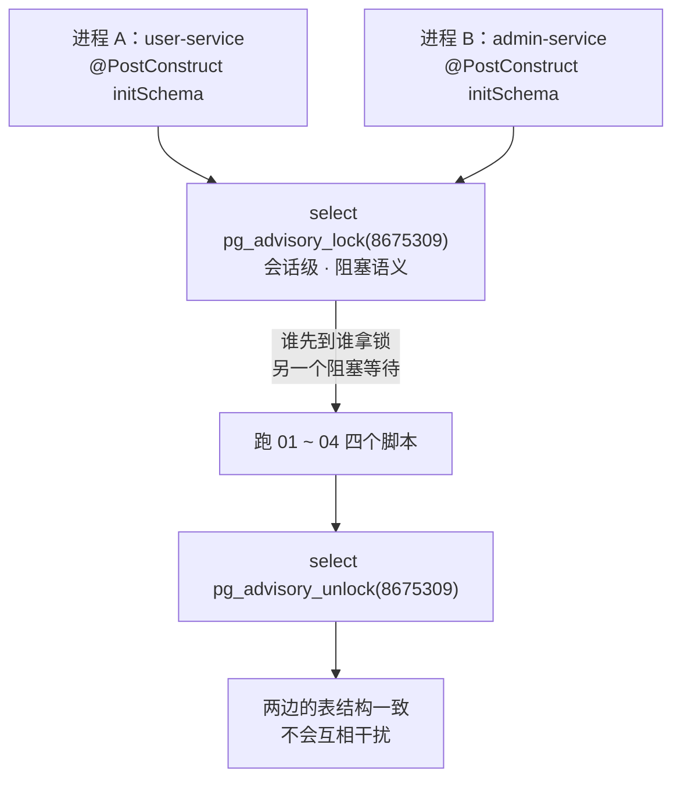
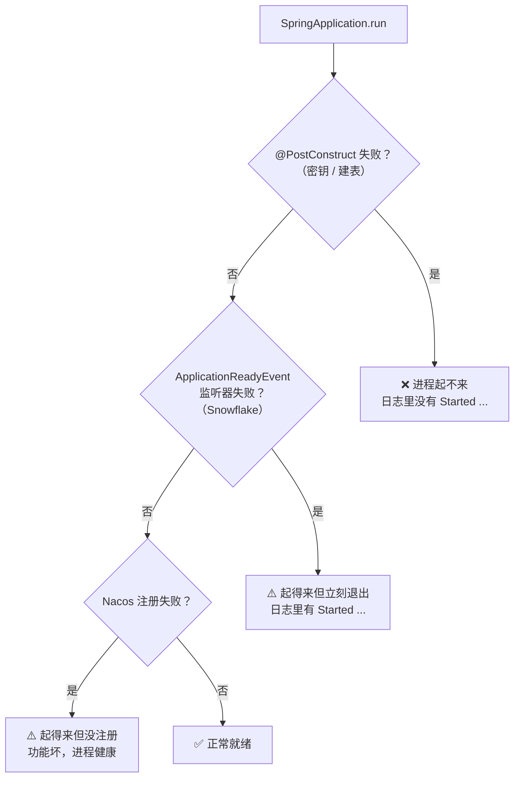
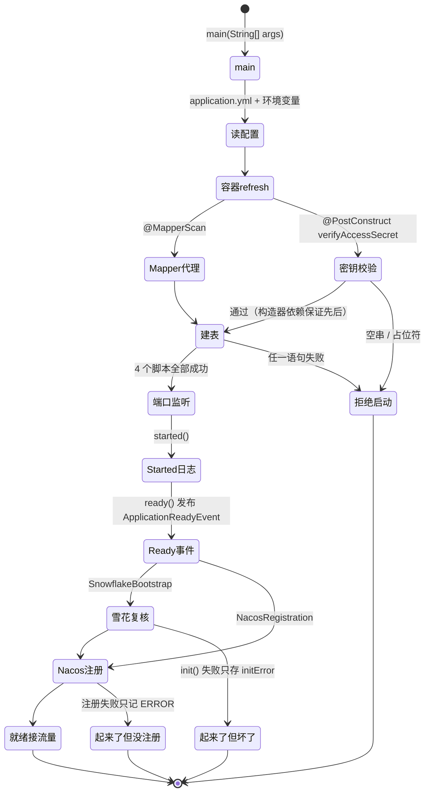

# 13. 应用启动与初始化流程

> 本篇讲的是**另一个维度**：不看某一次请求，而是看**整个进程从 `main()` 到"可以接流量"之间发生了什么**。
> 启动期的每一步都在做一件有副作用的事（建表、校验密钥、解析 workerId、注册到 Nacos），
> 而且**任何一步失败都会让进程起不来** —— 这正是本篇要讲清的东西。

---

## 1. 本次流程的研究范围

### 1.1 我们要追踪什么

```bash
java -jar service/users/user/target/user-service-1.0-SNAPSHOT.jar
# 或者
mvn -pl service/users/user spring-boot:run
```

本次追踪：**从 `main()` 方法的第一行**，到**容器就绪、开始接流量**为止。

具体覆盖 8 个阶段：

| 阶段 | 谁在做 | 做什么 |
|---|---|---|
| ① | `@SpringBootApplication` | 组件扫描 + 自动配置 |
| ② | `@EnableConfigurationProperties` | `application.yml` → 配置对象 |
| ③ | `@MapperScan` | 生成 Mapper 代理 Bean |
| ④ | `UserApiProperties` / `UserRpcProperties` 的 `@PostConstruct` | **密钥校验**（fail-closed） |
| ⑤ | `UserSchemaBootstrap` 的 `@PostConstruct` | **建表**（advisory lock + 4 个脚本） |
| ⑥ | `SnowflakeBootstrap` 的 `@EventListener(ApplicationReadyEvent)` | 校验 workerId + 初始化雪花生成器 |
| ⑦ | `NacosRegistration` 的 `@EventListener(ApplicationReadyEvent)` | 注册 `user-rpc` 到 Nacos |
| ⑧ | `NacosRegistration` 的 `@PreDestroy` | 优雅停机时反注册 |

### 1.2 我们**不**追踪什么

| 不追踪 | 原因 |
|---|---|
| 每一次 HTTP / gRPC 请求的处理 | 见 [01-用户登录流程.md](./01-用户登录流程.md) §4（登录主路径）、[12-gRPC用户服务流程.md](./12-gRPC用户服务流程.md) §4（gRPC 入口） |
| Spring Boot 内部的**全部**源码细节 | 只讲**和本进程启动直接相关**的机制，不写 Spring 百科 |
| 共享层 14 个 auto-config 各自内部 | 只讲它们**在启动期做了什么、失败了会怎样**；细节见共享层文档 |
| 数据库里表结构的全部列 | 只讲建表脚本的**幂等性**与**执行机制**；列定义见 `db/*.sql` 注释 |

### 1.3 启动期最重要的一条纪律

> **启动期的副作用必须是「要么全成、要么全不成」。**

本仓在启动期做了 4 件有副作用的事：写 DDL、注册 Nacos、初始化内存态的雪花生成器、
校验密钥。其中**只有 Nacos 注册允许失败**（失败只记日志），其余三件失败 ⇒ **进程拒绝启动**。

理由写在 `UserSchemaBootstrap` 的类注释里：

> ⚠️ **「不吞异常」是硬要求**：建表失败若被吞 ⇒ 进程会先打印「Started」，
> 然后在第一次 SQL 时才炸 ⇒ 报错长得像业务 bug。

---

## 2. 触发场景与输入

### 2.1 启动命令与产物

| 项 | 值 |
|---|---|
| 可执行 jar | `service/users/user/target/user-service-1.0-SNAPSHOT.jar` |
| `Start-Class` | `com.rag.user.UserServiceApplication`（由 `spring-boot-maven-plugin` 的 `repackage` 打进 `MANIFEST.MF`） |
| 主类 | `service/users/user/src/main/java/com/rag/user/UserServiceApplication.java` |
| HTTP 端口 | `8881`（`${USER_HTTP_PORT:8881}`） |
| gRPC 端口 | `8081`（`${USER_GRPC_PORT:8081}`） |
| Actuator | `http://localhost:8881/actuator/{health,info,prometheus}` |

### 2.2 启动前必须有的环境变量

| 变量 | 缺了会怎样 | 谁在检查 |
|---|---|---|
| `USER_JWT_SECRET` | **进程起不来**（占位符没被解析 ⇒ 密钥校验抛 `IllegalStateException`） | `UserApiProperties` / `UserRpcProperties` 的 `@PostConstruct` |
| `POSTGRES_HOST` / `POSTGRES_DB` / `POSTGRES_USER` / `POSTGRES_PASSWORD` | 有默认值（`postgres` / `first_db` / `admin` / `password`）⇒ **不会**因为缺变量而失败，但连不上库 ⇒ 建表失败 ⇒ 进程起不来 | `UserSchemaBootstrap` |
| `REDIS_ADDR` / `REDIS_PORT` / `REDIS_PASSWORD` | 有默认值 ⇒ **不影响启动**（Redis 只在 logout 时才用） | —— |
| `NACOS_ADDR` / `NACOS_PORT` / `NACOS_NAMESPACE` / `NACOS_GROUP` | 有默认值 ⇒ **不影响启动**（注册失败只记日志） | `NacosRegistration` |
| `SNOWFLAKE_NODE_ID` | 可选 ⇒ 缺了走 `SERVICE_NAME + PID` 的 sha256 兜底 | `Snowflake` |

⚠️ **注意 `application.yml` 里 `user-api.user-auth.access-secret` 与
`user-rpc.user-auth.access-secret` 写的是同一个环境变量**：

```yaml
user-api:
  user-auth:
    access-secret: ${USER_JWT_SECRET}          # ← 无默认值
    access-expire: ${USER_JWT_EXPIRE:2592000}
user-rpc:
  user-auth:
    access-secret: ${USER_JWT_SECRET}          # ← 同一个环境变量
    access-expire: ${USER_JWT_EXPIRE:2592000}
```

⇒ **不可能只配一边而漏掉另一边**（这是 D1 合并进程后保留两份键名的必然结果）。

---

## 3. 整体执行路线

```mermaid
flowchart TD
    MAIN["main(String[] args)<br/>UserServiceApplication:97"]
    RUN["SpringApplication.run(...)"]
    ENV["阶段 A：读配置<br/>application.yml + 环境变量 + profile"]
    CTX["阶段 B：创建 ApplicationContext<br/>+ 注册启动类"]
    REFRESH["阶段 C：refreshContext()<br/>容器 refresh"]
    AUTO["① @EnableAutoConfiguration<br/>14 个 auto-config 生效<br/>（BFPP 阶段）"]
    SCAN["① @ComponentScan<br/>扫 com.rag.user 及子包"]
    BPP["注册 BeanPostProcessor"]
    TOMCAT["创建 Tomcat 实例<br/>（onRefresh 阶段 · 还没监听端口）"]
    SINGLETON["阶段 D：实例化单例 Bean"]
    MAPPER["③ @MapperScan<br/>为 com.rag.user.mapper.* 生成代理 Bean"]
    SECRET["④ UserApiProperties / UserRpcProperties<br/>@PostConstruct verifyAccessSecret<br/>⇒ 密钥闸门"]
    DDL["⑤ UserSchemaBootstrap<br/>@PostConstruct initSchema<br/>⇒ advisory lock + 4 个脚本"]
    LISTEN["启动 Tomcat 生命周期<br/>（finishRefresh 阶段）<br/>⇒ 此刻起 8881 真正开始监听"]
    STARTED["日志：Started UserServiceApplication in N seconds"]
    READY["ApplicationReadyEvent 事件发布"]
    SNOW["⑥ SnowflakeBootstrap.initSnowflake<br/>校验 workerId + Snowflake.init()"]
    NACOS["⑦ NacosRegistration.register<br/>注册 user-rpc @ 8081"]
    RUNNING["进程就绪，开始接流量"]
    STOP["⑧ 进程关闭：@PreDestroy deregister<br/>从 Nacos 注销"]

    MAIN --> RUN --> ENV --> CTX --> REFRESH
    REFRESH --> AUTO --> SCAN --> BPP --> TOMCAT --> SINGLETON
    SINGLETON --> MAPPER --> SECRET --> DDL --> LISTEN --> STARTED --> READY
    READY --> SNOW --> NACOS --> RUNNING
    RUNNING -.->|"SIGTERM / 容器停止"| STOP
```



⚠️ **这张图里有两个"看起来反直觉"的地方**：

1. **Tomcat 实例创建得早，但端口真正开始监听得晚。**
   Spring Boot 的 refresh 顺序是 `onRefresh()`（**创建** web server）→ `finishBeanFactoryInitialization()`
   （**实例化单例 Bean ⇒ 触发 `@PostConstruct` ⇒ 建表**）→ `finishRefresh()`（**启动** web server ⇒ 端口开始监听）。
   ⇒ 所以「端口已经监听、但表还没建好」这个中间态**不存在**：
   **表建好了，端口才开始监听。**
   ⇒ 同理，`ApplicationReadyEvent`（Nacos 注册）时端口**一定已经绑定**了 —— 这正是
   `NacosRegistration` 类注释里「此时端口已真正绑定」那句话的依据。
2. **`Started ...` 日志打在 `ApplicationReadyEvent` 之前**。
   ⇒ 后面两个阶段（Snowflake / Nacos）失败时，**那行 "Started" 已经打出来了**。

---

## 4. 逐步讲解

### 4.1 第一步：`main()` 与 `SpringApplication.run`

`service/users/user/src/main/java/com/rag/user/UserServiceApplication.java:91-99`：

```java
@SpringBootApplication
@EnableConfigurationProperties({UserApiProperties.class, UserRpcProperties.class})
@EnableDiscoveryClient
@MapperScan("com.rag.user.mapper")
public class UserServiceApplication {

    public static void main(String[] args) {
        SpringApplication.run(UserServiceApplication.class, args);
    }
}
```

整个文件只有 **4 个注解 + 1 个 main**，没有一行 `@Import`、没有一行 `scanBasePackages`。
类注释解释了为什么（B 侧 rpc 入口用 `@Import` 逐个拉 9 个共享件；本仓共享层改成了 **starter**，
由 auto-config 提供 ⇒ 域内零装配代码，决策 D3）。

### 4.2 第二步：`@SpringBootApplication` 到底做了什么

`@SpringBootApplication` 是三个注解的组合：

| 组成 | 作用 | 在本进程里的具体后果 |
|---|---|---|
| `@SpringBootConfiguration` | 标记这是配置类 | —— |
| `@EnableAutoConfiguration` | 打开自动配置 | 加载 `common/` 的 **14 个** auto-config（见下表） |
| `@ComponentScan` | 扫描启动类所在包及子包 | 扫 `com.rag.user` 及全部子包 ⇒ `controller` / `service` / `domain` / `interceptor` / `advice` / `config` / `metrics` / `grpc` / `wiring` / `contract` / `dto` / `exception` 全部纳入 |

**14 个 auto-config**（`common/src/main/resources/META-INF/spring/org.springframework.boot.autoconfigure.AutoConfiguration.imports`）：

```
GoStyleOtelAutoConfiguration          WebAutoConfiguration
JsonBodyConverterAutoConfiguration     LoggerAutoConfiguration
ObservabilityAutoConfiguration         ProtectionAutoConfiguration
SnowflakeAutoConfiguration             MybatisPlusOrderingBridgeAutoConfiguration
GrpcExceptionMapperAutoConfiguration   PersistenceAutoConfiguration
RouteTemplateAutoConfiguration         ClientProtectionAutoConfiguration
ClientAutoConfiguration                DeadlineAutoConfiguration
```

⚠️ **框架机制提示**：`@EnableAutoConfiguration` 不是在 main 方法里立刻生效的。
它注册的是**一个 `ImportSelector`**（`AutoConfigurationImportSelector`），
真正被处理是在容器 refresh 的 **`invokeBeanFactoryPostProcessors`** 阶段 ——
因为 `ConfigurationClassPostProcessor` 本身就是 `BeanDefinitionRegistryPostProcessor`。
⇒ **自动配置是容器 refresh 的一部分**，不是「main 里的一步」。

**与 gRPC 的关系**（`UserServiceApplication` 类注释第 84 行）：

> gRPC server 由 `grpc-server-spring-boot-starter` 自动起（`@GrpcService` 被扫描到即可）

⇒ 见 [12-gRPC用户服务流程.md](./12-gRPC用户服务流程.md) §4.4.1。

### 4.3 第三步：`@EnableConfigurationProperties` —— yml 怎么变成对象

```java
@EnableConfigurationProperties({UserApiProperties.class, UserRpcProperties.class})
```

这个注解的作用是：**把这两个类注册成 Bean，并让 Spring 把 yml 里的对应段绑上去**。

| 配置类 | 前缀 | yml 段 | 绑到哪 |
|---|---|---|---|
| `UserApiProperties` | `user-api` | `application.yml:57-60` | `name`（默认 `"user-api"`）+ `userAuth.accessSecret` / `userAuth.accessExpire` |
| `UserRpcProperties` | `user-rpc` | `application.yml:62-65` | `name`（默认 `"user-rpc"`）+ `userAuth.accessSecret` / `userAuth.accessExpire` |

`@NestedConfigurationProperty`（两个类里都有）标记了嵌套对象 `userAuth` ——
告诉 Spring「`userAuth` 是一个嵌套的配置对象，不是一整个扁平的字符串」。

⚠️ **「绑上了」不等于「值是对的」**：

`application.yml` 里写的是 `${USER_JWT_SECRET}`（**没有默认值**）。
Spring 的占位符解析器在 `ignoreUnresolvablePlaceholders = true` 时，
解析不出来就**原样留下字面量** ⇒ 绑到对象上的是字符串 `"${USER_JWT_SECRET}"`，
**不是 null**。

⇒ 所以「只判 null / 空串」堵不住这条路 ⇒ 必须**额外判「值里还有 `${`」**。
这正是下一节的 `@PostConstruct` 干的事。

### 4.4 第四步：`@MapperScan("com.rag.user.mapper")` —— Mapper 代理怎么来的

```java
@MapperScan("com.rag.user.mapper")
```

`@MapperScan` 是 MyBatis-Plus 的注解（`org.mybatis.spring.annotation.MapperScan`），
它会为该包下的**每个 Mapper 接口**注册一个 `MapperFactoryBean` ⇒
容器里最终拿到的是**MyBatis 生成的动态代理对象**，不是接口本身。

本域的 Mapper：

| 接口 | 位置 |
|---|---|
| `UserMapper` | `service/users/user/src/main/java/com/rag/user/mapper/UserMapper.java` |
| `UserAvatarHistoryMapper` | `service/users/user/src/main/java/com/rag/user/mapper/UserAvatarHistoryMapper.java` |

⚠️ **B 侧 api 进程没有 `@MapperScan`**（它不碰 DB）⇒ C 侧合并成单进程后**必须显式加上**，
否则 Mapper 注册不上（`UserServiceApplication` 类注释第 47~52 行写了这条）。

⚠️ **Mapper Bean 是「懒」的吗？** 不是。
`MapperFactoryBean` 会在容器 refresh 的单例实例化阶段被创建 ⇒ **Mapper 的解析（XML / 注解 / TypeHandler 注册）
发生在启动期**，不是第一次调用时。
⇒ **Mapper 写错了 ⇒ 启动就报错**，而不是第一次查库才报错。

### 4.5 第五步（闸门一）：`@PostConstruct` 的密钥校验

`service/users/user/src/main/java/com/rag/user/config/UserApiProperties.java:70-83`：

```java
@PostConstruct
void verifyAccessSecret() {
    String secret = userAuth == null ? null : userAuth.getAccessSecret();
    if (secret == null || secret.isBlank()) {
        throw new IllegalStateException(
                "user-api.user-auth.access-secret 不能为空：请设置环境变量 USER_JWT_SECRET（与 user-rpc 共享同一把签发密钥）"
                        + "—— 本模块既签发又验签，空密钥会让任何人都能伪造 JWT");
    }
    if (secret.contains("${")) {
        throw new IllegalStateException(
                "user-api.user-auth.access-secret 仍是未解析的占位符（" + secret + "）：请设置环境变量 USER_JWT_SECRET"
                        + "—— 占位符字面量是公开在仓里的常量，拿它当密钥 = 密钥公开");
    }
}
```

`UserRpcProperties` 的同名方法（`:61-74`）逻辑完全一样，只是文案里写的是 `user-rpc`。

**两道检查，各挡一种失败**：

| 检查 | 挡住的失败 | 后果 |
|---|---|---|
| `secret == null \|\| secret.isBlank()` | 环境变量被设成空串（`PropertyPlaceholderHelper` 把空串当**合法值**） | 带着**空签名密钥**正常起来 ⇒ 任何人都能伪造 JWT |
| `secret.contains("${")` | 环境变量**没设** ⇒ 绑上的是字面量 `"${USER_JWT_SECRET}"` | 用一个**公开在仓里的常量**当密钥 |

⚠️ **这是「刻意加严」的一处**：`UserRpcProperties` 的类注释说，B 侧 user-rpc **只消费 `AccessExpire`
不消费 `AccessSecret`** ⇒ 本仓这道检查对 user-rpc 侧是**纯 fail-closed 收紧**，
不改变任何已存在的运行时取值。

⚠️ **`@PostConstruct` 什么时候跑**：在**单例 Bean 实例化之后**、
`@Autowired` / 构造器注入完成之后，由 `CommonAnnotationBeanPostProcessor` 调用。
⇒ **它在「Bean 已注入依赖、但还没被使用」的时点执行**。

### 4.6 第六步（闸门二）：`@PostConstruct` 的建表

`service/users/user/src/main/java/com/rag/user/wiring/UserSchemaBootstrap.java:65-93`：

```java
@Component
public class UserSchemaBootstrap {

    private static final Logger log = LoggerFactory.getLogger(UserSchemaBootstrap.class);

    private final DataSource dataSource;
    private final UserRpcProperties properties;

    public UserSchemaBootstrap(DataSource dataSource, UserRpcProperties properties) {
        this.dataSource = dataSource;
        this.properties = properties;
    }

    /**
     * 启动期重放全部 DDL；失败即让进程起不来。
     */
    @PostConstruct
    public void initSchema() {
        String serviceName = properties.getName();
        log.info("{} schema init starting", serviceName);
        try (Connection connection = dataSource.getConnection()) {
            SchemaInitializer.applyAll(connection, serviceName);
        } catch (Exception e) {
            // 不吞：建表失败必须让整个进程起不来，否则进程会「Started」然后在第一次
            // SQL 时才炸，报错长得像业务 bug。对齐 Go 的 log.Fatalln。
            throw new IllegalStateException(serviceName + " 建表失败，进程拒绝启动", e);
        }
        log.info("{} schema init done", serviceName);
    }
}
```

#### 4.6.1 一个容易被忽略的**顺序保证**

`UserSchemaBootstrap` 的**构造器注入**了 `UserRpcProperties`。

⇒ Spring 必须先创建 `UserRpcProperties`（它的 `@PostConstruct verifyAccessSecret` **先跑完**），
才可能创建 `UserSchemaBootstrap`（它的 `@PostConstruct initSchema` **后跑**）。

⇒ **密钥校验一定在建表之前**。这不是巧合，是构造器依赖带来的硬顺序。

⚠️ 反过来：`UserSchemaBootstrap` **不依赖** `UserApiProperties` ⇒
**HTTP 侧那份密钥校验与建表的先后顺序，源码无法确认**（两者都是独立的 Bean）。
（实践中两者都会在 refresh 期间完成，且 HTTP 侧那份失败同样会让进程起不来。）

#### 4.6.2 `SchemaInitializer.applyAll` 做了什么

`service/users/common/src/main/java/com/rag/users/common/SchemaInitializer.java:103-130`：

```java
public static void applyAll(Connection connection, String serviceName) throws SQLException {
    // 先拿会话级 advisory lock：把两个服务并发建表这件事串行化。
    // 拿不到就一直等（PG 的 pg_advisory_lock 是阻塞语义），等到即可，
    // 因为另一个进程执行完就会释放 —— 不会死锁，也不需要超时。
    boolean locked = false;
    try (Statement st = connection.createStatement()) {
        st.execute("select pg_advisory_lock(" + ADVISORY_LOCK_KEY + ")");
        locked = true;
        log.info("schema init [{}]: acquired advisory lock {}", serviceName, ADVISORY_LOCK_KEY);
        for (String script : SCRIPTS) {
            log.info("schema init [{}]: applying {}", serviceName, script);
            // continueOnError=false（ScriptUtils 默认）：任一条语句失败即抛 SQLException。
            ScriptUtils.executeSqlScript(connection, new ClassPathResource(script));
        }
    } finally {
        if (locked) {
            // 会话级锁在连接断开时也会自动释放，这里显式释放只是为了尽快放开，
            // 避免另一个进程干等。失败不抛：解锁失败不影响 DDL 本身的结论。
            try (Statement st = connection.createStatement()) {
                st.execute("select pg_advisory_unlock(" + ADVISORY_LOCK_KEY + ")");
            } catch (SQLException e) {
                log.warn("schema init [{}]: advisory unlock failed (连接断开也会自动释放)",
                        serviceName, e);
            }
        }
    }
    log.info("schema init [{}]: all {} scripts applied", serviceName, SCRIPTS.length);
}
```

三个常量（`:73-86`）：

```java
private static final String[] SCRIPTS = {
        "db/01_create_user.sql",
        "db/02_create_user_avatar_history.sql",
        "db/03_create_admin.sql",
        "db/04_create_admin_invite.sql",
};

private static final long ADVISORY_LOCK_KEY = 8_675_309L;
```

⚠️ **一个容易看错的事实**：**user-service 也会建 admin 的表。**
`SCRIPTS` 是**固定的 4 个脚本**，不区分调用方 ⇒
`user-service` 启动时会把 `admin_admin`（`03`）和 `admin_invite`（`04`）也建出来。
（`admin-service` 同样跑这 4 个脚本。）

#### 4.6.3 advisory lock 为什么必需



**为什么需要它**（`SchemaInitializer` 类注释第 46-48 行）：

> PG advisory lock：同一个常量键 ⇒ 两个进程并发建表时仍然串行化 ⇒ **并发建表不炸**
> （PG 的 `CREATE TABLE IF NOT EXISTS` 在并发下并不安全，
> 后到者可能撞 `pg_type_typname_nsp_index`）。

⚠️ **`pg_advisory_lock` 的三个语义要点**：

| 要点 | 说明 |
|---|---|
| **会话级**（不是 `pg_advisory_xact_lock`） | 锁绑定在**连接**上，不绑定在事务上 ⇒ 需要显式 `unlock` |
| **阻塞语义** | 拿不到锁时**阻塞等待**，不是立刻失败 ⇒ 另一个进程跑完就释放 ⇒ **不会死锁**、不需要超时 |
| **连接断开会自动释放** | 所以 `finally` 里的显式 unlock 失败只 `log.warn`，不抛 |

⚠️ 锁键 `8675309` **两个服务必须用同一个** ⇒ 改键等于让并发建表的保护失效
（`SchemaInitializer.advisoryLockKey()` 就是给守门脚本做对账用的）。

#### 4.6.4 脚本的幂等性

`service/users/common/src/main/resources/db/01_create_user.sql:33-52`：

```sql
CREATE TABLE IF NOT EXISTS users_user (
    id          BIGSERIAL PRIMARY KEY,
    uid         BIGINT NOT NULL UNIQUE,
    username    TEXT UNIQUE,
    password    TEXT,
    email       TEXT UNIQUE,
    status      BIGINT NOT NULL DEFAULT 0,
    score       INTEGER,
    extra_info  TEXT,
    create_time TIMESTAMPTZ DEFAULT CURRENT_TIMESTAMP,
    update_time TIMESTAMPTZ DEFAULT CURRENT_TIMESTAMP
);

CREATE INDEX IF NOT EXISTS idx_users_user_uid ON users_user (uid);

ALTER TABLE users_user ALTER COLUMN username TYPE text;
ALTER TABLE users_user ALTER COLUMN password TYPE text;
ALTER TABLE users_user ALTER COLUMN email   TYPE text;
```

⇒ **建表与建索引都是 `IF NOT EXISTS`** ⇒ 重复执行安全。

⇒ **那三条 `ALTER` 呢？** 它们**不是** `IF NOT EXISTS` 形态，但**语义上恒等**：
`varchar → text` 是**超集**转换，PG 里对已存在的列**恒成功** ⇒ 重复执行结果一样。
（脚本注释 `:28-31` 说明了这一点：「让**已存在的库自愈**—— 这正是 `SchemaInitializer`
无版本账本模式下「建表」之外还能承担「升级」的唯一手段」。）

`01_create_user.sql:148-153` 还有一组更微妙的三条：

```sql
SET TIME ZONE 'UTC';

ALTER TABLE users_user ALTER COLUMN create_time TYPE TIMESTAMPTZ USING create_time AT TIME ZONE 'UTC';
ALTER TABLE users_user ALTER COLUMN update_time TYPE TIMESTAMPTZ USING create_time AT TIME ZONE 'UTC';

RESET TIME ZONE;
```

⚠️ 为什么必须**先钉 UTC 再转**（脚本注释 `:127-147` 写得很清楚）：

> `timestamptz AT TIME ZONE 'UTC'` 对**已经是 timestamptz** 的列**并不恒等**：
> 会话时区非 UTC 时，**每启动一次整列时刻就偏移一次，且永不收敛**。

⇒ 所以是「会话 TZ 显式钉成 UTC → 转 → `RESET` 还原」，两条路径都恒等。

⚠️ **`SET TIME ZONE` 是会话级的** ⇒ 只影响这一条连接，不影响连接池里的其它连接
（`RESET TIME ZONE` 在同一脚本末尾把它还原了）。

⚠️ **为什么不能用 `DO $$ … $$` 条件块**（脚本注释 `:136-141`）：

> `SchemaInitializer` 用 Spring `ScriptUtils` 切分语句（分隔符 `;`），
> 而 spring-jdbc 的 `ScriptUtils` **没有 PostgreSQL 美元引号支持**
> ⇒ 块内分号照样被切断，DDL 语法错、applyAll 抛异常 ⇒ **双双重起不来**。

### 4.7 第七步：`ApplicationReadyEvent` —— 容器就绪之后

#### 4.7.1 为什么用 `@EventListener(ApplicationReadyEvent.class)` 而不是 `@PostConstruct`

| | `@PostConstruct` | `@EventListener(ApplicationReadyEvent.class)` |
|---|---|---|
| **时点** | 容器 refresh 期间，**单例 Bean 实例化后** | 容器 refresh **完成之后**、runner 跑完之后 |
| **此时 Web 容器** | 可能还没启动 | **已经启动并绑定了端口** |
| **此时能对外宣称「我准备好了」吗** | **不能**（后面还有别的 Bean 要初始化） | **能**（这就是「ready」的含义） |
| **适合做的事** | 必须先完成的**前置条件**（校验密钥、建表） | **对外宣告**（注册到服务发现、初始化 ID 生成器） |

⇒ 建表必须用 `@PostConstruct`：**表还没建好就注册到 Nacos ⇒ 流量进来第一件事就是 SQL 报错**。

⇒ Nacos 注册必须用 `ApplicationReadyEvent`：**端口还没绑定就注册 ⇒ 注册的端口是错的 / 连不上**。

`NacosRegistration` 的类注释就是这么说的：

> `@EventListener(ApplicationReadyEvent)` ⇒ 容器就绪后才注册（**此时端口已真正绑定**）

#### 4.7.2 `SnowflakeBootstrap` —— 校验 workerId

`service/users/user/src/main/java/com/rag/user/wiring/SnowflakeBootstrap.java:65-98`：

```java
@Component
public class SnowflakeBootstrap {

    private static final Logger log = LoggerFactory.getLogger(SnowflakeBootstrap.class);

    /**
     * 启动期校验 workerId 合法，并确保雪花生成器已初始化。
     */
    @EventListener(ApplicationReadyEvent.class)
    public void initSnowflake() {
        long workerId = resolveWorkerId();
        if (workerId < 0 || workerId > Snowflake.MAX_WORKER_ID) {
            throw new IllegalStateException(
                    "Snowflake workerId out of range [0, " + Snowflake.MAX_WORKER_ID + "]: " + workerId);
        }
        // 触发 Snowflake.init() 校验（throws if generateNodeId failed）
        Snowflake.init();
        log.info("SnowflakeBootstrap verified workerId={}, Snowflake ready", workerId);
    }

    private static long resolveWorkerId() {
        Long id = Snowflake.currentWorkerId();
        if (id == null) {
            Snowflake.init();
            id = Snowflake.currentWorkerId();
        }
        return id == null ? 0L : id;
    }
}
```

**workerId 从哪来？** 三档优先级（`common/src/main/java/com/rag/common/autoconfigure/SnowflakeAutoConfiguration.java` 的 `resolveWorkerId`）：

1. 环境变量 `SNOWFLAKE_NODE_ID`
2. 配置 `snowflake.worker-id`（`SnowflakeProperties`）
3. 兜底 hash：`SERVICE_NAME + "-" + PID` 的 sha256 **前 2 字节** `% 1024`
   （`common/src/main/java/com/rag/common/snowflake/Snowflake.java:395-426`）

⚠️ **实际上第 1/2 档在更早的时候就已经生效了**：

`SnowflakeAutoConfiguration` 的 `@Bean` 方法在**容器 refresh 的单例实例化阶段**就会跑：

```java
@Bean
@ConditionalOnMissingBean
public Snowflake snowflake(SnowflakeProperties props) {
    long workerId = resolveWorkerId(props);
    Snowflake.setWorkerId(workerId);
    return new Snowflake();
}
```

⇒ **workerId 在 refresh 期就已经写进 `Snowflake` 的静态状态了**
⇒ `SnowflakeBootstrap` 在 `ApplicationReadyEvent` 读到的 `Snowflake.currentWorkerId()` **早就有值**
⇒ 它的 `Snowflake.init()` 是**空操作**（`init()` 第一行就是
`if (workerId != null || initError != null) { return; }`）。

⇒ 所以 `SnowflakeBootstrap` 实际上只做了一件事：**复核**。

⚠️ **两个「看起来像 fail-fast、其实不可达」的细节**：

1. `workerId < 0 || workerId > MAX_WORKER_ID` 这个检查**实际不可达** ——
   解析链的每一档都做了 `% (MAX_WORKER_ID + 1)`（= `% 1024`）⇒ 结果恒在 `[0, 1023]`。
   类注释专门写了这条（「fail-fast 的实际可达性（照抄 B 侧，不加码）…… **不**擅自加严」）。
2. `Snowflake.init()` **不会抛异常**。看 `Snowflake.java:214-228`：

   ```java
   public static synchronized void init() {
       if (workerId != null || initError != null) {
           return; // 已初始化过，等价 sync.Once 的第二次调用直接返回
       }
       long id;
       try {
           id = generateNodeId();
       } catch (Throwable t) {
           initError = t;
           LOG.error("Snowflake initialize failed", t);
           return;                    // ⚠️ 记下来，不抛
       }
       workerId = id;
       LOG.info("Snowflake initialized with nodeId: {}", id);
   }
   ```

   ⇒ `SnowflakeBootstrap` 里那句注释「`throws if generateNodeId failed`」**与代码不符**：
   `init()` 失败时只是把原因存进 `initError` 并记一条 ERROR 日志。
   ⇒ 真正的失败会延后到**第一次 `Snowflake.nextId()`** 才暴露：
   `throw new IllegalStateException("snowflake node is not initialized", initError)`（`Snowflake.java:272-274`）。
   ⇒ 换句话说：**「UID 生成失败」不会让进程起不来，而是让第一次注册/上传头像失败。**

#### 4.7.3 `NacosRegistration` —— 注册 `user-rpc`

`service/users/user/src/main/java/com/rag/user/wiring/NacosRegistration.java:95-170`：

```java
@Component("userRpcNacosRegistration")
public class NacosRegistration {

    private static final String SERVICE_NAME = "user-rpc";

    private final NacosServiceManager nacosServiceManager;
    private final GrpcServerProperties grpcServerProperties;
    private final String groupName;

    private Instance registeredInstance;
    private String registeredServiceName;
    private String registeredGroupName;

    public NacosRegistration(NacosServiceManager nacosServiceManager,
                             GrpcServerProperties grpcServerProperties,
                             @Value("${spring.cloud.nacos.discovery.group:USER_GROUP}")
                             String groupName) {
        ...
    }

    @EventListener(ApplicationReadyEvent.class)
    public void register() {
        String serviceName = SERVICE_NAME;
        String group = this.groupName;
        int port = grpcServerProperties.getPort();

        try {
            Instance instance = new Instance();
            instance.setIp(resolveLocalIp());
            instance.setPort(port);
            instance.setHealthy(true);
            instance.setWeight(1.0);
            instance.setEphemeral(true);
            instance.setServiceName(serviceName);
            instance.setClusterName("DEFAULT");

            NamingService namingService = nacosServiceManager.getNamingService();
            namingService.registerInstance(serviceName, group, instance);

            this.registeredInstance = instance;
            this.registeredServiceName = serviceName;
            this.registeredGroupName = group;

            log.info("nacos registry, {} {} {}:{} register finished",
                    group, serviceName, instance.getIp(), port);
        } catch (NacosException | UnknownHostException e) {
            log.error("user-rpc nacos register FAILED service={} group={} port={}",
                    serviceName, group, port, e);
        }
    }
```

**六个注册细节，逐条**：

| 细节 | 取值 | 来源 / 理由 |
|---|---|---|
| 服务名 | `"user-rpc"`（**硬编码常量**） | **L1 契约**。B 侧就写死这个名字（运维健康检查查的是 `serviceName=user-rpc`）⇒ **不因 D1 合并而改成 `user-service`** |
| group | `${spring.cloud.nacos.discovery.group:USER_GROUP}` | 从配置读（不是写死）⇒ 部署设 `NACOS_GROUP` 才有效；默认值仍是 `USER_GROUP` |
| IP | `resolveLocalIp()` | 见下 |
| 端口 | `grpcServerProperties.getPort()` | **gRPC 端口 8081**，不是 HTTP 端口 8881 |
| ephemeral | `true` | 临时实例（Nacos 侧靠心跳保活） |
| clusterName | `"DEFAULT"` | —— |

**`resolveLocalIp()`（`:197-220`）**：

```java
private static String resolveLocalIp() throws UnknownHostException {
    InetAddress candidate = null;
    try {
        Enumeration<NetworkInterface> nis = NetworkInterface.getNetworkInterfaces();
        while (nis != null && nis.hasMoreElements()) {
            NetworkInterface ni = nis.nextElement();
            if (ni.isLoopback() || ni.isPointToPoint() || !ni.isUp()) {
                continue;
            }
            Enumeration<InetAddress> addrs = ni.getInetAddresses();
            while (addrs.hasMoreElements()) {
                InetAddress a = addrs.nextElement();
                if (a instanceof Inet4Address) {
                    if (candidate == null) {
                        candidate = a;
                    }
                }
            }
        }
    } catch (SocketException ignore) {
        // 退回 InetAddress.getLocalHost
    }
    return candidate != null ? candidate.getHostAddress() : InetAddress.getLocalHost().getHostAddress();
}
```

⇒ 遍历网卡 ⇒ 跳过 **loopback**（`127.0.0.1`）、**点对点**（点对点隧道）、**没 up 的**网卡
⇒ 取**第一个** IPv4 ⇒ 都没有才退回 `InetAddress.getLocalHost()`。

⚠️ **为什么不用 `InetAddress.getLocalHost()` 直接拿**（类注释里写了 B 侧 DRIFT-NEW-012）：
在 macOS 上它经常返回 `127.0.0.1` ⇒ docker 容器跨 host 网络访问不到 host loopback。

⚠️ **「只注册 1 个」是刻意的**：`application.yml:42` 里 `spring.cloud.nacos.discovery.register-enabled: false`
⇒ 关掉了 Spring Cloud 的自动注册 ⇒ **不会**再冒出一个 `user-service`@HTTP 端口 的条目
⇒ 全进程**恰好 1 个** Nacos 注册项。

⚠️ **bean 名必须显式**（`@Component("userRpcNacosRegistration")`）：
`NacosServiceRegistryAutoConfiguration` 里有个 `@Bean nacosRegistration()` ⇒
本类若用类名默认推导（也是 `nacosRegistration`）⇒ **撞名** ⇒ `BeanDefinitionOverrideException`
⇒ **整个上下文启动失败**。

⚠️ **注册失败不抛异常** ⇒ 只记一条 ERROR 日志 ⇒ **进程照常起来**。
⇒ 这是本篇 4 件启动期副作用里**唯一允许失败**的一件。

#### 4.7.4 `SnowflakeBootstrap` 与 `NacosRegistration` 的先后

两者都监听 `ApplicationReadyEvent`，**都没有 `@Order`** ⇒
**它们之间的相对执行顺序，源码无法确认**。

⇒ 实践含义：**不要**依赖「Snowflake 一定先于 Nacos 注册完成」这件事。

### 4.8 第八步：`@PreDestroy` —— 优雅停机时反注册

`NacosRegistration.java:175-189`：

```java
@PreDestroy
public void deregister() {
    if (registeredInstance == null) {
        return;
    }
    try {
        NamingService namingService = nacosServiceManager.getNamingService();
        namingService.deregisterInstance(
                registeredServiceName, registeredGroupName, registeredInstance);
        log.info("nacos registry, {} {} deregister finished",
                registeredGroupName, registeredServiceName);
    } catch (NacosException e) {
        log.warn("user-rpc nacos deregister FAILED", e);
    }
}
```

⚠️ `registeredInstance == null` 的早退是一个**隐含状态机**：
**只有注册成功过才会反注册** ⇒ 注册失败时不会去注销一个从未注册过的实例。

⚠️ 反注册失败只 `log.warn` ⇒ **不阻止进程退出**。

---

## 5. 重要分支与失败路径

| # | 失败点 | 抛出的异常 | 进程状态 | 客户端/运维可观察 |
|---|---|---|---|---|
| 1 | `UserApiProperties.verifyAccessSecret`：`USER_JWT_SECRET` 未设（值为 `${USER_JWT_SECRET}` 字面量） | `IllegalStateException` ⇒ `BeanCreationException` | **起不来** | **看不到** `Started ...` 日志；栈里能看到「仍是未解析的占位符」 |
| 2 | `UserApiProperties.verifyAccessSecret`：`USER_JWT_SECRET` 被设成空串 | 同上 | **起不来** | 看不到 `Started ...`；文案是「不能为空」 |
| 3 | `UserRpcProperties.verifyAccessSecret`：同上两种 | 同上 | **起不来** | 同上（文案里是 `user-rpc`） |
| 4 | `UserSchemaBootstrap.initSchema`：连不上 PG | `IllegalStateException("user-rpc 建表失败，进程拒绝启动", cause)` | **起不来** | 看不到 `Started ...`；cause 是 Hikari 的连接异常 |
| 5 | `SchemaInitializer.applyAll`：某个脚本的某条语句失败 | `SQLException` ⇒ 被 #4 包成 `IllegalStateException` | **起不来** | 看不到 `Started ...`；日志里有 `schema init [user-rpc]: applying db/0X_...` 指明失败在哪个脚本 |
| 6 | `SchemaInitializer.applyAll`：**拿不到 advisory lock** | **不会失败** | **正常起来** | `pg_advisory_lock` 是**阻塞**语义 ⇒ 一直等另一个进程跑完 |
| 7 | `SchemaInitializer.applyAll`：`finally` 里的 unlock 失败 | 只 `log.warn` | **正常起来** | 会话级锁在连接断开时也会自动释放 |
| 8 | `SnowflakeBootstrap.initSnowflake`：workerId 越界 | `IllegalStateException` | **起得来但立刻退出** | ⚠️ **`Started ...` 已经打出来了**；但 workerId 越界**实际不可达**（见 §4.7.2） |
| 9 | `Snowflake.init()`：`generateNodeId()` 抛异常（SHA-256 不可用） | **不抛**，只记 ERROR + 存 `initError` | **正常起来** | ⚠️ 真正的失败延后到**第一次 `Snowflake.nextId()`** ⇒ 那时 `register` / `uploadAvatar` 失败 |
| 10 | `NacosRegistration.register`：Nacos 不可达 / `UnknownHostException` | **不抛**，只记 ERROR | **正常起来** | ⚠️ **起得来但功能坏**：实例没注册 ⇒ 服务发现里查不到 `user-rpc` |
| 11 | `NacosRegistration.deregister`：反注册失败 | 只 `log.warn` | **正常退出** | Nacos 里可能留一个僵尸实例（靠 ephemeral 心跳过期清理） |
| 12 | `MapperFactoryBean` 初始化失败（Mapper 注解写错） | `BeanCreationException` | **起不来** | 看不到 `Started ...` |
| 13 | `UserServiceApplication` bean 名与 auto-config 里的 bean 撞名 | `BeanDefinitionOverrideException` | **起不来** | —— |

⚠️ **第 8 条与第 1~5 条的差别，是本篇最值得记住的一点**：

| 失败阶段 | 异常从哪抛出 | `Started ...` 日志 | 进程结局 |
|---|---|---|---|
| refresh 期（`@PostConstruct`） | Bean 初始化 | **没打** | 起不来 |
| `ApplicationReadyEvent` 期的监听器 | 事件监听器 | **已经打了** | 起得来但随即退出 |

（这是 Spring Boot 的 `SpringApplication.run` 顺序决定的：`started()` 打印 "Started ..."，
`ready()` 才发布 `ApplicationReadyEvent` —— **框架机制**，非本仓源码。）



---

## 6. 数据变化与副作用

### 6.1 副作用总表

| 副作用面 | 发生了什么 | 什么时候 | 失败的后果 |
|---|---|---|---|
| **DB（写 DDL）** | 重放 4 个 SQL 脚本 ⇒ 建/改 4 张表 + 6 个索引 | `@PostConstruct` | **进程起不来** |
| **DB（读）** | 启动期**只读**一张表？—— **没有**。启动期的唯一 DB 访问是建表 | —— | —— |
| **Nacos** | 注册 `user-rpc`（IP + 8081 + ephemeral） | `ApplicationReadyEvent` | 只记日志（功能坏） |
| **Nacos（注销）** | 反注册 | `@PreDestroy` | 只记 warn |
| **Snowflake** | 内存态初始化（静态 `STATE` + `workerId`） | refresh 期（auto-config）+ `ApplicationReadyEvent`（复核） | 延后到第一次 `nextId()` |
| **Redis** | **本流程中未发生任何读写** | —— | —— |
| **日志** | `schema init starting` / `acquired advisory lock` / `applying db/0X` / `all 4 scripts applied` / `SnowflakeBootstrap verified workerId=` / `nacos registry, … register finished` | 各阶段 | —— |
| **指标** | 启动期**不产生**业务指标（`user_rpc_*` 是领域层埋点 ⇒ 要等第一次业务请求） | —— | —— |
| **端口** | Tomcat 绑 8881、gRPC server 绑 8081 | refresh 期 | —— |

### 6.2 建表到底建了什么

| 脚本 | 建什么 | 关键约束 |
|---|---|---|
| `db/01_create_user.sql` | 表 `users_user` + 索引 `idx_users_user_uid` | `uid BIGINT NOT NULL UNIQUE`、`username TEXT UNIQUE`、`email TEXT UNIQUE`、`status BIGINT NOT NULL DEFAULT 0` |
| `db/02_create_user_avatar_history.sql` | 表 `users_user_avatar_history` + 索引 `idx_users_user_avatar_history_uid`、`idx_users_user_avatar_history_uid_is_current` | `history_id TEXT NOT NULL UNIQUE`、`uid BIGINT NOT NULL`、`is_current BOOLEAN NOT NULL DEFAULT FALSE` |
| `db/03_create_admin.sql` | 表 `admin_admin` + 索引 `idx_admin_admin_uid` | ⚠️ **user-service 也会建这张表** |
| `db/04_create_admin_invite.sql` | 表 `admin_invite` + 索引 `idx_admin_invite_code` | ⚠️ 同上 |

⇒ **4 张表、6 个索引**，全部 `IF NOT EXISTS` ⇒ 重复执行安全。

### 6.3 事务边界

⚠️ **`SchemaInitializer` 不开事务**：

- 源码里**没有** `setAutoCommit(false)` / `commit()` / `rollback()`；
- `ScriptUtils.executeSqlScript(connection, resource)` 也**不**开事务（它只是逐句执行）。

⇒ **合理推断**（不是源码明确）：本仓 `application.yml` 没有 `spring.datasource.hikari` 段
⇒ 连接池用 HikariCP 的默认值 `autoCommit = true`
⇒ **每条 DDL 语句各自立即提交**。

⇒ 后果：**第 3 个脚本失败时，第 1、2 个脚本的改动已经落库了**（表还在，只是第 3 张表没建）。
进程虽然起不来，但**数据库不是"干净的"** ⇒ 重启时会重放，幂等 ⇒ 能自愈。

⇒ `users-common` 的类注释把这套模式叫作「**无版本账本的幂等重放**」：
没有 `flyway_schema_history` 那种版本表，靠「每次原样重放 + 恒等语句」来实现升级。

---

## 7. 执行结果

### 7.1 启动成功

日志（按时间顺序，`INFO` 级别）：

```
user-rpc schema init starting
schema init [user-rpc]: acquired advisory lock 8675309
schema init [user-rpc]: applying db/01_create_user.sql
schema init [user-rpc]: applying db/02_create_user_avatar_history.sql
schema init [user-rpc]: applying db/03_create_admin.sql
schema init [user-rpc]: applying db/04_create_admin_invite.sql
schema init [user-rpc]: all 4 scripts applied
user-rpc schema init done
Started UserServiceApplication in 5.123 seconds (process running for 6.789)
SnowflakeBootstrap verified workerId=123, Snowflake ready
nacos registry, USER_GROUP user-rpc 172.17.0.2:8081 register finished
```

⚠️ **两行日志的顺序不保证**：`SnowflakeBootstrap verified workerId=…` 与
`nacos registry, … register finished` 谁先谁后取决于两个监听器的执行顺序
（**源码无法确认**，见 §4.7.4）。

### 7.2 启动成功后的可观察状态

| 观察点 | 期望 |
|---|---|
| `curl localhost:8881/actuator/health` | `{"status":"UP", ...}` |
| `curl localhost:8881/actuator/prometheus` | 含 `rpc_server_requests_code` / `rpc_server_requests_duration_ms` 等指标 |
| `psql` 查库 | 4 张表存在 |
| Nacos 控制台 | `USER_GROUP` 组下有一个 `user-rpc` 实例，端口 **8081** |
| `lsof -i :8081` | gRPC server 在听 |

### 7.3 启动失败

异常栈顶是 `IllegalStateException`，**`Started ...` 那行不会出现**：

```
org.springframework.beans.factory.BeanCreationException:
  Error creating bean with name 'userApiProperties':
  Invocation of init method failed
Caused by: java.lang.IllegalStateException:
  user-api.user-auth.access-secret 仍是未解析的占位符（${USER_JWT_SECRET}）：
  请设置环境变量 USER_JWT_SECRET—— 占位符字面量是公开在仓里的常量，拿它当密钥 = 密钥公开
```

建表失败时：

```
org.springframework.beans.factory.BeanCreationException:
  Error creating bean with name 'userSchemaBootstrap':
  Invocation of init method failed
Caused by: java.lang.IllegalStateException: user-rpc 建表失败，进程拒绝启动
Caused by: org.postgresql.util.PSQLException: ...
```

⇒ **进程以非 0 退出码结束** ⇒ 容器编排会重启它 ⇒ 如果是**配置问题**，就是**无限重启**。

---

## 8. 流程复盘

一次启动，真正走过的代码：

```
UserServiceApplication.main
  ↓ SpringApplication.run
  ↓ 读 application.yml（ConfigDataEnvironmentPostProcessor）
  ↓ refreshContext
    ↓ @EnableAutoConfiguration ⇒ common/ 的 14 个 auto-config 生效
    ↓ @ComponentScan ⇒ 扫 com.rag.user 及子包
    ↓ 实例化单例 Bean
      ├─ @MapperScan ⇒ UserMapper / UserAvatarHistoryMapper 的代理 Bean
      ├─ UserApiProperties / UserRpcProperties
      │    └─ @PostConstruct verifyAccessSecret ⇒ 密钥闸门
      ├─ SnowflakeAutoConfiguration#snowflake ⇒ Snowflake.setWorkerId(...)
      └─ UserSchemaBootstrap
           └─ @PostConstruct initSchema
                └─ SchemaInitializer.applyAll
                     ├─ select pg_advisory_lock(8675309)
                     ├─ ScriptUtils.executeSqlScript × 4（01 ~ 04）
                     └─ select pg_advisory_unlock(8675309)
  ↓ Started ... 日志
  ↓ ApplicationReadyEvent
       ├─ SnowflakeBootstrap.initSnowflake（复核 workerId）
       └─ NacosRegistration.register（user-rpc @ 8081 → Nacos）
  ↓ 进程就绪，开始接流量
```

**边界结论**：

1. **启动期的副作用有 4 处**：DDL、Nacos 注册、Snowflake 初始化、密钥校验。
   **只有 Nacos 注册允许失败**（失败 = 起得来但功能坏），其余失败 ⇒ **进程起不来**。
2. **`@PostConstruct` 与 `ApplicationReadyEvent` 的分工**：
   前者是「**必须先完成的前置条件**」（表、密钥），后者是「**可以对外宣告**」（端口已绑定）。
3. **构造器注入带来顺序保证**：`UserSchemaBootstrap` 注入 `UserRpcProperties`
   ⇒ **密钥校验一定在建表之前**。
4. **advisory lock 让两个进程串行化**：user-service 与 admin-service 跑**同一批 4 个脚本**、
   用**同一把锁键 8675309** ⇒ 谁先跑都行，重复重放恒等。
5. **没有 Flyway**：users 域刻意不用版本账本（决策 D17）⇒ 靠「`IF NOT EXISTS` + 恒等 `ALTER`」实现幂等。
6. **`user-service` 也会建 admin 的表** —— 因为 `SCRIPTS` 是固定的 4 个脚本。

---

## 9. 源码定位与验证方式

### 9.1 源码位置

| 内容 | 文件 | 位置 |
|---|---|---|
| 启动类（4 个注解 + main） | `service/users/user/src/main/java/com/rag/user/UserServiceApplication.java` | `:91-99` |
| 建表 bootstrap | `service/users/user/src/main/java/com/rag/user/wiring/UserSchemaBootstrap.java` | `initSchema` `:81-93` |
| DDL 幂等执行器 | `service/users/common/src/main/java/com/rag/users/common/SchemaInitializer.java` | `SCRIPTS` `:73-78`；锁键 `:86`；`applyAll` `:103-130` |
| Snowflake 校验 | `service/users/user/src/main/java/com/rag/user/wiring/SnowflakeBootstrap.java` | `initSnowflake` `:73-83`；`resolveWorkerId` `:91-98` |
| Nacos 注册 | `service/users/user/src/main/java/com/rag/user/wiring/NacosRegistration.java` | `SERVICE_NAME` `:103`；`register` `:141-170`；`deregister` `:175-189`；`resolveLocalIp` `:197-220` |
| 密钥校验（HTTP 侧） | `service/users/user/src/main/java/com/rag/user/config/UserApiProperties.java` | `verifyAccessSecret` `:70-83` |
| 密钥校验（gRPC 侧） | `service/users/user/src/main/java/com/rag/user/config/UserRpcProperties.java` | `verifyAccessSecret` `:61-74` |
| 雪花算法 | `common/src/main/java/com/rag/common/snowflake/Snowflake.java` | `init` `:214-228`；`nextId` `:268-280`；`generateNodeId` `:395-426`；`MAX_WORKER_ID` `:65` |
| workerId 解析 | `common/src/main/java/com/rag/common/autoconfigure/SnowflakeAutoConfiguration.java` | `snowflake` Bean；`resolveWorkerId` |
| 建表脚本 | `service/users/common/src/main/resources/db/01_create_user.sql` … `04_create_admin_invite.sql` | 见 §6.2 |
| 配置文件 | `service/users/user/src/main/resources/application.yml` | 端口 `:79-94`；密钥 `:57-65`；超时 `:75-77`；Nacos `:27-42` |
| auto-config 清单 | `common/src/main/resources/META-INF/spring/org.springframework.boot.autoconfigure.AutoConfiguration.imports` | 14 行 |

### 9.2 测试（可复跑）

本域的启动期断言：

| 测试类 | 断的是什么 |
|---|---|
| `UserServiceApplicationTests`（6 例） | 上下文装配 · `@MapperScan` 生效 · `@GrpcService` 被扫到 · JWT 两段 bean 都在 · **DDL 在启动期真被重放**（查真 PG）· 表名 L1 |
| `UserNacosRegistrationWiringTest`（6 例） | 注册名 = `user-rpc` · 端口 = gRPC 端口 · group 来自配置 · 默认值零变化 · yml 仍声明 group · 自动注册已关 |
| `UserApiPropertiesSecretGuardTest`（7 例） | 密钥 fail-closed：**null / 空串 / 未解析占位符** 三路都必须启动失败（api ＋ rpc 两侧） |
| `UserGrpcServiceContractTest`（4 例） | 真 gRPC server 上 9 个方法全被派发（见 [12-gRPC用户服务流程.md](./12-gRPC用户服务流程.md) §9.2） |

```bash
# 只跑本域
mvn -pl service/users/user -am test

# 单独跑启动期那一组
mvn -pl service/users/user -am test \
    -Dtest='UserServiceApplicationTests+UserNacosRegistrationWiringTest+UserApiPropertiesSecretGuardTest'
```

⚠️ 本域的测试需要 **真 PostgreSQL**（Testcontainers）。

### 9.3 不确定性的边界（明确写出来）

| 问题 | 状态 |
|---|---|
| `Snowflake.init()` 的失败是否会让进程起不来 | **不会** —— 源码明确它只存 `initError` 并记 ERROR（`Snowflake.java:221-224`）；`SnowflakeBootstrap` 里那句「throws if generateNodeId failed」的注释**与代码不符** |
| `workerId` 越界检查是否可达 | **不可达** —— 解析链每档都 `% 1024`（类注释自述） |
| `SnowflakeBootstrap` 与 `NacosRegistration` 的先后 | **源码无法确认**（都没有 `@Order`） |
| `UserApiProperties` 的密钥校验与建表的先后 | **源码无法确认**（两者无依赖关系；只保证都在 refresh 期完成） |
| DDL 的事务边界 | **合理推断**：无显式事务 + HikariCP 默认 `autoCommit=true` ⇒ 逐句提交。本仓 yml 未配 `spring.datasource.hikari` |
| 「`Started ...` 早于 `ApplicationReadyEvent`」 | **Spring Boot 框架机制**（`started()` → `ready()`），非本仓源码 |
| gRPC server 具体在哪个 refresh 子阶段绑定端口 | **源码无法确认**（由 devh starter 决定） |
| `admin-service` 的建表路径 | 本篇只读了 `AdminSchemaBootstrap.java:69`（同样是 `SchemaInitializer.applyAll(connection, "admin-service")`）⇒ 同一批脚本、同一把锁 |

---

## 相关文档

- [01-用户登录流程.md](./01-用户登录流程.md) —— 启动完成后跑的第一条业务流（§4 是它自己的入口讲解）
- [12-gRPC用户服务流程.md](./12-gRPC用户服务流程.md) —— gRPC server 是在启动期被装配起来的，本篇讲「什么时候」（§4.4.1 讲「装配完之后怎么被调用」）
- [11-HTTP统一响应与异常处理流程.md](./11-HTTP统一响应与异常处理流程.md) —— 启动失败与运行期异常是两种不同的处理路径（§4 是运行期那条）
---

## 10. 从需求到实现：如果让我重新开发「应用启动与初始化」

> **本章与前 9 章的分工**
> 第 1~9 章回答的是「这套代码跑起来时，进程从 `main()` 到「可以接流量」之间发生了什么」。
> 本章反过来回答：**如果我只拿到一句「这个服务启动时要能连上库、建好表、注册到服务发现，然后才能接流量」的需求，我该怎么把它推导出上面那套启动流程。**
>
> 本篇的特别之处：它讲的是**第三个维度**——不是「一次请求」，也不是「一个协议入口」，而是**进程的生命周期**。
> 所以本章的重点是：**启动期要完成哪几件事、它们的顺序依赖从哪来、哪些失败必须让进程拒绝启动**。
>
> ⚠️ **本章没有原始需求文档。** 全仓**不存在**「启动流程 PRD」这类文件
> ⇒ 本章的「需求」是**从现有行为反向还原出来的需求模型**，**不是**原开发者真实的需求记录。
> ⇒ 凡属「原作者当初为什么这么设计」的判断，一律标【存疑】。

### 10.0 本章的证据分级（通篇使用）

| 标记 | 含义 | 本章用它回答什么 |
|---|---|---|
| 【事实】 | 可在**当前仓库源码 / 建表 SQL** 里直接确认的行为 | 「它现在**是什么**」——附 `文件:行号` |
| 【契约】 | 可在 **proto / 建表 SQL / 共享层 / B 侧台账 / 已登记降级清单**里确认的要求 | 「它**必须**是什么」——附契约出处 |
| 【推导】 | 由前两类推出的设计要求 | 「它**应该**是什么」——**不冒充原作者的意图** |
| 【存疑】 | 现有资料不足以确定 | 明说「不知道」，不编 |

> ⚠️ **口径**：本章引用的行号是**我自己逐个打开文件核对过的**，与本文 §9.1 可能差几行（那张表写于更早的提交）⇒ 以本章为准。

---

### 10.A 从需求推导业务行为

#### 10.A.1 手上的原始输入，和它到底有多原始

如果我现在只接到一句需求，它长这样：

> 「这个服务启动时要能连上库、建好表、注册到服务发现，然后才能接流量。」

这句话**写不出一行代码**，因为它没有回答任何一条**可被测试**的问题：

- **「建好表」是哪几张表**？本域要建**别人的**表吗？
- 表已经存在怎么办？**重复启动**安全吗？**两个进程同时**启动安全吗？
- 「注册到服务发现」注册的是**哪个服务名**、**哪个端口**？注册**失败**了进程还能起来吗？
- 「然后才能接流量」——「接流量」的口径是**端口开始监听**，还是**注册成功**？
- **密钥**要不要在启动期校验？如果不校验而密钥是空的，会发生什么？
- **UID 生成器**（雪花 ID）要不要在启动期就绪？如果它坏了，是**启动失败**还是**第一次注册时失败**？
- 失败的**时刻**重要吗？「启动失败」与「运行期第一次请求才炸」对运维的意义完全不同。

⇒ **第一步不是写代码，是把这句话变成一组可判定的行为。**

#### 10.A.2 推导的七个问题，以及每个问题的答案出处

| # | 我必须先回答的问题 | 本项目里的答案 | 证据等级 | 依据 |
|---|---|---|---|---|
| Q1 | 启动期要完成哪几件事？ | **5 件**：① Mapper 代理注册 ② **密钥 fail-closed 校验** ③ **DDL 重放**（4 个脚本）④ **雪花 workerId 复核** ⑤ **Nacos 注册**（＋ 停机时反注册） | 【事实】 | 本文 §1.1 的 8 阶段表 ＋ `UserServiceApplication.java:91-94` |
| Q2 | 哪些失败**允许**继续，哪些必须**拒绝启动**？ | 允许失败的**只有 Nacos 注册**（只记 ERROR 日志）；其余（密钥、建表）失败 ⇒ **进程起不来** | 【事实】 | `NacosRegistration.java:166-169`（catch 不抛）vs `UserSchemaBootstrap.java:87-91`（抛 `IllegalStateException`） |
| Q3 | 表是**哪些**表？ | **4 张**：`users_user` / `users_user_avatar_history` / `admin_admin` / `admin_invite` —— ⚠️ **user-service 也会建 admin 的表** | 【事实】 | `SchemaInitializer.java:73-78`（`SCRIPTS` 是固定数组，不区分调用方） |
| Q4 | 重复启动 / 并发启动安全吗？ | 靠**幂等 DDL**（`IF NOT EXISTS` ＋ 恒等 `ALTER`）＋ **PG advisory lock**（键 `8675309`）串行化 | 【事实】+【契约】 | `SchemaInitializer.java:86` ＋ `:103-130` ＋ `01_create_user.sql:33-52` |
| Q5 | 升级怎么做？ | ⚠️ **没有版本账本**（不用 Flyway）⇒ 靠「**每次原样重放** + 恒等语句」实现 | 【契约】 | `SchemaInitializer.java:30-37` 的 javadoc ＋ `01_create_user.sql:28-31` |
| Q6 | 「可以接流量」的口径是什么？ | **端口开始监听**（`finishRefresh`）⇒ 此时**表已建好、密钥已校验**；但 `ApplicationReadyEvent`（雪花复核 + Nacos 注册）在**其后** ⇒ 「Started ...」日志**早于**那两件事 | 【事实】+【推导】 | 本文 §3 的两个「反直觉」点（框架机制） |
| Q7 | 有没有「种子数据」？ | **没有** —— 4 个脚本里 **0 条 `INSERT`**（`grep -c INSERT` 四个文件全为 0），域内也没有 `ApplicationRunner` / `CommandLineRunner` | 【事实】 | `service/users/common/src/main/resources/db/*.sql` ＋ 全域 grep |

> 🔴 **Q2 是本篇的纪律核心**：
> 「建表失败若被吞 ⇒ 进程会先打印「Started」，然后在第一次 SQL 时才炸 ⇒ **报错长得像业务 bug**」
> （`UserSchemaBootstrap.java:55-56` 的类注释原话）。
> ⇒ 所以启动期有一条**硬纪律**：**副作用要么全成、要么全不成**（本文 §1.3）。
> ⚠️ 而「副作用」其实有 **4 处**（DDL / Nacos 注册 / 雪花初始化 / 密钥校验），**其中只有 Nacos 允许失败**。

#### 10.A.3 行为清单（这是本章后面所有推导的**唯一输入**）

| 编号 | 行为 | 成功判据 | 失败判据 / 形态 | 证据等级 | 依据 |
|---|---|---|---|---|---|
| **B-01** | **密钥 fail-closed**：空串或未解析占位符 ⇒ 拒绝启动 | 密钥是**非空**且**不含 `${`** 的真实值 | `IllegalStateException` ⇒ `BeanCreationException` ⇒ **看不到 `Started ...`** | 【事实】 | `UserApiProperties.java:71-84` ＋ `UserRpcProperties.java:62-75` |
| **B-02** | 两份密钥配置**指向同一个环境变量** | —— | 不可能只配一边 | 【契约】 | `application.yml:57-60` ＋ `:62-65`（两个键都写 `${USER_JWT_SECRET}`） |
| **B-03** | **DDL 重放**：4 个脚本按文件名顺序执行 | 4 张表都存在 | 任一条语句失败 ⇒ `SQLException` ⇒ 包成 `IllegalStateException` ⇒ **进程拒绝启动** | 【事实】 | `SchemaInitializer.java:112-116` ＋ `UserSchemaBootstrap.java:85-91` |
| **B-04** | DDL **幂等** | 重复执行结果不变 | —— | 【契约】 | `01_create_user.sql:33-52`（`IF NOT EXISTS` ＋ 恒等 `ALTER`） |
| **B-05** | **并发建表串行化** | 两个进程先后拿到同一把锁 | —— | 【契约】 | `SchemaInitializer.java:104-111`（`pg_advisory_lock(8675309)`） |
| **B-06** | 锁是**会话级**、**阻塞语义** | 后到者**等待**而不是失败 | —— | 【事实】 | `SchemaInitializer.java:104-106` 的注释 ＋ `:118-127` 的 `finally` |
| **B-07** | 建表**无事务**：逐句提交 | —— | 第 3 个脚本失败时，第 1、2 个的改动**已落库** | 【推导】 | 无 `setAutoCommit(false)` / `commit()` / `rollback()`（`SchemaInitializer.java` 全文无）+ `ScriptUtils` 不开事务 |
| **B-08** | 恒等自愈语句：`ALTER ... TYPE text` | varchar→text 是**超集**转换 ⇒ 恒成功 | —— | 【契约】 | `01_create_user.sql:28-31` ＋ `:50-52` |
| **B-09** | ⚠️ **时间列的自愈必须「先钉 UTC 再转」** | 重放不改变任何一行的时刻 | 若裸写 `AT TIME ZONE 'UTC'` ⇒ **每启动一次整列时刻平移一次，且永不收敛** | 【契约】 | `01_create_user.sql:127-147`（注释里写明了推导与实测）＋ `:148-153`（`SET` / `ALTER` / `RESET`） |
| **B-10** | `extra_info` 的 `jsonb→text` 转换**是**幂等的 | 重放不再有任何变化 | —— | 【契约】 | `01_create_user.sql:93-100`（注释：**「别照抄那个的担心」**） |
| **B-11** | **不能用 `DO $$ … $$` 条件块** | —— | `ScriptUtils` 按 `;` 切句、**不支持 PG 美元引号** ⇒ 块内分号被切断 ⇒ DDL 语法错 ⇒ **双双重起不来** | 【契约】 | `01_create_user.sql:136-141`（写明「实测不可行，已回退」）＋ `SchemaInitializer.java:59-62` |
| **B-12** | **雪花 workerId 复核** | `workerId ∈ [0,1023]` | 越界 ⇒ `IllegalStateException`（⚠️ **实际不可达**：解析链每档都 `% 1024`） | 【事实】 | `SnowflakeBootstrap.java:73-83` ＋ `SnowflakeAutoConfiguration.java:90-105` ＋ `Snowflake.java:401,422` |
| **B-13** | ⚠️ **雪花初始化失败**不会让进程起不来 | —— | `Snowflake.init()` 只把原因存进 `initError` 并记 ERROR ⇒ 真正的失败**延后到第一次 `nextId()`** | 【事实】 | `Snowflake.java:214-228`（`:222` 存 `initError`）＋ `:268-280`（`:273` 抛） |
| **B-14** | **Nacos 注册**：服务名 `user-rpc`、端口 = **gRPC 端口**、group 从配置读 | 注册成功 ⇒ `log.info("nacos registry, … register finished")` | 注册失败 ⇒ **只记 ERROR，进程照常起来**（功能坏） | 【事实】 | `NacosRegistration.java:103,141-170` |
| **B-15** | **只注册 1 个**：Spring Cloud 的自动注册被关掉 | 全进程恰好 1 个 Nacos 条目 | —— | 【契约】 | `application.yml:42`（`register-enabled: false`）＋ `UserNacosRegistrationWiringTest#autoRegistrationIsDisabled`（`:183-194`） |
| **B-16** | **停机反注册** | `@PreDestroy` 调 `deregisterInstance` | 反注册失败 ⇒ 只 `log.warn`，**不阻止进程退出** | 【事实】 | `NacosRegistration.java:175-189` |
| **B-17** | **启动失败 vs 运行期失败**可区分 | ① refresh 期失败 ⇒ **没有** `Started ...` 日志 ② `ApplicationReadyEvent` 期失败 ⇒ **`Started ...` 已经打了** | —— | 【事实】+【推导】 | 本文 §5 的对照表（`started()` → `ready()` 是 Spring Boot 框架机制） |
| **B-18** | **端口在表建好之后才开始监听** | —— | 「端口已监听但表还没建好」这个中间态**不存在** | 【推导】 | Spring refresh 顺序：`onRefresh()`（创建 web server）→ `finishBeanFactoryInitialization()`（实例化单例 ⇒ 触发 `@PostConstruct`）→ `finishRefresh()`（启动 web server） |

> **B-09 与 B-10 放在一起，是本篇最值得记住的一对**：
> 同样是「`ALTER COLUMN ... TYPE`」，一个（`varchar→text`）**恒等**、一个（`timestamp→timestamptz` 带 `AT TIME ZONE`）**不恒等**。
> ⇒ **「照抄模式」只在语义同型时成立 —— 外形像不等于语义像**（`01_create_user.sql:134` 的原话）。
> ⇒ 而这两条结论**全部来自 SQL 注释里的真实推导与实测**，不是我的臆测。

#### 10.A.4 需求里没写、但动手前必须自己定下来的六件事

1. **【推导】密钥校验必须发生在「服务可用」之前。**
   空密钥或占位符密钥 = **任何人可伪造 token** ⇒ 这不是「登录时才发现」的问题，是**进程不该起来**的问题。
   ⇒ 推导出 B-01 ＋ 启动期 fail-closed 的纪律。
2. **【推导】「占位符」这个失败模式必须单独判。**
   Spring 的占位符解析器在 `ignoreUnresolvablePlaceholders = true` 时**解析不出来就原样留下字面量**
   ⇒ 绑到对象上的是字符串 `"${USER_JWT_SECRET}"`，**不是 null** ⇒ 只判「null / 空串」**堵不住这条路**。
   ⇒ 推导出 `secret.contains("${")` 这一道检查（`UserApiProperties.java:79`）。
3. **【推导】建表必须幂等 + 并发安全。**
   容器编排会**反复重启**（同一个 Pod 反复起）⇒ 不幂等 ⇒ 第二次启动就炸；
   两个域（user / admin）**必须连同一个库** ⇒ 不加锁 ⇒ 并发建表会撞 `pg_type_typname_nsp_index`。
   ⇒ 推导出 B-04、B-05 ＋ advisory lock。
4. **【推导】「副作用要么全成、要么全不成」——但 Nacos 是例外，且例外必须写明。**
   建表失败若被吞 ⇒ 进程「Started」之后第一次 SQL 才炸 ⇒ **报错长得像业务 bug** ⇒ 排障方向从一开始就跑偏。
   ⇒ 推导出 B-03 的「抛异常」与 B-14 的「catch 后只记日志」这一对**不对称**。
5. **【推导】升级不能靠「版本号」，只能靠「恒等重放」。**
   两个进程（user / admin）连同一个库 ⇒ **schema 级账本只能有一本** ⇒ 两边各带一套迁移版本号会撞车
   （版本号相同、内容不同 ⇒ 后启动者要么静默跳过自己的迁移，要么 checksum mismatch 启动失败）。
   ⇒ 推导出「无版本账本 + 幂等重放」这一整条路线（B-04/B-08/B-09/B-10）。
6. **【推导】「哪些失败允许继续」必须逐项写死，而不是靠默认。**
   Nacos 不可达 ⇒ 起得来但**服务发现里查不到** ⇒ 运维健康检查可能只看「进程活着」⇒ 变成**静默坏掉**。
   ⇒ 推导出 B-14 的「只记 ERROR」＋ **必须**有一条外部监控盯着那条 ERROR 日志（否则就白记了）。

#### 10.A.5 必须保持不变的既有行为（改代码时的红线）

| 红线 | 为什么不能动 | 依据 |
|---|---|---|
| advisory lock 键 **8675309** | **两个服务必须用同一个** ⇒ 改键 = 并发建表的保护失效 | 【契约】`SchemaInitializer.java:84-86` ＋ `advisoryLockKey()`（`:146-148`，就是给守门脚本对账用的） |
| `SCRIPTS` 的**文件清单与顺序** | 两个服务跑**同一批**脚本 ⇒ 顺序决定依赖 | 【契约】`SchemaInitializer.java:73-78` |
| 配置键名 `user-api.*` / `user-rpc.*` / `observability.*` / `grpc.server.port` / `spring.cloud.nacos.discovery.group` | 键名是 **L1 契约**（B 侧两份 yml 逐条一致） | 【契约】`application.yml:57-65` 等 |
| `USER_JWT_SECRET` **无默认值** | 加默认值 = 把「公开在仓里的常量」变成合法密钥 ⇒ **安全回退** | 【契约】`application.yml:52-55` 的注释 |
| Nacos 注册名 `user-rpc`（**不**改成 `user-service`） | 运维健康检查查的是 `serviceName=user-rpc`；B 侧跨域寻址也指着它 | 【契约】`NacosRegistration.java:31-43` 的类注释 |
| 「表还没建好就不注册到 Nacos」 | 反过来 ⇒ 流量进来第一件事就是 SQL 报错 | 【推导】本文 §4.7.1 |
| `snowflake.worker-id` 的 `% 1024` 解析 | 改它会**改变 workerId 取值** ⇒ 影响 UID 分布 | 【事实】`Snowflake.java:401,422` |
| `SET TIME ZONE 'UTC'` / `RESET TIME ZONE` 的三段结构 | 少了 `SET` ⇒ 时刻平移；少了 `RESET` ⇒ 连接归还连接池后行为漂移 | 【契约】`01_create_user.sql:143-147` |

#### 10.A.6 从行为清单到状态机



> **这张图是「需求状态机」**（不是启动顺序图）——它把「**失败发生在哪个阶段**」与「**进程结局**」绑在一起。
> 最关键的区分在图的下半部：**「拒绝启动」（看不到 `Started ...`）** vs
> **「起来了但坏了 / 起来了但没注册」（`Started ...` 已经打了）**（B-17）
> ⇒ 这两条在运维上的处理方式**完全不同**（前者是「CrashLoopBackOff，看栈」；后者是「进程健康但功能坏」）。

---

### 10.B 从业务行为推导组件设计

> 🔴 **本章最容易走偏的地方**：把启动期的东西当成「一堆初始化代码」。
> 那样得到的是「**这个项目启动时跑了哪些方法**」，不是「**哪些事必须在什么时候做完、失败怎么办**」。

#### 10.B.1 推导的第一问：每个行为要交给谁承担

| 行为 | 承担者 | 为什么是它（而不是别的） |
|---|---|---|
| B-01 密钥 fail-closed | `UserApiProperties` / `UserRpcProperties` 的 `@PostConstruct` | 校验对象是**自己绑上的配置** ⇒ 放在配置类里最自然；且 `@PostConstruct` 保证「Bean 已注入依赖、还没被使用」的时点 |
| B-02 两份密钥同源 | `application.yml` 的两个键写**同一个** `${USER_JWT_SECRET}` | 配置层解决 ⇒ 代码层**零逻辑** |
| B-03/B-04/B-05 建表 | `UserSchemaBootstrap`（域内）＋ `SchemaInitializer`（共享层静态工具） | 见 10.B.2 第三行 |
| B-07 无事务 | `SchemaInitializer` **不**开事务（也不该开） | DDL 在 PG 里本就隐式提交；显式开事务会让「一条失败 ⇒ 全部回滚」与「重放做升级」的语义打架 |
| B-08~B-11 恒等语句 | **建表 SQL 文件本身** | 「幂等」是**语句的属性**，不是执行器的属性 ⇒ 写在 SQL 里 ⇒ 执行器保持简单 |
| B-12/B-13 雪花 | `SnowflakeAutoConfiguration`（**解析并写入静态状态**）＋ `SnowflakeBootstrap`（**复核**） | 解析在 refresh 期（早），复核在 ready 期（晚）⇒ 两处各司其职 |
| B-14/B-15/B-16 Nacos | `NacosRegistration` | 注册名/group/端口/反注册都是**这个组件的专属契约** |
| B-17 失败阶段可区分 | Spring Boot 的 `started()` → `ready()` 顺序（框架机制） | —— |
| B-18 端口晚于建表 | `@PostConstruct`（refresh 期）vs `ApplicationReadyEvent`（ready 期） | 见 10.B.2 第一行 |

#### 10.B.2 为什么必须这样分层：五个「合并掉会怎样」的反事实

| 假设合并 | 会发生什么 | 结论 |
|---|---|---|
| 把建表挪到 `ApplicationReadyEvent` | 端口**已经监听**了才建表 ⇒ 有一段时间「端口通、但表还没建好」⇒ 流量进来第一件事就是 SQL 报错 ⇒ **正好是本篇要避免的那种失败** | ⇒ 建表必须 `@PostConstruct`（**refresh 期**），注册必须 `ApplicationReadyEvent`（**端口已绑定**） |
| 把 Nacos 注册挪到 `@PostConstruct` | 注册时端口**还没绑定** ⇒ 注册的端口可能是错的 / 连不上 ⇒ 服务发现里出现一个**连不通的实例** | ⇒ 注册必须在 ready 期 |
| 把 `SchemaInitializer` 挂成 `@Component` | 它在**共享层**（`service/users/common`），而各 app 只扫**自己的包** ⇒ 这个 Bean **永远不会被创建** ⇒ 造一个「永不生效的假 bean」 | ⇒ 保持**静态工具 + 各服务自己的 `wiring/*SchemaBootstrap` 显式调用**（`SchemaInitializer.java:54-57` 的 javadoc 明写） |
| 把 `advisory lock` 去掉，只靠 `IF NOT EXISTS` | PG 的 `CREATE TABLE IF NOT EXISTS` 在并发下**并不安全** ⇒ 后到者可能撞 `pg_type_typname_nsp_index` ⇒ **两个域同时启动时随机炸** | ⇒ 必须有锁 |
| 把 `Snowflake.init()` 的失败改成抛异常 | 会让「SHA-256 不可用」这类**极罕见**故障变成**每次启动都失败** ⇒ 而 B 侧是 `log.Fatalln` 之外的另一种语义 ⇒ 且 `SnowflakeBootstrap` 里那句「throws if generateNodeId failed」的注释**本来就与代码不符** | ⇒ 【事实】保持「存 `initError` + 记 ERROR」，失败**延后到第一次 `nextId()`**（B-13）⇒ 但必须**有人看着那条 ERROR 日志** |

#### 10.B.3 配置与常量：这些「简单文件」是怎么被推导出来的

##### `application.yml` 的四段

| 推导问题 | 结论 | 依据 |
|---|---|---|
| 为什么 `user-api` 与 `user-rpc` **两个键都留着**，而不是合并成一个？ | 合并进程后两边**只需要一把**密钥，但**键名是 L1 契约**（B 侧两份 yml 各写一遍）⇒ 不能删 ⇒ 但让它们**都指向同一个环境变量** ⇒ 不可能只配一边 | 【契约】`application.yml:47-50` 的注释 ＋ `:57-65` |
| 为什么 `access-secret` **不写默认值**？ | 加了默认值（哪怕是 `changeme`）⇒ 缺变量时进程**带着一个公开的常量**正常起来 ⇒ 任何人都能伪造 JWT ⇒ **必须**让它启动失败 | 【契约】`application.yml:52-55` ＋ `UserApiProperties.java:27-35` |
| 为什么 `observability.http-timeout` / `rpc-timeout` **没有 env 兜底**？ | 这两个键**缺失 = 机制静默不生效**（缺省即 `Duration.ZERO` ⇒ 不限时）⇒ 必须**显式写** | 【契约】`application.yml:67-73` 的注释 |
| 为什么 `grpc.client` 必须是**合法空 map `{}`**？ | 写成「只有注释的空键」⇒ YAML 解析成**空串**⇒ relaxed binding 拿 String 去转 `Map<String, GrpcChannelProperties>` ⇒ `ConverterNotFoundException` ⇒ **整个上下文启动失败** | 【契约】`application.yml:87-94` |

##### `SchemaInitializer` 的两个常量

| 推导问题 | 结论 | 依据 |
|---|---|---|
| `SCRIPTS` 为什么是**固定的 4 个**、不按调用方区分？ | user 域与 admin 域**必须连同一个库**（admin 侧也读写 `users_user`）⇒ 两边跑**同一批脚本** ⇒ 谁先跑都行 ⇒ 固定的数组就是「同一批」的表达 | 【契约】`SchemaInitializer.java:30-37` ＋ 本文 §4.6.2 |
| 脚本名的**数字前缀**是什么意思？ | ⚠️ **只保证确定性顺序，不表示版本**（`:71` 的 javadoc 原话）⇒ 这是「无版本账本」路线的必然产物 | 【契约】`SchemaInitializer.java:68-72` |
| `ADVISORY_LOCK_KEY` 为什么是 `long` 而不是 `int`？ | PG 的 `pg_advisory_lock` 有 **bigint** 与 **int** 两个版本；用 bigint 避免与别的 key 空间撞 | 【事实】`SchemaInitializer.java:80-86` |

##### `UserApiProperties` / `UserRpcProperties`（两份几乎一样）

| 推导问题 | 结论 | 依据 |
|---|---|---|
| 为什么**两个**配置类而不是一个？ | 两段配置的**前缀不同**（`user-api` / `user-rpc`）⇒ `@ConfigurationProperties(prefix=…)` 一个类只能绑一个前缀 ⇒ 必须两个类 | 【契约】`UserApiProperties.java:55` ＋ `UserRpcProperties.java:49` |
| 为什么 `name` 字段有默认值 `"user-api"` / `"user-rpc"`？ | `UserSchemaBootstrap` 用 `properties.getName()` 做**日志前缀**（`UserSchemaBootstrap.java:83`）⇒ 默认值保证「不配置也能跑」 | 【事实】`UserApiProperties.java:58` ＋ `UserRpcProperties.java:52` |
| 为什么 `@NestedConfigurationProperty` 是必需的？ | `userAuth` 是一个**嵌套对象**（`user-auth` 段）⇒ 不标的话 Spring 可能把 `userAuth` 当成**一个扁平的 String** ⇒ 绑定失败 | 【事实】`UserApiProperties.java:60-61` |
| `verifyAccessSecret` 为什么是 **`void` 且不 `public`**？ | 它是**框架回调**（`@PostConstruct`），不是业务 API ⇒ 不该被外部调用 ⇒ 包级可见就够 | 【事实】`UserApiProperties.java:71-72` |

#### 10.B.4 框架替我做了什么、我仍然必须自己写什么

| 职责 | 框架承担 | 我必须自己写 |
|---|---|---|
| Bean 生命周期钩子 | `@PostConstruct` / `@EventListener(ApplicationReadyEvent)` / `@PreDestroy` | **时机选哪个**（这是决策，不是框架给的） |
| 扫描 / 自动配置 | `@SpringBootApplication` / `@EnableAutoConfiguration` / `@MapperScan` | ——（域内零装配） |
| 配置绑定 | `@ConfigurationProperties` + `@EnableConfigurationProperties` | 键名（**L1 契约**）＋ **值是否合法的判据**（B-01） |
| DDL 执行 | `ScriptUtils.executeSqlScript`（按 `;` 切句） | **每一条语句必须恒等**（因为它不支持 `$$`，且无事务） |
| HTTP / gRPC server 启动 | Spring Boot / devh starter | —— |
| 服务发现客户端 | Nacos SDK | **注册名 / group / 端口 / IP 选取 / 失败处理** |
| 雪花 ID 算法 | `Snowflake`（共享层） | **workerId 的来源与优先级** ＋ **失败时怎么办** |

> ⚠️ **框架承担 ≠ 业务行为被免除**：
> Spring 给你 `@PostConstruct` 这个钩子，但**「哪些事必须在这个钩子里做完」是业务决定**；
> `ScriptUtils` 给你「执行 SQL 脚本」的能力，但**「每条语句必须恒等」是业务决定**（而且这条决定**写在 SQL 文件里**，不在 Java 里）；
> Nacos SDK 给你注册 API，但**「注册失败要不要让进程死」是业务决定**。

---

### 10.C 从空文件推导代码实现

#### 10.C.1 动手前先钉死的四张清单

| 清单 | 内容 | 从哪来 |
|---|---|---|
| ① 副作用清单 | 启动期做哪几件**有副作用**的事？各自的失败策略是什么？ | 10.A.2 的 Q1/Q2 ＋ 本文 §1.3 |
| ② 顺序清单 | 哪些事必须在哪些事**之前**？靠什么保证？ | 10.A.6 状态机 ＋ 10.B.2 第一行 |
| ③ DDL 清单 | 每张表、每条语句、**每条语句是否恒等** | `db/*.sql` ＋ B-08~B-11 |
| ④ 契约清单 | 不能改的键名 / 锁键 / 注册名 ＋ 改动需要谁拍板 | 10.A.5 红线表 |

#### 10.C.2 `UserSchemaBootstrap`：从空文件到 12 行方法体

```java
@Component                                     // ① 放在 wiring/ 包：启动期副作用集中在这里
public class UserSchemaBootstrap {

    private final DataSource dataSource;       // ② 只依赖 DataSource 与配置
    private final UserRpcProperties properties;

    public UserSchemaBootstrap(DataSource dataSource, UserRpcProperties properties) {
        this.dataSource = dataSource;
        this.properties = properties;
    }

    @PostConstruct                             // ③ 时机：refresh 期，接流量之前
    public void initSchema() {
        String serviceName = properties.getName();       // ④ 日志前缀来自配置
        log.info("{} schema init starting", serviceName);
        try (Connection connection = dataSource.getConnection()) {   // ⑤ 连接由本类持有并关闭
            SchemaInitializer.applyAll(connection, serviceName);
        } catch (Exception e) {
            // 不吞：建表失败必须让整个进程起不来，否则进程会「Started」然后在第一次
            // SQL 时才炸，报错长得像业务 bug。对齐 Go 的 log.Fatalln。
            throw new IllegalStateException(serviceName + " 建表失败，进程拒绝启动", e);
        }
        log.info("{} schema init done", serviceName);
    }
}
```

| 步骤 | 我怎么知道该这么写 | 反事实 |
|---|---|---|
| 1 | 启动期副作用集中在 `wiring` 包，失败一律 fail-fast（B 侧 `bootstrap/` 的既有约定，`UserSchemaBootstrap.java:58-59`） | 放域内任意包 ⇒ 找不到 |
| 2 | **构造器注入 `UserRpcProperties`** ⇒ 这是**顺序保证的来源**：Spring 必须先创建 `UserRpcProperties`（它的 `@PostConstruct verifyAccessSecret` **先跑完**），才可能创建本类 ⇒ **密钥校验一定在建表之前** | 改成字段注入 + `@Autowired` ⇒ **顺序不再保证** ⇒ 可能先建表再校验密钥 |
| 3 | `@PostConstruct`（refresh 期）⇒ 表在端口监听**之前**建好（B-18） | 用 `ApplicationReadyEvent` ⇒ 端口已监听 ⇒ 有窗口期 |
| 5 | 连接由**本类**持有并关闭（`try-with-resources`）⇒ 生命周期明确；`SchemaInitializer` **不**自己开连接（`SchemaInitializer.java:91-95` 的 javadoc） | 每个脚本各拿一条 ⇒ 连接数翻倍、且锁语义变乱 |
| 6 | **不吞异常** ⇒ 进程拒绝启动（硬要求，`UserSchemaBootstrap.java:55-56`） | 吞掉 ⇒ 进程「Started」后第一次 SQL 才炸 ⇒ **报错长得像业务 bug** |

#### 10.C.3 `SchemaInitializer.applyAll`：从空文件到 5 步

```java
public static void applyAll(Connection connection, String serviceName) throws SQLException {
    boolean locked = false;
    try (Statement st = connection.createStatement()) {
        st.execute("select pg_advisory_lock(" + ADVISORY_LOCK_KEY + ")");   // ① 先拿锁
        locked = true;
        log.info("schema init [{}]: acquired advisory lock {}", serviceName, ADVISORY_LOCK_KEY);
        for (String script : SCRIPTS) {
            log.info("schema init [{}]: applying {}", serviceName, script);
            ScriptUtils.executeSqlScript(connection, new ClassPathResource(script));  // ② 逐个执行
        }
    } finally {
        if (locked) {
            try (Statement st = connection.createStatement()) {
                st.execute("select pg_advisory_unlock(" + ADVISORY_LOCK_KEY + ")");    // ③ 尽量快放开
            } catch (SQLException e) {
                log.warn("schema init [{}]: advisory unlock failed (连接断开也会自动释放)", serviceName, e);
            }
        }
    }
    log.info("schema init [{}]: all {} scripts applied", serviceName, SCRIPTS.length);
}
```

| 步骤 | 我怎么知道该这么写 |
|---|---|
| ① 先拿锁 | 两个域并发建表 ⇒ PG 的 `CREATE TABLE IF NOT EXISTS` 在并发下**不安全**（后到者可能撞 `pg_type_typname_nsp_index`）⇒ 必须串行化（`SchemaInitializer.java:46-48`） |
| ① 用 `pg_advisory_lock`（**会话级**）而不是 `pg_advisory_xact_lock` | 会话级锁**连接断开即释放** ⇒ 即使 `finally` 里的 unlock 失败也不会留下死锁；代价是需要显式 unlock |
| ① 拿不到锁就**一直等**（阻塞语义），**不设超时** | 另一个进程执行完就释放 ⇒ 不会死锁 ⇒ 不需要超时（B 侧同款） |
| ② `ScriptUtils.executeSqlScript` **不**传 `continueOnError` | 默认 `false` ⇒ **任一条语句失败即抛 `SQLException`** ⇒ 绝不能吞（B-03） |
| ② 逐个脚本打日志 | 失败时能立刻知道**是哪个脚本**断的（本文 §5 的第 5 条） |
| ③ unlock 失败只 `log.warn` | 锁的**结论**（DDL 有没有跑完）不受 unlock 失败影响 ⇒ 失败不该掩盖真正的结论 |

#### 10.C.4 建表 SQL：一条「恒等自愈语句」是怎么写出来的

这是本篇**最值得单独一节**的推导。目标：让 `ALTER` 在**每次重放**时都**恒等**。

| 步骤 | 推导 | 落成的 SQL |
|---|---|---|
| ① 放宽列宽（varchar → text） | `text` 是 `varchar` 的**超集**且**不需要 `USING`** ⇒ 对已存在的列**恒成功** ⇒ 重放结果一样 ⇒ 可反复执行 | `ALTER TABLE users_user ALTER COLUMN username TYPE text;`（`01_create_user.sql:50-52`） |
| ② 改列的 JSON 存储类型（jsonb → text） | jsonb→text 是 **assignment cast**（非 implicit）⇒ 不写 `USING` 会报错；但 `text→text` 是**恒等转换** ⇒ 重放不再有任何变化 ⇒ **幂等** | `ALTER TABLE users_user ALTER COLUMN extra_info TYPE text USING extra_info::text;`（`:101`） |
| ③ 改时间列类型（timestamp → timestamptz） | ⚠️ **这一步最容易写错**：`timestamptz AT TIME ZONE 'UTC'` 对**已经是 timestamptz** 的列**并不恒等** —— 会话时区非 UTC 时，**每启动一次整列时刻就偏移一次，且永不收敛** | 必须在转换前把会话时区**显式钉成 UTC**，转完 `RESET` 还原（`:148-153`） |
| ④ 想用条件块省事 | ❌ `DO $$ … $$` **不可行**：`ScriptUtils` 按 `;` 切句、**不支持 PG 美元引号** ⇒ 块内分号被切断 ⇒ DDL 语法错 ⇒ **user-rpc 与 admin-rpc 双双起不来**（实测：34 个测试全红在启动阶段） | **放弃条件块**，改成「两条路径都恒等」的无分支写法 |

```sql
-- ① 放宽列宽：超集转换 ⇒ 恒成功
ALTER TABLE users_user ALTER COLUMN username TYPE text;

-- ② jsonb → text：text→text 恒等 ⇒ 重放无变化
ALTER TABLE users_user ALTER COLUMN extra_info TYPE text USING extra_info::text;

-- ③ 时间列：先钉 UTC，再转，最后还原 ⇒ 两条路径都恒等
SET TIME ZONE 'UTC';
ALTER TABLE users_user ALTER COLUMN create_time TYPE TIMESTAMPTZ USING create_time AT TIME ZONE 'UTC';
ALTER TABLE users_user ALTER COLUMN update_time TYPE TIMESTAMPTZ USING create_time AT TIME ZONE 'UTC';
RESET TIME ZONE;
```

> 🔴 **这一节的通用教训**（`01_create_user.sql:134` 的原话）：
> **「照抄 R3 模式」只在语义同型时成立 —— 外形像不等于语义像。**
> ⇒ 写第一条幂等 `ALTER` 时觉得「这个模式可以到处用」⇒ 到了 `timestamptz` 那条就**整列时刻平移**。
> ⇒ 所以「幂等」**不是**「这条语句长得像幂等的语句」，而是**「这条语句在重放下的复合结果不收敛」这条性质**。

#### 10.C.5 实现顺序（谁先谁后）与每步的完成判据

| 序 | 先做哪一步 | 为什么不能颠倒 | 完成判据 |
|---|---|---|---|
| 1 | **配置键与属性类** | 后面每件事都要读配置 | 属性绑得上，且 `verifyAccessSecret` 在三种坏值下都抛异常 |
| 2 | **密钥校验**（`@PostConstruct`） | 必须**早于**建表（构造器依赖）⇒ 也早于端口监听 | 缺 `USER_JWT_SECRET` ⇒ **看不到** `Started ...` |
| 3 | **建表 SQL 脚本**（`db/*.sql`） | 执行器依赖脚本存在 | 每条语句**恒等**（重放两次结果一致） |
| 4 | **`SchemaInitializer`**（执行器） | 依赖脚本清单 | 4 个脚本按序执行、任一失败即抛 |
| 5 | **`UserSchemaBootstrap`**（接线） | 依赖执行器 | 建表后**端口才开始监听** |
| 6 | **雪花解析 + 复核** | workerId 必须在**第一次 `nextId()`** 之前就位 | `Snowflake.currentWorkerId() != null` |
| 7 | **Nacos 注册 / 反注册** | 必须在端口绑定之后 | 服务发现里出现 `user-rpc` @ 8081 |
| 8 | **测试** | 依赖全部 | 见 10.D |

---

### 10.D 如何验证实现符合需求

> 🔴 **本章的红线**：**「能编译」「测试通过」「代码看起来没问题」都不等于「行为正确」**。
> 而且启动期有一个**特别**的红线：**「进程起来了」不等于「启动期该做的事都做成了」**
> —— Nacos 注册失败时进程**照样起来**（B-14）⇒ 必须查**副作用**，不能只看「进程活着」。

#### 10.D.1 从行为清单推导用例，并对照现有测试

| 行为 | 推导出的用例 | 本项目现状 | 依据 |
|---|---|---|---|
| B-01 | api 侧：`null` / 空串 / 未解析占位符 三路都启动失败 | ✅ 已覆盖 | `UserApiPropertiesSecretGuardTest#apiNullSecretFailsFast`（`:38-47`）＋ `#apiBlankSecretFailsFast`（`:49-57`）＋ `#apiPlaceholderSecretFailsFast`（`:59-68`） |
| B-01 | rpc 侧：`null` / 未解析占位符 两路都启动失败；合法密钥放行 | ✅ 已覆盖 | `#rpcNullSecretFailsFast`（`:81-90`）＋ `#rpcPlaceholderSecretFailsFast`（`:92-101`）＋ `#apiValidSecretPasses`（`:70-77`）/ `#rpcValidSecretPasses`（`:103-110`） |
| B-02 | yml 里两个键都指向 `USER_JWT_SECRET` | ⚠️ **未覆盖**（`UserApiPropertiesSecretGuardTest` 只测方法，不读 yml） | 依据：`application.yml:57-65` |
| B-03/B-04 | **DDL 在启动期真被重放**：查真 PG ⇒ `users_user` 表存在 | ✅ 已覆盖 | `UserServiceApplicationTests#schemaWasAppliedAtStartup`（`:116-123`） |
| B-03 | 建表失败 ⇒ 进程起不来 | ⚠️ **未覆盖**（需要断掉 PG 或注入坏脚本） | 依据：`UserSchemaBootstrap.java:87-91` |
| B-04 | **重复重放结果一致**（幂等） | ⚠️ **未覆盖**（现有测试只验证一次重放的结果） | 依据：`01_create_user.sql:28-31` |
| B-05 | 两个进程并发建表不炸 | ⚠️ **未覆盖**（需要真的并发起两个进程） | 依据：`SchemaInitializer.java:46-48` |
| B-09 | 重放**不改变**任何一行的时刻 | ⚠️ **未覆盖**（需要「建表 → 写入 → 再重放 → 逐行比对」） | 依据：`01_create_user.sql:127-134` |
| B-12 | workerId 校验通过 | ⚠️ **未覆盖**（`SnowflakeBootstrap` 没有专门测试） | 依据：`SnowflakeBootstrap.java:73-83` |
| B-13 | 雪花初始化失败 ⇒ **起得来但第一次 `nextId()` 失败** | ⚠️ **未覆盖** | 依据：`Snowflake.java:214-228` ＋ `:268-280` |
| B-14 | 注册名 = `user-rpc`；端口 = gRPC 端口；group 来自配置 | ✅ 已覆盖 | `UserNacosRegistrationWiringTest#registrationUsesBServiceName`（`:69-90`）＋ `#registrationUsesGrpcPort`（`:92-115`）＋ `#registrationUsesConfiguredGroup`（`:121-139`） |
| B-14 | group 默认值零变化 | ✅ 已覆盖 | `#defaultGroupIsUnchanged`（`:145-163`） |
| B-15 | yml 里仍声明了 group；自动注册已关 | ✅ 已覆盖 | `#applicationYamlStillDeclaresGroup`（`:169-181`）＋ `#autoRegistrationIsDisabled`（`:183-194`） |
| B-16 | 停机时反注册 | ⚠️ **未覆盖**（需要真的走 `@PreDestroy`） | 依据：`NacosRegistration.java:175-189` |
| B-18 | 端口在表建好之后才开始监听 | ⚠️ **未覆盖**（需要并发探测端口 + 查表） | 依据：Spring refresh 顺序（框架机制） |
| —— | `@MapperScan` 真生效、`@GrpcService` 被扫到、JWT 两段 Bean 都在、表名 = L1 | ✅ 已覆盖 | `UserServiceApplicationTests` 的 `#mapperBeansAreRegistered`（`:91-98`）＋ `#grpcServiceBeanExists`（`:100-105`）＋ `#jwtTwoStageBeansExist`（`:107-114`）＋ `#tableNamesMatchB`（`:125-132`） |

⇒ **诚实的结论**：**「进程能起来 + 表建出来了 + Nacos 注册参数对」这三件事有测试覆盖**；
但**「失败时的行为」「幂等性」「并发」「副作用的持久性」这四类几乎没有覆盖**。

#### 10.D.2 三类结论必须分开写

| 类别 | 本流程里的具体内容 | 怎么标注 |
|---|---|---|
| **已运行验证** | B-01（6 个用例）＋ B-03/B-04 的一次重放 ＋ B-14（三条）＋ B-15（两条）＋ `@MapperScan`/`@GrpcService`/JWT 两段/表名 | 「真 Spring 上下文 + 真 PG 断言通过」（`UserServiceApplicationTests` / `UserApiPropertiesSecretGuardTest` / `UserNacosRegistrationWiringTest`） |
| **仅源码推导，未运行** | B-02（yml 两键同源）、B-03（失败路径）、B-04（幂等重放）、B-05（并发）、B-09（时刻不变）、B-12、B-13、B-16、B-18 | 「源码推导，未运行」 |
| **无法确认** | `SnowflakeBootstrap` 与 `NacosRegistration` 两个 `ApplicationReadyEvent` 监听器的**相对顺序**（都没有 `@Order`）；DDL 的**事务边界**（合理推断：HikariCP 默认 `autoCommit=true` ⇒ 逐句提交，本仓 yml 未配 `spring.datasource.hikari`）；gRPC server 具体在哪个 refresh 子阶段绑定端口 | 【存疑】 |

#### 10.D.3 怎么验「副作用」，而不只是「进程起来了」

| 行为 | 「进程起来了」能证明什么 | 真正要查的地方 |
|---|---|---|
| B-03 建表 | 进程过了 refresh 期 | 查**真 PG**：`information_schema.tables` 里有没有那 4 张表（`UserServiceApplicationTests#schemaWasAppliedAtStartup` 就是这么查的） |
| B-04 幂等 | 第一次重放成功 | **再起一次** ⇒ 表结构与数据**逐行相同**（尤其 `create_time` / `update_time` 的**时刻**——B-09 就藏在这里） |
| B-05 并发 | 单进程没问题 | **同时**起两个进程（user + admin）⇒ 两者都成功、且 `information_schema` 里的结构一致 |
| B-14 Nacos | 进程活着 | 查**服务发现**：Nacos 控制台 `USER_GROUP` 组下有没有 `user-rpc`、端口是不是 **8081**（**不是** 8881） |
| B-13 雪花 | 进程活着 | **第一次 `nextId()`**（即第一次 `register`）能不能成功 ⇒ 这才是 B-13 的真正暴露点 |
| B-16 反注册 | 进程退出码是 0 | Nacos 里有没有**僵尸实例**（`ephemeral=true` ⇒ 靠心跳过期清理，但停机瞬间会有一条 warn） |
| B-17 失败阶段 | —— | 看**有没有 `Started ...` 那行日志**（框架机制的分界线） |

#### 10.D.4 怎么验「失败策略」，而不只是「起起来了」

常见错误写法：只测「正常启动成功」⇒ **失败路径完全没被验证**。
正确写法要断言**三件事**：

1. **进程结局**（起不来 / 起得来但坏）
2. **失败发生在哪个阶段**（有没有 `Started ...` 日志）
3. **失败的证据落在哪**（异常类型 + 消息 + 哪条日志）

⇒ 例：`UserApiPropertiesSecretGuardTest` 断言的是 `isInstanceOf(IllegalStateException.class)` **且** `hasMessageContaining("未解析的占位符")`
⇒ 区分了「空串」与「占位符」两种失败（`#apiBlankSecretFailsFast` vs `#apiPlaceholderSecretFailsFast`）
⇒ 因为这两种失败在**运维处置**上是不同的（前者是「变量被设成空」、后者是「变量压根没设」）。

#### 10.D.5 回归范围：改了这个流程，什么必须重新验

| 改动类型 | 必须回归 |
|---|---|
| 改 `application.yml` 的任何键 | 该键绑定的属性类 ＋ **两个**配置类（B-02：两个键同源）＋ 若是 `observability.*` ⇒ 跨文档 [`./12`](./12-gRPC用户服务流程.md)（gRPC 的 2s 超时） |
| 改 `verifyAccessSecret` 的判据 | B-01 的 6 个用例 ＋ **新增**「空串」「占位符」两条的**消息**（运维按消息定位） |
| 改 `db/*.sql` 里**任何一条语句** | **幂等重放**（起两次进程，逐行比对）＋ B-09（时刻不变）＋ **两个服务**都要验（admin 域跑同一批脚本） |
| 加一个建表脚本 | `SchemaInitializer.SCRIPTS`（**两个服务共用** ⇒ 改一处 ⇒ 两边都变）＋ 启动期重放 ＋ 跨文档 [`./02`](./02-用户注册流程.md) 等读写方 |
| 改 `ADVISORY_LOCK_KEY` | ⚠️ **必须**同时改 admin 域 ⇒ 否则两把锁 ⇒ 并发保护失效 ⇒ 只能用 `advisoryLockKey()` 对账（`SchemaInitializer.java:146-148` 就是为此存在） |
| 改 `UserSchemaBootstrap` 的**注入依赖** | ⚠️ 顺序保证（密钥先于建表）可能失效 ⇒ B-01 + B-03 的先后要重新证明 |
| 改 `@PostConstruct` → `ApplicationReadyEvent` | B-18（端口与建表的先后）＋ **跨文档** [`./12`](./12-gRPC用户服务流程.md)（gRPC server 也在这段时间起来） |
| 改 `NacosRegistration` 的注册名 / group / 端口 | B-14 三条用例 ＋ 运维健康检查（B 侧 `docker-compose` 查的是 `serviceName=user-rpc`） |
| 改 `Snowflake` 的 workerId 解析 | B-12 + **UID 分布**（改动会改变 UID 落库值） |

---

### 10.E 出现问题时如何定位

> 🔴 **红线**：定位不是「看日志 / 查数据库 / 上 Debug」，而是**一串有顺序的排除**。
> 下面三个案例都来自本流程**真实存在的机制**（不是虚构的故障剧本）。

#### 10.E.1 案例一：进程起来了，但第一笔业务请求报「表不存在」

| 要素 | 内容 |
|---|---|
| **1. 故障现象** | 容器编排反复重启后终于「Healthy」；但第一笔 `register` 请求返回 500，日志里是 `relation "users_user" does not exist` |
| **2. 预期行为** | 表在**端口开始监听之前**就建好了（B-18）⇒ 不可能出现「服务可用但表不存在」 |
| **3. 实际行为** | 表**根本没建**（或建到了**另一个库**）⇒ 进程却起来了 ⇒ 说明建表这一步**被吞了**，或者连的是**另一个 schema** |
| **4. 排查入口** | **先看启动日志里有没有 `schema init` 那几行**，再看有没有 `Started ...` ⇒ 两行日志的**有无组合**直接分出四种情形 |
| **5. 检查顺序** | ① 日志里有 `schema init starting` 吗？② 有 `schema init done` 吗？③ 有 `acquired advisory lock` 吗？④ 有 `applying db/0X_...` 吗？⑤ 有 `Started ...` 吗？ |
| **6. 可能原因** | ① **`schema init starting` 都没有** ⇒ 建表**根本没跑** ⇒ `@PostConstruct` 没触发 ⇒ Bean 没被扫描到（`@Component` 的包不在扫描路径）② 有 `starting` 但**没有** `done` ⇒ 建表**中途失败** ⇒ 但异常被吞了（违反硬要求）⇒ 找 `IllegalStateException("… 建表失败，进程拒绝启动")` ③ 四行都有 ⇒ 建表**成功** ⇒ 那「表不存在」是**连错库**（`application.yml:11-15` 的 `POSTGRES_HOST/PORT/DB` 与实际不符，或连接串指向了**另一个 schema**）④ 四行都有但表确实不在 ⇒ 建到了**另一个 schema**（PG 的 `search_path`） |
| **7. 排除过程** | ① 查日志四行的**组合**：`starting` 有没有？`done` 有没有？⇒ **没有 `done`** ⇒ 建表失败 ⇒ 去堆栈里找 `IllegalStateException` ⇒ 找到 ⇒ 根因在**建表**；找不到 ⇒ 异常被吞了（违反硬要求）⇒ **确认 ②** ② `done` 有 ⇒ 建表成功 ⇒ **排除 ①②** ③ 用**一条独立的只读 SQL**（不经过 Java）查 `information_schema.tables`：`SELECT table_schema, table_name FROM information_schema.tables WHERE table_name='users_user'` ⇒ **查得到** ⇒ 表在，只是**不在应用的 search_path 里** ⇒ **确认 ④**；**查不到** ⇒ 表真的没建 ⇒ 排除 ③④ ⇒ 回到 ① |
| **8. 根因确认** | 判据 = **「启动日志四行 + 一条独立 SQL」的组合**。日志告诉你「Java 侧认为建表成功了」，SQL 告诉你「表在哪个 schema」⇒ 两个独立证据才能把「建表失败」与「连错库/schema」分开。**只看其中一边都会误判。** |
| **9. 影响范围** | ① 全部**读** `users_user` 的流程（登录、查询、更新、删除）② 全部**写**流程（注册、头像上传）③ **启动期本身是「成功」的** ⇒ 健康检查说 Healthy ⇒ 运维的「重启次数」这个信号**看不到问题** ⇒ 真正的信号只有**业务错误率** ⇒ 这是「起得来但功能坏」的典型（B-17） |
| **10. 修复与验证** | 按 ⑦ 分出的方向修：① ⇒ 查 `@Component` 的包与 `@SpringBootApplication` 的扫描范围；② ⇒ 修构建表失败的那个 SQL 语句（并**确认异常不再被吞**）③/④ ⇒ 修 `application.yml` 的库指向或 `search_path` ⇒ 回归 **B-03、B-04、B-18** ＋ 补一条「进程起来 ⇒ 表一定在」的断言（**用与建表不同的连接去查** ⇒ 否则又是自证） |

#### 10.E.2 案例二：反复重启后，`create_time` 的时刻越来越怪

| 要素 | 内容 |
|---|---|
| **1. 故障现象** | 服务重启几次之后，查 `users_user` 发现 `create_time` 的值**整体偏移了**（每次重启偏几个小时）；而 `update_time` 的偏移量还**和 `create_time` 不一致** |
| **2. 预期行为** | 重放是**恒等**的 ⇒ 任何一行的时刻都**不应该**因为重启而改变（B-04/B-09） |
| **3. 实际行为** | 时刻被**平移**了 ⇒ 说明有语句**不恒等** ⇒ 而且两个时间列的偏移量不同 ⇒ 说明它们**不是同一条语句**的效果 |
| **4. 排查入口** | **建表 SQL 里的 `ALTER ... TYPE` 语句**，特别是 `01_create_user.sql:148-153` 那一段（`SET TIME ZONE` / 两条 `ALTER` / `RESET TIME ZONE`） |
| **5. 检查顺序** | ① 那三条语句**在不在**？② `SET TIME ZONE 'UTC'` 在**转换之前**吗？③ `RESET TIME ZONE` 在**之后**吗？④ 会话时区**当时**是不是 UTC？⑤ 两个时间列的 `USING` 子句是不是**都写成了 `create_time`**（⚠️ 见下） |
| **6. 可能原因** | ① `SET TIME ZONE 'UTC'` 被删了 ⇒ 会话时区是本机时区 ⇒ `AT TIME ZONE 'UTC'` 把时刻重新解释 ⇒ 每次重放偏一次 ② `RESET TIME ZONE` 被删了 ⇒ 连接归还连接池后**时区仍是 UTC** ⇒ 污染同池的其它连接 ③ 两条 `ALTER` 的 `USING` 子句**都引用了 `create_time`** ⇒ `update_time` 被**按 `create_time` 的值**重解释 ⇒ 两个列的偏移量不同 ⇒ **这正是现象里那条线索** |
| **7. 排除过程** | ① 查 `01_create_user.sql` 那三行**在不在、顺序对不对** ⇒ 缺 ①/② ⇒ 找到对应原因 ② **做一次对照实验**：把 `SET TIME ZONE 'UTC'` 那行临时删掉，起一次进程，再查时刻 ⇒ **偏了** ⇒ 确认是时区问题；**没偏** ⇒ 排除 ①② ③ 核对两条 `ALTER` 的 `USING` 子句 ⇒ 都写 `create_time` ⇒ **确认 ③**（这是一个真实存在于该脚本里的写法，见 `01_create_user.sql:150-151`） |
| **8. 根因确认** | 判据 = **「对照实验 + 逐行比对」**：SQL 注释里已经写明了机理（「`timestamptz AT TIME ZONE 'UTC'` 对**已经是 timestamptz** 的列**并不恒等**」）⇒ 所以判据不是「我觉得时区有问题」，而是「**去掉 `SET TIME ZONE` 后偏移量恰好等于会话时区差**」这条**可量化**的证据。 |
| **9. 影响范围** | ① **所有**历史行的时刻（不可逆 ⇒ 数据已经歪了 ⇒ 需要**按已知偏移量**修正，且**修正脚本本身必须幂等**）② 依赖时刻的逻辑：按 `create_time` 排序的历史列表、`AvatarHistoryItem.create_time` 的输出 ③ **每次重启都再偏一次** ⇒ 偏移量随重启次数累积 ⇒ 停机越久、偏得越多 ⇒ **不能用「减掉固定偏移」修** |
| **10. 修复与验证** | ① 把 `SET TIME ZONE 'UTC'` 与 `RESET TIME ZONE` **补回**（`01_create_user.sql:148-153` 已经是这个形态 ⇒ 说明历史上曾退化过）② 核对两条 `ALTER` 的 `USING` 子句是否**各自引用自己的列**（`update_time` 的 `USING` 写成 `update_time AT TIME ZONE 'UTC'`）⇒ ⚠️ 当前脚本 `:151` 写的是 `create_time` ⇒ **需要业务方确认这是有意还是笔误**（本章**不下结论**）③ 回归 **B-04、B-09**：起两次进程，逐行比对时刻 ⇒ **必须完全相同** ④ 已歪掉的数据要单独修（且修正脚本**也必须幂等**） |

#### 10.E.3 案例三：部署后容器一直 CrashLoopBackOff，日志里只有一行 `Started ...`

| 要素 | 内容 |
|---|---|
| **1. 故障现象** | 容器反复重启；日志里能看到 `Started UserServiceApplication in N seconds`，但**没有 `Started` 之后的后续**（既没有 `SnowflakeBootstrap verified`，也没有 `nacos registry … register finished`） |
| **2. 预期行为** | `Started ...` 之后应该还有两行（雪花复核 + Nacos 注册）⇒ 缺行 ⇒ 那两个 `ApplicationReadyEvent` 监听器里有一个抛了 |
| **3. 实际行为** | 进程在 `ApplicationReadyEvent` 阶段**起得来但立刻退出**（本文 §5 的第 8 条） |
| **4. 排查入口** | **`Started ...` 那一行之后**的异常栈 —— 不是启动栈（启动栈在 `Started` 之前） |
| **5. 检查顺序** | ① `Started ...` 之后有没有异常栈？② 栈顶是什么？③ 是不是 `SnowflakeBootstrap` 抛的 `IllegalStateException("Snowflake workerId out of range …")`？④ 是不是 Nacos 抛的？ |
| **6. 可能原因** | ① **workerId 越界** ⇒ `SnowflakeBootstrap.initSnowflake` 抛 `IllegalStateException`（`SnowflakeBootstrap.java:76-79`）—— ⚠️ 但**实际不可达**（解析链每档都 `% 1024`）② **Nacos 注册抛了未捕获的异常** —— ⚠️ `register()` 只 catch `NacosException | UnknownHostException`（`:166`）⇒ **其它** RuntimeException（比如 `resolveLocalIp()` 之外的路径、或者 `nacosServiceManager.getNamingService()` 抛的东西）**会逃出去** ⇒ 让整个 ready 阶段失败 ③ `UserApiProperties` 的密钥校验失败 —— ❌ **排除**：它在 refresh 期 ⇒ **不会有** `Started ...` |
| **7. 排除过程** | ① 找 `Started ...` **之后**的第一条异常 ⇒ 没有 ⇒ 进程是**正常退出**的（不是异常退出）⇒ 查退出码 ② 退出码非 0 且有栈 ⇒ 看栈顶类名 ⇒ 是 `SnowflakeBootstrap` ⇒ 走 ③；是 Nacos 相关 ⇒ 走 ④ ③ 查 `SNOWFLAKE_NODE_ID` 环境变量的值 ⇒ 若是**非数字** ⇒ `resolveWorkerId` 的 `NumberFormatException` 被**忽略**（`SnowflakeAutoConfiguration.java:99-101` 的 catch）⇒ 落到下一档 ⇒ **不会**越界 ⇒ 排除 ③ ④ Nacos 侧：查 `register()` 的 catch 覆盖范围 ⇒ `NacosException | UnknownHostException` 之外的异常**会逃** ⇒ 确认 ② |
| **8. 根因确认** | 判据 = **「`Started ...` 在不在」这一条**，它把失败**精确地二分**成两个世界：之前（refresh 期 ⇒ 看不到 `Started` ⇒ 看启动栈）vs 之后（ready 期 ⇒ **看得到** `Started` ⇒ 看它后面的栈）。⇒ **在启动排障里，这行日志是最便宜的分界线。** |
| **9. 影响范围** | ① 进程**反复重启** ⇒ 若是配置问题 ⇒ **无限重启** ⇒ 容器编排的 `restartPolicy` 会一直拉起 ② 但 `Started` 已经打出 ⇒ **有些健康检查（只看进程/端口）会说 Healthy** ⇒ 「看起来健康、实际起不来」③ 若根因是 Nacos 抛了未捕获异常 ⇒ **只要 Nacos 侧一直异常，进程就一直起不来** ⇒ 而本域的设计意图是「Nacos 失败不影响启动」（B-14）⇒ ⇒ **这是一个与设计意图相悖的行为**（catch 范围不够窄/太窄） |
| **10. 修复与验证** | ① workerId 越界 ⇒ 修 `SNOWFLAKE_NODE_ID`（但请先记住：**实际不可达**，所以先别往这里查）② Nacos 侧未捕获异常 ⇒ **要么**把 catch 扩到兜住真正会抛的东西（并**在需求里写明「Nacos 注册失败不影响启动」**）**要么**接受它让进程死（与 B-14 的设计意图不符 ⇒ 要改设计）⇒ 这是**决策**，不是技术选择 ③ 回归 **B-14**（注册失败 ⇒ 进程照常起来）＋ 跨文档回归 [`./12`](./12-gRPC用户服务流程.md)（Nacos 注册名 / 端口是跨域寻址面） |

#### 10.E.4 三类故障的「第一动作」速查

| 症状 | 第一动作 | 为什么先做这个 |
|---|---|---|
| 进程起来了但表不存在 | 查启动日志的 **`schema init` 四行** | 那四行直接分出「没跑 / 跑失败 / 跑成功」三种 |
| 时刻随重启漂移 | 对照实验：临时去掉 `SET TIME ZONE 'UTC'` 再起一次 | 偏移量恰好等于会话时区差 ⇒ 机制确认 |
| CrashLoop 且只有 `Started ...` | 看 `Started ...` **之后**的栈 | 这行日志是「refresh 期 vs ready 期」的分界线 |
| 缺 `USER_JWT_SECRET` | 看有没有 `Started ...` | **没有** ⇒ 是密钥闸门（refresh 期）；**有** ⇒ 不是密钥问题 |
| Nacos 里查不到 `user-rpc` | 先查进程日志有没有 `nacos registry … FAILED` | 注册失败**不让进程死**（B-14）⇒ 进程健康 ≠ 注册成功 |

---

### 10.F 需求变化时如何修改

> 本节三个场景**刻意分成三类**：F-1 与 F-2 = 当前项目**未实现**、纯**教学假设**（明确标记）；
> F-3 = **看似相关但不应该改**（说明为什么）。

#### 10.F.1 场景一（教学假设）：新增一张表 `users_user_profile`（用户简介）

> ⚠️ **当前项目的 `SCRIPTS` 是固定的 4 个脚本**（`SchemaInitializer.java:73-78`）⇒ 本节是**假设场景**。

| # | 内容 |
|---|---|
| **1. 原有业务行为** | 启动期重放 4 个脚本（`users_user` / `users_user_avatar_history` / `admin_admin` / `admin_invite`）；user 域与 admin 域**跑同一批脚本**；锁键 `8675309` 共享（B-03/B-05） |
| **2. 新需求改变了什么** | 新增一张 `users_user_profile` 表（外键指向 `users_user.uid`），由 user-service 启动时建出来 |
| **3. 哪些原有行为必须保持不变** | ① 现有 4 张表的结构**一字不改**（B-04 恒等）② **锁键不变**（两个服务必须共用同一把）③ 现有脚本的**执行顺序**不变 ④ 现有表名的 L1 契约不变（`UserServiceApplicationTests#tableNamesMatchB` 会守） |
| **4. 需要改的组件** | ① **新增** `db/05_create_user_profile.sql` ② **改** `SchemaInitializer.SCRIPTS`（追加第 5 个）③ **可能**加一个 `UserProfileEntity` + `UserProfileMapper`（`@MapperScan("com.rag.user.mapper")` 会自动扫到 ⇒ **不需要**改扫描配置）④ **测试**：加一条「表存在」断言 |
| **5. 为什么是这些** | ① DDL 只能落在**脚本**里（这是「无版本账本 + 重放」路线的唯一载体）② `SCRIPTS` 是**清单** ⇒ 追加即可 ③ Mapper 由 `@MapperScan` 自动注册 ⇒ **零装配改动**（这是 starter 化的收益） |
| **6. 不应该改的** | ① **现有 4 个脚本的任何一行**（改了就是「改既有行为」）② `ADVISORY_LOCK_KEY`（改了就与 admin 域失去互斥）③ `SchemaInitializer` 的**执行机制**（无事务、逐句提交、失败即抛）④ `UserSchemaBootstrap` 的**注入依赖**（动了会丢顺序保证） |
| **7. 是否需要新增 DTO / Entity / 字段 / 方法 / 配置 / 约束** | 需要：**1 个 SQL 脚本** ＋ **1 个 Entity** ＋ **1 个 Mapper 接口**（若要读写）＋ **1 个领域方法**。不需要：新配置项、新 DTO（新表对应的是新领域能力，不是新协议契约） |
| **8. 是否影响接口契约 / Proto / DB 结构 / 其它服务** | **影响 DB 结构**（新增一张表）⇒ 影响**所有连这个库的进程** ⇒ ⚠️ **admin 域也跑这批脚本**（`SchemaInitializer` 在共享层，`SCRIPTS` 是同一份）⇒ **两边都会建这张表** ⇒ 这是**设计上的必然**（同一批脚本）⇒ 要确认 admin 域不需要它（不需要也无妨，只是多一张表）。**不影响** proto（除非新表对应新的对外字段 ⇒ 那要走 L1 变更） |
| **9. 是否影响事务 / 幂等 / 并发 / 安全性 / 异常处理** | **幂等**：新脚本必须写成 `CREATE TABLE IF NOT EXISTS` ＋ 恒等 `ALTER` ⇒ 否则**第二次启动就炸**（B-04）。**并发**：新脚本在同一把锁下执行 ⇒ 自动被串行化（B-05）。**事务**：无（沿用 B-07 的「逐句提交」）⇒ ⚠️ 若第 5 个脚本失败 ⇒ 前 4 个已落库 ⇒ 进程起不来但库**不是干净的** ⇒ 重启重放 ⇒ 自愈。**安全性**：新表若含敏感字段 ⇒ 需在**访问层**做脱敏（建表阶段不涉及）。**异常处理**：沿用「失败即抛 ⇒ 进程拒绝启动」 |
| **10. 合理的修改顺序** | ① 先写脚本（**逐条自问「这句重放幂等吗」**）→ ② 追加进 `SCRIPTS`（**注意顺序**：新表若被别的表引用 ⇒ 必须排在后面 ⇒ 数字前缀 `05` 正是为此）→ ③ 加 Entity + Mapper → ④ 加领域方法 → ⑤ 补测试 → ⑥ **起两次进程**验证幂等（B-04）⇒ 顺序的价值：**每一步都能单独验证**，且脚本先于代码 ⇒ 不会出现「代码引用了还不存在的表」 |
| **11. 需要验证哪些新行为** | ① 启动后新表存在 ② **第二次启动**仍然成功且表结构一致（B-04）③ 新表的时刻列**没有漂移**（B-09）④ 新表**没有破坏**现有 4 张表 ⑤ admin 域启动也成功（同一批脚本 ⇒ 它也会建这张表） |
| **12. 需要回归哪些旧行为** | B-03（4 个脚本仍按序执行）＋ B-04（重放幂等）＋ B-05（并发安全）＋ 现有 4 张表的结构不变（`UserServiceApplicationTests#schemaWasAppliedAtStartup` ＋ `#tableNamesMatchB`）＋ **跨文档** [`./02-用户注册流程.md`](./02-用户注册流程.md)（注册流程会碰新表吗）＋ [`./12`](./12-gRPC用户服务流程.md)（gRPC 入口的新领域方法） |

#### 10.F.2 场景二（教学假设）：把建表从「启动期重放」改成「由运维脚本执行」（即引入 Flyway）

> ⚠️ **当前项目明确不用 Flyway**（决策 D17，见 `SchemaInitializer.java:30-37` 的 javadoc）⇒ 本节是**假设场景**。

| # | 内容 |
|---|---|
| **1. 原有行为** | 无版本账本 ⇒ 每次启动原样重放 4 个脚本；靠 `IF NOT EXISTS` ＋ 恒等 `ALTER` 幂等；两个服务用同一把锁串行化（B-03/B-04/B-05） |
| **2. 新需求** | 引入版本化迁移（Flyway/Liquibase）：`flyway_schema_history` 账本、脚本按版本号执行一次、**不再重放** |
| **3. 必须保持的** | ① **user 域与 admin 域仍连同一个库** ② **建表失败 ⇒ 进程拒绝启动**（硬要求）③ **端口在表建好之后才监听**（B-18）④ **advisory lock 的互斥**（两个进程同时迁移 ⇒ 撞账本）⑤ 现有 4 张表的**最终结构**不变 |
| **4. 需要改的组件** | ① `SchemaInitializer`（**整个类**）② `UserSchemaBootstrap`（改成调用 Flyway 的 `migrate()`）③ **pom**：加 Flyway 依赖 ④ **SQL 脚本**：改成 `V1__xxx.sql` 形态 ⑤ **两个服务**都要改（admin 域也调用同一个 `SchemaInitializer`）⑥ 测试：从「重放后表存在」改成「迁移后表存在 + 账本正确」 |
| **5. 为什么是这些** | 「谁来执行迁移」是执行器的职责 ⇒ 换执行器就要换它**唯一**的调用点（`UserSchemaBootstrap`）与**唯一**的脚本清单 ⇒ 其余（Entity / Mapper / 领域层）**全都不动** ⇒ 这是「执行器边界清晰」带来的好处 |
| **6. 不应该改的** | ① **业务代码**（Entity / Mapper / 领域层 / HTTP 端点）② **配置键名** ③ **Nacos 注册** ④ **密钥校验**（它与迁移机制无关） |
| **7. 是否需要新增 DTO / Entity / 字段 / 方法 / 配置 / 约束** | 需要：**新配置**（Flyway 的 `locations` / `baseline-on-migrate` / `schemas`）＋ **新脚本**（`V1__…` 命名）＋ **可能**一条 `baseline` 规则（⚠️ 对**已存在的库**首次引入 Flyway ⇒ 必须 baseline，否则 Flyway 会认为「库里有表但没账本」而报错）。不需要：新 Entity、新 DTO、新表 |
| **8. 是否影响接口契约 / Proto / DB 结构 / 其它服务** | **不影响** proto、不影响**最终** DB 结构（脚本内容不变，只改命名与执行方式）⇒ **但**影响**所有连这个库的进程**：admin 域**也**必须一起切 ⇒ **两边切换的时间点必须一致** ⇒ 否则一边用重放、一边用 Flyway ⇒ **同一个库两套迁移机制** ⇒ 比现状更糟 |
| **9. 是否影响事务 / 幂等 / 并发 / 安全性 / 异常处理** | **幂等**：由 Flyway 的账本接管（每个版本只跑一次）⇒ **不再需要**「恒等语句」这条纪律 ⇒ 但**已写好的脚本可以保留恒等写法**（无害）⚠️ **陷阱**：把非幂等语句（如 `timestamptz AT TIME ZONE`）搬进 Flyway ⇒ **首迁仍会偏移一次** ⇒ 必须在**迁移脚本里**处理（Flyway 每个版本只跑一次 ⇒ 偏移只发生一次 ⇒ 但仍要显式钉 UTC）⇒ **本条最容易被忽略**。**并发**：Flyway 自己有锁 ⇒ 本仓的 advisory lock 可以退场（但要确认 Flyway 的锁与「两域同时迁移」的场景匹配）。**事务**：Flyway 默认按版本事务执行 ⇒ 与 B-07 的「逐句提交」不同 ⇒ 失败时**该版本回滚**（更干净）。**安全性/异常处理**：迁移失败 ⇒ 进程拒绝启动 ⇒ 沿用 |
| **10. 合理的修改顺序** | ① 先在**测试库**上验证「老库 baseline → 迁移 → 结构不变」② 再改 `SchemaInitializer` 的调用点 ③ 加依赖 ④ 改脚本命名（**保留内容逐字**）⑤ 改测试 ⑥ **两个域同时切**（灰度顺序：先 admin 还是先 user ⇒ 要一起）⑦ 验证回滚路径 ⇒ 顺序的价值：**proto/业务层零改动** ⇒ 任何时候都能停在「只改执行器」这一步 |
| **11. 需要验证哪些新行为** | ① 老库首次迁移后**结构与现状一致**（逐列比对）② 迁移后 `flyway_schema_history` 有正确的版本记录 ③ 迁移失败 ⇒ **进程起不来**（B-03 保留）④ **两个服务同时起**不会撞账本 ⑤ **迁移后的时刻列**没有偏移（⚠️ 见 ⑨ 的陷阱） |
| **12. 需要回归哪些旧行为** | B-03（失败即拒启动）＋ B-04/B-09（幂等与时刻不变 ⇒ 换成「首次迁移正确」）＋ B-05（并发安全）＋ B-18（端口与建表的先后）＋ 现有 4 张表的结构不变 ＋ **跨文档** 所有读 `users_user` 的流程（结构没变 ⇒ 理论上不受影响 ⇒ 但要验） |

#### 10.F.3 场景三：看似相关、但**不应该**改的地方

| 看着该改 | 为什么**不该**改 |
|---|---|
| 「`SchemaInitializer` 加个 `@Component` 就能自动跑」 | 它在**共享层**（`service/users/common`），各 app 只扫**自己的包** ⇒ 这个 Bean **永远不会被创建** ⇒ 造一个「永不生效的假 bean」（`SchemaInitializer.java:54-57` 明确拒绝） |
| 「把 `SCRIPTS` 按调用方分开：user 域只建 user 的表」 | 两个服务**必须连同一个库**且跑**同一批脚本**（admin 侧也读写 `users_user`）⇒ 分开 ⇒ 两边的表结构版本会不一致 ⇒ 「谁先跑谁说了算」 |
| 「把 advisory lock 的键改成一个更好看的数」 | **两个服务必须用同一个** ⇒ 改键 = 并发建表的保护失效（`SchemaInitializer.java:84-86`）⇒ 对账用 `advisoryLockKey()`（`:146-148`） |
| 「建表失败就打个 WARN 吧，让服务先起来」 | 违反硬要求（`UserSchemaBootstrap.java:55-56`）：进程会先打印「Started」，然后第一次 SQL 才炸 ⇒ **报错长得像业务 bug** ⇒ 排障方向从一开始就错 |
| 「给 `access-secret` 加一个默认值，省得每次都配环境变量」 | 默认值就是**公开在仓里的常量** ⇒ 任何人可伪造 JWT ⇒ `application.yml:52-55` 明确禁止 |
| 「`Snowflake.init()` 改成失败即抛，让启动更早暴露问题」 | ⚠️ 这**看起来**是改进，实际是把「极罕见的 SHA-256 故障」变成「每次启动都失败」；且 B 侧的语义是另一种 ⇒ 且 `SnowflakeBootstrap` 里那句「throws if generateNodeId failed」的注释**本来就与代码不符** ⇒ 正确的做法是**加监控**盯那条 ERROR 日志，而不是改失败语义 |
| 「把 `workerId` 的越界检查删掉，反正不可达」 | 它**不可达**是因为解析链每档都 `% 1024` ⇒ 万一将来加一档**不取模**的来源 ⇒ 越界检查就是唯一的兜底 ⇒ 留着（成本 = 0） |
| 「把 `SET TIME ZONE 'UTC'` 那行删掉，反正数据库时区就是 UTC」 | 那是在赌「会话时区 == UTC」⇒ 一旦数据库时区不是 UTC（或容器时区变了）⇒ **每重启一次整列时刻平移一次，且永不收敛** ⇒ 10.E.2 的真实故障形态 |
| 「把 `01_create_user.sql` 里 `update_time` 的 `USING` 改成 `update_time`」 | ⚠️ 当前脚本写的是 `create_time`（`:151`）—— 这**可能是笔误**，也**可能**是有意的（两个列同源迁移）⇒ **本章不下结论** ⇒ 要改必须先**查清数据语义**，不能凭「看起来更合理」就改（这正是 01 号文档 §11.F.3 讲的那类「看似更语义、实为行为改动」） |

#### 10.F.4 修改的四种类型，一句话区分

| 类型 | 判断标准 | 处理方式 |
|---|---|---|
| **需求确实要求改** | 新需求直接点名了它 | 改，并补验证 |
| **为保持原有行为必须同步改** | 不改它，新需求就会**破坏**旧行为 | 一起改，且**在回归清单里显式列出**（例：加脚本 ⇒ `SCRIPTS` 必须一起改；改执行器 ⇒ 两个域必须一起改） |
| **看似相关但不该改** | 改了会让**别的**契约漂移 | **不改**，把理由写进台账/注释 |
| **项目没实现、仅教学演示** | 现状里根本不存在 | **明确标记为假设**，不得写成「现有功能」 |

---

### 10.G 本章的边界

| 项 | 说明 |
|---|---|
| **本章能给你什么** | 一条**生命周期专属**的推导链：怎么把「要能连上库、建好表、注册到服务发现」这句话拆成**有顺序、有失败策略**的行为；以及三条判断法：「**副作用要么全成、要么全不成（但例外必须写明）**」「**顺序依赖要靠构造器依赖显式保证**」「**幂等 = 重放下复合结果不收敛，不是「长得像幂等」**」 |
| **本章给不了什么** | 「原作者当初为什么这么设计」——仓库里没有需求文档 ⇒ 一律【存疑】；`SnowflakeBootstrap` 与 `NacosRegistration` 两个监听器的相对顺序、DDL 的事务边界、gRPC server 绑定端口的具体子阶段 —— 都是【存疑】；另外 `01_create_user.sql:151` 那条 `update_time ... USING create_time` 是**有意还是笔误**，本章**没有依据下结论** |
| **哪些内容是本流程特有的** | 「4 个脚本固定」「user 域也建 admin 的表」「锁键 8675309」「注册名 `user-rpc`」「两把密钥同一个环境变量」「`Started ...` 是失败阶段的分界线」「无版本账本 + 恒等重放」——这些是**这个域的部署拓扑**的属性，换一个域要重新推导 |
| **哪些内容是通用的** | 「先定行为再定组件」「失败策略要逐项写死」「fail-closed vs fail-open 是决策不是默认」「**顺序依赖靠构造器依赖显式保证**」「**幂等要在「重放」这个语义下定义**」「**副作用要查、不能只看进程活着**」——这些在任何有启动期副作用的服务里都成立 |

> 📌 **三篇合起来看，才看得清分层**：
> [`./11-HTTP统一响应与异常处理流程.md`](./11-HTTP统一响应与异常处理流程.md) 管**响应怎么塑形**；
> [`./12-gRPC用户服务流程.md`](./12-gRPC用户服务流程.md) 管**协议怎么适配**；
> 本文管**进程怎么活到「可以接流量」**。
> ⇒ 三者的共同纪律是同一条：**「状态由什么承载」必须先定下来** ——
> 响应形状由**信封类型**承载、错误语义由**异常类型**承载、启动顺序由**构造器依赖**承载。
