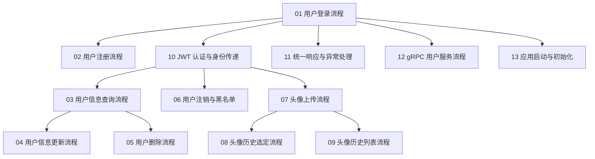

# user 域 · 流程学习记录（索引）

> 本目录是 RAG-V1 **`service/users/user`**（用户域 Spring Boot 进程）的真实执行流程讲解集。
> 总索引见 [`../README.md`](../README.md)。本文件是**本域**的索引与学习计划。

---

## 1. 本域文档集说明

| 项 | 内容 |
|---|---|
| 研究对象 | `service/users/user/` —— 48 个主代码文件 + 7 个测试类 |
| 源码版本 | `/Users/pr/Documents/GitHub/RAG-V1` · `main` · 基线 commit `c665476` |
| 进程形态 | **一个** Spring Boot 进程同时起 Tomcat 与 gRPC Server（决策 **D1 + D7**：B 侧的 api/rpc 分离已压平） |
| HTTP 端点 | **9 个**，全部 `@PostMapping`，前缀 `/user/v1`（2 个 public + 7 个 JWT 受保护） |
| gRPC 服务 | `UserService` —— 9 个 RPC（`proto/src/main/proto/users.proto`） |
| 数据表 | `users_user` · `users_user_avatar_history` |
| 外部依赖 | PostgreSQL · Redis（黑名单）· Nacos（注册 `user-rpc`） |
| 判定基准 | B 侧 RAG 仓（只读）—— L1/L2/L4 全部以 B 侧为准（D13 + D16） |

### 本域必须先知道的四件事

1. **HTTP 调用领域层 = 同进程 Java 调用。**
   `UserApiService.login()` → `userDomainService.login(rpcReq)` 里 `rpcReq` 是 proto 生成的消息类型，
   但那**不是** gRPC 网络请求 —— 是同一个 Spring 容器里的方法调用。
   真正的 gRPC 入口是 `grpc/UserGrpcService.java`，它是**另一个入口**，调用**同一份** `UserDomainService`。

2. **鉴权是两段式：Filter 验签 → Interceptor 授权。**
   `JwtAuthFilter`（`@Order(HIGHEST_PRECEDENCE + 6)`）先验签并把结果塞进 request attribute；
   `JwtAuthInterceptor` 取结果、判 public 路径、查 Redis 黑名单、写入 `userId` 与 `jwt_token` 两个 attribute。
   业务代码从 attribute 取身份，**不自己解析 token**。

3. **登录的领域层是「三态返回」而不是「抛异常」。**
   `status=0` 成功 / `status=1` 用户不存在**或**密码错 / `status=2` 被封禁。
   `status=1` 故意合并「用户不存在」与「密码错误」，避免用户名枚举。
   是 API 层把这三态翻译成业务错误码（1002 / 1011）。

4. **本域错误码从域内读**：`contract/ErrCodes.java` + `contract/ErrMsg.java`
   —— 它们是**薄转发层**（每个常量都转发自共享层 `com.rag.users.common.ErrCodes` / `ErrMsg`，
   只额外暴露本域用到的那个子集）。admin 域则是**直接**读共享层那张表。
   ⇒ **码值两边完全一致**；差别只在「以哪个类名访问」，读文档时注意出处。

---

## 2. 学习顺序

```
  ①  02 用户登录流程            ← 尺子：读完就知道主轴了
      │
      ├─► ② 用户注册流程        ← 同为 public 端点，对照着看
      │
      ├─► ③ 用户信息查询流程    ← 引入「身份判定链」六步
      │     ├─► ④ 用户信息更新流程
      │     └─► ⑤ 用户删除流程
      │
      ├─► ⑥ 用户注销与 Redis 黑名单流程
      │
      ├─► 07 头像上传流程        ← 引入「双写事务」
      │     ├─► 08 头像历史选定流程
      │     └─► 09 头像历史列表流程
      │
  ②  10 JWT 认证与身份传递流程  ← 回头补上前面所有流程依赖的鉴权底座
      11 HTTP 统一响应与异常处理流程
      │
  ③  12 gRPC 用户服务流程        ← 换一个入口看同一份领域代码
      13 应用启动与初始化流程    ← 换一个生命周期维度看
```

**为什么把 10/11 放在业务流之后**：它们是「所有业务流都会碰到」但**单独看会缺少上下文**的机制。
先在具体流程里见过一次（知道「哦，这里冒出一个 `userId` attribute」），再读机制篇才接得住。

---

## 3. 流程文档索引

| 编号 | 文档名称 | 触发场景 | 主要入口 | 流程终点 | 前置知识 |
|---|---|---|---|---|---|
| 01 | [用户登录流程](./01-用户登录流程.md) | 客户端提交用户名密码 | `UserController#login` | 客户端拿到 JWT | HTTP 请求处理 |
| 02 | [用户注册流程](./02-用户注册流程.md) | 客户端提交注册信息 | `UserController#register` | 返回新用户 uid | 01 |
| 03 | [用户信息查询流程](./03-用户信息查询流程.md) | 已登录用户查自己 | `UserController#getUser` | 返回 `user` + `found` | 10 |
| 04 | [用户信息更新流程](./04-用户信息更新流程.md) | 已登录用户改资料 | `UserController#updateUser` | 返回更新后的 `user` | 03 |
| 05 | [用户删除流程](./05-用户删除流程.md) | 已登录用户注销账号 | `UserController#deleteUser` | 行被删除 | 03 |
| 06 | [用户注销与 Redis 黑名单流程](./06-用户注销与黑名单流程.md) | 已登录用户退出登录 | `UserController#logout` | token 进黑名单 | 10 |
| 07 | [头像上传流程](./07-头像上传流程.md) | 已登录用户换头像 | `UserController#uploadAvatar` | 双写落库 + 返回 history | 10 |
| 08 | [头像历史选定流程](./08-头像历史选定流程.md) | 用户从历史里选头像 | `UserController#selectAvatar` | 头像被切换 | 07 |
| 09 | [头像历史列表流程](./09-头像历史列表流程.md) | 用户查看历史头像 | `UserController#getAvatarHistory` | 返回列表 | 07 |
| 10 | [JWT 认证与身份传递流程](./10-JWT认证与身份传递流程.md) | 任意受保护路径的请求 | `JwtAuthFilter` → `JwtAuthInterceptor` | request attribute 就位 | 01 |
| 11 | [HTTP 统一响应与异常处理流程](./11-HTTP统一响应与异常处理流程.md) | 任意异常或正常返回 | `UserApiExceptionHandler` / `UserApiResponseAdvice` | 最终 HTTP 响应 | 01 |
| 12 | [gRPC 用户服务流程](./12-gRPC用户服务流程.md) | 外部 gRPC 客户端调用 | `UserGrpcService` | `StreamObserver` 响应 | 01、11 |
| 13 | [应用启动与初始化流程](./13-应用启动与初始化流程.md) | 进程启动 | `UserServiceApplication` | 容器就绪 + Nacos 注册 | 01 |

---

## 4. 本域流程依赖关系



### 复用机制速查

| 机制 | 完整解释 | 用到它的流程 |
|---|---|---|
| JWT 验签 / claim 提取 / 身份判定六步链 | [10](./10-JWT认证与身份传递流程.md) | 03、04、05、06、07、08、09 |
| 统一响应信封 + 两套 gRPC 码映射 | [11](./11-HTTP统一响应与异常处理流程.md) | 全部 |
| Redis 黑名单（写 / 读） | [06](./06-用户注销与黑名单流程.md) 写 · [10](./10-JWT认证与身份传递流程.md) 读 | 06、10 |
| 雪花 ID 生成 | [02](./02-用户注册流程.md) · [07](./07-头像上传流程.md) | 02、07 |
| 双写事务（user + avatar_history） | [07](./07-头像上传流程.md) | 07、08 |
| `extra_info` 的 JSON TypeHandler | [02](./02-用户注册流程.md) · [04](./04-用户信息更新流程.md) | 02、04、07、08 |

---

## 5. 覆盖状态

| 编号 | 文档 | 状态 |
|---|---|---|
| 01 ~ 13 | 全部 | ✅ 已完成 |

> 「已完成」= 基于**实际读取过的源码**写成，文中定位可在仓库中核对。
> 与 B 侧的对拍结论以 `docs/DRIFT/users/verification-users-user-2026-11-02.md` 为准。

---

## 6. 本域源码速查

| 位置 | 路径 |
|---|---|
| 应用入口 | `service/users/user/src/main/java/com/rag/user/UserServiceApplication.java` |
| Controller（9 端点） | `service/users/user/src/main/java/com/rag/user/controller/UserController.java` |
| HTTP 用例 | `service/users/user/src/main/java/com/rag/user/service/UserApiService.java` · `UserApiSupport.java` |
| 领域服务 | `service/users/user/src/main/java/com/rag/user/domain/service/UserDomainService.java` · `AvatarDomainService.java` |
| Mapper | `service/users/user/src/main/java/com/rag/user/mapper/UserMapper.java` · `UserAvatarHistoryMapper.java` |
| 实体 | `service/users/user/src/main/java/com/rag/user/domain/entity/UserEntity.java` · `UserAvatarHistoryEntity.java` |
| 鉴权 | `service/users/user/src/main/java/com/rag/user/interceptor/`（5 个类） |
| 响应 / 异常 | `service/users/user/src/main/java/com/rag/user/advice/`（2 个类） |
| gRPC | `service/users/user/src/main/java/com/rag/user/grpc/UserGrpcService.java` |
| 启动 | `service/users/user/src/main/java/com/rag/user/wiring/`（3 个类） |
| 配置 | `service/users/user/src/main/resources/application.yml` |
| 共享身份解析 | `service/users/common/src/main/java/com/rag/users/common/IdentityResolver.java` |
| 共享建表 | `service/users/common/src/main/java/com/rag/users/common/SchemaInitializer.java` |
| proto | `proto/src/main/proto/users.proto` |
