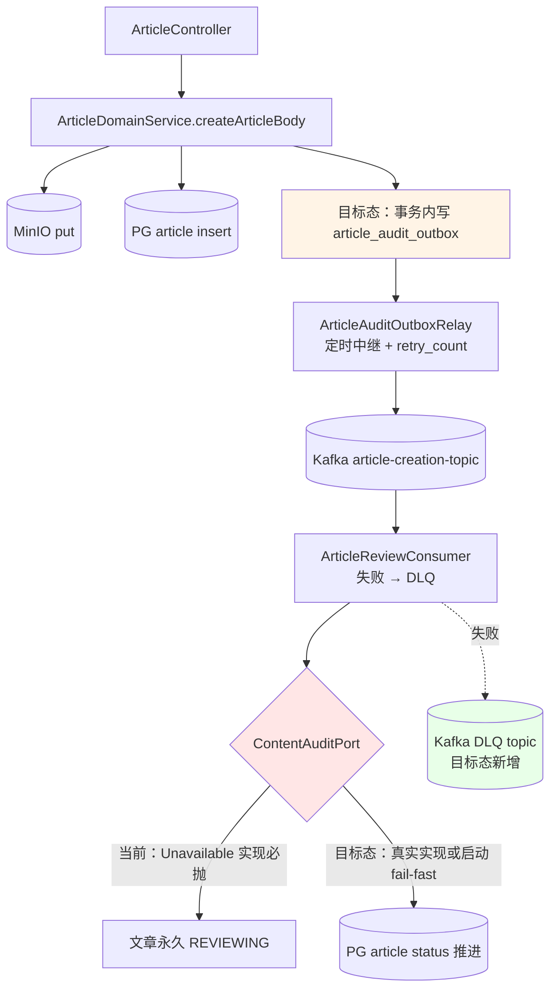
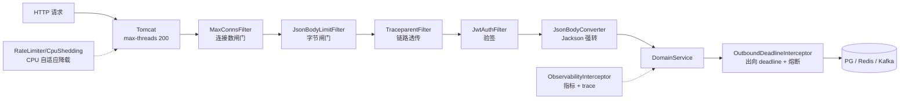
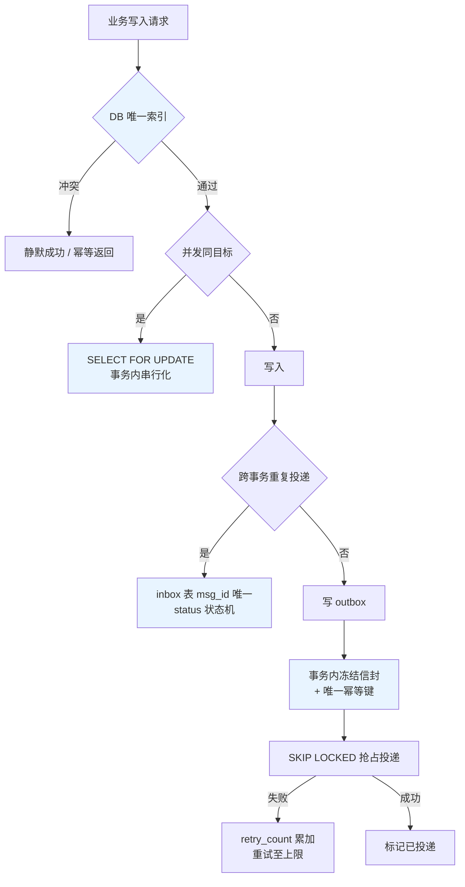

# 05 · 最终目标架构

> 前提：本方案**不新增中间件、不删限界上下文**；只做三件事 —— 修失效机制、删死代码、补部署与断言。
> 与 §04 的关系：🟢 组（零偏离）直接执行；🟡 组需登记；🔴 组（进程合并、proto 变更）只作为**可选路线**列出。

---

## 1. 最终技术栈（保留 / 移除 / 补齐）

### 1.1 保留（全部有真实业务消费点）

| 技术 | 版本 | 用途 | 保留理由 |
|---|---|---|---|
| Java | 21 | 语言基座 | 虚拟线程已在 hot 域使用 |
| Spring Boot | 3.5.11 | 应用框架 | 10 个 app |
| Spring MVC | — | HTTP 入口 | Filter/Interceptor 分工清晰 |
| MyBatis-Plus | BOM | 持久层 | 半自动 + 自研 JSONB typeHandler + SQL 超时注入 |
| PostgreSQL | — | 主存储 | 唯一数据源（**非 MySQL**） |
| Redis (Lettuce) | — | 热榜 ZSET / 任务进度 / JWT 黑名单 / 幂等标记 | 4 类真实用途，key 按域前缀隔离 |
| Kafka | spring-kafka | 9 个 topic，5 域 | 唯一 MQ |
| gRPC (net.devh) | — | 跨域 RPC | 10 域注册，拦截器/异常映射统一在共享层 |
| Nacos | 3.0.3 | 注册发现 | 10 域手写注册（自动注册显式关闭） |
| MinIO | — | 图片/正文对象存储 | 仅 article 域 |
| Resilience4j | — | 三态熔断 | 每路由独立 breaker |
| OpenTelemetry | — | 链路与指标 | 全域 |
| jjwt | 0.12 | JWT 签发/验签 | HS256 |
| Lombok | provided | 样板消除 | A13 断言 55/55 |
| Flyway（8 域）/ SchemaInitializer（users 域） | — | 建表 | ⚠️ 需逐域统一账本表名 |

### 1.2 移除（零行为影响）

- `common/observability/` 的 `RpcHandleRunner` + `RpcCallHandler` + `RpcResult`（342 行，生产零调用）
- `common/web/GrpcStatusMapper.toBusinessException`（零生产调用）
- `users-common/JdbcUserStatusLookup`（生产零消费）
- `users/user/contract/{ErrCodes,ErrMsg}`（纯转发别名）
- `service/message/pom.xml` 的 `spring-boot-starter-data-redis` + 其 yml 段
- `comment`/`like` 的 `spring.jpa.*`；task 的 `spring.kafka.listener.ack-mode`；`article` 的 Redis 段
- `ArticleMetaObjectHandler.insertFill` 空实现

### 1.3 补齐（全部用现成机制，**不引入新中间件**）

| 补什么 | 用什么 |
|---|---|
| Kafka 死信 | Spring Kafka `DeadLetterPublishingRecoverer`（Kafka 自带 DLQ topic） |
| 审核事件可靠投递 | 复用仓内 `article_sync_outbox` 范式（+1 张表） |
| outbox 多实例抢占 | `FOR UPDATE SKIP LOCKED`（like/comment 已有范式） |
| JVM 参数 / GC | Docker ENV + `-XX:+HeapDumpOnOutOfMemoryError` + GC 日志 |
| 部署面 | `docker-compose.yml`（PG/Redis/Kafka/Nacos/MinIO）+ GitHub Actions 跑两个已绿的守门脚本 |
| Tomcat 参数上限定论 | 真实 Tomcat 断言（2049 参数 → 期望 400） |
| DB 死锁重试 | `common/persistence/SqlTimeoutStatusTranslator` 翻译点加一次重试 |
| gRPC 分页上限 | 复用 `normalizeLimit`（follow/message 已有） |
| hot 消费幂等 | payload 加 `event_id` + SETNX（🔴 L1 变更，需决策） |

### 1.4 明确不引入（维持 D）

ES · Milvus/向量库/RAG · Neo4j · Dubbo · RocketMQ · RabbitMQ · ZooKeeper · 分库分表 · AI Agent · 分布式事务框架 · 独立 Netty 业务层

---

## 2. 最终业务流程（Mermaid）

### 2.1 点赞域（项目最完整的一条链路，含 3 个中间件）

```mermaid
flowchart TD
    A[LikeController / LikeGrpcService] --> B[LikeApiService<br/>参数校验 + JWT 身份]
    B --> C[LikeDomainService<br/>动作编排]
    C --> D[(PG like_record<br/>uk_user_target 唯一索引)]
    C --> E[(PG like_consume_inbox<br/>msg_id 幂等 + FOR UPDATE)]
    C --> F[(Redis<br/>动作脚本 / key 空间)]
    C --> G[(PG like_outbox_event / like_domain_fact_outbox)]

    K[(Kafka like_promotion_topic)] -->|消费| H[LikeUpdateKafkaListener]
    H --> E
    H --> D
    H --> G

    G -->|定时中继| L[(Kafka article-hot-events)]
    L --> M[HotEventConsumer<br/>HeavyKeeper + Redis ZSET]
    M --> N[(Redis hot:articles:p*n)]
    N -->|合并调度 + Lua RENAME| O[(Redis hot:articles<br/>查询唯一来源)]

    C --> P[(Kafka task.logs.filtered.*)]
    P --> Q[TaskUserCountConsumer / TaskArticleCountConsumer<br/>Redis INCR]
    Q --> R[TaskUserLikeProgressSink<br/>SETNX 幂等 + delta 合并]
    R -->|@Scheduled 刷盘| S[(PG user_like_count / task_progress<br/>ON CONFLICT + GREATEST)]
    R --> T[(Redis Stream stream:task:reward)]

    style D fill:#e8f4ff
    style E fill:#e8f4ff
    style O fill:#fff4e6
    style S fill:#e8f4ff
```

### 2.2 文章审核链路（**当前断在第一跳 ⇒ 目标态用 outbox 补齐**）



### 2.3 请求入口的统一保护链（共享层，所有域一致）



### 2.4 幂等与一致性的六层防线（面试主线）



---

## 3. 最终模块结构

### 3.1 保留 10 域进程结构（🟢 零偏离路线 · **默认推荐**）

```
RAG-V1/
├── pom.xml                     根 pom（依赖管理 + 插件管理）
├── proto/                      10 个 .proto（pb 包名 com.rag.proto.<域>）
├── common/                     共享 starter（112 类 → 约 108 类，删 4 个死类）
│   ├── autoconfigure/          14 个 auto-config（保留全部，消费点已断言）
│   ├── protection/             熔断 / 降载 / 限流 / deadline（18 类）
│   ├── observability/          OTel / 指标 / deadline 载体（19 类 → 17，删死三件套）
│   ├── web/                    HTTP 入口面（22 类 → 21，删死方法）
│   ├── persistence/            MP 集成 / JSONB / SQL 超时（11 类）
│   ├── communityfact/          跨域事实协议（13 类，★ 保留）
│   ├── redis/ logger/ security/ exception/ snowflake/ contract/
├── service/                    10 域（结构不变）
│   ├── article/  comment/  favorite/  follow/  hot/  like/  message/  task/
│   └── users/ ├── user/ ├── admin/ └── common/
├── tools/                      守门 + 对拍（新增 compose/CI 脚本）
└── docs/audit/                 本次审计 6 份
```

### 3.2 可选路线：合并为单进程（🔴 需拍板 + 改 AGENTS.md 决策）

```
RAG-V1/
├── proto/
├── common/
├── service/                    10 个域保留为「域包」而非「进程」
│   ├── article/  comment/  favorite/  follow/  hot/  like/  message/  task/  users/
│   └── bootstrap/
│       ├── BootstrapApplication.java        ← 唯一启动类
│       ├── NacosRegistration.java           ← 一次注册
│       └── DomainModuleRegistry.java        ← 域装配开关（按需启用某域）
├── deploy/
│   ├── docker-compose.dev.yml                ← PG/Redis/Kafka/Nacos/MinIO
│   ├── Dockerfile
│   └── .github/workflows/ci.yml              ← 跑两个已绿守门脚本
└── docs/audit/
```

> ⚠️ **代价明示**：合并后 **跨进程 gRPC 实战面归零**、Nacos 注册发现实战面归零 ⇒ 面试上「微服务 / gRPC 跨服务调用」的说服力下降。
> ⇒ **建议**：面试版本保留 10 进程（工程版本亦然），仅把**重复装配收进 common**（R-01 方案 2）。

---

## 4. 修改优先级

### P0 · 影响业务正确性 / 数据安全（建议立即做，全部 🟢 零偏离）

| # | 任务 | 收益 | 范围 | 风险 | 偏离性 |
|---|---|---|---|---|---|
| P0-1 | `InteractionStubService.commentArticle` → 抛 `UNIMPLEMENTED` | 止住「假成功」（调用方以为评论成功） | `service/hot/.../service/InteractionStubService.java:82-84`（1 行） | 无（原本就不该成功） | 🟢 |
| P0-2 | 删除 `RpcHandleRunner` + `RpcCallHandler` + `RpcResult` | -342 行死代码；消除「以为 RPC 都走它」的误导 | `common/observability/` | 需跑 A13/A9 守门复核 | 🟢 |
| P0-3 | 默认管理员口令改 env 强制（去掉 `admin/admin`） | 消除硬编码弱口令 | `service/users/admin/.../domain/service/AdminDomainService.java:154,164`；`wiring/AdminSeederBootstrap.java:146` | 首次部署须注入 env | 🟢 |
| P0-4 | `POST /v1/upload` 加入受保护路由 | 堵住匿名上传 | `service/article/.../interceptor/ArticleJwtAuthFilter.java:170-174` | 匿名上传的前端调用需带 token | 🟡（对外可观测） |
| P0-5 | `ContentAuditPort` 补真实实现 **或** 启动期 fail-fast | 消除「默认部署下文章永远 REVIEWING 且被静默 drop」 | `service/article/.../client/{UnavailableContentAuditClient,ContentAuditAutoConfiguration}.java` | fail-fast 会让无 SDK 环境下无法启动 ⇒ 需与部署同步 | 🟡 |
| P0-6 | hot 消费者加幂等（`event_id`） | 消除热度计数被重复放大 | `service/hot/.../contract/ArticleHotEvent.java`；`HotEventConsumer.java:229` | 需扩契约 | 🔴（L1） |

### P1 · 明显过度设计 / 重复实现（零行为影响，建议本轮做完）

| # | 任务 | 收益 | 范围 | 风险 | 偏离性 |
|---|---|---|---|---|---|
| P1-1 | hot 并发闸门二选一（删 `Semaphore(8)` 或删 64 线程池） | 并发度口径统一 | `HotHydrationExecutorConfiguration.java:101-107` + `HotApiService.java:124,307` | 需确认有效并发度期望值（现为 8） | 🟢 |
| P1-2 | hot 分布式锁续期失败即终止合并 | 消除两实例同时合并 | `HotMergeScheduler.java:250-252` | 合并失败率略升（可观测） | 🟡 |
| P1-3 | `HeavyKeeper` 单结构 + 增量维护 | 消除 O(n log n)/次 + 状态漂移 | `service/hot/.../domain/model/HeavyKeeper.java:117,119,246-248` | 需补排序断言保输出一致 | 🟢 |
| P1-4 | 两套 JWT 栈合并到 `users-common` | -~250 行重复 | `users/user/interceptor/*` + `users/admin/interceptor/*` | 畸形 claim 策略须参数化 | 🟡 |
| P1-5 | 删 `user/contract/*` 转发层 | 两子域形态对称 | `service/users/user/.../contract/` | 无（码值不变） | 🟢 |
| P1-6 | `SchemaInitializer` 按表归属拆分 | 解除跨域建表耦合 | `service/users/common/.../SchemaInitializer.java:73-78` | 部署时序需同步 | 🟡 |
| P1-7 | 删 message 域 Redis 依赖+配置；删 4 处死配置 | 消除误导性配置 | 见 §04 E-05~E-10 | 无 | 🟢 |
| P1-8 | outbox 捞取加 `FOR UPDATE SKIP LOCKED` | 消除多实例重复投递 | `ArticleSyncOutboxMapper.java:63-70` | 无 | 🟢 |
| P1-9 | 删 `JdbcUserStatusLookup`（或接入） | 消除「状态取法两套」 | `service/users/common/.../JdbcUserStatusLookup.java:49` | 无 | 🟢 |
| P1-10 | `AtomicLong` → `LongAdder`；调度线程显式 daemon | 热点计数无 CAS 竞争；关停不挂起 | `HotEventConsumer.java:96`；`ObservabilityRuntime.java:62` 等 | 无 | 🟢 |

### P2 · 值得补充的重要工程能力（收益明显）

| # | 任务 | 收益 | 范围 | 风险 | 偏离性 |
|---|---|---|---|---|---|
| P2-1 | Kafka 死信队列 | 消除「静默丢弃」，article 卡审核有痕迹可查 | 各域 `DefaultErrorHandler` 装配 | 需建 DLQ topic | 🟢 |
| P2-2 | article 审核事件走 outbox | 消除「DB 已提交 + MQ 失败 ⇒ 永久卡审核」 | article 域新增 1 表 + relay | 新增表 | 🟡 |
| P2-3 | **JVM 参数与 GC 治理** | 现在连 `-Xmx` 都没有 ⇒ 生产内存不可控 | Dockerfile/compose ENV | 无 | 🟢 |
| P2-4 | **compose + CI** | 本地可起全套；守门脚本进 CI（两个脚本实测 EXIT=0） | `deploy/` + `.github/workflows/` | 无 | 🟢 |
| P2-5 | Tomcat `max-parameter-count` 定论 + 生效值断言 | 消除「两处配置冲突」的不确定性 | 共享层常量或 8 域 yml 二选一 + 断言 | 需确认目标值 | 🟢 |
| P2-6 | DB 死锁重试 | 死锁不再冒泡 500 | `common/persistence/SqlTimeoutStatusTranslator` | 重试次数可观测 | 🟡 |
| P2-7 | article gRPC `ListArticles` 的 `page_size` clamp | 堵住 HTTP 之外的深分页面 | `ArticleDomainService.java:811-812` | gRPC 行为收紧 | 🟡 |
| P2-8 | `CODE_POINT_ORDER` 笔误修正 + 键序断言 | 可能与 A17 守门口径冲突 | `ArticleApiSupport.java:337` | JSON 字节序变化 | 🟡 |
| P2-9 | `task:goka:count:*` 加 TTL | 消除 Redis key 单调增长 | `TaskCountStore.java:21-28` | 计数丢失窗口 | 🟡 |

### P3 · 非必要优化（有余力再做）

| # | 任务 | 收益 |
|---|---|---|
| P3-1 | article 冗余作者校验清理 | 减少一次读 |
| P3-2 | `ArticleApiSupport.resolveAuthorName` 接入用户域真实昵称 | 消除「作者名永远是假名」的功能缺口 |
| P3-3 | 统一 users 域两套异常体系（`BusinessException` vs `StatusRuntimeException`） | 统一心智模型 |
| P3-4 | 各域 Flyway 账本表名统一核对（`flyway_schema_history_<域>`） | 消除 schema 级账本撞号 |
| P3-5 | `task` 域补鉴权（当前水平越权） | 安全（继承 B 侧 ⇒ 需决策） |
| P3-6 | `favorite` 域 `QueryLimitInterceptor` 与 comment/favorite 归一化器统一 | 一致性 |
| P3-7 | 补「启动耗时打点」+ `full GC 次数` 指标 | 支撑 JVM 板块叙述 |

---

## 5. 一页纸总结（给面试官看的版本）

```
保留：Java 21 · Spring Boot 3.5 · MyBatis-Plus · PostgreSQL · Redis · Kafka · gRPC · Nacos · MinIO · Resilience4j · OTel
去掉：ES · Milvus · Neo4j · Dubbo · RocketMQ · RabbitMQ · ZK · 分库分表 · AI Agent  ← 全部「不引入」，且每个都给了理由
不做：统一错误码 · 统一分页插件 · 全局乐观锁 · 集群限流 · 缓存穿透三件套  ← 当前规模不需要
必修：6 处失效机制（假成功 / 只写不投 / 默认不可用 / 死路事件 / 硬编码口令 / 匿名上传）
必删：342 行生产死代码 + 5 处死配置 + 2 处死类 + 1 处转发层
必补：DLQ · 审核 outbox · JVM 参数 · compose+CI · Tomcat 参数断言 · 死锁重试 · gRPC clamp · hot 幂等
```
